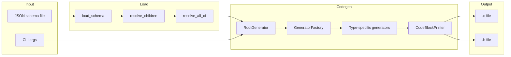
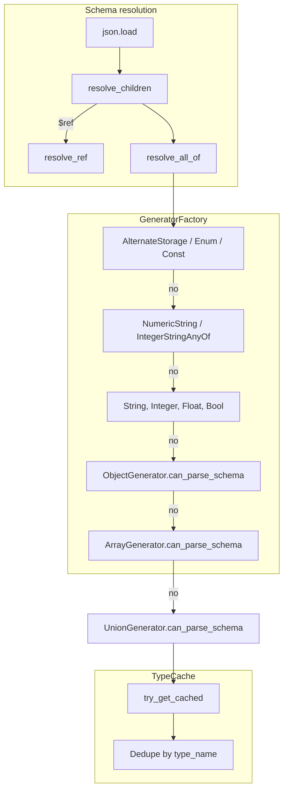
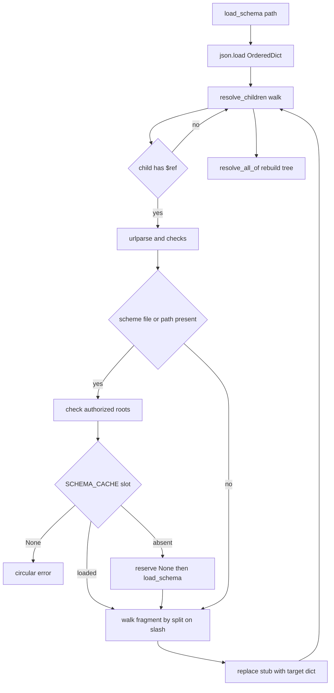

# json_schema_to_c — Research report

## Metadata

- **Library name**: json_schema_to_c
- **Repo URL**: https://github.com/badicsalex/json_schema_to_c
- **Clone path**: `research/repos/c/badicsalex-json_schema_to_c/`
- **Language**: C (output); generator implemented in Python
- **License**: MIT
- **Analyzed version**: commit `5700756` (2026-07-14, HEAD of default branch; no release tags in clone, so no release version)
- **Report date**: 2026-10-27

## Summary

json_schema_to_c is a JSON Schema to C code generator. It takes a JSON Schema and emits a single self-contained .c file and .h interface file. The generated code parses JSON at runtime into C structs and arrays, with no dynamic allocations and no external dependencies beyond a vendored JSMN tokenizer. It targets embedded systems and small platforms. The generator is a Python CLI (`json_schema_to_c.py`). Supported schema features include: types (`integer`, `number`, `boolean`, `string`, `array`, `object`), min/max length and value constraints, path-like `$ref` (in-document or into another local schema file, with an authorized-paths allowlist), `allOf` merge (stricter bound wins), `required`, `additionalProperties: true`, `const` (strings and integers), `anyOf` emitted as a tagged union, numeric strings, and default values. Extensions (`js2cDefault`, `js2cType` incl. `void`/`raw` storage, `js2cParseFunction` for strings, enums and integers, `js2cSettings`) cover custom storage and parsing. Key limitations: strings and arrays must have `maxLength`/`maxItems`; all object fields must be required or have defaults; `null`, `oneOf` and tuple-style arrays are not supported; `$ref` must be path-like (not `$id`-based) and local (no http(s)). Since the previous analysis the project gained a large hardening pass: type annotations plus `mypy` in `make check`, schema errors reported as messages instead of tracebacks, and output files only written after both generated cleanly.

## JSON Schema support

- **Drafts**: README and CLI help state "Schema version 7 is supported." Example and test schemas use `$schema: "http://json-schema.org/draft-07/schema#"`. No explicit support for draft-04, 2019-09, or 2020-12.
- **Scope**: Partial subset focused on structure and bounded types. Core types, `properties`, `required`, `items` (single schema), `$ref`, `allOf`, `definitions`, `additionalProperties`, `default`, validation keywords (`minLength`, `maxLength`, `minItems`, `maxItems`, `minimum`, `maximum`, etc.) are used for structure and runtime checks. `const` is supported for strings and integers; `anyOf` produces a tagged union (plus the numeric-string special case). `oneOf` is rejected with a schema error. Not supported: `null`, `not`, `if`/`then`/`else`, `patternProperties`, `prefixItems`, `format`, remote (http/https) `$ref`, `$id`-based `$ref`, and most advanced applicator/validation keywords. Unsupported keywords are silently ignored (only keys listed in each generator's `JSON_FIELDS` are read).

## Keyword support table

Keyword list derived from vendored draft 2020-12 meta-schemas under `specs/json-schema.org/draft/2020-12/meta/`. The library targets draft-07 (README/CLI say "version 7"; README naming example now uses a 2020-12 `$schema`, which is ignored); notes reflect actual implementation in `js2c/` and `js2c/schema.py`.

| Keyword | Implemented | Notes |
|---------|-------------|-------|
| $anchor | no | Not used. |
| $comment | no | Ignored. |
| $defs | partial | Not special-cased; works only because the `$ref` fragment is a generic path walk (`#/$defs/X` and `#/definitions/X` both resolve). README example uses `$defs`. |
| $dynamicAnchor | no | Not used. |
| $dynamicRef | no | Not used. |
| $id | yes | Required on root schema; used for root type name. Nested `$id` overrides a nested type name (and stops the name-prefix ascent). Not usable as `$ref` target. |
| $ref | yes | Path-like fragments only (`#/definitions/...` or `#/$defs/...`; fragment is walked as a plain JSON path). Can point into another local file (relative path or `file:` URI + fragment), restricted to the schema's directory or `--authorized-paths`; circular cross-file refs detected. Ref nodes must have no sibling keys. Resolved inline by `resolve_ref` (the `$ref` node is replaced by the very same Python dict object, not a copy). |
| $schema | no | Parsed but not used for codegen. |
| $vocabulary | no | Not used. |
| additionalProperties | yes | `true` allowed with `--allow-additional-properties`; `false` denies unknown keys. |
| allOf | yes | Merged via `resolve_all_of` before codegen; combined with `$ref`. Range bounds merge to the stricter value (max of minimums, min of maximums); other scalar conflicts or type mismatches raise. |
| anyOf | partial | Generic `anyOf` becomes a tagged union (`UnionGenerator`): enum tag + anonymous C union, options tried in order with parser-state rewind and error muting. Special case: `anyOf` of `integer` and `string` with a `pattern` is one integer accepting number or numeric string. Options must store a value (no `const`/`void`); no `js2cDefault`. |
| const | partial | Strings and integers only (`ConstGenerator`); validates only, stores nothing, cannot have `js2cDefault`; not allowed as root or array item. Number consts compare as int64 (`type` must be `number` when given). |
| contains | no | Not used. |
| contentEncoding | no | Not used. |
| contentMediaType | no | Not used. |
| contentSchema | no | Not used. |
| default | yes | Supported for integer, number, boolean, string, enum; implicit for object (all defaults) and array (`minItems: 0`). |
| dependentRequired | no | Not used. |
| dependentSchemas | no | Not used. |
| deprecated | no | Not used. |
| description | yes | Emitted as docstrings in generated C. |
| else | no | Not used. |
| enum | yes | String enums only; C enum with sanitized labels, or custom type via `js2cType` + `js2cParseFunction`. |
| examples | no | Not used. |
| exclusiveMaximum | yes | Enforced in integer/float parser. |
| exclusiveMinimum | yes | Enforced in integer/float parser. |
| format | no | Not used. |
| if | no | Not used. |
| items | yes | Single schema only; tuple (array of schemas) rejected. |
| maxContains | no | Not used. |
| maximum | yes | Integer/float; enforced at parse time (literals suffixed `LL`/`ULL`; bounds above INT64_MAX tested). |
| maxItems | yes | Required for arrays; drives fixed-size C array. |
| maxLength | yes | Required for strings; drives char array size. |
| maxProperties | no | Not used. |
| minContains | no | Not used. |
| minimum | yes | Integer/float; enforced at parse time; `minimum >= 0` selects `uint64_t` storage. |
| minItems | yes | Enforced at parse time; `0` gives implicit default (empty array). |
| minLength | yes | Enforced for strings. |
| minProperties | no | Not used. |
| multipleOf | no | Not used. |
| not | no | Not used. |
| oneOf | no | Not used. |
| pattern | partial | Used only for numeric strings: a fixed whitelist of regexes (decimal, hex, optional `0x`, auto-radix, each with optional `[+-]?`) selects the radix; any other pattern is a schema error. |
| patternProperties | no | Not used. |
| prefixItems | no | Not used. |
| properties | yes | Required for objects; drives struct fields. |
| propertyNames | no | Not used. |
| readOnly | no | Not used. |
| required | yes | Drives which fields must be present; non-required must have default. |
| then | no | Not used. |
| title | no | Not used for codegen. |
| type | yes | `object`, `array`, `string`, `integer`, `number`, `boolean`; drives generator choice. |
| unevaluatedItems | no | Not used. |
| unevaluatedProperties | no | Not used. |
| uniqueItems | no | Not used. |
| writeOnly | no | Not used. |

## Constraints

Validation keywords are enforced in the generated C parser at runtime. Integer/float bounds, string/array length bounds, `const`, enum membership, `required`, duplicate keys and (unless allowed) unknown keys are checked. `minLength`, `maxLength` for strings and `minItems`, `maxItems` for arrays produce parse errors when violated. `minimum`, `maximum`, `exclusiveMinimum`, `exclusiveMaximum` for integer and number trigger range checks during parsing; on failure, the parser returns an error. Structural keywords (`properties`, `required`, `items`) drive the generated struct layout and parsing logic. The generated code does not use a separate validation step; parsing and constraint checking are combined.

## High-level architecture

Pipeline: **JSON Schema file** → **Load and resolve** → **Generator factory** → **Type-specific generators** → **CodeBlockPrinter** → **.c and .h files**.

- **Input**: JSON schema file path; optional CLI args (prefix/postfix files, `allow_additional_properties`, etc.).
- **Load**: `load_schema` reads JSON, `resolve_children` inlines `$ref` nodes (including cross-file, via a `SCHEMA_CACHE`), `resolve_all_of` merges `allOf` schemas.
- **Root generator**: `RootGenerator` gets a generator from `GeneratorFactory.get_generator_for` for the root schema. `GeneratorFactory` first rejects `oneOf` and schemas lacking `type`/`anyOf`/`const`/void-raw `js2cType`, then tries `AlternateStorageGenerator`, `EnumGenerator`, `ConstGenerator`, `NumericStringGenerator`, `IntegerStringAnyOfGenerator`, `StringGenerator`, `IntegerGenerator`, `FloatGenerator`, `BoolGenerator`, `ObjectGenerator`, `ArrayGenerator`, `UnionGenerator` in order.
- **Code emission**: Each generator produces type declarations and parser bodies; `RootGenerator` assembles header and implementation, including JSMN and builtins.
- **Output**: Single .c file and .h file; caller specifies paths. Both are generated in memory (`CodeBlockPrinter`) and written only after both succeed (`save_to_file`), so a schema error leaves existing outputs untouched.

## Medium-level architecture

- **Modules**: `js2c/schema.py` (load, `$ref` incl. cross-file, `allOf`), `js2c/settings.py` (CLI/schema settings), `js2c/codegen/` (one module per generator: alternate_storage, array, bool, const, enum, float, integer, object, string, union; plus base, root, type_cache, code_block_printer). Entry point: `json_schema_to_c.py`.
- **Schema resolution**: `resolve_ref` handles only `#/...`-style refs. It parses the URI (scheme must be empty or `file`; no netloc/query), requires a path-like fragment, optionally loads a foreign file (relative to the referring file, must be under an authorized path, cached, circular loads detected), walks the fragment path and returns the target. The caller replaces the `$ref` node in-place; the `$ref` node may not carry sibling keys. `resolve_children` recurses and replaces every `$ref` before codegen. `definitions`/`$defs` are just path segments, not special-cased. `--authorized-paths` is deliberately CLI-only (not in `js2cSettings`) so an untrusted schema cannot widen its own allowlist.
- **allOf merge**: `resolve_all_of` recursively merges `allOf` entries into a single schema via `all_of_merge_dict`; object keys are merged, lists are unioned, equal scalars kept, differing `minimum`/`minLength`/`minItems`-style bounds take the max and `maximum`/`maxLength`/`maxItems`-style take the min; other conflicts raise.
- **Generator dispatch**: `GeneratorFactory.get_generator_for` iterates over generator classes; the first whose `can_parse_schema(schema)` returns true is used. Type-specific generators (Object, Array, etc.) recursively call `get_generator_for` for nested schemas.
- **Type cache**: `TypeCache` (one per root, a `dict[str, CType]`) deduplicates `CType` by `type_name`; identical shapes sharing a name reuse the same declaration, while a different type under an existing name raises "Two different types with the same name". Type names are derived from the schema *path*, so sharing only happens when names are made to coincide (explicit nested `$id`, `js2cType`).
- **Union (anyOf)**: `UnionGenerator` builds each option's generator, then a `bool`-returning `_try_N` wrapper per option; the union parser copies `parse_state`, sets `inhibit_errors`, and tries options in order, advancing the real token cursor only on success. Member names derive from option type names minus common prefix. `max_token_num` takes the largest option.
- **Token budget**: each generator reports `max_token_num`; the root sums them (plus `--allow-additional-properties`) to size a stack `jsmntok_t token_buffer[N]`, which is how zero heap allocation is achieved.
- **Writer model**: `CodeBlockPrinter` accumulates text in a Python string (`self.text`) with a target path and provides `print`, `code_block`, `if_block`, `for_block`, `indent` for structured C output; it does not hold an open file handle.

## Algorithms and data structures

### Schema representation

The schema is plain parsed JSON: `json.load(..., object_pairs_hook=OrderedDict)` in `js2c/schema.py::load_schema`, i.e. a tree of `OrderedDict`/`list`/scalars. There is no typed schema model; each generator reads the keys it cares about by iterating its class attribute `JSON_FIELDS` in `Generator.__init__` and `setattr`-ing matching keys onto itself (class-level defaults such as `minItems: int = 0`, `maxItems: int | None = None`). Keys not listed in any generator's `JSON_FIELDS` are never looked at, which is why unsupported keywords are silently ignored. Boolean schemas (`true`/`false`) are rejected: `GeneratorFactory.get_generator_for` raises "is not a type descriptor" for any non-dict. Values are not type-validated against the meta-schema; a wrong type for a keyword surfaces as a Python exception or a C compile error (e.g. `wrong_type_for_type` is one of the explicit error tests). Python owns everything via garbage collection.

After loading, the schema is mutated in place by `resolve_children` (refs replaced by shared dict references) and then rebuilt by `resolve_all_of` (which constructs *new* dicts, so sharing of ref targets is lost and the post-load tree is a fresh tree that may be exponentially larger than the DAG if refs are nested). `IntegerStringAnyOfGenerator` and `NumericStringGenerator` also mutate the schema they receive (injecting `minimum: 0`, merging the two `anyOf` options with `dict.update`).

### Reference resolution and registry

`js2c/schema.py` implements a deliberately minimal resolver. `resolve_children(full_schema, part, filepath, authorized_paths)` walks every dict and list in the document; for each child value it calls `resolve_ref`, assigns the result back into the parent (`part[k] = resolve_ref(...)`), then recurses into the *original* child `v` (the `$ref` stub, whose only value is a string, so recursion is a no-op for resolved nodes; the referenced target is walked when the traversal reaches it at its own location). The author's comment flags it as hard to review. Because target dicts are shared by identity, a `$ref` to a still-unresolved definition is fine: its inner refs are rewritten in place when it is visited, whether before or after.

`resolve_ref` handles one `$ref` string with `urllib.parse.urlparse`: scheme must be empty or `file`; no netloc/params/query; the fragment must start with `/` ("Only path-like references"; `#foo` anchors / `$id` refs are rejected); the node must have no sibling keys. If the URI has a scheme or path, `get_schema_from_path` loads the foreign document. The fragment is then walked: `ref_str = fragment[1:] + '/'` and a `while` loop with `split('/', 1)` indexes `replacement[part]` at each step. There is no JSON Pointer unescaping (`~0`/`~1`, percent-decoding), and a missing path raises a bare `KeyError`.

The registry is the module-global `SCHEMA_CACHE: dict[str, Any]` keyed by absolute path. `get_schema_from_path` first checks the path is equal to or under one of the authorized roots (`path.startswith(root + os.sep)`; roots are `--authorized-paths` plus the root schema's directory, supplied only from the CLI so a schema cannot widen its own sandbox), then reserves `SCHEMA_CACHE[path] = None` *before* calling `load_schema(path)` recursively; encountering `None` means a load is in progress and raises "Circular dependency detected". Each foreign file is therefore loaded, ref-resolved and allOf-resolved once. Same-file circular `$ref`s are not detected by this mechanism: they would create a cyclic Python object graph (resolution itself terminates since it only rewrites stubs), and the later recursive `resolve_all_of` or generator descent would recurse until Python's recursion limit (not verified by tests; no `circular_ref` test covers the same-file case, the existing one is cross-file). Remote URLs, `$id` base-URI tracking, `$anchor`, `$dynamicRef` and `$recursiveRef` are not implemented. Resolution is eager and one pass, and no URI is ever fetched over the network.

### Compiled / intermediate form

The "compiled" form is a tree of Python generator objects built by `GeneratorFactory.get_generator_for` (`js2c/codegen/generator_factory.py`), one object per schema node, each owning child generators (`ObjectGenerator.fields: OrderedDict[str, Generator]`, `ArrayGenerator.item_generator`, `UnionGenerator.option_generators`). In parallel each generator computes a `CType` (`base.py`): a small class hierarchy (`CType`, `ObjectType`, `ArrayType`, `StringType`, `EnumType`, `UnionType`, `IntegerType`, `RawJsonType`) that carries `type_name`, a `declaration_generated` flag and a structural `__eq__` (class + name + fields/items/max sizes/labels/options; description deliberately excluded). `CType.generate_type_declaration` emits dependencies first (fields' types, then the struct) and is idempotent through `declaration_generated`, giving a topological, dedup'd typedef order. The generator tree is acyclic by construction (it is built from the post-resolution tree), so type declaration needs no cycle handling. `GeneratorInitParameters` (a `NamedTuple`) threads `path_in_schema`, `base_name`, `parser_name`, `type_name`, `settings`, the factory class and the shared `TypeCache` down the tree; `with_suffix` derives the child's path/parser/type names.

The ultimate output is C source text: per node a `static bool parse_<path>(parse_state_t *, T *out)` function plus type declarations. The generated C also has a compile-time token budget (`max_token_num`, below).

### Core algorithm

**Dispatch.** `get_generator_for` first rejects non-dicts and `oneOf`, requires `type`/`anyOf`/`const` (or `js2cType` in `void|raw`), then linearly scans `GENERATORS` calling each class's `can_parse_schema(schema)` classmethod and instantiating the first match. Order matters: AlternateStorage (`js2cType` void/raw) and Enum (`type: string` + `enum`) and Const precede the string-based `NumericStringGenerator` (string with one of 8 whitelisted `pattern`s), then `IntegerStringAnyOfGenerator` (two-option `anyOf` of integer + string with `pattern`), then plain String/Integer/Float/Bool/Object/Array, with the general `UnionGenerator` (any `anyOf`) last.

**Composition.** `allOf` is handled before codegen by `resolve_all_of`, a recursive (Python-recursion) rebuild: for a node with `allOf` it starts from the node's other keys (recursively processed), then folds each member in with `all_of_merge_dict`. `all_of_merge_single_pair` requires the same Python `type()` on both sides; dicts merge recursively; lists are concatenated with set-like dedup (`element1 + [x for x in element2 if x not in element1]`, O(n*m)); equal scalars are kept; for `minimum`, `exclusiveMinimum`, `minLength`, `minItems` the `max` wins and for the `maximum`-style keys the `min` wins; anything else raises (e.g. unequal `type`). `resolve_all_of` only descends into dict values, never list elements (a `TODO` in the code), so an `allOf` nested inside an `anyOf` option (list element) is not expanded. Merging is purely syntactic, so merged `required` lists union and `properties` dicts merge. `anyOf` becomes a tagged union (below); `oneOf`, `not`, `if/then/else` are unsupported. There is no type inference: a `type` must be explicit.

**Object codegen** (`object.py`). Properties are generated in schema order. `ObjectType` fields are an `OrderedDict` (asserted, since equality depends on order). Property names that are C keywords are rejected (`C_RESERVED`). The emitted parser (`generate_parser_bodies`) is:
1. `check_type(parse_state, JSMN_OBJECT)`; declare `bool seen_<field>` for each field; save `object_start_token`; read `n = tokens[cur].size` (number of keys).
2. `for (i < n)`: error if the key token has `size > 1` or `< 1` (missing separator/value), then an if / else-if chain over *every* field: `current_string_is(parse_state, "<field>")` (length compare via `strlen`, then `memcmp`); on match, error if `seen_`, set `seen_`, advance token, set `parse_state->current_key = "<field>"` (saved/restored for error messages), and call the child's parser inline. The final `else` either `builtin_skip`s the value (with `--allow-additional-properties`) or logs "Unknown field".
3. Rewind `current_token` to the object start (so errors point to the object), emit required checks (`!seen_x` -> error) and defaults (`if (!seen_x) { ... }`), restore the token. A non-required field must have a default, or generation fails (except a `const`, which stores nothing).
Key lookup is therefore O(F) string comparisons per key, so O(F^2) per object in the worst case, with no hashing, perfect-hash or switch on length.

**Array codegen.** `ArrayType` is `struct { uint64_t n; item items[maxItems]; }`; the parser checks `JSMN_ARRAY`, reads `size` as `n`, range-checks `n` against `maxItems`/`minItems`, then loops calling the item parser on `&out->items[i]`. `has_default_value()` is true when `minItems == 0` (default = `n = 0`), and the implicit default applies to object fields.

**Scalars.** Strings: `StringType` is `typedef char T[maxLength+1]`; `builtin_parse_string` checks the *raw token byte length* against min/max (JSON escapes are not decoded, `\n` stays as two bytes in the copy; multi-byte UTF-8 counts as bytes) and `memcpy`s. Integers: `IntegerGeneratorBase` chooses `uint64_t` when `minimum >= 0`, else `int64_t` (or a narrower `js2cType` after range checks), calls `builtin_parse_signed/unsigned` (`strtoll`/`strtoull` over the token text with a radix; the whole token must be consumed via an `end_char` check; `errno`/overflow is not checked, so out-of-range literals saturate) and then emits inline range comparisons with `LL`/`ULL`-suffixed bounds; `minimum`/`maximum`/`exclusive*` are emitted as separate `if`s. Numeric strings reuse this with `string_allowed=true` and a radix looked up from the pattern whitelist (`[+-]?` variants for signed). Floats call `strtod` after a cheap second-character sanity check, and bounds are `%.15g`/Python `float` repr pasted into C (`float.py`). Bool looks at the first character (`t`/`f`) only. Consts compare strings with `current_string_is` or integers via `builtin_parse_signed`. Enums are a chain of `current_string_is` per label assigning the C enum value (or one membership test then a custom `js2cParseFunction`).

**anyOf union** (`union.py`). Each option gets a wrapper `parse_<name>_try_i` returning `bool` (false = success). The union parser makes a *copy* of the whole `parse_state_t` (`attempt = *parse_state; attempt.inhibit_errors = true;`), runs option 0, and on failure re-copies from the untouched real state and tries the next; on success it sets the tag, and finally commits `parse_state->current_token = attempt.current_token`. `inhibit_errors` is what `TRY_LOG_ERROR` consults, so expected failures are silent. This is ordered backtracking (first match wins, not JSON Schema `anyOf` "all branches evaluated" semantics), with cost multiplicative in the number of options and nesting depth (a failed option may have parsed a deep subtree). `UnionType` is `struct { tag; union { opt0; opt1; ... }; }`; member names are the option type names minus their `os.path.commonprefix` and `_t`, prefixed `option_` if they start with a digit or are C reserved. The tag is an `EnumType` also routed through the `TypeCache`.

**Token budget.** Every generator's `max_token_num()` is a static worst-case count of JSMN tokens: scalars 1; array `maxItems * item + 1`; object `sum(1 + field) + 1` (the `1` per field is the key token); union the max over options; the root adds `--allow-additional-properties`. This sizes `jsmntok_t token_buffer[N]` on the stack of the generated root parser. A document with more tokens makes `jsmn_parse` return `JSMN_ERROR_NOMEM` ("JSON file too complex"). `builtin_skip` walks tokens using the `size` field of each token (objects count pairs, keys have size 1) so skipping a subtree is a linear scan with no recursion.

**Emission.** `RootGenerator` builds the `.h` (guard `H_<NAME>`, includes, user prefix/postfix, extern "C", type declarations, two entry-point prototypes) and the `.c` (include header, user prefix, builtins with JSMN spliced inline or an external include, `generate_parser_bodies` depth-first so child parsers precede parents, then root parser). The generated C is recursion-bounded by the schema depth (tree), not by input depth.

### Error and output model

Generator-side: `SchemaError(ValueError)` formats `Schema error in '<path>': <message>` with a dotted `path_in_schema` (`.properties.name`, `.anyOf_0`) or `<root>`; `json_schema_to_c.py::main` catches `ValueError`/`OSError` (load phase) and `SchemaError` (codegen phase), prints to stderr, exit 1. Both outputs are built into `CodeBlockPrinter.text` strings and `save_to_file()` runs only after both generate. Resolver errors (`KeyError` for a missing path, recursion errors) are not `SchemaError`s and are only partially handled.

Runtime (generated C): functions return `bool` where `true` means error. `parse_state_t` holds `json_string`, `current_key` (a `const char *` name of the field being parsed, used in messages), the token pointer, `current_token`, `max_token_num` and `inhibit_errors`. Errors are reported through the user-definable `LOG_ERROR(byte_position, printf_fmt, ...)` macro (default: empty), wrapped by `TRY_LOG_ERROR` to honor `inhibit_errors`. There is no error object or JSON-pointer path; the only context is the byte offset and the immediate field key. First error aborts (no error accumulation).

## Low-level details

- **JSMN**: Pulled in as a git submodule at `jsmn/` (`.gitmodules`; the submodule directory is empty in this clone, so the JSMN source itself could not be read; `js2c/codegen/jsmn.h` and `js2c/codegen/js2c_builtins.h` are symlinks). Built with `JSMN_STATIC` and `JSMN_STRICT`. Tokenizer-only, no dynamic allocation; the generator textually splices `jsmn.h` into the output at the `#include "jsmn.h"` line of the builtins.
- **Builtins**: `js2c_builtins.h` provides `builtin_parse_json_string`, `builtin_parse_string`, `builtin_parse_double`, `builtin_parse_bool`, `builtin_parse_signed`/`builtin_parse_unsigned`, `builtin_skip`, etc. Inlined into generated .c unless `include_external_builtins_file` is set.
- **Extensions**: `js2cDefault` (C expression pasted as-is; must be a scalar string/int/float, rejected where nothing is stored), `js2cType` (forces a C type on strings, enums and integers; integers take `u?int(8|16|32|64)_t` parsed as 64-bit then truncated after range checks; reserved values `void` = validate and drop, `raw` = store `{index,length}` reference into the input), `js2cParseFunction` (custom converter for strings, enums, and now integers), `js2cSettings` (schema-level CLI overrides), `convertLabelsToSnakeCase` (enum label conversion).
- **Entry points**: generated `json_parse_<id>(json)` and `json_parse_<id>_with_len(json, len, out)` for non-NUL-terminated buffers. Header guards start with `H_` (avoid C99 reserved `E` prefix); property names that are C reserved words are rejected.
- **Custom logger**: `LOG_ERROR(token_position, ...)` can be defined in the C prefix file; errors from failed `anyOf` attempts are muted. Not covered by LOG_ERROR: JSON syntax errors from JSMN are logged with `LOG_ERROR` directly (not `TRY_LOG_ERROR`).
- **Numbers and strings**: integers are 64-bit only (no big ints); `strtoll`/`strtoull` saturate on overflow with no `errno` check; unsigned parsing explicitly rejects a leading `-`; floats are `double` via `strtod`, `multipleOf` is not supported. String lengths are measured in raw bytes of the undecoded JSON token (no escape handling or UTF-8 code point counting), so `\\uXXXX` escapes are copied literally into the buffer.
- **Generator recursion**: `resolve_children`, `resolve_all_of` and the generator factory are plain Python recursion, so very deep schemas hit Python's recursion limit; the generated C parser is recursive only to schema depth.
- **Injection surface**: `js2cDefault`, `js2cType`, `js2cParseFunction` and string `const`/enum/default values are pasted into C source without escaping (`"{self.const}"`, `"{field_name}"` in generated string literals), so schemas are trusted input to the generator. The code does check `js2cDefault` is a scalar and rejects reserved property names.
- **C identifier sanitization**: Enum labels sanitized via `SANITIZE_RE`; property names must be valid C tokens (README).

## Output and integration

- **Vendored vs build-dir**: Output files are written to paths specified by the user (CLI args). No built-in vendoring; typical use is to generate into a build directory or commit generated files.
- **API vs CLI**: CLI only. `json_schema_to_c.py schema.json parser.c parser.h`; schema errors print a message and exit 1 (previously some caused tracebacks). No library API for embedding in other tools.
- **Writer model**: File-only. `argparse.FileType('w')` for output files; `CodeBlockPrinter` buffers output and writes it in `save_to_file()` once generation succeeded. No generic `Write` abstraction.

## Configuration

- **CLI**: `--h-prefix-file`, `--h-postfix-file`, `--c-prefix-file`, `--c-postfix-file` (include user code); `--allow-additional-properties` (token count for extra keys); `--include-external-builtins-file` (path to builtins instead of inlining); `--authorized-paths` (files/dirs a schema may reference across files; the schema's own directory is always allowed).
- **Schema**: `js2cSettings` at root accepts same options in snake_case or camelCase; schema settings override CLI. `js2cDefault`, `js2cType`, `js2cParseFunction`, `convertLabelsToSnakeCase` on fields.
- **Naming**: Root type from `$id` (`<id>_t`); nested types from a nested `$id` if present, else the parent name plus the field name / `item` / `option_N` suffix; `js2cType` overrides the type name. Object/array structs get an `_s` tag. Enum labels: prefix from type name, optional snake_case conversion.

## Pros/cons

- **Pros**: Zero runtime dependencies; no dynamic allocation; single-file output; embedded-friendly; supports `$ref` (including cross-file with allowlist), `allOf`, `const`, `anyOf` tagged unions, defaults, bounded arrays/strings, `raw`/`void` passthrough; validation constraints enforced at parse time; extensible via prefix/postfix and custom parsers.
- **Cons**: Object field lookup is linear; `anyOf` is first-match backtracking rather than JSON Schema semantics; `$ref`'d types are not merged unless named equal; string lengths are raw-escaped bytes; Strict schema requirements (maxLength/maxItems mandatory, all fields required or defaulted); no `null`, tuples, `oneOf`, or remote/`$id`-based `$ref`; `anyOf` options re-parse (backtracking); unsupported keywords silently ignored; property names must be C identifiers; Python 3 required for generator.

## Testability

- **Tests**: `make check` runs `make -C tests all`. Tests live under `tests/`; each `*.schema.json` is compiled to `*.parser.c` and `*.parser.h`, then linked with `*.c` and run. Schema error tests (`schema_error/*.json`, 47 cases) expect generation to fail, assert the exact message from `*.expected_err` (the comparison previously did not actually compare), and assert no output files were written. Runtime error-message tests live in `tests/errors/`. Tests build with `-Wall -Wextra -Werror -fsanitize=address`.
- **Fixtures**: Test schemas cover types (object, array, string, integer, float, bool, enum), refs, allOf, defaults, additionalProperties, custom parsers, prefix/postfix, C++ compilation. No JSON Schema Test Suite integration.
- **Quality**: `make check` runs `pylint`, `autopep8`, and `mypy` (annotations added throughout) before tests; `requirements-dev.txt` pins them. README states the goal of 100% feature coverage with e2e tests including error messages. Test dirs: array, bool, enum, errors, example1, float, number, object, other, schema_error, schema_features, string.

## Performance

Analyzed from code only; nothing was built or run. Two distinct things could be measured: the Python generator (run once per schema) and the generated C parser (run per document). The second is where design choices matter.

### Performance techniques

- **Compile vs interpret**: The whole design is ahead-of-time specialization. The schema is compiled into straight-line C: each node becomes a dedicated `static bool parse_<path>` function with constants (`maxLength`, bounds with `LL`/`ULL` suffixes, field names as string literals, tags) baked in. There is no runtime schema, no keyword dispatch and no interpretation. All constraint, default, naming and token-count decisions are made at generation time (`generate_parser_bodies`, `max_token_num`). Runtime work per document: one JSMN tokenization pass, then one linear walk of the token array.
- **Memory layout and allocation**: Zero heap allocation at runtime. The token array is `jsmntok_t token_buffer[N]` on the stack, `N` computed statically as the worst-case token count (`root.py::generate_root_parser`); strings are fixed `char[maxLength+1]` copied in place; arrays are fixed `items[maxItems]` plus a count; unions are a tag plus an anonymous C union (size of the largest option). The cost is that memory is proportional to schema maxima (worst-case sizes always reserved, including for absent optional data) and the stack must hold the whole token buffer. `raw` stores only `{index,length}` offsets into the input and `void` just skips, avoiding copies. Strings are copied once (`memcpy`); values are never re-tokenized, except by `anyOf` retries.
- **Caching and memoization**: At generation time only: `SCHEMA_CACHE` (one load per foreign file) and `TypeCache` (type declarations emitted once per type name). Nothing at runtime.
- **Fast paths and short-circuiting**: Early return on first error (`return true`). Type checks on the JSMN token type come first. Integer parse is a single `strtoll`/`strtoull` with no intermediate buffers. `builtin_skip` is a linear token-count walk. The numeric-string `anyOf` special case (`IntegerStringAnyOfGenerator`) is a fast path that avoids a general union: one parser accepts a number or numeric string without backtracking. Weak spots: object key matching is a linear if/else chain of `strlen`+`memcmp` over all fields (O(F) per key, O(F^2) per object, repeated `strlen` of literals unless the compiler folds it), enum matching is likewise linear in labels, and `anyOf` copies `parse_state_t` and re-parses per option (cost multiplies across options and nesting).
- **Regex handling**: No regex engine in the generated parser. `pattern` is only accepted if it is exactly one of a small whitelist of strings (`NumericStringGenerator.UNSIGNED_PATTERNS` / `SIGNED_PATTERNS`), used to pick a `strtoll` radix at generation time. Other patterns are a schema error. No ReDoS surface at runtime. The generator uses Python `re` only for label sanitization (`SANITIZE_RE`, `CAMEL_CASE_RE`).
- **Concurrency**: Generated parsers keep all state in a caller-stack `parse_state_t` and the stack token buffer, with no globals, so they are reentrant and thread-safe. The Python generator keeps a module-global `SCHEMA_CACHE` and is not designed for concurrent use. No parallelism anywhere.

### Benchmarks in repo

None (re-checked: no benchmark directory, scripts or timing code; README has no performance claims beyond "no dynamic allocation"). Entry points for a shared harness: generation with `python3 json_schema_to_c.py schema.json out.c out.h` (schema must have `$id`, `maxLength`/`maxItems`, all fields required or defaulted), then compile the `.c` and call `json_parse_<id>(const char *json, T *out)` or `json_parse_<id>_with_len(json, len, out)` (returns `false` on success). Tests in `tests/*/` show usage patterns.

## Determinism and idempotency

The generator walks schema structures in deterministic order (`OrderedDict` for JSON, `GeneratorFactory` order for dispatch). Type declarations and parser bodies are emitted in a fixed traversal order. No randomization or timestamps in output. Repeated runs with the same schema and settings should produce identical .c and .h files. Property iteration order follows `schema['properties']` (JSON object order preserved by `object_pairs_hook=OrderedDict`; the allOf merge also builds `OrderedDict`s, and merged-in keys are appended in `allOf` order). Type declarations are emitted depth-first (children before the struct), guarded by `CType.declaration_generated`, so shared types are emitted once at first use. The `TypeCache`, `SCHEMA_CACHE` use plain dicts (insertion ordered) and are never iterated to produce output. Since there is no `set` iteration or timestamp, output should be byte-identical for identical input; no test asserts this explicitly (Unknown beyond code reading). One caveat: the generated header guard derives from the `.h` file basename.

## Enum handling

Enums are string-only and map to a C `enum` (labels prefixed with the type name, upper-snake-cased by default, non-alphanumerics replaced by `_`) or, with `js2cType` + `js2cParseFunction`, to a custom type. A default must be in the enum list or generation fails.

- **Duplicate entries**: Enum values are iterated as-is. Duplicates (e.g. `["a", "a"]`) would produce duplicate C enum identifiers after `convert_enum_label`, leading to a C compilation error. No deduplication.
- **Namespace/case collisions**: With `convertLabelsToSnakeCase` (default), labels are uppercased and snake-cased. (Re-verified at HEAD: still no dedup or collision check.) `CAMEL_CASE_RE` only inserts `_` at lower-to-upper and letter/digit boundaries, then `.upper()` is applied, so values `"a"` and `"A"` would both map to the same identifier (e.g. `THE_ENUM_A`), causing a collision. With `convertLabelsToSnakeCase: false`, original casing is preserved after sanitization, so `"a"` and `"A"` can remain distinct if the sanitizer produces different tokens. The library does not explicitly handle case collisions (and `SANITIZE_RE` can also merge e.g. `"a-b"` and `"a_b"`). The generated parser emits one `if (current_string_is(...))` branch per entry, so the C enum duplication, not the parser, is what fails.

## Reverse generation (Schema from types)

No. The tool generates C code from JSON Schema only. There is no facility to produce JSON Schema from C structs or types.

## Multi-language output

C only. The generated code is C (compatible with C++ via `extern "C"` when compiled as .cpp). The tests include a `cpp` target that compiles the same generated code with a C++ compiler; the output language is still C. No TypeScript, Go, or other targets.

## Model deduplication and $ref/$defs

- **$ref/$defs**: `$ref` nodes are resolved inline before codegen (local and cross-file) by replacing each `$ref` node with the target dict object. `definitions` and `$defs` are just path segments, not special-cased.
- **Deduplication is by generated type name, not by structure, and names come from the schema path.** `Generator.__init__` sets `type_name` from `js2cType`, else a nested `$id` (`removeprefix("#") + "_t"`), else the parent-derived name (`GeneratorInitParameters.with_suffix`: `<parent>_<field>_t`, `_item_t`, `_option_N_t`). `TypeCache.try_get_cached` is keyed on `type_name`: an equal type (same class, same name, and for composites the same fields/items/options; the description is ignored) reuses the first `CType` instance; an unequal type under the same name raises `Two different types with the same name`.
- **Consequence for `$ref`**: two properties that both `$ref` the same definition are two uses of the same dict, but they are named by path (`root_veggie1_t`, `root_veggie2_t` in `tests/schema_features/refs.schema.json`), so they produce separate, structurally identical typedefs. They merge only if the target carries a `$id` (e.g. `"$id": "#name"`) or the same `js2cType`, which is what `tests/schema_features/type_dedup.schema.json` exercises (including a `duplicate_type_name` error test for same-name/different-shape). This corrects an earlier claim that a `$ref` target always yields one reused type.
- **Parsers are never deduplicated**: `parser_name` is also path-based, so even when a type is shared, a separate `static bool parse_<path>(...)` function is emitted per use site.
- Structurally identical inline objects with different names produce separate types.

## Validation (schema + JSON → errors)

The generated C code parses JSON and reports errors when constraints are violated (wrong type, range, length, missing required field, unknown field when `additionalProperties: false`, etc.). Errors are logged via `LOG_ERROR` (macros/configurable in prefix). The tool does not provide a separate validation API; parsing and validation are fused. Success is indicated by the parse function returning `false` (no error); errors cause `true` (error) and an early return. `LOG_ERROR` receives the byte offset of the offending token. `anyOf` attempts mute errors via `inhibit_errors`. The generator itself does not validate JSON instances; it only generates parsers that validate at runtime.
