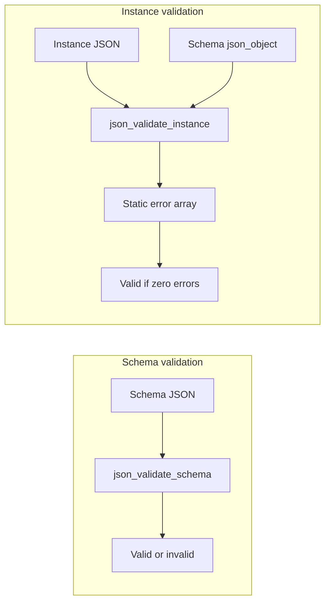
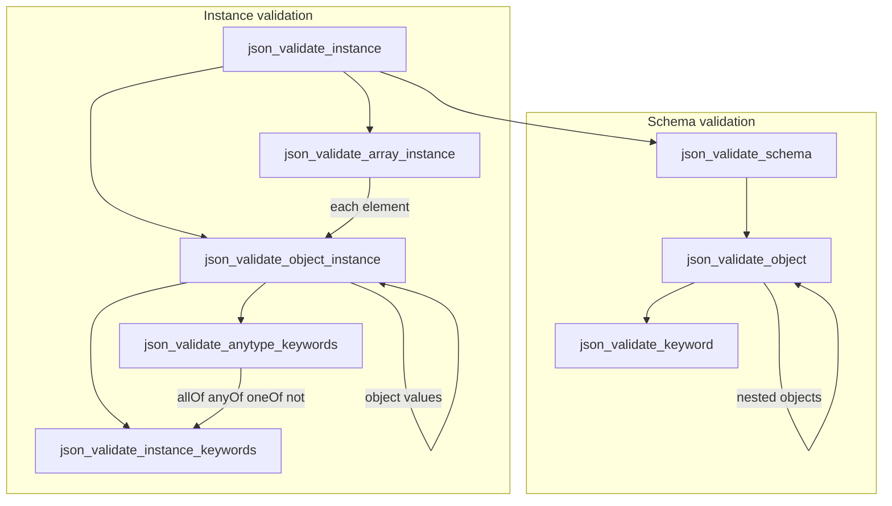

# jsonschema-c — Research report

## Metadata

- **Library name**: jsonschema-c
- **Repo URL**: https://github.com/helmut-jacob/jsonschema-c
- **Clone path**: `research/repos/c/helmut-jacob-jsonschema-c/`
- **Language**: C (C99-ish, GNU autotools, depends on json-c and POSIX `<regex.h>`)
- **License**: MIT (copyright 2015 Amine Aouled Hamed, Ocedo GmbH)
- **Analyzed version**: 4abad5a 2016-01-19 (no tagged release; `configure.ac` declares version "0,1"; ~1,900 lines of C/headers; repository appears inactive since)
- **Report date**: 2026-10-27

## Summary

jsonschema-c is a JSON Schema validation library for C. It does not generate code; it validates JSON at runtime. It has two components: (1) a schema validator that checks that a schema conforms to draft-04 using a table of per-keyword constraints, and (2) an instance validator that validates a json-c instance against a schema. It is built on json-c (`struct json_object`, `lh_table`) and standard C with autotools. It handles many draft-04 validation keywords, but the implementation is fragile: global mutable state, in-place mutation of the schema and instance, int-truncated numeric comparisons, no `$ref`, and several code paths that appear to crash or misreport (details in Algorithms and Low-level details). Format is not enforced on instances. The README calls the library "in the testing phase".

## JSON Schema support

- **Drafts**: draft-04 only (README: "V4 draft"; test fixtures use `$schema: "http://json-schema.org/draft-04/schema#"`).
- **Scope**: validation only (schema validation and instance validation). No code generation. No `$ref`, no `id`-based resolution; `definitions` is only checked structurally.

## Keyword support table

Keyword list derived from the `properties` of the vendored draft-04 meta-schema (`specs/json-schema.org/draft-04/schema.json`); 33 keywords. `$ref` is not a property in that meta-schema, so it is covered in a note below the table. The library itself defines 32 keywords (`enum json_keywords` in `schema_validator.h`); `id` is the one missing. Evidence from `schema_validator.c`, `instance_validator.c`, `schema_rules.txt`.

| Keyword | Implemented | Notes |
|---------|-------------|-------|
| $schema | yes | Recognised by the schema validator (string); ignored by instance validation (no case in any `switch`). |
| additionalItems | partial | `json_handle_additionalItems_keyword`: only checks `additionalItems: false` when `items` is an array (length comparison). Dereferences `json_get_keyword_entry(key_table,"items")->v` unconditionally, so a schema with `additionalItems` but no `items` appears to dereference NULL. |
| additionalProperties | partial | Only the `false` form is enforced; a schema-valued `additionalProperties` is not applied. Dereferences `lh_table_lookup_entry(key_table,"properties")->v` and the same for `patternProperties` without NULL check, so a schema lacking either appears to crash. Mutates the schema (see Core algorithm). |
| allOf | partial | Evaluated by splicing each sub-schema into the live schema table; sub-schema failures are recorded as errors, but the combinator's own pass/fail result is unreliable (see Core algorithm). |
| anyOf | partial | As allOf; `anyOf` returns success on first sub-schema because the helper always returns 1, while errors from failing branches remain in the global error list. |
| default | yes | Recognised (any value); no validation effect. |
| definitions | partial | Schema validation: object whose children are walked as schemas. Never used by the instance validator (no `$ref`). |
| dependencies | partial | Property dependencies are checked correctly. Schema dependencies are implemented by splicing the dependency schema's keywords into the live schema table and recursing; the `patternProperties` branch unconditionally returns an error after its loop. Error message in `utils.c` still reads "TO BE DONE". |
| description | yes | Schema validation; string type. |
| enum | yes | Instance validation: compares serialized JSON text (`json_object_to_json_string`) of the instance with each enum entry. |
| exclusiveMaximum | yes | Boolean; requires `maximum` (constraint dependency). Read by `json_handle_maximum_keyword` as a strictness flag. |
| exclusiveMinimum | yes | Boolean; requires `minimum`. Read by `json_handle_minimum_keyword`. |
| format | partial | Schema validation only: value must be a string found in `json_values[]` (which also contains primitive type names). `json_validate_value_regex` only compiles the format regex and never matches an instance (the `json_value_matches_regex` case falls through to `default`). Not enforced on instances. |
| id | no | Not in `json_keywords_char`; the schema validator skips it as an unknown keyword, and the instance validator reports it as unknown (`json_invalid_value_error`) when it appears in a schema node reaching a per-type handler. |
| items | partial | Single-schema `items` is applied to each array element via `json_validate_array_instance`; tuple-form (array) `items` is not applied per index (only used by `additionalItems`). `json_validate_array_instance` dereferences `lh_table_lookup_entry(...,"items")->v` without NULL check, so an array instance against a schema without `items` appears to crash. |
| maximum | partial | Instance validation; operands truncated to `int` (`json_object_get_int`), so fractional or >32-bit bounds are wrong. |
| maxItems | yes | Instance validation via `json_compare_num` on array length. |
| maxLength | partial | Uses `strlen` (UTF-8 bytes, not code points). |
| maxProperties | yes | Instance validation via `lh_table_length`. |
| minimum | partial | As maximum (int truncation). |
| minItems | yes | Instance validation. |
| minLength | partial | Uses `strlen` (bytes). |
| minProperties | partial | Enforced, but a violation is recorded with `json_maxProperties_error`. |
| multipleOf | partial | `op = instance / schema; op - (int)op != 0`: floating-point division, int cast (overflows for large quotients), no tolerance. |
| not | partial | As allOf; the helper always reports success so `not` appears to always fail (see Core algorithm). |
| oneOf | partial | As anyOf; counts "successes" that are always 1, so with more than one branch it appears to always fail. |
| pattern | partial | POSIX ERE via `regcomp(REG_EXTENDED)`/`regexec`, not ECMA-262; compiled per check and never freed. |
| patternProperties | partial | Used to locate property schemas and for `additionalProperties: false`; matching property schemas are added into the live `properties` object. |
| properties | yes | Property schemas looked up per instance key. |
| required | yes | All listed names must exist in the instance table (`json_handle_required_keyword`). |
| title | yes | Schema validation; string type. |
| type | partial | Schema validation requires a string (the constraint row allows only json-c type 6), so an array of types is rejected; also accepts the non-draft value `double`. At instance time `type` only selects the per-type keyword handler (`json_get_key_type`). |
| uniqueItems | yes | Sorts the instance array in place and compares serialized neighbours. |

Note on `$ref`: not a meta-schema property in draft-04 `schema.json`; not in the library's keyword table and never resolved. The schema validator *skips* unknown keywords (`json_validate_keyword` returns 1 when `json_is_keyword` is -1; `tests/basic_schema_tests.c` asserts "unknown keywords need to be skipped"), so a schema containing `$ref` passes schema validation; at instance time the per-type handlers report it as unknown (`case -1` adds `json_invalid_value_error`). The previous report claimed unknown keywords are rejected; that was wrong.

## Constraints

Validation keywords are enforced at instance time by per-type handlers (`json_validate_numeric_keywords`, `json_validate_string_keywords`, `json_validate_array_keywords`, `json_validate_object_keywords`) plus `json_validate_anytype_keywords` (enum, allOf, anyOf, oneOf, not). Violations are recorded with `json_add_error` (code, key, object position). The schema validator enforces keyword structure through the `json_keywords_constraints` table (allowed value types, parent type, dependency keyword, allowed-value rules).

## High-level architecture

Two independent pipelines sharing json-c: schema JSON → schema validator (1/0); instance + schema → schema validator first, then instance validator → 1/0 derived from a global error list.

- **Schema validator** (`schema_validator.c`): walks the parsed schema (`json_validate_object`) and checks each recognised keyword against a static table. No intermediate representation; the json-c tree is the schema.
- **Instance validator** (`instance_validator.c`): re-runs the schema validator on every call, then interprets the same json-c schema tree directly against the instance, recording errors in a function-static array (`utils.c`).

## Medium-level architecture

- **Modules**: `schema_validator.c/.h` (keyword enum, constraint table, schema walk), `instance_validator.c/.h` (instance interpretation), `utils.c/.h` (error codes/messages, global error store, colored logging, sort callback). Built as `libjsonschema-c.la` (`Makefile.am`, `-ljson-c`).
- **Schema validation**: `json_validate_schema` → `json_validate_object` → `json_validate_keyword` per entry; `json_validate_keyword` checks parent type, value type, dependency, allowed values, then children values for object-valued keywords.
- **Instance validation**: `json_validate_instance` → `json_validate_schema`, then `json_validate_object_instance` (root object) or `json_validate_array_instance` (root array). Object instances iterate instance keys, find the property schema, and dispatch to `json_validate_anytype_keywords` and `json_validate_instance_keywords(key_type)`.
- **$ref / definitions**: not implemented.

## Algorithms and data structures

### Schema representation

There is no schema model of its own. A schema is a `struct json_object*` parsed by json-c (`json_tokener_parse` or `json_object_from_file`). Objects are json-c `lh_table`s: a chained hash table whose entries (`struct lh_entry`) are also threaded on a doubly linked list (`head`, `tail`, `prev`, `next`) in insertion order. The code reads these internals directly (`object_table->head`, `entry->next`, `lh_foreach`, `lh_foreach_safe`), which tightly couples it to the json-c version. Keywords are looked up by string with `lh_table_lookup_entry` (average O(1)) or by iteration. Boolean schemas do not exist in draft-04; `additionalItems`/`additionalProperties` accept booleans or objects. Unknown keywords are simply present in the table and skipped by the schema validator. Ownership follows json-c reference counting; the code mostly never calls `json_object_put` on what it creates (see Low-level details).

The per-keyword rules live in static C arrays, not code: `json_keywords_char[]` maps `enum json_keywords` indices to names; `json_keywords_constraints[][6]` is a table of strings `{name, allowedTypes, parentTypes, dependencyIndex, allowedValues, childAllowedValues}` where fields hold encoded integers such as `"2 | 3"` (json-c type ids; 7 stands for "number"). `json_split_str` parses these strings with `strtol` into small int arrays on every use.

### Reference resolution and registry

Not applicable: `$ref`, `id`, `definitions` lookup and remote fetching are not implemented. `definitions` is only walked structurally. There is no registry, base-URI tracking or cycle handling, so no cycle problem arises (and no recursion through references is possible).

### Compiled / intermediate form

None. The json-c tree is interpreted directly. The only precomputation is the static constraint table, and even that is re-parsed from strings at each check. Keyword names map to enum ids with `json_get_keyword_id`, a linear `strcmp` scan over all 32 names, called once per keyword per schema node per validation.

### Core algorithm

**Schema validation** (`schema_validator.c`). `json_validate_object` iterates the object's linked list; for each entry it calls `json_validate_keyword`, then recurses into any object-typed value (arrays are not descended into, so schemas inside `allOf`/`anyOf`/`oneOf`/`items`-arrays are not checked structurally beyond the "array of objects" rule). `json_validate_keyword`:
1. `json_is_keyword` (linear scan); if not a keyword it returns 1 (skip).
2. Determines the parent's `type` (a string, or a one-element array; longer arrays fail), then `json_validate_parent_type` checks the keyword is applicable to that type (parent type defaults to object if absent).
3. `json_validate_type` checks the value's json-c type against the allowed set.
4. `json_check_dependencies` requires a named sibling keyword (e.g. `exclusiveMaximum` needs `maximum`).
5. `json_check_allowed_values` applies a rule id (>0, >=0, array of objects, unique strings, valid regex via `regcomp`, value in a list, ...). Rules are OR-ed: the loop `break`s as soon as one returns 1. Uniqueness (`json_validate_array_items_uniqueness`) sorts the array in place with `json_object_array_sort` and compares serialized neighbours (O(n log n) plus serialization in the comparator).
6. For object-valued keywords (properties, patternProperties, dependencies), children are checked with the child-rule column.

The overall result is held in a function-`static int res` inside `json_validate_object`, which is never reset: once any schema is invalid, every later call in the process also returns invalid. Results of nested recursive calls are ignored except through that shared static.

**Instance validation**. `json_validate_instance` first calls `json_validate_schema` (on every call; no caching), then:
- Root array → `json_validate_array_instance`: runs `json_validate_array_keywords`, then for each element deep-copies the `items` schema via `copy_object` (serialize to string, `json_tokener_parse` again) and calls `json_validate_object_instance(element, copy)`. The copy exists because validation mutates the schema (below). Element position is tracked as `object_pos = i+1`.
- Root object → `json_validate_object_instance`: runs `json_validate_object_keywords` on the schema node (maxProperties, minProperties, required, additionalProperties, dependencies), then for each instance key finds its schema: first a direct lookup of the instance key in the *schema node's own table* (so an instance key named e.g. `type` hits the schema's `type` keyword), then in `properties`. If not found and none of `patternProperties`/`anyOf`/`allOf`/`not`/`oneOf` exist, it returns failure immediately (early exit, no error recorded). Nested object values recurse; scalar and array values go to `json_validate_anytype_keywords` then `json_validate_instance_keywords(key_type)`, where `key_type` comes from the property schema's `type` (default object; "number"/"double" are mapped to the numeric handler).
- Per-type handlers loop over *all* keywords of the schema node with `lh_foreach`, switch on the keyword id, and record errors. Each iteration overwrites a single `res`, so the function's return value reflects only the last handled keyword; it also checks the instance's JSON type inside the loop and records `json_invalid_value_error` on mismatch. Because the top-level result ignores these return values and looks only at the error count, correctness of reporting depends on `json_add_error` being called.

**Applicators (allOf/anyOf/oneOf/not)** (`json_get_instance_schema_from_Of_keywords`). Instead of recursing with a new schema pointer, the code splices linked lists: it sets `keyword_entry->prev->next = subschema_table->head` and `subschema_table->tail->next = keyword_entry->next`, so the sub-schema's keywords temporarily (in effect permanently) replace the combinator entry in the parent's iteration order, then calls `json_validate_anytype_keywords` and `json_validate_instance_keywords` on the same instance. The splice is only reverted on the branch where the validator result is `< 0`, which these functions never return (they return 0/1), so reversal appears never to happen. The helper therefore always returns 1; the combinators' own results are thus unreliable (anyOf passes at the first branch, oneOf appears to count every branch, not appears to always flag an error), while failing branches still leave errors in the global list. This was determined by reading; not executed.

**Schema dependencies and additionalProperties** also mutate the live schema: `json_handle_additionalProperties_keyword` adds matched `patternProperties` schemas into the `properties` object with `json_object_object_add` (without taking a reference); `json_handle_dependencies_keyword` merges the dependency schema's keywords into the node, temporarily unlinks the `dependencies` entry to avoid infinite recursion, recurses with `json_validate_object_instance`, then tries to unlink the merged entries (the restore code indexes by lookups and manual `prev->next` rewiring).

Complexity: roughly O(instance nodes x schema keywords per node x 32) for keyword-id scans, plus per-array-element schema serialize/parse O(size of items schema), plus `regcomp` per pattern use. The schema validator itself is rerun per instance validation.

### Error and output model

`utils.c` holds `json_add_error(int error_value, char* key, int obj_pos, int* size)`, which keeps `static struct json_error errors[256]` and `static int i` inside the function. A call with `error_value < 0`, non-NULL key and `obj_pos >= 0` appends `{key, obj_pos, json_error_messages[1000 + error_value], error_code}`; a call with `(0, NULL, -1, &n)` just returns the array and count. Error codes are an enum starting at -1000 (`json_error_values`), one per keyword; messages are a parallel array. There is no instance path or schema path: an error carries only the property key (or the placeholders "root object"/"root array"/"instance object") and a numeric object position (the array element index for root arrays, 0 otherwise). Final result in `json_validate_instance`: `num_errors > 0` → print each error colored and return 0. Because the counter is a function-static that is never reset, errors accumulate across calls; after the first invalid instance every later call also reports invalid, and the 256-entry array has no bound check. Output is `printf` to stdout with ANSI colors (`json_printf_colored`), including per-key debug traces ("**key:", "KEYWORD", "ALL OK") on every validation, not an API-level structured report.

## Low-level details

- **Numerics**: `maximum`/`minimum` compare via `json_compare_num(double, double, strict)` but are called with `int` arguments (`json_object_get_int`), truncating doubles and 64-bit integers. `multipleOf` uses double division and an `(int)` cast. Type `integer` maps to `json_type_int`; `number` maps to a private id 7; `double` is also treated as numeric.
- **Strings**: lengths use `strlen`, i.e. UTF-8 bytes, not code points. Enum and `uniqueItems` compare serialized JSON text, so `1` and `1.0` differ, and key order inside objects affects equality.
- **Regex**: POSIX ERE via `regcomp`/`regexec` (`REG_EXTENDED | REG_NOSUB`), never `regfree`d; not ECMA-262 (the comments claim ECMA 262). The ipv4/ipv6 entries in `json_format_regex` are the literal `"*"`.
- **Recursion**: schema walk, instance walk and `json_get_keyword_entry` are literal recursion with no depth limit; deep input can overflow the stack.
- **Memory/safety**: `json_validate_instance` `malloc`s a 256-entry array and immediately overwrites the pointer (leak). `copy_object` results are never released. Many unchecked `->v` dereferences on `lh_table_lookup_entry` results (items, properties, patternProperties). `json_validate_object_instance` calls `lh_foreach` on `json_object_get_object(instance)`, which is NULL for non-object instances; the tests include a scalar-vs-object-schema case, so behavior on non-objects could not be verified from reading alone, and arrays of scalars as `items` instances appear to be at risk. `json_handle_enum_keyword` is declared `int inline name(...)` (implicit linkage oddity).
- **Shared type/format list**: `json_values[]` mixes format names and type names, so `format: "string"` passes schema validation and `type` accepts `double`.
- **Not tested**: the test suite does not exercise any keyword other than `type`.

## Output and integration

- **Vendored vs build-dir**: N/A for codegen (validation only). Built as an autotools libtool library.
- **API vs CLI**: Library API only. Entry points: `json_validate_schema`, `json_validate_schema_from_file`, `json_validate_instance`, `json_validate_instance_from_file`. All return 1 (valid) or 0.
- **Writer model**: N/A for output; diagnostics go to stdout via `printf`; no writer injection.

## Configuration

Autoconf checks for json-c, `regex.h`, `string.h`. `tests/Makefile.am` hard-codes `-I/usr/local/include/json-c`. No runtime configuration.

## Pros/cons

- **Pros**: pure C; small and readable; table-driven schema checking; draft-04 keywords including `dependencies`/`patternProperties` attempted; per-error key/position.
- **Cons**: draft-04 only; no `$ref`; format not enforced on instances; tuple `items` unsupported; global static state (`res` in `json_validate_object`, error array in `json_add_error`) makes it non-reentrant, non-thread-safe and stateful across calls; the schema is mutated in place during validation (applicators, additionalProperties, dependencies, uniqueItems sorts the instance array); combinator results unreliable; int-truncated numeric bounds; `minProperties` reports `json_maxProperties_error`; schema revalidated per instance; per-element schema deep copy; always-on stdout logging; unchecked NULL dereferences; unmaintained since 2016.

## Testability

- **Tests**: `make check` builds `check_jsonschema_c` (`tests/jsonschema-test.c`, uses `tests/example_schema.txt`/`example_instance.txt` or argv), `basic_schema_tests` (minimal schema valid; unknown keyword skipped; `type: object` valid; `type: invalid` rejected) and `basic_object_tests` (empty object valid against `type: object`; integer instance rejected). Tests are plain C programs returning non-zero on failure, no framework.
- **Fixtures**: one large example schema with patternProperties, dependencies, allOf/anyOf/oneOf/not.
- **Coverage**: very thin; no keyword-level tests; no CI config. Include path is hard-coded for `/usr/local/include/json-c`.

## Performance

By code reading only; nothing was built or run.

### Performance techniques

- **Compile vs interpret**: none. The json-c tree is interpreted directly; the constraint table is static but parsed from strings (`json_split_str` with `strtol`) at each use. The schema validator runs again inside every `json_validate_instance`.
- **Memory layout and allocation**: pointer-heavy json-c trees; no arenas. Allocation overhead is notable: `copy_object` serializes and reparses the `items` schema per array element; `json_object_to_json_string` is called per enum entry and per uniqueness comparison; per-use `regcomp` without `regfree` leaks.
- **Caching and memoization**: none (no compiled regex cache, no keyword-id cache, no schema-validated flag).
- **Fast paths and short-circuiting**: limited. `json_check_allowed_values` stops at the first satisfied rule; `json_validate_object_instance` returns early when an instance key has no schema and no combinator/patternProperties exists; per-type handlers return at the first instance-type mismatch. No boolean-only path; errors are always recorded. Keyword lookup is average O(1) via `lh_table_lookup_entry` where used, but keyword-id mapping is a linear 32-way `strcmp`.
- **Regex handling**: POSIX `regcomp`/`regexec` (system libc implementation), compiled at each use, no caching, no ReDoS protection, not ECMA-262.
- **Concurrency**: not thread-safe or even reentrant: function-static `errors[256]`/`i` and `static int res`; schemas are mutated during validation, so even concurrent validations of a shared schema are unsafe.

### Benchmarks in repo

None. Entry points for an external harness: `json_validate_instance(instance, schema)` or `json_validate_instance_from_file(instance_path, schema_path)`. A harness would need to account for stdout logging and the stateful error array.

## Determinism and idempotency

Validation order is deterministic (json-c preserves insertion order via its linked list, and keyword iteration follows it) and there is no randomness, but the library is not idempotent across calls: the global error counter and the static `res` persist, and validation mutates the schema (spliced combinators, merged properties/dependencies) and sorts instance arrays in place, so repeated validation of the same pair can change outcome. N/A for codegen.

## Enum handling

- **Duplicate entries**: schema validation of `enum` requires a non-empty unique array (rule "array of unique items", `json_validate_array_items_uniqueness(value,-1)`, via serialized text comparison after an in-place sort; the emptiness check's result is overwritten by the uniqueness result, so an empty array appears to pass). Duplicates are therefore rejected at the schema level. At instance time, `json_handle_enum_keyword` scans entries comparing serialized text and returns on the first match.
- **Namespace/case collisions**: `"a"` and `"A"` serialize differently, so both are distinct and matchable. N/A for codegen.

## Reverse generation (Schema from types)

No. Validation-only; no facility to generate JSON Schema from C types.

## Multi-language output

N/A. No code generation.

## Model deduplication and $ref/$defs

N/A for codegen. For validation, `$ref` is not implemented and `definitions` is only structurally checked.

## Validation (schema + JSON → errors)

**Primary purpose.**

- **Schema validation**: `json_validate_schema(schema)` / `json_validate_schema_from_file(path)` returns 1/0, printing colored messages; no structured error list. Contains a stale-state defect (static `res`). `json_validate_schema_from_file` calls `json_printf_colored` with message and color arguments swapped on the load-failure path.
- **Instance validation**: `json_validate_instance` / `json_validate_instance_from_file` returns 1 only if the schema validates and the global error count is zero. Errors are retrieved via `json_add_error(0, NULL, -1, &n)` and printed as `key(object #pos): message`.
- **Error codes**: `utils.h` (`json_error_values`), messages in `utils.c`. Covers all implemented keywords; `format` and `dependencies` messages are marked "TO BE DONE".

**Could not verify (code reading only)**: runtime behavior of the splice-based combinators on real inputs; behavior of `json_object_get_object` on non-object instances in the json-c version the authors targeted; whether the `"*"` regexes for ipv4/ipv6 compile on a given libc (they are never matched).
