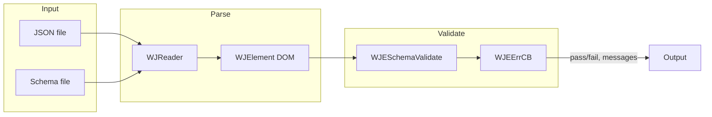
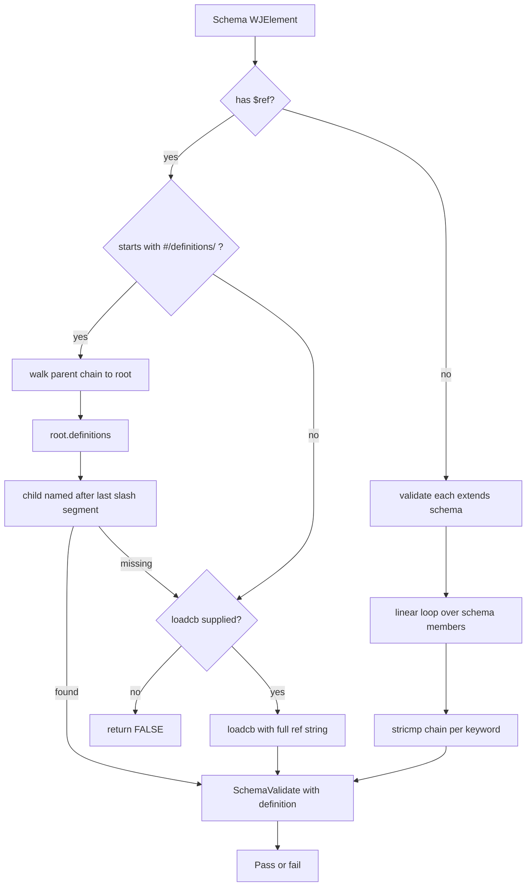

# WJElement (netmail-open/wjelement) — Research report

## Metadata

- **Library name**: WJElement
- **Repo URL**: https://github.com/netmail-open/wjelement
- **Clone path**: `research/repos/c/netmail-open-wjelement/`
- **Language**: C
- **Analyzed version**: c5495a2 2026-03-23 (v1.3-57-gc5495a2; last tag v1.3)
- **Report date**: 2026-10-27
- **License**: GNU LGPL v3 (COPYING.LESSER); COPYING and COPYING.MIT also present in repo

## Summary

WJElement is a JSON manipulation library for C, built on WJReader and WJWriter (included in the repo). It provides an in-memory JSON DOM with path-based access and is capable of JSON Schema validation. It does not generate C code from JSON Schema; it validates a JSON instance (as a WJElement tree) against a schema (also a WJElement tree) at runtime via `WJESchemaValidate`. Validation errors are reported via a printf-style callback. The library supports draft-03 and draft-04 style schemas (with draft-04 only partially supported per code comments), `$ref` (including inline `#/definitions/` and external via load callback), and a wide set of validation keywords including type, properties, items, required, numeric and string constraints, pattern, enum, format, and combinators (allOf, anyOf, oneOf).

## JSON Schema support

- **Drafts**: Code in `src/wjelement/schema.c` detects `$schema` and sets version 3 or 4 for `http://json-schema.org/draft-03/` and `http://json-schema.org/draft-04/` respectively. Comments state that draft-04 is "barely supported, mostly where it overlaps with draft 3" and that "Draft 4 patches are most welcome." Example schema `example/layout.schema` does not set `$schema`; it uses draft-3/4 style (e.g. `required` as array on properties and at object level).
- **Scope**: Subset aligned with draft-03 and partial draft-04. No support for 2019-09 or 2020-12 (e.g. no `$defs`, `prefixItems`, `if`/`then`/`else`, `dependentRequired`). Uses `definitions` for inline `$ref` and supports `extends` (draft-3 and MA extension). Validation is runtime-only; no codegen.

## Keyword support table

Keyword list derived from the vendored draft-03 and draft-04 meta-schemas (`specs/json-schema.org/draft-03/schema.json` and `draft-04/schema.json`, union of their `properties`), since those are the only drafts the library targets (draft-04 partially). 2019-09/2020-12 keywords (`$defs`, `const`, `prefixItems`, `if`/`then`/`else`, etc.) are not handled and fall into the "unknown keyword, ignore" branch at the end of the member loop in `src/wjelement/schema.c`; they are not listed individually. Draft-06/07 additions (`const`, `contains`, `propertyNames`, numeric `exclusiveMinimum`) are likewise unsupported.

| Keyword | Implemented | Notes |
|---------|-------------|-------|
| $ref | partial | Checked first; if present the schema is replaced by the target and the function returns immediately (all sibling keywords ignored, including `extends`). `#/definitions/<name>` resolved by walking to the root and taking only the text after the last `/` (so `#/definitions/a/b` looks up `b`); anything else goes to `WJESchemaLoadCB`. With no `loadcb` and no inline hit the function returns FALSE (invalid) silently, with no error message. No JSON Pointer, `id`, or `$anchor` resolution. |
| $schema | yes | Read only to set `version` 3 or 4 (substring match on `://json-schema.org/draft-03/` or `draft-04/`); default version is 0, treated like draft-03 for `required`. |
| additionalItems | yes | Draft-03. `false` fails if the array is longer than `items` array; schema object is applied to every element of the array (not just the extras). |
| additionalProperties | partial | `false` or schema object. The per-property `properties` lookup runs only when the schema has `properties`. The `fail` flag starts TRUE and is cleared only by a matching `properties` name (or successful extra-property schema), so `additionalProperties: true` (type TRUE) never clears it and fails any non-empty object, and an empty object also leaves it TRUE; with no `properties`, `additionalProperties: false` rejects every member. `patternProperties` matches also considered when HAVE_REGEX_H. |
| allOf | yes | Draft-04. Each subschema validated; counts passes and fails if not all pass. |
| anyOf | yes | Draft-04. At least one subschema must pass. |
| default | no | Explicitly ignored (no-op branch). |
| definitions | partial | Not a validated keyword; only used as the lookup table for inline `#/definitions/<name>` `$ref`. |
| dependencies | yes | Draft-03/04: schema object, single property name (string, draft-03), or array of names. |
| description | no | Explicitly ignored (annotation). |
| disallow | yes | Draft-03. Handled with `type`; result inverted. |
| divisibleBy | yes | Draft-03. Uses `Modulus(instance, divisor)` (double math with an `int64` cast); a zero divisor is skipped; only `WJR_TYPE_NUMBER` instances. |
| enum | yes | Instance must equal an element, compared with `CompareJson` (object/array comparison is positional, so key order matters; numbers compare by truncated `int` of the double difference, so 1.0 equals 1.5; with DISTINGUISH_INTEGERS two integers always compare equal). |
| exclusiveMaximum | yes | Boolean (draft-03/04); read inside the `maximum` handler; the keyword itself is a no-op. |
| exclusiveMinimum | yes | Boolean (draft-03/04); read inside the `minimum` handler; the keyword itself is a no-op. |
| extends | yes | Draft-03. Inline schema object, array of schemas, or string reference (MA extension) loaded via loadcb; processed during schema setup before the member loop. |
| format | partial | Only compiled when HAVE_REGEX_H. Known: date-time, date, time, regex, color, style, phone, uri, email, ip-address/ipv6 (via getaddrinfo), host-name; `utc-millisec` has no pattern. Unknown formats pass. |
| id | no | Not read; not used for resolution. |
| items | yes | Single schema applied to each element, or array (tuple typing). |
| maxItems | yes | Enforced at runtime. |
| maxLength | yes | Enforced via `strlen` (bytes, not Unicode code points). |
| maxProperties | yes | Draft-04. Enforced at runtime. |
| maximum | yes | Instances of type `WJR_TYPE_NUMBER` only (skipped for `WJR_TYPE_INTEGER` when DISTINGUISH_INTEGERS), compared as double; honours boolean `exclusiveMaximum`. |
| minItems | yes | Enforced at runtime. |
| minLength | yes | Enforced via `strlen` (bytes, not Unicode code points). |
| minProperties | yes | Draft-04. Enforced at runtime. |
| minimum | yes | Instances of type `WJR_TYPE_NUMBER` only (skipped for `WJR_TYPE_INTEGER` when DISTINGUISH_INTEGERS), compared as double; honours boolean `exclusiveMinimum`. |
| multipleOf | no | Draft-04 name is not handled; only draft-03 `divisibleBy` is (falls into the ignore-unknown branch). |
| not | no | Not handled; ignored. |
| oneOf | yes | Draft-04. Exactly one subschema must pass (sub-errors suppressed). |
| pattern | partial | Only when HAVE_REGEX_H; POSIX `REG_EXTENDED | REG_NOSUB`, not ECMA 262. |
| patternProperties | partial | Only when HAVE_REGEX_H; POSIX extended regex. |
| properties | yes | Each property validated against its schema; a missing instance member is passed as NULL (relevant to draft-03 `required: true`). |
| required | yes | Draft-03 boolean on the property schema (version <= 3, including unset) and array of names (applied regardless of version). |
| title | no | Explicitly ignored (annotation). |
| type | yes | string, number, integer, boolean, object, array, null, any; array of types or schemas (union); schema object as type (draft-03). |
| uniqueItems | yes | Pairwise `CompareJson` over all index pairs, with each element fetched by a `[i]` path search (see Performance); same CompareJson caveats as `enum`. |

## Constraints

Validation keywords are enforced at runtime by `WJESchemaValidate`. Type, properties, items, required, additionalProperties, and combinators (allOf, anyOf, oneOf) drive structure checks. Numeric and string constraints (minimum, maximum, exclusiveMinimum, exclusiveMaximum, minLength, maxLength, minItems, maxItems, minProperties, maxProperties) and pattern, enum, format, uniqueItems, and divisibleBy are all checked during validation; failures are reported via the WJEErrCB callback. There is no generated code; all constraint checking is in schema.c.

## High-level architecture

Components: **WJReader** (streaming JSON parser), **WJWriter** (JSON writer), **WJElement** (in-memory DOM with path selectors), and **schema validation** (schema.c). Pipeline: JSON and schema are parsed into WJElement trees (via WJReader + WJEOpenDocument); the application calls `WJESchemaValidate(schema, document, err, loadcb, freecb, client)`; validation walks the schema and document, resolves `$ref` via loadcb or inline `#/definitions/`, and reports pass/fail plus errors via the callback. No code generation step.

## Medium-level architecture

Key modules: **wjreader** (`src/wjreader/wjreader.c`, streaming pull parser), **wjwriter** (`src/wjwriter`), **wjelement** (`src/wjelement`: `element.c` DOM construction/mutation, `types.c` typed getters/setters, `search.c` selector engine, `schema.c` validator, `hash.c` structural hashing), **cli** (`src/cli`, the `wje` binary), and a small portability/memory layer (`include/xpl.h`, `include/memmgr.h`, `src/lib/xpl.c`). The validator is not a separate compiled representation: it interprets the schema DOM directly, using the same selector API (`WJEGet`, `WJEChild`, `WJEString`, ...) that application code uses to read documents.

**$ref resolution** (`SchemaValidate` in `schema.c`): if the current schema node has a `$ref` member, (1) if the string begins with `#/definitions/`, walk `schema->parent` up to the root, fetch its `definitions` object, and look up the text after the *last* `/` as a child name; on a hit recurse into that node and return its result; (2) otherwise, if a `loadcb` was supplied, call it with the whole `$ref` string, recurse into the returned schema, then release it with `freecb` (or `WJECloseDocument` when no `freecb` is given). With no `loadcb` and no inline hit the function returns FALSE. There is no registry, base-URI tracking or caching inside the library; every `$ref` use re-invokes the callback.

## Algorithms and data structures

### Schema representation

There is no typed schema model. A schema is an ordinary `WJElement` tree, identical to a parsed instance document. `WJElementPublic` (`include/wjelement.h`) is a node with `name`, `type`, `next`/`prev` sibling links, `child`/`last` pointers, `parent`, `count` (number of children), `length` (string length), a `changes` counter, and client/free/write callbacks. The private `_WJElement` (`src/wjelement/element.h`) adds a `parent` pointer plus a union `value` (`char *string`, `XplBool boolean`, or a number struct holding `uint64 i`, `double d`, `hasDecimalPoint`, `negative`) and a flexible array member `_name[]` so the node and its name are one allocation (`_WJENew` in `element.c`). Objects and arrays are doubly linked child lists, appended in document order; there is no hash table, so lookups by name are linear scans (`_WJEChild`). Type is a one-byte tag (`WJR_TYPE_OBJECT 'O'`, `'A'`, `'S'`, `'N'`, optional `'I'`, `'T'`/`'F'`/`'B'`, `'0'`, `'?'`). Booleans are separate types TRUE/FALSE, so boolean schemas (`false` for `additionalItems`/`additionalProperties`) are detected by `memb->type == WJR_TYPE_FALSE`. Unknown keywords are simply retained as nodes and skipped by the dispatch loop. Numbers are stored as magnitude plus a `negative` flag, and a `hasDecimalPoint` flag recorded by the reader (`WJRIntOrDouble`). Duplicate object member names are refused at load time (`_WJELoad` returns NULL if `WJEChild(parent, name)` already exists), so first-wins. Ownership: the DOM owns all nodes; schemas fetched through `loadcb` are owned by the caller until `freecb`.

### Reference resolution and registry

Described under Medium-level architecture. Mechanism summary: resolution is purely lazy and callback driven. The "registry" is whatever the host puts behind `WJESchemaLoadCB` (the CLI and `example/validate.c` map a name through a `printf`-style path pattern such as `path/to/%s.json` and reopen the file each time). Inline resolution is a parent-pointer walk to the root plus one linear child scan for `definitions` and one for the name: O(depth + number of definitions). Cycle handling: none. A recursive `$ref` terminates only because validation recurses over the (finite) instance; a schema whose `$ref` points at itself with no instance descent recurses until the C stack overflows. `id`, `$anchor`, `$dynamicRef`, relative URI resolution, and JSON Pointer paths longer than one segment are not implemented. A separate non-draft extension uses `describedby` on a *document* to find its schema when `schema` is NULL (`SchemaValidate` start; `ListSelectors`; `WJESchemaIsType`), and `extends` strings are fed to `loadcb` the same way.

### Compiled / intermediate form

None. The schema DOM is interpreted directly each time; nothing is precompiled, indexed or cached. Entry point `WJESchemaValidate` calls the static recursive `SchemaValidate(schema, document, err, loadcb, freecb, client, name, version)` with `name = "(root)"` and `version = 0`. The `name` argument is a display string used only for error messages; `version` (0, 3 or 4) is threaded down the recursion and is overwritten whenever a visited schema node carries a `$schema` string containing `://json-schema.org/draft-03/` or `draft-04/`.

### Core algorithm

`SchemaValidate` (`schema.c`, about 280 lines, one function) works in three phases.

1. **Setup**: if `schema` is NULL it tries to load the document's own schema from `describedby` via `loadcb`, else returns FALSE. Reads `$schema` for the version. Handles `$ref` (returning immediately, see above). Then handles `extends`: an inline object, a string reference (loaded via `loadcb`), or an array of either; every extended schema is validated against the same document, and if any fail the function returns FALSE before looking at the schema's own keywords.
2. **Member loop**: `while ((memb = WJEGet(schema, "[]", memb)))` iterates the schema's members in document order. For each member a chain of about 28 `stricmp(memb->name, "...")` comparisons selects the handler (so keyword names match case-insensitively; order of tests is fixed, with `type`/`disallow` first). Each handler sets a local `fail` and ORs it into `anyFail`; there is no early exit, so all keywords are always evaluated and all errors reported (except `oneOf`, whose sub-validations pass `err = NULL`). Handlers: `type`/`disallow` (string, array of strings or schemas, or schema object; `disallow` inverts), `properties` (for each *schema* property, fetch the instance child with `WJEChild` and recurse; a missing child is passed as NULL, which every type check treats as passing, so only `required` fails on absence), `patternProperties` and `additionalProperties` (POSIX regex over instance member names), `anyOf`/`allOf`/`oneOf` (iterate subschemas, counting passes), `items` (object form validates each element; array form is tuple typing), `additionalItems`, `required` (draft-3 `true` boolean at version <= 3, or array of names), `dependencies`, numeric/length/count bounds, `uniqueItems`, `pattern`, `enum`, `format`, `divisibleBy`; `default`, `title`, `description`, `exclusiveMinimum/Maximum` are explicit no-ops; unrecognised members are ignored.
3. **Cleanup**: free a schema that was fetched through `describedby`; return `!anyFail`.

`type` with an array tries each alternative and passes if any matches (`ValidateType`, a `stricmp` chain on type names; `any` matches every known type). Equality for `enum` and `uniqueItems` is `CompareJson`: same type, same name when both named, then for containers equal `count` followed by *positional* pairwise recursion (so `{"a":1,"b":2}` differs from `{"b":2,"a":1}`), strings by `strcmp`, and numbers by `(int)(double a - double b)` (the difference is truncated toward zero by the function's `int` return, so values less than 1 apart compare equal). `CompareJson` recurses in C. `Modulus` for `divisibleBy` computes `a - (int64)(a/b)*b` with an exact-quotient shortcut, so it is only reliable within int64 range and subject to float error. `additionalProperties` iterates every instance member and clears a shared `fail` flag on any hit (see keyword table for the resulting quirks). Combinator error reporting: `anyOf` and `allOf` pass the real `err` callback to subschemas, so a passing `anyOf` can still emit errors from non-matching branches.

Selector helpers (`WJESchemaGetSelectors`/`WJESchemaGetAllSelectors`, `ListSelectors`) walk a schema's `properties`/`items`/`extends` to enumerate WJElement path selectors for a given `type`/`format`; `WJESchemaIsType`/`FindBacklink` walk `extends` chains through `loadcb` (a repo-specific "backlinks" extension). They are not part of validation.

### Error and output model

Errors are text only. `WJEErrCB` is `void (*)(void *client, const char *format, ...)`; `SchemaValidate` calls it with ad hoc messages such as `"%s: minimum length (%d) not met (%d)."`, `"%s: required member '%s' not found."`, `"%s failed validation"`. The `name` argument is the only location information: `"(root)"` at the top, the member name for `properties`, `name[i]` for array elements, `name[i]` of the subschema index for combinators. It is not a JSON Pointer and does not accumulate a full path (a property-level error names just that property). The return value is a single boolean (`XplBool`). One failure can produce several messages (a leaf message plus a parent `"%s failed validation"`), and `anyOf`/`allOf`/array-form `type` can emit messages for branches that do not affect the final result. Passing `err = NULL` suppresses all messages. There is no structured, collectable error list; the host builds one inside its callback if desired (the CLI just `vfprintf`s to stderr).

## Low-level details

- **Regex compile flags**: `pattern`, `patternProperties`, `additionalProperties`-with-patternProperties and `format` use POSIX `regcomp` (`REG_EXTENDED | REG_NOSUB`; formats add `REG_ICASE`) and are compiled only when `HAVE_REGEX_H` is defined (CMake `check_include_files(regex.h)`). Without it those keywords are silently ignored (CMake warns). An invalid `pattern` regex makes the instance fail (tested in `wjeunit.c` `SchemaTest`).
- **Strings**: `minLength`/`maxLength` use `strlen` on the stored UTF-8, so they count bytes. The reader decodes `\uXXXX` (including surrogate pairs) to UTF-8 and `\xNN` to raw bytes in place (`wjreader.c` around lines 1169-1232); embedded NUL via `\u0000` would truncate `strlen`-based checks.
- **Numbers**: reader stores either `uint64` + `negative` flag or `double`; the validator reads numbers through `WJEDouble`, `WJENumber` (an `int`) for counts, so bounds beyond int range or exactly-representable ints above 2^53 lose precision. `integer` means "no decimal point in source text" (so `1.0` is not an integer) via `hasDecimalPoint`. With `DISTINGUISH_INTEGERS` (`WJE_DISTINGUISH_INTEGER_TYPE`) integers get a separate node type `'I'`; `minimum`, `maximum`, `divisibleBy` then skip them (they test `type == WJR_TYPE_NUMBER`) and `CompareJson` treats all integer pairs as equal, a likely latent bug.
- **required**: draft-3 `"required": true` on a property schema is checked against the NULL/absent child; draft-4 array form is applied regardless of declared version. `required` keyword name collision between the two forms is resolved by value type.
- **format**: patterns are hard-coded strings in `schema.c`; `ip-address`/`ipv6` call `getaddrinfo` on the instance string with NULL hints, which can trigger real name resolution for non-literal strings. Unknown formats pass. Formats are checked for string, number and boolean instances.
- **Depth and hardening**: the reader enforces a `maxdepth` (`_WJROpenDocument` takes a `maxdepth`; `WJRDown` returns -1 when `depth >= maxdepth`). The validator and `_WJELoad`/`CompareJson`/`_WJEHash`/`_WJECopy` are literally recursive in C with no depth guard of their own, and there is no recursion guard for self-referential `$ref`. Several handlers format into heap strings with `MemAsprintf` and ignore allocation failure. `example/validate.c`'s `schema_load` builds a path with `sprintf` into a buffer sized `strlen(format)+strlen(name)`, which is adequate only because `%s` in the pattern is replaced; a pattern with additional conversions would overflow, so the sample loader is not a safe template for untrusted input. No fuzzing or sanitizer configuration was found.
- **Case-insensitive keywords**: keyword and type names compare with `stricmp`, so `"Type"` or `"STRING"` are accepted.

## Output and integration

- **Vendored vs build-dir**: N/A; no code generation. Validation is runtime only.
- **API vs CLI**: Library API in wjelement.h: `WJESchemaValidate`, `WJESchemaIsType`, `WJESchemaNameIsType`, `WJESchemaGetSelectors`, `WJESchemaGetAllSelectors`, `WJESchemaFindBacklink`, `WJESchemaNameFindBacklink`, `WJESchemaFreeBacklink`. CLI: `wje` binary (src/cli) with a `validate` command that takes a schema file and optional pattern for loading additional schemas; it calls `WJESchemaValidate(e, *doc, schema_error, schema_load, NULL, pat)`.
- **Writer model**: N/A for codegen. Validation errors are reported via `WJEErrCB` (varargs callback); the CLI prints them to stderr.

## Configuration

Build-time: **STATIC_LIB** (static vs shared libraries), **DISTINGUISH_INTEGERS** (integer vs number type in validation), **HAVE_REGEX_H** (enables pattern, patternProperties, format). No model/serialization or codegen options. Install prefix and paths set via CMake (minimum raised to 3.5 in 2026 to avoid failures with newer CMake); pkg-config file generated. A Nix flake (`flake.nix`, `.envrc`) provides a dev shell with cmake, pkg-config, ninja, gdb, lldb.

## Pros/cons

**Pros**: Single C stack (reader, writer, element, schema) in one repo; path-based DOM access with wildcards and conditions; schema validation with draft-3/4 style and many keywords; $ref with inline and external loading; optional regex-based pattern/format; LGPL licensing. **Cons**: No codegen; draft-04 only partially supported; pattern/format depend on system regex; no support for 2019-09/2020-12 keywords (if/then/else, $defs, prefixItems, etc.); validation and selector logic are intertwined in schema.c.

## Testability

Tests live in `src/wjelement/wjeunit.c`: a fixed JSON document is parsed and a list of test functions (SelfTest, NamesTest, SchemaTest, etc.) run. Schema tests use inline schema strings and `WJESchemaValidate` to assert pass/fail for type+pattern. CMake adds tests via `add_test(WJElement:Schema ${EXECUTABLE_OUTPUT_PATH}/wjeunit schema)` and similar. Run: build with CMake, then `ctest` or `make test`, or run `wjeunit schema` (and other test names) manually. Entry point for running the validator on shared fixtures: `WJESchemaValidate(schema, document, err, loadcb, freecb, client)` or CLI `wje` with document loaded and `validate <schema-file> [pattern]`.

## Performance

Analyzed from code only; nothing was built or run.

### Performance techniques

- **Compile vs interpret**: None found. The schema DOM is interpreted on every call; no preprocessing, keyword indexing, ref pre-resolution or regex precompilation. Each keyword is found by walking the member list and testing up to ~28 `stricmp` calls, so per-schema-node dispatch is O(members x keywords) with case-insensitive string compares. A source comment in the `format` handler (`schema.c`) acknowledges it: "it could get CPU-wasteful to compile regex's each time".
- **Memory layout and allocation**: The DOM is pointer-linked (`_WJElement` with sibling/child/parent pointers; name stored inline via a flexible array member so node + name is one `MemMalloc`; string values are separate allocations grown with `MemMallocEx`). Validation itself does not build intermediate structures, but it allocates many small strings: `MemAsprintf` builds `"[%d]"` index selectors and `"%s[%d]"` display names for every element of `items`, `anyOf`, `allOf`, and in `uniqueItems` two allocations per compared pair. Names are built even when `err` is NULL. The parser reads through a fixed buffer (default about 3 KB) with an in-buffer type stack, so reader memory is O(depth + token size), but the DOM is fully materialised (string values copied).
- **Caching and memoization**: None. `$ref` targets and loaded schemas are re-fetched via `loadcb` on every reference use and freed afterwards (`freecb` or `WJECloseDocument`); regexes are compiled and freed on every use (including inside a loop over instance members for `patternProperties`/`additionalProperties`).
- **Fast paths and short-circuiting**: Little. `$ref` returns immediately; `extends` failure returns before own keywords; `oneOf` stops counting after the second match (`num > 1` break) and runs subschemas with `err = NULL`. There is no early exit on first failure (all keywords and, for `allOf`/`anyOf`/`properties`, all branches are always evaluated), no boolean-only mode, and type checks are not hoisted. Missing instance values pass type checks immediately (`ValidateType` returns TRUE for NULL).
- **Algorithmic hot spots**: Child access by index goes through `WJESearch` (`search.c`), which parses the path string, then `WJEMatchSubscript` finds the index with `_WJEIndex`, a linear walk over `prev` pointers (O(1) only for the last element). Consequently `allOf`/`anyOf` (fetch subschema `i` by `"[i]"` while also iterating), tuple-form `items`, and `uniqueItems` pay O(n) per element lookup: `uniqueItems` is O(n^2) pairs, each with two O(n) lookups plus `CompareJson`, so roughly O(n^3) work and O(n^2) small allocations. Iteration with `WJEGet(x, "[]", prev)` re-parses the path each step but advances in O(1). `_WJEChild` (named lookup) is a linear scan, so `properties` validation is O(schema props x instance members).
- **Regex handling**: System POSIX `<regex.h>` (extended syntax), not ECMA-262, so `\d`, lookahead etc. differ by libc; compile-per-use, no cache. Guarded by `HAVE_REGEX_H`. POSIX engines on common libc implementations can be exponential on some patterns; the library has no ReDoS protection or timeouts.
- **Concurrency**: `schema.c` has no global or static mutable state, so concurrent validation of the same read-only schema and document trees from multiple threads looks safe in principle, provided the `loadcb`/`freecb`/`err` callbacks and the allocator (`MemMalloc` layer in `memmgr.h`) are thread-safe. The library does not use threads or locks itself, and DOM mutation functions bump `changes` counters up the parent chain without synchronisation. Not verified beyond reading `schema.c`.

### Benchmarks in repo

No benchmarks. `src/wjelement/wjeunit.c` has `BigDocTest`, `RealBigDocTest` and `LargeDoc2Test` (large generated documents, 100k to 1M elements) that exercise parsing and DOM building as pass/fail functional tests, with no timing and no schema validation. The only schema test is `SchemaTest` (three cases: pattern match, pattern mismatch, invalid regex), registered in `src/wjelement/CMakeLists.txt` as `add_test(WJElement:Schema ... wjeunit schema)`. Entry points for an external harness: C API `WJESchemaValidate(schema, document, err, loadcb, freecb, client)` after `WJROpenFILEDocument`/`WJROpenMemDocument` + `WJEOpenDocument` (see `example/validate.c`), or the CLI `example/validate <json-file> <schema-file> [pattern]` and `wje` `validate <schema-file> [pattern]` (`src/cli/cmds.c` `WJECLIValidate`).

## Determinism and idempotency

**Codegen**: Not applicable (no code generation). **Validation**: deterministic. Schema members are visited in document order (doubly linked lists preserve insertion order, no hashing), so error message order is stable for a given schema/document pair; the first duplicate object key wins at load time. Output is not sorted, and there is no codegen output to diff. Results can depend on the platform's POSIX regex and, for `ip-address`/`ipv6`, `getaddrinfo` (resolver state).

## Enum handling

Enum is validated by iterating the schema's enum array and comparing the instance value with `CompareJson(document, arr)`; first match passes. Duplicate enum entries are not deduped; if the array has `["a", "a"]`, both are checked and either match would satisfy. Case/namespace collisions: comparison is type and value based (`CompareJson`); string comparison is `strcmp`, so "a" and "A" are distinct and both can appear in the enum and be matched correctly. Duplicate enum values are not documented or tested in the repo. Number members compare by truncated difference, so `[1, 1.5]` cannot distinguish 1.0 from 1.5.

## Reverse generation (Schema from types)

No. The library does not generate JSON Schema from C types or any other code.

## Multi-language output

No. Validation only; no generated code and no multi-language output.

## Model deduplication and $ref/$defs

N/A for codegen. For validation: multiple `$ref` to the same `#/definitions/Name` resolve to the same in-tree node; external URIs are re-loaded via loadcb at each use (no sharing). No deduplication of generated types; the validator simply recurses with the resolved schema. `$defs` (2020-12) is not used; the code uses `definitions` (draft-04 style).

## Validation (schema + JSON → errors)

Yes. **API**: `WJESchemaValidate(WJElement schema, WJElement document, WJEErrCB err, WJESchemaLoadCB loadcb, WJESchemaFreeCB freecb, void *client)`. Inputs: schema and document as WJElement trees (typically from WJROpenDocument + WJEOpenDocument). Output: XplBool (TRUE = valid, FALSE = invalid); validation errors are reported via the `err` callback (printf-style, unstructured text; see Error and output model). Optional loadcb loads externally referenced schemas; freecb frees them. **Example**: `example/validate.c` reads JSON and schema from files, builds WJElement trees, and calls `WJESchemaValidate(schema, json, schema_error, schema_load, schema_free, format)`. **CLI**: After loading a document, `validate <schema-file> [<schema-pattern>]` runs validation and prints "Schema validation: PASS" or failures to stderr.

## Changes since previous analysis

Upstream activity since the prior review is limited to build/dev tooling. This deep re-analysis re-read `schema.c`, `element.[ch]`, `search.c`, `hash.c` and parts of `wjreader.c`. Corrections to the earlier report: `$ref` without `loadcb` returns invalid (not pass); `additionalProperties` has `fail`-flag quirks (`true` fails non-empty objects); `CompareJson` truncates numeric differences and is order-sensitive for objects, and equates all integers under DISTINGUISH_INTEGERS; numeric bounds skip integer-typed instances in that build; the `$ref` diagram was redone; Performance, Determinism and Enum text were rewritten from code. Could not verify: default reader `maxdepth` value (macro `WJROpenDocument` not inspected), thread-safety of the allocator layer, behaviour on a self-referential `$ref` (inferred from code, not run).
