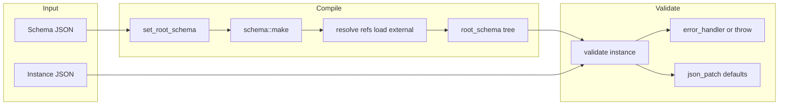

# json-schema-validator (pboettch) — Research report

## Metadata

- **Library name**: JSON schema validator for JSON for Modern C++
- **Repo URL**: https://github.com/pboettch/json-schema-validator
- **Clone path**: `research/repos/cpp/pboettch-json-schema-validator/`
- **Language**: C++
- **License**: MIT (Copyright (c) 2016 Patrick Boettcher)
- **Analyzed version**: d519955 2026-10-14 (`git describe`: 2.4.1-17-gd519955; ChangeLog top entry: Release 2.4.1)
- **Report date**: 2026-10-27

## Summary

This is a C++ library that validates JSON documents against a JSON Schema. It does not generate code; it performs runtime validation only. Latest release in the ChangeLog is 2.4.1 (default-value patch fixes, `$ref` below unknown keywords, URI dot-segment normalization, Windows DLL/CI, unsigned-char email fix). The library targets draft-7 of JSON Schema Validation and is built on top of [nlohmann/json](https://github.com/nlohmann/json) (JSON for Modern C++). Schemas are parsed into compiled C++ objects at setup time and then used repeatedly for validation; the README states that validation speed improved by a factor of 100 or more in version 2 compared to the previous approach of reusing the schema as a JSON document. Validation can report errors either by throwing exceptions (default) or via a custom `basic_error_handler` callback. The library supports external schema loading via a loader callback, optional format checking, and content (contentEncoding/contentMediaType) checking. It can return a JSON Patch of default values applied during validation.

## JSON Schema support

- **Draft**: JSON Schema draft-7 only. README and built-in meta-schema reference `$schema: "http://json-schema.org/draft-07/schema#"`. Version 1 supported draft-4; version 2 is a complete rewrite for draft-7.
- **Meta-schema**: The draft-07 meta-schema is embedded as a C++ raw string (`src/json-schema-draft7.json.cpp`, exported as `json_schema::draft7_schema_builtin`). It is NOT preloaded into any validator: `json-validator.cpp` never references it. It is only an exported value the caller may use as a schema (the test driver and `test_package` do `json_validator meta(draft7_schema_builtin, ...)` to validate schemas). User schemas are not validated against it on load, only structurally parsed (wrong JSON types throw `std::invalid_argument` or an nlohmann `type_error`).
- **Scope**: Validation only. Schema is parsed into an internal graph of C++ schema objects; `$ref` and `$id` are resolved with support for external schemas when a schema loader is provided. Both `definitions` and `$defs` are recognized. No code generation.

## Keyword support table

Keyword list derived from the `properties` keys of the vendored draft-07 meta-schema `specs/json-schema.org/draft-07/schema.json` (47 keywords; the library targets draft-07 only, so the 2020-12/2019-09 vocabularies are not tabulated, though see the note below the table). Implementation evidence from `src/json-validator.cpp`, `src/string-format-check.cpp`, and tests. Note: `$defs` (2019-09+) is also accepted but is not a draft-07 keyword.

| Keyword | Implemented | Notes |
|---------|-------------|-------|
| $id | yes | Resolved against the current base URI (`derive`) and pushed on the URI stack so the schema is registered under that URI too; then erased. Per known-failures, a sibling `$id` next to `$ref` still changes the base URI (2019-09 behaviour, not draft-07). |
| $schema | partial | Erased after parsing (`schema.erase("$schema")`); no draft selection or meta-schema validation of the user schema is performed. |
| $ref | yes | Resolved via root_schema::get_or_create_ref; fragments (JSON Pointer and `$id`-style) and external refs via loader. Sibling keywords other than `default` are ignored (draft-07 semantics). |
| $comment | no | Not erased and not interpreted; it is stored as an unknown keyword (so it can still be targeted by a `$ref` pointer). |
| title | no | Erased after parsing (annotation; ignored). |
| description | no | Erased after parsing (annotation; ignored). |
| default | yes | Stored and applied; validate() returns a JSON Patch with default values. Next to a `$ref` it overrides the referenced schema's default (copy via `make_for_default_`; deliberate draft-07 deviation). |
| readOnly | no | No handling in the code; kept as an unknown keyword. |
| writeOnly | no | No handling in the code; kept as an unknown keyword. |
| examples | no | No handling in the code; kept as an unknown keyword. |
| multipleOf | yes | Enforced for number/integer via `std::remainder` on doubles (tolerance-based; see issue-293 test for float error). |
| maximum | yes | Enforced; numeric validator. |
| exclusiveMaximum | yes | Enforced (value must be strictly less than); numeric validator. |
| minimum | yes | Enforced; numeric validator. |
| exclusiveMinimum | yes | Enforced (value must be strictly greater than); numeric validator. |
| maxLength | yes | Enforced for strings. |
| minLength | yes | Enforced for strings. |
| pattern | yes | Enforced via `regex_search` with ECMAScript flavour (std::regex, or boost::regex / disabled via JSON_SCHEMA_BOOST_REGEX / JSON_SCHEMA_NO_REGEX); not unicode-aware (non-bmp-regex optional test is a known failure). |
| additionalItems | yes | When items is array; subschema for extra items. |
| items | yes | Single schema or array of schemas (tuple-style); both supported. |
| maxItems | yes | Enforced on array size. |
| minItems | yes | Enforced on array size. |
| uniqueItems | yes | Enforced when true (equality check over array elements). |
| contains | yes | At least one array element must match subschema (draft-07: no minContains/maxContains). |
| maxProperties | yes | Enforced on object size. |
| minProperties | yes | Enforced on object size. |
| required | yes | Listed properties must be present. |
| additionalProperties | yes | false or schema; unknown properties validated or rejected. |
| definitions | yes | findDefinitions("definitions") and findDefinitions("$defs"); subschemas registered by pointer. |
| properties | yes | Property names mapped to subschemas. |
| patternProperties | yes | Regex → schema; property names matched by regex, validated by subschema. |
| dependencies | yes | Property or schema dependencies; subschemas created per key. |
| propertyNames | yes | Schema applied to each property name. |
| const | yes | Instance must equal const value (JSON equality). |
| enum | yes | Instance must equal one of the enum values (iteration, instance == v). |
| type | yes | Single type or array of types; null, object, array, string, boolean, integer, number. |
| format | partial | Only strings. A schema containing `format` throws at compile time if no format_checker was supplied. Built-in `default_string_format_check` supports: date-time, date, time, uri, email, idn-email, hostname, ipv4, ipv6, uuid, regex, uri-reference, iri, iri-reference, uri-template, json-pointer, relative-json-pointer; unknown formats are rejected (known failure vs. suite). Not in the list: idn-hostname. |
| contentMediaType | partial | Stored; requires a content_checker callback (compile-time throw if absent). No built-in decoder; the library only invokes the user callback. |
| contentEncoding | partial | Stored; requires content_checker callback. `contentEncoding: "binary"` implicitly accepts nlohmann binary instances. No built-in base64 decoding. |
| if | yes | Conditional; then/else applied based on if validation. |
| then | yes | Used when if validates. |
| else | yes | Used when if fails. |
| allOf | yes | Instance must satisfy all subschemas. |
| anyOf | yes | Instance must satisfy at least one subschema. |
| oneOf | yes | Instance must satisfy exactly one subschema. |
| not | yes | Instance must not satisfy subschema. |

Non-draft-07 keywords (e.g. `dependentRequired`, `dependentSchemas`, `unevaluated*`, `prefixItems`, `$dynamicRef`, `$anchor`, `minContains`) are not implemented; they are treated as unknown keywords (ignored for validation, retained only as potential `$ref` pointer targets). `optional/cross-draft` suite tests that rely on 2019-09 keywords are in `known-failures.json`.

## Constraints

All validation keywords listed above are enforced at runtime during instance validation. The validator compiles the schema into a tree of C++ schema objects (type_schema, string, numeric, object, array, logical_combination, schema_ref, etc.); each node performs the relevant checks (e.g. minLength, maximum, required, pattern) and calls the error_handler on failure. No constraints are generated into user code; validation is entirely library-driven.

## High-level architecture

- **Input**: Root schema as nlohmann::json (or set later via set_root_schema). Optional schema_loader for external $refs; optional format_checker and content_checker.
- **Compile**: set_root_schema (or constructor with schema) calls schema::make(), which builds a shared_ptr<schema> tree (type_schema, object, array, logical_combination, schema_ref, etc.). References are recorded in root_schema::files_[location].unresolved; definitions and $defs are processed via findDefinitions; external files are loaded by the loader until no new files are needed; unresolved refs after that throw.
- **Validate**: json_validator::validate(instance) or validate(instance, error_handler, initial_uri) runs root_->validate(ptr, instance, patch, err, initial_uri). The root schema’s validate() is invoked; it dispatches by instance type and keyword (type, enum, const, allOf/anyOf/oneOf, if/then/else, etc.). Errors are reported via error_handler (default: throwing_error_handler). Return value is a json_patch of applied default values.



## Medium-level architecture

- **Key types**: `nlohmann::json_schema::json_validator` (public API; holds unique_ptr<root_schema>). `root_schema` holds schema_loader, format_checker, content_checker, and a map `files_` from location string to schema_file (schemas map fragment → shared_ptr<schema>, unresolved map fragment → schema_ref, unknown_keywords json). `schema` is the abstract base; implementations include type_schema (type, enum, const, if/then/else, default), object (properties, additionalProperties, patternProperties, dependencies, propertyNames, required, max/minProperties), array (items, additionalItems, contains, max/minItems, uniqueItems), string (min/maxLength, pattern, format, contentEncoding/contentMediaType), numeric (min/max, exclusiveMin/Max, multipleOf), logical_combination<allOf|anyOf|oneOf>, logical_not, schema_ref, boolean.
- **$ref resolution**: When schema::make() sees a $ref, it computes the resolved URI with uris.back().derive(ref_value), then calls root->get_or_create_ref(id). get_or_create_ref looks up the file by location and fragment: if a schema already exists, it returns it; if an unresolved schema_ref for the fragment exists, it returns that; otherwise it creates and stores a new schema_ref in file.unresolved, and then, if the fragment is a JSON Pointer present in unknown_keywords, compiles that JSON into a schema (which binds the new ref on insert) and returns it instead. When a schema is later inserted via root->insert(uri, sch), any unresolved ref with that fragment is resolved (set_target). set_root_schema() repeatedly loads external files (via loader_) for any location that has no schemas yet, then throws if any unresolved refs remain.
- **Definitions**: findDefinitions("$defs") in schema::make(), falling back to findDefinitions("definitions") only when no `$defs` key is present (a schema with both processes only `$defs`; the other key stays as an unknown keyword); each definition is created with schema::make(def.value(), root, {defs, def.key()}, uris), which registers it under the appended pointer so $ref to that fragment can resolve.

```mermaid
flowchart TB
  subgraph refResolution [Ref resolution]
    Make[schema::make]
    FindRef[find "$ref"]
    DeriveUri[uris.back.derive ref_value]
    GetOrCreate[root->get_or_create_ref]
    Insert[root->insert uri sch]
    Unresolved[unresolved schema_ref]
    Make --> FindRef
    FindRef --> DeriveUri
    DeriveUri --> GetOrCreate
    GetOrCreate --> Insert
    GetOrCreate --> Unresolved
  end
  subgraph files [Per-file state]
    Schemas[schemas fragment to schema]
    UnresolvedMap[unresolved fragment to schema_ref]
    Unknown[unknown_keywords]
  end
  Insert --> Schemas
  Unresolved --> UnresolvedMap
```

## Algorithms and data structures

### Schema representation

Parsing is destructive and single-pass. `schema::make(json &schema, root_schema*, keys, uris)` (`src/json-validator.cpp`) takes the nlohmann::json by non-const reference; `root_schema::set_root_schema` takes the schema by value (a copy) so the caller's document is untouched. Each constructor `find`s the keywords it owns and `erase`s them from the JSON. What remains afterwards is, by construction, the set of unknown keywords (plus annotation-ish ones such as `$comment`, `examples`, `readOnly`), and `schema::make` hands each remaining key to `root->insert_unknown_keyword` so they stay reachable by `$ref` JSON Pointers. There is no typed AST of the original document: the compiled form (below) is the only representation, and the source JSON is discarded except for the per-file `unknown_keywords` json tree, `enum` values and `const` values (stored as `std::pair<bool, json>`) and default values (`json default_value_` on every node).

Boolean schemas are a `boolean` node (`bool true_`; the false case reports "instance invalid as per false-schema"). A non-object, non-boolean schema throws `std::invalid_argument`. Ownership: every node is a `std::shared_ptr<schema>`, held strongly by `root_schema::files_[location].schemas[fragment]` (and by parent nodes); there are raw `root_schema*` back-pointers in every node, so nodes must not outlive the `json_validator` (which owns the `root_schema` through a `unique_ptr`). `schema_ref` holds only a `std::weak_ptr` target to avoid ownership cycles in recursive schemas (a strong `target_strong_` is kept only for the default-override copies, `make_for_default_`). Unsupported keywords are simply left as unknown, never rejected.

### Reference resolution and registry

The registry is `root_schema::files_`, a `std::map<std::string, schema_file>` keyed by the document *location* (URL or URN without fragment). Each `schema_file` has three parts: `schemas` (`std::map<fragment, shared_ptr<schema>>`), `unresolved` (`std::map<fragment, shared_ptr<schema_ref>>`, forward references waiting for a target) and `unknown_keywords` (a json tree). The fragment key is either a JSON Pointer string (`/definitions/a`) or a plain-name identifier (`foo` from `$id: "#foo"`).

URIs are modelled by `nlohmann::json_uri` (`src/nlohmann/json-schema.hpp`, `src/json-uri.cpp`): fields `urn_`, `scheme_`, `authority_`, `path_`, `pointer_` (a json_pointer) and `identifier_`. `derive(uri)` copies the base and calls `update`, which splits at `#`, percent-decodes the fragment, handles `urn:` as opaque, replaces scheme/authority if `://` is present, otherwise resolves the path relative to the current path (drop last segment, append), then runs `remove_dot_segments` (RFC 3986 5.2.4). `append(key)` extends the JSON Pointer (and is a no-op for identifier-based URIs). Ordering/equality use a tuple of the components.

Base-URI tracking is a `std::vector<json_uri> uris` passed *by value* down `schema::make`. It starts as `{"#"}`. On entry plain-name entries are dropped, then every entry gets the child key(s) appended, so a nested schema is simultaneously registered under every alias it has inherited (the pointer path from the root and the pointer path under each `$id`). When a subschema has `$id`, `uris.back().derive(id)` is pushed (an existing equal entry is moved to the back), so `uris.back()` is always the innermost base used to resolve `$ref`. At the end of `make`, `root->insert(uri, sch)` is called for every URI in the vector; inserting an already-present key throws ("schema with ... already inserted"), which is how duplicate `$id`s are rejected.

Resolution is lazy and forward-reference tolerant. `$ref` calls `root->get_or_create_ref(uris.back().derive(ref))`: (1) if `schemas` already holds the fragment, return that node; (2) else return or create an entry in `unresolved` (a `schema_ref` with a `weak_ptr` target); (3) if the ref is a JSON Pointer that lands in `unknown_keywords`, it immediately compiles that JSON into a schema with `schema::make` (the pre-created unresolved entry lets recursive references inside it bind when it is inserted). `root_schema::insert` resolves pending references: after adding `schemas[fragment]` it looks up `unresolved[fragment]`, calls `set_target`, and erases the entry. `insert_unknown_keyword` does the symmetrical thing: if an unresolved ref is waiting for that pointer it compiles the keyword as a schema, otherwise it stores a copy into `unknown_keywords`, rebuilding the intermediate objects token by token (escaping `/` and `~`), then recurses into object values. This copies each unknown subtree once per alias URI and once per recursion level, so unknown-keyword-heavy schemas cost O(size x depth) at compile time.

External files: after the root is compiled, `set_root_schema` loops: collect all locations in `files_` whose `schemas` map is empty, call the user `schema_loader(location, json&)` for each, compile with `schema::make(loaded, ..., {{loc}})`, repeat until no new file was loaded. No loader means `std::invalid_argument`. Afterwards any non-empty `unresolved` map throws, listing the dangling fragments. There is no network fetching in the library (the loader is entirely user-supplied), no `$anchor`/`$dynamicRef`/`$recursiveRef` (draft-07 only). Cycles: a recursive `$ref` simply produces a `schema_ref` whose weak target is the enclosing node; recursion terminates because validation descends into the instance. A pure ref loop with no instance descent (e.g. `{"$ref":"#"}`) would recurse without bound; this is an inference from the code (no visited set or depth guard exists), not something the repo tests.

### Compiled / intermediate form

The compiled form is a tree/DAG of polymorphic `schema` subclasses (abstract `validate(ptr, instance, patch, error_handler&) const`):

- `type_schema`: the hub node created for every object schema without `$ref`. It owns `std::vector<shared_ptr<schema>> type_` sized `value_t::discarded + 1` and indexed by the nlohmann `value_t` enum, plus `enum_`, `const_`, `logic_` (vector of `logical_not`/`logical_combination<allOf|anyOf|oneOf>`), and `if_/then_/else_`.
- Per-type validators created by `type_schema::make`: `null`, `boolean_type` (both no-ops), `numeric<number_integer_t>`, `numeric<number_float_t>`, `string`, `object`, `array`.
- `schema_ref`, `boolean`, `required` (used for array-form `dependencies`).

Construction of `type_`: with no `type` keyword, all seven per-type validators are instantiated (each reads and erases the keywords it owns); with `type` as a string or array only the named ones are. Integer-instance slots are patched: if only `number` is declared, integer and unsigned instances reuse the float validator; unsigned slot aliases the integer slot; `binary` aliases the string slot. Because irrelevant per-type validators are not built, a keyword that does not apply to the declared type (e.g. `properties` next to `"type":"string"`) is never consumed and falls through as an unknown keyword.

### Core algorithm

`json_validator::validate` creates a `json_pointer` and an empty `json_patch`, and calls `root_schema::validate`, which looks up `files_[initial.location()].schemas[initial.fragment()]` and invokes it. `type_schema::validate` then: (1) indexes `type_[instance.type()]` (O(1) switch-free dispatch) and runs that validator, or reports "unexpected instance type" if the slot is empty; (2) checks `enum` by linear scan with `instance == v`; (3) checks `const`; (4) runs each `logic_` entry; (5) evaluates `if` into a `first_error_handler`, then `then` or `else` (only when `if_` and at least one of them exists); (6) at the document root with a null instance, adds the root default to the patch. Nothing short-circuits between steps: all steps run and each reports through the handler, so with a non-throwing handler multiple errors are collected; with the default `throwing_error_handler` the first `error()` call throws and unwinds.

Combinators (`logical_combination<T>`): each subschema is run against a fresh `logical_combination_error_handler` (a vector of `{pointer, json instance copy, message}`); on failure the patch is truncated back to its previous size (rolling back defaults produced by the failed branch). Specializations of `is_validate_complete` give: `allOf` stops at the first failing branch and propagates its errors; `anyOf` stops at the first success; `oneOf` stops once two branches succeed (error "more than one subschema") and otherwise needs `count==1` (if `count==0` it reports the aggregated per-branch errors prefixed `[combination: oneOf / case#N] `). `not` runs the subschema into a `first_error_handler` and errors if nothing failed.

`object::validate`: size checks, `required` loop with `instance.find`, then for each instance member: `propertyNames` validate against the key as a JSON string, `properties_` lookup (`std::map<string,...>`, O(log p)), a linear scan over all `patternProperties_` regexes with `regex_search`, and `additionalProperties` only if neither matched (validated into a `first_error_handler` and re-reported as a single "validation failed for additional property" error). A second "reverse search" loop walks every declared property and, for absent ones with a non-null default, appends an `add` to the patch. `dependencies` are checked last. `array::validate`: size checks, `uniqueItems` by nested `std::find` (O(n^2), one error per element that has a later duplicate), then `items` as a single schema or tuple list with `additionalItems` (the iteration `break`s when there is no validator for the remaining items), then `contains` (linear, each item validated into a throwaway `first_error_handler`). `string::validate`: min/maxLength via `utf8_length` (counts bytes that are not UTF-8 continuation bytes, i.e. code points), optional content checker, `pattern` via `regex_search`, then `format`. `numeric<T>::validate` converts `instance.get<T>()` and accumulates messages in one `ostringstream`, so a single call can emit one combined message for multipleOf/min/max violations. Defaults: `type_schema` with `default` stores it; `object` stores its own `default`; a `$ref` with a sibling `default` builds a new `schema_ref` (or copy of the target for `type_schema`/`boolean`) through the virtual `make_for_default_`.

### Error and output model

The error sink is the abstract `error_handler::error(const json_pointer &ptr, const json &instance, const std::string &message)`. Built-ins: `throwing_error_handler` (internal; throws `std::invalid_argument("At <ptr> of <instance.dump()> - <message>")`), the public `basic_error_handler` (records only a bool), and internal `first_error_handler` / `logical_combination_error_handler` used for sub-evaluation. The pointer is the instance location only (built incrementally with `ptr / key`); no schema-path or keyword identifier is reported, and there is no structured output format (no flag/basic/detailed). Errors are free-form English strings. The only structured return value is a `json_patch` (a wrapper over a JSON array of `{op:add,path,value}` objects) of default values, returned by value from `validate`. Errors from subschemas of combinators are re-emitted with textual prefixes (`[combination: anyOf / case#2] `), which is how branch context is preserved.

## Low-level details

- **Number quirks (from code)**: `numeric<T>` parses `maximum`/`minimum`/`exclusive*` with `get<T>()` where T is the instance-type slot; for the integer slot a fractional bound (e.g. `maximum: 1.5`) is truncated by nlohmann's conversion, and `exclusiveMaximum`/`exclusiveMinimum` (draft-07 numbers) are stored by setting the bound and a bool. `multipleOf` always uses `double`: `std::remainder`, normalized by the quotient when it exceeds 1, compared with an epsilon from `std::nextafter(x, 0)`; integers are cast to double so very large int64 values lose precision. Unsigned instances above INT64_MAX are read through the integer validator via `get<int64>` (unverified wrap behaviour).
- **Mutation of input**: `schema::make` erases keys from the json it compiles, so unknown-keyword capture sees only leftovers; `$schema`, `title`, `description` are erased unconditionally.
- **Pattern**: std::regex (or boost with JSON_SCHEMA_BOOST_REGEX); ECMAScript flavor. Disabled with JSON_SCHEMA_NO_REGEX (pattern/patternProperties not enforced). CMake auto-selects boost or none only for GCC < 4.9.
- **Unknown keywords**: `insert_unknown_keyword` stores every unconsumed keyword (recursively) per file so `$ref`s such as `#/foo/bar` into non-keyword locations resolve into real schemas (fixed in 2.4.1 for `/` and `~` keys and recursive refs).
- **URI handling**: `json-uri.cpp` derives/normalizes URIs, removing dot-segments so the same file via different paths loads once.
- **Numbers**: numeric<T> is instantiated per instance type (integer vs float); `1.0` is a float and not accepted as `integer` (known failure, issue #166). No bignum.
- **Recursion**: validation and schema construction are recursive C++ calls; deeply nested schemas/instances are bounded by the call stack (no depth limit found).
- **Format**: Optional. If schema has "format" and no format_checker was provided, schema compilation throws. At validation time, format_check() is called; default_string_format_check supports the 17 formats listed in the keyword table (see string-format-check.cpp); `idn-hostname` and any unknown name throw `std::logic_error`, which the string validator turns into a validation error.
- **Default value patch**: validate() returns a json_patch; type_schema adds default_value to the patch when instance is null. README notes that default in a $ref can be overridden by the referencing location (draft-7 break for compatibility with newer drafts).
- **Format regexes** in `string-format-check.cpp` are function-local `static const` regex objects (compiled lazily, thread-safe initialization in C++11); email uses a generated state-machine parser in `smtp-address-validator.cpp` (`is_address`), not a regex.
- **Thread-safety**: validate() is const; multiple threads can call validate on the same validator. Validator construction/set_root_schema is not thread-safe.

## Output and integration

- **N/A for codegen** — validation-only library.
- **API**: Library only. Public API in the single header `src/nlohmann/json-schema.hpp`: `json_validator` constructor (optional schema_loader, format_checker, content_checker), set_root_schema(), validate(instance), validate(instance, error_handler, initial_uri). Return value of validate is nlohmann::json (a JSON Patch of defaults). No shipped CLI; `test/json-schema-validate.cpp` is a small test driver (`json-schema-validate <schema> < doc`, with a file loader) built with the tests; examples in example/ (readme.cpp, format.cpp). The README still points to `app/json-schema-validate.cpp`, which no longer exists.
- **Build**: CMake; builds static library by default; BUILD_SHARED_LIBS or JSON_VALIDATOR_SHARED_LIBS for shared. ctest runs unit and JSON-Schema-Test-Suite tests when JSON_SCHEMA_TEST_SUITE_PATH is set.

## Configuration

- **Constructor**: schema_loader (for external $ref), format_checker (for "format" keyword), content_checker (for contentEncoding/contentMediaType). Any can be nullptr; format/content require non-null if schema uses them.
- **Default format checker**: nlohmann::json_schema::default_string_format_check can be passed; supports the formats listed in the `format` row of the keyword table.
- **Initial URI**: validate(instance, err, initial_uri) defaults to json_uri("#") for root.
- **Build options**: JSON_VALIDATOR_INSTALL, JSON_VALIDATOR_BUILD_TESTS, JSON_VALIDATOR_BUILD_EXAMPLES (all default to top-level-project only), JSON_VALIDATOR_SHARED_LIBS (default BUILD_SHARED_LIBS), JSON_VALIDATOR_TEST_COVERAGE, JSON_FETCH_VERSION (nlohmann/json to FetchContent when not found, default v3.12.0), JSON_SCHEMA_TEST_SUITE_PATH, JSON_SCHEMA_ENABLE_OPTIONAL_TESTS. Optional regex: JSON_SCHEMA_BOOST_REGEX or JSON_SCHEMA_NO_REGEX. Requires nlohmann/json >= 3.8.0; packaging via CMake package config, Conan (`conanfile.py`, `test_package`), Fedora/packit files. CMake target `nlohmann_json_schema_validator::validator`.

## Pros/cons

- **Pros**: Draft-7 support; rich keyword set including if/then/else, dependencies, patternProperties, contentEncoding/contentMediaType; compiled schema (per-type dispatch table) for fast repeated validation; human-readable error messages (design goal); optional error handler for non-throwing use; JSON Patch of defaults; external refs via loader; optional format and content checkers; uses widespread nlohmann/json; MIT license; JSON-Schema-Test-Suite compliance (all required tests OK per README).
- **Cons**: Bignum not supported (README “Weaknesses”); numerical validation uses nlohmann number types. Pattern requires std::regex (or boost) unless disabled. Work in progress; external documentation is minimal. Draft-07 only (no 2019-09/2020-12 keywords). `format`/content checking require user-supplied callbacks (throws at compile time otherwise); built-in format coverage is incomplete and rejects unknown formats. `1.0` not accepted as integer. Recursive C++ validation with no depth guard.

## Testability

- **Build and run**: Out-of-source build with cmake, make, then ctest (or CMake presets/workflow presets such as `gcc-ci`, `llvm-ci`). Tests enabled by default when top-level (JSON_VALIDATOR_BUILD_TESTS). The official suite's draft7 tests are vendored in `test/JSON-Schema-Test-Suite/` (used by default if JSON_SCHEMA_TEST_SUITE_PATH is unset; it may be out of date); one ctest per suite file, including `optional/` and `optional/format/`. `known-failures.json` lists the individual test cases allowed to fail with reasons (about 9 entries, e.g. sibling `$id` with `$ref`, float-integer, unknown format, cross-draft), and `JSON-Suite::Optional::bignum` and `non-bmp-regex` are expected-fail.
- **CI** (`.github/workflows/test.yaml`): pre-commit (clang-format), matrix over gcc/llvm/intel toolchains and nlohmann/json develop/v3.12.0/v3.8.0, a strict-warnings job (`-Wall -Wextra -Wpedantic -Werror`, C++11 and C++23), arm64, and Windows jobs; plus a release workflow.
- **Test files**: test/ contains unit/regression tests (errors.cpp, id-ref.cpp, uri.cpp, validator-api.cpp, string-format-check-test.cpp, issue-*.cpp incl. default-value tests, binary-validation.cpp, json-patch.cpp, etc.) and test/JSON-Schema-Test-Suite/ for the official suite. CMakeLists.txt adds test targets and optionally fetches nlohmann/json.
- **Entry point for benchmarking**: json_validator::validate(const json &) or validate(const json &, error_handler &, const json_uri &). No built-in benchmark binary; one could time validate() on fixed schema + instance.

## Performance

Analyzed from code only; nothing was built or run.

### Performance techniques

- **Compile vs interpret**: The whole schema is lowered once (`set_root_schema`) into the `schema` object graph; keywords are parsed into typed members (`size_t`, `std::regex`, `std::map`, `std::vector<shared_ptr>`) and regexes are compiled at that moment, so validation never re-reads the schema JSON. The per-instance-type dispatch table `type_schema::type_[value_t]` replaces keyword-by-keyword string comparison with one array index. Not done: no keyword specialization beyond this, no ordering by cost, no code generation. README claims a 100x speedup versus version 1 (which interpreted the schema JSON); this is an unmeasured claim.
- **Memory layout and allocation**: Pointer-rich: every node is a separate `std::make_shared` allocation, children are `shared_ptr` (atomic refcount traffic when copied, e.g. `std::shared_ptr<schema> item_validator` copy per array item in the tuple path and `for (auto l : logic_)` copies each `shared_ptr` per validate). `schema_ref` calls `weak_ptr::lock()` on every traversal (atomic ops). A no-`type` schema builds seven per-type validator objects. Per-instance allocations are significant on the error path: error messages are `std::string` concatenations, `first_error_handler` and `logical_combination_error_handler` store a full `json` copy of the offending instance, `ptr / key` allocates a new `json_pointer` per member, and `numeric::validate` constructs an `ostringstream` on every call even when valid. On the happy path the main allocations are the `json_pointer` per child and the `json_patch` array.
- **Caching and memoization**: No result memoization. Compile-time maps (`files_`, `schemas`, `unresolved`) dedupe `$ref` targets so each URI+fragment compiles once. Format regexes are cached as function-local statics. No compiled-schema cache across `json_validator` instances, except a static internal validator used to validate JSON Patches (`json-patch.cpp`).
- **Fast paths and short-circuiting**: `anyOf` returns on first success, `allOf` on first failure, `oneOf` after the second success; `contains` breaks on the first match; `if` and `not` and `additionalProperties` use `first_error_handler` (which still lets the subschema run to completion, since it only ignores subsequent errors; there is no early abort). With the default throwing handler the first error aborts the entire validation via exception (the exception cost, and the `instance.dump()` in the message, are paid once). No boolean-only fast path, no type-check-first reorder, and `enum`/`const` still run even when the type check already failed. `uniqueItems` is O(n^2) (`std::find` from each element), and `enum` is a linear scan using deep JSON equality.
- **Regex handling**: `std::regex` ECMAScript (or `boost::regex` with `JSON_SCHEMA_BOOST_REGEX`, or compiled out with `JSON_SCHEMA_NO_REGEX`). Patterns and `patternProperties` are compiled once at schema load. Matching is `regex_search` per string and, for patternProperties, every key is tested against every pattern. `std::regex` is backtracking, so no ReDoS protection exists, and `std::regex` is known to be slow and recursion-based on long inputs (stack overflow risk); the library adds no guard.
- **Concurrency**: `validate` is `const`, mutates nothing in the compiled graph, and README documents it as thread-safe on a shared validator; construction/`set_root_schema` is not thread-safe. Shared state reads are via `weak_ptr::lock` and const regex objects. No internal parallelism.

### Benchmarks in repo

None: no benchmark target or harness exists (a case-insensitive search of the repo, excluding the vendored test suite, finds no benchmark files). The only performance statement is the README's "factor 100 or more" note. Entry points for an external harness: construct `json_validator(schema, loader, format_checker, content_checker)` once, then loop `validate(instance, error_handler)` with a non-throwing handler such as `basic_error_handler` to avoid exception cost; `test/json-schema-validate.cpp` is a CLI-style driver (`json-schema-validate <schema> < doc`).

## Determinism and idempotency

Not applicable for codegen. Validation is deterministic: the compiled graph uses ordered `std::map`s for properties/files, the nlohmann object type iterates in key order (default `std::map`), and the patch order follows instance-member then declared-property order. Same root schema and instance produce the same validation result and same default patch (error_handler may be stateful; the library’s logic is deterministic).

## Enum handling

- **Duplicate entries**: Draft-07 meta-schema requires enum array to have uniqueItems: true. The validator does not explicitly dedupe enum values; it iterates the schema’s enum array and checks instance == v. If the schema contained duplicates, both would match the same value; validation behavior is unchanged. No separate “duplicate enum entry” error.
- **Namespace/case collisions**: Enum comparison uses JSON equality (nlohmann::json operator==). Values "a" and "A" are distinct; both can appear in the enum and both are matched correctly. No special collision handling.

## Reverse generation (Schema from types)

No. Validation-only library; no facility to generate JSON Schema from C++ types.

## Multi-language output

No. C++ library only; no code generation.

## Model deduplication and $ref/$defs

N/A for codegen. For validation: $ref is fully resolved. Each distinct $ref target (by URI + fragment) gets one shared schema object; multiple $refs to the same definition reuse the same compiled schema. definitions and $defs are processed so that each key is a fragment under the current URI; when a $ref is resolved, get_or_create_ref returns the same shared_ptr for that fragment. So referenced definitions are deduplicated by design (single schema node per URI+fragment).

## Validation (schema + JSON → errors)

**Primary purpose of the library.**

- **API**: `json_validator validator(schema_loader, format_checker, content_checker)` or constructor with schema json; `validator.set_root_schema(schema)`; then `validator.validate(instance)` returns a json_patch (and throws on first error with default handler), or `validator.validate(instance, error_handler, initial_uri)` returns the patch and reports all errors via error_handler::error(ptr, instance, message).
- **Schema compilation**: set_root_schema() parses the root schema into a tree of schema objects, resolves all $ref (including loading external schemas via the loader), and throws if any ref remains unresolved.
- **Instance validation**: validate() walks the instance against the compiled schema, enforcing type, enum, const, and all applicator/validation keywords. Errors report json_pointer, the offending instance (a full copy, not an excerpt) and a string message. Default behavior uses throwing_error_handler (std::invalid_argument with "At <ptr> of <instance> - <message>").
- **Default values**: The returned json_patch contains operations that apply schema default values (e.g. for missing properties). The user can patch the instance with this to get the validated document with defaults filled in.
