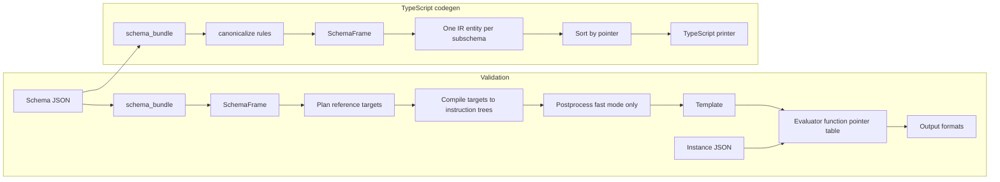
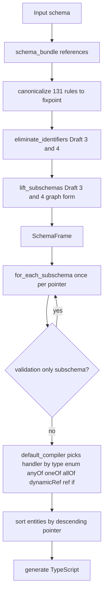

# Blaze — Research report

## Metadata

- **Library name**: Blaze
- **Repo URL**: https://github.com/sourcemeta/blaze
- **Clone path**: `research/repos/cpp/sourcemeta-blaze/`
- **Language**: C++ (CMake build; also a JavaScript port under `ports/javascript`)
- **License**: Dual-licensed: GNU AGPL v3 or later, or a commercial license from Sourcemeta (`LICENSE`).
- **Analyzed version**: 17f980bfd 2026-10-24 (no release tag reachable from `HEAD`: `git describe --tags` fails; a `v1.0.0` tag exists in the clone but points at an unrelated commit `51a6158e5`; `CMakeLists.txt` declares the placeholder `project(blaze VERSION 0.0.1)`)
- **Report date**: 2026-10-26

## Summary

Blaze is an ultra high-performance JSON Schema validator for C++ that compiles a schema into a low-level instruction template and interprets it against instances (boolean, annotation, or trace/standard output). It does not generate validator code. Since the previous report it has grown from a validator into a family of schema-tooling libraries built on Sourcemeta Core: a canonicalizer, an AlterSchema lint/transform rule engine, a dialect converter, an editor-compat layer, a dependency reporter, a JSON-LD output, the BinPack binary serialization format, and a **schema-to-TypeScript type generator** (`src/codegen`, `contrib_typescript`). The TypeScript generator is the only code-generation path: it bundles and canonicalizes the schema, converts every subschema to a typed IR entity (one named TypeScript declaration per subschema), and prints `export type` / `export interface` declarations. Validation remains the primary purpose (the README claims at least 10x faster than popular validators, citing a 2025 paper, and 100% Bowtie compliance).

## JSON Schema support

- **Validation drafts**: Draft 3 (partial for formats), Draft 4, 6, 7, 2019-09, 2020-12 (README; `default_compiler.cc` `supported_vocabularies` lists all of them plus their hyper-schema vocabularies), and the Schema Object dialects of OpenAPI 3.0, 3.1, 3.2 (`OPENAPI_3_0_BASE` etc.) and a `SOURCEMETA_EXTENSION_V1` vocabulary. Draft 3 is new relative to the previous report. Draft-00/01/02 appear only in the lint/canonicalizer tests, not as validation targets.
- **Scope (validation)**: Full for the listed dialects; keywords are dispatched per vocabulary. OpenAPI 3.0 is a closed dialect: an unknown non-`x-` member throws `PROHIBITED_KEYWORD_FOR_DIALECT`. In 2019-09/2020-12, unknown keywords not starting with `$` compile to annotations when annotations are enabled.
- **Scope (TypeScript codegen)**: Much narrower. `default_compiler` in `codegen_default_compiler.h` accepts vocabularies of 2020-12, 2019-09, Draft 7, 6 and 4 (not Draft 3 or OpenAPI) and only the schema shapes that remain after canonicalization. It throws `CodegenUnsupportedKeywordError` for `not`, rejects unlisted sibling keywords via a per-handler whitelist (`ONLY_WHITELIST_KEYWORDS`), and throws `CodegenUnexpectedSchemaError` for anything else.

## Keyword support table

Keyword list: union of `properties` keys in `specs/json-schema.org/draft/2020-12/meta/*.json` (57 keywords). "Implemented" describes validation by the compiler/evaluator (`src/compiler/default_compiler.cc` plus `default_compiler_*.h`); the TypeScript codegen column in Notes states what the generator does with the keyword. Annotation-only keywords compile to `AnnotationEmit` instructions only when `Tweaks::annotations` whitelists them, or when no whitelist is set and `Mode::Exhaustive` is used (`annotations_enabled` in `compile_helpers.h`).

| Keyword | Implemented | Notes |
|---------|-------------|-------|
| $anchor | yes | Resolved by Core `SchemaFrame`; no instruction. Codegen whitelists it. |
| $comment | partial | Shape-checked as a string (`keyword_shape_error`), then skipped: `$`-prefixed keywords fall through `dispatch_keyword`'s 2019-09/2020-12 fallback to no instruction and no annotation. |
| $defs | yes | Container; targets reached via `$ref` jumps. Codegen emits one type per `$defs` entry. |
| $dynamicAnchor | yes | Frame-level; used by `ControlDynamicAnchorJump` and by codegen `$dynamicRef`. |
| $dynamicRef | yes | `compiler_2020_12_core_dynamicref`. Codegen: union of all same-fragment dynamic anchors. |
| $id | yes | Base URI/resolution via Core frame. |
| $ref | yes | `compiler_draft3_core_ref` (shared across drafts); `ControlJump` to precompiled target. Codegen: `CodegenIRReference` alias. |
| $schema | yes | Dialect selection. |
| $vocabulary | yes | Drives vocabulary-based dispatch; unsupported required vocabularies throw. |
| additionalProperties | yes | Draft 3 through 2020-12 and OpenAPI. Codegen: `Record<string, T>` or index signature. |
| allOf | yes | Codegen: intersection type (`A & B`); single branch becomes alias. |
| anyOf | yes | Codegen: union type. |
| const | yes | Draft 6+. Canonicalizer folds `const` to `enum` for codegen. |
| contains | yes | With `minContains`/`maxContains` handled inside the `contains` compiler. Codegen ignores subschemas under it (validation-only). |
| contentEncoding | partial | Annotation only (`compiler_2019_09_content_*`), wrapped in a type check group. |
| contentMediaType | partial | Annotation only. |
| contentSchema | partial | Annotation only. |
| default | partial | Annotation only (via fallback). Codegen whitelists but ignores. |
| dependentRequired | yes | 2019-09/2020-12; `dependencies` for older drafts. |
| dependentSchemas | yes | 2019-09/2020-12. |
| deprecated | partial | Annotation only. |
| description | partial | Annotation only; codegen ignores. |
| else | yes | Evaluated as part of `if`. |
| enum | yes | `AssertionEqualsAny` / hash variants. Codegen: literal union. |
| examples | partial | Annotation only. |
| exclusiveMaximum | yes | Standalone number in Draft 6+; boolean modifier of `maximum` in Draft 3/4/OpenAPI 3.0. |
| exclusiveMinimum | yes | As above. |
| format | partial | Annotation by default; asserted only when `Tweaks::format_assertion`, a schema-level `x-format-assertion: true`, or the 2020-12 format-assertion vocabulary. `ValueStringType` (22 values) covers URI, IRI, email, IPv4/6, hostname, date-time, date, time, duration, JSON Pointer, UUID, regex, color, base64 and others; unlisted formats emit nothing. Codegen ignores. |
| if | yes | `LogicalCondition`. Codegen: `(if & then) | else` approximation. |
| items | yes | Per-draft handlers (array and schema forms), 2020-12 `items` after `prefixItems`. Codegen: `T[]` or tuple. |
| maxContains | yes | Inside `contains` compiler; fallback returns no instructions. |
| maxItems | yes | Size assertions. |
| maxLength | yes | Size assertions (code-point aware via instruction semantics). |
| maxProperties | yes | |
| maximum | yes | |
| minContains | yes | Inside `contains`. |
| minItems | yes | |
| minLength | yes | |
| minProperties | yes | |
| minimum | yes | |
| multipleOf | yes | `AssertionDivisible`; `divisibleBy` for Draft 3. |
| not | yes | `LogicalNot`. Codegen throws unsupported keyword. |
| oneOf | yes | `LogicalXor`. Codegen: union (approximation; exclusivity not expressed). |
| pattern | yes | `AssertionRegex` via Core regex. |
| patternProperties | yes | `LoopPropertiesRegex`. Codegen: template-literal index signatures only for prefix patterns (e.g. `^x-`). |
| prefixItems | yes | 2020-12. Codegen: tuple. |
| properties | yes | Many unrolled/loop variants. Codegen: interface members. |
| propertyNames | yes | Draft 6+. |
| readOnly | partial | Annotation only. Codegen whitelists it and ignores it: `CodegenIRObjectValue::immutable` exists and the printer would emit `readonly`, but `handle_object` hard-codes it to `false`. |
| required | yes | Codegen: non-optional members. |
| then | yes | Part of `if`. |
| title | partial | Annotation only. |
| type | yes | Many specialized type instructions; Draft 3 union/schema types supported. Codegen: string/number/integer/object/array scalars. |
| unevaluatedItems | yes | `LoopItemsUnevaluated`; dependencies computed in `unevaluated.h`. Codegen: whitelisted only beside combinators. |
| unevaluatedProperties | yes | `LoopPropertiesUnevaluated*`. Canonicalizer rewrites it to `additionalProperties` where possible for codegen. |
| uniqueItems | yes | `AssertionUnique`. |
| writeOnly | partial | Annotation only. |

Legacy keywords outside the 2020-12 meta-schemas that are also handled: `definitions`, `dependencies`, `additionalItems`, `$recursiveRef`/`$recursiveAnchor` (2019-09), `nullable` (OpenAPI 3.0), Draft 3 `extends`, `disallow`, `divisibleBy`, and OpenAPI `discriminator`/`xml`/`externalDocs`/`example` (accepted as no-ops).

## Constraints

For validation, every constraint keyword is enforced at runtime by the interpreter; there is no generated validator code. The compiler specializes heavily: `InstructionIndex` has 103 opcodes (e.g. `AssertionTypeStringBounded`, `LoopPropertiesExactlyTypeStrictHash`, `AssertionEqualsAnyStringHash`). Some constraints are fused into type checks, so no separate `minLength` instruction exists in fast mode when `type: string` is present (`compiler_draft6_validation_type` folds `minLength`/`maxLength` into `AssertionTypeStringBounded`/`Upper`; `compiler_draft3_validation_minlength` then returns nothing). For TypeScript codegen, `minLength`, `pattern`, `minimum`, `uniqueItems`, `minItems` etc. are accepted by the per-handler whitelist and dropped; TypeScript types carry structure only. `required`, `enum`/`const`, `additionalProperties` and prefix-only `patternProperties` affect the output.

## High-level architecture

Two independent pipelines share Sourcemeta Core (vendored under `vendor/core`: JSON value and parser, JSON Pointer, URI, regex, `SchemaFrame`, schema walker, `schema_bundle`).

1. **Validation**: `compile(schema, walker, resolver, compiler, mode, ...)` first bundles remote references into the document, frames it, plans reference targets, compiles each target to an instruction tree, and optionally post-processes (fast mode only). The result is a `Template`. `Evaluator::validate` interprets it, optionally with a callback that feeds the `output` library (simple, standard, trace, JSON-LD).
2. **TypeScript codegen**: `codegen::compile` bundles, canonicalizes with the Blaze canonicalizer (a 131-rule fixpoint rewriter), frames, maps each subschema to one IR entity, sorts the entities; `generate<TypeScript>` prints them with a visitor.



Other libraries (CMake options, default ON): `alterschema` (57 `common` transform rules plus 46 `linter` rules, applied by `SchemaTransformer`), `canonicalizer`, `convert` (dialect upgrade/downgrade), `editor`, `dependencies`, `configuration`, `test` runner, `binpack`.

## Medium-level architecture

- **Compiler** (`src/compiler`): `compile.cc` builds a `Context` (frame, resources, reference `targets` map, tweaks, mode, depth counter, `InstructionExtras` accumulator) and compiles every reference target. `compile_subschema` iterates keywords with `SchemaKeywordIterator`, validates each keyword's value shape against the dialect (`keyword_shape_error`), and calls the user `Compiler` function (default: `default_schema_compiler` in `default_compiler.cc`), which dispatches by (vocabulary, keyword) through a long `COMPILE`/`COMPILE_ANY` if-chain into per-draft handler headers (`default_compiler_draft3.h` is about 3.5k lines and later drafts reuse many `compiler_draft3_*` handlers). `postprocess.h` runs only in `Mode::FastValidation`.
- **Evaluator** (`src/evaluator`): `Template`, `Instruction`, `Value` (a `std::variant` of 26 payload types) and a header-only dispatcher (`evaluator_dispatch.h`, about 3k lines): one `INSTRUCTION_HANDLER` template function per opcode, a static `HANDLERS[103]` function-pointer table instantiated for each `<Track, Dynamic, HasCallback>` combination, and `DIRECT_*` forced-inline helpers that let parent instructions evaluate simple children without a table call.
- **Output** (`src/output`): consumers of the evaluator callback: `SimpleOutput` (error list, annotations), `StandardOutput` (`Flag` and `Basic` formats), trace output and JSON-LD.
- **Codegen** (`src/codegen`): `CodegenIREntity` is a `std::variant` of Object, Scalar, Enumeration, Union, Intersection, Conditional, Array, Tuple, Impossible, Any, Reference; every entity carries a JSON Pointer and a `symbol` (vector of name segments from `symbol()`). `mangle()` turns symbols into identifiers (prefix `Schema` by default) and disambiguates collisions by prefixing `_` using an ordered `std::map<std::string, Pointer>` cache.
- **Canonicalizer** (`src/canonicalizer`): `canonicalize.cc` holds a flat vector of 131 rule objects (`SchemaTransformRule` subclasses in `rules/`), an `apply` fixpoint driver, identifier elimination and a Draft 3/4 graph-lifting pass.



## Algorithms and data structures

### Schema representation

The compiler does not build a typed schema model. The schema stays a `sourcemeta::core::JSON` tree (the only in-memory form), and every compiler step takes `const JSON &` views. The JSON value is a tagged union with separate storage for `Integer` (int64), `Real` (double) and `Decimal` (arbitrary precision) numbers (`json_value.h`), so large integers and exact decimals compare by mathematical value across representations (`JSON::operator==`, `divisible_by`).

JSON objects are `JSONObject<Key, Value, Hash>` (`vendor/core/src/core/json/include/sourcemeta/core/json_object.h`): a `std::vector<Entry>` (insertion order preserved), each `Entry{first, second, hash}` storing a precomputed property hash. There is no hash table; lookup (`find`, `defines`, `at`) is a linear scan comparing the stored hash first. The hash (`PropertyHashJSON`, `json_hash.h`) is a 256-bit value (two `uint128`) in which byte 0 is reserved: for keys of 1 to 31 bytes the key bytes are `memcpy`'d into bytes 1..31 (a *perfect* hash, `is_perfect` is true when byte 0 is zero), and longer keys copy the first 31 bytes and put a length/first/last-byte checksum into byte 0 (a lossy hash). For a perfect hash, equality is hash equality plus a length check (two keys differing only by trailing NULs hash equal); otherwise a string comparison follows. Trade-off: no allocation or rehash per object and cache-friendly scans, at O(n) per lookup, which wins for the small objects typical of schemas and instances. Because hashes are stored in the parsed value, the compiler can emit `ValueProperty{name, hash}` pairs and the evaluator never hashes instance keys.

Unknown keywords stay in the tree; the compiler consults the Core *walker* (`SchemaWalker`, `known_walker.cc`) for each keyword to get a `SchemaKeywordType` (Assertion, Annotation, ApplicatorValueTraverseAnyItem, Reference, ...), its vocabulary, and which keywords it depends on. Boolean schemas are handled up front in `compile_subschema`: `true` compiles to no instructions, `false` to a single `AssertionFail` (rejected at a resource root in Draft 4 and earlier and OpenAPI 3.0 via `booleans_are_schemas`). Lifetimes: the `Template` owns copies of everything it needs (`ValueJSON`, strings, regexes) and does not reference the schema afterwards.

### Reference resolution and registry

Resolution is eager and static, and delegated to Core:

1. `compile(...)` (`compile.cc`) calls `schema_bundle` in `References` mode, which inlines remote `$ref` targets (via the pluggable `SchemaResolver`) as embedded resources with `$id`s, then builds a `SchemaFrame` (a map from URI/pointer to `Location{pointer, base, relative_pointer, type, parent, ...}` plus a table of `Reference{destination, ...}` per origin pointer). `max_locations` bounds bundling and framing.
2. Step (1) of the compile function collects every schema resource URI into a sorted, de-duplicated `std::vector<std::string> resources`; the index in this vector is the numeric `schema_resource` stored per instruction (`schema_resource_id`, comment says it is a perfect hash source).
3. Step (3) plans targets. `schema_frame_populate_target_types` scans all references and records for each destination whether it is reached from a normal position (`needs_instance`) or from a `propertyNames` subschema (`needs_name`; the evaluator carries the property name out of band, so the same schema may need two compilations). It then propagates the property-name flag transitively through references located within destinations, in a `while (changed)` fixpoint. The `targets` map is `std::map<tuple<ReferenceType, destination string_view, is_property_name>, pair<index, origin ptr>>`; the entry point is index 0. Only references whose origin is reachable from the entry point (`frame.is_reachable`) get a target, and every dynamic anchor reachable from the entry point is added as a potential override target.
4. Each target is compiled once into its own `Instructions` vector (`compiled_targets[index]`). A `$ref` keyword (`compiler_draft3_core_ref`) looks up the frame reference, fetches the target index from `context.targets`, and emits `ControlJump{value = index}`. Recursive schemas therefore cost nothing extra at compile time: the cycle is represented as an index, not expanded.
5. Dynamic references: `$dynamicRef`/`$recursiveRef` become `ControlDynamicAnchorJump` carrying the anchor fragment string. If the frame shows the reference is not actually dynamic, they compile like `$ref`. `Template::labels` is a `vector<pair<hash, target index>>` built from reachable dynamic anchors using `Evaluator::hash(resource_id, fragment)` (FNV-1a 64 masked to 53 bits so JavaScript can hold it). At evaluation, `Evaluator::resources` is a stack of the `schema_resource` ids of instructions currently being evaluated (pushed in `EVALUATE_PUSH` when `Dynamic`), and `ControlDynamicAnchorJump` scans that stack from the outermost resource inward, hashing `(resource, fragment)` and linear-scanning `labels` with `std::ranges::find_if`, jumping to the first (oldest) match. This matches the spec's "outermost dynamic scope" rule. Cost per jump is O(stack depth x labels).
6. Draft 7 and earlier: a `$ref` overrides sibling keywords (`ref_overrides_sibling_keywords`), so siblings are compiled only to check their shape and then discarded (`default_schema_compiler`).

Cycle detection exists in two places: `is_circular` in `compile_helpers.h` (a visited-set DFS over frame references, used to avoid inlining circular targets) and `PathGuard` in `unevaluated.h` (a scoped insert into a `std::set` of `(pointer, is_static)` so that a self-referencing schema stops the dependency walk). The evaluator also has a runtime guard: `DEPTH_LIMIT = 300` on the instruction recursion depth throws `EvaluationError`.

### Compiled / intermediate form

`Template` (`evaluator.h`): `{bool dynamic; bool track; vector<Instructions> targets; vector<pair<size_t,size_t>> labels; vector<InstructionExtra> extra; vector<string> vocabularies}`. `Instructions = std::vector<Instruction>`, and

```cpp
struct Instruction {
  InstructionIndex type;              // uint8_t opcode
  sourcemeta::core::Pointer relative_instance_location;
  Value value;                        // std::variant payload
  Instructions children;              // nested tree
  std::size_t extra_index;            // index into Template::extra
};
```

So the form is an instruction *tree* (not flat bytecode): control, logical and loop instructions own their `children` vectors, and `ControlJump` links to other trees by index into `targets`. The instance location is a *relative* JSON Pointer (tokens with cached property hashes), so a parent can navigate once and children inherit the cursor, or a child can carry its own sub-path (`/properties/a/b`) and avoid an intermediate instruction.

`Value` is a `std::variant` of 26 alternatives (`evaluator_value.h`), the typed operand per opcode: `ValueType` and `ValueTypes` (a `std::bitset` over JSON types), `ValueRange{min, optional max, exhaustive}`, `ValueRegex{Regex, original string}`, `ValueSet` (an `unordered_set<JSON>` for enum), `ValueStringSet` (a `JSONPropertySet` with precomputed hashes), `ValueProperty{name, hash}`, `ValueNamedIndexes` (a `JSONObject<string, size_t>` mapping property name to child index), `ValuePropertyFilter{strings, prefixes, regexes}`, `ValueStringHashes` (perfect-hash table described below), `ValueTypedHashes`, `ValueObjectProperties` (vector of `(name, hash, required)`, at most 32), `ValueIntegerBounds{int64, int64}`, `ValueIndexPair` (used by `LogicalCondition` for the then/else start offsets), `ValueStringType` (format enum), `ValueNumberType` and others. The handler recovers the payload with `assume_value<T>` which is `std::get_if` plus `SOURCEMETA_ASSUME` (a `__builtin_assume` under clang, an assert otherwise), so no bad-variant check on the hot path.

`InstructionExtra` (`relative_schema_location`, `keyword_location` string, `schema_resource`, `vocabulary`) is "satellite data" kept in a separate vector so that fast evaluation does not touch it; it is read only when `Track` or a callback needs to build evaluate paths/keyword locations. `InstructionExtras::push_back` (compiler.h) throws `CompilerInstructionLimitError` once `Tweaks::max_instructions` is exceeded, because inlining and unrolling copy instruction metadata and an adversarial schema can blow up compile cost.

The opcode set (103) is organized in families: `Assertion*` (leaf checks, many type+bound fusions), `Annotation*` (emit to current/parent location), `Logical*` (Or, And, Xor, Not, Condition, plus `LogicalWhen*` guards), `Loop*` (properties, keys, items, contains, with variants `Evaluate` for tracking, `Except`/`Regex`/`StartsWith` filters, `TypeStrict` fused child checks), and `Control*` (groups, jumps, dynamic jump, evaluate marker). Encoding variants are separate opcodes rather than flags: e.g. `AssertionType` (non-strict: a real that is integral counts as integer) vs `AssertionTypeStrict`, and `...Evaluate` variants that additionally mark the instance as evaluated for `unevaluated*`.

The template can be serialized (`to_json` in `compile_json.cc`, `JSON_VERSION = 9`) and loaded by `from_json`; the JavaScript port under `ports/javascript` interprets the serialized form (not analyzed in depth).

### Core algorithm

**Compile (per keyword).** `compile_subschema` loops over the subschema's keywords in the iterator's order and appends whatever `compiler(...)` returns to a growing `steps` vector; the `current` steps are passed to each handler so later keywords can look at earlier output (for instance the array `type` handler skips its check when the preceding instruction is a `LoopItemsIntegerBoundedSized`). Handlers pick specialized opcodes with compile-time knowledge:

- `type` (`compiler_draft6_validation_type`): in fast mode it returns nothing when `enum`/`const` already pin the type, folds `minLength/maxLength` into `AssertionTypeStringBounded`/`Upper`, `minItems/maxItems` into `AssertionTypeArrayBounded`/`Upper`, `minProperties/maxProperties` into `AssertionTypeObjectBounded`/`Upper`, and drops the object type check when a non-empty `required` rejects non-objects anyway. `number` becomes the bitmask `AssertionTypeStrictAny{Real,Integer,Decimal}`, and `integer` the non-strict `AssertionType` so `1.0` counts.
- `enum` (`compiler_draft3_validation_enum`): one value gives `AssertionEqual`; otherwise options are inserted into a `ValueSet` (duplicates silently skipped), and when every option is a string with a perfect hash (key at most 31 bytes) fast mode emits `AssertionEqualsAnyStringHash` carrying a `ValueStringHashes`; otherwise `AssertionEqualsAny` over the hash set.
- `properties` (`compiler_draft3_applicator_properties_with_options`): chooses between (a) `LoopPropertiesMatch`/`LoopPropertiesMatchClosed` (iterate over *instance* properties and map name to child index through `ValueNamedIndexes`) when `properties_as_loop` decides most properties are optional (`required.size() <= size/4`, more than 5 properties, or a closed object with some optional properties), and (b) unrolled per-property children, wrapped in `ControlGroupWhenDefines[Direct]` unless the property is required. Required-only closed objects with a single type collapse to `LoopPropertiesExactlyTypeStrictHash` (three required perfect-hash keys use `AssertionDefinesExactlyStrictHash3`, an unrolled permutation compare). Objects whose property subschemas are single leaf checks and where nothing else would be disturbed fuse into `AssertionObjectPropertiesSimple`: a single instruction with `ValueObjectProperties` of up to 32 `(name, hash, required)` entries whose children are matched by position, a 32-bit `seen` bitmask to check required properties after one pass over the instance's members, and an inlined `switch` over child opcodes (`CHILD_DIRECT`) that evaluates the common leaf kinds without a function-pointer call.
- Property ordering: `compile_properties` sorts properties by `recursive_template_size` ascending (cheapest first), preferring subschemas that contain a direct `enum`/`const`, then by name, when `Tweaks::properties_reorder` is true, so cheap checks fail fast.
- `allOf` (`compiler_draft4_applicator_allof`): in fast mode without dynamic scopes the branch instructions are spliced directly into the parent (no `LogicalAnd` node); otherwise wrapped in `LogicalAnd`. `anyOf` (`...anyof`): if every branch is a single strict type check the whole disjunction collapses to one `AssertionTypeStrictAny` bitmask (or a single `AssertionTypeStrict`), else `LogicalOr` with `ValueBoolean` = *exhaustive*. `oneOf` always becomes `LogicalXor`. The exhaustive flag is true when in `Exhaustive` mode, when annotations are collected, or when `requires_evaluation` says an `unevaluated*` keyword depends on this subschema's marks; otherwise evaluation short-circuits on the first match.
- `if/then/else` compiles to one `LogicalCondition` whose children are the concatenation `[condition..., then..., else...]` and whose `ValueIndexPair` records the start offsets of `then` and `else`.

**Postprocess** (`postprocess.h`, fast mode only; a comment says more of the default compilers' fast-mode tricks should move here). Per target: `collect_statistics` records instruction count, which `ControlJump` targets are used how often, and whether any instruction requires an empty instance location. Then a `while (changed)` loop walks each target with an explicit stack (not recursion) collecting child lists, bottom-up, and for each list: inlines `ControlJump`s whose target has fewer than `target_inline_threshold` (default 50) instructions, is not self-recursive, when there are no dynamic scopes and the empty-location precondition holds (`duplicate_metadata` copies `InstructionExtra`, `rebase` prefixes instance/schema locations); drops no-op containers with no children (`is_noop_without_children`); folds `LoopProperties` with a single `AssertionTypeStrict[Any]/AssertionType` child into `LoopPropertiesType*`; converts instance-property-path type assertions into `AssertionPropertyType*` variants; and `fuse_numeric_bounds` merges `type: integer` with `minimum`/`maximum` siblings into `AssertionTypeIntegerBounded[Strict]`/`LowerBound`/`AssertionNumberIntegerBounded`. Disjunction, conditional and positional (`AssertionObjectPropertiesSimple`) child lists are marked `disjoint`/`positional` so subsumption and expansion do not cross branch boundaries.

**Evaluate.** `Evaluator::validate` picks one of four instantiations of `evaluate_impl<Track, Dynamic, HasCallback>` (a callback forces `<true,true,true>`; otherwise `track` and `dynamic` from the `Template`), builds a `DispatchContext`, and runs `evaluate_instruction` over `targets[0]`, stopping at the first failing instruction. `evaluate_instruction` is: check `depth > DEPTH_LIMIT`, then `HANDLERS<...>[to_underlying(type)](instruction, instance, depth, context)`, an indirect call through a constexpr array indexed by the opcode byte (it is a table of function pointers, not a `switch`). Each handler follows a macro skeleton: `EVALUATE_BEGIN*` resolves the instance (`resolve_instance` walks the relative pointer unless empty), applies a precondition (returning `true` immediately when the type does not apply, so e.g. `minimum` is vacuous on strings), `EVALUATE_PUSH` pushes the evaluate path / instance location / resource only `if constexpr` they are needed, then sets `result` and `EVALUATE_END` pops and returns. Because the three bool template parameters are compile-time, the fast path has no tracking code at all. Failures short-circuit by returning `false`; logical instructions decide how to combine child results.

Specifics worth knowing:

- `LogicalOr`: non-exhaustive loops until the first success; exhaustive runs all branches. Under `Track`, each branch records `checkpoint = evaluated.size()` and `rewind(checkpoint)` on failure, so a failed branch contributes no evaluation marks. `LogicalXor` counts matches. `LogicalNot` succeeds when any child fails (empty children means failure). `LogicalCondition` rewinds the condition's marks if it fails.
- `LoopContains` handles `minContains`/`maxContains` with the `ValueRange` and its `exhaustive` flag: it stops early on exceeding the maximum or, if there is no maximum and not exhaustive, on reaching the minimum.
- Strings are compared by *code points*: `JSON::size` counts bytes that are not UTF-8 continuation bytes, so `minLength/maxLength` are O(string length) per evaluation.
- `uniqueItems` uses `JSON::unique()`: hashes every element into a thread-local `vector<uint64_t>`, then for each element scans forward only over equal hashes and confirms with full equality, so it is O(n^2) in the worst case but near-linear with distinct hashes.
- `multipleOf` uses `JSON::divisible_by`: integer remainder when both are int64, an exact `Decimal` path when a real or integer exceeds the double significand, and a real path otherwise.
- Annotations (`AnnotationEmit`, `AnnotationEmitWrapped`, `AnnotationToParent`, `AnnotationBasenameToParent`) exist only as callback events; they do nothing without a callback (`EVALUATE_ANNOTATION` is guarded by `HasCallback`).

**Unevaluated tracking.** At compile time `unevaluated()` (`unevaluated.h`) builds `SchemaUnevaluatedEntries` (a `std::map<URI string, entry>`) for every subschema that has `unevaluatedProperties` or `unevaluatedItems`. For each, `find_adjacent_dependencies` walks the subschema and its in-place applicators (`allOf`, `anyOf`, `oneOf`, `if/then/else`, `$ref` targets, `dependentSchemas`...) collecting the locations of `properties`, `patternProperties`, `additionalProperties` (resp. `prefixItems`, `items`, `contains`) keywords into `static_dependencies` (reached unconditionally) or `dynamic_dependencies` (reached through a branching applicator), with `unresolved = true` if a `$dynamicRef` is in the way. This is a recursive DFS with a `PathGuard` cycle cut. The compiler then specializes: if all dependencies are static, `unevaluatedProperties` compiles to a plain `LoopPropertiesExcept` with a filter of the statically known names, prefix patterns (via `pattern_as_prefix`) and regexes (no runtime tracking); if `additionalProperties`/`unevaluatedProperties` already covers it, it compiles to nothing. Only when dynamic dependencies, unresolved references, or `requires_evaluation` hold does it emit the tracking forms: producers emit `ControlEvaluate`/`Evaluate` markers or `...Evaluate` opcode variants, and the consumer is `LoopPropertiesUnevaluated[Except]` or `LoopItemsUnevaluated`. `Template::track` is set when mode is not fast, or `requires_evaluation` holds for the entry point, or any `unevaluatedItems` exists (a TODO notes `unevaluatedItems` is not yet analyzed as precisely as properties).

At runtime the evaluated set is `Evaluator::evaluated`, a `vector<Evaluation{const JSON *instance, WeakPointer evaluate_path, bool skip}>`. `evaluate(target)` appends; `is_evaluated(target)` scans the vector *in reverse* for an entry with the same instance pointer, not skipped, whose evaluate path has `starts_with_initial` of the current path; `unevaluate()` (used by `not`) marks entries under the current path as `skip`. Marking is keyed by instance *address*, so the instance document must outlive and not move during evaluation. Cost: each query is O(entries) with path comparisons, so objects with many properties under `unevaluatedProperties` are roughly O(properties x marks); the compile-time static-filter specialization above exists to avoid this in the common case.

**Fast vs exhaustive.** `Mode::FastValidation` ("attempt to get to a boolean result as fast as possible") enables all the fusions, postprocessing, short-circuiting `anyOf`/`oneOf`, and emits annotations only for keywords in `Tweaks::annotations`. `Mode::Exhaustive` runs every branch and emits annotations for all annotation keywords, disables the string-hash enum optimization ("can affect error messages"), keeps `LogicalWhenType` wrappers, and skips `postprocess`. Passing a callback to `validate` always uses the tracking/dynamic/callback instantiation regardless of how the template was compiled, but a template compiled in fast mode has fused instructions, so reported errors describe those fused opcodes.

**Codegen algorithm.**

1. `schema_bundle(References)`: inline remote refs.
2. `canonicalize(...)`: `std::vector<Rule>` of 131 `SchemaTransformRule` objects, each with `condition(schema, root, vocabularies, frame, location, walker, resolver) -> bool`, `transform(schema&)`, optional `rereference(...)`, and a `reframe_after_transform` flag. The driver `apply` is a fixpoint: build a `SchemaFrame`, then `frame->any_subschema` visits subschemas top-down (each pointer once per pass, tracked in `visited`); at each subschema it tries rules in vector order and applies the first whose `condition` is true. Before a transform it snapshots every pointer-fragment reference (`PotentiallyBrokenReference`); after the transform it calls `rule->rereference` to rewrite references into moved subschemas, re-checks (in debug) that the condition is now false, and records `(pointer, rule name, resulting JSON)` in `processed_rules` (an assert-only check that a rule never re-fires on identical output). A transform that reframes, or fixes references, stops the traversal (returns `true` from the visitor) so the outer `while (true)` rebuilds the frame and restarts; the loop ends when a whole pass applies nothing. Cost: one full frame rebuild per reframing transform, so roughly O(transforms x schema size x rules); the design buys simplicity and correctness of references at the expense of speed. Rule examples: `type_array_to_any_of`, `enum_split_by_type` (mixed-kind `enum` into one branch per JSON type), `duplicate_enum_values` (order-preserving dedupe via `unordered_set<JSON>`), `const_as_enum`, `type_boolean_as_enum`/`type_null_as_enum`, `allof_merge_compatible_branches` (merges a type-only branch into a sibling when keywords do not overlap and no references go through it), `unevaluated_properties_to_additional_properties`, `inline_single_use_ref`, `dependent_required_to_any_of`, `required_property_implicit`, `flatten_nested_allof`, `single_branch_allof`. Each rule gates on vocabularies via `ONLY_CONTINUE_IF`.
3. After the fixpoint: `eliminate_identifiers` (Draft 3/4 only: rewrite every `$ref` to a local JSON Pointer or absolute URI, then erase every `id`), and `lift_subschemas` (Draft 3/4 only, see Model deduplication).
4. Re-frame, then `frame.for_each_subschema` once per distinct pointer (`unordered_set<WeakPointer>`), skipping subschemas under keywords whose Core walker type is `ApplicatorValueTraverseAnyPropertyKey` (`propertyNames`) or `ApplicatorValueTraverseAnyItem` (`contains`; also OpenAPI 3.0 `items`), recursively through ancestors (`is_validation_subschema`). Each remaining subschema yields exactly one entity via `default_compiler`.
5. `default_compiler` is a shape dispatcher in a fixed order: boolean `true`/`false` to Any/Impossible; `type` string to String/Object/Integer/Number/Array handlers; else `enum`, `anyOf`, `oneOf`, `allOf`, `$dynamicRef`, `$ref`, `if`; `not` throws; anything else throws `CodegenUnexpectedSchemaError`. It trusts the canonicalizer to have reduced everything to these shapes (asserts such as "Guaranteed by canonicalisation: `properties` defined"). Each handler first calls `ONLY_WHITELIST_KEYWORDS`, which throws `CodegenUnsupportedKeywordError` for any member outside the shape's whitelist (`definitions` is always allowed). It also first checks vocabularies against a fixed `SUPPORTED` set (2020-12 and 2019-09 vocabularies, Draft 7, 6, 4).
6. Sort entities with `operator<` on the pointer in *descending* order (`right < left`), so deeper/later pointers come before ancestors, which puts referenced members before their parents in the output.
7. `generate<TypeScript>` visits each entity, printing `export type`/`export interface`. Names are computed lazily at print time by `mangle(prefix, pointer, symbol, cache)`: `symbol_to_identifier` uppercases the first letter of each word, keeps `_`/`$`, replaces other characters with word breaks, prefixes digit-leading segments with `_`; then, on a name already in the ordered cache for a different pointer, prefixes `_` until free. `symbol()` derives name segments by climbing the frame parents from the location, using `$ref`/`$id` URI path segments (file stem for `file:` URIs) and property names or array indexes.

### Error and output model

The evaluator has no built-in error type for validation failures; it returns `bool`. Rich output is produced through the `Callback` (`std::function`) invoked with `(EvaluationType Pre|Post, bool valid, const Instruction &, const InstructionExtra &, const WeakPointer &evaluate_path, const WeakPointer &instance_location, const JSON &annotation)`. Evaluate path and instance location are maintained incrementally as `WeakPointer`s (non-owning token stacks) by the `EVALUATE_PUSH/POP` macros, only when `Track`/`HasCallback` is on. `describe()` (`evaluator_describe.cc`, about 2.9k lines) renders a message per opcode from the instruction, instance and annotation.

`SimpleOutput` (`output_simple.cc`) is the main collector: for successful non-annotation steps it takes a fast path that only maintains a mask stack; failures append `{message, instance_location, evaluate_path, schema_location}` entries. Branching instructions (`LogicalOr/Xor` as Disjunction, `LoopContains` as Element, `LogicalCondition/Not` as Subschema) push `MaskEntry`s carrying `buffered_traces` and an `annotations_mark`, so errors from branches that ultimately succeed (e.g. one failing `anyOf` arm) are buffered and discarded, and annotations produced by a failing unit are erased from the recorded mark onward. Other outputs: `StandardOutput` (`output_standard.cc`), trace output, JSON-LD (`output_jsonld.cc`, about 1.9k lines). Schema-side exceptions use dedicated types: `CompilerError(base, schema pointer, message)` for invalid keyword shapes, `CompilerReferenceTargetNotSchemaError`, `CompilerInvalidRegexError`, `CompilerInstructionLimitError`, `CompilerDepthLimitError`, `EvaluationError` (depth limit), and `Codegen*Error` types.

## Low-level details

- **Numbers**: three representations (int64, double, arbitrary-precision `Decimal`) with exact cross-type equality and ordering (`cross_numeric_ordering`). Type checks treat an integral real/decimal as an integer in non-strict `AssertionType` (e.g. `1.0` is an integer) and `effective_type_strict_real` maps integral decimals to Integer in strict mode. Integer bound instructions compare in `Decimal` when a value does not fit int64 (`integer_within_bounds`/`as_decimal`). A `minLength`/`maxItems` bound too large to represent compiles to an always-failing check (`bound_is_representable`). Bounds in `ValueIntegerBounds` are int64; real/decimal elements in `LoopItemsIntegerBounded` are compared through `double`.
- **String length**: code points via UTF-8 lead-byte counting (`JSON::size`), not bytes or UTF-16 units.
- **Recursion limits**: compile-time recursion is real recursion through keyword handlers, bounded by `Tweaks::max_depth` via the RAII `DepthGuard` (throws `CompilerDepthLimitError`); `find_adjacent_dependencies` and `is_circular` are recursive with visited sets; postprocess uses explicit stacks. Evaluation recurses on the C++ stack and is bounded by `DEPTH_LIMIT = 300` (an `LoopItems` direct path skips the check for its direct children, guarded by `depth < DEPTH_LIMIT`). Codegen `is_validation_subschema` and the canonicalizer's graph lifter (`walk`, `collect`) are recursive over schema structure.
- **Untrusted schema hardening**: `Tweaks::max_instructions`, `max_depth`, bundling/framing `max_locations`, regexes compiled with default PCRE2 match limits, and a closed OpenAPI 3.0 dialect that rejects unknown non-`x-` keywords (`PROHIBITED_KEYWORD_FOR_DIALECT`). Keyword value shapes are validated at compile time per dialect (`keyword_shape_error`), so a schema that its meta-schema rejects usually throws `CompilerError`.
- **Property names**: schemas under `propertyNames` are compiled with `is_property_name = true`; the evaluator applies them to a null placeholder and passes the actual name through `DispatchContext::property_target` (`EVALUATE_RECURSE_ON_PROPERTY_NAME`), so string assertions like `AssertionRegex` read the name via `resolve_string_target`.
- **Codegen specifics**: `$ref` is bundled in `References` mode, `handle_ref` emits `CodegenIRReference{pointer, target}` printed as `export type A = B;`. Object members follow the schema's property iteration order, always quoted, `?` when not required, the IR has an `immutable` flag and the printer emits `readonly` for it, but `handle_object` always sets it to `false` (no code anywhere derives it from `readOnly`). Typed-only additional properties with no members become `Record<string, T>`; an object allowing any additional properties with no members becomes `Record<string, unknown>`; otherwise an index signature that unions every member type, pattern type and additional type with `undefined` (comment documents the TypeScript limitation); prefix `patternProperties` become template-literal index signatures. `if/then/else` prints `(If & Then) | Else`. `true` prints `unknown`, `false` prints `never`, `[null]` prints `null`, `[true,false]` prints `boolean`, integer and number both print `number`.
- **Not verified**: the internals of `SchemaFrame`/`schema_bundle`, BinPack, `convert`, `editor`, `dependencies`, and `ports/javascript` were not read in detail.

## Output and integration

- **Vendored vs build-dir**: No checked-in generated output. Templates are in memory or serialized as JSON; TypeScript text is written to a stream.
- **API vs CLI**: C++ libraries (installed CMake targets `sourcemeta::blaze::*`), optional `contrib` programs when `BLAZE_CONTRIB=ON`: `compile`, `validate`, `trace`, `perf`, `canonicalize`, `typescript` (`contrib/typescript.cc`, takes a schema path and `--default-prefix`), `upgrade`, `jsonld`. The separate Sourcemeta `jsonschema` CLI (not in this repo) wraps Blaze. A JavaScript port (`@sourcemeta/blaze`) evaluates serialized templates in JS.
- **Writer model**: Codegen is generic over `std::ostream&` (`generate<T>(std::ostream&, result, prefix)`); the printer writes directly to the stream.

## Configuration

- **Validation**: `Mode`, `Tweaks` (unroll, reorder, inline threshold, `format_assertion`, annotation whitelist, `max_instructions`, `max_depth`), default dialect, default id, entrypoint.
- **Codegen**: dialect/id defaults and a type-name prefix; custom `CodegenCompiler` function can replace `default_compiler`. No options for naming style, optional/null mapping, or map types.
- **Build options** (`CMakeLists.txt`): `BLAZE_COMPILER`, `BLAZE_EVALUATOR`, `BLAZE_OUTPUT`, `BLAZE_TEST`, `BLAZE_CONFIGURATION`, `BLAZE_ALTERSCHEMA`, `BLAZE_CODEGEN`, `BLAZE_CANONICALIZER`, `BLAZE_CONVERT`, `BLAZE_EDITOR`, `BLAZE_DEPENDENCIES`, `BLAZE_BINPACK`, `BLAZE_TESTS`, `BLAZE_BENCHMARK`, `BLAZE_CONTRIB`, `BLAZE_DOCS`, `BLAZE_INSTALL`, address/undefined sanitizers. CMake 3.24+.

## Pros/cons

- **Pros**: Very fast interpreter design with extensive opcode specialization; broad dialect coverage including Draft 3 and OpenAPI 3.0-3.2; schema-agnostic serializable templates; annotations and standard output; strong tooling around it (canonicalizer, lint rules, dialect conversion); TypeScript generator built on canonicalization so many equivalent schemas produce the same shapes; deterministic output; large test corpus and Bowtie compliance.
- **Cons**: The only code generator targets TypeScript and is strict (throws on `not`, unknown sibling keywords, unsupported vocabularies); constraints are dropped; `oneOf` and `if/then/else` are approximated; no naming configuration; depends on Sourcemeta Core vendored tree; AGPL-3.0 (or commercial) licensing; no release tag in the clone.

## Testability

- **Tests**: `BLAZE_TESTS=ON`, run with CTest (`make test` after `make configure compile`; CI runs `make -C schemas ci` and a CMake matrix). Test directories: `alterschema`, `binpack`, `canonicalizer` (with `canonicalizersuite.cc` and draft3/draft4 fixture dirs), `codegen`, `compiler`, `configuration`, `convert`, `dependencies`, `editor`, `evaluator`, `output`, `packaging`, `test`.
- **Evaluator**: per-dialect JSON fixtures (draft3 through 2020-12, OpenAPI 3.0-3.2, valid and invalid variants), `officialsuite.cc` runs the vendored JSON Schema Test Suite (`vendor/jsonschema-test-suite`), `annotationsuite.cc` runs its annotations tests, `tracesuite*.cc` checks trace output.
- **Codegen**: `codegen_test.cc`, `codegen_2020_12_test.cc`, `codegen_mangle_test.cc`, `codegen_symbol_test.cc`, and `test/codegen/e2e/typescript/2020-12` (an e2e runner `e2e.cc` that compiles generated TypeScript fixtures).
- **Running against our generator**: the codegen e2e fixtures and the official test suite JSON are reusable schema corpora.

## Performance

Analyzed from code only; nothing was built or run.

### Performance techniques

- **Compile vs interpret**: Blaze is an ahead-of-time *specializing compiler to an interpreter IR* (no native code, no source generation). Done once at compile time: bundling and framing; reference target planning and one compilation per target; vocabulary dispatch and keyword-shape validation; property-name hashing (`ValueProperty`, `ValueStringHashes`); regex compilation (`ValueRegex` built in `parse_regex`); enum set and perfect-hash table construction; choosing among the 103 specialized opcodes; static dependency analysis for `unevaluated*` (`unevaluated()`); property reordering by recursive instruction count; fusing numeric bounds and type checks; inlining small `ControlJump` targets (fewer than 50 instructions by default, non-recursive, no dynamic scopes); folding `anyOf` of types into a type bitmask; dropping vacuous instructions (`is_noop_without_children`). Done per validation: walking the instruction tree, resolving relative pointers, dispatch through the opcode table, and, only when needed, evaluation tracking. Three booleans (`Track`, `Dynamic`, `HasCallback`) are template parameters so tracking code is compiled out of the fast path; the `Template` carries `track` and `dynamic` flags so a schema without `unevaluated*` dependencies or `$dynamicRef` never pays for them.
- **Memory layout and allocation**: Instructions are a tree of `std::vector<Instruction>` (pointer-chasing but small), with cold data (`InstructionExtra`: schema locations, keyword-location strings) split into a side vector so the hot struct has only opcode, a relative `Pointer`, a variant payload and children. Parsed JSON objects are `vector<Entry>` with precomputed hashes (no per-object hash table); the perfect property hash makes key comparison a fixed-size integer compare plus a length check. The evaluator avoids heap allocation per instruction: the evaluate path and instance location are `WeakPointer` token stacks pushed and popped in place (and only when tracking/callback), `ControlJump` reuses the target vector by reference, and `AssertionObjectPropertiesSimple` uses a 32-bit `seen` mask on the stack. Known allocation hot spots remain: `AssertionEqualsAny` on a property name constructs a `JSON{string}` copy (TODO in source), `AnnotationToParent` copies the instance location (TODO), `JSON::unique` uses a thread-local scratch vector, and `Value` is a 26-way `std::variant` whose size is that of its largest alternative (e.g. `ValuePropertyFilter` tuple), which bloats every `Instruction`. Small handler functions are `static inline` and `DIRECT_*` helpers are `SOURCEMETA_FORCEINLINE`.
- **Caching and memoization**: Compiled templates are values the caller owns; there is no global schema cache or registry across `compile` calls. Within a compile, every reference target is compiled once and shared by index (`targets_map`), and the resource-id list is a sorted vector reused by every instruction. Regexes are compiled once per occurrence and held by `shared_ptr<void>` (PCRE2 code) inside `ValueRegex`; PCRE2 match data is allocated once per thread (`thread_local pcre2_match_data`) and reused. No memoization of validation results.
- **Fast paths and short-circuiting**: (1) Immediate-vacuous preconditions in `EVALUATE_BEGIN*` return `true` before any path bookkeeping when the instance type does not apply. (2) `Mode::FastValidation` stops at the first failing instruction at every level; `anyOf` and `oneOf` run non-exhaustively unless something needs their annotations or evaluation marks (`LogicalOr` breaks on first success). (3) Cheapest-first property ordering and "closed object" shortcuts: `LoopPropertiesMatchClosed` fails the moment an instance key is not a declared property; `LoopPropertiesExactlyTypeStrictHash` assumes the instance's property order matches the schema's and verifies by hash in a single pass, falling back to a scan from where order diverged; `AssertionDefinesExactlyStrictHash3` unrolls all six permutations of three hashes. (4) `AssertionEqualsAnyStringHash` consults a size-indexed "table of contents" (`ValueStringHashes.second[len] = (first,last)` range into hash-sorted entries) so only same-length candidates are hashed-compared. (5) Opcode fusion avoids interpretive layers: `AssertionTypeStringBounded`, `AssertionTypeIntegerBounded`, `LoopItemsIntegerBoundedSized`, `LoopPropertiesTypeStrict`, `AssertionObjectPropertiesSimple` with an inlined `switch` over leaf child opcodes (`CHILD_DIRECT`), `LoopItems` with an inlined `AssertionTypeArrayBounded` child when untracked. (6) Regex short-circuits: trivial patterns skip the engine entirely (see Regex). (7) Property-name loops: `LoopPropertiesMatch` iterates the *instance* keys and looks each up in a small `ValueNamedIndexes` rather than iterating all schema properties when most are optional. (8) `type`-implied checks are elided (a non-empty `required` or an all-same-type `enum` removes the `type` assertion).
- **Regex handling**: Core `to_regex` (`vendor/core/src/core/regex/regex.cc`) returns a `std::variant<Prefix, NonEmpty, Range, PCRE2, Noop>`. With `optimise_for_match` it recognises `.*`-style patterns as `Noop` (always true), `.+`/`.` as `NonEmpty`, `^literal(.*)?` as `Prefix` (a `starts_with`), and `^.{m,n}$` as `Range` (code-point count between bounds); these are matched by `matches()` without invoking an engine. Everything else is translated (`translate_permissive`, an ECMA-262 to PCRE2 translation with an I-Regexp mode too) and compiled with `PCRE2_UTF | PCRE2_UCP | PCRE2_DOTALL | PCRE2_DOLLAR_ENDONLY | PCRE2_NEVER_BACKSLASH_C | PCRE2_MATCH_INVALID_UTF | PCRE2_ALLOW_EMPTY_CLASS`, then JIT-compiled (`pcre2_jit_compile(PCRE2_JIT_COMPLETE)`). Matching passes a null context so PCRE2's built-in match/depth limits apply, which bounds catastrophic backtracking; exhausting a limit (including the JIT stack on long inputs) counts as a non-match. Note the prefix pre-parse uses `std::regex` on the *pattern* at compile time only. `patternProperties` matching is a linear loop over patterns per instance key (`LoopPropertiesRegex`), with `^prefix` patterns reduced to `LoopPropertiesStartsWith`.
- **Concurrency**: A `Template` is immutable during evaluation and may be shared across threads; the mutable state (`evaluate_path`, `instance_location`, `resources`, `evaluated`) lives in the `Evaluator` object, so use one `Evaluator` per thread. `validate` asserts that paths are empty at entry. Compilation itself is single-threaded. There is no parallel validation or parallel codegen. The only shared mutable state is thread-local (PCRE2 match data, the `unique` scratch buffer).

### Benchmarks in repo

- **Location**: Google Benchmark target `sourcemeta_blaze_benchmarks` (`BLAZE_BENCHMARK=ON`, `benchmark/CMakeLists.txt`). `benchmark/e2e/runner.cc` runs compile and evaluate over about 40 real-world schema directories (each `schema.json` plus `instances.jsonl`: adaptivecard, ansible-meta, aws-cdk, babelrc, clang-format, cmake-presets, code-climate, cql2, deno, dependabot, geojson, helm-chart-lock, importmap, openapi, vercel and more, including `draft-04`); `benchmark/micro/{draft4,draft6,draft7,2019_09,2020_12}.cc` hold per-dialect micro benchmarks with `schemas` and `instances` fixtures; `benchmark/alterschema.cc`, `convert.cc`, `jsonld.cc`, `test.cc` cover the other libraries. `contrib/perf.cc` (Linux) and `ports/javascript/benchmark.mjs` also exist.
- **What is measured**: wall time of compile and of `Evaluator::validate`. The README cites the paper "Blaze: Compiling JSON Schema for 10x Faster Validation" (arXiv 2503.02770) for cross-implementation comparisons.
- **Entry points for our harness**: `sourcemeta::blaze::compile` + `Evaluator::validate`; `contrib_validate`; `contrib_compile`; for codegen, `contrib_typescript <schema>` (writes TypeScript to stdout).

## Determinism and idempotency

Compilation and evaluation are deterministic for a given input and `Tweaks` (property order within `compile_properties` is sorted by instruction count then name when reordering is on; `std::map`/sorted vectors are used for targets and resources). Codegen output order is deterministic: entities are sorted by pointer (descending), identifiers are produced by a pure function of the symbol plus a collision cache in an ordered `std::map` consulted in print order, and object members follow the schema's insertion-ordered property vector (the Core object is a `vector<Entry>`, so JSON key order from the input is preserved, not alphabetized). Because names derive from pointers and `$ref`/`$id` URI path segments, a small schema edit mostly changes names and entries locally, but collision resolution depends on print order, so renaming/adding one entity can shift a `_` prefix onto a later colliding name. The canonicalizer is written to be idempotent: the fixpoint ends only when no rule applies, `processed_rules` asserts no rule re-fires on identical output, and the Draft 3/4 lift loop repeats "until neither changes anything, otherwise canonicalising a second time would keep going". It is not tested here by execution.

## Enum handling

- **Validation**: `compiler_draft3_validation_enum` throws `CompilerError` for an empty or non-unique `enum` in Drafts 3, 4, 6 and 7 (`EXPECTED_UNIQUE_VALUES`), but in 2019-09 and later duplicates are accepted and silently deduplicated while building the `ValueSet` (`options.insert(...).second`). Empty `enum` in newer dialects compiles to `AssertionFail`; one value to `AssertionEqual`. Values compare by exact JSON equality (numbers across int/real/decimal by value), so `"a"` and `"A"` are distinct options.
- **Codegen**: The canonicalizer runs `duplicate_enum_values` (order-preserving dedupe), `enum_split_by_type` (a mixed-kind `enum` becomes `anyOf`/`type` branches per kind), `enum_filter_by_type`, `const_as_enum`, and the `type_boolean_as_enum`/`type_null_as_enum` rules before `handle_enum`. Values print as a union of JSON literals (`"a" | "A"`), so case-differing values stay distinct and neither is lost; `[null]` becomes `null` and `[true,false]` becomes `boolean`. There are no named variants, so no name collisions arise.

## Reverse generation (Schema from types)

No. No C++ or TypeScript type to JSON Schema generation exists (BinPack and JSON-LD are unrelated serialization/annotation features).

## Multi-language output

TypeScript only today. `generate<T>(std::ostream&, CodegenIRResult, prefix)` instantiates a visitor type `T` over the IR variant (`TypeScript` in `codegen_typescript.cc`), so another backend would be another visitor class, but none exists in the repo.

## Model deduplication and $ref/$defs

For codegen of 2019-09/2020-12/Draft 6-7 inputs, there is **no structural deduplication**: one entity (hence one named TypeScript declaration) is emitted per subschema location, including trivial leaves, so two identical inline object shapes become two differently named types (names from their pointers). `$defs`/`definitions` entries are themselves subschemas and so get their own declarations; a `$ref` becomes `export type A = B;`; a single-branch `allOf` becomes an alias. External references are bundled first. Rules such as `inline_single_use_ref` and `single_branch_allof` and the canonicalizer's reduction of equivalent forms can collapse some wrappers, but not merge equal-but-separate shapes.

For Draft 3 and Draft 4 inputs (excluding the OpenAPI 3.0 dialect) the canonicalizer's final `lift_subschemas` pass rewrites the document into a **graph form**: every subschema becomes an entry `#/definitions/N`, nesting is replaced by `$ref`, and the root becomes a one-element wrapper referencing the entry point. It then merges entries that "say the same thing": each body is reduced to a skeleton (its references blanked), bodies with equal skeletons start in one class, and classes are repeatedly split by the classes of the entries their references lead to (partition refinement on the reference graph, a fixpoint equivalent to bisimulation); each class becomes one entry, renumbered in a deterministic graph walk, with single-reference "edge" entries collapsed. So for Draft 4 input, structurally identical subschemas (including identical leaf types) do dedupe into one declaration. This pass is quadratic-ish in the number of entries (linear `find`s over vectors) and is gated to Drafts 3/4 only; the Draft 3 vocabulary is then rejected by the codegen handlers' `SUPPORTED` set, so in practice the dedup applies to Draft 4 input to codegen. For validation, each `$ref` target is compiled once and reached by `ControlJump` (inlined when small).

## Validation (schema + JSON -> errors)

Yes, this is the primary purpose. Flow: `compile(...)` to a `Template`, then `Evaluator::validate(template, instance)` for a boolean, or with a callback for step-level results which `output` formats as simple, standard, trace, or JSON-LD (see Error and output model). Instances and schemas are Core `JSON`. A pluggable resolver handles `$id`, `$ref` and remote references. There is no separate API that validates a schema against its meta-schema; malformed keyword values throw `CompilerError` during compile, and meta-schema validation can be done by compiling the dialect's meta-schema. CLI-style access via `contrib_validate`/`contrib_trace`. A schema-driven test runner library (`src/test`) executes test files with `valid` expectations. Format assertion is off by default (annotation) and is enabled with `Tweaks::format_assertion`, `x-format-assertion: true` or the 2020-12 format-assertion vocabulary.
