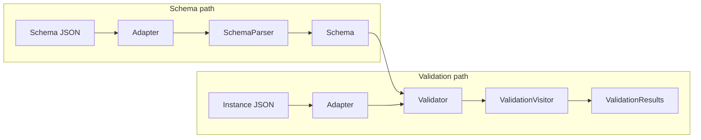

# Valijson — Research report

## Metadata

- **Library name**: Valijson
- **Repo URL**: https://github.com/tristanpenman/valijson
- **Clone path**: `research/repos/cpp/tristanpenman-valijson/`
- **Language**: C++
- **License**: Simplified BSD License (see LICENSE in repo)
- **Analyzed version**: af23835 2026-10-19 (master, 8 commits after tag v1.1.3; v1.1.x series)
- **Report date**: 2026-10-27

## Summary

Valijson is a header-only JSON Schema **validation** library for modern C++. It does **not** generate code. It loads a JSON Schema (via an adapter over a JSON parser), parses it into an internal `Schema` representation (subschemas and constraints), then validates JSON documents against that schema. Supported JSON Schema drafts are draft-03 (deprecated), draft-04, and draft-07; the default parser version is draft-07. Validation is adapter-based: the same schema can be used with multiple JSON parser back ends (RapidJSON, nlohmann/json, Boost.JSON, jsoncpp, PicoJSON, Qt, Poco, etc.). A C++17-capable compiler is required for the current master branch (v1.1.x); legacy v1.0.x targets C++14 and a v1.2.x C++20 line is planned. `PLAN.md` outlines a roadmap to draft 2020-12 (a `kDraft202012` mode, `$defs`, `prefixItems`, `$anchor`, `unevaluated*`, `$dynamicRef`); none of it is implemented yet except `$id` work noted as in progress. The core headers total about 8k lines (`schema_parser.hpp` ~2.6k, `validation_visitor.hpp` ~2.1k).

## JSON Schema support

- **Drafts**: Draft-03 (deprecated), draft-04, draft-07. The `SchemaParser` constructor accepts a `Version` enum: `kDraft3`, `kDraft4`, `kDraft7` (default).
- **Scope**: Validation only (schema + instance → valid/invalid + error list). No code generation.
- **Subset**: README states that Valijson supports "most of the constraints defined in Draft 7"; main exceptions are **default** (not enforced on instance) and **format** (optional; only date, time, date-time are validated when present; unrecognised formats are treated as valid). The README now states `default` is annotation-only and that only `date`, `time`, `date-time`, and `ipv4` formats are enforced (code also enforces `hostname`; README is stale on that). JSON References: local refs supported; remote refs require user callbacks. The draft-07 `ref.json` and `refRemote.json` suite files are run in full; the only skipped cases are one draft-03 sibling-`id` `$ref` case (needs a schema registry/canonical URI handling) and the hostname A-label (punycode) case. `uri.md` documents known RFC 3986 URI-resolution deviations in `resolveRelativeUri`.

## Keyword support table

Keyword list derived from the vendored draft-07 meta-schema (`specs/json-schema.org/draft-07/schema.json`), the highest draft the library targets (draft-04 `id` and draft-03 `extends`/`divisibleBy` also noted). Implementation evidence re-verified by grep in `include/valijson/schema_parser.hpp` (keyword dispatch via `object.find("...")`), `include/valijson/validation_visitor.hpp`, and `tests/test_validator.cpp`.

| Keyword | Implemented | Notes |
|---------|-------------|-------|
| $id | yes | `idKeyword()` returns `$id` for draft-07 and `id` for draft-03/04; used to compute resolution scope for `$ref` (`resolveId`). |
| id | yes | Draft-03/04 counterpart of `$id`; same scope handling. |
| $schema | no | Not read; ignored (version is chosen via the `SchemaParser` constructor). |
| $ref | yes | Resolved during parse; chain of $ref followed; schema registry and optional fetch callback for remote refs. |
| $comment | no | Not parsed or stored. |
| title | yes | Stored on subschema; not used for validation. |
| description | yes | Stored on subschema via setSubschemaDescription; not used for validation. |
| default | no | Annotation only; not stored or applied (README: does not affect validation). |
| readOnly | no | Not implemented. |
| writeOnly | no | Not implemented. |
| examples | no | Not implemented. |
| multipleOf | yes | Instance validation; MultipleOfDoubleConstraint / MultipleOfIntConstraint. Draft-03 uses divisibleBy (parsed, mapped to multipleOf). |
| maximum | yes | Instance validation; draft-03/04 boolean exclusiveMaximum; draft-07 exclusiveMaximum as number. |
| exclusiveMaximum | yes | Draft-03/04: boolean; draft-07: number (always exclusive). |
| minimum | yes | Instance validation; draft-03/04 boolean exclusiveMinimum; draft-07 exclusiveMinimum as number. |
| exclusiveMinimum | yes | Draft-03/04: boolean; draft-07: number (always exclusive). |
| maxLength | yes | Instance validation; UTF-8 length via utils::u8_strlen. |
| minLength | yes | Instance validation; UTF-8 length. |
| pattern | yes | Instance validation; regex engine (default std::regex; optionally Boost or custom). |
| additionalItems | yes | Instance validation; boolean or schema; LinearItemsConstraint. |
| items | yes | Instance validation; single schema (SingularItemsConstraint) or array of schemas (LinearItemsConstraint); draft-07 boolean schema supported. |
| maxItems | yes | Instance validation. |
| minItems | yes | Instance validation. |
| uniqueItems | yes | Instance validation. |
| contains | yes | Instance validation; at least one array element must match subschema; draft-07 boolean schema supported. |
| maxProperties | yes | Instance validation. |
| minProperties | yes | Instance validation. |
| required | yes | Instance validation; draft-03 required at parent level when root. |
| additionalProperties | yes | Instance validation; boolean or schema; PropertiesConstraint. |
| definitions | partial | Not handled as a keyword; subschemas under it are populated lazily only when reached via a `$ref` JSON Pointer (e.g. `#/definitions/foo`), then cached. Unreferenced definitions are never parsed. |
| properties | yes | Instance validation; property name to subschema mapping. |
| patternProperties | yes | Instance validation; combined with properties and additionalProperties. |
| dependencies | yes | Instance validation; property and schema dependencies; draft-03 string dependency supported. |
| propertyNames | yes | Instance validation (draft-07); schema applied to each property name. |
| const | yes | Instance validation; value must equal const (FrozenValue equality). |
| enum | yes | Instance validation; value must match one of the enum values (equality). |
| type | yes | Instance validation; single type or array; draft-07 boolean schema; draft-04 no "any" type. |
| format | partial | Optional; only `date`, `time`, `date-time`, `ipv4`, `hostname` validated (hostname via `internal/hostname.hpp`, RFC 1123 syntax, no punycode decoding). Unrecognised formats pass. |
| contentMediaType | no | Not implemented. |
| contentEncoding | no | Not implemented. |
| if | yes | Instance validation; ConditionalConstraint (if/then/else). |
| then | yes | Instance validation; ConditionalConstraint. |
| else | yes | Instance validation; ConditionalConstraint. |
| allOf | yes | Instance validation; all subschemas must pass. |
| anyOf | yes | Instance validation; at least one subschema must pass. |
| oneOf | yes | Instance validation; exactly one subschema must pass. |
| not | yes | Instance validation; value must not satisfy subschema. |

## Constraints

Validation keywords are enforced at **runtime** by the `ValidationVisitor`; there is no code generation, so keywords are never used "for structure only". Each constraint type (e.g. `TypeConstraint`, `EnumConstraint`, `MaximumConstraint`) is applied when the visitor visits the corresponding constraint object attached to a `Subschema`. Constraints are not used for "structure only"—they directly enforce instance validation (e.g. minLength, minItems, pattern, required). Schema parsing only builds the constraint graph; it does not validate the schema document itself against a meta-schema. Type checking can be strong (default) or weak (attempts to cast values to satisfy type); date/time format can be strict (RFC 3339 with timezone) or permissive.

## High-level architecture

Pipeline: **Schema JSON** (via adapter) → **SchemaParser::populateSchema** → **Schema** (root Subschema, constraint objects, optional schema registry) → **Validator::validate(schema, target, results)** → **ValidationVisitor** visits constraints on the root subschema and recursively on child subschemas → **ValidationResults** (`std::deque` FIFO of `Error{context, description, jsonPointer}`). Instance JSON is provided via the same adapter abstraction, so any supported JSON library can be used for both schema and instance.



## Medium-level architecture

- **Schema parsing**: `SchemaParser` (version: `kDraft3`/`kDraft4`/`kDraft7`) is a stateless class apart from `m_version` and a vector of user-registered `ConstraintBuilder`s (custom keywords, run last in `populateSchema`). The public entry point `populateSchema(node, schema, fetchDoc, freeDoc)` creates a per-call `DocumentCache` (`std::map<std::string, const DocumentType*>`) and a per-call `SchemaRegistry`, calls the private `resolveThenPopulateSchema` for the root, and frees fetched documents afterwards (also on exception). A node that is an object with a `$ref` key is *replaced* by the referenced node (sibling keywords are ignored); otherwise `populateSchema(rootSchema, rootNode, node, subschema, ...)` runs a long fixed sequence of `object.find("<keyword>")` probes (not a loop over the object's keys) and, for each present keyword, builds a concrete `Constraint` and copies it into the owning `Subschema`. Child subschemas are created through `makeOrReuseSchema`, which consults the registry.
- **$ref resolution**: see "Reference resolution and registry" below. Resolution is eager, at parse time, and recursive on the C++ stack.

```mermaid
flowchart TB
  subgraph parse [Schema parsing]
    Populate[populateSchema]
    Resolve[resolveThenPopulateSchema]
    RefCheck["$ref?"]
    MakeOrReuse[makeOrReuseSchema]
    SchemaRegistry[SchemaRegistry]
    FetchDoc[fetchDoc callback]
    DocCache[DocumentCache]
    Populate --> Resolve
    Resolve --> RefCheck
    RefCheck -->|"yes, other document"| FetchDoc
    FetchDoc --> DocCache
    DocCache --> Resolve
    RefCheck -->|"yes, same document"| Resolve
    RefCheck -->|no| Populate
    Populate -->|"child schemas"| MakeOrReuse
    MakeOrReuse --> SchemaRegistry
    MakeOrReuse -->|"not registered"| Populate
  end
  subgraph validate [Validation]
    Validator[Validator::validate]
    Visit[ValidationVisitor::validateSchema]
    Apply["Subschema::apply or applyStrict"]
    VisitConstraint["Constraint::accept then visit"]
    Child[child ValidationVisitor]
    Validator --> Visit
    Visit --> Apply
    Apply --> VisitConstraint
    VisitConstraint --> Child
    Child --> Visit
  end
```

- **Validation**: `ValidatorT<RegexEngine>::validate(schema, target, results)` builds a `ValidationVisitor<AdapterType, RegexEngine>` for the root instance value and calls `validateSchema(subschema)`. The visitor implements `ConstraintVisitor` (double dispatch: `Constraint::accept(visitor)` calls `visitor.visit(const ConcreteConstraint&)`). Descent into properties, items, applicators constructs a *new* visitor per child value with an extended path.
- **Key types**: `Schema` (root, derives from `Subschema`), `Subschema`, `SchemaRegistry`, `Constraint` / `BasicConstraint<T>` and ~30 concrete constraint classes in `constraints/concrete_constraints.hpp`, `ConstraintVisitor`, `ValidationVisitor`, `ValidatorT`, `ValidationResults`, `adapters::Adapter` / `BasicAdapter`, `FrozenValue`, `internal::json_reference`, `internal::json_pointer`, `internal::uri`.



## Algorithms and data structures

### Schema representation

Valijson does not keep a typed or raw-JSON copy of the schema document. The input schema (held by the caller in any parser's DOM, wrapped by an `Adapter`) is only a transient source; parsing produces a separate graph of C++ objects and the caller's document can be discarded afterwards (fetched remote documents are freed by `freeDoc` at the end of `populateSchema`). Enum and `const` values are the one place where JSON is retained: they are copied into `FrozenValue` objects (see Enum handling).

- `Subschema` (`include/valijson/subschema.hpp`) is the node type. Its fields are `bool m_alwaysInvalid` (the boolean schema `false`), `std::vector<Constraint::OwningPointer> m_constraints` (a `std::unique_ptr<const Constraint, CustomDeleter>` per constraint, deep-cloned via `Constraint::clone` into memory from `m_allocFn`), and `std::optional<std::string>` for `m_id`, `m_title`, `m_description`. Boolean `true` is represented as a `Subschema` with no constraints; `false` sets `m_alwaysInvalid`.
- `Schema` (`schema.hpp`) *is* the root `Subschema` (public inheritance) and additionally owns every other subschema: `std::set<Subschema*> subschemaSet` for ownership/validation of `const_cast` mutation (`mutableSubschema` throws if a pointer is not in the set) and a `sharedEmptySubschema` that stands in for "additionalProperties: true / absent". `createSubschema()` allocates with `m_allocFn` + placement new and inserts the raw pointer; the destructor destroys them all. Subschemas reference each other by `const Subschema*` raw pointers (graph edges), so the structure is a general directed graph (cycles allowed for recursive refs) with a single owner.
- Constraints are the real payload. Each keyword maps to one concrete class derived from `BasicConstraint<T>` (CRTP, `constraints/basic_constraint.hpp`) which supplies `accept()` and `clone()`. Examples of stored fields: `PropertiesConstraint` holds two `std::map<String, const Subschema*>` (named properties and patternProperties, ordered by name) plus a `const Subschema* m_additionalProperties` (never null after parsing; the shared empty subschema means "anything allowed", null means "forbidden"); `AllOf/AnyOf/OneOfConstraint` hold a `std::vector<const Subschema*>`; `RequiredConstraint` a `std::set<String>`; `TypeConstraint` a `std::set<JsonType>` plus a vector of schema types (draft-03); `Maximum/MinimumConstraint` a `double` and an exclusive flag; `EnumConstraint` a `std::vector<const FrozenValue*>`. All containers use `internal::CustomAllocator<T>` so a user-supplied `malloc`/`free` pair threads through (`internal/custom_allocator.hpp`).
- Unknown keywords are never stored or seen: `populateSchema` only probes the fixed keyword set, so unrecognised keys are silently ignored (except through user-registered `ConstraintBuilder`s). `$schema`, `$comment`, `default`, `examples`, `readOnly`, `writeOnly`, `content*` and unreferenced `definitions` are dropped.
- Trade-off: a flat constraint list per subschema makes validation a simple "apply each constraint" loop, but keyword interactions (e.g. `properties` + `patternProperties` + `additionalProperties`, `items` + `additionalItems`, `if/then/else`, draft-04 `maximum` + `exclusiveMaximum`) are merged into a single combined constraint at parse time.

### Reference resolution and registry

`SchemaRegistry` is `typedef std::map<std::string, const Subschema *> SchemaRegistry` (`schema_registry.hpp`); one is created per `populateSchema` call, together with a `DocumentCache` (`std::map<uri, const DocumentType*>`) for fetched remote documents. The base URI ("resolution scope") is carried down the recursion as `std::optional<std::string> currentScope`; `populateSchema` updates it when the node has `$id` (draft-07) or `id` (draft-03/04) via `resolveId` -> `internal::uri::resolveRelativeUri` (a hand-written RFC 3986-ish merge with dot-segment removal; deviations are documented in `uri.md`).

`makeOrReuseSchema` (`schema_parser.hpp`) is the heart of it and the only place the registry is consulted:

1. Node without `$ref`: the registry key is `currentScope + nodePath` (`nodePath` is the JSON Pointer from the document root, built by string concatenation as parsing descends). If the key exists the existing `Subschema*` is returned (no work). Otherwise a new subschema is created, **registered before it is populated**, then populated. Registering first is what makes recursive/cyclic references terminate: a nested `$ref` back to an ancestor finds the in-progress subschema.
2. Node with `$ref`: `getJsonReferenceUri` / `getJsonReferencePointer` split on `#`; the URI is resolved against the scope (`resolveDocumentUri`); `queryKey = documentUri + pointer`. Lookup order: (a) plain-name fragment (`#foo`) -> `findSchemaById`, a **linear depth-first walk of the whole root document** looking for a node whose resolved `$id` equals the target, then `resolveJsonPointerStrict` to the found path; (b) registry hit on `queryKey`; (c) a different document URI -> first try `findSchemaById` on the in-memory root (embedded `$id` sub-resources), else check `docCache`, else call the user `fetchDoc` (throws if no callback or if it returns null); the fetched document is cached by URI and the pointer is applied to it; (d) same-document pointer -> `resolveJsonPointerStrict(rootNode, pointer)`, `findScopeForPath` (another full-document DFS to recompute the scope in force at that path), then recurse into `makeOrReuseSchema` on the target node with `nodePath = pointer`.
3. Cycle detection exists only for pure `$ref -> $ref` chains: the `newRegistryKeys` vector accumulates the query keys visited during one resolution and if `queryKey` is already in it, `"found cycle while resolving JSON reference"` is thrown (linear `std::find`). Structural recursion (a ref reaching a schema that contains itself) is handled by the register-before-populate rule instead. Registry insert collisions throw a logic error (`updateSchemaRegistry`).

Consequences read from the code: every `$ref` target is parsed lazily (only reachable ones, so `definitions` is never iterated), the same target reached by two refs is shared as one `Subschema`, but a node reached by pointer (`#/definitions/a`) and the same node reached by walking down structurally can have different registry keys and so be built twice. A root-level `{"$ref": ...}` is handled by `resolveThenPopulateSchema` which populates the *root* subschema directly from the referenced node without the registry. No `$anchor`, `$dynamicRef`, `$recursiveRef`; there is no multi-document registry keyed by `$id` beyond the per-call map, so remote resources must be fetched by URI through the callback. `findSchemaById` and `findScopeForPath` make ref-heavy schemas with plain-name or `$id`-based refs O(document size) per ref.

### Compiled / intermediate form

The intermediate form is the `Schema` graph described above: a tree/graph of `Subschema` objects each holding a `std::vector` of polymorphic `Constraint` objects (virtual `accept`/`clone`). There is no bytecode, closures, or code generation. Validation-time interpretation is a visitor over this graph. Dispatch is two virtual calls: `Constraint::accept` (virtual, defined in `BasicConstraint<T>` as `visitor.visit(*static_cast<const T*>(this))`) and then `ConstraintVisitor::visit(const T&)` overload resolution (a virtual per constraint type, `constraints/constraint_visitor.hpp`). `PolyConstraint` is an extension point: users subclass it and implement `validate(adapter, path, results)`, which the visitor calls through `visit(const PolyConstraint&)` with the type-erased `adapters::Adapter&`.

Ordering of constraints inside a `Subschema` is the fixed order of the probes in `populateSchema`: `type`, `allOf`, `anyOf`, `const`, `contains`, `dependencies`, `divisibleBy`, `enum`, `extends`, `format`, `items`, `if`, maximum/exclusiveMaximum, `maxItems`, `maxLength`, `maxProperties`, minimum..., `minItems`, `minLength`, `minProperties`, `multipleOf`, `not`, `oneOf`, `pattern`, `properties`/`patternProperties`/`additionalProperties` (one `PropertiesConstraint`), `propertyNames`, `required`, `uniqueItems`, then custom builders. So `type` is always evaluated first, and this fixed order (not the schema's key order) determines the order of reported errors.

### Core algorithm

`ValidationVisitor::validateSchema(const Subschema&)` is the evaluation loop:

```
if (subschema.getAlwaysInvalid()) return false;
fn = std::bind(validationCallback, _1, *this);   // constraint.accept(visitor)
if (m_results == nullptr) return subschema.applyStrict(fn);  // stop at first failing constraint
else                      return subschema.apply(fn);        // run every constraint, collect errors
```

So the same code serves two modes: with `results == nullptr` it is a boolean validator that returns at the first failure (and most child loops also check `!m_results` to bail out early); with a `ValidationResults*` it continues to collect all errors. Each `visit` first checks applicability: `if ((m_strictTypes && !m_target.isArray()) || !m_target.maybeArray()) return true;` i.e. a keyword for another instance type is vacuously true. In weak-type mode (`kWeakTypes`) the `maybeX()` adapter accessors accept string-backed values that parse as numbers/booleans (intended for Boost property_tree).

Keyword algorithms (all in `validation_visitor.hpp`):

- **Applicators**: `allOf` runs `ValidateSubschemas(continueOnSuccess=true, continueOnFailure=false)` so it stops at the first failing subschema even in collect mode. `anyOf` uses a separate child `ValidationResults` and `(false, true)` so it stops at the first success; only if none match are the buffered child errors flushed to the parent followed by the summary error. `oneOf` runs all subschemas `(true, true)` and counts successes (`!=1` fails), so it has no early exit on the second match. `not` validates with `results=nullptr` and inverts. `if/then/else` evaluates `if` with `nullptr` results (boolean mode), then `then` or `else` with a buffered result set; an absent branch passes.
- **Objects**: `PropertiesConstraint` iterates the *schema's* `properties` map (sorted by name) and does an `Object::find` on the instance for each (cost O(P log N) in the adapter's lookup), recording matched names in a `std::set<std::string> propertiesMatched`. `patternProperties` loops each pattern over **every** instance member (O(patterns x members) regex searches), also adding to `propertiesMatched`. Finally `additionalProperties`: if the subschema pointer is null (additionalProperties false) it compares `propertiesMatched.size()` with `getObjectSize()`; otherwise it validates every unmatched member against the additional subschema. `required` is a `std::set` of names checked with `Object::find`. `dependencies` splits into property dependencies and schema dependencies; the schema-dependency branch re-validates the **same** instance with the dependent subschema using the current visitor. `propertyNames` wraps each key in a `StdStringAdapter` and validates it with a visitor templated on that adapter.
- **Arrays**: `items` as a single schema (`SingularItemsConstraint`) loops over elements, constructing a child visitor per element with an extended path; the tuple form (`LinearItemsConstraint`) validates the first N elements against positional subschemas through `ValidateItems`, then the remainder against `additionalItems`. `ValidateItems` calls `itr.advance(index)` from `begin()` for every positional element, which is O(1) for random-access adapters (RapidJSON, nlohmann, PicoJSON, Poco) and O(index) for adapters whose `advance` loops (jsoncpp, property_tree). `contains` stops at the first element that validates (child visitor with `nullptr` results). `uniqueItems` is a plain O(n^2) double loop with `equalTo(strict=true)`; in collect mode it records every duplicate pair.
- **Numbers**: `maximum`/`minimum` compare as `double` (so 64-bit integers lose precision above 2^53). `multipleOf` has two constraint types chosen at parse time: `MultipleOfIntConstraint` does `i % divisor` on `int64_t` (doubles are truncated to int64 if in range, otherwise checked with `remainder`), and `MultipleOfDoubleConstraint` divides and accepts if `|q - round(q)| <= max(|q|,1) * DBL_EPSILON`, rejecting non-finite quotients.
- **Strings**: lengths are counted in Unicode code points by `utils::u8_strlen` (a byte scan using lead-byte classification, tolerant of malformed/truncated sequences and embedded NULs). `pattern` uses `RegexEngine::search` (unanchored, i.e. ECMA-style "find") with a per-`Validator` cache. `format` is a hand-rolled if/else chain on the format string (see below).
- **Types**: `TypeConstraint` first tests the named types, where `integer` accepts true integers and also doubles with an integral value (`detail::isDoubleAnInteger`, range-checked against int64), and then draft-03 schema-typed alternatives.
- **Equality** (`enum`, `const`, `uniqueItems`): `BasicAdapter::equalTo(other, strict)` is a structural recursive comparison; objects compare size then look up each key of one side in the other (`ObjectComparisonFunctor`), arrays compare element-wise. Recursion is on the C++ stack.

Date-time formats: `date`, `time`, `date-time` use function-local `static const internal::regex` objects (strict vs permissive RFC 3339 variants chosen by `m_strictDateTime`) followed by calendar checks (`validate_date_range` incl. leap years, `validate_leap_second` which accepts second `60` only when the UTC time is 23:59); `ipv4` is one static regex; `hostname` is a hand-written scanner in `internal/hostname.hpp` (<=255 chars, labels <=63, alnum/hyphen, no leading/trailing hyphen, no punycode handling). All other format names are accepted.

The whole algorithm is recursive on the C++ call stack for both schema parsing (`populateSchema` -> `makeXConstraint` -> `makeOrReuseSchema` -> `populateSchema`) and instance validation; there is no depth limit (see Low-level details).

### Error and output model

`ValidationResults` (`validation_results.hpp`) wraps a `std::deque<Error>`. `Error` has three fields: `std::vector<std::string> context` (legacy `<root>["a"][1]` style), `std::string description`, and `std::string jsonPointer` (RFC 6901 with `~0`/`~1` escaping). The instance location is tracked as `ValidationResults::Path = std::vector<Segment{Kind kind; std::string name}>`; each child visitor receives a **copy** of the parent path with one segment pushed, and `pushError(path, description)` renders both the legacy context and the JSON pointer on every error. There is no schema-location (keyword path) information: errors carry only the instance pointer and a free-text description (e.g. `"Failed to match regex specified by 'pattern' constraint."`). Errors are pushed in traversal order; the deque is consumed via `begin()/end()`, `numErrors()` or `popError()`. Parent constraints often add a summary error (`"Failed to validate item #3 in array."`) *in addition to* (and after) the child's own errors, so a single failure yields multiple entries at different paths. For `anyOf`, `oneOf` and `if/then/else` the child errors are collected in a scratch `ValidationResults` and only flushed to the real one on overall failure. Output is only this error queue plus the boolean return value; there is no annotation output, no structured (draft 2019-09 style) output format.

## Low-level details

- **Adapter layer**: `adapters::Adapter` (`internal/adapter.hpp`) is an abstract interface; `internal/basic_adapter.hpp` implements `BasicAdapter<AdapterType, ArrayType, ObjectMemberType, ObjectType, ValueType>` on top of a small per-library `*Value` wrapper, giving each backend (RapidJSON, nlohmann, jsoncpp, Boost.JSON, PicoJSON, json11, Poco, Qt, QVariant, yaml-cpp, property_tree, std::string) its `isX()` (exact type) / `maybeX()` (convertible, used for weak typing) / `asX()` / `getX(out)` accessors plus lightweight `Array` / `Object` view classes. The wrappers hold *references* into the host DOM (no copy of the instance); `ValidationVisitor` stores its `AdapterType m_target` by value (a thin pointer wrapper) so building a child visitor is cheap apart from the path copy. Instance and schema may use different adapter types.
- **Numbers**: `isInteger()`/`isDouble()` are distinct; `maximum`/`minimum` and double `multipleOf` use `double`; integer `multipleOf` uses `int64_t` with range checks added for OSS-Fuzz findings. JSON number parsing helpers in `internal/double_parser.hpp` choose `std::from_chars`, `fast_float::from_chars` or a locale-independent `istringstream`. Integers beyond int64 and arbitrary-precision decimals are not supported.
- **Strings**: `minLength`/`maxLength` count code points (see above); `pattern` is evaluated on the raw UTF-8 bytes with `std::regex` (byte-oriented, so `.` matches a byte, not a code point, unless the user supplies another engine).
- **Regex**: `internal/regex.hpp` aliases either `std::regex` or `boost::regex` (compile-time `VALIJSON_USE_BOOST_REGEX`); `DefaultRegexEngine` wraps it. `ValidatorT<RegexEngine>` lets callers inject any class with a `(const std::string&)` constructor and a static `search(const std::string&, const RegexEngine&)`.
- **Custom allocation**: Constraints and subschemas are allocated through user `CustomAlloc`/`CustomFree` function pointers (default `::operator new(size, nothrow)`); `CustomDeleter` calls the destructor and then the free function (`constraints/constraint.hpp`). There are `TODO`s in `EnumConstraint` noting frozen values still use plain `new`.
- **Exceptions**: Library code uses `throwRuntimeError`/`throwLogicError`, which throw when `VALIJSON_USE_EXCEPTIONS` is on and otherwise print and `abort()`; many `#if VALIJSON_USE_EXCEPTIONS` blocks exist purely for cleanup of manually managed memory.
- **Recursion and hardening**: Parsing and validation are recursive (no depth limit); `AGENTS.md` and `fuzz.md` acknowledge OSS-Fuzz stack-overflow reports (7 open, 36 verified, snapshot 2026-07-24), including `std::regex` matching overflowing the stack on crafted patterns. Mitigations in code: NUL-safe `u8_strlen`, range-checked double-to-int64 in `multipleOf`, `isDoubleAnInteger` range check, non-finite handling in the nlohmann adapter.
- **Pointer/URI handling**: `internal/json_pointer.hpp` implements RFC 6901 decoding plus `%XX` percent-decoding of tokens (URI fragment form); it walks the pointer recursively, calling `std::find` for the next `/` and building a token string per segment. `isUrn` is a (large) regex, compiled once as a function-local static.

## Output and integration

- **Vendored vs build-dir**: N/A (validation only; no generated code output).
- **API vs CLI**: Library API only for validation (header-only). Optional Qt-based **JSON Inspector** app (separate CMake project under `inspector/`) for loading schemas and documents and viewing validation results. No codegen API.
- **Writer model**: N/A (validation only).

## Configuration

- **Schema version**: Pass `SchemaParser::Version` (kDraft3, kDraft4, kDraft7) to `SchemaParser` constructor; default kDraft7.
- **Remote refs**: Provide `SchemaParser::FunctionPtrs<AdapterType>::FetchDoc` and `FreeDoc` when calling `populateSchema` to resolve remote JSON References.
- **Type checking**: `ValidatorT(Validator::kStrongTypes)` (default) or `Validator::kWeakTypes` (attempts to cast, e.g. for Boost property_tree string-backed values).
- **Date/time**: `ValidatorT(..., Validator::kStrictDateTime)` (default) or `Validator::kPermissiveDateTime` for format "date", "time", "date-time".
- **Regex engine**: Template `ValidatorT<RegexEngine>`; default uses std::regex. CMake option `valijson_USE_BOOST_REGEX` or define `VALIJSON_USE_BOOST_REGEX` for Boost.Regex.
- **Exceptions**: CMake option `valijson_USE_EXCEPTIONS` defaults to ON and propagates `VALIJSON_USE_EXCEPTIONS`; when headers are used without the macro, fatal errors are printed to stderr and the process aborts. Library code must call `throwRuntimeError()`/`throwLogicError()` (per `AGENTS.md`).
- **Number parsing**: `valijson_USE_FAST_FLOAT` uses vendored fast_float; otherwise `internal/double_parser.hpp` falls back (`from_chars` or locale-independent istringstream).
- **Bundled header**: `bundle.sh` can generate a single-header build (e.g. `valijson_nlohmann_bundled.hpp`) for one adapter.

## Pros/cons

- **Pros**: Header-only; supports draft-07 (and 03/04); many JSON parser adapters; $ref resolution with optional remote fetch; schema registry for reuse and cycles; strong/weak typing and strict/permissive date-time; custom regex engine; optional exceptions; JSON Schema Test Suite used for draft3/draft4/draft7; benchmark example; Qt Inspector and community WASM demo.
- **Cons**: No code generation; no draft 2019-09/2020-12 (only a roadmap in PLAN.md); format only partially supported; schema registry is just a `std::map` typedef (no multi-document registry, `$anchor`); URI resolution has documented RFC 3986 gaps (`uri.md`); open OSS-Fuzz stack-overflow/timeout/OOM findings (`fuzz.md`); no meta-schema validation of the schema; no contentMediaType/contentEncoding/readOnly/writeOnly/examples/$comment; std::regex default can be unsafe (catastrophic backtracking); C++17 required for master.

## Testability

- **Build**: CMake; `-Dvalijson_BUILD_TESTS=ON -Dvalijson_BUILD_EXAMPLES=ON`; build then run `./test_suite` from build directory.
- **Test suite**: Hand-crafted tests plus JSON Schema Test Suite. Tests expect the suite at `../thirdparty/JSON-Schema-Test-Suite/tests/` (TEST_SUITE_DIR); draft3, draft4, and draft7 test files are processed (e.g. ref.json, refRemote.json, definitions.json, if-then-else.json, optional/format/date-time.json).
- **Fuzzing**: `tests/fuzzing/` contains an OSS-Fuzz build script and fuzzer entry point; CI includes `cifuzz.yml`. `fuzz.md` (snapshot 2026-07-24) lists 7 open OSS-Fuzz issues (stack overflows incl. std::regex, a timeout, an OOM) and 36 verified-fixed.
- **CI**: `.github/workflows/cmake.yml` builds with GCC (Qt5/Qt6) and LLVM 19/22 (fast_float and istringstream number-parse variants), builds the Qt inspector, and runs `./test_suite`. `AGENTS.md` mandates a regression test per bug fix.
- **Scope of suite runs**: draft3, draft4, draft7 files run across all adapters (Json11, JsonCpp, RapidJson, PicoJson, Nlohmann, Poco, etc.); draft7 optional format files for date, time, date-time, ipv4, hostname. Other unit tests cover URI resolution (`test_uri.cpp`, 45 cases), hostname, double parsing, UTF-8, JSON pointer, custom regex engine, and CRT allocator.
- **Other tests**: test_validator.cpp, test_validation_errors.cpp, test_json_pointer.cpp, adapter-specific tests (e.g. test_rapidjson_adapter.cpp), test_fetch_absolute_uri_document_callback.cpp, test_fetch_urn_document_callback.cpp.

## Performance

Analysis is from code reading only; nothing was built or run.

### Performance techniques

- **Compile vs interpret**: Partial ahead-of-time work. Parsing lowers the schema once into the `Schema`/`Subschema`/`Constraint` graph (keyword dispatch, `$ref` resolution, `properties` maps, draft-specific merging such as `maximum`+`exclusiveMaximum`, int vs double `multipleOf` choice, `additionalProperties` normalisation to a subschema pointer) so no schema JSON is re-read during validation. Validation itself is a tree-walking interpreter via the visitor (two virtual calls per constraint). There is no code generation, specialisation or constraint reordering; constraint order is the fixed parser order, which does put `type` first.
- **Memory layout and allocation**: Pointer-heavy. Subschemas are individually heap-allocated and linked by `const Subschema*`; constraints are individually heap-cloned (`Constraint::clone`) into `std::vector<unique_ptr>`; properties/required/types are `std::map`/`std::set` of `std::basic_string` with a custom allocator (not flat or interned; `std::less<String>` lookups). At validation time the instance is not copied (adapters are thin wrappers over the host DOM), but per-descent costs are real: every child `ValidationVisitor` copies the parent `Path` (`std::vector<Segment>` of `std::string`), every `validateSchema` constructs a `std::function` through `std::bind`, array/object member loops often build `std::string` keys (`propertyName.c_str()` -> `std::string`), `PatternConstraint::getPattern<>()` copies the pattern into a `std::string` per call, `visit(FormatConstraint)` copies the instance string, `visit(MinLength...)` copies `asString()`, and `propertiesMatched` is a `std::set<std::string>` allocated per object. Error strings are built only when `m_results != nullptr` (error construction is lazy in the sense that the boolean path never formats messages or paths into errors, though paths are still copied).
- **Caching and memoization**: (1) Regex cache: `ValidatorT::regexesCache` is `std::unordered_map<std::string, RegexEngine>` keyed by pattern text, passed by reference into every child visitor and filled on first use (`visit(PatternConstraint)`, `ValidatePatternPropertySubschemas`), so each regex is compiled once per `Validator` object, not once per call. It is never evicted. (2) Format regexes (`date`, `time`, `date-time`, `ipv4`, `isUrn`) are function-local `static const` objects compiled once per process. (3) Parse-time: `SchemaRegistry` and `DocumentCache` dedupe subschemas and remote documents within one `populateSchema` call; no cross-call cache and no memoisation of validation results.
- **Fast paths and short-circuiting**: With `results == nullptr`, `Subschema::applyStrict` returns on the first failing constraint and loops over properties/items check `!m_results` to return early; `anyOf` stops at the first match, `allOf` at the first failure, `contains` at the first match, `enum` at the first equal value (`ValidateEquality(false, true)`), `if` is evaluated in boolean mode. Keyword applicability checks (`isArray()` etc.) return true immediately for non-matching instance types. The shipped benchmark relies on this: it validates with `nullptr` and only re-validates with a `ValidationResults` on failure. Weak spots: `oneOf` evaluates all branches, `uniqueItems` is O(n^2), `patternProperties` is O(patterns x members) and `ValidateNamedTypes` always returns true (continue), so it tests every listed type even after a match (no real cost for 1-2 types).
- **Regex handling**: `std::regex` by default (ECMAScript grammar flavour, backtracking implementation in libc++/libstdc++), or `boost::regex`, or a user-supplied engine through the `RegexEngine` template parameter. No translation of ECMA-262 specifics and no ReDoS protection; `fuzz.md` records stack-overflow findings inside `std::regex`. Patterns are matched against raw UTF-8 bytes. Compile-once caching as above.
- **Concurrency**: A parsed `Schema` is immutable during validation (`const Subschema*`, `const Constraint&`), so one `Schema` can be shared across threads. A `Validator` is **not** thread-safe because `validate` mutates `regexesCache` (an `unordered_map` with lazy insertion); use one `Validator` per thread. `SchemaParser::populateSchema` keeps its state in locals so a parser object can be reused, but a `Schema` is built single-threaded. The local `static const regex` format objects use C++11 thread-safe static initialisation. No parallel validation.

### Benchmarks in repo

- `examples/valijson_benchmark.cpp` (built with `-Dvalijson_BUILD_EXAMPLES=ON`): usage `./valijson_benchmark <iterations> <schema> <document|directory> [document|directory]...`. It uses nlohmann/json: loads the schema once, parses it into a `Schema` with `SchemaParser` (draft-07), loads every document into memory (directories walked recursively, sorted, de-duplicated), then times `iterations x documents` calls of `Validator(kStrongTypes).validate(schema, NlohmannJsonAdapter, nullptr)` with `std::chrono::steady_clock` and prints total time and documents/second. On a failing document it re-validates once with a `ValidationResults` (not timed separately; `-DREPORT` prints errors). Example fixtures: `etc/hello-world.schema.json` and `etc/hello-world.document.*`. Only the validate loop is timed, not parsing.
- Entry point for our harness: the same API (`SchemaParser::populateSchema` once, then `Validator::validate(schema, adapter, nullptr)` per document) or the benchmark binary with custom schema/document paths. The boolean (`nullptr`) path is the fast mode; pass a results object for error-reporting cost.

## Determinism and idempotency

- **Generated output**: Not applicable (validation only; nothing is generated).
- **Validation result**: Deterministic for a given schema and instance. Constraint order is the fixed probe order in `SchemaParser::populateSchema`, not the schema document's key order; `properties`, `patternProperties`, `required` and dependencies are stored in `std::map`/`std::set` ordered by name, so those are visited in sorted name order. Errors are appended to the `std::deque` in that traversal order; instance object members are visited in the host DOM's iteration order (e.g. insertion order for RapidJSON, sorted for nlohmann's default `std::map`), so error order for `additionalProperties` and `patternProperties` can differ between adapters. There is no explicit sorting of errors.

## Enum handling

- **Implementation**: `EnumConstraint` stores `std::vector<const FrozenValue*>`; each schema enum element is deep-copied at parse time with `Adapter::freeze()` (e.g. `NlohmannJsonFrozenValue` holds a `nlohmann::json` copy; each adapter supplies its own `FrozenValue` subclass). `visit(EnumConstraint)` runs `applyToValues(ValidateEquality(..., continueOnSuccess=false, continueOnFailure=true))`, a linear scan calling `FrozenValue::equalTo(target, strict)` that stops at the first match; no match yields `"Failed to match against any enum values."`. Cost is O(#values x comparison), with no hashing or sorted lookup. `EnumConstraint::clone` deep-clones every frozen value again when a constraint is copied into its `Subschema`. Draft-03/04/07 only: no check that `enum` is a non-empty array of unique values (`makeEnumConstraint` calls `node.getArray()`, which throws if it is not an array).
- **Duplicate entries**: No dedupe, no error; `["a","a"]` stores two values and an instance `"a"` matches the first. Harmless for validation.
- **Case / namespace**: Not applicable to codegen. `"a"` and `"A"` are distinct frozen values compared by exact (case-sensitive) structural equality; both are accepted independently. With `kWeakTypes`, `equalTo(strict=false)` additionally treats string-backed values as numbers/booleans.

## Reverse generation (Schema from types)

No. Valijson is a validation-only library; it does not generate JSON Schema from C++ types.

## Multi-language output

N/A (validation only; no code generation).

## Model deduplication and $ref/$defs

- **Validation context**: There are no generated models; the question is how shared schema parts are represented in memory.
- **$ref**: Resolved eagerly during parsing (see Reference resolution and registry). Targets are shared through `SchemaRegistry` keyed by `scope + JSON Pointer`, so two `$ref`s to the same `#/definitions/foo` resolve to one `Subschema` (and the schema graph may contain cycles). Identical inline subschemas at different paths are **not** deduplicated: each distinct `nodePath` gets its own `Subschema`.
- **definitions**: Not parsed as a keyword; an entry is built only when a `$ref` reaches it (then registered/cached). Unreferenced definitions are never built, so they are never syntax-checked. `$defs` (2019-09/2020-12) is not recognised as such, though a `$ref` of `#/$defs/x` still works as a plain JSON Pointer. Remote refs go through the user fetch callback and the per-call document cache. Known gap: a node reached both by pointer and by structural descent can be built twice (different registry keys).

## Validation (schema + JSON → errors)

Yes. This is the library’s main purpose.

- **Inputs**: (1) A JSON Schema document, loaded into an adapter and parsed with `SchemaParser::populateSchema` into a `Schema`. (2) A JSON instance document, exposed via an adapter (same or different parser).
- **API**: `ValidatorT<RegexEngine>::validate(const Subschema &schema, const AdapterType &target, ValidationResults *results)` (`Validator` = `ValidatorT<DefaultRegexEngine>`). The root subschema is typically `schema.root()` (a `Schema` also converts to its base `Subschema`). If `results` is non-null, constraints are evaluated and failures are recorded (most loops continue; `allOf` stops at its first failing subschema); if null, validation stops on the first failure.
- **Output**: Boolean return (true = valid, false = invalid). When `results` is provided, `ValidationResults` holds a `std::deque` of `Error` (legacy context, description, jsonPointer). User can iterate with `begin()`/`end()` or `popError()`.
- **Format**: Optional; only "date", "time", "date-time", "ipv4", "hostname" are enforced when the format keyword is present; controlled by Validator’s DateTimeMode (strict vs permissive).
- **Remote refs**: Supported when fetch/free callbacks are supplied to `populateSchema`; draft-07 ref and refRemote suite files pass.
