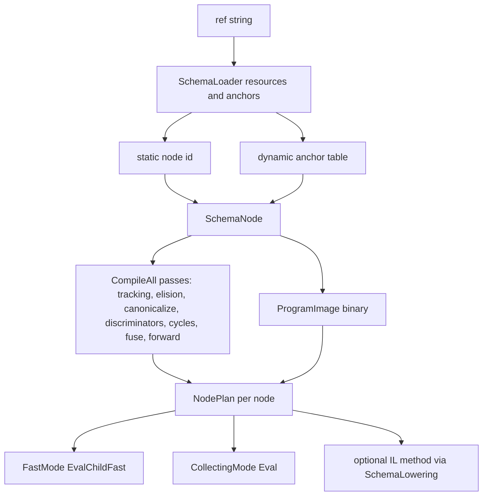

# Corvus.JsonSchema — Research report

## Metadata

- **Library name**: Corvus.JsonSchema (V5 packages `Corvus.Text.Json.*`; V4 packages `Corvus.Json.*`)
- **Repo URL**: https://github.com/corvus-dotnet/Corvus.JsonSchema
- **Clone path**: `research/repos/csharp/corvus-dotnet-Corvus.JsonSchema/`
- **Language**: C# (plus ports of the evaluator in Rust, Go, Java, Python, TypeScript and a dozen other languages)
- **License**: Apache-2.0
- **Analyzed version**: 4fcedcfef 2026-10-22 (`git describe`: `perl-alien-v0.1.0-1-g4fcedcfef`; VERSIONHISTORY top entry V5.7.8)
- **Report date**: 2026-10-26

## Summary

Corvus.JsonSchema turns JSON Schema (and OpenAPI 2.0/3.0/3.1/3.2 and AsyncAPI 2.6/3.0 documents) into strongly typed C# `readonly partial struct` models via a Roslyn incremental source generator or the `corvusjson` CLI. The current generation is V5 (`Corvus.Text.Json`): its own pooled-memory `ParsedJsonDocument<T>` / mutable `JsonDocumentBuilder<T>` model (forked from System.Text.Json) replaces the V4 immutable `Corvus.Json.ExtendedTypes`. Validation is performed by a shared runtime schema evaluator (compiled node graph, optionally lowered to IL), so the same engine serves generated types, the dynamic `Corvus.Text.Json.Validator`, and a standalone-evaluator generation mode. The repository also hosts the V4 engine (`src-v4/`, still selectable with `--engine V4`) and ports of the evaluator to ~17 other languages; these ports validate only and do not generate models.

## JSON Schema support

- **Drafts**: Draft 4, 6, 7, 2019-09, 2020-12 (`JsonSchemaDialect` enum), plus OpenAPI 2.0 and 3.0 Schema Object dialects (Draft 4 rules, all formats, `nullable` / `x-nullable`) added in V5.7.7. OpenAPI 3.1/3.2 schemas are 2020-12 based.
- **Scope**: Full. The runtime evaluator runs the JSON-Schema-Test-Suite (required, optional, optional/format with assertion, annotation suite) for all five drafts; only `draft4/optional/zeroTerminatedFloats.json` and leap-second time cases are excluded (docs/RuntimeEvaluator.md). Custom metaschemas with `$vocabulary` are honoured. Bowtie results are published.
- **Regex**: `pattern`, `patternProperties` and `format: regex` follow ECMA-262 (parser + translator to .NET; V5.7.8), invalid patterns refused at compile/generation time, 1 s match timeout.

## Keyword support table

Keyword list is the union of `properties` keys of `specs/json-schema.org/draft/2020-12/meta/*.json` (55 keywords), followed by legacy-draft keywords from `draft-04`/`draft-07`/`2019-09`. Evidence: `src/Corvus.Text.Json/Corvus/Text/Json/RuntimeEvaluator/Compilation/SchemaCompiler.cs` and `SchemaKeywords.cs` (every 2020-12 keyword plus the legacy ones appears there), `Evaluation/Evaluator.cs`, and the V4 keyword classes in `src-v4/Corvus.Json.CodeGeneration/Corvus.Json.CodeGeneration/Keywords/` used by the type builder for codegen.

| Keyword | Implemented | Notes |
|---------|-------------|-------|
| $anchor | yes | Registered by the loader (SchemaLoader) as a fragment anchor; resolved to node ids at compile time. Engine keyword: DollarAnchorKeyword (src-v4). |
| $comment | yes | Ignored by evaluation; non-structural keyword for codegen. |
| $defs | yes | Subschema container always traversed so pointer refs reach it; each referenced location becomes a type. |
| $dynamicAnchor | yes | Loader registers it; SchemaCompiler builds the resourceId->nodeId dynamic table. |
| $dynamicRef | yes | Resolved statically first, kept dynamic only if the target has a matching anchor; scope maintained only when needed (UsesDynamicScope). |
| $id | yes | Base URI / resource registration (also legacy `id` for draft 4); draft <=7 `$ref` siblings ignored including `$id`. |
| $ref | yes | Resolved at compile time (URI + JSON pointer or anchor); remote docs via DocumentResolver; pure-$ref nodes elided in flag mode. |
| $schema | yes | Selects dialect and vocabulary set; unknown metaschemas loaded via resolver or embedded set. |
| $vocabulary | yes | Read from custom metaschemas so missing validation vocabulary or format-assertion are honoured. |
| additionalProperties | yes | Object plan: reject, type-test inline, or dispatch to schema node; generated types expose additional-property accessors. |
| allOf | yes | Array of in-place applicators; forward plan for single branch; contributes to fused object plans. |
| anyOf | yes | Type-union / type-dispatch plans and discriminator selection (flag mode); codegen emits Match() and C# union members. |
| const | yes | Compared by deep equality in normalized form; consts in generated types; discriminator keys. |
| contains | yes | Single-pass array evaluation with minContains/maxContains counts. |
| contentEncoding | partial | Asserted only for Draft 7 with the `AssertContent` option, and only for `base64` (and `application/json` media type); in 2019-09 and later it is an annotation (SchemaCompiler content block, `dialect == Draft7 && options.AssertContent`). |
| contentMediaType | partial | As contentEncoding: only `application/json` is ever asserted, Draft 7 with `AssertContent`; otherwise an annotation. |
| contentSchema | partial | Walked by the loader as a Single subschema (2019-09+) but only emitted as an annotation (`stringsOnly`), and only when `contentMediaType` is present; never evaluated against decoded content. |
| default | yes | Annotation in evaluator; generated property getters return the default when the property is absent (non-null defaults). |
| dependentRequired | yes | Presence bits in Utf8NameMap checked after the object pass. |
| dependentSchemas | yes | Map of subschemas applied in place when the trigger property is present (2019-09+; draft<=7 `dependencies` also handled). |
| deprecated | yes | Annotation (collected via JsonSchemaAnnotationProducer). |
| description | yes | Annotation; emitted as XML doc comments; feeds DocumentationNameHeuristic. |
| else | yes | Applied with if/then; fused when the if condition is decided by seen bits. |
| enum | yes | Normalized deep equality; inline string-enum test via Utf8NameMap; codegen emits nested native KnownValues enum for pure string enums (>=2 constants). |
| examples | yes | Annotation only. |
| exclusiveMaximum | yes | Numeric (2019-09+/6+) and draft-4 boolean form; exact decimal comparison. |
| exclusiveMinimum | yes | Numeric and draft-4 boolean form; exact decimal comparison. |
| format | yes | Asserted per-dialect/option/formatMode (assert/disable/warning); built-in checkers for date/time/uri/email/hostname/regex/uuid/etc.; codegen maps to typed wrappers (NodaTime, BigNumber, Int32 etc.). |
| if | yes | Conditional evaluation; fused plan. |
| items | yes | Single schema (2020-12) or schema/array (older drafts); SimpleArray and ArrayItems plans. |
| maxContains | yes | Counted during contains; ignored without contains. |
| maximum | yes | Exact normalized decimal compare; long fast path for plain integers. |
| maxItems | yes | Array plans. |
| maxLength | yes | Rune count; decided from byte length where possible. |
| maxProperties | yes | Object plan count bounds. |
| minContains | yes | Counted during contains (0 allowed). |
| minimum | yes | Exact normalized decimal compare. |
| minItems | yes | Array plans. |
| minLength | yes | Rune count. |
| minProperties | yes | Object plan count bounds. |
| multipleOf | yes | Exact IsMultipleOf on normalized decimals (big numbers, small divisors). |
| not | yes | In-place negation; excluded from unevaluated propagation. |
| oneOf | yes | Discriminator selection, type dispatch; codegen emits Match() and union members. |
| pattern | yes | ECMA-262 pattern parsed and translated to .NET Regex (or regex-free matchers); invalid patterns rejected; 1 s match timeout unless proved linear. |
| patternProperties | yes | Same regex pipeline; applied after named property in the object plan. |
| prefixItems | yes | Tuple items (2020-12); older `items` array + `additionalItems` handled for earlier drafts. |
| properties | yes | Utf8NameMap lookup; strict/unrolled object plans; one generated property accessor each. |
| propertyNames | yes | Applied to every property name in the object pass. |
| readOnly | yes | Annotation only. |
| required | yes | Presence bits / RequiredMask; generated types mark required properties. |
| then | yes | Applied with if. |
| title | yes | Annotation; feeds type naming heuristics and doc comments. |
| type | yes | TypeMask token test; integer accepts 1.0; drives CoreTypes in codegen. |
| unevaluatedItems | yes | Stack-allocated evaluated-bit tracking only on nodes that consume it; $ref opens a new scope. |
| unevaluatedProperties | yes | Same tracking via ulong bitsets (rented above 256 entries). |
| uniqueItems | yes | Structural open-addressing hash set on raw UTF-8, order-independent for objects. |
| writeOnly | yes | Annotation only. |
| $recursiveAnchor (legacy draft) | yes | 2019-09 only; folded into the dynamic-reference machinery. |
| $recursiveRef (legacy draft) | yes | 2019-09 only; resolved like $dynamicRef. |
| definitions (legacy draft) | yes | Draft 4-7 container; always traversed. |
| dependencies (legacy draft) | yes | Draft 4-7; both property-list and schema forms. |
| additionalItems (legacy draft) | yes | Draft 4-2019-09 only; subschema kind Single. |
| nullable / x-nullable (legacy draft) | yes | OpenAPI 3.0/2.0 dialects only (V5.7.7): nullable adds null to allowed types. |

## Constraints

Constraints are enforced, not just structural. In V5 every generated type exposes `EvaluateSchema(IJsonSchemaResultsCollector? = null)`, whose body is `return <JsonSchema>.Evaluate(_parent, _idx, resultsCollector)`; that in turn calls a per-type `static readonly JsonSchemaEvaluator Evaluator = CorvusJsonSchemaProgram.Entry(n)` (`CodeGeneratorExtensions.JsonSchema.cs`, `AppendRuntimeProgramEvaluateMethod`). No validation code is emitted per type any more: all assertions (minLength/maxLength, pattern, numeric bounds, multipleOf, item and property counts, uniqueItems, required, const/enum, contains counts, dependent keywords, unevaluated*, composition) run in the shared runtime evaluator described below. A type whose schema location is unknown (a synthetic type) gets an `Evaluate` that returns `true`.

Format assertion is controlled per dialect, by `--assertFormat`, and per format with `--formatMode` (`assert` / `disable` / `warning`). Numbers are compared exactly as normalized decimals. `contentEncoding`/`contentMediaType` are asserted only in Draft 7 with the `AssertContent` option (and only base64 / `application/json`); in later drafts they and `contentSchema` are annotations.

## High-level architecture

- **Input**: JSON or YAML schema files (also OpenAPI/AsyncAPI documents), a generation spec (`corvusjson config`), or `[JsonSchemaTypeGenerator("path")]` with the schema as AdditionalFiles.
- **Analyse**: the type builder is the V4-lineage project `src-v4/Corvus.Json.CodeGeneration`, which the V5 project `src/Corvus.Text.Json.CodeGeneration` references as a `ProjectReference`: `JsonSchemaTypeBuilder`, `JsonSchemaRegistry`, `TypeBuilderContext`, vocabularies and `IKeyword` classes build a `TypeDeclaration` graph; `CanReduce()` / `ReducedTypeDeclaration()` collapse pure-`$ref` types. (So V4 is not only a legacy engine: its analysis layer is shared by V5.)
- **Emit**: `Corvus.Text.Json.CodeGeneration` (`CSharpLanguageProvider`, `CodeFileBuilders/CorePartial`, `MutableCorePartial`, `JsonSchemaPartial`, name heuristics, format handlers) writes partial structs as strings through a `CodeGenerator` text builder. `RuntimeProgramGenerator` emits one `CorvusJsonSchemaProgram` class per compilation (embedded schema documents, or a precompiled base64 `ProgramImage` when the host supplies a `SchemaProgramCompiler`, as the CLI does).
- **Run**: generated types depend on `Corvus.Text.Json`; validation uses the RuntimeEvaluator compiled (lazily, once per entry point) from that program. IL lowering exists but is opt-in via `JsonSchemaEvaluatorOptions.CodeGeneration` and is not used by generated types' default options.
- **Output**: C# files, written to `--outputPath` (CLI, with a lock file) or to compiler-generated sources (source generator).

```mermaid
flowchart LR
  subgraph input [Input]
    Schema["Schema JSON or YAML"]
    Config["generation spec or attribute"]
  end
  subgraph analyse [Analyse - src-v4 Corvus.Json.CodeGeneration]
    Registry["JsonSchemaRegistry and resolvers"]
    TypeBuilder["JsonSchemaTypeBuilder and TypeBuilderContext"]
    TypeDecls["TypeDeclaration graph with reduction"]
  end
  subgraph emit [Emit - Corvus.Text.Json.CodeGeneration]
    LangProvider["CSharpLanguageProvider naming"]
    Builders["CorePartial MutableCorePartial JsonSchemaPartial"]
    Program["RuntimeProgramGenerator program class"]
  end
  subgraph runtime [Runtime - Corvus.Text.Json]
    Doc["ParsedJsonDocument rows"]
    Evaluator["RuntimeEvaluator node plans"]
  end
  CsFiles["C# source files"]
  Schema --> Registry
  Config --> Registry
  Registry --> TypeBuilder
  TypeBuilder --> TypeDecls
  TypeDecls --> LangProvider
  LangProvider --> Builders
  LangProvider --> Program
  Builders --> CsFiles
  Program --> CsFiles
  CsFiles -. "generated struct views" .-> Doc
  CsFiles -. "EvaluateSchema via Entry(n)" .-> Evaluator
  Doc --> Evaluator
```

Main projects (under `src/`): `Corvus.Text.Json` (runtime documents, builders and the RuntimeEvaluator), `Corvus.Text.Json.CodeGeneration`, `Corvus.Text.Json.SourceGenerator`, `Corvus.Json.Cli` / `Corvus.Json.Cli.Core` (`corvusjson`), `Corvus.Json.CodeGenerator` (legacy `generatejsonschematypes` shim, defaults to V4), `Corvus.Text.Json.Validator`, `Corvus.Text.Json.Compatibility` and `Migration.Analyzers` (V4 to V5), OpenApi/AsyncApi generators, and JMESPath/JSONata/JsonLogic/JSONPath/Patch/Yaml/Toon libraries. `src-v4/` holds the V4 engine (`Corvus.Json.ExtendedTypes` runtime and the immutable-struct V4 emitter `Corvus.Json.CodeGeneration.CSharp`), the shared analysis layer, and the dialect vocabularies (4, 6, 7, 201909, 202012, OpenApi20/30/31).

## Medium-level architecture

- **Runtime documents (the "model")**: `ParsedJsonDocument<T>` owns a UTF-8 buffer plus a flat `MetadataDb` of 12-byte `DbRow`s; a generated type is a `readonly partial struct` holding only `IJsonDocument _parent; int _idx;` (see Schema representation below).
- **Codegen schema representation**: `LocatedSchema` (location + element) registered in `JsonSchemaRegistry`; `TypeDeclaration` accumulates keyword results, `PropertyDeclaration`s, subschema declarations and a string-keyed metadata bag. Keywords implement `IKeyword` plus capability interfaces (`IValidationKeyword`, `IPropertyProviderKeyword`, `IAnyOfConstantValidationKeyword`, `IReferenceKeyword`, ...). Name heuristics (`WellKnownTypeNameHeuristic`, `SimpleCoreTypeNameHeuristic`, `CustomKeywordNameHeuristic`, `BaseSchemaNameHeuristic`, `DocumentationNameHeuristic`, `DefaultValueNameHeuristic`, `RequiredPropertyNameHeuristic`, `ConstPropertyNameHeuristic`, `SubschemaNameHeuristic`, `PathNameHeuristic`, `SingleTypeArrayNameHeuristic`) name types in priority order; `INameCollisionResolver`s fix clashes.
- **Runtime evaluator schema representation**: `SchemaLoader` walks documents once (dialect-aware), registering resources and anchors; `SchemaCompiler` builds one `SchemaNode` per distinct (document, element) with pre-digested data (`TypeMask`, normalized bounds, `PatternMatcher`, `Utf8NameMap`). `ProgramImage` serializes the compiled node array so generated code can skip loading and compiling. `Evaluator.Eval<TMode,TAccess>` is JIT-specialised for `FastMode` (fail fast, no reporting) and `CollectingMode` (full results/annotations into `IJsonSchemaResultsCollector`), and for the access path (`RawAccess` over the document's row/text spans, or `InterfaceAccess` through `IJsonDocument`).
- **$ref / $defs resolution**: at runtime-compile time `$ref` resolves to node ids (`System.Uri` resolution, pointer fragments, anchor tables, remote docs through `JsonSchemaEvaluatorOptions.DocumentResolver`). `$dynamicRef`/`$recursiveRef` resolve statically when possible, otherwise by a resource-to-node table and a stack-allocated dynamic scope. For codegen, `$ref` is resolved by the registry/type builder and pure reference types are reduced to their targets.
- **Optimization layers**: per-node `NodePlan` (Leaf, SimpleArray, ArrayItems, Object, StrictObject, DynamicRef, Forward, TypeUnion, TypeDispatch, FusedObject, Conditional, Composite, Generated), discriminator selection for oneOf/anyOf, pure-`$ref` elision, equivalent-node canonicalization, compile-time cycle detection (Tarjan SCC), regex-free matchers, and an optional IL emitter.

## Algorithms and data structures

### Schema representation

**Instance documents: pooled flat rows, generated types as views.** `ParsedJsonDocument<T>` (`Document/ParsedJsonDocument.cs`, `.Parse.cs`) is a sealed class deriving from `JsonDocument`. Its state: `ReadOnlyMemory<byte> _utf8Json` plus the backing `byte[] _utf8Array`/`_utf8Start`, the parse result `MetadataDb _parsedData`, and exactly one optional owner of the backing bytes (`_extraRentedArrayPoolBytes`, `_extraPooledByteBufferWriter` or `_extraOwner`, asserted mutually exclusive in the constructor). `Parse` rents a `MetadataDb` sized from the input length (`MetadataDb.CreateRented`) and runs a single-pass `Utf8JsonReader` loop that appends one row per token, using a `StackRowStack` (not recursion) for container bookkeeping. The text is not copied when the caller already holds a byte array: `Parse(ReadOnlyMemory<byte>, byte[] rentedArrayPoolBytes)` takes ownership of an `ArrayPool` array; the `string`/`ReadOnlyMemory<char>` overloads transcode into a rented array handed to the document. `Dispose()` clears the document's bytes and returns them (via `Interlocked.Exchange`) and disposes the metadata.

`MetadataDb` (`Document/Internal/MetadataDb.cs`) is a `byte[]` of rows plus `Length`; the rows are `DbRow`s (`DbRow.cs`, `[StructLayout(Sequential)]`, 12 bytes): word 1 = 28-bit byte offset into the UTF-8 buffer with bit 31 meaning "row belongs to an external (workspace) document"; word 2 = size/length (bit 31 = "has complex children" for arrays and escaped strings, or a property-map index on `EndObject` rows); word 3 = 4-bit `JsonTokenType` in the top nibble plus 28 bits for the number of rows to skip (or workspace document id). A container is `StartObject ... EndObject` with row counts in the Start row, so "skip this subtree" is one addition and sibling stepping in the evaluator is row arithmetic. Numbers and strings are stored as slices of the original text; nothing is parsed or unescaped until requested.

`JsonElement` and every generated type have the same shape: `private readonly IJsonDocument _parent; private readonly int _idx;` (generated by `AppendBackingFields`, `CodeGeneratorExtensions.cs`; the mutable variant adds `ulong _documentVersion`). A property getter is generated as `_parent.TryGetNamedPropertyValue(_idx, <Names>.<Prop>Utf8, out PropType value)`, array indexers as `_parent.GetArrayIndexElement<T>(_idx, i)`, conversions as `_parent.TryGetValue(_idx, out long)`; each returns another 16-byte struct over the same document, so navigation allocates nothing and `T` is chosen per call site (`IJsonElement<T>` CRTP with `static abstract CreateInstance` on .NET 8+). A default (uninitialised) struct has a null `_parent`, which `CheckValidInstance`/`ValueKind` treat as "undefined", which is how absent optional properties surface. Cost of keeping one view alive: it pins the whole document and must not outlive `Dispose()`.

**Property lookup.** For a parsed document, `TryGetNamedPropertyValueIndexUnsafe` first checks whether the object's `EndObject` row carries a property map; if not it scans the object's rows backwards comparing raw name bytes (`SequenceEqual`, unescaping only when the stored name contains a backslash and is longer than the probe). The hash map (`JsonDocument.PropertyMap`: 28-byte header, 24-byte `Entry {HashCode, Next, ValueIndex, KeyOffset}`, separate chaining, Lemire fast-mod bucket selection, hash from `Utf8Hash.GetHashCode`, which reads the first 7 bytes as an integer and mixes length plus bytes 7 and last for longer keys) is built lazily by `EnsurePropertyMapUnsafe` and, in the code read, is requested only from `JsonElementHelpers.DeepEquals` and the mutable builder (`JsonElement.Mutable.cs`), so ordinary parsed-document reads of small objects are linear scans of rows.

**Mutable documents.** `JsonDocumentBuilder<T>` (`DocumentBuilder/`) is the writable counterpart: its own `MetadataDb` and value buffer, a `_version` counter that generated mutable structs snapshot to detect stale views, and a `JsonWorkspace` (thread-cached via `JsonWorkspaceCache`, owns `IJsonDocument[]` rented from `ArrayPool`) that lets rows reference values living in other documents (the "external document" bit above) so composing documents does not copy text. Edits go through `ComplexValueBuilder` over a rented span of rows and `InsertAndDispose/OverwriteAndDispose` on the parent.

**Schema documents in the runtime evaluator.** A schema is just a `ParsedJsonDocument<JsonElement>` over a private byte copy (`SchemaLoader.AddDocument`), wrapped as `SchemaDocument {Id, Document, RetrievalUri}`; a `SchemaResource {Id, Document, RootIndex, Uri, Dialect, Vocabularies, Anchors, DynamicAnchors, RecursiveAnchor}` is one `$id` scope; a `SchemaTarget(Document, Index, Resource)` names a subschema by row index. Boolean schemas become `AlwaysTrue/AlwaysFalse` nodes; unknown keywords are not retained except annotation keywords (`title`, `description`, `default`, `examples`, `deprecated`, `readOnly`, `writeOnly`, content keywords), whose raw JSON bytes are copied into `AnnotationEntry` for verbose output.

**Schema representation for codegen** is a graph of `TypeDeclaration`s keyed by location, described under "Core algorithm".

### Reference resolution and registry

**Evaluator.** `SchemaLoader` keeps `resourcesByUri`, `documentsByUri` (ordinal dictionaries), `resourceOfElement[(docId, rowIndex)]` and per-resource `Anchors`/`DynamicAnchors` maps. `Walk(doc, element, resource, isResourceRoot)` is the registration pass: it descends only through keywords classified by `SchemaKeywords.GetSubschemaKind` (None/Single/SingleOrArray/Array/Map, depending on dialect; `$defs`/`definitions` always walked), assigns every visited schema object to its owning resource, creates a new `SchemaResource` when a nested `$id` (or draft-4 `id`) resolves to a different absolute URI, registers `$anchor` (2019-09+), `$dynamicAnchor` (2020-12, also as a plain anchor), `$recursiveAnchor`, and legacy `#name` ids (drafts <= 7). In drafts <= 7 an object with `$ref` ignores siblings including `$id`. `Walk` is literal recursion over schema nesting (not instance nesting). Remote/unknown documents are loaded on demand by `TryLoadDocument`: user `DocumentResolver`, then the embedded metaschemas (`Metaschemas`), then `FallbackDocumentResolver`; nothing is fetched by the library itself. `GetDialectInfo` maps `$schema` to a dialect and, for a custom metaschema, reads its `$vocabulary` into a `JsonSchemaVocabularies` flags enum (a loading set guards metaschema cycles).

`TryResolveReference(from, ref)` splits the URI and fragment, resolves against `from.Uri` (`UriUtilities`), loads the document if needed, then `TryResolveFragment`: empty = resource root, `/`-prefixed = JSON Pointer via `TryResolvePointer`, otherwise an anchor lookup.

Compilation is lazy over a worklist: `GetNode(target)` allocates a `SchemaNode` id keyed on `(documentId, rowIndex)` *before* compiling it and enqueues it, so cyclic references terminate (a back-edge just reuses the id). `CompileAll` loops `worklist -> CompileNode` and `ExpandDynamicRefs` until no new nodes appear. `$dynamicRef`/`$recursiveRef` become a `PendingDynamicRef` (initial target, candidate `(resourceId,nodeId)` list, seen resources); `FinalizeDynamicRefs` demotes it to a static `$ref` when only one resource defines the anchor, or builds `DynamicRefTarget.NodeByResource[]` (indexed by resource id) and, when the entry resource decides the answer for every reaching path, `NodeByEntryResource[]` so no runtime scope is needed (`NeedsScope == false`). `ComputeUsesDynamicScope` sets the program-wide `UsesDynamicScope`. At evaluation `ResolveDynamicRef` scans the stack-allocated scope outermost-first (`state.Scope[..ScopeDepth]`) and returns the first node table hit, else the fallback.

**Cycle control.** `ComputeInPlaceCycles` runs an iterative Tarjan SCC over `InPlaceChildren` edges (`$ref`, dynamic targets, allOf/anyOf/oneOf, not, if/then/else, dependentSchemas) and sets `InPlaceCycle` on nodes in an SCC of size > 1 or with a self-edge; only those nodes count depth (`MaxDepth` = 128 in-place nesting; instance depth is bounded separately by the parser's `DefaultMaxDepth` of 64), so acyclic `$ref` chains carry no counter or try/finally.

**Entry points.** `CompiledSchema` (a ref-counted wrapper with a `gate` lock) holds `Nodes`, `RootNode`, `entryPoints : Dictionary<string,int>` and the live `SchemaCompiler`. `AddEntryPoint(s)` resolves a `document#pointer` reference and compiles the new nodes into the same node array, so many generated types in one assembly share nodes; `NodesSnapshot()` publishes an immutable copy of the list. A program loaded from an image has no loader/compiler, so only entry points recorded at image creation resolve.

**Codegen.** `JsonSchemaRegistry` registers `LocatedSchema`s per document (base-schema registration pass, anchors, dynamic anchors, `$id` re-basing, `rebaseAsRoot`) and resolves through `IDocumentResolver`s (file system, HTTP via `Corvus.Json.CodeGeneration.HttpClientDocumentResolver`, pre-populated `AddDocument`). `JsonSchemaTypeBuilder.AddTypeDeclarationsAsync` performs two passes: (1) `RegisterBaseSchema` loads and indexes everything; (2) a "contextual" pass from the root with `TypeBuilderContext` building `TypeDeclaration`s so dynamic references see their dynamic scope. The shared `locatedTypeDeclarations : Dictionary<string, TypeDeclaration>` (key = full location string, URI + fragment) is the identity map: a second visit to the same location returns the existing declaration. `TypeBuilderContext` maintains a `Stack<JsonSchemaScope>` of (location, pointer, schema, replaced dynamic types); entering a dynamic scope rewrites the declaration's location with a `?dynamicScope=<uri>` query (`UpdateDynamicLocation`) so the same schema reached through different dynamic scopes becomes distinct declarations, and `LeaveScope` restores replaced entries. On .NET 9+ it uses `Dictionary.GetAlternateLookup<ReadOnlySpan<char>>` with a stackalloc/pooled buffer to avoid allocating the key string. `await` is used throughout the builder (`ValueTask<TypeDeclaration>`), and the synchronous entry point throws if any await did not complete synchronously (documents must be pre-resolved).

### Compiled / intermediate form

**Runtime evaluator: a `SchemaNode[]` graph.** `SchemaNode` (`Compilation/SchemaNode.cs`) is a large mutable class: identity (`Id`, `ResourceId`, `Dialect`, `SchemaLocation` bytes); value keywords (`Type` as `TypeMask` flags, `Const`/`ConstString`/`ConstNumber`, `Enum` array plus `EnumStrings : Utf8NameMap<object>` when all strings); number keywords (`NumberValue Minimum/Maximum/Exclusive*` holding sign, integral digits, fractional digits, exponent and an `AsLong` shortcut; `DivisorValue` with `AsLong`/`Small`/`Big`); string keywords (`MinLength/MaxLength`, `PatternMatcher Pattern`, `FormatKind`, `AssertFormat`, `ContentKind`); object keywords (`Utf8NameMap<PropertyEntry> Properties`, `PropertyEntry[] UnrolledProperties`, seen-bit allocation `SeenBitCount`/`RequiredSeenBits`/`RequiredMask`, `StrictEntry[]`, `PatternPropertyEntry[]`, `DependencyEntry[]`, `ChildRef` for additional/propertyNames/unevaluated); array keywords (`PrefixItems`, `Items`, `Contains`, counts, `UniqueItems`); in-place applicators (`Ref`, `DynamicRef`, `AllOf/AnyOf/OneOf` as `ChildRef[]`, `Not/If/Then/Else`, `Discriminator`s, `AnyOfTypeDispatch`...). Children are linked by integer node id in a `ChildRef {Node, FastNode, Path, CollectingPath}`: `Node` is the logical child, `FastNode` the node flag mode jumps to after ref elision/canonicalization, `Path` the pre-encoded evaluation-path segment bytes (so collecting mode never builds strings). `NodeFlags : uint` packs the summary booleans so node entry reads one word.

`CompileNode` fills one node from one schema object by switching on keyword name length then bytes (a hand-rolled switch on `name.Length`/`SequenceEqual` against `"..."u8`), gated by dialect and vocabulary (`validation`, `metaData`, `content`, `legacy` booleans). After the worklist drains, `CompileAll` runs ordered whole-graph passes: `FinalizeDynamicRefs`, `ComputeLeafFlags` (IsLeaf/IsTypeOnly), `ComputeTracking` (which nodes keep evaluated-property/item bitsets; only those with their own `unevaluated*`), `ComputeMarking` (transitively whether a child can mark properties/items), `ElidePureRefs`, `CanonicalizeEquivalentNodes`, `ComputeDiscriminators`, `OrderUnrolledProperties`, `ComputeSimpleArrays`, `ComputeInPlaceCycles`, `FusedObjects.Compute`, `ComputeForwards`, `ComputeObjectDetails`, `ComputePlans` (`SelectPlan`), `ComputeFlags`.

- *Pure-ref elision* (`ElidePureRefs`): for each node, follow `Ref` through nodes whose only keyword is `$ref` (up to 16 hops, but not across a resource boundary if the program uses a dynamic scope) and store the end in `ChildRef.FastNode`/`ElidedTarget`; `CollectingPath` keeps the skipped segments so verbose output is unchanged.
- *Canonicalization* (`CanonicalizeEquivalentNodes`): groups nodes by `(resourceId, rawTextLength)` (length >= 8), compares raw UTF-8 text with `SequenceEqual`, skips subschemas that contain `$id`/`$anchor`/`$dynamicAnchor`/`$recursiveAnchor`/draft-4 `id`, and rewrites every `FastNode` to one representative. Disabled when the program uses a dynamic scope. This is a flag-mode-only dedupe of identical subschema text.
- *Plans* (`NodePlan`, `SelectPlan`): a decision list. AlwaysTrue/False, Leaf (only local value keywords), SimpleArray (`{type:array,minItems,maxItems,items:<leaf>}`), FusedObject, Forward (lone `allOf` branch or kept `$ref`), Conditional (own object keywords plus if/then/else), TypeUnion/TypeDispatch (a node that is only an anyOf/oneOf decided by token type), DynamicRef, Composite (applicators alongside own keywords), then Object / StrictObject / ArrayItems for plain object or array keywords, else General.
- *StrictObject* (`IsStrictObject`, `StrictEntry`): per property a `StrictEntry` carries the seen bit, a token-type bitmask (`TokenBits`) for type-only children, an inline string `Set` (`Utf8NameMap<object>`) for string enums, `ConstBytes` for string consts, length bounds, a child node id and a `ChildDecided/ChildAccepts` pair of token-kind bitmasks for children whose type alone decides acceptance. `RequiredMask` (<= 64 seen bits) lets `required` be one `(seen & mask) == mask` test.
- *Discriminators* (`BuildDiscriminator`, class `Discriminator`): for oneOf/anyOf where branches constrain the same property with `const`/`enum`, a `Utf8NameMap<int[]> KnownValues` maps a tagged value (`'s'`+string, `'n'`+canonical number, `'b'`, `'z'`) to the candidate branch list, with `UnknownString`, `NonString` and `AllBranches` fallbacks and an `AllRequire` flag; flag mode evaluates only the selected branches.
- *Fused objects* (`FusedObjects.cs`, ~1,400 lines): for a node with `unevaluatedProperties` whose object semantics are split over `$ref`/`allOf`/`if-then-else`, `TryFuse` builds a `FusedObject` (contributors, per-name `FusedEntry` application lists, `FusedCondition`s decided from seen bits, a name -> entry `Utf8NameMap`, pattern/additional resolution per contributor) so one pass over the instance applies every contributor's child schema per property and a coverage bitset answers `unevaluatedProperties` without per-branch re-scans. Collecting mode keeps the general path.

**Image form.** `ProgramImage.Write/Read` (version 7, magic `CJSP`): header (dynamic-scope flag, resource count, root node, entry-point table), one JSON array of all `const`/`enum` constants (parsed once into a `ParsedJsonDocument` that `ConstantValue` refers to), a deduplicated pattern table, a deduplicated byte-string table (`BytesTable` interns schema locations, path segments, property names, annotation bytes, number texts), then per-node bodies using varints, length-prefixed arrays and packed bit sets. Everything else in the graph is derived on load: `ComputeForwards`, `ComputeObjectDetails` etc. re-run in `Read`. In a generated assembly the image is base64 literals (`"..."u8` chunks) decoded by `Base64.DecodeFromUtf8` in `LoadImage`.

**Optional IL form.** `SchemaLowering.Compile(nodes, entry, ...)` walks the plan-annotated graph with a queue, and for each specialised node (StrictObject, SimpleArray, ArrayItems, flat/general FusedObject, Object, Composite/Conditional, TypeUnion, TypeDispatch, simple General) drives an `ISchemaEmitter` (`BeginMethod/.../EndMethod`). The only implementation is `IlSchemaEmitter`, which uses `System.Reflection.Emit` (`AssemblyBuilder`/`TypeBuilder`, one `public static bool N<id>(ref EvaluationState, IJsonDocument, int)` per node, an entry method taking a `CompiledEntry`) and an `IgnoresAccessChecksTo` attribute to call the internal evaluator. It chooses which small methods to mark `AggressiveInlining` with size budgets (`MaxInlinedMethodSize` 300 IL bytes, `MaxSizeWithInlinedMethods` 1500, `MaxGrowthByInlinedMethods` 1500) and falls back to hashed lookups for name sets once a method passes 16,000 IL bytes; objects with more than 256 names stay interpreted (`MaxDispatchNames`). Output is a copy of the node array in which specialised nodes are cloned with `Plan = NodePlan.Generated` and a `Generated` delegate, so interpreted and generated nodes interleave freely. Enabled by `JsonSchemaCodeGeneration` = `Disabled` (default), `AfterWarmUp` (compile on a thread-pool `Task.Run` after 1,000 non-collecting evaluations, published with `Interlocked.CompareExchange` on the `FlagModeEntry`) or `Eager`; unsupported without `RuntimeFeature.IsDynamicCodeSupported`, and not applied to schemas with a dynamic scope.

**Standalone mode.** There is no second engine: a "standalone evaluator" (`EmitEvaluator=true`, `CodeGenerationMode.SchemaEvaluationOnly/Both`) is a generated `<Name>Evaluator` class whose `Evaluate<TElement>` forwards to `CorvusJsonSchemaProgram.Entry(n)` (`RuntimeProgramGenerator.GenerateStandaloneEvaluator`). The Roslyn source generator links the evaluator's loader/compiler/image writer in as source compiled against `System.Text.Json` (`#if STJ` branches throughout `SchemaNode.cs`, `SchemaCompiler.cs`), so it can emit images at build time without referencing `Corvus.Text.Json`.

**Codegen IR.** The type graph is `TypeDeclaration` (`LocatedSchema`, `subschemaTypeDeclarations : Dictionary<string,TypeDeclaration>` keyed by subschema pointer, `properties : Dictionary<string,PropertyDeclaration>`, `metadata : Dictionary<string,object?>` used as a typed cache for derived facts such as `CanReduce`, `ReducedTypeDeclaration`, `ImpliedCoreTypes`, `AnyOfConstantValues`, native-enum member lists). Well-known process-wide declarations (`WellKnownTypeDeclarations.JsonAny` etc., `IsShared`) use a copy-on-write metadata dictionary so concurrent generations read without locks. Emitted C# is a string produced by the `CodeGenerator` fluent builder (cached indent strings, per-scope `memberNamesByScope : Dictionary<string,HashSet<string>>`), cut into files: `Type.cs` (CorePartial), `Type.Mutable.cs`, `Type.JsonSchema.cs`, etc.

### Core algorithm

**Evaluation (flag mode).** Entry (`JsonSchemaEvaluator.Evaluate`, `Evaluator.Evaluate`/`EvaluateFlagRaw`): if there is no collector, no dynamic scope and the document is a `JsonDocument`, a stack `EvaluationState` (program, node array, row/text spans, scope depth, max depth) is filled field by field (no object initializer to avoid a zeroed temporary) and `EvalChildFast<RawAccess>(entryNode)` is called with no try/finally. `EvalChildFast` switches once on `node.Plan` and calls a dedicated routine; General falls to `Eval<FastMode,TAccess>` -> `EvalCore`, which tests `NodeFlags` groups in order: value keywords (type/const/enum), then by `tokenType` the number, string, object or array keyword routine, then in-place applicators (`EvalInPlace`: `$ref`, allOf, anyOf, oneOf, not, if/then/else, dependent schemas), then `unevaluated*`. In `FastMode` `ok` short-circuits at the first false; in `CollectingMode` every keyword runs and `ok &= ...` accumulates. `default(TMode).Collecting` and `default(TAccess)` are generic struct-constrained values, so the JIT folds the untaken branches away: one source, two or four native specialisations.

The object loop (`EvalStrictObjectLoop`, `EvalObjectPlanCore`, `EvalObjectCore`) is a single forward pass over the instance rows: read each name's location/length from its row, find its `PropertyEntry`/`StrictEntry` index via `Utf8NameMap.GetIndex` (below), OR in the entry's seen bit, then either test token bits, string-set, const bytes, or call the child plan with `valueIndex`, stepping to the next sibling with the row's skip count. Required properties/dependencies are checked after the loop from the seen bits. Instance-side cost is O(properties) with O(1) name tests. `EvalObjectUnrolled` handles very small schema objects (<= 6 properties, mostly required) by looking each schema name up in the instance (`TryFindProperty`) instead of hashing every instance name.

`Utf8NameMap<T>` (`Compilation/Utf8NameMap.cs`): keys are `byte[][]`; (1) for keys of up to 8 bytes, zero-padded 64-bit words grouped by length (`wordStart/wordCount`), where a probe reads 8 bytes unaligned from the text and masks to its length, then compares against at most `MaxWordCandidates` (3) words of that length; (2) otherwise a per-length `Utf8NameBucket {position, int[256] table}` that picks the byte position which best separates the keys of that length at construction (`bestDistinct`), then chains candidates sharing a byte through `next[]`, comparing full keys only for the one or two chained candidates. No hash is computed over the instance name. This one structure backs `properties`, string `enum` membership, discriminators and fused name tables.

Arrays (`EvalArray`, `EvalArrayItemsPlan`, `EvalSimpleArrayFast`, `EvalPrefixLoop`): one pass over elements applying `prefixItems`, `items`, `contains` (counting matches for min/maxContains), with inline type/leaf item loops. `uniqueItems` uses `AllUniquePairwise` for up to `PairwiseLimit` (8) items (string slices compared by length then bytes) else `UniqueItemSet`: an open-addressing table of item indices rented from `ArrayPool<int>` and sized to the next power of two >= 2n, keyed by `HashValue` over the raw UTF-8 (unescaped strings, numbers by value, objects order-independently), with `ValuesEqual` on hash hits.

Numbers (`EvalNumber`/`EvalNumberBounds`): compare in normalized decimal form (`JsonElementHelpers.ParseNumber` -> sign/integral/fractional/exponent; `CompareNormalizedJsonNumbers`); fast path when the instance is a plain integer literal (`TryPlainLong`) and the bound has `AsLong`. `multipleOf` uses `DivisorValue` (`AsLong`, `Small` ulong for <= 19 digits, `Big` BigInteger) with exact remainder arithmetic. Strings: `minLength`/`maxLength` count runes, decided from byte length when the answer cannot depend on rune count (`StringLengthWithin`); formats via `MatchesFormat(FormatKind, ReadOnlySpan<byte>)`.

Composition: `EvalAnyOf`/`EvalOneOf` evaluate branches (for oneOf stopping at the second match in flag mode); when a `Discriminator` is present `TrySelectBranches` finds the discriminator property with `TryFindProperty`, selects candidates from `KnownValues`, and `EvalOneOfSelected`/`EvalAnyOfSelected` evaluate only those. Annotation tracking for `unevaluated*`: nodes flagged `TracksProperties/TracksItems` allocate a `ulong` bitset (stackalloc of 4 words = 256 entries; `ArrayPool<ulong>` above) on entry; in-place children get a cleared scratch set and merge (`Merge`: OR) into the parent on success, so annotations flow up but a `$ref` target gets its own scope.

**Codegen.** After type building: (1) `PropertyProvider.CollectProperties` fills each `TypeDeclaration`'s `PropertyDeclaration`s, merging required/optional across composition (`AddOrUpdatePropertyDeclaration`, `ComposedRequired`); (2) `GetCandidateTypesToGenerate` does a depth-first walk adding every non-reducible declaration (recursing through `ReducedTypeDeclaration().ReducedType` for reducible ones) into a `HashSet`, then orders it by location with an ordinal `JsonReference.CompareTo`; (3) `MarkNonGeneratedTypes` runs the built-in name heuristics: `WellKnownTypeNameHeuristic` (boolean/empty schemas -> JsonAny/JsonNotAny) and `SimpleCoreTypeNameHeuristic`, which names any schema whose only non-reducible keywords are core `type` and `format` by a canonical name `Json<CoreType|FormatSuffix>` (`JsonString`, `JsonInteger`, `JsonUuid`, `JsonUuidNotAsserted` when format is not asserted; `CoreTypeNames` map String/Number/Integer/Boolean/Null/Array/Object) in the root namespace, marks every such declaration `DoNotGenerate`, and emits just the first-seen one per canonical name (`firstSeenNames` HashSet + ordered `firstSeen` list, so emission order does not depend on string hash seeds); (4) `SetParents` assigns each generated type a parent declaration by stepping its location fragment back one segment at a time until a generated declaration is found (types are emitted nested inside their parent struct), or via the `?dynamicScope=` query; (5) `SetNames` runs two depth-first passes: `SetNamesBeforeSubschema` (heuristics that need only the declaration itself) over parents first, then `SetNamesAfterSubschema` (heuristics needing the children's names, e.g. `SingleTypeArrayNameHeuristic`) and collision resolution; (6) the language provider emits one file group per type via the `ICodeFileBuilder`s. `Formatting.FormatTypeNameComponent` PascalCases and sanitises. Naming heuristics run in ascending `Priority` (lower first; `IsOptional` ones can be globally disabled): WellKnownType 1, SimpleCoreType 2, CustomKeyword 100, BaseSchema 1000, Documentation / DefaultValue 1500, RequiredProperty 1550, ConstProperty 1600, SingleTypeArray 1600 (after-subschema), Subschema 10000, Path 11000; the first to produce a name wins (`SetTypeNameWithKeywordHeuristics`). An explicit `namedTypes` entry (matched by location string) overrides all heuristics. Collision handling: `FixTypeNameForCollisionWithParent` runs `DefaultNameCollisionResolver` (a type may not equal its parent's name or a sibling's: it first tries the previous fragment segment PascalCased as a prefix, then the parent name as prefix, then a numeric suffix `ApplyStandardSuffix`/`ApplySuffix(index)`), and in `UpdateTypeNameWithKeywordHeuristics` a final pass indexes names by fully-qualified name in `namedTypesByFullyQualifiedName` and appends `1,2,...` to `baseName` until unique, so two inline objects deriving the same name at different locations get `Foo` and `Foo1` (the comment in code cites "multiple OpenAPI response schemas with identical inline objects").

**Member and KnownValues naming.** Every property/enum-member/field name is allocated through `CodeGenerator.GetUniqueMemberName(MemberName)`: `MemberName` carries `(FullyQualifiedScope, baseName, Casing, prefix, suffix)`; `CSharpMemberName.BuildName()` PascalCases, translates single non-letter characters to words (`"+"` -> `Plus`, `"1"` -> `One`), prefixes a leading digit with `Value`, and fixes reserved words (`Formatting.FixReservedWords`); `AddName` then loops `name = baseName` / `baseName + index` against a per-scope `HashSet<string>` until `Add` succeeds. Scopes are dotted strings (`generator.GetChildScope`), so nested types and nested enum/Constants classes have independent namespaces; `ReserveName` pre-claims names (`EvaluateSchema`, `Evaluator`, `TryGetKnownValue`, `None`).

### Error and output model

Flag mode returns a bare `bool` and allocates nothing. Collecting mode drives `IJsonSchemaResultsCollector` (public interface in `JsonSchema/IJsonSchemaResultsCollector.cs`): a tree protocol of `BeginChildContext(parentSeq, pathProviders...)` returning an int sequence number, `EvaluatedKeyword(isMatch, messageProvider, encodedKeyword)`, `EvaluatedBooleanSchema`, `IgnoredKeyword(rawJson, ..., keyword)` (annotations), and `CommitChildContext(seq, parentIsMatch, childIsMatch, messageProvider)`. Messages and paths are delegates (`JsonSchemaMessageProvider(Span<byte>, out int written)` and generic `<TContext>` variants) invoked only if the level needs them; the evaluator passes `static` lambdas plus a small `EdgeContext` struct (`Providers` in `EvaluationState.cs`) so no closures are allocated. `JsonSchemaResultsCollector` (levels `Basic`, `Detailed`, `Verbose`) stores everything in pooled byte buffers: `_evaluationPath`, `_schemaEvaluationPath`, `_documentEvaluationPath` as UTF-8 stacks with `ValueStack<ValueRange>` for push/pop, a `_resultStack` of `(start,end,commitIndex,seq)` ranges and a `_committedResultStack`, a UTF-8 string backing for messages (max 1024 bytes per message, 1024 per path segment), enumerated afterward as `(valid, message, evaluation path, schema location, document location)`. Collectors are cached per thread (`JsonSchemaResultsCollectorCache`, depth counter). Evaluation-path segments are precomputed `byte[]` per `ChildRef`; collecting mode uses `CollectingPath` to replay segments that flag-mode elision skipped. `JsonSchemaAnnotationProducer` post-processes a verbose collector into annotations. Runtime failures are exceptions: `JsonSchemaCompilationException` (bad ref, invalid or oversized regex), `JsonSchemaEvaluationException` (in-place depth), `RegexMatchTimeoutException` (propagated to the caller, not reported as invalid), `InvalidOperationException` for half-surrogate escapes in strings matched against patterns.

## Low-level details

- **Native enums**: pure string enums (two or more string constants) generate a nested `KnownValues` C# enum; objects whose 2..31 declared properties are all boolean generate a nested `[Flags]` enum; both with conversions and non-throwing `TryGetKnownValue` / `TryGetFlags`. Option `nativeEnums` (`None`/`StringEnums`/`FlagsObjects`/`All`, default All). Flags bit order follows the ordered `PropertyDeclarations` (ordinal by JSON name); a `None` member name is reserved first.
- **Unions**: `oneOf`/`anyOf` types get `Match()` and, with the C# 15 compiler, C# union members (`--unions`, default true).
- **optionalAsNullable**: `None`, `NullOrUndefined`, `NullOrUndefinedExceptNonNullDefaulted`.
- **Formats**: `WellKnownStringFormatHandler` / `WellKnownNumericFormatHandler` map formats to typed wrappers (NodaTime date/time types, `BigNumber`, `Uuid`, `Uri` etc.). The evaluator's `FormatKind` enum covers date/time, email, hostname, ip, uri/iri families, uuid, uri-template, json-pointer, regex, and numeric formats (byte, int16..int128, uint*, half, single, double, decimal), each with an `Expected*` and (for string formats) `Warning*` message provider.
- **Numeric semantics**: normalized decimal comparison (sign, integral digits, fractional digits, exponent) avoids `double` rounding; integer-valued floats such as `1.0` satisfy `type: integer` (a `lexicalInteger` flag distinguishes dialect-specific behaviour, e.g. draft 4).
- **Strings**: lengths count Unicode runes (UTF-8 lead bytes), not UTF-16 units; pattern matching transcodes UTF-8 to a rented/stackalloc `char` span (`JsonSchemaEvaluation.MatchRegularExpression`; on netstandard a `string` is allocated).
- **Instance depth / DoS**: parser `DefaultMaxDepth` 64; evaluator `MaxDepth` 128 for in-place cycles; pattern size limits; 1 s regex timeout unless provably linear; the validator cache is keyed by canonical URI.
- **Recursion**: the evaluator's recursion follows instance nesting (bounded by parser depth) and schema nesting through plan dispatch; `SchemaLoader.Walk`, the type builder (`BuildTypeDeclarationForCurrentScope`, `GetTypesToGenerateCore`) and the regex parser/writer recurse over schema or pattern nesting; Tarjan and the document parse use explicit stacks.
- **Regex**: `EcmaRegexParser` + `EcmaRegexTranslator` parse the pattern to a tree and emit .NET syntax; limits of 1,048,576 chars, nesting 200, 2,000,000 steps, 65,536 copies, construction cost 100,000,000; linear-proved patterns skip the timeout.
- **Naming**: `$corvusTypeName` hint, `namedTypes`, namespace mapping by URI prefix; optional heuristics can be disabled individually (`listNameHeuristics`).

## Output and integration

- **Vendored vs build-dir**: Both. CLI writes to `--outputPath` (intended to be checked in) and maintains `corvusjson-jsonschema.lock` (specification, content hashes, generator version, files written; unchanged runs skipped, stale files removed). The source generator emits compiler-generated files (visible under obj with `EmitCompilerGeneratedFiles`). Generated types in a folder share one `CorvusJsonSchemaProgram`.
- **API vs CLI**: (1) `corvusjson` commands: `jsonschema`, `config`, `listNameHeuristics`, `validateDocument`, `version`, `openapi-client`, `openapi-server`, `openapi-callback-*`, `openapi-show`, `asyncapi-generate`, `asyncapi-show`, and jsonlogic/jsonata/jmespath/jsonpath. (2) Roslyn source generator via `[JsonSchemaTypeGenerator("path", EmitEvaluator = true)]`. (3) Library: `CSharpLanguageProvider.GenerateCodeFor(typeDeclarations, IGeneratedCodeFileSink, ct)`.
- **Writer model**: `IGeneratedCodeFileSink` abstraction (collecting sink returns `GeneratedCodeFile`s; CLI uses a staging sink with rollback on failure); the `CodeGenerator` builds into a `StringBuilder`. No generic `TextWriter` API.
- **Code generation modes**: `TypeGeneration`, `SchemaEvaluationOnly` (standalone evaluator class only), `Both`. Engines: `--engine V5|V4`.

## Configuration

- **CLI `jsonschema` options**: `--rootNamespace`, `--outputPath`, `--outputRootTypeName`, `--rootPath`, `--rebaseToRootPath`, `--useSchema` (Draft4/6/7/201909/202012/OpenApi30), `--assertFormat`, `--formatMode`, `--optionalAsNullable`, `--useImplicitOperatorString`, `--unions`, `--nativeEnums`, `--disableOptionalNamingHeuristics`, `--disableNamingHeuristic`, `--useUnixLineEndings`, `--yaml`, `--addExplicitUsings`, `--engine`, `--codeGenerationMode`, `--outputMapFile`, `--force`.
- **MSBuild (source generator)**: `CorvusTextJsonFallbackVocabulary`, `CorvusTextJsonOptionalAsNullable`, `CorvusTextJsonAlwaysAssertFormat`, `CorvusTextJsonFormatMode`, `CorvusTextJsonUseImplicitOperatorString`, `CorvusTextJsonAddExplicitUsings`, `CorvusTextJsonUseOptionalNameHeuristics`, `CorvusTextJsonNativeEnums`, `CorvusTextJsonUnions`, `CorvusTextJsonDisabledNamingHeuristics`, `CorvusTextJsonSuppressAnalyzerDiagnosticsInGeneratedCode`.
- **Generation spec (`config`)**: `typesToGenerate`, `additionalFiles` (pre-loaded refs), `namedTypes`, `namespaces`, and the shared options above.
- **Runtime evaluator options**: `DefaultDialect`, `AssertFormat`/`FormatModes`, `AssertContent`, `DocumentResolver`/`FallbackDocumentResolver`, `BaseUri`, `EntryPoint`, `MaxDepth` (128), `CompileRegularExpressions` (default true), `RegexMatchTimeout` (default 1 s), `RegexProvider`, `CodeGeneration` (default Disabled), `AssertFormatInLegacyDrafts`.

## Pros/cons

- **Pros**: Drafts 4 to 2020-12 and OpenAPI/AsyncAPI in one toolchain; one evaluator shared by generated types, the dynamic validator and standalone mode; near allocation-free validation (benchmarks against other .NET validators and the 37-corpus jsonschema-benchmark); documents as pooled flat rows with 16-byte struct views; mutable builder API; native enums and union matching; exact numeric semantics; ECMA-262 regex conformance with explicit size and time bounds; annotations and Basic/Detailed/Verbose output; dynamic validator with millisecond cold start; lock-file based regeneration; evaluator ported to many languages; Bowtie-tested.
- **Cons**: Generates C# only; V4 and V5 coexist (two engines, migration analyzers needed) and V5's analysis layer lives in the V4 tree; V5 generated types need the `Corvus.Text.Json` runtime and are structs over a document (not POCOs) that must not outlive it; absent optional object properties return a default whose nested access throws; no reverse generation; identical inline schemas are not merged; very large repository with many unrelated subsystems; netstandard targets limit some features (C# 15 unions need a new SDK); the node graph and plan selection are a large, heuristic-heavy surface (`SchemaNode` has ~100 fields, `Evaluator.cs` ~4,700 lines).

## Testability

- **Suites**: `tests/Corvus.Text.Json.SchemaTestSuite.Tests` (generated types vs JSON-Schema-Test-Suite, generated by `Corvus.JsonSchemaTestSuite.CodeGenerator`), `Corvus.Text.Json.EvaluatorTestSuite.Tests` and `RuntimeEvaluator.Tests` (suite + annotation suite + image round-trip `ImageSuiteTests` + unit tests), `Validator.Tests`, `CodeGenerator.Tests`, `SourceGenerator.Tests`, `Tests.GeneratedModels*` (generated golden models per option set), V4 tests under `tests-v4/`, OpenAPI/AsyncAPI generator and runtime tests, ECMA regex data tests (against V8-derived data), analyzer tests.
- **Running**: `git submodule update --init` for JSON-Schema-Test-Suite etc.; `dotnet test --solution Corvus.Text.Json.slnx --filter "TestCategory!=failing&TestCategory!=outerloop&TestCategory!=integration"` (docs/RunningTests.md). Integration tests need Docker/Podman brokers. `regenerate-and-diff.ps1` regenerates committed generated code and diffs. (Not run for this report.)
- **Fixtures**: JSON-Schema-Test-Suite, annotation suite, `ExampleRecipes` (numbered, catalogued), 37 benchmark schemas with instances (JSONL). Running another generator against these schemas is straightforward since schemas are plain files.

## Performance

Analysis is from code and the repo's own docs only; nothing was built or run.

### Performance techniques

- **Compile vs interpret**: Three tiers of ahead-of-time work. (1) Generation time: the CLI/source generator can compile the schema program to a `ProgramImage` (`SchemaProgramCompiler`) so a generated assembly performs no schema loading, `$ref` resolution, pattern parsing or plan selection at run time except regex construction (`[GeneratedRegex]` on net8+ via `RegexProvider`); `docs/RuntimeEvaluatorPrecompilation.md` reports image load at roughly 5x less time and half the allocation of compiling (8.6 ms vs 45.9 ms for all 37 corpora, repo-reported). (2) First use: entry points compile lazily under a lock to a `SchemaNode[]`, with all derived facts (token bit masks, seen-bit assignment, required masks, discriminator tables, name maps, canonical node ids, plans) computed once. (3) Optional IL: `SchemaLowering`/`IlSchemaEmitter` emit one static method per specialised node (opt-in, background compile after 1,000 evaluations, or eager). Per evaluation only instance-dependent work remains: flag dispatch on `NodePlan`, name lookups, token tests, number/string checks. There is no per-keyword virtual dispatch or delegate invocation in the interpreter; the switch is on an enum.
- **Memory layout and allocation**: instance side: flat 12-byte rows, UTF-8 text slices, 16-byte struct views (above); `EvaluationState` is a stack struct passed by `ref`; evaluated-property/item bitsets are `stackalloc ulong[4]` (256 entries) and rent above that; the dynamic scope is a stackalloc `int[32]` that grows through `RentedScope`; `UniqueItemSet` and regex transcoding use `stackalloc` below a threshold and `ArrayPool` above; collecting mode writes paths/messages into pooled byte buffers with delegate-provided lazy text. Schema side: names, paths and locations are pre-encoded `byte[]`, `Utf8NameMap` avoids hashing, and `SchemaNode` is a class graph indexed by int (no object pointers needed to follow a child, `state.Nodes[id]`). The program image interns byte strings. `docs/RuntimeEvaluator.md` states steady-state evaluation allocates nothing, measured with `GC.GetAllocatedBytesForCurrentThread`; the one caveat it documents is tier-0 JIT `"..."u8` span stubs.
- **Caching and memoization**: `CorvusJsonSchemaProgram` caches one `JsonSchemaEvaluator` per entry in a static array guarded by a lock-and-recheck; `JsonSchemaEvaluator.FlagMode()` caches the flag-mode entry data keyed by node-array identity; `PatternMatcher` has a process-wide `RegexCache` (`ConcurrentDictionary<RegexKey(pattern, options, timeout), Regex>`) and `TranslationCache` (pattern -> translation or error), both bounded (4,096 patterns / 1,048,576 characters, then emptied); `Corvus.Text.Json.Validator` caches compiled schemas by canonical URI; collectors, writers and workspaces are thread-cached with depth counters; the codegen side memoizes derived facts in `TypeDeclaration` metadata and caches ordered property/subschema lists (copy-on-write dictionaries for shared declarations). Hash property maps are built lazily and persisted in the document's backing arrays.
- **Fast paths and short-circuiting**: flag mode fails at the first violation and elides all reporting at JIT time; plan-per-node dispatch (Leaf, SimpleArray, StrictObject, TypeUnion/Dispatch, Forward, Composite...) replaces generic keyword walks; type-only children are token-bit tests at the call site; string enums and consts are tested on raw bytes; `required` is one mask compare; `minLength/maxLength` decided from byte length when possible; plain-integer numbers compared as `long`; oneOf/anyOf use discriminator tables and absence fast-fail; pure `$ref` chains are skipped; identical subschemas share one node; `uniqueItems` is pairwise for <= 8 items; in-place children that cannot mark properties/items skip bitsets; unrolled lookup for small objects; direct row-span access (`RawAccess`) with unchecked reads after a single bounds check; format checks are linear scans over bytes.
- **Regex handling**: JSON Schema `pattern` is ECMA-262, matched by .NET `Regex` after translation. `EcmaRegexParser` parses with the `u`-flag grammar and falls back to the Annex B (no-flag) grammar, producing an `EcmaRegexNode` tree; `EcmaRegexTranslator` writes .NET syntax from the tree (code-point semantics, ECMA canonicalization for `i`, Unicode property tables in `EcmaRegexUnicodeData.cs`, empty-loop and backreference rewrites). Before reaching `Regex`, `PatternMatcher.Create` pattern-matches common shapes and answers them on UTF-8 without .NET regex: `.*`/`.+`, `^literal` prefixes, `^.{m,n}$` length ranges, alternation of literals (optionally anchored), class sequences with fixed counts (`^\d{4}-\d{2}-\d{2}$`), separated lists, grouped alternatives. For real regexes: `RegexOptions.CultureInvariant | Compiled` by default (unless the translation is too long or flagged unsuitable for the compiled engine by `IsForCompiledEngine`), `RegexMatchTimeout` 1 s by default, but `Regex.InfiniteMatchTimeout` when `EcmaRegexTranslator.IsLinear` proves linear-time matching (`Linearity` analysis over the tree: no backreferences/lookaround, repetitions over single characters/sets that cannot give back to each other), because timeouts make the engine poll the clock. Compile-time defences: pattern length, group nesting, a step counter, translation length, repetition copy count and a construction-cost model refuse hostile patterns deterministically (no clock). Generated assemblies emit `[GeneratedRegex(..., matchTimeoutMilliseconds)]` per pattern index.
- **Concurrency**: compiled programs are shared and thread-safe after construction: node arrays are replaced rather than mutated (`NodesSnapshot`, `FlagModeEntry` published with `Interlocked.CompareExchange`), entry creation uses a lock with double-checked read, regex caches are `ConcurrentDictionary`, per-evaluation state is on the caller's stack, `[ThreadStatic]` caches for collectors/writers/workspaces. IL compilation runs on the thread pool. There is no parallel validation inside one evaluation. Document instances are single-writer; `ParsedJsonDocument` reads are safe concurrently, builders are not.

### Benchmarks in repo

BenchmarkDotNet projects under `benchmarks/`: per-schema validation models (`Corvus.Text.Json.<Name>BenchmarkModels`, one for each of the 37 jsonschema-benchmark corpora, with frozen `B/` baseline and regenerable `C/` current code, docs/BenchmarkGuide.md), `Corvus.Text.Json.Benchmarks`, `.Benchmarks.Validation`, `Corvus.Text.Json.RuntimeEvaluator.Benchmarks` (in-process interleaved `quick`, `diff`, `dump`, `image`, `emit` modes) with `.ColdStart`/`.ColdRunner`/`.MicroModels`, `CodeGeneration.Benchmarks`, `Json.Validator.Benchmarks`, `Numerics.Benchmarks`, `DotNetVersions.Benchmarks`, plus Toon/Yaml/JSONata/JMESPath/JsonLogic/JsonPath/OpenApi/AsyncApi benchmarks; results under `docs/measurements/` and `docs/RuntimeEvaluatorResults.md`. Docs claim over 10x faster than other .NET validators and 136 B per parsed document (not verified here). Entry points for our harness: `corvusjson jsonschema schema.json --rootNamespace X --outputPath out/`; `CSharpLanguageProvider.GenerateCodeFor`; `Person.EvaluateSchema()`; `JsonSchema.FromFile(path).Validate(json)`; `JsonSchemaEvaluator.Compile`/`CompileFromUri`.

## Determinism and idempotency

Deterministic by design, and explicitly so: `CSharpLanguageProvider.OrderingComparer` is `StringComparer.Ordinal` ("so that the output does not depend on the culture of the generating process"); `TypeDeclaration.PropertyDeclarations` are ordered by JSON name with that comparer; subschema declarations and the generation candidate set are ordered by `JsonReference.CompareTo` (ordinal); naming heuristics are ordered by `(Priority, type name)` ordinal; unique-name allocation walks declarations in that order so suffixes (`Foo1`) are stable; native-enum members follow schema declaration order and keyword name order (ordinal); the Documentation heuristic trims whitespace so output is identical across newline styles. Machine paths are removed from generated programs (`corvus-schema:///` keys relative to the common directory). The CLI lock file records content hashes, generator version and written files, skips unchanged runs and deletes files no longer generated; line endings are selectable (`--useUnixLineEndings`). `regenerate-and-diff.ps1` and the frozen B/C benchmark layout rely on reproducible regeneration. Output is split per type, so small schema changes give localised diffs; a new type with a colliding name can renumber suffixes of later colliding siblings (ordinal order by location), and inserting an enum value renumbers KnownValues ordinals (the generated XML doc warns against persisting them).

## Enum handling

- V5 emits no C# enum for generic `enum`: the type is a struct wrapper validated by the evaluator (deep equality against each constant; `Utf8NameMap`-based string-set test inline). So `["a","a"]` validates `"a"` once and case variants (`"a"`, `"A"`) are distinct valid values; neither the evaluator nor the wrapper dedupes or rejects duplicates.
- A pure string enum with two or more string constants (`HasNativeStringEnum`: every `enum` element is a string, total >= 2) also gets a nested `KnownValues` enum (default on). Members are built once (`GetOrBuildKnownValuesMembers`), in array order, with no dedupe of the constant list: each element calls `GetUniqueStaticReadOnlyPropertyNameInScope(jsonString, rootScope: knownValuesScope)`, which PascalCases (`CSharpMemberName.BuildName`) and then appends `1,2,...` until the name is unused in that scope. Hence `["a","A"]` gives `A` and `A1`, and `["a","a"]` gives two members `A` and `A1` with ordinals 0 and 1 (both map to the same JSON string; `TryGetKnownValue` emits an `if (ValueEquals(...))` chain, so the first duplicate wins for JSON-to-enum, and the enum-to-JSON conversion maps each ordinal to its own constant). Names that normalise identically (`"foo-bar"`, `"FooBar"`) are likewise suffixed, and strings that reduce to nothing become `Value`. Backing `Constants` fields (`Enum1`, `Enum2`, ...) are named per element index. The XML doc warns not to persist integer values (ordinals follow schema order) and implicit conversion from a type to the enum throws for values the schema rejects; use `TryGetKnownValue` for external input. Mixed-type enums keep only the wrapper.

## Reverse generation (Schema from types)

No. Generation is schema to C# only. The `Corvus.Json.JsonSchema.*` (V4) packages model schema documents but there is no .NET type to schema extraction.

## Multi-language output

Model generation is C# only (`CSharpLanguageProvider`; `ILanguageProvider` abstraction exists, and `ISchemaProgramVocabularyLanguageProvider` for fallback vocabulary). The evaluator (validation only, no model generation) is ported to JavaScript/TypeScript, Rust, Java/Kotlin, Go, Julia, Pascal, OCaml, Python, C, C++, Swift, Fortran, Ruby, PHP, R and Perl (`src-rs`, `src-go`, `src-java`, ...; docs/OtherLanguages.md), passing the same test suite and producing the same results format. Not read in depth for this report.

## Model deduplication and $ref/$defs

One `TypeDeclaration` per location string in the shared `locatedTypeDeclarations` map, so every `$ref`/`$dynamicRef` to the same target reuses the declaration; pure-reference types are reduced (`CanReduce` true when the only meaningful keyword is a reference keyword, siblings hidden in drafts <= 7) to their target, so `$defs` shared via `$ref` yield a single type. Reaching one schema through different dynamic scopes can create distinct declarations (location suffix `?dynamicScope=`), with duplicates marked `DoNotGenerate` when found under the same parent. Structural merging exists in exactly one case: schemas that are only `type` (optionally with `format`) are collapsed by `SimpleCoreTypeNameHeuristic` into one shared root-namespace type per canonical name (`JsonString`, `JsonInteger`, `JsonUuid`, `JsonUuidNotAsserted`...), however many places declare them. Any other structurally identical inline schemas at different locations (e.g. two identical inline objects) are *not* merged: each gets a context-named type, with collisions resolved by prefixing the parent/segment name or numeric suffixes. (Only the runtime evaluator merges textually identical subschemas, as an internal flag-mode optimization via `CanonicalizeEquivalentNodes`, invisible to generated types.) `namedTypes` lets a definition be given an explicit name and namespace, and the shared `CorvusJsonSchemaProgram` stores each schema document once per output folder.

## Validation (schema + JSON → errors)

Yes, several ways:

1. **Generated types**: `EvaluateSchema()` returns bool; overloads take a `JsonSchemaResultsCollector` with level Basic, Detailed or Verbose giving evaluation path, schema location, instance location and message; `JsonSchemaAnnotationProducer` extracts annotations.
2. **Dynamic**: `Corvus.Text.Json.Validator` `JsonSchema.FromFile/FromText/...` then `Validate(string|bytes|stream|element, collector)`; compiled schemas are cached; resolution via file, HTTP, additional files, in-memory; no Roslyn or code generation (V5.x replaced the earlier Roslyn-based approach, so cold start is milliseconds). Optional `CodeGeneration` option enables IL lowering.
3. **Runtime evaluator directly**: `JsonSchemaEvaluator` with options (dialect, formats, resolver, entry point at any subschema).
4. **CLI**: `corvusjson validateDocument schema.json document.json`.
5. **Standalone evaluator** generation mode (`EmitEvaluator = true` / `SchemaEvaluationOnly`).

## What could not be verified

- No code was built or executed; all performance statements (including "allocates nothing", ratio tables, the 136 B per document and 10x claims) come from reading code and repo docs.
- `Evaluator.cs` (4,688 lines) and `FusedObjects.cs` (1,379 lines) were read in their dispatch structure and the main loops, not line by line; details of every plan routine (Composite, Conditional, fused-object condition handling) are summarised from code skeletons and `docs/RuntimeEvaluator.md`.
- The V4 vocabulary and keyword classes (`src-v4/.../Keywords`), `PropertyProvider`, and `Subschemas.BuildSubschemaTypes` internals were sampled, not fully traced; the exact `CanReduce` rule per keyword was not enumerated.
- The ports in other languages, the OpenAPI/AsyncAPI generators, and the YAML preprocessor were not examined.
- `IlSchemaEmitter` (2,297 lines) was read for design constants and structure only.
