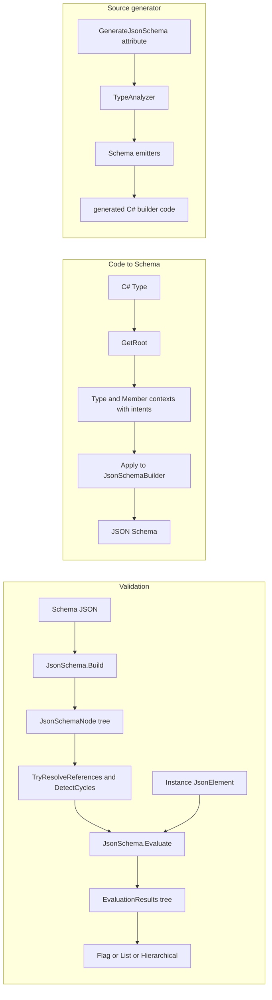

# json-everything — Research report

## Metadata

- **Library name**: json-everything (JsonSchema.Net and related packages)
- **Repo URL**: https://github.com/json-everything/json-everything
- **Clone path**: `research/repos/csharp/json-everything-json-everything/`
- **Language**: C#
- **License**: MIT for the repo (Copyright (c) .NET Foundation and Contributors); NuGet binaries are packaged under `OSMFEULA.txt` (Open Source Maintenance Fee EULA, `PackageLicenseFile` in `JsonSchema.csproj`)
- **Analyzed version**: 4d7ca86f1 2026-10-26 (JsonSchema.Net `9.5.0` per `src/JsonSchema/JsonSchema.csproj`, `<JsonSchemaNetVersion>`)
- **Report date**: 2026-10-26

## Summary

json-everything is a C# ecosystem of libraries for JSON handling built on System.Text.Json. Its JSON Schema components include: (1) **JsonSchema.Net** — full validation of JSON against JSON Schema (drafts 6, 7, 2019-09, 2020-12, plus the new `v1` / `V1_2026` dialect, which is the default); (2) **JsonSchema.Net.Generation** — code → schema (generates JSON Schema from C# types via intents and refiners, with optional source generation at compile time); (3) **JsonSchema.Net.CodeGeneration** — schema → C# code, **deprecated** (README table points to Corvus.JsonSchema) and absent from the repo (`src/JsonSchema.CodeGeneration` does not exist). Also in-repo: JsonSchema.DataGeneration (schema → sample JSON data), JsonSchema.Data, JsonSchema.ArrayExt, JsonSchema.OpenApi, JsonSchema.Api (ASP.NET). The active schema→code capability is no longer maintained; the validation and code→schema generation remain active and in development.

## JSON Schema support

- **Drafts**: Draft-06, Draft-07, Draft 2019-09, Draft 2020-12, and `v1` / `V1_2026` (next-generation spec the project tracks; `Dialect.v1.cs`, `Meta-Schemas/v1.json`). Draft-04 and earlier are not supported. Evidence: `src/JsonSchema/README.md`; `Dialect.06.cs`, `Dialect.07.cs`, `Dialect.201909.cs`, `Dialect.202012.cs`, `Dialect.v1.cs`; `__ModuleInitialization.cs` sets `Dialect.Default = Dialect.V1`.
- **Scope**: Full validation for the listed drafts. Architecture is **Dialect-based**: a `Dialect` is a set of `IKeywordHandler` singletons plus flags (`RefIgnoresSiblingKeywords` true for drafts 6/7, `AllowUnknownKeywords` true for 6/7/2019-09/2020-12 and false for V1), `Id`, and a per-dialect `FormatRegistry`. A `DialectRegistry` selects the dialect from `$schema`; `Vocabulary` objects (`Vocabulary.201909.cs`, `Vocabulary.202012.cs`, `VocabularyRegistry`) are still used to compose custom dialects from `$vocabulary` meta-schemas. A `propertyDependencies` handler exists but is commented out of V1 as a proposal. Schema → code (CodeGeneration) is deprecated; code → schema (Generation) is active.

## Keyword support table

Keyword list derived from vendored draft 2020-12 meta-schemas (`specs/json-schema.org/draft/2020-12/meta/*.json`, union of `properties` keys: 57 keywords, all present below). Each row verified against a handler file in `src/JsonSchema/Keywords/` (and its `Name` property) and its presence in `Dialect.202012.cs`.

| Keyword | Implemented | Notes |
|---------|-------------|-------|
| $anchor | yes | Core; AnchorKeyword; used for resolution. |
| $comment | yes | Core; CommentKeyword; annotation only. |
| $defs | yes | Core; DefsKeyword; container for definitions. |
| $dynamicAnchor | yes | Core; DynamicAnchorKeyword; for $dynamicRef. |
| $dynamicRef | yes | Core; `Keywords/Draft202012/DynamicRefKeyword.cs` (2020-12 bookend semantics: dynamic only if the target resource has a matching `$dynamicAnchor`, else behaves as `$ref`) and `Keywords/DynamicRefKeyword.cs` (v1: anchor-only, always resolved against the dynamic scope at evaluation). |
| $id | yes | Core; IdKeyword; changes the base URI during build (`BuildNode`) and makes the subtree a separately registered embedded resource; fragments other than empty `#` are rejected. |
| $ref | yes | Core; RefKeyword; resolved eagerly after build (`TryResolve`), lazily retried at first `Evaluate` if a target was not yet registered. |
| $schema | yes | Core; SchemaKeyword; dialect selection. |
| $vocabulary | yes | Keywords/Draft201909/VocabularyKeyword.cs (shared by the 2020-12 dialect); evaluation is a no-op (`KeywordEvaluation.Ignore`); read by `DialectRegistry.Get` to build custom dialects from meta-schemas. |
| additionalProperties | yes | Applicator; AdditionalPropertiesKeyword. |
| allOf | yes | Applicator; AllOfKeyword. |
| anyOf | yes | Applicator; AnyOfKeyword. |
| const | yes | Validation; ConstKeyword. |
| contains | yes | Applicator; ContainsKeyword. |
| contentEncoding | partial | Content; ContentEncodingKeyword; annotation only (no decoding). |
| contentMediaType | partial | Content; ContentMediaTypeKeyword; annotation only. |
| contentSchema | partial | Content; ContentSchemaKeyword; builds the annotation from the raw value, performs no decoding or sub-validation (`Evaluate` returns `IsValid = true` with the raw value as annotation). |
| default | yes | Meta-data; DefaultKeyword; annotation. |
| dependentRequired | yes | Validation; DependentRequiredKeyword. |
| dependentSchemas | yes | Applicator; DependentSchemasKeyword. |
| deprecated | yes | Meta-data; DeprecatedKeyword; annotation. |
| description | yes | Meta-data; DescriptionKeyword; annotation. |
| else | yes | Applicator; ElseKeyword; if-then-else. |
| enum | yes | Validation; EnumKeyword. |
| examples | yes | Meta-data; ExamplesKeyword; annotation. |
| exclusiveMaximum | yes | Validation; ExclusiveMaximumKeyword. |
| exclusiveMinimum | yes | Validation; ExclusiveMinimumKeyword. |
| format | yes | One class family: `Keywords/FormatKeyword.cs` (always asserts, used by the `v1` dialect) and `Keywords/Draft06/FormatKeyword.cs` (`Annotate` = annotation only unless `EvaluationOptions.RequireFormatValidation`; `Validate` = always asserts; the 2020-12 dialect uses `Annotate`, the format-assertion vocabulary uses `Validate`). Format checkers come from the dialect's `FormatRegistry`. |
| if | yes | Applicator; IfKeyword. |
| items | yes | Applicator; ItemsKeyword (2020-12/v1 semantics: skips the `prefixItems` count, which is read from the sibling at build time); `Keywords/Draft06/ItemsKeyword.cs` holds the array-form for older drafts. |
| maxContains | yes | Validation; MaxContainsKeyword. |
| maximum | yes | Validation; MaximumKeyword. |
| maxItems | yes | Validation; MaxItemsKeyword. |
| maxLength | yes | Validation; MaxLengthKeyword. Length is counted in grapheme clusters (`StringInfo.LengthInTextElements`), not code points. |
| maxProperties | yes | Validation; MaxPropertiesKeyword. |
| minContains | yes | Validation; MinContainsKeyword. |
| minimum | yes | Validation; MinimumKeyword. |
| minItems | yes | Validation; MinItemsKeyword. |
| minLength | yes | Validation; MinLengthKeyword. Length is counted in grapheme clusters (`StringInfo.LengthInTextElements`), not code points. |
| minProperties | yes | Validation; MinPropertiesKeyword. |
| multipleOf | yes | Validation; MultipleOfKeyword. |
| not | yes | Applicator; NotKeyword. |
| oneOf | yes | Applicator; OneOfKeyword. |
| pattern | yes | Validation; PatternKeyword. |
| patternProperties | yes | Applicator; PatternPropertiesKeyword. |
| prefixItems | yes | Applicator; PrefixItemsKeyword; 2020-12. |
| properties | yes | Applicator; PropertiesKeyword. |
| propertyNames | yes | Applicator; PropertyNamesKeyword. |
| readOnly | yes | Meta-data; ReadOnlyKeyword; annotation. |
| required | yes | Validation; RequiredKeyword. |
| then | yes | Applicator; ThenKeyword. |
| title | yes | Meta-data; TitleKeyword; annotation. |
| type | yes | Validation; TypeKeyword. |
| unevaluatedItems | yes | Unevaluated; UnevaluatedItemsKeyword (2020-12/v1; 2019-09 variant in `Keywords/Draft201909/`). Reads annotations from sibling evaluations and nested valid result trees (see Core algorithm). |
| unevaluatedProperties | yes | Unevaluated; UnevaluatedPropertiesKeyword. Annotation-driven; forces full (non-Flag-optimized) result construction in its schema node. |
| uniqueItems | yes | Validation; UniqueItemsKeyword. |
| writeOnly | yes | Meta-data; WriteOnlyKeyword; annotation. |

Note: Draft-06/07 also use `definitions`, `additionalItems`, `dependencies` and `$id`/`items` variants (`Keywords/Draft06/`); 2019-09 uses `$recursiveRef`, `$recursiveAnchor`, its own `$anchor` and `unevaluatedItems` (`Keywords/Draft201909/`). `propertyDependencies` (`Keywords/PropertyDependenciesKeyword.cs`) is a non-spec proposal keyword. Unknown keywords are kept as annotations when the dialect allows them (`AnnotationKeyword`); V1 rejects them. `format` is a single handler covering annotation and assertion (`EvaluationOptions.RequireFormatValidation`). `contentEncoding`/`contentMediaType`/`contentSchema` are annotation-only. Of the 57 keywords in the table, 54 are fully implemented and 3 (content*) are annotation-only.

## Constraints

- **Validation (JsonSchema.Net)**: every assertion keyword is enforced at runtime in `JsonSchema.Evaluate()`. The schema is built once into a `JsonSchemaNode` tree; each keyword is a stateless `IKeywordHandler` singleton. Constraints are never turned into generated code.
- **Code to schema (Generation)**: constraint attributes (`[MinLength]`, `[Pattern]`, `[Minimum]`, `[UniqueItems]`, ...) and `System.ComponentModel.DataAnnotations` become intents (`MinLengthIntent`, `PatternIntent`, ...) which emit the corresponding keywords. Nothing is enforced on the C# type itself, except through the optional `GenerativeValidatingJsonConverter`.
- **Schema to code (CodeGeneration, deprecated)**: the project `src/JsonSchema.CodeGeneration` does not exist in this clone (verified: absent from `src/`); only the README deprecation pointer to Corvus.JsonSchema remains. Nothing can be said about its constraint handling from this clone.

## High-level architecture

- **Validation**: JSON text / `JsonElement` -> `JsonSchema.Build()` (`FromText`, `FromFile`, or the `JsonSchemaBuilder`) -> `JsonSchema` wrapping a root `JsonSchemaNode` tree and registered in a `SchemaRegistry`. `Evaluate(JsonElement, EvaluationOptions)` walks the node tree, calls each keyword handler, and returns a tree of `EvaluationResults` that is then flattened or pruned according to `OutputFormat`.
- **Code to schema (Generation)**: C# `Type` -> `JsonSchemaBuilder.FromType` -> `SchemaGenerationContextCache.GetRoot` -> graph of `TypeGenerationContext` / `MemberGenerationContext` holding lists of `ISchemaKeywordIntent` -> `Apply(JsonSchemaBuilder)` -> JSON Schema. A Roslyn incremental source generator (`[GenerateJsonSchema]`) emits C# `JsonSchemaBuilder` calls at compile time.
- **Schema to code**: not present (see Constraints).
- **Other projects in repo (not analyzed in depth)**: JsonSchema.DataGeneration (schema to sample JSON), JsonSchema.Data, JsonSchema.ArrayExt, JsonSchema.OpenApi, JsonSchema.Api. Also non-schema libraries: JsonPointer, JsonPath, JsonPatch, JsonLogic, JsonE, Json.More, Yaml2JsonNode.

## Medium-level architecture

- **Dialect / vocabulary layer**: `Dialect` (`Dialect.cs`) is an ordered-by-dependency set of `IKeywordHandler`s plus flags (`RefIgnoresSiblingKeywords`, `AllowUnknownKeywords`, `Id`, `FormatRegistry`). Static instances `Draft06`, `Draft07`, `Draft201909`, `Draft202012`, `V1_2026` (aliased `V1`) are declared in `Dialect.*.cs`. `Dialect.Default` is set to `V1` by `__ModuleInitialization` (a `[ModuleInitializer]`). `DialectRegistry.Get(uri, ...)` returns a registered dialect for a `$schema` URI, or, for an unknown URI whose meta-schema is in the `SchemaRegistry` and carries `$vocabulary`, composes a new `Dialect` from the `Vocabulary` objects named there (`VocabularyRegistry`), inheriting `AllowUnknownKeywords`/`RefIgnoresSiblingKeywords` from the enclosing dialect.
- **Build layer**: `JsonSchema.Build` -> `BuildNode` creates one `JsonSchemaNode` per (sub)schema, each holding `KeywordData[]` (handler + raw `JsonElement` + parsed `Value` + child `Subschemas`). Keyword handlers recurse back into `JsonSchema.BuildNode` from `BuildSubschemas`.
- **Registry layer**: `SchemaRegistry` maps absolute base URIs to a `Registration` (root document, anchors, dynamic anchors, recursive anchor). A process-wide `SchemaRegistry.Global` is the default in `BuildOptions`; a per-registry `Fetch` delegate (falling back to `Global.Fetch`) loads missing documents.
- **Evaluation layer**: `JsonSchemaNode.Evaluate(EvaluationContext)` iterates the keywords in dependency order and assembles an `EvaluationResults` node.
- **Output layer**: `EvaluationResults` plus `ToFlag()` / `ToList()` and `EvaluationResultsJsonConverter` (writes the spec output format).
- **Generation layer**: `GeneratorRegistry` (type -> `ISchemaGenerator`), `AttributeHandler` (attributes -> intents), `ISchemaRefiner`s, `SchemaGeneratorConfiguration`, and `Intents/*` (one `ISchemaKeywordIntent` per keyword).

```mermaid
flowchart TB
  subgraph refFlow [Reference resolution]
    BuildNode[BuildNode per subschema]
    RegisterAnchors[Register embedded resources and anchors]
    RefBuild[RefKeyword.BuildSubschemas resolves URI against base]
    TryResolve[TryResolveReferences walk with visited set]
    Registry[SchemaRegistry Get or Get anchor]
    Fetch[Fetch delegate]
    FindSub[JsonSchema.FindSubschema by pointer]
    Link[KeywordData.Subschemas set to target node]
    Cycles[DetectCycles on pure ref chains]
    BuildNode --> RegisterAnchors
    BuildNode --> RefBuild
    RefBuild --> TryResolve
    TryResolve --> Registry
    Registry --> Fetch
    Registry --> FindSub
    FindSub --> Link
    Registry --> Link
    Link --> Cycles
  end
  subgraph dynFlow [Dynamic refs at evaluation time]
    DynRef[DynamicRef Evaluate]
    Scope[DynamicScope stack of base URIs]
    GetDynamic[SchemaRegistry.GetDynamic scope anchor]
    DynRef --> Scope
    Scope --> GetDynamic
  end
  subgraph genDefs [Generation defs and refs]
    GetRoot2[GetRoot]
    Cache2[Per-thread type cache]
    Reintegrate[Inline single-reference types]
    DefsIntent2[DefsIntent for the rest]
    GetRoot2 --> Cache2
    Cache2 --> Reintegrate
    Reintegrate --> DefsIntent2
  end
```

## Algorithms and data structures

### Schema representation

The in-memory model is a tree of `JsonSchemaNode` objects (`src/JsonSchema/JsonSchemaNode.cs`) that is retained alongside the original JSON, not a typed struct hierarchy. A node has `BaseUri` (resource base URI), `Source` (the schema's `JsonElement`, which keeps the whole parsed document alive), `Keywords` (`KeywordData[]`), `RelativePath` (a `JsonPointer` from the parent keyword to this subschema, e.g. `0` under `allOf`, a property name under `properties`) and the obsolete-but-used `PathFromResourceRoot`. Each `KeywordData` (`KeywordData.cs`) holds the `IKeywordHandler` singleton, the `RawValue` `JsonElement`, an `object? Value` slot that handlers use for keyword-specific build-time state, `Subschemas` (`JsonSchemaNode[]`), an internal `EvaluationOrder`, and a copy of the `BuildContext` struct it was built in.

The `Value` slot is the "parsed keyword" mechanism: `type` stores a `SchemaValueType` flags enum (array form is OR'ed together); `required` a `string[]`; `pattern` a compiled `Regex`; `patternProperties` a `Dictionary<string, Regex>`; `minLength` a `long`; `$ref` a resolved absolute `Uri`; `additionalProperties` a `KnownProperties` (set + regex array computed from sibling `properties`/`patternProperties`); `items` the count of sibling `prefixItems`; `contains` a `ContainsLimits` struct with sibling `minContains`/`maxContains`. Keywords that read neighbours (items/contains/additionalProperties) peek at `context.LocalSchema` (the raw object) during `BuildSubschemas`, so sibling dependency is resolved at build time rather than by pointer between keyword objects.

Boolean schemas are nodes whose `Source` is the cached `true`/`false` element and whose `BaseUri` is the sentinel `https://json-schema.org/true|false`; `JsonSchema.True/False` are singletons. Unknown keywords, when the dialect has `AllowUnknownKeywords`, get `AnnotationKeyword.Instance` and the keyword name as `Value`; otherwise `Dialect.GetHandler` throws `JsonSchemaException`. A top-level `JsonSchema` (`JsonSchema.cs`) is a thin wrapper: `Root` node, `BaseUri`, the `BuildOptions` it was built with, a `_resolved` flag and a lazy `_discoveredSchemas` map used by pointer-fragment lookup. Ownership is plain GC references; schemas are registered into a registry that outlives them (the global one by default, so schemas leak into process lifetime unless the caller supplies a fresh `SchemaRegistry`).

Dialect keyword storage is `MultiLookupConcurrentDictionary<KeywordMetaData>` (`MultiLookupConcurrentDictionary.cs`): one `ConcurrentDictionary<object, T>` indexed simultaneously by keyword name (string) and handler `Type`, so handlers can be found by `GetHandler("allOf")` or by `typeof(AllOfKeyword)`.

### Reference resolution and registry

`SchemaRegistry` (`SchemaRegistry.cs`) is a `ConcurrentDictionary<Uri, Registration>` where `Registration` has `Root` (an `IBaseDocument`; `JsonSchema` implements it, so non-schema documents can be registered), `Anchors`, `DynamicAnchors` (both `Dictionary<string, JsonSchemaNode>`) and `RecursiveAnchor`. Keys are made absolute against a dummy `https://json-everything.lib/` base. Registering a different object under an already-registered URI throws ("Overwriting registered schemas is not permitted"). Lookup (`GetRegistration`) tries the registry, then `Global`, then the `Fetch` delegate on this registry, then `Global.Fetch`, and registers whatever is returned; there is no built-in HTTP fetching.

Base-URI tracking happens during build. `BuildContext` is a struct carrying `BaseUri`, `LocalSchema`, `Dialect`, `RelativePath`, `PathFromResourceRoot`. When `BuildNode` sees an `$id` handler it resolves the id against the current base (`context.BaseUri.Resolve`) and resets `PathFromResourceRoot`; for draft-06/07, a `$ref` with siblings suppresses the base change (`allowBaseUriChange`). After all keywords are built, any child whose `BaseUri` differs from the parent is wrapped into its own `JsonSchema` and registered, i.e. embedded resources become independent registry entries. Anchors are registered at the end of `BuildNode`: draft-06/07 `$id: "#foo"`, `$anchor` (also for 2019-09), `$dynamicAnchor` (registered both as an anchor and as a dynamic anchor), and 2019-09 `$recursiveAnchor: true`.

Resolution is two-phase. `RefKeyword.BuildSubschemas` only resolves the textual reference against the base URI and stores the absolute `Uri` in `keyword.Value`. After the whole root is built and registered, `JsonSchema.TryResolveReferences` (recursive, with a `HashSet<JsonSchemaNode>` visited set so it terminates on graphs) calls `RefKeyword.TryResolve` for `$ref` and `$dynamicRef` on each node. `TryResolve` parses the fragment: if it is a JSON Pointer it fetches the registered document and calls `JsonSchema.FindSubschema(pointer, ctx)`, which first looks in `_discoveredSchemas`, then walks the already-built node tree matching keyword name and `RelativePath` segment by segment, and, if the pointer lands somewhere that was never built as a subschema (e.g. inside `$defs`-less arbitrary location or an unknown keyword), builds a fresh node from the raw JSON at that pointer and caches it; otherwise it looks the fragment up as a plain-name anchor. The resolved node is stored in `keyword.Subschemas = [target]`, so at evaluation `$ref` is a direct pointer to the target node (O(1), no lookup). If anything could not be resolved (target in a not-yet-registered document), `_resolved` stays false and `Evaluate` retries resolution once on first use; if it still fails, evaluation throws `RefResolutionException`.

Dynamic references are resolved at evaluation time through `DynamicScope` (`DynamicScope.cs`), a `Stack<Uri>` of base URIs of schema resources entered during the current evaluation; `JsonSchemaNode.Evaluate` pushes `BaseUri` when it differs from the current local scope and pops after. `SchemaRegistry.GetDynamic(scope, anchor)` enumerates the scope outermost-first (`scope.Reverse()`), looks up each resource's `DynamicAnchors` and returns the first hit, which implements the "outermost dynamic anchor wins" rule. The 2020-12 `$dynamicRef` handler decides at build time whether a reference is dynamic (`DynamicRefInfo.IsDynamic`) by checking whether the *local* resource defines a matching `$dynamicAnchor`; if not it is resolved statically like `$ref`. The v1 `DynamicRefKeyword` is always dynamic. 2019-09 `$recursiveRef` uses `GetRecursive(scope)`, which walks the scope while resources have `$recursiveAnchor: true`, keeping the last (outermost contiguous) one.

Cycle handling has two separate mechanisms. Static: `DetectCycles` follows chains of `$ref` -> node whose keywords contain `$ref` using a per-node `HashSet`, and throws `JsonSchemaException("Cycle detected ...")` if a chain revisits a node; recursion through applicators (e.g. a tree schema referencing itself under `properties`) is legitimate and is not flagged. Dynamic: `JsonSchemaNode.Evaluate` keeps `EvaluatedNodes`, a `Stack<(JsonSchemaNode, JsonPointer)>`, and throws if the same (node, instance location) pair is already on the stack (`context.EvaluatedNodes.Any(...)` is a linear scan, so cost is O(depth) per node visit). This catches infinite recursion that does not advance in the instance, e.g. `$dynamicRef` loops.

`SchemaRegistry.CreateBundle` (bundling) uses two explicit queues (documents and nodes) with a `HashSet<JsonSchema>` visited set, no recursion: it walks every node, for each `$ref` pulls the target document's whole source JSON into a `$defs` object keyed by its base URI, and publishes a 2020-12 schema `{ $schema, $id: bundleUri, $ref: rootUri, $defs }`. Dynamic and recursive refs throw `NotSupportedException`.

### Compiled / intermediate form

The "compiled" form is the `JsonSchemaNode` graph described above, produced by `JsonSchema.Build` (this is the only build step; there is no code emission or bytecode). It differs from the raw JSON in four ways: (1) keywords are bound to handler singletons and validated eagerly (`ValidateKeywordValue` throws `JsonSchemaException` on a bad keyword value, so malformed schemas fail at build); (2) per-keyword state such as regexes, `type` flags, required arrays and sibling-derived data is precomputed into `KeywordData.Value`; (3) keywords are stored pre-sorted by evaluation order; (4) `$ref`/static `$dynamicRef` become direct node links, turning the tree into a graph that can contain cycles.

Evaluation order is computed per dialect in `Dialect.EvaluateDependencies`. Fixed priorities: `$ref` (-4, only when `RefIgnoresSiblingKeywords`), `$schema` (-3), `$vocabulary` (-2), `$id` (-1), `unevaluatedItems`/`unevaluatedProperties` (`long.MaxValue`). All others receive a priority from a layered topological sort driven by the `[DependsOnAnnotationsFrom(typeof(X))]` attribute on handler classes (e.g. `AdditionalPropertiesKeyword` depends on `PropertiesKeyword` and `PatternPropertiesKeyword`; `ThenKeyword` depends on `IfKeyword`; `UnevaluatedPropertiesKeyword` additionally on itself): repeatedly assign the next integer priority to every keyword none of whose dependencies is still unprioritized. Dependency attributes also set `ProducesDependentAnnotations` on the depended-on handler. The sort is O(K^2) in keywords per dialect, run once at dialect construction. `BuildNode` orders property enumeration by this priority (`OrderBy`) and again sorts `keywordData.OrderBy(EvaluationOrder).ToArray()`; unknown keywords (priority null) sort as 0.

### Core algorithm

**Validation.** `JsonSchema.Evaluate` creates an `EvaluationContext` struct (options, `SchemaRegistry`, dialect `FormatRegistry`, `InstanceRoot`, `Instance`, `EvaluationPath`, `Scope`, `CanOptimize`, `EvaluatedNodes`) and calls `Root.Evaluate(context)`. Contexts are structs passed by value and specialised with C# `with` expressions at each applicator (e.g. `context with { InstanceLocation = ..., Instance = child, EvaluationPath = ... }`), so child state never leaks upward.

`JsonSchemaNode.Evaluate`: (1) recompute `CanOptimize &= Keywords.All(h => h is not unevaluated*)` so any node with an `unevaluated*` keyword switches to full-detail mode; (2) construct an `EvaluationResults` (cheap parameterless one when `CanOptimize`, else with evaluation path, schema location URI and instance location); (3) boolean schemas return immediately; (4) cycle check and push on `EvaluatedNodes`; push `BaseUri` on the dynamic scope if the resource changed; (5) allocate `context.EvaluatedKeywords = new KeywordEvaluation[Keywords.Length]` and loop over `Keywords.OrderBy(x => x.EvaluationOrder)`: call `handler.Evaluate(keyword, context)`, store the returned `KeywordEvaluation` struct in `EvaluatedKeywords[i]` (so later siblings can read earlier siblings' annotations), AND `IsValid` into the node unless `!ContributesToValidation` (used by `if`), and, if not optimizing, move `Details`, `Error` and `Annotation` into the result node. In drafts 6/7 a `$ref` stops the loop (`RefIgnoresSiblingKeywords`). (6) On failure it clears annotations unless `PreserveDroppedAnnotations`; (7) pops scope/stack.

Keyword dispatch is a virtual call on the handler (`IKeywordHandler.Evaluate`), no switch. Handlers that do not apply to the instance's JSON type return `KeywordEvaluation.Ignore` (valid, no annotation).

**Short-circuiting** happens inside handlers only when `context.CanOptimize` is true (set when `OutputFormat == Flag`): `allOf` returns invalid on the first failing branch, `anyOf` returns valid on the first passing branch, `oneOf` returns invalid as soon as two branches pass, `properties`/`patternProperties`/`additionalProperties`/`prefixItems`/`items` return on the first failing child, `required` returns on the first missing name. In non-Flag modes every branch runs so full details exist. `contains` and `unevaluated*` never short-circuit. A subtle detail: the `InstanceLocation` property setter on `EvaluationContext` re-enables `CanOptimize` (if Flag) whenever the instance location changes, so an `unevaluated*` node only forces detail mode for its own instance location; children at deeper locations can optimise again.

**Annotation collection for `unevaluated*`.** There is no separate annotation store. Annotations live in the `EvaluationResults` tree and in the sibling `EvaluatedKeywords` array. `UnevaluatedPropertiesKeyword.GetEvaluatedProperties` (1) returns "all evaluated" if a sibling `additionalProperties` was evaluated, (2) unions the string-array annotations of sibling `properties` and `patternProperties` (these keywords emit the set of property names they applied to as a `JsonElement` array annotation), then (3) scans the `Details` of every sibling keyword's result whose result is valid and at the same `InstanceLocation`, recursing through `GetNestedEvaluatedProperties`, which adds `properties`/`patternProperties` annotations of valid descendants and short-circuits to "all" if a descendant carries `additionalProperties` or `unevaluatedProperties`. Because invalid subschema results are skipped (and annotations of failed nodes are cleared), annotations from failed `anyOf` branches or `not` correctly do not count. `unevaluatedItems` does the same with `items` (true), `prefixItems` (annotation = last evaluated index), and `contains` (annotation = array of matching indexes) and tracks an index plus a `HashSet<int>` of extra indexes. Cost: a full walk of the valid result subtree per `unevaluated*` evaluation (O(size of result tree) per node, repeated on nested unevaluated keywords); the annotation payloads are `JsonElement`s created by `JsonSerializer.SerializeToElement`, so every `properties` keyword allocates a serialized array.

`if`/`then`/`else`: `IfKeyword` evaluates its subschema and returns `ContributesToValidation = false`; `ThenKeyword` finds `if` in `context.EvaluatedKeywords` and only evaluates when it was valid (hence the dependency attribute ordering). `format` consults `context.FormatRegistry.Get(name)` which returns an `UnknownFormat` fallback for names not registered.

**Numbers.** Numeric comparisons are done on the raw JSON text, not on `double`/`decimal`: `JsonMath.NumberCompare`, `JsonMath.Divides` (for `multipleOf`) and `JsonMath.IsInteger` call `JsonElement.GetRawText()`, normalise the literal into (negative, digit start, digit length, exponent) and compare/modulo digit by digit using `stackalloc` buffers; `ModuloDigits` does a streaming remainder with a `ulong` accumulator and falls back to `ModuloDigitsLarge` when the divisor exceeds `int.MaxValue`. This gives arbitrary-precision results without `BigInteger` or floating-point error (`0.1` divides `0.3`, `1.0` is an integer, `1e2` is an integer). `enum`/`const`/`uniqueItems` equality uses `JsonElement.IsEquivalentTo` (Json.More), which compares objects irrespective of key order and numbers as `decimal` (so values outside `decimal` range can throw).

**Code to schema.** `JsonSchemaBuilderExtensions.FromType` sets the thread-static `SchemaGeneratorConfiguration.Current`, clears the thread-static `SchemaGenerationContextCache`, calls `GetRoot(type)` and `Apply`s the root context to the builder. Steps:

1. `Get(type, isRoot)` creates a `TypeGenerationContext` (one per CLR type, cached in a `[ThreadStatic] Dictionary<Type, TypeGenerationContext>`; registers itself in the cache before generating intents so recursive types terminate), adds a `DescriptionIntent` from XML doc comments, and calls `GenerateIntents()`.
2. `TypeGenerationContext.GenerateIntents`: if the type is in `ExternalReferences` it becomes a single `RefIntent(uri){IsExternalRef}`; else if the type has `[Id]` and is not root it becomes a `RefIntent` to that id; otherwise it picks the first matching `ISchemaGenerator` (user generators from configuration first, then `GeneratorRegistry`, an ordered list: nullable value type, bool, integer, number, string, enum, DateTime, Guid, JsonPointer, JsonNode/JsonArray/JsonObject/JsonValue, Uri, string- and enum-keyed dictionaries, arrays/enumerables, and finally `ObjectSchemaGenerator`, which handles everything) and calls `AddConstraints`. Then `AttributeHandler.HandleAttributes` and the configured refiners run.
3. `ObjectSchemaGenerator` reflects public instance properties/fields (plus non-public ones with `[JsonInclude]`), deduplicates by member name (`GroupBy(Name).First()`), orders them per `PropertyOrder` (`AsDeclared` uses `MemberInfoMetadataTokenComparer`: base-type-first, then metadata token; `ByName`; or unspecified), skips `[JsonIgnore(Always)]`/`[JsonExclude]`, adds read/write-only markers, creates a `MemberGenerationContext` per member (`type context` + that member's attributes, incl. `[Nullable]`), resolves the JSON name via `PropertyNameResolver` or `[JsonPropertyName]`, and emits a `PropertiesIntent`, `RequiredIntent` (from `[Required]`, `required` members, `[JsonRequired]`), and conditional intents (`if`/`then`, `allOf` of if-then groups, optional `unevaluatedProperties:false` under `StrictConditionals`) from `[If]`, `[IfMin]`, `[IfMax]`, `[IfEnum]` attributes.
4. `MemberGenerationContext.GenerateIntents`: root type -> `$ref: "#"`; nullable, non-referenceable, or simple-external-ref types -> copy the type's intents (wrapped through `AsNullable()` when nullable); otherwise -> `RefIntent("#/$defs/<DefinitionName>")` and register itself in the type context's `References` list.
5. Refiners: `ArrayItemsRefiner` (file `Refiners/TypedArrayRefiner.cs`) and `ObjectValuesRefiner` re-target attributes to the item/value type of arrays and dictionaries by regenerating the nested `MemberGenerationContext` with `Parameter` set so `INestableAttribute.GenericParameter` selects the right element.
6. `GetRoot` post-processing: types referenced exactly once (and not the root, and `CanBeReferenced()`) are inlined back into their single referrer, unless the referrer already has a conflicting keyword (set intersection of intent types excluding `RefIntent`); remaining referenced types become `DefsIntent` entries, keyed by `DefinitionName` (`TypeNameGenerator` or a camelised friendly CLR name such as `array of integer`); `DistinctBy(DefinitionName)` silently drops a second type whose name collides. 

**Source generator.** `JsonSchemaSourceGenerator` (`IIncrementalGenerator`) uses `ForAttributeWithMetadataName("...GenerateJsonSchemaAttribute")`, reads MSBuild properties (`DisableJsonSchemaSourceGeneration`, `JsonSchemaDefaultPropertyNaming`, `...PropertyOrder`, `...EnumFormat`), runs `TypeAnalyzer` over the Roslyn symbols, gathers transitive referenced types, resolves types already covered by other generating assemblies, and emits per-type partial classes via `SchemaCodeEmitter` / `ISchemaEmitter` implementations (`ObjectSchemaEmitter`, `ArraySchemaEmitter`, `DictionarySchemaEmitter`, `EnumSchemaEmitter`, `ConditionalSchemaEmitter`, ...). The emitted artefact is C# source text calling the fluent `JsonSchemaBuilder` (`.Type(...)`, `.Ref("...")`, `.AnyOf(...)` for nullable), i.e. the schema is built as a builder expression at runtime of the host app, not embedded as a JSON literal.

### Error and output model

`KeywordEvaluation` (a `readonly struct`) is what each handler returns: `Keyword`, `IsValid`, optional `Annotation` (`JsonElement?`), `Details` (`EvaluationResults[]` for applicators), `Error` (string), `ContributesToValidation`. `EvaluationResults` (class) is the per-schema-node result: `IsValid`, `EvaluationPath` (keyword path through `$ref`s, a `JsonPointer`), `InstanceLocation`, lazily built `SchemaLocation` (`#`-fragment relative to the last `$ref`/`$dynamicRef`/`$recursiveRef` segment in the evaluation path against the node's `BaseUri`), `Details` (child results), `Annotations` (`Dictionary<string, JsonElement>`, keyed by keyword), `Errors` (`Dictionary<string, string>`, keyed by keyword), and `Parent`. So errors are one message per keyword per schema node, keyed by keyword name, with nesting via `Details`.

Output formats are applied after evaluation by mutating the tree: `Hierarchical` leaves it as built; `ToFlag()` clears `Details`, `Annotations`, `Errors` and marks `Format = Flag` (the JSON converter then writes just `{"valid": ...}`); `ToList()` does a BFS over the tree (`GetAllChildren`, an explicit `Queue`), detaches every node's `Details`, and re-attaches all nodes (plus a copy of the root) as a flat list under the root, marking each `Format = List`. `OutputFormat.Flag` also turns on the evaluation-time `CanOptimize` shortcut, so Flag output is both cheaper to build and avoids creating detail nodes. `EvaluationResultsJsonConverter` writes `valid`, and for hierarchical/child nodes `evaluationPath`, `schemaLocation` (appends `#` for empty fragments), `instanceLocation`, then `annotations` (valid) or `errors`/`droppedAnnotations` (invalid), then `details`. Error text is produced by `ErrorMessages.GetXxx(culture)` from `.resx` resources (`Localization/`, many cultures) with `[[token]]` replacement (`ReplaceToken`); messages are built eagerly when a keyword fails and `IncludeApplicatorErrors` is true, except in `CanOptimize` mode where most failing paths return a bare `KeywordEvaluation { IsValid = false }` with no message. Exceptions (`JsonSchemaException`, `RefResolutionException`) are used for malformed schemas, unresolved refs and evaluation cycles, not for instance validation failures.

## Low-level details

- **Format**: per-dialect `FormatRegistry` (`FormatRegistry.Draft06/07/201909/202012/V1`), a `ConcurrentDictionary<string, Format>` keyed by format name, with ~19 built-in formats (`Formats.cs`, ~1900 lines of hand-written validators for date-time, email, hostname, idn-hostname, ipv4/6, uri/iri, uuid, duration, json-pointer, relative-json-pointer, regex, uri-template). Draft-specific variants of `date-time`/`time` exist in `Keywords/Draft06/Formats.cs` and `Keywords/Draft07/Formats.cs`. `Format` subclasses `PredicateFormat`, `RegexFormat`, `UnknownFormat` (unknown formats annotate only). The test suite file notes that much of the format validation code was AI-generated (`ValidationOptimized.cs` header) and several idn-hostname cases are explicitly ignored in the suite runners.
- **String length**: `minLength`/`maxLength` count `StringInfo.LengthInTextElements` (extended grapheme clusters), not Unicode code points as the spec requires; a combining-character or emoji-sequence string is therefore shorter than its code-point count.
- **Numbers**: see Core algorithm (textual arbitrary-precision compare/divide). `minContains`/`maxContains` are read through `GetDouble()` and truncated.
- **Regex**: see Performance techniques (ECMAScript option, 5 s timeout, `{Letter}`/`{digit}` normalisation).
- **Recursion and stack depth**: build (`BuildNode`), `TryResolveReferences`, `DetectCycles`, the `unevaluated*` annotation walk, and evaluation itself are all literal recursion over the schema or result tree; there is no depth limit besides the evaluation cycle check (same node + same instance location). Very deep instances or schemas can overflow the stack. `IsEquivalentTo` also recurses. `ToList` and bundling are iterative.
- **`items` evaluation path**: in `ItemsKeyword.Evaluate` the per-item path is `evaluationPath.Combine(Name)` where `evaluationPath` already includes `items`, so item results are reported under `.../items/items` (observed from code; not checked against tests).
- **`additionalProperties`**: `BuildSubschemas` compiles `patternProperties` regexes (`RegexOptions.ECMAScript | Compiled`, no timeout) into `KnownProperties.PatternProperties`, but `Evaluate` does not use them; it consults the sibling `patternProperties` annotation instead, so those regexes are compiled and never used.
- **Untrusted-input hardening**: `Regex` timeouts (5 s) for `pattern`/`patternProperties`/static `RegexOrPattern`; `Fetch` is caller-supplied (no network access by default); no schema size/depth limits; `$ref` resolution to arbitrary file URIs only through `FromFile`/`Fetch` the caller provides. `Uri`-based file URIs have fragments stripped before registry lookup.
- **Target frameworks**: `netstandard2.0;net8.0;net9.0;net10.0`, AOT-compatible on net7+ (`IsAotCompatible`), source-generated JSON serializer contexts (`JsonSchemaSerializerContext`), signed assembly.
- **Meta-schemas** are embedded resources (`Meta-Schemas/**/*.json`) loaded and built at module initialization (`__ModuleInitialization.LoadMetaSchemas`: 19 meta-schema documents built eagerly at assembly load).

## Output and integration

- **Vendored vs build-dir**: Validation and Generation produce in-memory objects. The source generator emits `*.g.cs` into the compilation (typically `obj/`); it can be disabled with `build_property.DisableJsonSchemaSourceGeneration=true`.
- **API vs CLI**: Library only (NuGet). No CLI. `JsonSchema.FromText/FromFile/Build`, `schema.Evaluate`, `new JsonSchemaBuilder().FromType<T>(config)`, and the attribute-driven source generator. JsonSchema.Net.Api adds ASP.NET endpoint validation; `ValidatingJsonConverter` / `GenerativeValidatingJsonConverter` hook validation into System.Text.Json deserialization.
- **Writer model**: Not applicable for output code (no schema to code in this clone). Schemas serialize through `JsonSchemaJsonConverter` which writes the original `Root.Source` `JsonElement`, so `JsonSerializer.Serialize(schema)` round-trips the source JSON verbatim. The source generator writes through Roslyn `SourceProductionContext` with `StringBuilder`.

## Configuration

- **Generation**: `SchemaGeneratorConfiguration` - `PropertyOrder` (`AsDeclared`, `ByName`, unspecified), `PropertyNameResolver` (`PropertyNameResolvers.*`), `TypeNameGenerator` (`ITypeNameGenerator` for `$defs` keys), `Refiners`, `Generators`, `ExternalReferences` (type -> URI), `StrictConditionals`, `DefaultDialect` (`$schema` to emit), XML comment files (`RegisterXmlCommentFile<T>`). `[GenerateJsonSchema]` attribute and MSBuild properties configure the source generator (naming, order, enum format names/numbers).
- **Validation**: `BuildOptions` (`SchemaRegistry`, `VocabularyRegistry`, `DialectRegistry`, `Dialect`; defaults are the global registries and `Dialect.Default` = V1) and `EvaluationOptions` (`OutputFormat`, `RequireFormatValidation`, `PreserveDroppedAnnotations`, `AddAnnotationForUnknownKeywords`, `IgnoreAnnotationsFrom<T>()`, `Culture`, `IncludeApplicatorErrors`).

## Pros/cons

- **Pros**: Multi-draft support (6, 7, 2019-09, 2020-12, v1) via swappable dialects/vocabularies; build-once/evaluate-many design with direct node links for static refs; textual arbitrary-precision number handling; spec-format output (Flag/List/Hierarchical) with a Flag-mode fast path; correct dynamic scope handling and annotation-driven `unevaluated*`; custom dialects from `$vocabulary` meta-schemas; extensible handlers and formats; localized error messages; code to schema with intents/refiners/attributes and DataAnnotations, plus an AOT-friendly incremental source generator; runs the official JSON-Schema-Test-Suite.
- **Cons**: No schema to code in this repo (CodeGeneration deprecated and removed; Corvus.JsonSchema recommended); evaluation allocates heavily (a `List<EvaluationResults>`, arrays and `JsonPointer`s per node, and a per-node LINQ sort); literal recursion without depth limits; global mutable registries by default; non-thread-safe registration structures; grapheme-based string length deviates from spec; `GetRawText()` string allocation on every numeric comparison; `unevaluated*` cost grows with result-tree size; binary NuGet packages carry the OSMF EULA.

## Testability

- **Build and run**: `dotnet test` on `json-everything.sln` (NUnit). Relevant projects: `src/JsonSchema.Tests`, `src/JsonSchema.Generation.Tests`, `src/JsonSchema.Generation.DataAnnotations.Tests`, `src/JsonSchema.Data.Tests`, etc.
- **Official suite**: `src/JsonSchema.Tests/Suite/Validation.cs`, `ValidationOptimized.cs` (runs the same cases with `OutputFormat.Flag`, i.e. the `CanOptimize` path) and `Output.cs` (output-format cases) read `ref-repos/JSON-Schema-Test-Suite/tests` and `remotes` (a git submodule, empty unless initialised; the clone's `ref-repos` was not verified to be populated). Each class carries an explicit ignore list of known-failing optional/format cases. A `json-schema-vocab-test-suites` submodule is also referenced.
- **Other tests**: `ReferenceTests`, `AnchorTests`, `BundleTests`, `CustomDialectTests`, `CrossDraftTests`, `FetchTests`, `FormatTests`, `OutputTests`, `LocalizationTests`, `PatternTests`, `JsonMathTests`, `VocabularyBasedDialectTests`, `UnrecognizedKeywordTests`, `SelfValidationTest`. Generation tests (`src/JsonSchema.Generation.Tests`) compare generated schemas for attributes, nullability, conditionals, refiners, external references, property order/naming, comments, and source generation (`SourceGeneration/`).
- **Running our generator against theirs**: the test-suite JSON files (once the submodule is populated) and `tools/Benchmarks/Files/tests.json` / `more-tests.json` are standard JSON Schema cases usable as shared fixtures.

## Performance

Analysis from code only; no benchmark was run.

### Performance techniques

- **Compile vs interpret**: Build is a real ahead-of-time step: schema JSON is parsed once into the `JsonSchemaNode` graph; keyword values are validated and pre-parsed (regexes compiled, `type` as flags enum, `required` as `string[]`, `items`/`contains`/`additionalProperties` sibling data captured); keywords are pre-sorted by dependency order; static `$ref` becomes a direct node pointer. Evaluation is still an interpreter over that tree (virtual `Evaluate` per keyword, no code generation or delegates). Per-evaluation work includes re-sorting keywords (`Keywords.OrderBy(x => x.EvaluationOrder)` in `JsonSchemaNode.Evaluate`, a stable LINQ sort of an already sorted array on every node visit) and recomputing `Keywords.All(...)` for `CanOptimize`.
- **Memory layout and allocation**: Pointer tree of heap objects (`JsonSchemaNode`, `KeywordData`, arrays) rather than arena/flat layout. Several value-type choices reduce allocation: `EvaluationContext`, `BuildContext` and `KeywordEvaluation` are structs; `JsonPointer` is a `readonly struct` over a `ReadOnlyMemory<char>` whose `Combine` uses `stackalloc` (<=256 chars) or `ArrayPool` then `ToArray()` (so each combine still allocates one `char[]`); number math uses `stackalloc` digit buffers. Against that, each node visit allocates a `KeywordEvaluation[]`, an `EvaluationResults`, and each applicator allocates `List<EvaluationResults>`, `.ToArray()` copies, `HashSet<string>` for property names, and `JsonSerializer.SerializeToElement` for annotations. `GetRawText()` allocates a string for every `minimum`/`maximum`/`multipleOf`/`type: integer` check. `IsEquivalentTo` uses `ToList()`/`GroupBy` per object comparison. `Flag` mode avoids building detail trees, error strings and annotations (parameterless `EvaluationResults`, early returns), the main allocation reduction. Error messages are built lazily only on failure.
- **Caching and memoization**: Compiled regexes are stored in `KeywordData.Value` (per-keyword cache). `SchemaRegistry` is a URI-to-registration cache; `$ref` targets are resolved once and cached in `KeywordData.Subschemas`; pointer-fragment targets are cached in `JsonSchema._discoveredSchemas`. Dialects are cached in `DialectRegistry`, and dialects composed from `$vocabulary` are memoised under their URI. `MemberInfoMetadataTokenComparer` caches comparers per type (`ConcurrentDictionary`). `SchemaGenerationContextCache` memoises per-type contexts (per call, per thread; cleared at the start of every `FromType`). No memoisation of evaluation results (the same subschema/instance pair reached twice is re-evaluated).
- **Fast paths and short-circuiting**: `OutputFormat.Flag` drives `CanOptimize` and early exits in `allOf`/`anyOf`/`oneOf`/`properties`/`patternProperties`/`additionalProperties`/`items`/`prefixItems`/`required` (see Core algorithm); it is deliberately disabled for nodes containing `unevaluated*` and re-enabled per instance location. Type-gating is done at the top of each handler (`Ignore` when the instance kind does not match). Keyword ordering puts `$ref` (draft 6/7) and `$id` first and `unevaluated*` last. `$ref` in drafts 6/7 ends the keyword loop. `uniqueItems` uses a hash-based `Dictionary<JsonElement,int>` with `GetEquivalenceHashCode` (O(n) average) rather than pairwise comparison, while `enum` is a linear scan with `IsEquivalentTo`. `additionalProperties` reuses the `patternProperties` annotation rather than re-running regex matches. No `type`-first reordering or discriminator shortcuts.
- **Regex handling**: .NET `System.Text.RegularExpressions`. `RegexOrPattern.CreateRegex` picks `RegexOptions.ECMAScript` (JS-like `\d`, `\w`, no Unicode categories) unless the pattern contains `\p{...}`/`\u{...}`, in which case it uses default options (Unicode mode); adds `RegexOptions.Compiled` for schema keywords; passes a 5 s match timeout (protection against catastrophic backtracking, throws `RegexMatchTimeoutException` instead of hanging); normalises `\p{Letter}` -> `{L}`, `{digit}` -> `{Nd}`. Regexes are compiled once per keyword at build (`ValidateKeywordValue`) and reused for every evaluation, so the cost moves into build time (compiled regex construction is expensive: IL emit per pattern). The `additionalProperties` handler's own `new Regex(..., Compiled)` has no timeout and is unused at evaluation (see Low-level details). `DynamicRefKeyword` uses `[GeneratedRegex]` for its anchor pattern on net7+.
- **Concurrency**: Evaluation holds no shared mutable state in handlers (singletons are stateless; context is per-call, `EvaluatedNodes`/`Scope` are created per `Evaluate`), so concurrently evaluating one fully built and resolved `JsonSchema` is safe. Construction is less so: `SchemaRegistry._registered` is a `ConcurrentDictionary`, but the nested `Anchors`/`DynamicAnchors` dictionaries, `DialectRegistry._dialects`, `VocabularyRegistry._vocabs`, `JsonSchema._discoveredSchemas` and the lazy `_resolved` re-resolution in `Evaluate` (which writes `KeywordData.Subschemas`) are unsynchronised. `SchemaGenerationContextCache`/`SchemaGeneratorConfiguration.Current` are `[ThreadStatic]`, making generation thread-safe per thread but not reentrant. No parallel evaluation or parallel generation inside the library.

### Benchmarks in repo

`tools/Benchmarks/` (BenchmarkDotNet 0.15.8; references the in-repo JsonSchema and JsonLogic projects and competitors NJsonSchema 11.1.0 and Newtonsoft.Json.Schema 4.0.1). `Program.cs`: in `DEBUG` it loops `SingleSchemaRunner.JsonSchemaNetEvaluateOnly(1000)`; in Release it runs `BenchmarkRunner.Run<SingleSchemaRunner>()` only (`TestSuiteRunner` is commented out). `SchemaSuite/SingleSchemaRunner.cs`: `[MemoryDiagnoser]`, `[SimpleJob(RuntimeMoniker.Net10_0)]`, `[EventPipeProfiler(CpuSampling)]`; an inline "order" schema with required/pattern/format/min/max/enum/nested objects/arrays; the active `[Benchmark]`s are `JsonSchemaNet` (build once, then `Evaluate` 100000 times with `OutputFormat.Flag`) and `NJsonSchema` (the same loop); build-only and evaluate-only variants exist but are commented out. Other runners: `SchemaSuite/TestSuiteRunner.cs`, `Pointer/` (JsonPointer parse/combine), `LogicSuite/` (JsonLogic). Fixtures: `tools/Benchmarks/Files/tests.json`, `more-tests.json`. Entry points for an external harness: `JsonSchema.FromText(text)` or `JsonSchema.Build(JsonElement, BuildOptions)` once, then `schema.Evaluate(JsonElement, new EvaluationOptions { OutputFormat = OutputFormat.Flag })` per instance (use a fresh `SchemaRegistry` in `BuildOptions` to avoid the global registry's overwrite check).

## Determinism and idempotency

- **Validation**: deterministic for a given schema/instance (evaluation order is fixed by the dialect topological sort; property-name annotations come from `HashSet`s, whose enumeration order is insertion order in practice but not contractually; `Errors` dictionaries are keyed by keyword).
- **Generation**: property order is explicit via `PropertyOrder`: `AsDeclared` sorts by base-type-first then metadata token (stable across runs for the same compiled assembly); `ByName` sorts by member name; the default (unspecified) uses reflection order (`GetProperties` then `GetFields`, not guaranteed). `$defs` come from `Cache` dictionary enumeration (`Dictionary<Type,...>` insertion order in practice) with `DistinctBy(DefinitionName)`, so output order follows first-reference order. `Enum.GetValues` order is by underlying value. Same input yields the same schema within one build; no explicit idempotency tests were reviewed.
- **Source generator**: output is a function of the Roslyn symbols; no sorting step verified.
- **CodeGeneration**: not present.

## Enum handling

- **Validation**: `EnumKeyword.Evaluate` does `RawValue.EnumerateArray().Any(x => x.IsEquivalentTo(instance))`: linear scan, deep equality (order-insensitive objects, numeric equality via `decimal`). Duplicate entries are accepted and harmless; `"a"` and `"A"` are distinct values.
- **Generation (code to schema)**: `EnumGenerator` emits `EnumIntent(names)` from `Enum.GetValues(type)` filtered by `[JsonIgnore(Always)]`/`[JsonExclude]`; names come from `ToString()` or, on net9+, `JsonStringEnumMemberName`. There is no dedupe step: enum aliases (two members with the same underlying value) would produce repeated names. `EnumIntent` can also hold arbitrary `JsonNode` values (numbers when the source generator/attribute selects numeric format) and merges `ConstIntent` + extra values for conditional `if` blocks.
- **CodeGeneration**: not present.

## Reverse generation (Schema from types)

**Yes**, JsonSchema.Net.Generation is the main purpose of the generation side.

- **Reflection API**: `new JsonSchemaBuilder().FromType<T>(configuration).Build()`: described in Core algorithm. Handles objects, arrays/enumerables, string- and enum-keyed dictionaries, enums, primitives, `Guid`, `DateTime` via `DateTimeSchemaGenerator`, `Uri`, `JsonNode` family, nullable value types and nullable reference annotations; recursion via `$ref: "#"` and `$defs`; attribute set (`[Minimum]`, `[MaxLength]`, `[Pattern]`, `[Required]`, `[Title]`, `[Description]`, `[Const]`, `[Default]`, `[If*]`, `[Id]`, ...) and `DataAnnotations` via a separate package.
- **Compile-time API**: `[GenerateJsonSchema]` on a class/interface/struct; the incremental generator emits a static schema member; `GenerativeValidatingJsonConverter` validates during deserialization using it.
- **Extension points**: `ISchemaGenerator` (type handling), `ISchemaRefiner`, `IAttributeHandler`, `ISchemaKeywordIntent`, `[SchemaHandler]`.

## Multi-language output

Not applicable for the schema -> code direction (no code generator in this clone; the deprecated C#-only generator is gone). Generation produces JSON Schema only; the source generator produces C# only.

## Model deduplication and $ref/$defs

- **Validation**: `$defs`/`$ref` are fully resolved to node links; each definition is one node, and every `$ref` shares it. `SchemaRegistry` dedupes documents by URI and refuses to overwrite a different document at the same URI.
- **Generation**: dedupe is by CLR `Type`: one `TypeGenerationContext` per type, shared by all members. A type used from more than one place becomes one `$defs` entry referenced by `$ref`; a type used once is inlined back into its single user (reintegration), unless that would clash with keywords already on the referrer. Two different CLR types that produce the same `DefinitionName` collide and one is dropped (`DistinctBy`). Structurally identical but distinct types are not merged. `ExternalReferences` and `[Id]` replace a type with a `$ref` to an outside URI.
- **CodeGeneration**: not present.

**Colliding identities (researched for json-schema-rs #50).** Generation drops the second type whose definition name matches, silently, via `.DistinctBy(DefinitionName)` (`src/JsonSchema.Generation/SchemaGenerationContextCache.cs:70-71`); its `$ref` then points at the wrong type. A non-root `[Id]` type is never embedded: it becomes a bare `$ref` to its URI (`TypeGenerationContext.cs:50-54`), so resolving it is left to the registry. `SchemaRegistry` throws "Overwriting registered schemas is not permitted." when a different schema is registered at a URI that is already taken (`src/JsonSchema/SchemaRegistry.cs:138-141`), stopping at the first. `CreateBundle` keys defs by URI with `??=`, so the first one wins (`SchemaRegistry.cs:313-319`).

## Validation (schema + JSON -> errors)

**Primary purpose of JsonSchema.Net.**

- **API**: `JsonSchema.FromText(text)` / `FromFile` / `JsonSerializer.Deserialize<JsonSchema>` -> `schema.Evaluate(JsonElement, EvaluationOptions)` -> `EvaluationResults` (`IsValid`, `Details`, `Errors`, `Annotations`, paths). The instance is passed as a `JsonElement`.
- **Behaviour**: full draft 6/7/2019-09/2020-12/v1 keyword sets, annotations, `unevaluated*`, dynamic refs, custom dialects from `$vocabulary`, format assertion toggle, localized messages, three output formats.
- **Not verified**: the numerical formats in `Formats.cs` (1900 lines) and the exact set of spec/optional tests passing; the `ref-repos` submodule content; Draft06/07/2019-09 keyword implementations (`Keywords/Draft06`, `Draft07`, `Draft201909`) beyond skimming; the `JsonSchema.DataGeneration`, `Data`, `ArrayExt`, `OpenApi` and `Api` projects; XML-comment reading in Generation; details of the source generator's emitters beyond `SchemaCodeEmitter` and the generator entry point.
