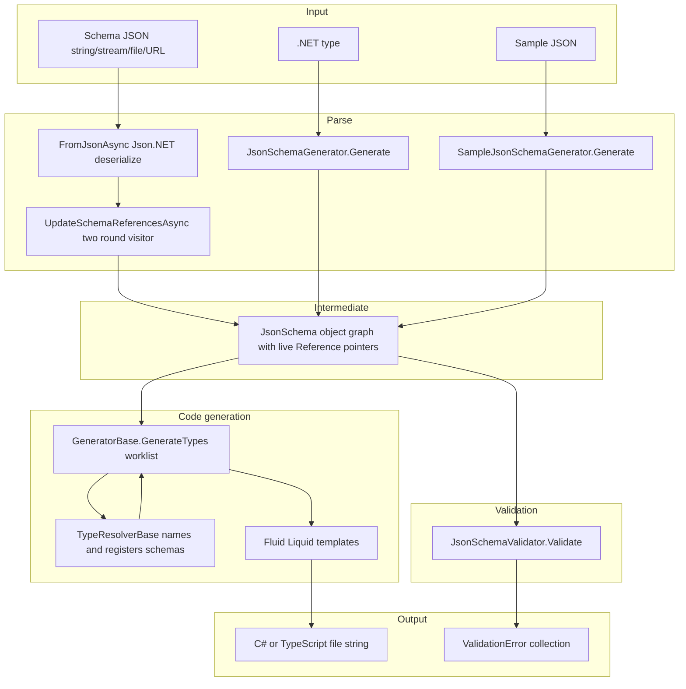
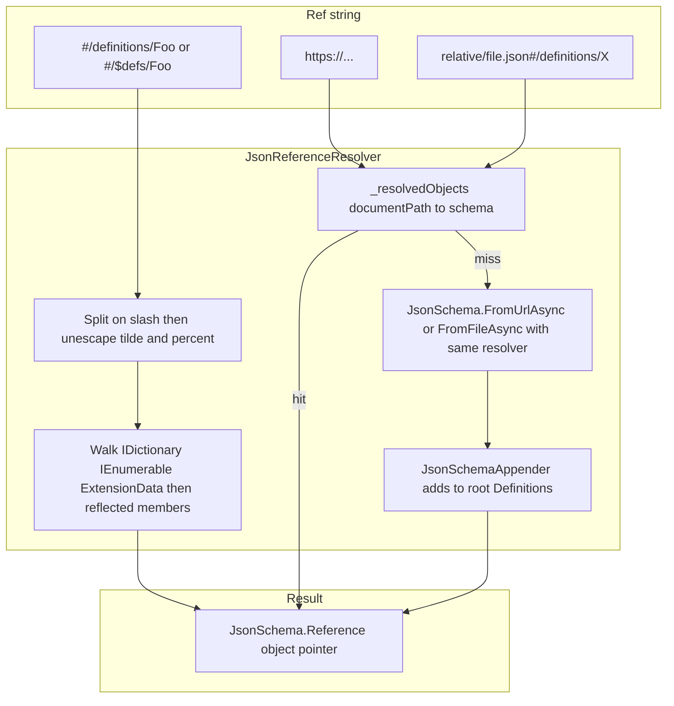

# NJsonSchema (Rico Suter) — Research report

## Metadata

- **Library name**: NJsonSchema for .NET
- **Repo URL**: https://github.com/RicoSuter/NJsonSchema
- **Clone path**: `research/repos/csharp/RicoSuter-NJsonSchema/`
- **Language**: C#
- **License**: MIT (https://github.com/RicoSuter/NJsonSchema/blob/master/LICENSE.md)
- **Analyzed version**: 18ba2ccf 2026-09-08 (release line v11.6.1; HEAD is 7 commits after tag `v11.6.1`)
- **Report date**: 2026-10-27

## Summary

NJsonSchema is a .NET library that reads, generates, and validates JSON Schema draft v4 (plus the subset of draft-06/07 that overlaps) schemas. It supports schema-to-code generation (C# classes/records/enums and TypeScript interfaces/classes/enums, rendered through Fluid/Liquid templates), reverse generation (JSON Schema from .NET types via reflection, or from sample JSON), and runtime validation of a Json.NET `JToken` against a schema. The model is a mutable, Json.NET-bound object graph (`JsonSchema`) in which `$ref` is resolved to a live object pointer. It builds on Json.NET and Namotion.Reflection and is the schema engine under NSwag. Output languages for codegen are C# and TypeScript.

## JSON Schema support

- **Drafts**: JSON Schema draft-04 (default; `SchemaVersion = "http://json-schema.org/draft-04/schema#"` in `JsonSchema.cs`) with partial draft-06/07 overlap. The model has no draft-06/07-only keywords (`const`, `contains`, `if/then/else`, `propertyNames`, `examples`, `$comment`, `content*`), no 2019-09/2020-12 keywords, and `$schema` is just stored. Numeric `exclusiveMinimum/Maximum` (draft-06+) are accepted alongside the draft-04 boolean form (`IsExclusiveMinimum` and `ExclusiveMinimum` are separate properties). Targets `netstandard2.0;net462;net8.0` (`src/NJsonSchema/NJsonSchema.csproj`).
- **Scope**: Full parsing/serialization of the supported keywords; runtime validation; code generation; reverse generation (type → schema, sample JSON → schema). Also models Swagger 2 / OpenAPI 3 DTO schema dialects through a `SchemaType` enum that changes how a few keywords are (de)serialized (`nullable`, `readOnly`, `example`, `discriminator`).

## Keyword support table

Keyword list is the union of the top-level `properties` of the vendored `specs/json-schema.org/draft-04/schema.json` and `draft-07/schema.json` (the drafts the library targets; 2019-09/2020-12 keywords such as `$defs`, `prefixItems`, `unevaluated*`, `dependentRequired` have no model support and are listed only where noted). Implementation evidence: `[JsonProperty]` attributes in `JsonSchema.Serialization.cs`, `JsonSchema.cs`, `JsonSchemaProperty.cs`, `Validation/JsonSchemaValidator.cs`, and codegen modules (all under `src/`).

| Keyword | Implemented | Notes |
|---------|-------------|-------|
| $id | yes | Stored as `Id`; also supports draft-04 `id` via `[JsonProperty("id")]`. |
| $schema | yes | Stored as `SchemaVersion`; default draft-04. |
| $ref | yes | `JsonReferenceBase.Reference` / `IJsonReferenceBase`; resolved via `JsonReferenceResolver` (document, URL, file); `#/definitions/X` and, through ExtensionData traversal, `#/$defs/X`. |
| $comment | no | Not present in JsonSchema model; would fall to ExtensionData if present. |
| $defs | partial | Not a model property (not in draft-04/07 meta-schemas). Lands in `ExtensionData` (`[JsonExtensionData]`); `ExtensionDataDeserializationConverter` turns nested objects having a `type` or `properties` key into `JsonSchema` instances, so `#/$defs/X` resolves (segment lookup in `ResolveDocumentReferenceWithoutDereferencing` checks `ExtensionData` before reflection) and `$ref`s inside it are visited by the reference visitor via the reflection fallback. A `$defs` entry with neither key stays a plain dictionary. Never serialized as `$defs` by the model and not registered as a named definition type unless referenced. |
| id | yes | Draft-04; mapped to `Id` property. |
| title | yes | Serialized and used as type name hint when valid identifier. |
| description | yes | Stored on schema and property. |
| default | yes | Stored; used by `SampleJsonDataGenerator`. |
| readOnly | partial | Model property `IsReadOnly` is serialized as `x-readOnly`; renamed to `readOnly` only for SchemaType OpenApi3/Swagger2 and to `readonly` for plain JSON Schema (`CreateJsonSerializerContractResolver`). On read, a draft-07 `readOnly` lands in ExtensionData for plain JSON Schema. |
| writeOnly | partial | `IsWriteOnly` serialized as `x-writeOnly`; renamed to `writeOnly` only for OpenApi3. |
| examples | no | Not in model; single `x-example` (renamed `example` for OpenApi3/Swagger2). |
| multipleOf | yes | Stored as `decimal?`; validated with `decimal` `%` (falls back to `double` `%` on `OverflowException`), so no binary-float rounding for ordinary values. |
| maximum | yes | Validated; stored; codegen emits `[Range]` when GenerateDataAnnotations. |
| exclusiveMaximum | yes | Draft-04 boolean and draft-06+ number; both supported. |
| minimum | yes | Validated; stored; codegen emits `[Range]`. |
| exclusiveMinimum | yes | Draft-04 boolean and draft-06+ number; both supported. |
| maxLength | yes | Validated; codegen emits `[MaxLength]` / `[StringLength]`. |
| minLength | yes | Validated; codegen emits `[MinLength]` / `[StringLength]`. |
| pattern | yes | Validated with static `Regex.IsMatch(value, pattern)` (.NET regex, not ECMA-262, no timeout); codegen emits `[RegularExpression]`. |
| additionalItems | yes | Boolean or schema; validated. |
| items | yes | Single schema or array (tuple-style); array form validated per index plus `additionalItems`. |
| maxItems | yes | Validated; check is `MaxItems > 0`, so `maxItems: 0` is a no-op. |
| minItems | yes | Validated; check is `MinItems > 0`, so 0 is a no-op (harmless). |
| uniqueItems | yes | Validated by comparing `array.Count` to the count of distinct `JToken.ToString()` values (string-equality, not structural JSON equality). |
| contains | no | Not in JsonSchema model; not validated. |
| maxProperties | yes | Validated; check is `MaxProperties > 0`, so `maxProperties: 0` is a no-op. |
| minProperties | yes | Validated (`MinProperties > 0`). |
| required | yes | Stored; validated; codegen emits `[Required]`. |
| additionalProperties | yes | Boolean or schema; validated. |
| definitions | yes | Stored in `Definitions`; serialized; registered with the type resolver (`RegisterSchemaDefinitions`) so each becomes a named type. |
| properties | yes | Full support. |
| patternProperties | yes | Full support; codegen emits dictionary types. |
| dependencies | no | Not in JsonSchema model; not validated (would go to ExtensionData). |
| propertyNames | no | Not in JsonSchema model; not validated. |
| const | no | Not in JsonSchema model; use enum with single value. |
| enum | yes | Stored in `Enumeration` (`ICollection<object>`); validated by comparing `ToString()` of each member with the token's `ToString()`; codegen emits C#/TS enums. |
| type | yes | `JsonObjectType` flags; supports all primitives. |
| format | yes | Stored; validated via `IFormatValidator` (default list: date-time, date, email, guid, hostname, ipv4, ipv6, time, time-span, uri, uuid, base64, byte). Codegen maps formats (date, date-time, time, time-span, uri, guid/uuid, byte, long, etc.) to types. |
| contentMediaType | no | Not validated. |
| contentEncoding | no | Not validated. |
| if | no | Not in model; not validated. |
| then | no | Not in model; not validated. |
| else | no | Not in model; not validated. |
| allOf | yes | Stored; validated; codegen uses for inheritance. |
| anyOf | yes | Stored; validated. |
| oneOf | yes | Stored; validated; used for nullable refs. |
| not | yes | Stored; validated. |
## Constraints

- **Validation**: All supported validation keywords (type, enum, pattern, min/max length, min/max items/properties, required, multipleOf, etc.) are enforced at runtime by `JsonSchemaValidator`.
- **Codegen**: The C# generator emits DataAnnotations when `GenerateDataAnnotations` is true: `[Required]`, `[Range]`, `[StringLength]`, `[MinLength]`, `[MaxLength]`, `[RegularExpression]`. `minimum`/`maximum` also influence integer width in `CSharpTypeResolver.ResolveInteger` (a bound outside `int` range selects `long`). The TypeScript generator does not emit validation logic into generated code.

## High-level architecture

- **Input**: JSON Schema (string, stream, file, URL), a .NET `Type`, or sample JSON.
- **Parse**: `JsonSchema.FromJsonAsync()` / `FromFileAsync()` / `FromUrlAsync()` call `JsonSchemaSerialization.FromJsonAsync`, which deserializes with Json.NET into `JsonSchema` objects and then runs `JsonSchemaReferenceUtilities.UpdateSchemaReferencesAsync`, a two-round visitor pass that resolves every `$ref` string into an object pointer (`JsonReferenceBase.Reference`) using `JsonReferenceResolver`.
- **Intermediate**: The `JsonSchema` object graph itself (`Properties`, `Definitions`, `AllOf`/`AnyOf`/`OneOf`, `Item`/`Items`, `Reference`, `ExtensionData`), with `Parent` back-pointers. There is no separate IR; code generators read the same graph through derived views (`ActualSchema`, `InheritedSchema`, `ActualProperties`, `ActualTypeSchema`).
- **Codegen**: `CSharpGenerator` / `TypeScriptGenerator` (both derive `GeneratorBase`) register the root schema in a `TypeResolverBase`, which assigns type names while a worklist loop renders a `CodeArtifact` per registered schema from Fluid templates; artifacts are concatenated into one file string.
- **Reverse**: `JsonSchema.FromType<T>()` uses `JsonSchemaGenerator` (reflection through Namotion.Reflection; System.Text.Json variant available); `SampleJsonSchemaGenerator.Generate()` infers a schema from sample JSON.
- **Validate**: `JsonSchemaValidator` walks the `JToken` and the schema object graph in lock-step.

## Medium-level architecture

- **Key types**: `JsonSchema` (partial class split over `JsonSchema.cs`, `JsonSchema.Serialization.cs`, `JsonSchema.Reference.cs`; extends `JsonReferenceBase<JsonSchema>`), `JsonSchemaProperty` (subclass carrying `Name`, `IsRequired`, `IsReadOnly`...), `JsonReferenceResolver` (resolves `#/...` pointers, http(s) URLs and relative files), `JsonSchemaAppender` (adds an externally loaded schema to the root `Definitions`), `JsonReferenceVisitorBase` / `AsyncJsonReferenceVisitorBase` (generic graph walkers), `TypeResolverBase` + `CSharpTypeResolver` / `TypeScriptTypeResolver` (schema → type name and registry), `GeneratorBase` (worklist), `DefaultTemplateFactory` + `LiquidParser` (Fluid), `JsonSchemaValidator`.
- **Ref resolution (summary)**: Each `$ref` string is stored in `IJsonReferenceBase.ReferencePath`; the resolver visitor replaces it with a direct object reference (`Reference`) and clears the string. On serialization the opposite direction runs (`UpdateSchemaReferencePaths` recomputes JSON-pointer paths by searching the graph). Details below.
- **Definitions vs $defs**: `definitions` is a typed, serialized dictionary (`Definitions`). `$defs` is not a model property; it lands in `ExtensionData`, where schema-looking objects are converted to `JsonSchema` by `ExtensionDataDeserializationConverter`, and the resolver's pointer walk consults `ExtensionData` before reflected properties.

## Algorithms and data structures

### Schema representation

`src/NJsonSchema/JsonSchema.cs` + `JsonSchema.Serialization.cs`: a schema is a mutable class instance bound to Json.NET via `[JsonProperty]` attributes, not a raw `JToken` and not an arena. Fields: nullable scalars for most keywords (`decimal? Minimum/Maximum/MultipleOf`, `int? MinLength/MaxLength`, `string? Pattern/Format`, `object? Default`), `JsonObjectType Type` (a `[Flags]` enum so `["string","null"]` is a bit-or; `GetTypes` iterates the flag values), and four collections `_allOf/_anyOf/_oneOf/_items` of type `ObservableCollection<JsonSchema>` plus `_properties/_patternProperties/_definitions` of type `ObservableDictionary<string, ...>` (a custom wrapper over `Dictionary<TKey,TValue>` in `Collections/ObservableDictionary.cs`). `Enumeration` is a collection of `object`; `RequiredProperties` is a string collection. Booleans for `additionalProperties`/`additionalItems` are split into `AllowAdditionalProperties` (bool) plus `AdditionalPropertiesSchema` (schema). Boolean schemas (`true`/`false` as a whole schema, draft-06+) are not modeled.

Observable collections exist so that the tree stays self-consistent: `RegisterSchemaDictionary/RegisterSchemaCollection` subscribe a single cached delegate (`_initializeSchemaCollectionEventHandler`, allocated once per schema) to `CollectionChanged`; `InitializeSchemaCollection` sets `child.Parent = this` and, for properties, `property.Name = key`. Every `JsonSchema` therefore has an upward `Parent` pointer, used for finding the owning document (`FindParentDocument`) and `IsRequired`. The cost is one event handler and several collection objects per schema node even when empty (`Initialize()` allocates all of them in the constructor, and `[MemberNotNull]` annotations document that they are never null).

Unknown keywords are kept: `[JsonExtensionData] ExtensionData` (`IDictionary<string, object?>`), post-processed by `ExtensionDataDeserializationConverter.TryDeserializeValueSchemas`, which recursively turns any `JObject` that has a `type` or `properties` key (and whose `required` is not a boolean) into a `JsonSchema`, otherwise into a `Dictionary<string, object?>` / `object[]` / primitive. That heuristic is what lets vendor extension blocks and `$defs` carry nested schemas, at the price of occasionally mis-classifying a non-schema object (a try/catch swallows failures). Because it is attached through `[JsonConverter]`, the converter runs `serializer.Populate` on each nested schema.

Ownership is plain managed references: there is no borrowing/lifetime concept, and the graph may be cyclic after reference resolution (a `Reference` can point at an ancestor). Serialization is made safe for cycles by clearing the object pointer to a JSON-pointer string first (see below).

### Reference resolution and registry

Two-phase, eager, object-pointer based. Files: `JsonSchemaReferenceUtilities.cs`, `JsonReferenceResolver.cs`, `JsonSchemaAppender.cs`, `References/JsonReferenceBase.cs`, `Infrastructure/JsonSchemaSerialization.cs`.

1. **Deserialize**: `$ref` is a `[JsonProperty("$ref")]` explicit-interface property (`IJsonReferenceBase.ReferencePath`, a string). Setting the object-typed `Reference` clears `ReferencePath`, and `JsonSchema.Reference`'s setter also forces `Type = None` ("only `$ref` is allowed when schema is a reference"), i.e. sibling keywords of `$ref` are not preserved on the reference node for the draft-04 semantics.
2. **`FromJsonWithLoaderAsync`** creates a `JsonReferenceResolver` via a factory (`CreateJsonReferenceResolverFactory`, holds a `JsonSchemaAppender` bound to the root + an `ITypeNameGenerator`), registers the root's own `documentPath` in the resolver's `_resolvedObjects` (`Dictionary<string, IJsonReference>`), then calls `UpdateSchemaReferencesAsync`.
3. **`JsonReferenceUpdater.VisitAsync`** (an `AsyncJsonReferenceVisitorBase`) walks the whole graph twice (`_replaceRefsRound` true then false). Round one only touches references found directly under `/definitions/<name>` or `/schemas/<name>` (a definition that is itself a pure `$ref`) and *replaces the definition entry with the resolved target without appending*, i.e. aliases collapse. Round two resolves every remaining `ReferencePath`: `reference.Reference = await ResolveReferenceAsync(...)`.
4. **`ResolveReferenceAsync`** dispatches on the string: `"#"` returns the root; `"#/..."` calls `ResolveDocumentReference`; `http(s)://` calls `ResolveUrlReferenceWithAlreadyResolvedCheckAsync`; anything else is a relative path against the root's `DocumentPath` (file or URL), requiring one to exist (otherwise `NotSupportedException`). Splitting on `#` separates document from fragment; the document is loaded once (cache hit in `_resolvedObjects`, keyed by full path or URL), `DocumentPath` is set on it, and – when `append` is true – `JsonSchemaAppender.AppendSchema` adds the loaded schema to the **root** schema's `Definitions` under a name from `ITypeNameGenerator` (falling back to `ref_<guid>`), so external types become first-class definitions of the root document. The fragment is then resolved recursively against the loaded document.
5. **JSON Pointer walk** (`ResolveDocumentReference(object, List<string> segments, ...)`): segments are `jsonPath.Split('/').Skip(1)`, each passed through `Uri.UnescapeDataString` then `~1→/`, `~0→~`. At each step the current object may be (a) an `IDictionary` (key lookup), (b) an `IEnumerable` (integer index; `Cast<object>().ToArray()` per step), (c) an `IJsonExtensionObject` (`ExtensionData` key lookup, which is how `$defs` is found), or (d) a `JsonSchema`/other type whose members are searched by `ContextualAccessorInfo.GetName()` (JSON name) using a static cached reflected accessor list for `JsonSchema` (`JsonSchemaContextualAccessors`) and uncached reflection for other types. Before descending, if the current object is itself a reference, the pointer is first tried through the *referenced* object (`ResolveDocumentReferenceWithoutDereferencing(reference.Reference, ...)`), then on the object itself, so pointers can traverse `$ref`s. `segments.Skip(1).ToList()` copies the remaining segments at every step (quadratic in path depth, trivial for real paths). A `HashSet<object> checkedObjects` guards cycles: any object visited once is never re-entered during that pointer walk. When the final target is a plain `IDictionary` (not yet a `JsonSchema`), it is round-tripped through `JsonConvert.SerializeObject` + `DeserializeObject(targetType)` to materialize a schema.
6. **`$id`/`id`, `$anchor`, `$dynamicRef`, `$recursiveRef`**: `id`/`$id` is only stored (`Id`); it does not alter the base URI. Resolution relies on the physical `DocumentPath`, not on in-document identifiers. No anchors or dynamic refs.
7. **Cycle handling**: Parsing a recursive schema is fine because resolution is by pointer assignment, not by inlining. At use time, `JsonSchema.ActualSchema` (`JsonSchema.Reference.cs`) follows chains of `Reference`, and of single-element `allOf`/`oneOf`/`anyOf` that wrap a reference (`HasAllOfSchemaReference` etc. test that the node has no other constraining keywords), using a stack-allocated `CheckedSchemaContainer` struct (two inline slots, then a `List<JsonSchema>`) to detect a loop and throw `InvalidOperationException("Cyclic references detected.")`. `ActualSchema` is recomputed on every access (no memoization).
8. **Serialization direction**: `ToJson` calls `UpdateSchemaReferencePaths`, which uses `JsonReferencePathUpdater` (collect `reference → target`) and then `JsonPathUtilities.GetJsonPaths`, a single DFS over the root (visited `HashSet<object>`, early exit once every searched object has a path) that assigns each target the first JSON pointer found. A referenced schema that is not reachable from the root (not in some `Definitions`) raises "Could not find the JSON path of a referenced schema". Cost is one full graph traversal per serialization, with reflection-based contract lookups for non-schema node types.
9. **Remote fetching**: built in, no allow-list: `ResolveUrlReferenceAsync` calls `JsonSchema.FromUrlAsync` (HttpClient via `DynamicApis`). The resolver is `virtual` at each step so callers can substitute loaders.

### Compiled / intermediate form

Validation: none; the schema object graph is interpreted directly. Codegen: the intermediate form is `CodeArtifact` plus per-type template model objects. `TypeResolverBase` holds `Dictionary<JsonSchema,string> _generatedTypeNames` (keyed by object identity; `JsonSchema` does not override `Equals/GetHashCode`) and `HashSet<string> _reservedTypeNames`. For each registered schema, `CSharpGenerator.GenerateClass` builds a `ClassTemplateModel` (list of `PropertyModel`, `BaseClass` model recursively built for `InheritedSchema`, flattened `AllProperties` = base props + own props) and `EnumTemplateModel`, which are handed to Fluid templates (`Templates/*.liquid`, embedded resources, composed through a custom `` tag defined in `LiquidParser`). A `CodeArtifact` carries `TypeName`, `BaseTypeName`, `Type`, `Language`, `Category`, and the already rendered `Code` string; `Concatenate()` joins them. There is no separate type IR; the schema graph is both IR and source of truth.

### Core algorithm

**Codegen driver (`GeneratorBase.GenerateTypes`)**: registers the root (`_resolver.Resolve(schema, false, hint)`), then loops: collect entries of `_generatedTypeNames` whose type name is not in `processedTypes`; for each, call the abstract `GenerateType`, which renders and, as a side effect, resolves every property type, registering further schemas in the resolver; repeat until a pass finds no new entries. This is a worklist without recursion; nested types are discovered lazily as templates ask the resolver for property types. Results are stored in `Dictionary<string, CodeArtifact>` keyed by type name (so a later artifact with the same name replaces an earlier one) and excluded names (`ExcludedTypeNames`) are filtered. `CSharpGenerator.GenerateTypes` then appends utility artifacts (`JsonInheritanceAttribute`, `JsonInheritanceConverter`, `DateFormatConverter`) only if a string search (`Code.Contains(...)`) finds the helper referenced in generated code.

**Type selection (`CSharpTypeResolver.Resolve`)**: `GetResolvableSchema` strips a nullable `oneOf` (`RemoveNullability` picks the first non-null `oneOf` member) and dereferences unless the target is itself a type-generating definition. Then in order: the "any" schema (no type, no discriminator, no inheritance, not registered) → `object`/`AnyType`; numbers (`format` decimal/double/float switch to settings types); integers (format byte/long/ulong/integer, or min/max outside `int` → `long`); boolean; binary; string with `format` mapping (date, date-time, time, duration/time-span, uri → `System.Uri`, guid/uuid → `System.Guid`, byte/base64 → `byte[]`); arrays (`List<T>` from `Item`, `System.Tuple<...>` from `Items`); dictionaries (`additionalProperties` schema or uniform `patternProperties` value types; `x-dictionaryKey` for the key type); otherwise `GetOrGenerateTypeName` registers a new class/enum. Nullability is a bool threaded through `Resolve`.

**Composition**: `allOf` is treated as *inheritance*, not merge. `JsonSchema.InheritedSchema` heuristics (`JsonSchema.cs`): single `allOf` item → base; else the first item that `HasReference`; else the first object-typed item; else the first. Remaining `allOf` members that are not the base contribute properties through `ActualProperties` (`Union` + `ToDictionary`, throwing `InvalidOperationException("The properties ... are defined multiple times.")` on a duplicate key; the fast path with no `allOf` allocates a copy of `_properties`). `ClassTemplateModel` ctor builds a base model recursively for the inherited chain. `oneOf` has a codegen role only for nullable wrappers (`oneOf: [null, $ref]`) and as the "actual type schema" (`ActualTypeSchema` picks the lone non-null `oneOf` or the lone non-reference/non-dictionary `allOf` item). `anyOf`/`oneOf` with several real alternatives do not produce union types; such a property falls back to `object`/`any` (anyOf is validated but not generated). Discriminators (`discriminator`, `JsonInheritanceConverter`) are an OpenAPI-style mechanism; `GetDerivedSchemas` (`JsonSchemaGraphUtilities`) walks the root with a visitor, calling `schema.Inherits(base)` on every node, to find subclasses (O(nodes x inheritance depth) per base).

**Naming and dedup**: `TypeResolverBase.GetOrGenerateTypeName` dereferences the schema, calls `RegisterSchemaDefinitions(schema.Definitions)` (pre-registers every definition that `IsDefinitionTypeSchema`: object/enum/typeless, and optionally named arrays/dictionaries), then looks up the schema *object* in `_generatedTypeNames`; on a miss `ITypeNameGenerator.Generate(schema, hint, reservedNames)` is called. `DefaultTypeNameGenerator.Generate`: choose hint (explicit, else schema `Title` if it matches `^[a-zA-Z0-9_]*$`, else last path segment of `DocumentPath`), strip `[]<>, ` into `Of`/`And` pieces, `ConvertToUpperCamelCase`, strip illegal characters, and on a clash with a reserved name append an increasing integer (`Foo2`, `Foo3`, ... `GenerateAnonymousTypeName`). `reservedTypeNames.Contains` is a linear `IEnumerable.Contains` on a `HashSet<string>` in the resolver path, but a `Keys` collection in `JsonSchemaAppender`. Identity (not structure) decides sameness: two `$ref`s to the same definition share an object and thus a type; two structurally identical inline objects are two types.

**Property emission order**: `ClassTemplateModel` iterates `ActualProperties.Values` (insertion order of the backing `Dictionary`). `CSharpGenerator.RenamePropertyWithSameNameAsClass` appends a number to a property whose generated name equals the class name (C# forbids it). There is no general property-name collision resolution after `CSharpPropertyNameGenerator` (which strips/maps illegal characters, converts to UpperCamelCase).

**Validation core** (`Validation/JsonSchemaValidator.cs`): see below. **Reverse codegen** (`Generation/JsonSchemaGenerator.cs`): `Generate(type)` creates a `JsonSchemaResolver` (a `JsonSchemaAppender` subclass with `Dictionary<string,JsonSchema> _mappings` keyed by `Type.FullName` + `:Integer` for integer enums). `Generate(schema, contextualType, resolver)` asks `IReflectionService.GetDescription` for a `JsonTypeDescription`, tries special types/`TypeMappers`, then dispatches to `GenerateObject` (registers the schema in the resolver *before* generating members so recursive types terminate via `resolver.HasSchema → schema.Reference = ...`), `GenerateDictionary`, `GenerateArray`, `GenerateEnum`, or applies a primitive type. `GenerateWithReferenceAndNullability` decides between inline, `$ref`, or `oneOf:[null,{$ref}]`/`allOf` wrappers; it contains a `// TODO: Improve performance` that serializes the referencing schema to JSON just to test whether it has any properties. Inheritance/discriminator generation, `knownType` attributes, DataAnnotations (`ApplyDataAnnotations`, `ApplyRangeAttribute`) and schema processors run per type. `SampleJsonSchemaGenerator` infers types from a `JToken` tree.

### Error and output model

Validation: `ValidationError` (`Kind: ValidationErrorKind` enum, `Property`, `Path` = `"#/" + dotted/[idx] path`, `Schema`, `Token`, and `LineNumber/LinePosition` copied from `IJsonLineInfo`); `ChildSchemaValidationError` adds `IReadOnlyDictionary<JsonSchema, ICollection<ValidationError>> Errors` (per-subschema error lists for `anyOf/allOf/oneOf` and for property/item subschemas); `MultiTypeValidationError` (for multi-type `type` arrays) keeps per-type error lists. `Validate` returns the flat `ICollection<ValidationError>`; nesting is only through the `Errors` dictionaries. Paths are Json.NET `token.Path` style (`a.b[0]`), not JSON Pointers. Codegen output: a single `string` (file) or `IEnumerable<CodeArtifact>`; generation failures are exceptions (`InvalidOperationException` wrapping Liquid errors in `LiquidTemplate.Render`).

## Low-level details

- **Numeric representation**: schema numeric keywords are `decimal?`; instance numbers are read as `decimal` via `token.Value<decimal>()` and compared exactly; on `OverflowException` the code falls back to `double` comparisons. `multipleOf` uses `value % multipleOf != 0` (decimal remainder, exact for typical inputs). Integer vs number: `ValidateInteger` requires `JTokenType.Integer`, so `1.0` fails `type: integer`. Minimum/maximum bound checks exist in both the draft-04 boolean-flag and draft-06 numeric forms and are both applied.
- **String length**: `value.Length` (UTF-16 code units, not code points). A `Date`/`Uri`/`Guid`/`TimeSpan` JToken is treated as a string and re-rendered (dates as `yyyy-MM-ddTHH:mm:ssK`) before pattern/length/format checks. `Validate(string)` reads with `DateParseHandling.None` to avoid this for raw text.
- **Property lookup**: `JsonSchemaValidatorSettings.PropertyStringComparer` (default ordinal); `TryGetPropertyWithStringComparer` first does an exact `TryGetValue`, then scans linearly using the comparer.
- **Required**: both `JsonSchemaProperty.IsRequired` (draft-03 style flag mapped from the `required` array) and `RequiredProperties` for names not declared in `properties`.
- **Nullable**: draft-04 style uses `type` flag `Null` or `oneOf` with a null member; `IsNullable(SchemaType)` also reads `x-nullable`/`nullable` from `ExtensionData` for OpenAPI modes.
- **Recursion limits**: Json.NET deserialization sets `MaxDepth = 128` (`UpdateCurrentSerializerSettings`); the validator and visitors are literally recursive with no depth guard (a cyclic `$ref` combined with a matching cyclic instance structure is bounded by instance depth, but a purely schema-side cycle such as `allOf: [{$ref: "#"}]` recurses without a limit and relies on the stack; `ActualSchema` itself detects reference-only cycles).
- **Vendor extensions**: `x-nullable`, `x-abstract`, `x-deprecated`, `x-deprecatedMessage`, `x-enumFlags`, `x-enumNames`/`x-enum-names`/`x-enum-varnames`, `x-enumDescriptions`/`x-enum-descriptions`, `x-dictionaryKey`, `x-example`, `discriminator`, `xml`. Unknown keywords round-trip through `ExtensionData`.
- **Format validators**: pluggable `IFormatValidator` (`Format`, `ValidationErrorKind`, `IsValid(string, JTokenType)`); defaults registered in `JsonSchemaValidatorSettings.FormatValidators`: date-time, date, email, guid, hostname, ipv4, ipv6, time, time-span, uri, byte, base64, uuid. The validator indexes them once into `Dictionary<string, IFormatValidator[]>` by format.
- **Serialization libraries**: Json.NET (`NJsonSchema.NewtonsoftJson`); YAML via `NJsonSchema.Yaml`; static `[ThreadStatic]` fields (`IsWriting`, `CurrentSerializerSettings`) plus a process-wide `_currentSchemaType` static carry serialization context (so schema type switching during (de)serialization is not re-entrant across threads for the non-ThreadStatic field).
- **Template infrastructure**: Fluid (Liquid) with a post-processing step: embedded `.liquid` text is regex-rewritten once (tab-count arguments, `csharpdocs` and `tab` filters) before parsing; custom `` tag; empty sub-template output is replaced by a marker that a final regex pass removes; `UnsafeMemberAccessStrategy` exposes model members to templates via Fluid reflection registration.

## Output and integration

- **Vendored vs build-dir**: Generated code is returned in memory; the caller decides where to write it. NSwag and similar tools write it to files.
- **API vs CLI**: Library API is primary. No standalone NJsonSchema CLI in this repo (NSwag provides CLIs that use it).
- **Writer model**: In-memory only. `GenerateFile()` returns a string; `GenerateTypes()` returns `IEnumerable<CodeArtifact>` for callers that want per-type output.

## Configuration

- **CSharpGeneratorSettings**: `Namespace`, `DateType`, `DateTimeType`, `TimeType`, `TimeSpanType`, `NumberType`, `IntegerType`, `ArrayType`, `DictionaryType`, `ClassStyle` (Poco/Inpc/Prism/Record), `GenerateNativeRecords`, `JsonLibrary` (Newtonsoft/SystemTextJson), `GenerateDataAnnotations`, `GenerateNullableReferenceTypes`, `GenerateOptionalPropertiesAsNullable`, `UseRequiredKeyword`, `SortConstructorParameters`, `EnumNameGenerator`, `TypeNameGenerator`, `PropertyNameGenerator`, `ExcludedTypeNames`, `InlineNamedDictionaries/Arrays/Tuples/Any`, `TemplateFactory`, `TemplateDirectory`.
- **TypeScriptGeneratorSettings**: `TypeStyle` (Interface/Class), `TypeScriptVersion`, `GenerateConstructorInterface`, `ConvertConstructorInterfaceData`, `EnumStyle` (Enum/StringLiteral), `HandleReferences`, `ExtensionCode`, etc.
- **JsonSchemaGeneratorSettings** (reverse): `SchemaType` (JsonSchema/Swagger2/OpenApi3), `DefaultReferenceTypeNullHandling`, `GenerateXmlObjects`, `FlattenInheritanceHierarchy`, `AllowReferencesWithProperties`, type mappers, schema processors.

## Pros/cons

- **Pros**: Mature, widely used (NSwag); C# and TypeScript generation; reflection-based schema generation; validation with format checking; Swagger/OpenAPI dialect support; configurable Liquid templates with user overrides; template parse cache; no JSON-Schema-level evaluation state to manage (simple object model).
- **Cons**: Default draft-04; no `contains`, `if`/`then`/`else`, `const`, `dependencies`, `propertyNames`, `content*`, no 2019-09/2020-12; mutable graph with per-node observable collections; validator re-evaluates every `anyOf`/`allOf`/`oneOf` branch in full and builds errors eagerly; `ActualSchema`/`ActualProperties` recomputed rather than cached; `anyOf`/`oneOf` do not become union types; generated code is string-only; process-wide static serialization context.

## Testability

- **Test layout** (xunit, about 780 `[Fact]`/`[Theory]` attributes across projects): `NJsonSchema.Tests`, `NJsonSchema.CodeGeneration.Tests`, `NJsonSchema.CodeGeneration.CSharp.Tests`, `NJsonSchema.CodeGeneration.TypeScript.Tests`, `NJsonSchema.Yaml.Tests`, `NJsonSchema.NewtonsoftJson.Tests`.
- **How to run**: `dotnet test` from the repo root or solution (`src/NJsonSchema.sln`).
- **Fixtures**: Inline JSON schemas in tests; `References/LocalReferencesTests/` with external schema files; verified snapshots (Verify.Xunit) for generated output. No JSON-Schema-Test-Suite runner was found (not verified exhaustively).

## Performance

All analysis is from reading code; nothing was built or run.

### Performance techniques

- **Compile vs interpret**: None for validation: every `Validate` call interprets the schema graph (`JsonSchemaValidator.Validate`). `JsonSchema.Validate(...)` constructs a new `JsonSchemaValidator` each call, which rebuilds the `Dictionary<string, IFormatValidator[]>` (`GroupBy` + `ToDictionary`) from settings, so reusing a `JsonSchemaValidator` instance avoids that setup. Ahead-of-time work exists only in codegen: Liquid templates are parsed once and cached (`LiquidTemplate.Templates`, a static `ConcurrentDictionary<TemplateKey(language, template, templateDirectory), IFluidTemplate>`), including the regex rewrite of the template text, and the `JsonSchema` type's reflected accessor list is cached statically (`JsonSchemaContextualAccessors`, `JsonSchemaPropertiesCache`).
- **Memory layout and allocation**: Pointer-heavy object graph; each `JsonSchema` allocates seven observable collections/dictionaries at construction, plus an event-handler registration. Hot-path micro-optimizations are present in places: `CheckedSchemaContainer` is a stack struct with two inline slots before falling back to a list; `ValueStringBuilder` (`ValueStringBuilder.cs`, a pooled/stack-buffer struct) is used in `CodeArtifactExtensions.Concatenate` and `ConversionUtilities`; `SearchValues<char>` and `AsSpan().IndexOfAny` are used on net8.0 for name cleanup, and `GeneratedRegex` source-generated regexes in the template pipeline. Validation allocates freely: a new `List<ValidationError>` per `Validate` call, `ToDictionary` over child schemas for every composition keyword, `obj.Properties().ToList()` for every object, string concatenation for property paths, `$"[{index}]"` per array item, and `new HashSet<string>(schema.Properties.Keys, comparer)` per object. `ValidationError` construction copies line info eagerly (not lazy).
- **Caching and memoization**: Template parse cache (above); `_resolvedObjects` document cache in `JsonReferenceResolver` (per resolver instance, so each `FromJsonAsync` call has its own); `JsonSchemaResolver._mappings` type→schema cache for reverse generation; `Types` registry in the type resolver. `ActualSchema`, `ActualTypeSchema`, `InheritedSchema`, `ActualProperties` and the `Has*SchemaReference` predicates are *not* memoized and are re-evaluated on each access; codegen templates call them repeatedly. The `NJsonSchema.Benchmark` project exists largely to measure this path.
- **Fast paths and short-circuiting**: `ValidateType` returns early for `null` tokens on nullable schemas; `ActualProperties` has a fast path when `allOf` is empty; `ConvertToCamelCase` skips work when no `-` is present; `JsonPathUtilities.FindJsonPaths` stops once all searched objects have paths. No keyword ordering optimization, no boolean-only `IsValid` path: `anyOf` evaluates every branch (`ToDictionary(s => s, s => Validate(token, s))`) even when the first matches, `oneOf` evaluates all branches to count matches, `allOf` evaluates all branches, and all errors are always collected.
- **Regex handling**: .NET `System.Text.RegularExpressions`. `pattern` and `patternProperties` use the static `Regex.IsMatch(input, pattern)` overload, relying on the framework's small static regex cache (default size 15); no explicit compile cache, no match timeout (so a hostile `pattern` or instance can cause catastrophic backtracking), no ECMA-262 translation (.NET syntax, `RegexOptions.None`). `patternProperties` matching is `FirstOrDefault` over all patterns per property, so only the first matching pattern's schema is applied. Library-internal format regexes (email, ipv4, hostname) also use static `Regex.IsMatch` (with `IgnoreCase`); date-time and enum-name regexes are `Lazy<Regex>` with `RegexOptions.Compiled` and a 250 ms timeout. 
- **Concurrency**: Schema graphs are mutable and use non-thread-safe `Dictionary`/`ObservableCollection`; after construction, read-only concurrent use (validation, codegen) is plausible but not guaranteed by the library, and `ActualSchema` computation is allocation-free apart from the struct. Serialization and deserialization depend on `[ThreadStatic]` and process-wide static state (`JsonSchemaSerialization.CurrentSchemaType`, `CurrentSerializerSettings`), so concurrent parse with differing `SchemaType` is not safe. `LiquidTemplate.Templates` is a `ConcurrentDictionary`, so template rendering across generators is safe. Reference loading is `async` (HttpClient/file) but sequential per visitor. No parallel validation or generation.

### Benchmarks in repo

`src/NJsonSchema.Benchmark/` (BenchmarkDotNet, `[MemoryDiagnoser]`): `JsonSchemaBenchmark` (parse `LargeSchema.json`, ~3.6 KB), `CsharpGeneratorBenchmark` and `TypeScriptGeneratorBenchmark` (generate a file from the parsed schema), `CSharpTypeResolverBenchmark`, `ConversionUtilitiesBenchmark`, `JsonSchemaGeneratorBenchmark` / `SchemaGenerationBenchmarks` (reverse generation), `SerializationBenchmarks`; `Program.cs` also has a hand-rolled loop (100 `GenerateFile` iterations) for profiler attach. The fixtures are tiny (`Schema.json` 197 bytes), so they measure fixed overhead more than scaling. No validation benchmark. Also `NJsonSchema.Demo.Performance`. Entry points for our harness: `await JsonSchema.FromJsonAsync(json)`, `new CSharpGenerator(schema, new CSharpGeneratorSettings()).GenerateFile()`, `schema.Validate(json)` (or a reused `new JsonSchemaValidator(settings).Validate(token, schema)`).

## Determinism and idempotency

- **Order of types**: `GeneratorBase.GenerateTypes` accumulates artifacts in a `Dictionary<string, CodeArtifact>` and returns `.Values`; with no removals .NET enumerates a `Dictionary` in insertion order, which here follows registration order (root first, then in discovery order while rendering, then `Definitions` in the document's key order, since `RegisterSchemaDefinitions` iterates the dictionary). This is an implementation behavior, not a contract. The C# file keeps that order (no sort, no base-first reorder). The **TypeScript** generator additionally calls `OrderByBaseDependency()` in `GenerateFile`, which moves a base type ahead of its derived type (a list-index shuffle that is stable for everything else).
- **Order of properties**: `ActualProperties` (a `Dictionary` built from `Union` over own properties then `allOf` members) preserves document order. `SortConstructorParameters` (default true) sorts constructor parameters by `Name` only in the C# **Record** constructor template (`Class.Constructor.Record.liquid`); POCO property order is document order.
- **Name stability**: type name clashes get an increasing integer suffix assigned in registration order, so inserting a definition earlier in the document can renumber later colliding names. `ref_<guid>` fallback names (from `JsonSchemaAppender`, used when an external schema's name cannot be derived or already exists) are random per run and non-deterministic, though they affect internal definition keys more than final C# names when a title/hint exists.
- **Idempotency**: Same schema and settings produce the same text (templates are pure; no timestamps are inserted except the toolchain version header comment). No guarantee documented; minimal-diff behavior under small schema edits follows from document-order emission.

## Enum handling

- **Duplicate entries**: `Enumeration` is a collection; it is not deduplicated. Validation uses `schema.Enumeration.All(v => v?.ToString() != token?.ToString())`, so duplicates simply both match (comparison is by `ToString()`, so `1` and `"1"` are equal). Codegen (`EnumTemplateModel.Enums`) iterates by index, skipping only `null`, with no dedupe, so `["a","a"]` yields two members with the same generated name (C# compile error).
- **Case collisions**: `DefaultEnumNameGenerator.Generate` maps symbolic names (`=`→`Eq`, `!=`→`Ne`, ...), prefixes leading `-`/`+` with `Minus`/`Plus`, then `ConvertToUpperCamelCase` and replaces characters outside Unicode letter/digit categories with `_`. `"a"` and `"A"` both become `A`, and there is no collision-suffixing across members, so the generated enum has duplicate member names. Integer enums without names get `_<value>`; names can be supplied via `x-enumNames`, `x-enum-varnames`. Underlying values are preserved separately (`Value` = original text, `InternalValue`), so only the member *names* collide. TypeScript string enums can carry distinct values but names can collide the same way.

## Reverse generation (Schema from types)

- **Yes**: `JsonSchema.FromType<T>()` / `FromType(Type)` use `JsonSchemaGenerator` (Newtonsoft reflection service, or `SystemTextJsonReflectionService`) to reflect over .NET types. Supports DataAnnotations (Required, Range, MinLength, MaxLength, StringLength, RegularExpression), XML docs as descriptions, inheritance (with discriminator generation), enums, collections, dictionaries, nullability from nullable reference types, and extension points (`ISchemaProcessor`, `ITypeMapper`).
- **Sample JSON**: `SampleJsonSchemaGenerator.Generate()`; also `SampleJsonDataGenerator` produces sample data from a schema.
- **Scope**: Full type graph; recursive types terminate through the resolver's type→schema map; nested/reusable types become `definitions` with `$ref`.

## Multi-language output

- **Supported output languages**: C# and TypeScript. No other languages.
- **Implementation**: Separate packages `NJsonSchema.CodeGeneration.CSharp` and `NJsonSchema.CodeGeneration.TypeScript`; each has its own generator, type resolver, models and `.liquid` templates, sharing `NJsonSchema.CodeGeneration` (`GeneratorBase`, `TypeResolverBase`, template factory).

## Model deduplication and $ref/$defs

- **$ref/$defs**: Schemas referenced by `$ref` (e.g. `#/definitions/Foo`, `#/$defs/Foo`) resolve to a single `JsonSchema` instance. `TypeResolverBase._generatedTypeNames` is keyed by `JsonSchema` with default (reference) equality (no `Equals` override), so each referenced schema object produces one generated type.
- **Identical inline shapes**: Two identical inline object definitions at different locations are separate `JsonSchema` instances; the resolver assigns each a distinct generated type name (hint from the property name, numeric suffix on a clash). No structural deduplication; dedup happens only through explicit `$ref`/definitions.
- **definitions vs $defs**: `definitions` is the primary typed form and is pre-registered by `RegisterSchemaDefinitions`; `$defs` content is found only via `ExtensionData` and becomes a type only when referenced.
- **External files/URLs**: Loaded once per resolver (path/URL cache), appended to the root `Definitions` so they are emitted once.

## Validation (schema + JSON → errors)

- **Yes**: `schema.Validate(jsonData)` and `new JsonSchemaValidator(settings).Validate(token, schema)` return `ICollection<ValidationError>`.
- **Inputs**: `JsonSchema` and JSON (string or `JToken`; the string overload parses with `JToken.ReadFrom`, `DateParseHandling.None`).
- **Control flow**: `Validate(token, schema.ActualSchema, ...)` runs, in fixed order, `ValidateAnyOf`, `ValidateAllOf`, `ValidateOneOf`, `ValidateNot`, `ValidateType` (per type flag: array, string, number, integer, boolean, null, object checks), `ValidateEnum`, `ValidateProperties` (declared properties, extra required names, min/max properties, `patternProperties`, `additionalProperties`). Array validation handles `minItems/maxItems/uniqueItems`, `items` (single schema or tuple array) and `additionalItems`. A multi-type schema validates the token against each type flag and fails only when all fail (`NoTypeValidates`, `MultiTypeValidationError`). Child validations call back into the public `Validate(token, schema)`, which dereferences with `ActualSchema`. No annotation tracking (no `unevaluated*`), no `$dynamicRef`, no `format` assertion toggle (formats are always asserted when a validator is registered).
- **Output**: List of `ValidationError` with `Path`, `Kind` (e.g. `PropertyRequired`, `PatternMismatch`, `NotInEnumeration`), `Schema`, `Token`, line info; composition keywords produce `ChildSchemaValidationError` with nested per-subschema errors.
- **Optional**: `JsonSchemaValidatorSettings` for `FormatValidators`, `PropertyStringComparer`.
- **Not verified**: conformance against the official JSON-Schema-Test-Suite (not run; per constraints), and behavior of `oneOf`/`anyOf` interplay with draft-06+ boolean schemas.
