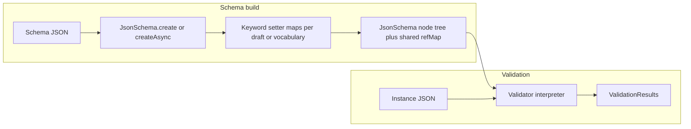
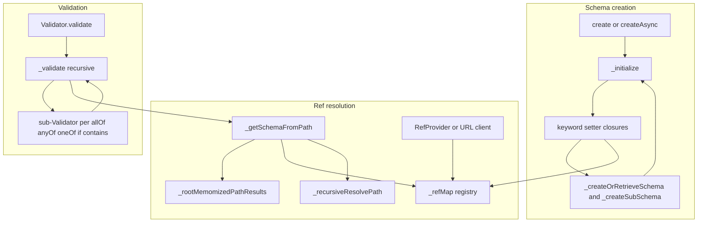

# json_schema (Workiva) — Research report

## Metadata

- **Library name**: json_schema
- **Repo URL**: https://github.com/Workiva/json_schema
- **Clone path**: `research/repos/dart/Workiva-json_schema/`
- **Language**: Dart
- **License**: Boost Software License 1.0 (see LICENSE in repo)
- **Analyzed version**: 3ce85f9 2026-03-12 (pubspec version 5.2.2; CHANGELOG top entry is 5.2.0)
- **Report date**: 2026-10-27

## Summary

Workiva json_schema is a platform-agnostic (web, Flutter, VM) Dart library for **validating** JSON instances against JSON Schemas. It does **not** generate code. It loads a JSON Schema (via `JsonSchema.create` or `JsonSchema.createAsync`), parses it into an internal `JsonSchema` representation, then validates JSON documents against that schema with `schema.validate(instance)`. Supported drafts are draft-04, draft-06, draft-07, draft-2019-09, and draft-2020-12; the default is draft-07. Sync creation requires all `$ref`s within the root schema; async creation supports remote HTTP refs and custom `RefProvider`s. Validation returns `ValidationResults` with errors and warnings (instance path, schema path, message).

## JSON Schema support

- **Drafts**: Draft-04, draft-06, draft-07, draft-2019-09, draft-2020-12. `SchemaVersion` enum and `_getSchemaVersion` detect draft from `$schema` or default to draft-07.
- **Scope**: Validation only (schema + instance → valid/invalid + error list). No code generation.
- **Subset**: Supports the full set of validation keywords for draft-04 through 2020-12. For 2019-09 and 2020-12, keyword sets are chosen by vocabulary (`_draft2019VocabMap`, `_draft2020VocabMap`: core, applicator, unevaluated, validation, meta-data, format-annotation, format-assertion, content) according to the metaschema `$vocabulary`. `content*` and metadata keywords are annotations only. Format validation is by default enabled for draft ≤7 and disabled for 2019-09/2020-12; `validateFormats` can override. The repo vendors the JSON-Schema-Test-Suite and runs it per draft with a skip-list.

## Keyword support table

Keyword list is the union of properties from the vendored 2020-12 meta files (`specs/json-schema.org/draft/2020-12/meta/*.json`), 2019-09 meta files, and the draft-04/06/07 `schema.json`. Evidence: keyword-setter maps (`_accessMapV4/V6/V7`, `_draft2019*`, `_draft2020*`) in `lib/src/json_schema/json_schema.dart` and `lib/src/json_schema/validator.dart`.

| Keyword | Implemented | Notes |
|---------|-------------|-------|
| $schema | yes | Selects draft; in 2019-09/2020-12 `$vocabulary` of the metaschema selects keyword sets. |
| $id | yes | Draft-06+ base URI; draft-04 uses `id` (see `id`). Used for ref scope. |
| $ref | yes | Local refs (`#...`) are resolved lazily at validation time through `resolvePath`/`_getSchemaFromPath` (checked for resolvability at creation); remote refs (non-`#`) go through retrieval requests, and in drafts before 2019-09 the referring node is replaced by the target schema at creation time (`_schemaAssignments`). Runtime cycle detection via `InstanceRefPair`. Pre-2019 drafts ignore siblings of `$ref` (validator returns early). |
| $anchor | yes | 2019-09/2020-12 core vocabulary setter `_setAnchor`; resolved through `_refMap`. |
| $dynamicRef | yes | 2020-12 only; `_findDynamicAnchorParent` walks the dynamic-parent chain in the validator. The cycle guard for it is keyed on `schema.recursiveRef` (null for a `$dynamicRef` node), a likely copy-paste slip. |
| $dynamicAnchor | yes | 2020-12 only. |
| $vocabulary | yes | `_setVocabulary` / `_setMetaschemaVocabulary`; known vocab URIs map to setter maps; custom vocabularies supported. |
| $comment | yes | Draft-07+; stored, not validated. |
| $defs | yes | 2019-09/2020-12; subschemas parsed and addressable by `$ref`. |
| $recursiveRef | yes | 2019-09 only. |
| $recursiveAnchor | yes | 2019-09 only. |
| id | yes | Draft-04 identifier (`_setId`). |
| base | no | Draft-04 hyper-schema-ish property in the vendored draft-04 meta-schema; no setter. |
| links | no | Hyper-schema property in vendored meta-schemas; no setter. |
| title | yes | Stored; accessor only. |
| description | yes | Stored; accessor only. |
| default | partial | Stored; never applied or enforced. |
| deprecated | partial | 2019-09+; stored. Validator emits a *warning* (not error) when the instance is validated against a deprecated schema. |
| readOnly | partial | Draft-07+; stored, not enforced. |
| writeOnly | partial | Draft-07+; stored, not enforced. |
| examples | yes | Draft-06+; stored, accessor; not validated. |
| multipleOf | yes | `_numberValidation`; int modulo for ints, divide-and-truncate for doubles. |
| maximum | yes | Instance validation. |
| exclusiveMaximum | yes | Boolean modifier in draft-04, numeric in draft-06+ (separate setters). |
| minimum | yes | Instance validation. |
| exclusiveMinimum | yes | As exclusiveMaximum. |
| maxLength | yes | Counts Unicode runes. |
| minLength | yes | Counts Unicode runes. |
| pattern | yes | Compiled once at schema creation as `RegExp(p, unicode: true)`; `hasMatch` (unanchored). |
| additionalItems | yes | Draft-04 to 2019-09; not registered for 2020-12. |
| items | yes | Single schema or array (≤2019-09); 2020-12 uses `_setItemsDraft2020` (schema applied after `prefixItems`). |
| prefixItems | yes | 2020-12 only. |
| maxItems | yes | Instance validation. |
| minItems | yes | Instance validation. |
| uniqueItems | yes | Pairwise O(n^2) comparison with `DeepCollectionEquality`; reports one error per duplicate pair. |
| contains | yes | Draft-06+. |
| minContains | yes | 2019-09+; checked in `_itemsValidation`. |
| maxContains | yes | 2019-09+. |
| unevaluatedItems | yes | 2019-09 (applicator) / 2020-12 (unevaluated vocab); evaluated-item context stack. |
| maxProperties | yes | Instance validation. |
| minProperties | yes | Instance validation. |
| required | yes | Array form only (V4 setter requires non-empty list, V6+ allows empty); each missing name yields two errors (object path and property path). |
| dependentRequired | yes | 2019-09+; stored in `_propertyDependencies`, checked by `_propertyDependenciesValidation`. |
| dependentSchemas | yes | 2019-09+; stored in `_schemaDependencies`. |
| dependencies | yes | Draft-04..07 (property and schema forms). |
| properties | yes | Instance validation. |
| patternProperties | yes | Regex keys. |
| additionalProperties | yes | Boolean or schema; marks property evaluated (5.2.0). |
| unevaluatedProperties | yes | 2019-09/2020-12; evaluated-property context stack. |
| propertyNames | yes | Draft-06+; validated per instance key as an `Instance` of the key string. |
| definitions | yes | Draft-04..07 setter (`_setDefinitions`). Not in the 2019-09/2020-12 vocabulary setter maps, so there it takes the unknown-keyword path (sub-schemas registered, pointer resolution via `_baseAccessGetterMap`). |
| const | yes | Draft-06+; `DeepCollectionEquality`. |
| enum | yes | `_setEnum` rejects duplicate entries at schema-creation time (`TypeValidators.uniqueList`); `_enumValidation` does a full `singleWhere` scan with `DeepCollectionEquality`. See Enum handling. |
| type | yes | Single or list; integer accepts num with zero fraction for draft-06+. |
| format | partial | Same `_setFormat` setter in 2019-09 `format` vocab and both 2020-12 format vocabs; assertion is governed only by `validateFormats`, not by the vocabulary. 19 built-in validators (date, date-time, duration, email, hostname, idn-email, idn-hostname, ipv4, ipv6, iri, iri-reference, json-pointer, regex, relative-json-pointer, time, uri, uri-reference, uri-template, uuid); unknown formats pass; non-strings ignored; on by default for draft ≤7, off for 2019-09/2020-12; `customFormats` extend. |
| contentMediaType | partial | Stored only. |
| contentEncoding | partial | Stored only. |
| contentSchema | partial | 2019-09+; setter calls `TypeValidators.string` (typed as String, although the keyword's value is a schema); not validated. |
| if | yes | `_ifThenElseValidation`. |
| then | yes | As above. |
| else | yes | As above. |
| allOf | yes | Captures evaluations for unevaluated*. |
| anyOf | yes | All branches evaluated to capture evaluations. |
| oneOf | yes | Exactly one must match (`singleWhere`). |
| not | yes | Instance validation. |

## Constraints

Validation keywords are enforced at **runtime** by the `Validator` class. Each constraint (type, enum, const, numeric bounds, string length/pattern, array items, object properties, etc.) is applied when the validator visits the corresponding subschema. Constraints are enforced directly on the instance. Format validation can be enabled or disabled per `validateFormats`; for draft-2019-09 and draft-2020-12, formats are annotation-only by default. Custom formats can be registered via `customFormats` in `createAsync`/`create`.

## High-level architecture

Pipeline: **Schema JSON** (String or decoded Map/bool) -> `JsonSchema.create` / `createAsync` (optional `RefProvider`, `customFormats`, `customVocabularies`, `schemaVersion`) -> a **tree of `JsonSchema` nodes** that shares one root-level `_refMap` -> `schema.validate(instance)` -> a fresh `Validator` walks the tree against the instance -> `ValidationResults` (errors and warnings, each with `instancePath`, `schemaPath`, `message`). The instance may be pre-decoded JSON or a String with `parseJson: true`. There is no separate compile step: the parsed `JsonSchema` object tree *is* the validation structure, and the `Validator` interprets it directly (see Algorithms).

## Medium-level architecture

- **Schema creation** (`lib/src/json_schema/json_schema.dart`): the factories decode a String, determine the draft (`_getSchemaVersion`: explicit `schemaVersion` argument, else `$schema`, else draft-07) and call the private `JsonSchema._fromRootMap` / `_fromRootBool`, which run `_initialize`. `_initialize` for the root sets up the shared state (`_refMap`, `_rootMemomizedPathResults`, `_retrievalRequests`, `_schemaAssignments`, completers); each nested sub-schema is created by `_createSubSchema` -> `JsonSchema._fromMap(_root, ..., parent: this)` and copies the root's shared maps by reference. Keywords are dispatched through static maps of setter closures (`_accessMapV4`, `V6`, `V7`, and for 2019-09/2020-12 the per-vocabulary maps combined according to the metaschema `$vocabulary`).
- **Ref resolution**: `_refMap` (a single `Map<String, JsonSchema>`) is the registry, populated by `$id`/`id`, `$anchor`, `$dynamicAnchor`, the root (`'<uri>#'`), fetched remote roots, and unknown-keyword sub-schemas. `_getSchemaFromPath` consults a memo table, then `_refMap`, then walks JSON Pointer fragments over typed getters (`_recursiveResolvePath`). Remote refs are queued as `RetrievalRequest`s on the root and satisfied by a `RefProvider` (sync or async) or the default HTTP/file client.
- **Validation**: `Validator` holds the root schema plus mutable per-run state (error/warning lists, evaluated-items and evaluated-properties context stacks, a dynamic-parent map, a ref cycle set). `_validate(schema, instance)` is a recursive interpreter.
- **Key types**: `JsonSchema`, `Validator`, `ValidationResults`, `ValidationError`, `RefProvider`, `RetrievalRequest`, `Instance` (data + path string), `SchemaPathPair` (memo key), `InstanceRefPair` (cycle key), `CustomVocabulary`/`CustomKeyword`, `ValidationContext`.

## Algorithms and data structures

### Schema representation

`JsonSchema` (`json_schema.dart`, about 2,500 lines) is a **mutable typed node class**, not a raw JSON value and not an arena. Each node stores:

- the original source as `final Map<String, dynamic>? _schemaMap` (a shallow `Map.unmodifiable` copy; nested maps are shared with the caller's input) or `final bool? _schemaBool` for boolean schemas (draft-06+);
- one private typed field per keyword, e.g. `_allOf/_anyOf/_oneOf` (`List<JsonSchema>`), `_properties` (`Map<String, JsonSchema>`), `_patternProperties` (`Map<RegExp, JsonSchema>`, regexes precompiled with `unicode: true`), `_pattern` (`RegExp?`), `_typeList` (`List<SchemaType?>`), `_enumValues` (`List`), `_items`/`_itemsList`/`_prefixItems`, `_additionalItemsBool|Schema`, `_additionalProperties(Bool|Schema)`, `_ifSchema/_thenSchema/_elseSchema`, `_notSchema`, `_unevaluatedItems/_unevaluatedProperties`, `_requiredProperties`, `_propertyDependencies` (`Map<String, List<String>>`) and `_schemaDependencies` (`Map<String, JsonSchema>`; both `dependencies` and `dependentSchemas` write here, and both `dependencies` arrays and `dependentRequired` write to `_propertyDependencies`), numeric bounds as `num?` (draft-04 boolean `exclusiveMaximum` is kept in a separate bool field and translated by the getter);
- tree links: `_root` (the root `JsonSchema`, `null` only transiently), `_parent`, and `_path` (a string such as `#/properties/a/items/0`, rewritten to `<ref>/` for schemas pulled in via a remote ref);
- URI state: `_id`, `_idBase`, `_fetchedFromUri`, `_fetchedFromUriBase`, plus derived `_uri` / `_inheritedUri` (walks `_parents` upward to find the nearest ancestor with a URI).

**Unknown keywords** are not preserved as data fields. In `_validateAndSetIndividualProperties`, any key not in the active setter map is handed to `_createOrRetrieveSchema(..., mustBeValid: false)`: if the value happens to be a Map or bool it is parsed as a sub-schema and registered in `_refMap` under its path (so custom `#/foo/bar` pointers resolve); otherwise it is silently dropped (the raw value remains reachable only via `schemaMap`). Custom keywords registered through `CustomVocabulary` are wrapped by `_setCustomProperty` into closures that are appended to `_customAttributeValidators` on the node and run at validation time.

`$id` is processed first so sibling keywords see the base URI. Equality and hashing are structural: `hashCode` is `DeepCollectionEquality().hash(schemaMap ?? schemaBool)`, cached in `_hashCode`, and `operator ==` compares **only the hashes**. This matters because `JsonSchema` is used as a key in `Validator._dynamicParents` and inside `SchemaPathPair`: two different nodes with identical source maps are the same key, and a 29-bit hash collision would conflate distinct schemas.

Ownership is plain garbage-collected references; the whole tree stays alive as long as any node is referenced, and sub-schemas keep `_root`/`_parent` back-pointers (cyclic graph). Because Dart sub-schemas are constructed recursively from the source map, schema nesting depth is bounded by the Dart call stack.

### Reference resolution and registry

**Registry**: a single `Map<String, JsonSchema> _refMap`, created at the root and passed by reference to every descendant (`_refMap = root._refMap`) and to every remote root fetched through a provider (`JsonSchema._fromRootMap(..., refMap: _refMap)`). Keys are URI strings: the root registers itself under `'<uri>#'` (or `'#'` with no base); `_setId` registers `'$_id#'` (or the id as-is if it has a fragment); `_setAnchor` and `_setDynamicAnchor` register `'<uri>#<anchor>'`; fetched remote roots register under their `_uri`; unknown-keyword sub-schemas register under their translated path. Pointer targets such as `#/definitions/foo` are **not** pre-registered; they are found by walking.

**Base-URI tracking**: there is no explicit scope stack. Each node computes its base lazily from `_id`/`_fetchedFromUri` and by walking `_parents` (`_inheritedUri`, `_inheritedUriBase`). `_translateLocalRefToFullUri` rewrites a `$ref` at set time: refs with no scheme get the inherited base prepended (path refs are joined to `_inheritedUriBase`, fragment-only refs to `_uri`/`_inheritedUri`). So `schema.ref` is an absolute-ish `Uri` stored on the node. A TODO in that function notes that detecting a local ref is incomplete. `$id` with a fragment is rejected for 2019-09+.

**Eager vs lazy**: refs split into three paths at `_setRef`:
1. *Local* (no scheme, and the inherited base is not a relative file URI): added to the root's `_localRefs` set; the actual target is resolved **lazily at validation time** each time the validator meets `schema.ref`. Resolvability is still checked up front: `_baseResolvePaths` calls `_getSchemaFromPath` for every local ref at the end of schema creation, so a dangling local ref fails at `create`.
2. *Remote* (scheme present, or relative file base): `_addRefRetrievals` appends a `RetrievalRequest` (holding both an async and a sync operation) to the root. `_createOrRetrieveSchema` additionally, for drafts before 2019-09 where `$ref` replaces its siblings, defers `assigner(_getSchemaFromPath(ref))` into `_schemaAssignments`, so the referring node is **replaced** by the target schema once retrieval completes; for 2019-09+ it builds a normal sub-schema (so siblings survive) and resolves at validation time.
3. *Statically known meta-schemas*: `getStaticSchemaByURI` (in `constants.dart`) returns draft-04..2020-12 meta-schemas embedded as raw strings and `json.decode`s them on each call; `$schema` is itself a retrieval request so that, for 2019-09+, the metaschema's `$vocabulary` can drive keyword selection (`_resolveMetaSchemasForVocabulary`).

`_baseResolvePaths` first filters out requests that can be satisfied locally (same base as root, already in `_refMap`, or a versioned meta-schema URL, in which case `JsonSchema.create(staticSchema)` builds a full meta-schema tree and registers it). Remaining requests are executed by `_resolveAllPathsSync` (sequentially, in a while loop, via the `RefProvider`; any unsatisfied request throws `FormatException` listing the URIs) or `_resolveAllPathsAsync` (`Future.wait` over all requests, then run `_schemaAssignments`, then complete `_thisCompleter` with the root). Remote documents are handled by `_createAndResolveProvidedSchema`: the provided Map becomes a new root `JsonSchema` that shares `_refMap`, and a fragment, if present, is resolved against it. Fetching uses `IoSchemaUrlClient` (dart:io `HttpClient`, or file read) or `HtmlSchemaUrlClient` via conditional imports; there is no HTTP cache beyond `_refMap` itself, and no timeout or size limit in the library code.

**Fragment resolution** (`_getSchemaFromPath` -> `_recursiveResolvePath`): the pointer's segments are walked over typed getters (`_baseAccessGetterMap` covers `$defs`, `definitions`, `properties`, `items`, `prefixItems`; map-valued keywords consume the next segment as a key with `~0/~1` unescaping, list-valued as an index; other segments are looked up in `_refMap` as custom properties). If a node on the path is a `$ref`, it is followed (`_resolveSchemaWithAccounting`); if that node also has sibling keywords (more than `$id/$schema/$comment`), `_resolveParallelPaths` explores **both** the ref target and the node itself and throws "Ambiguous paths detected" if they yield different schemas. Results are memoized in `_rootMemomizedPathResults` (see Performance).

**Cycle handling** is done at two times. At resolve time `_resolveSchemaWithAccounting` carries a `Set<Uri?> refsEncountered` and throws `FormatException('... Cycle detected.')` when a ref repeats within one resolution. At validation time `Validator._withRefScope` adds an `InstanceRefPair(instance.path, refUri)` to `_refsEncountered`; seeing the same (instance path, ref) pair again means a loop that consumes no instance and throws `FormatException('Cycle detected ...')`. Legitimate recursion (`{"$ref":"#"}` for tree data) is fine because the instance path changes at every level. Cycles in schema structure are therefore handled by never following refs eagerly at creation.

**Dynamic scope** (`$recursiveRef`, `$dynamicRef`): `Validator._dynamicParents` is a `Map<JsonSchema, JsonSchema>` recording, for each schema entered via a `$ref`, the referring schema (`_setDynamicParent` before and after the call, restoring the previous value). `_findAnchorParent` (2019-09) and `_findDynamicAnchorParent` (2020-12) climb `_dynamicParents[x] ?? x.parent` from the target upward and keep the **outermost** schema with `$recursiveAnchor: true` / a matching `$dynamicAnchor` (looked up via `resolveDynamicAnchor` -> `_refMap['<id>#<name>']`), per the spec's "furthest outer" rule. Cost is O(depth of dynamic chain) per dynamic reference.

### Compiled / intermediate form

There is **no separate compiled form**. The parsed `JsonSchema` tree is the intermediate representation: nodes with typed fields and direct references to child nodes (`properties[k]`, `allOf[i]`, ...), plus precompiled `RegExp` objects, a `List<SchemaType>` for `type`, and a list of closure-based custom keyword validators. Refs are *not* lowered to pointers: `$ref` nodes hold a `Uri` and are re-resolved through `resolvePath` on each visit (cheap after the memo fills; see below). Format validators are looked up by name at validation time (`schema.customFormats[schema.format] ?? defaultFormatValidators[schema.format]`, plain `Map<String, Function>` lookups); there is no per-schema specialization, no closure compilation of keyword checks, and no bytecode. The nearest thing to compilation is the setter-map dispatch at build time that converts raw JSON into typed fields and pre-validates keyword shapes via `TypeValidators` (which throw `FormatException`s for malformed schemas).

### Core algorithm

`Validator.validate` (the public `JsonSchema.validate` always calls it with `reportMultipleErrors: true`) resets `_errors`, resolves `_validateFormats = validateFormats ?? schemaVersion <= draft7`, wraps the data into an `Instance`, and calls `_validate(rootSchema, instance)`.

`_validate` (validator.dart) does, in order:
1. If the schema has `unevaluatedItems`/`unevaluatedProperties`, push a context (`List<bool>` filled false, sized to the array length, or an empty `Set<Instance>`).
2. If `schema.ref != null`: inside `_withRefScope`, `resolvePath(ref)`, record the dynamic parent, recurse. For drafts before 2019-09 it then `return`s (siblings ignored). Then `$recursiveRef`, then `$dynamicRef` handled similarly.
3. If it is a boolean schema: `false` adds an error, return.
4. Otherwise a **fixed sequence of keyword-group checks**, each guarded by a cheap predicate: `if/then/else`; `type`; `const`; `enum`; for `List` instances `_itemsValidation` (items/prefixItems/additionalItems, min/maxItems, `uniqueItems`, `contains` with min/maxContains); for `String` `_stringValidation` (rune count, pattern); for `num` `_numberValidation`; `allOf`, `anyOf`, `oneOf`, `not`; `unevaluatedItems`; `format`; for `Map` `_objectValidation` (min/maxProperties, required, properties/patternProperties/additionalProperties/propertyNames, dependencies, `unevaluatedProperties`); `deprecated` warning; custom keyword validators. There is no keyword-priority ordering for cost and no skipping after the first error in multi-error mode; the type check does not gate the rest (a type mismatch still runs `const`/`enum`, though the instance-kind predicates `is List/String/num/Map` act as an implicit type filter for the structural groups).
5. Pop the evaluated contexts, merging the popped context into the parent (`_popEvaluatedItemsContext` -> `_mergeEvaluatedItems`; `_popEvaluatedPropertiesContext` -> `addAll`).

**Combinators use a nested validator**: `_validateAndCaptureEvaluations(schema, instance)` allocates `Validator._(s, inEvaluatedItemsContext: ..., inEvaluatedPropertiesContext: ..., initialDynamicParents: _dynamicParents)`, calls `v.validate(instance)` in first-error mode (the first `_err` throws a `FormatException` that `validate` catches), and, only if valid, merges that child's evaluated items/properties into the current context. `allOf` is `every(...)`, `anyOf` is `any(...)` unless evaluated-tracking is active, in which case it folds over *all* branches so every branch contributes annotations, `oneOf` is `map(...).singleWhere((s) => s)` (lazy; stops at the second success, `StateError` for 0 or >1 matches), `not` constructs a brand-new `Validator(notSchema)` (no inherited dynamic parents or evaluation contexts), `if/then/else` and `contains` also go through the helper. `contains` evaluates every item (no early exit on the first match) so it can count matches for `minContains/maxContains` and mark items evaluated.

**Annotation tracking** for `unevaluatedItems`/`unevaluatedProperties`: items are tracked as a `List<bool>` per context (index set by `_setItemAsEvaluated`); properties as a `Set<Instance>` where `Instance.==` compares only the **path string**, so membership is by instance path. `additionalProperties` (5.2.0) and `dependencies` mark properties evaluated. `unevaluatedItems` handling: `false` compares `_evaluatedItemCount` to the length; a schema validates each unevaluated index; then all items are marked evaluated. Note these contexts only exist where a schema declares an `unevaluated*` keyword, so ordinary validation pays nothing for them.

Instance traversal creates a new `Instance(data, path: '${instance.path}/$k')` for every property and array element visited, so the instance path is built by string concatenation at descent (O(path length) per child). Object validation iterates **instance keys** and looks each up in `schema.properties` (map lookup), then tests every `patternProperties` regex against the key (`O(#instance keys x #patterns)`), then applies `additionalProperties`. Required checking is a loop over `requiredProperties` using `containsKey`.

Numbers: `_numberValidation` compares as Dart `num`; `multipleOf` uses `%` for int/int, otherwise `n / multipleOf` and checks `truncate() == result` (so floating error can produce false negatives/positives; `infinity` is rejected). `integer` type matching accepts any `num` with `remainder(1) == 0` for drafts >= 6.

### Error and output model

`ValidationError` (`validator.dart`) has three mutable fields: `instancePath` (the concatenated `/a/0/b` string; keys are **not** JSON-Pointer-escaped), `schemaPath` (the node's `_path` such as `#/properties/a`, with the first `#` stripped by `replaceFirst`), and a `message`. `ValidationResults` copies the error and warning lists (`List.of`) and exposes `isValid` (`errors.isEmpty`). Warnings (currently only `deprecated`, plus whatever custom validators emit through `ValidationContext.addWarning`) do not affect validity.

Two collection modes exist. `Validator.validate(reportMultipleErrors: false)` (the lower-level default) throws a `FormatException` at the first `_err` and catches it at the top, returning one error. `JsonSchema.validate` passes `true`, so `_err` just appends and traversal continues. Nested validators created for combinators are always in first-error mode and their error lists are discarded: when `allOf`, `anyOf`, `oneOf`, `not`, `if/then/else` or `contains` fail, the caller records a **single summary error** (for example `anyOf violated (...)`) rather than the sub-errors; `anyOf`/`oneOf` code even carries TODO comments to pass them back. Errors inside plain `properties`/`items`/`$ref` recursion are reported individually in traversal order. A required-property failure produces two errors (one on the object, one on the missing property path). Messages embed `$instance`, which stringifies the whole data value, so messages for large instances can be big. In multi-error mode a `$ref` cycle `FormatException` propagates to the caller instead of being collected (the try/catch only wraps first-error mode), and `_withRefScope` does not remove the pair from `_refsEncountered` when the callback throws.

Custom formats and keywords receive a `ConcreteValidationContext` that closes over the current instance path, schema path and the `_err`/`_warn` callbacks; `addError` therefore also throws in first-error mode.

## Low-level details

- **Draft/vocabulary selection**: `SchemaVersion` is a const-int ordered value class (`draft4=0 ... draft2020_12=4`) with `<`/`>=` operators used throughout for version gates. `SchemaVersion.fromString` accepts both `http` and `https` URIs with/without trailing `#`; an unrecognized `$schema` makes `_getSchemaVersion` throw (the error message mentions "custom schemas supported", but only via an explicit `schemaVersion` argument). For 2019-09+, the keyword set is the union of the setter maps for the vocabularies listed in the metaschema's `$vocabulary` (an unknown *required* vocabulary throws); custom vocabularies are merged into the same lookup.
- **`$ref` siblings**: before 2019-09 a node with `$ref` stops after resolving the reference (validator `return`); from 2019-09 siblings are applied after the reference.
- **Numbers**: values are Dart `int`/`double`, so integers beyond 2^53 behave differently on the VM (64-bit) and on dart2js (doubles); no decimal/bignum support. `multipleOf` must be > 0 (checked by `nonNegativeNum`, whose name is misleading).
- **String length** uses `instance.data.runes.length`, i.e. Unicode code points (not UTF-16 units), via an O(n) iteration. `pattern`/`patternProperties` compile with `unicode: true`; `format: regex` also compiles with `unicode: true` (draft-07+ only).
- **Format validators** (`formats/*.dart`) are small functions returning the `ValidationContext`: regexes in `validation_regexes.dart` for email (JS email regex), ipv4, hostname (draft-04 and 2019 variants are identical text), idn-hostname, duration, uuid (2019-09+ only), json-pointer, relative-json-pointer (the same regex as json-pointer, i.e. not the relative form), date and time; `date-time` uses `DateTime.parse` (accepts more than RFC 3339); `uri`/`uri-reference` use `Uri.parse` plus space/backslash rejection (`DefaultValidators` in `utils.dart`, accessed via `global_platform_functions.dart`); `uri-template` uses the `uri` package's `UriTemplate`; ipv6 and iri paths are also implemented in their own files. Non-string instances are skipped, and unknown formats pass.
- **Recursion limits**: none. Schema construction and `_validate` are literally recursive, so very deep schemas or instances can overflow the Dart stack; no depth guard exists.
- **`contentSchema`** is parsed with `TypeValidators.string`, so a schema-valued `contentSchema` (a Map) makes schema creation throw.
- **Custom vocabularies**: `CustomVocabulary` maps a vocabulary URI to `CustomKeyword` objects (keyword + `validator(context, keywordValue, instance)`); `_createCustomVocabMap` converts them to setter closures that store the keyword value and register a per-node validator.
- **Format override propagation**: `validateFormats` is stored in `_validateFormats` of the *outer* validator only. Nested validators created for `allOf/anyOf/oneOf/if/then/else/contains/not` call `validate(instance)` with the default `validateFormats == null`, so inside those branches formats follow the draft default again. This is derived from reading the code (`_validateAndCaptureEvaluations`); it was not executed to confirm.
- **Remote fetching hardening**: HTTP GET with `followRedirects = true`, no timeout, size limit or host allow-list in the library; `file:` and scheme-less refs are read from disk by the default io client when no `RefProvider` is set.

## Output and integration

- **Vendored vs build-dir**: N/A (validation only; no generated code output).
- **API vs CLI**: Library API only. `JsonSchema.create`, `JsonSchema.createAsync`, `JsonSchema.createFromUrl`; `schema.validate(instance, {parseJson, validateFormats})` (always multi-error); `Validator(schema).validate(instance, {reportMultipleErrors, parseJson, validateFormats})` for first-error mode. No CLI.
- **Writer model**: N/A (validation only).

## Configuration

- **Schema version**: `schemaVersion` parameter in create/createAsync; auto-detected from `$schema` if not provided; default draft-07.
- **Ref resolution**: Sync `RefProvider.sync((ref) => Map?)` or async `RefProvider.async((ref) => Future<Map?>)`; default async fetches from HTTP via `SchemaUrlClient`.
- **Format validation**: `validateFormats` in `validate()` overrides default (on for draft4–7, off for 2019-09/2020-12).
- **Custom formats**: `customFormats: {'format-name': (context, instanceData) => context}` in create/createAsync.
- **Custom vocabularies**: `customVocabularies` for extending parsing.

## Pros/cons

- **Pros**: Platform-agnostic (web, Flutter, VM); multi-draft support (04–2020-12); sync and async creation; flexible ref resolution (RefProvider); custom formats and vocabularies; JSON Schema Test Suite fixtures; accessors for all keywords (useful for forms, diagrams); evaluated/unevaluated tracking for 2019-09/2020-12.
- **Cons**: No code generation; `contentSchema` is typed as a String; each combinator failure collapses nested errors into one summary message; `JsonSchema` equality is hash-only; no recursion depth guard; readOnly, writeOnly, contentMediaType, contentEncoding parsed but not enforced; default not enforced; remote ref tests require `make serve-remotes`; no built-in benchmarks.

## Testability

- **Run tests**: `make pubget` then `make test` or `dart test`. For tests with remote refs: `make serve-remotes` (separate terminal) then `make test`, or `make test-with-serve-remotes` (starts server, runs tests, stops server).
- **Fixtures**: `make gen-fixtures` generates Dart source from JSON-Schema-Test-Suite for cross-platform testing without `dart:io` file reads. CI runs `make gen-fixtures --check`.
- **CI** (`.github/workflows/dart_ci.yaml`): Dart 2.19.6 and stable; dependency_validator, format check (line length 120), `dart analyze`, `make gen-fixtures --check`, `make test-with-serve-remotes`, publish dry run. Specification tests per draft skip known-failing files/cases listed in `specification_test.dart` (e.g. `draft2019SkippedTestFiles`, `draft2020SkippedTestFiles`).
- **Test layout**: `test/unit/json_schema/` (validation_error_test, specification_test, custom_formats_test, configurable_format_validation_test, nested_refs_in_root_schema_test, etc.); `test/JSON-Schema-Test-Suite/` (vendored suite).

## Performance

Analyzed from code only; nothing was built or run.

### Performance techniques

- **Compile vs interpret**: The library is an **interpreter over a parsed object tree**. Work done once at schema creation: keyword parsing into typed fields (setter maps), `RegExp` compilation for `pattern` and `patternProperties` keys, `type` strings to `SchemaType` lists, local-ref resolvability check (`_baseResolvePaths`), `$id`/`$anchor` registration in `_refMap`, remote fetching, and the 2019-09+ vocabulary lookup. Work done per validation: everything else, including re-resolving each `$ref` target through `resolvePath`, looking formats up by name, allocating `Instance` objects and path strings, and re-evaluating every applicable keyword group. No code generation, closure specialization, or ahead-of-time ordering of cheap-first checks exists. Creation itself is not free: each schema declaring `$schema` triggers a retrieval request that, for known draft URIs, builds a full `JsonSchema` of the meta-schema (`JsonSchema.create(getStaticSchemaByVersion(...))` in `_baseResolvePaths`), and `getStaticSchemaByURI` `json.decode`s the embedded meta-schema text on every call.
- **Memory layout and allocation**: Pointer-rich object graph; one `JsonSchema` per (sub)schema with dozens of fields (mostly null/empty collections allocated eagerly: `_allOf`, `_anyOf`, `_oneOf`, `_properties`, `_patternProperties`, `_definitions`, `_defs`, `_dependencies`... are `final` collections initialised per node). Validation allocates liberally: a new `Instance` plus an interpolated path `String` for every property and array element visited; a new `Validator` (two `List`s, a `Map`, a `Set`, and an `addAll` copy of `_dynamicParents`) for each `allOf`/`anyOf`/`oneOf` branch, `if/then/else`, `contains` item, and `not`; `ValidationResults` copies both lists on every nested call; `DeepCollectionEquality()` is constructed afresh per `enum`/`const`/`uniqueItems` comparison; `Runes` iteration for string length. Errors are built eagerly (messages interpolate `$instance`, i.e. `data.toString()`), even when only validity is needed. No interning, arenas or lazy error construction.
- **Caching and memoization**: (1) `_rootMemomizedPathResults: Map<SchemaPathPair, JsonSchema>` on each document root memoizes JSON-Pointer fragment resolution in `_getSchemaFromPath`; the key hash is `Hasher.hash2(schema.hashCode, path.hashCode)` and equality compares the schema hash and the `Uri`. It is filled only for successful fragment walks (CHANGELOG 4.0.1: "cache calls to `resolvePath`"); `_refMap` hits (anchors, ids, root) are plain map lookups. Remote roots have their own memo table. (2) `JsonSchema.hashCode` is cached in `_hashCode` (also 4.0.1), made safe by the shallow unmodifiable `_schemaMap`; the first computation is a deep hash of the sub-tree. (3) `InstanceRefPair` and `SchemaPathPair` cache their hash codes. (4) `JsonSchema.empty` caches per-version empty schemas in `_emptySchemas`. (5) Remote documents are cached for the life of the root `_refMap`; there is no cache shared across `JsonSchema` instances. Not cached: format-validation results, regexes compiled in the format validators (they are `static` and compiled once per process, except `regex` format, which compiles the instance), dynamic-anchor lookups, meta-schema decoding.
- **Fast paths and short-circuiting**: First-error mode (`reportMultipleErrors: false`) aborts via exception at the first `_err`; nested validators use it, so each combinator branch bails at its first failure. `allOf` uses `every`, `anyOf` uses `any` (but falls back to a full fold when evaluation tracking is active), `oneOf` uses a lazy `singleWhere` that stops at the second match. `if` without `then`/`else` returns early. Keyword groups are guarded by instance-kind predicates (`is List/String/num/Map`), so a string is never examined for object keywords. Boolean schemas return immediately. Pre-2019 `$ref` nodes skip sibling keywords. Missing optimizations: there is no boolean-only `is_valid` path (an invalid check still builds error objects with formatted messages), `contains` and `anyOf`-with-tracking never short-circuit, `uniqueItems` is O(n^2), `enum` scans all values with a deep-equality object even after finding a match (needed to detect duplicates, which parse-time `uniqueList` already forbids), and the public `validate` never stops at the first error.
- **Regex handling**: Dart's built-in `RegExp` (ECMAScript-style syntax; `unicode: true` is set for `pattern`, `patternProperties` and `format: regex` checks). Patterns are compiled once at schema build (`_setPattern`, `_setPatternProperties`); an invalid pattern throws at build time. `hasMatch` is unanchored as the spec requires. The library does not translate patterns, bound input length, or defend against catastrophic backtracking; ReDoS exposure depends on the platform's regexp engine. `patternProperties` tests every instance key against every pattern.
- **Concurrency**: Not designed for parallelism, and Dart isolates do not share heap, so thread safety is moot; a `JsonSchema` can be shared within an isolate and re-used across `validate` calls because each call constructs its own `Validator` (all mutable evaluation state lives there). Schema creation uses `Future`s/`Completer`s (`_thisCompleter`, `_metaSchemaCompleter`) and `Future.wait` to fetch remote refs concurrently in async mode; nested remote documents start their own resolution without being awaited by the parent (`_createAndResolveProvidedSchema` returns the new schema without waiting on its completer), which I could not verify to be race-free for deeply nested remote graphs. The mutable `_refMap`/memo table are only written during creation and lazily by the memo during validation (single-isolate, so no locking).

### Benchmarks in repo

None. There is no `benchmark/` directory or benchmark target in `Makefile`; the only performance work recorded is CHANGELOG 4.0.1 (cached `resolvePath` and `hashCode`). The vendored JSON-Schema-Test-Suite README points to the external `json-schema-benchmark` project. Entry points for an external harness: `JsonSchema.create(schema)` (or `createAsync` with a `RefProvider`) once, then `schema.validate(instance)` per document (returns `ValidationResults`; use `isValid`). `Validator(schema).validate(instance)` with the default `reportMultipleErrors: false` gives the first-error path.

## Determinism and idempotency

- **Generated output**: N/A (validation only; nothing is emitted).
- **Validation result**: Deterministic for a given schema and instance. Errors are appended in traversal order, which follows Dart `Map` iteration order of the decoded instance (insertion order for the default `LinkedHashMap`) and the fixed keyword-group order in `_validate`; patternProperties iterate the schema's `Map<RegExp, JsonSchema>` in insertion order. No sorting of errors is performed. Schema keyword processing order follows source key order (except `$id`, which is processed first). The `Set<Instance>` / `Set<InstanceRefPair>` structures are only membership tests, not iterated for output.

## Enum handling

- **Implementation**: `_enumValidation` runs `enumValues!.singleWhere((v) => DeepCollectionEquality().equals(instance.data, v))` and reports `enum violated` on a `StateError` (no match, or more than one match). An empty enum list is skipped (`isNotEmpty == true` guard), so `enum: []` accepts everything.
- **Duplicate entries**: `_setEnum` calls `TypeValidators.uniqueList`, which does a pairwise `DeepCollectionEquality` comparison and throws `FormatException('enum values must be unique: ...')` when the schema is created. So `["a", "a"]` is rejected at schema load; duplicates never reach validation, and nothing is deduplicated or silently kept. (The earlier version of this report said duplicates were accepted at parse time; that was incorrect.) `singleWhere`'s ">1 match" branch is therefore effectively unreachable for schemas that pass creation.
- **Case / namespace**: Equality is value-based and case-sensitive; `"a"` and `"A"` are distinct, valid entries and both validate. No code is generated, so there are no variant names to collide.

## Reverse generation (Schema from types)

No. Validation-only library; does not generate JSON Schema from Dart types.

## Multi-language output

N/A (validation only; no code generation).

## Model deduplication and $ref/$defs

- **Validation context**: no generated types. The relevant behaviour is how `$ref` and definitions map onto in-memory nodes.
- **No structural dedup at parse time**: every occurrence of an inline subschema becomes its own `JsonSchema` node. `$defs`/`definitions` are parsed into `_defs`/`_definitions` maps once, and a `$ref` to them is resolved by walking the pointer; all `$ref`s to the same target resolve to the *same* node object (through the memo table and `_refMap`), so referenced definitions are shared, not copied (draft before 2019-09 remote refs are replaced by the shared target node).
- **Structural equality quirk**: because `JsonSchema ==` and `hashCode` are structural (hash-only), identical inline subschemas in different places are `==` to each other, which `Validator._dynamicParents` and the memo key rely on; it does not merge them in memory.

## Validation (schema + JSON -> errors)

Yes. This is the library's main purpose.

- **Inputs**: (1) JSON Schema (Map, bool for draft-06+, String, or fetched from URL/file). (2) JSON instance (Map/List/primitive, or String with `parseJson: true`; an `Instance` wrapper is also accepted).
- **API**: `schema.validate(instance, {parseJson: false, validateFormats})` returns `ValidationResults` and always collects multiple errors. `Validator(schema).validate(instance, {reportMultipleErrors: false, ...})` is the lower-level entry point with first-error semantics. `validateWithResults` is deprecated.
- **Output**: `ValidationResults.errors` and `.warnings` (lists of `ValidationError` with instancePath, schemaPath, message) and `isValid`.
- **Error format**: `ValidationError.toString()` yields `# (root): message` or `<instancePath>: message`. Combinator failures are summarised (see Error and output model).
