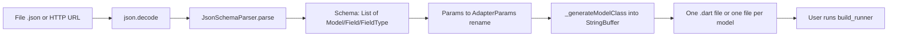
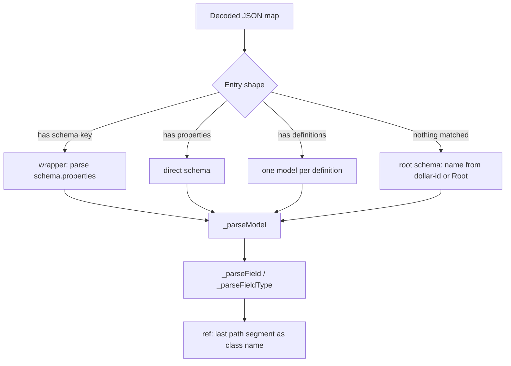

# json_schema_to_freezed — Research report

## Metadata

- **Library name**: json_schema_to_freezed (pub.dev package, v1.0.2)
- **Repo URL**: https://github.com/jpedrosouza/json_schema_to_freezed
- **Clone path**: `research/repos/dart/jpedrosouza-json_schema_to_freezed/`
- **Language**: Dart (SDK ^3.7.2)
- **License**: MIT
- **Analyzed version**: 700b530 2026-10-21 (pubspec version 1.0.2)
- **Report date**: 2026-10-27

## Summary

A small Dart CLI/library (about 600 lines of source) that reads a JSON Schema document (from a local `.json` file or an HTTP endpoint) and emits Dart model classes: Freezed classes (`@freezed`, Freezed 3 `abstract class` by default) with `fromJson` wired to `json_serializable`, or plain Dart classes with hand-written `fromJson`/`toJson`. It is a pragmatic generator rather than a general JSON Schema implementation: it understands `properties`, `required`, `description`, simple `type`s, `$ref` by name, `$id` and a custom wrapper format (`{ "Name": { "schema": {...}, "description": "" } }`). The user must then run `build_runner` to produce `.freezed.dart`/`.g.dart`.

## JSON Schema support

No draft is selected or validated. Examples use draft-07 (`$schema` in the README sample, `definitions`), and the keyword set read is a tiny subset of draft-07. There is no meta-schema validation, no `$ref` resolution, and no 2019-09/2020-12 constructs. Input shapes accepted by the parser: (1) an object whose values are `{schema, description}` wrappers, (2) an object whose values are schemas with `properties`, (3) an object whose values contain `definitions`, (4) a single root schema with `properties` (class named from `$id` or `Root`). A custom, non-standard `propertyOrder` array controls field order.

## Keyword support table

Keywords derived from the vendored draft-07 `schema.json` and the 2020-12 `meta/*.json` vocabularies (union). Verified against `lib/src/parsers/json_schema_parser.dart` (the only place schema keys are read).

| Keyword | Implemented | Notes |
|---------|-------------|-------|
| `$anchor` | no | Not read. |
| `$comment` | no | Ignored. |
| `$defs` | no | Not read; only draft-07 `definitions` under a wrapper entry. |
| `$dynamicAnchor` | no | Ignored. |
| `$dynamicRef` | no | Ignored. |
| `$id` | partial | Root-level `$id` is used as the root class name (then PascalCased) when `--use-dollar-id` (default on); a root schema without `$id` while the flag is on throws a cast error (`null as String`) that escapes the converter's `try/catch` (see Low-level details). Only used in the fallback path when no model was found by the entry scan; not used for resolution. |
| `$ref` | partial | Only for properties/array items: last `/` segment is PascalCased into a class name. No resolution, no remote refs, no check the target exists; A `$ref` takes precedence over `type`/`format` on the same property. `$ref` at the top of a model is not followed. |
| `$schema` | partial | Read unconditionally from the root map into `Schema.version` (a non-map root would throw); never used. |
| `$vocabulary` | no | Ignored. |
| `additionalItems` | no | Ignored. |
| `additionalProperties` | no | Ignored; every object property-type becomes `Map<String, dynamic>`. |
| `allOf` | no | Ignored; field becomes `dynamic`. |
| `anyOf` | no | Ignored; field becomes `dynamic`. |
| `const` | no | Ignored. |
| `contains` | no | Ignored. |
| `contentEncoding` | no | Ignored. |
| `contentMediaType` | no | Ignored. |
| `contentSchema` | no | Ignored. |
| `default` | no | Ignored. |
| `definitions` | partial | Only when a top-level entry of the input object is a map with a `definitions` key: each definition becomes a model named `<entry>_<def>` (only `properties` considered). Root-level `definitions` next to `properties` is not read. |
| `dependencies` | no | Ignored. |
| `dependentRequired` | no | Ignored. |
| `dependentSchemas` | no | Ignored. |
| `deprecated` | no | Ignored. |
| `description` | yes | Field description becomes `///` doc comment; model description stored but not emitted. |
| `else` | no | Ignored. |
| `enum` | no | Ignored; string enums become plain `String`. `Model.isEnum` and `TypeKind.enum_` exist but are never set or emitted. |
| `examples` | no | Ignored. |
| `exclusiveMaximum` | no | Ignored. |
| `exclusiveMinimum` | no | Ignored. |
| `format` | partial | Only `date-time` on a string maps to `DateTime`; all other formats ignored. |
| `if` | no | Ignored. |
| `items` | partial | Single-schema `items` gives `List<T>`; missing `items` on an array throws (null access); tuple form (array) not handled. |
| `maxContains` | no | Ignored. |
| `maxItems` | no | Ignored. |
| `maxLength` | no | Ignored. |
| `maxProperties` | no | Ignored. |
| `maximum` | no | Ignored. |
| `minContains` | no | Ignored. |
| `minItems` | no | Ignored. |
| `minLength` | no | Ignored. |
| `minProperties` | no | Ignored. |
| `minimum` | no | Ignored. |
| `multipleOf` | no | Ignored. |
| `not` | no | Ignored. |
| `oneOf` | no | Ignored; field becomes `dynamic`. |
| `pattern` | no | Ignored. |
| `patternProperties` | no | Ignored. |
| `prefixItems` | no | Ignored. |
| `properties` | yes | Each property becomes a field; only top-level model properties are modelled (nested inline objects are `Map<String, dynamic>`, not new classes). |
| `propertyNames` | no | Ignored. |
| `readOnly` | no | Ignored. |
| `required` | yes | Properties not listed become nullable (`T?`); listed become `required`. |
| `then` | no | Ignored. |
| `title` | no | Ignored. |
| `type` | partial | Single string types only: string, integer (`int`), number (`double`), boolean, array, object (`Map<String, dynamic>`); anything else (including type arrays such as `["string","null"]`, `null`) becomes `dynamic`. |
| `unevaluatedItems` | no | Ignored. |
| `unevaluatedProperties` | no | Ignored. |
| `uniqueItems` | no | Ignored; always `List`. |
| `writeOnly` | no | Ignored. |

Non-standard: `propertyOrder` (yes; orders fields, appends unlisted properties).

## Constraints

None enforced. Validation keywords (`minLength`, `minimum`, `minItems`, `pattern`, etc.) are ignored; the only constraint-like behavior is `required` controlling nullability. Generated code has no runtime checks beyond Dart type casts in the non-Freezed `fromJson`.

## High-level architecture

Three layers: CLI (`bin/json_schema_to_freezed.dart`, `package:args`), converter (`lib/src/converter.dart`, class `JsonSchemaToFreezed`), and parser/model (`lib/src/parsers/json_schema_parser.dart`, `lib/src/models/schema_model.dart`). The library entry exports the converter and models.

## Medium-level architecture

- `Schema {models, version, metadata}`, `Model {name, fields, description, isEnum}`, `Field {name, type, isNullable, description, isId, isUnique, attributes}`, `FieldType {kind, itemType, reference}`, `TypeKind {string, integer, float, boolean, dateTime, array, map, reference, enum_, unknown}`. Several members (`isId`, `isUnique`, `attributes`, `isEnum`, `enum_`, `metadata`) are never populated.
- See Algorithms and data structures for the detailed mechanisms. `$ref` handling: `_parseFieldType` takes the last `/`-separated segment of `$ref`, PascalCases it with `recase`, and stores it as a `TypeKind.reference`. Nothing checks that a model with that name exists; no graph, no cycle handling.
- `_mapTypeToDart` maps kinds to Dart types (recursion over array item types only); `_getCastOperation` builds cast expressions for non-Freezed `fromJson`.
- Class names: `ReCase.pascalCase`; names ending in `Params` are rewritten to `...AdapterParams` (hardcoded project-specific behavior, applied in both the parser and converter), and in separate-files mode file names ending `_params`/`_adapter_params` become `..._adapter`.

## Algorithms and data structures

The library is a single-pass, non-recursive-in-the-schema translator: decoded JSON goes into a flat model list, which is printed once. There is no schema graph, no registry and no validator.

### Schema representation

The input is never held as a typed JSON Schema. `json.decode` yields `dynamic` (`Map<String, dynamic>` / `List`), and `JsonSchemaParser` (`lib/src/parsers/json_schema_parser.dart`) reads only the keys it knows with `containsKey` / `[]` and unchecked `as` casts. Unknown keywords are simply never looked at; boolean schemas (`true`/`false`) are not supported (a property whose schema is a bool throws `NoSuchMethodError` on `fieldData['description']`). The output of parsing is the plain mutable-class model in `lib/src/models/schema_model.dart`: `Schema{List<Model> models, String? version, Map? metadata}`, `Model{String name (mutable), List<Field> fields, description, isEnum}`, `Field{name, FieldType type, isNullable, description, isId, isUnique, attributes}`, `FieldType{TypeKind kind, FieldType? itemType, String? reference}`. `FieldType` is the only recursive structure and recurses solely through array `itemType`. `isEnum`, `isId`, `isUnique`, `attributes`, `metadata` and `TypeKind.enum_` are never assigned anywhere. Models are stored in a `List`, in discovery order, with no index by name.

### Reference resolution and registry

Not applicable in the sense of resolution: there is no registry, no base-URI tracking, no `$anchor`/`$dynamicRef` handling and no remote fetching of referenced documents (HTTP is used only for the top-level schema in `convertFromUrl`). `_parseFieldType` handles `$ref` purely lexically: `ref.split('/').last`, then `_formatClassName` (`ReCase.pascalCase`, plus the `Params` to `AdapterParams` rewrite) becomes `FieldType(kind: reference, reference: name)`. The emitter writes that string verbatim as the Dart type and, in non-Freezed `fromJson`, as `Name.fromJson(...)`. Existence of the target is never checked, so dangling refs surface only when the user compiles the Dart output. Cycles cannot cause non-termination because nothing is followed; recursive schemas simply produce self-referencing class names, which Dart allows. Cost is O(length of ref string) per reference.

### Compiled / intermediate form

The intermediate form is the `Schema`/`Model`/`Field`/`FieldType` list above, a direct "type graph" with by-name edges (the `reference` strings). No normalisation, merging or lowering passes exist. The only post-parse transform is in `JsonSchemaToFreezed._processSchemaData` (`lib/src/converter.dart`): a loop renaming any `Model.name` ending in `Params` to `...AdapterParams` (already done in `_formatClassName`, so for parsed names the loop is effectively redundant). Output is a `StringBuffer` of Dart source (or one buffer per model in separate-files mode).

### Core algorithm

Parsing (`JsonSchemaParser.parse`) is an entry scan over the top-level object. For each `(key, value)` where `value` is a map, the first matching branch wins: (1) has `schema` (wrapper format `{schema, description}`): if `schema` has `properties`, `_parseModel(key, schema, description)`; (2) has `properties`: `_parseModel(key, value)`; (3) has `definitions`: one model per definition named `${key}_$defName`. Entries matching none are dropped silently, and a wrapper whose schema lacks `properties` is dropped. If the scan found no model and the root has `properties`, the root is parsed as a single model, named by `$id` (cast `as String`, throwing if absent while `useDollarId` is on) or `Root`. Consequence: a plain root schema with a property literally named `schema` or `properties` would be misread by the entry scan.

`_parseModel` computes field order: start from `propertyOrder` (non-standard) or `properties.keys`, then append any property missing from the order, using `orderedProps.contains` per key (O(P^2) for P properties; negligible). Required-ness is a `List<String>.contains` per property (also O(P*R)). Each property becomes a `Field` with `isNullable = !required.contains(name)`. `_parseFieldType` switches on the `type` string: `string` (with `format == 'date-time'` giving `dateTime`), `integer`, `number` (to `float`), `boolean`, `array` (recursing into `items`), `object` (always `map`, ignoring `properties`), else `unknown`. Type arrays, `null`, enums, combinators all fall to `unknown` and become `dynamic`. Array recursion depth equals array nesting depth; a missing `items` throws.

Emission (`_generateModelClass`) iterates models then fields and writes lines. Freezed mode prints `@freezed abstract class X with _$X { const factory X({...}) = _X; factory X.fromJson(...) => _$XFromJson(json); }` (`abstract` omitted with `--no-abstract`). Type mapping is `_mapTypeToDart` (recursive over `itemType`). The field's Dart name is always `ReCase(name).camelCase`; `@JsonKey(name: '<orig>')` (with `required: true` for required fields) is emitted only when the name changed AND `--camel-case` is on. With `--no-camel-case` the field is still renamed but no `@JsonKey` is written, so serialisation keys no longer match the schema. Non-Freezed mode builds a class with `final` fields, a constructor, and a hand-written `fromJson` using closures from `_getCastOperation` (returns `String Function(String)` composing cast text such as `($src as List).map((e) => ...).toList()`), and a `toJson` that writes raw field values (nested models and `DateTime` are not converted). Name collisions (two JSON names camelCasing identically, Dart reserved words) are not detected.

### Error and output model

There is no diagnostics model. `convertFromUrl`/`convertFromFile` wrap work in `try/catch`, `print` the error and return `false`. However `return _processSchemaData(...)` is returned without `await` inside the `try`, so exceptions thrown during parsing (cast errors, `NoSuchMethodError`) are not caught there; they propagate as a failed future to the CLI, whose outer `catch` prints `Error: ...` plus help and exits 1. Only I/O, HTTP status and JSON decode errors take the "return false" path, and emission errors are caught inside `_generateDartClasses`/`_generateSeparateFiles`. `_generateSeparateFiles` initialises `allSuccess = true` and never changes it. No schema path or location is tracked in any error.

## Low-level details

- Field names: camelCased via `ReCase`; `@JsonKey` rules as in Core algorithm. In the non-Freezed branch `@JsonKey(name: ...)` is emitted whenever names differ regardless of the flag, and `toJson` writes the camelCased Dart values under the original keys.
- Nullable: any property not in `required` gets `?` and no `required`; non-Freezed constructors make those optional named parameters.
- Header generation differs: single-file output (Freezed mode only) omits a timestamp; separate-files Freezed output includes `Generated on: <DateTime.now()>`. In separate-files mode with `--no-freezed` no header or imports are written at all; with Freezed, each file imports only freezed/json_annotation, never sibling models, so cross-model `$ref` types do not resolve without manual imports. `import 'dart:convert'` is emitted but unused.
- Non-Freezed mode emits no imports, yet `@JsonKey` may appear without `json_annotation` imported.
- A separate-files run is triggered by `*` anywhere in the output path, not only by `--separate-files`.
- With `--use-dollar-id` on, a single root schema lacking `$id` throws.
- `--config`/`-c` is declared but never read; the `useId` constructor parameter is unused.
- Watch mode uses `File.watch()`; the listener calls `convertFromFile` and exceptions from parsing are uncaught there. It also sets `stdin.lineMode/echoMode`, which throws on a non-terminal stdin.
- Numbers: integers map to Dart `int` (64-bit on VM) and `number` to `double`; no bounds or `multipleOf` logic. Strings: no length handling. Recursion is only over array item nesting; no depth limit and no hardening for untrusted input (the tool is aimed at trusted schemas, and a schema fetched from a URL is parsed without size limits).

## Output and integration

- **Vendored vs build-dir**: Writes wherever `--output` points (default `lib/models/generated_models.dart`); user commits or ignores. Output requires follow-up `build_runner`.
- **API vs CLI**: Both. CLI `dart run json_schema_to_freezed -f schema.json -o out.dart`; library class `JsonSchemaToFreezed` with `convertFromFile` and `convertFromUrl` (return `Future<bool>`, errors printed, not thrown).
- **Writer model**: File-only (`File.writeAsString` from a `StringBuffer`); no String/stream return API. Separate files via `*` in output path (CLI `--separate-files` rewrites `name.dart` to `name_*.dart`). Fetch from URL supports custom headers (`-H key:value`).

## Configuration

CLI flags / constructor args: `freezed`, `json-serializable`, `camel-case`, `abstract` (Freezed 3), `use-dollar-id`, `separate-files`, `watch`, `header`, `url`/`file`/`output`. No config file (flag declared, unused). No map-type or optional-type (uuid/chrono) options; only `date-time` to `DateTime` is built in. Dependencies: `args`, `http`, `path`, `recase`.

## Pros/cons

Pros: tiny, easy to read; Freezed 3 and `json_serializable` output; snake_case to camelCase with `@JsonKey`; URL fetching with headers; watch mode; separate files; accepts a multi-model wrapper format.
Cons: very small keyword subset; no real `$ref`/`$defs` resolution; no nested-object classes (inline objects become `Map<String, dynamic>`); no enum, oneOf/anyOf/allOf, nullable-union or `additionalProperties` support; hardcoded `Params` to `AdapterParams` renaming looks like leaked project-specific behavior; unused/stub options; I/O errors swallowed into a boolean while parse errors escape as raw exceptions; `--no-camel-case` renames fields without `@JsonKey`; no cross-file imports in separate-files mode; non-Freezed output is incomplete; crashes on array without `items` or missing `$id`.

## Testability

`dart test` (see CONTRIBUTING.md); `dart_test.yaml` sets 10m timeout, retry 2, VM only. One test file, `test/zod_schema_test.dart`: writes an inline zod/v4-style schema to `test/zstore_sample.json`, converts it to `test/zstore.dart`, and asserts success, file existence, and `contains` checks for `@freezed` and the class header; then deletes files. No golden-file tests; no fixtures committed except `example/sample-from-readme.json`. Running another generator against their inputs: the README sample (wrapper format) and the zod sample are the only schemas; neither is a standard JSON Schema corpus.

## Performance

Analyzed from code only; nothing was built or run.

### Performance techniques

- **Compile vs interpret**: Not applicable. The tool is an ahead-of-time generator; its own work is one parse plus one print. Generated code relies on `json_serializable`/Freezed build-time codegen, so the runtime parsing cost of generated models is decided by those tools, not by this library.
- **Memory layout and allocation**: None found. The entire decoded JSON (`dart:convert` `json.decode`, whole file via `readAsString` or `http.get` body) is held in memory, copied into small model objects, then rendered into a `StringBuffer`. Separate-files mode allocates one buffer per model and writes with `writeAsString`. `_getCastOperation` allocates a closure per field and recursive closure per array level.
- **Caching and memoization**: None found. `ReCase` objects are re-created for each use (the camelCase is recomputed several times per field).
- **Fast paths and short-circuiting**: None found beyond the `$ref`-first branch and the first-match `if/else` in the entry scan. Property ordering and required-ness use `List.contains` (O(P^2)), which is immaterial at realistic sizes.
- **Regex handling**: No regex use for schemas (`pattern` ignored). `recase` uses regexes internally for case conversion.
- **Concurrency**: Async I/O only (`Future`-based file/HTTP); no isolates, no parallel generation. Separate files are written sequentially with `await`. No shared mutable state besides the mutable `Model.name`.

### Benchmarks in repo

None. Entry points for a harness: CLI `dart run bin/json_schema_to_freezed.dart -f <schema.json> -o <out.dart>` or `JsonSchemaToFreezed().convertFromFile(path, out)`; inputs must be in a supported shape (single root schema with `properties` and `$id`, or the wrapper/definitions format), otherwise the converter yields no models.

## Determinism and idempotency

Field order follows `propertyOrder` if present, otherwise the JSON object key order (Dart `Map` preserves insertion order); models follow input order; nothing is sorted. Single-file output is deterministic for a given input (reordering note: `Map` iteration and `propertyOrder` both preserve input order); separate-files output embeds `DateTime.now()` in a header comment, so repeated runs differ. Diffs stay minimal with small input changes because order is input-driven.

## Enum handling

Not supported. `enum` is ignored; a string enum is generated as `String`. Duplicate values and case collisions are therefore not applicable (no variants emitted). `isEnum`/`TypeKind.enum_` are unused scaffolding.

## Reverse generation (Schema from types)

No.

## Multi-language output

No. Dart only (Freezed or plain classes).

## Model deduplication and $ref/$defs

No deduplication. Models are created only from top-level entries (or `definitions` under a wrapper entry); inline objects are never promoted to classes, so identical shapes are not even emitted twice, they are `Map<String, dynamic>`. `$ref` is a name-only reference (last path segment PascalCased), so `#/definitions/Foo` and `#/$defs/Foo` and even external URLs ending `/Foo` all map to class `Foo`; this works only if a model with that name is generated elsewhere (a `definitions` model is named `<entry>_<def>`, which may not match the ref name).

## Validation (schema + JSON → errors)

No. Generated Freezed classes rely on `json_serializable` (type casts) at runtime; no schema validator exists.
