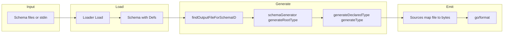
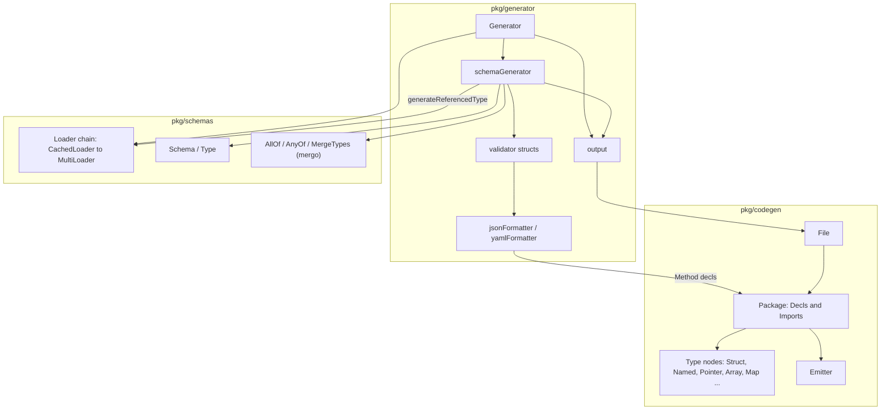

# go-jsonschema (omissis) — Research report

## Metadata

- **Library name**: go-jsonschema
- **Repo URL**: https://github.com/omissis/go-jsonschema
- **Clone path**: `research/repos/go/omissis-go-jsonschema/`
- **Language**: Go
- **License**: MIT
- **Analyzed version**: 9813172 2026-10-13 (`git describe`: v0.24.1-6-g9813172; i.e. six commits after release v0.24.1); Go 1.25
- **Report date**: 2026-10-27

## Summary

go-jsonschema is a tool that generates Go data types and structs from JSON Schema definitions. It produces Go source files containing type declarations and unmarshalling code that validates input JSON according to the schema’s validation rules (e.g. required fields, string length, numeric bounds, pattern, enum). The tool is used primarily via a CLI (`go-jsonschema`); the core logic is in a library (`pkg/generator`, `pkg/codegen`, `pkg/schemas`) so it can be driven programmatically. It supports multiple schema files in one run with per-schema package and output mapping, YAML schemas, and external `$ref` resolution. Generated code uses standard library `encoding/json` and optional `encoding/json` + YAML/mapstructure tags.

## JSON Schema support

- **Drafts**: The schema model and README refer to draft-wright and draft-handrews (e.g. `definitions` and `$defs`, `id` and `$id`). Test fixtures use draft-04 `$schema` (e.g. `tests/data/validation/enum/enum.json`). The implementation does not enforce a single draft; it accepts draft-04–style and draft 2019-09/2020-12–style keywords where they overlap (e.g. `$defs` and `definitions`, `$id` and `id`).
- **Scope**: Structure-oriented subset with validation. Parsed schema drives type generation (`type`, `properties`, `items`, `$ref`, `$defs`/`definitions`, `allOf`, `anyOf`, `enum`, `additionalProperties`, `required`, `format`, etc.). Missing `type` is now inferred (object when `properties` etc. present). Many validation keywords are enforced in generated unmarshal code (e.g. numeric bounds, string length/pattern, array min/max items, required, read-only, default, const). Not supported: nested `$defs` (only top-level names in `#/$defs/someName` and `file.json#/$defs/someName`), `oneOf`, conditional `if`/`then`/`else`, `patternProperties`, `uniqueItems`, `dependentRequired`/`dependentSchemas`, `contentEncoding`/`contentMediaType`/`contentSchema`, `unevaluatedProperties`/`unevaluatedItems`, `$anchor`/`$dynamicRef`/`$dynamicAnchor`.

## Keyword support table

Keyword list derived from the vendored draft 2020-12 meta-schemas under `specs/json-schema.org/draft/2020-12/meta/` (core, applicator, validation, meta-data, unevaluated, format-annotation, format-assertion, content), plus legacy keywords from draft-04 `schema.json` and 2019-09 meta-schemas that the model also accepts (rows at the end). The `Type` struct in `pkg/schemas/model.go` is the authoritative list of parsed keywords; "Not used" below means the keyword is absent from the model or never read by `pkg/generator`/`pkg/codegen`.

| Keyword | Implemented | Notes |
|---------|-------------|-------|
| $anchor | no | Not used. |
| $comment | no | Not in the model; ignored. |
| $defs | yes | Parsed as `Schema.Definitions` and legacy `definitions`; used for `#/$defs/name` and `file#/$defs/name`. Top-level only; nested $defs not supported (TODO in code). |
| $dynamicAnchor | no | Not used. |
| $dynamicRef | no | Not used. |
| $id | partial | Root only: `Schema.ID` (and legacy `id`), used as the key for output/schema mapping (`Generator.outputs`, `processedSchemas`). Nested `$id` is not in `Type` and is ignored; no base-URI tracking. |
| $ref | yes | Fragment and file refs: `#`, `#/$defs/name`, `file.json#/$defs/name`. Resolved via loader and `extractRefNames`; nested definitions in ref path not supported. |
| $schema | no | Parsed into `Type.Version` but never read by codegen (draft is never detected). |
| $vocabulary | no | Not used. |
| additionalProperties | yes | Schema or `false`; `false`/absent with `.Not == nil` allows typed map; otherwise map value type from schema. |
| allOf | yes | Merged via `schemas.AllOf` then generated as single type. |
| anyOf | yes | Merged after resolving refs; generated as struct with optional fields and anyOf validator. |
| const | partial | String, boolean and numeric const emitted as validators (`stringValidator.constVal`, `booleanValidator`, `numericValidator.constVal`, only for primitive Go types); a non-string const on a string field or non-bool on a bool field is warned and ignored; object/array/null const is ignored. |
| contains | no | Not used in codegen. |
| contentEncoding | no | Not used. |
| contentMediaType | no | Not used. |
| contentSchema | no | Not used. |
| default | yes | Emitted for struct fields; default validator in unmarshal; default value used in generated code. |
| dependentRequired | no | Parsed in model (`DependentRequired`) but never read by the generator. |
| dependentSchemas | no | Parsed in model (`DependentSchemas`) but never read by the generator. |
| deprecated | no | Not in the model; ignored. |
| description | yes | Emitted as struct/field comments. |
| else | no | Not used. |
| enum | yes | Go type with constants and custom unmarshal; string, number, boolean, null, mixed; multiple types may wrap in struct. |
| examples | no | Not in the model; ignored. |
| exclusiveMaximum | yes | Parsed (`*any`, so both the draft-04 boolean and the numeric form decode); used for numeric type selection and validation in generated code (integer and float). |
| exclusiveMinimum | yes | Parsed (`*any`, draft-04 boolean and numeric forms); used for numeric type selection and validation in generated code. |
| format | partial | date, date-time, time, duration → custom types (SerializableDate, SerializableTime, time.Time, duration); ipv4, ipv6 → net/netip.Addr. Nullable date/date-time/time no longer produce named pointer alias types. Other format values not mapped. |
| if | no | Not used for codegen; an object whose `allOf` holds only conditional subschemas now still generates a struct (fix #590). |
| items | yes | Single schema → slice element type; arrays without `items` now yield `[]interface{}`; tuple-style (array of schemas) not implemented. |
| maxContains | no | Not used. |
| maximum | yes | Used for int sizing and validation in generated code. |
| maxItems | yes | Validation in generated unmarshal. |
| maxLength | yes | Validation in generated unmarshal (utf8 rune count). Stored as a plain `int`, so `0` means unset and `maxLength: 0` cannot be enforced (same for `maxItems`, `minItems`, `minLength`). |
| maxProperties | no | Parsed but not used in codegen. |
| minContains | no | Not used. |
| minimum | yes | Used for int sizing and validation in generated code. |
| minItems | yes | Validation in generated unmarshal. |
| minLength | yes | Validation in generated unmarshal. |
| minProperties | no | Parsed but not used in codegen. |
| multipleOf | yes | Validation in generated unmarshal (integer and float). |
| not | partial | Parsed on every `Type`, but the only consumer is a check for `.Not == nil` on `additionalProperties`: boolean `false` decodes to `Type{Not: &Type{}}`, which suppresses the `AdditionalProperties` field. Not generated as a general subschema. |
| oneOf | no | Parsed (`OneOf`; `SubSchemaTypeOneOf` constant exists) but no codegen branch reads it; only anyOf and allOf are handled. |
| pattern | yes | Validation in generated unmarshal (regexp.MatchString). |
| patternProperties | no | Parsed in model but struct generation only uses `properties`; not used in codegen. |
| prefixItems | no | Not used; items handled as single schema only. |
| properties | yes | Drives struct fields; naming and required/optional. |
| propertyNames | no | Not used. |
| readOnly | yes | Parsed; optional read-only validation in unmarshal (field must not be present in input); can be disabled via config. |
| required | yes | Required fields; non-required get pointer or omitempty; required validator in unmarshal. |
| then | no | Not used. |
| title | yes | Used for type naming when StructNameFromTitle is set. |
| type | yes | Single and multiple types; null with another type → pointer; drives Go type and format. |
| unevaluatedItems | no | Not used. |
| unevaluatedProperties | no | Not used. |
| uniqueItems | no | Parsed in model but array generation does not use it; always slice. |
| writeOnly | no | Not in the model; ignored. |
| definitions (draft-04/07) | yes | Legacy alias of `$defs`; `Schema.UnmarshalJSON` falls back to `definitions` when `$defs` is absent (root only). |
| id (draft-04) | yes | Legacy alias of `$id` (`LegacyID`); used when `$id` is empty. |
| dependencies (draft-04/07) | no | Not in the model; ignored. |
| additionalItems (draft-04/07) | no | Parsed (`AdditionalItems`) but never read. |
| $recursiveAnchor / $recursiveRef (2019-09) | no | Not in the model. |

## Constraints

Validation keywords are enforced in the generated unmarshal code, not only used for structure. The generator emits validators (required, readOnly, default, array min/max items, string min/max length and pattern, numeric bounds and multipleOf, const, anyOf) that run during `UnmarshalJSON`/`UnmarshalYAML`. So constraints like `minLength`, `maxLength`, `pattern`, `minimum`, `maximum`, `exclusiveMinimum`, `exclusiveMaximum`, `multipleOf`, `minItems`, `maxItems`, `required`, `const` (string, bool, numeric) and `readOnly` produce runtime checks. String length now counts UTF-8 runes; duplicate validators are no longer emitted; `multipleOf` handles small divisors without precision failures; structs combining additional properties and constraints were fixed. Integer sizing can use `minimum`/`maximum` to choose smaller int types when MinSizedInts is enabled.

## High-level architecture

- **Input**: One or more schema files (JSON or YAML), paths from CLI or API; optional stdin (`-`).
- **Load**: `Loader` (default: cached multi-loader with file and HTTP) loads and parses schema; `Schema` has `$id`, `$defs`/definitions, root type.
- **Generate**: For each file, `Generator.DoFile` / `AddFile` finds or creates an output (package + file name from config or `$id`). A `schemaGenerator` generates root type and all definitions: `generateRootType` iterates definitions (sorted by name), then root; each type goes through `generateDeclaredType` → `generateType` / `generateTypeInline` (with ref resolution, enum, struct, array, allOf/anyOf, primitives with format). Validation code is not templated text: each constraint becomes a `validator` Go struct that later prints its own Go snippet via the `Emitter`.
- **Emit**: `Generator.Sources()` builds `map[string][]byte` (filename → Go source); each output file’s `codegen.File` is rendered via a fresh `Emitter` (80-column comment wrapping), then passed through `go/format.Source`; if formatting fails the unformatted text is used and a warning is emitted.
- **Write**: CLI writes each entry in `Sources()` to disk (or stdout for single `-`).

## Medium-level architecture

- **Packages**: `pkg/schemas` (schema model, loaders, merge helpers), `pkg/generator` (Generator, Config, schemaGenerator, output, formatters, validators), `pkg/codegen` (File, Package, TypeDecl, Type nodes, Emitter), plus `pkg/mathutils` (bound normalization), `pkg/types` (runtime `SerializableDate`/`SerializableTime` that generated code imports), `internal/x/text` (Caser).
- **Generator** (`generate.go`): holds `outputs map[string]*output` keyed by schema `$id` (empty string for id-less schemas), `inScope map[qualifiedDefinition]struct{}` for cycle detection, the loader, the `Caser`, and a list of `formatter`s (always `jsonFormatter`, plus `yamlFormatter` when `ExtraImports`). `DoFile` loads a schema and calls `AddFile`, which finds/creates the `output` (by `SchemaMappings` match on `$id`, else defaults), skips already processed `$id`s, and runs a fresh `schemaGenerator.generateRootType()`.
- **output** (`output.go`): per-output-file state: the `codegen.File`, `declsByName map[string]*TypeDecl`, `declsBySchema map[*schemas.Type]*TypeDecl` (pointer identity), `unmarshallersByTypeDecl`, `processedSchemas`. `beginOutput` merges schemas that map to the same file name and package into one `output`, and errors if the same file name is mapped to two packages.
- **schemaGenerator** (`schema_generator.go`): per (schema, output) state with `schemaTypesByRef map[string]*schemas.Type`. Entry points: `generateRootType` (definitions sorted by name, then the root if it has a `type`), `generateDeclaredType` (registers a named Go decl), `generateType` / `generateTypeInline` (map a schema to a `codegen.Type` node), `generateReferencedType` (`$ref`), `generateAnyOfType` / `generateAllOfType`, `generateEnumType`, `generateStructType`.
- **Ref resolution**: `extractRefNames` splits `$ref` at `#` and requires the fragment to start with `/$defs/` or `/definitions/` (case-insensitive prefix test), taking the remainder (which may itself contain further `/`, so nested paths are looked up verbatim in a top-level map and fail with "definition does not exist"). A ref with a file part is loaded through the `Loader`, `AddFile`'d into its own output, and wrapped in a `NamedType` carrying the other package (adding an import) when packages differ. See Algorithms for the details.

## Algorithms and data structures

The whole tool is a single-pass, recursive, stateful tree walk from a typed schema tree to a typed Go-AST-like tree (`codegen.Type`), which is printed with a string `Emitter`. There is no separate validator engine: "validation" is Go source text generated per constraint.

### Schema representation

- `pkg/schemas/model.go`. A schema is a fully typed Go struct, `Type`, with one field per recognised keyword (floats as `*float64`, lengths/counts as plain `int`, `ExclusiveMinimum/Maximum` as `*any` so both draft-04 booleans and numeric forms decode, `Enum []any`, `Const any`, `Items *Type` (single schema only), `Properties map[string]*Type`, `AllOf/AnyOf/OneOf []*Type`, `Not *Type`, `Definitions map[string]*Type`). Unknown keywords are dropped by `encoding/json` (and, as a consequence of `encoding/json` semantics, keyword matching is case-insensitive). There is no raw-JSON retention, so annotations/`$comment`/`examples` are lost.
- The root is `Schema { *ObjectAsType; ID; LegacyID; Definitions }`. `ObjectAsType` and `unmarshalerSchema` are `type X Type/Schema` re-declarations with no methods, used to call the default decoder without recursing into the custom `UnmarshalJSON`. Because the embedded `*ObjectAsType` is allocated by `encoding/json` only when one of its keys appears, a document with only `$id`/`$defs` has a nil embedded pointer and `generateRootType` returns `errSchemaHasNoRoot`.
- Custom `Type.UnmarshalJSON`: (1) boolean schemas: `true` becomes `Type{}`, `false` becomes `Type{Not: &Type{}}`; (2) decode into `ObjectAsType`; (3) a second decode pass into an anonymous struct for legacy `definitions` and `dependencies` (folded into `Definitions` / `DependentSchemas` when the modern key is absent); (4) infer `type: object` when `type` is empty and `properties` or `additionalProperties` exist. `Schema.UnmarshalJSON` does the same two-pass trick for `id` and `definitions`. Since every nested `*Type` runs this decoder, each level re-scans its raw bytes at least twice.
- `TypeList` accepts either a string or an array of strings. Mutable generator state lives on the schema nodes themselves: unexported `subSchemaType`, `subSchemasCount`, `subSchemaTypeElem`, and the exported `Dereferenced` flag (set during ref resolution).
- Ownership: schemas are heap pointers shared freely; the generator mutates them (injects inferred types into anyOf branches, converts integer enum values to `int`, rewrites refs, may nil out `Minimum`/`Maximum`). The loader cache hands out the same `*Schema` to every ref, so those mutations are visible across the run.
- YAML input is decoded to `map[string]any`, keys normalised by `yamlutils.FixMapKeys`, re-marshalled to JSON and decoded through the same path (`schemas/parse.go`).

### Reference resolution and registry

- There is no global registry keyed by canonical URI. Three separate caches cooperate:
  1. `CachedLoader.cache map[string]*Schema` (`schemas/loaders.go`) keyed by the raw ref file string, so the same file reached via two different spellings (`./a.json` vs `a.json`) is parsed twice.
  2. `Generator.outputs map[string]*output` keyed by the schema's `$id` (`""` for schemas without one), plus `output.processedSchemas` which makes `AddFile` idempotent per `$id`.
  3. `schemaGenerator.schemaTypesByRef map[string]*schemas.Type` (per schemaGenerator, keyed by the literal `$ref` string) memoizing `resolveRef`.
- `$ref` parsing (`extractRefNames`): split at the first `#`; fragment must begin `/$defs/` or `/definitions/`. The remainder is the definition name and is looked up in `schema.Definitions` (top level only, with a `TODO: Support nested definitions`). A bare `#` is handled specially: if the root's decl exists it returns `decl.Type`, else `interface{}`. Refs such as `#/properties/foo`, JSON-pointer escapes (`~1`), `$anchor`, `$dynamicRef` are unsupported.
- `generateReferencedType` flow: (a) same-file ref: first tries `outputs[schema.ID].declsByName[defName]` using the *raw* (un-identifierized) name, returning a `NamedType` if present; (b) file ref: `loader.Load(fileName, parentFileName)` (relative to the parent's directory; `QualifiedFileName` tries the name plus each `ResolveExtensions` suffix and `filepath.EvalSymlinks`; `http(s)://` goes to `HTTPLoader`), then `AddFile` generates that schema's own output, then a new `schemaGenerator` for the target schema is used; (c) pick `Definitions[defName]` or, for a file-only ref, the target root (forced to `object` if it has no `type`); (d) `detectCycle`; (e) `sg.generateDeclaredType(def, newNameScope(defName))`; (f) if the target package differs, add an import and wrap in `NamedType{Package: ...}`.
- There is no base-URI stack: relative refs inside a loaded file resolve against that file's path (`schemaFileName`), not against `$id`. For refs inside a type that was lifted out of an external file (allOf/anyOf merging), `resolveRef` calls `Type.ConvertAllRefs(fileName)`, a reflection walk (`updateAllRefsValues`) over the entire type graph that prefixes every `Ref` string beginning with `#` with the file name, so that after merging into another schema they still point to the right file. This mutates the shared cached schema in place.
- Cycle handling: `detectCycle` builds `qualifiedDefinition{schema, schemaType, filename, name}` and uses `Generator.inScope` as a visited-set with a deferred cleanup closure (a DFS "on stack" set). A hit sets `isCycle`, which makes `generateReferencedType` wrap the result in a pointer (with a warning), or makes `generateAnyOfType` degrade to `interface{}`. The key contains the `*Type` pointer of the `$ref` node, so detection is per ref node. Recursion through same-file refs is mostly terminated earlier: `generateDeclaredType` registers `declsBySchema[t]` and `declsByName[name]` *before* generating the body, so a nested ref to the same definition returns the existing `NamedType` (decl `.Type` still nil at that point). Cost: O(1) map ops per ref.

### Compiled / intermediate form

The IR is `pkg/codegen` (`model.go`), a small typed tree:
- Declarations (`Decl` interface with `Generate(*Emitter) error`): `TypeDecl{Name, Type, Comment, SchemaType *schemas.Type}`, `Var`, `Constant`, `AliasType`, `Method{Impl func(*Emitter) error, Name}`, `Fragment`, `Import`. `Package{QualifiedName, Decls []Decl, Imports []Import}` is the container; `File{FileName, Package}` wraps it.
- Types (`Type` interface adds `IsNillable()`): `PrimitiveType{string}`, `NamedType{Package *Package, Decl *TypeDecl}` (a pointer into a TypeDecl, so later mutation of the decl is visible), `PointerType`, `ArrayType`, `MapType{Key,Value}`, `StructType{Fields []StructField, RequiredJSONFields, DefaultValue}`, `EmptyInterfaceType`, `NullType`, `DurationType`, `CustomNameType` (extension-provided type string).
- `StructField` keeps `SchemaType *schemas.Type`, so validators can be derived later from the original keywords. Validators are a second small IR: `requiredValidator`, `readOnlyValidator`, `nullTypeValidator`, `defaultValidator`, `arrayValidator`, `stringValidator`, `numericValidator`, `booleanValidator`, `anyOfValidator`, each with `generate(out, format)` and `desc()` (flags `beforeJSONUnmarshal`, `requiresRawAfter`, `hasError`, import list). `Method.Impl` is a closure over the validators and decl; it is only executed during `Sources()`.
- Output is not an AST: types and validators print directly into a `strings.Builder` through `Emitter` (`Printf`, indentation counter, `Comment` word-wrapped by `go-wordwrap`), followed by `go/format`. Literal values (default values, enum value lists, constants) are rendered with `litter.Sdump`.

### Core algorithm

Codegen walk (all recursive Go calls, no explicit stack):
1. `generateRootType`: for each `$defs` name in sorted order, `generateDeclaredType(def, scope=Identifierize(name))`; then the root if it has a `type`.
2. `generateDeclaredType(t, scope)`: (i) if `declsBySchema[t]` exists, return it (and if the node was `Dereferenced` under a different name, emit a Go `type Alias = Name`); (ii) if the scope-derived name is already taken, return the existing decl when `cmp.Equal` says schemas are equal (ignoring unexported fields, `Ref`, `AnyOf`), else fall through to `getDeclByEqualSchema`, which probes `Name`, `Name_1`, `Name_2`, ... for an equal schema; (iii) enums go to `generateEnumType`; (iv) otherwise reserve a name with `uniqueTypeName`, register the (still type-less) decl in both maps, call `generateType`, and if the result is itself a named type (or a map with `DisableCustomTypesForMaps`) discard the reservation, otherwise `Package.AddDecl`; (v) unless `OnlyModels`, build validators by type switch and call `generateUnmarshaler`.
3. `generateType`/`generateTypeInline` dispatch: extension type override, enum, `$ref`, anyOf, allOf, then `determineTypeName` (single type; `[T, "null"]` becomes pointer to T; any other multi-type becomes `interface{}` with a warning; missing type with anyOf/allOf takes the common type if all branches agree, else `null`). `array` maps `items` to `[]Elem` (scope suffix `Elem` or singular name under `MinimalNames`; no `items` gives `[]interface{}`), `object` to `generateStructType`, primitives to `PrimitiveTypeFromJSONSchemaType` (format switch: `date-time` to `time.Time`, `date`/`time` to `types.SerializableDate/Time`, `duration` to `time.Duration`, `ipv4/ipv6` to `netip.Addr`; `integer` to `int`, or with `MinSizedInts` the smallest `int8..uint64` that fits `getMinIntType`'s normalized bounds, dropping the redundant bound validator).
4. Structs (`generateStructType`): no `properties`/`allOf`/`anyOf` gives `map[string]V` (V from `additionalProperties` or `interface{}`). Otherwise fields are created for `sortedKeys(properties)` via `addStructField`: identifier via `Caser.Identifierize`, collisions get `_N` plus a warning (`uniqueNames` map), tags (`json`/`yaml`/`mapstructure`, `omitempty`/`omitzero` when not required), pointer wrapping when not required and no default (`generateStructFieldType`), required names collected into `RequiredJSONFields`. `additionalProperties` (non-`false`) adds an `AdditionalProperties` field of a typed map tagged `mapstructure:",remain"`.
5. allOf (`generateAllOfType`): `resolveRefs` resolves every branch (`$ref` becomes the referenced `*schemas.Type`, via a full generation of the referenced type, so the side effects are real), then `schemas.AllOf` -> `MergeTypes`: starts from an empty `Type`, `mergo.Merge`s the base then each branch with `WithAppendSlice` (slices such as `required`/`enum` are concatenated, map fields such as `properties` are merged key-wise with first writer winning, scalars set only when still zero) and a transformer that skips `TypeList`. If all participating types are primitives the merge is short-circuited to an empty result (the fix for `if/then/else`-only allOf checks `sawPrimitive`). The merged type has `allOf` cleared and goes back through `generateTypeInline`. With `AliasSingleAllOfAnyOfRefs`, a lone-ref allOf/anyOf on an empty object becomes the referenced type directly.
6. anyOf (`generateAnyOfType`): resolve refs (a `null` branch sets `hasNull` and is removed; a single temporal branch plus null collapses to a nillable temporal primitive); each branch gets its `type` inherited from the parent if missing, is marked `subSchemaTypeElem`, cycle-checked, and generated as its own named type `Scope_i` (each gets an `UnmarshalJSON`); then the branches are merged with `schemas.AnyOf` (same `MergeTypes`, but `Required` = base required plus names required by *every* branch) into one struct with all fields optional, tagged `SubSchemaTypeAnyOf` with `subSchemasCount`. That struct's unmarshaler is an `anyOfValidator`: it unmarshals the raw bytes into every `Name_i` type and fails only if all fail (`errors.Join`). `oneOf` has no branch at all (no codegen reads `OneOf`).
7. Emission (`Sources`): per output, `Package.Generate` writes the package clause, imports sorted by qualified name (stable sort), then declarations sorted with `sort.Slice` on `CleanNameForSorting(name)`, so enum value `Var`s sort next to their type, then each decl's `Generate`. Each file is gofmt'd.

Generated unmarshal code (per type that has validators): `UnmarshalJSON(value []byte)` optionally decodes into `raw map[string]interface{}` first (needed by required / readOnly / default / AdditionalProperties), runs "before" validators on `raw`, declares `type Plain Name` (to avoid recursion), decodes into `plain`, runs "after" validators on the struct fields, then assigns `*j = Name(plain)`. YAML is the same shape over `*yaml.Node`. Enums: an `UnmarshalJSON` decodes into the underlying primitive and linearly scans the generated `enumValues_Name` slice with `reflect.DeepEqual`. Required checks are map-key presence tests on `raw`, so they distinguish absent from null.

### Error and output model

- Generator-side: ordinary `error` values wrapped with `%w` and sentinel `errors.New` vars; non-fatal issues go through `Config.Warner func(string)` (name collisions, multi-type fallbacks, ignored const values, cycles). There is no diagnostic location or schema path structure; messages embed the ref string or the name scope.
- Runtime validation errors in generated code are `fmt.Errorf` strings of fixed shapes (`field X in Y: required`, `field X length: must be >= N`, `field X pattern match: must match P`, `field X: must be <= N`, `invalid value (expected one of ...)`, `all validators failed: ...`). Validation is fail-fast: the first failing check returns; no error aggregation and no JSON-pointer path (only the JSON property name and, for nested arrays, index formatting through `fmt.Sprintf`).
- Output is `map[string][]byte` from `Sources()`; no streaming writer.

## Low-level details

- **Identifier naming**: `Caser.Identifierize` (`internal/x/text/cases.go`) splits on case transitions and non-letter delimiters via a small state machine over runes, capitalizes each part (with the `Capitalizations` override list matched case-insensitively, e.g. `id` to `ID`), prefixes `A` if the first rune is not a cased letter, and prefixes `A` for Go keywords. Empty string gives `Blank`, `*` gives `Wildcard`. The mapping is lossy (`a`, `A`, `a_`, ... collapse), which is why collisions are handled afterward.
- **Type-name uniqueness**: `output.uniqueTypeName(scope)` with `MinimalNames` tries progressively longer suffixes of the name-scope stack (`nameScope.stringFrom(i)`) until an unused name is found; otherwise the full concatenated scope; on collision it probes `Name_1`, `Name_2`, ... and warns. `nameScope.add` copies the slice, O(depth) per step.
- **Numerics**: bounds are `*float64` (so integers above 2^53 lose precision in both bound checks and `const`); numeric `const` is printed with `%v`. Integer enum values are converted from `float64` to `int`. `multipleOf` for integer-typed fields generates `x % N != 0` with `N = int64(multipleOf)` (a fractional multiple such as `0.5` would truncate to 0; not verified against tests); for floats it generates `math.Mod` with a fixed `1e-10` absolute tolerance on remainder or `multipleOf - remainder`. `mathutils.NormalizeBounds` reconciles draft-04 boolean exclusive flags with draft-06+ numeric ones, choosing the tighter bound when both `minimum` and `exclusiveMinimum` are numeric.
- **Strings**: `minLength`/`maxLength` use `utf8.RuneCountInString` (code points, not UTF-16 units or graphemes). `pattern` is emitted inside a Go raw string literal passed to `regexp.MatchString` (RE2 syntax, unanchored as JSON Schema specifies, not ECMA-262); only `\b \f \n \r \t` control characters are re-escaped, and a pattern containing a backtick would break the generated source.
- **Zero-value ambiguity**: `minLength`, `maxLength`, `minItems`, `maxItems` are `int`, so an explicit `0` cannot be told from absence. `arrayValidator` only applies `minItems` when the slice is non-nil.
- **Defaults**: applied in generated unmarshal when the key is absent or `null` (checked on `raw`); durations are parsed ISO-8601 at generation time (`sosodev/duration`) and emitted as a `time.ParseDuration` call; integer defaults are converted from `float64`; defaults on pointer fields use a temp variable.
- **Hardening**: none specific. Recursion is native Go recursion (schema depth is bounded in practice by `encoding/json`'s 10000-level nesting limit and Go's growable stack). `HTTPLoader` uses a default `http.Client{}` with no timeout, size limit, or host allow-list; the content-type switch falls back to extension. File refs are resolved relative to the parent file and symlinks are evaluated but there is no root confinement, so a schema can reference arbitrary local paths.
- **Dedup of declarations**: `Package.AddDecl` rejects a decl if it is the same pointer, `reflect.DeepEqual` to an existing decl, or has the same `GetName()` as any existing `Named` decl. This silently drops a second decl with a colliding name, which matters for enum constants (see Enum handling).

## Output and integration

- **Vendored vs build-dir**: Generated files are not vendored by the tool; the CLI writes to paths specified by `--output` / `--schema-output` or to stdout. Tests use golden files next to schema (e.g. `schema.json` + `schema.go` in same dir); overwrite with `OVERWRITE_EXPECTED_GO_FILE=true make test`.
- **API vs CLI**: Both. CLI in `main.go` (cobra): flags for package, output, schema-package, schema-output, schema-root-type, tags, capitalizations, resolve-extension, yaml-extension, struct-name-from-title, only-models, min-sized-ints, minimal-names, disable-readonly-validation, disable-custom-types-for-maps. Library: `generator.New(config)`, `DoFile`/`AddFile`, `Sources()` returns `map[string][]byte`.
- **Writer model**: In-memory: `Sources()` returns `map[string][]byte` (filename → formatted Go source). CLI writes each to disk or stdout. No generic `io.Writer` API; caller writes bytes from `Sources()`.

## Configuration

- **Config** (generator.Config): SchemaMappings (schema ID → package, output name, root type), DefaultPackageName, DefaultOutputName, ExtraImports (adds YAML formatter), Capitalizations, ResolveExtensions, YAMLExtensions, StructNameFromTitle, Warner, Tags (e.g. json, yaml, mapstructure), OnlyModels (no unmarshal/validation), MinSizedInts, MinimalNames, Loader, DisableOmitempty, DisableReadOnlyValidation, DisableCustomTypesForMaps, DisableOmitZero (Go 1.24 `omitzero` tag emitted for non-required fields unless disabled; json tag only), AliasSingleAllOfAnyOfRefs (types with a single nested anyOf/allOf ref become type aliases). The `goJSONSchema` extension gained a `pointer` override to force or suppress pointer fields, and extra field tags.
- **Schema mapping**: For multi-schema runs, `--schema-package=URI=PACKAGE`, `--schema-output=URI=FILENAME`, `--schema-root-type=URI=NAME` map by schema `$id`.
- **Extensions**: `goJSONSchema` schema extension for custom Go type, identifier, nillable, imports, extraTags. Resolve extensions (e.g. `.json`) used when resolving `$ref` file names.

## Pros/cons

- **Pros**: Validation in generated code (required, lengths, pattern, numeric bounds, enums, etc.); configurable packages and outputs for multi-schema; YAML and JSON; external refs and cross-package types; format-based types (date, date-time, time, duration, ipv4/ipv6); optional read-only validation; struct name from title; capitalizations; only-models mode; go workspaces used in repo to test generated code.
- **Recent changes** (since earlier analysis): numeric const, type inference, nested ref types (#458), title-based names in all sub-objects, omitzero, pointer override, alias for single anyOf/allOf, subschema improvements, Go 1.25 and heavy dependency-bot churn; no oneOf or conditional support added.
- **Cons**: Nested `$defs` and oneOf not supported; patternProperties, uniqueItems, dependent*, if/then/else, unevaluated* not implemented; README status shows many validation items still unchecked; const limited to string/bool/numeric; multiple types for a property fall back to interface{} with warning; name collisions get numeric suffix and warning.

## Testability

- **Unit/integration**: Tests in `tests/`: `generation_test.go` runs generator on schema fixtures and compares output to golden `.go` files; `validation_test.go` unmarshals JSON into generated types and asserts on expected errors (required, length, pattern, numeric, etc.). Helpers in `tests/helpers`; some tests use generated packages (e.g. cross-package).
- **Running tests**: From repo root, `make test` or `go test ./tests/...`. Golden update: `OVERWRITE_EXPECTED_GO_FILE=true make test`.
- **Fixtures**: `tests/data/` (core, validation, validationDisabled, nameFromTitle, refWithOverridesPath, regressions, schemaExtensions, miscWithDefaults, yaml, etc.). Each example typically has a `.json` (or `.yaml`) schema and a `.go` golden file; validation tests import generated packages and run Unmarshal with expected error messages.
- **Entry points for shared fixtures**: `generator.New(cfg)`, `generator.DoFile(path)` or `AddFile(path, schema)`, `generator.Sources()`; CLI `go-jsonschema -p <pkg> -o <out> <schema.json>`.

## Performance

Analyzed by reading code only; nothing was built or run. Two different costs exist: the generator's own run time, and the run-time cost of the code it generates. The tool is a short-lived CLI over small inputs, and no part of the code is performance-engineered.

### Performance techniques

- **Compile vs interpret**: The entire library is "compile": JSON Schema is lowered once to Go source. Constraint evaluation is specialised at generation time (e.g. `numericValidator` emits only the comparisons actually present, `MinSizedInts` chooses int width so one bound check can be dropped), so the generated code does not interpret the schema at runtime and holds no schema object. Nothing is computed lazily; the whole schema (and every transitively referenced file) is generated eagerly.
- **Memory layout and allocation**: Pointer-rich trees (`*schemas.Type`, `map[string]*Type`), no arena or interning. `nameScope.add` copies a slice per nesting level. Emission builds strings through `strings.Builder` and `fmt.Fprintf`, with temporary `Emitter`s created for default values and pointer temporaries. `Sources()` copies each builder to a string then `[]byte`, then `go/format.Source` re-parses the text. Schema parsing re-scans each subtree's raw bytes at least twice (`Type.UnmarshalJSON`'s legacy pass), roughly O(depth x size). `MergeTypes` allocates a new `Type` per allOf/anyOf use, deep-merging maps via reflection (`mergo`).
- **Caching and memoization**: (1) `CachedLoader` caches parsed schemas per raw ref string; (2) `schemaTypesByRef` memoizes `resolveRef`; (3) `declsBySchema` (pointer identity) and `declsByName` give O(1) memoization of generated decls; (4) `unmarshallersByTypeDecl` prevents emitting an unmarshaler twice; (5) `processedSchemas` prevents regenerating a file. No cache invalidation; all caches live for one `Generator`.
- **Fast paths and short-circuiting**: Pointer-identity check before structural comparison in `generateDeclaredType`; `generateUnmarshaler` is skipped entirely when there are no validators (and the type is not an anyOf element), so unconstrained structs get plain `encoding/json`. Generated unmarshal only pre-decodes into `raw map[string]interface{}` when a validator needs it (`forceBefore`/`beforeValidators`). Validation is fail-fast.
- **Quadratic spots**: `Package.hasDecl` is a linear scan with `reflect.DeepEqual` on every `AddDecl`, i.e. O(n^2) in declaration count with possibly deep comparisons; `AddImport` is a linear scan; `getDeclByEqualSchema` and `uniqueTypeName` probe numeric suffixes linearly; `cmp.Equal` on two `schemas.Type` trees is a deep structural comparison (used on every name collision). `ConvertAllRefs` walks the whole subtree by reflection per cross-file resolve. For realistic schemas these are not significant, but there is no protection for very large schemas.
- **Generated-code cost** (affects consumers, not the generator): a constrained struct is decoded twice (once into `map[string]interface{}` for presence checks, once into `Plain`); `pattern` calls `regexp.MatchString` on every unmarshal, which recompiles the regex each time (no package-level `regexp.MustCompile`); enum membership is a linear `reflect.DeepEqual` loop; anyOf tries decoding into every branch type; types with `AdditionalProperties` additionally use `reflect` and `mapstructure.Decode`.
- **Regex handling**: The generator itself uses no regex for schema processing. For `pattern` it emits Go's `regexp` (RE2, linear-time, so no catastrophic backtracking) but with no ECMA-262 translation and no compile-once caching (see above). Patterns are not validated at generation time; an invalid pattern surfaces as `matched=false` (the error from `MatchString` is discarded with `_`), so every value fails validation at runtime.
- **Concurrency**: None in the library (no goroutines, no `sync`). `Generator`, `output` and `CachedLoader` use plain maps and are not safe for concurrent use; the tests parallelise by creating one `Generator` per test. Generated types are plain structs and their unmarshalers are stateless, so they are safe to use concurrently.

### Benchmarks in repo

None: no `Benchmark*` functions anywhere (`pkg/mathutils` has only unit tests), and no benchmark make target. Entry points for a shared harness: CLI `go-jsonschema -p <pkg> -o <out.go> schema.json` (multi-file mapping via `--schema-package=URI=PKG` etc.), or programmatically `generator.New(cfg)`, `DoFile(path)`, `Sources()` (a Warner function must be set since `Sources()` calls `g.config.Warner` when formatting fails). Measuring the *generated* code's validation speed would require compiling the output and unmarshalling JSON into it.

## Determinism and idempotency

- **Ordering**: Definitions are processed in `sort.Strings` order (`sortDefinitionsByName`); struct properties in `sortedKeys` order; `goJSONSchema` extra tags are `slices.Sort`ed; default-value map literals iterate `sortedKeys`. At emit time `Package.Generate` sorts imports (stable, by qualified name) and declarations (`sort.Slice` by `CleanNameForSorting(name)`), so declaration order does not depend on discovery order. `sort.Slice` is not stable, but ties (e.g. `X_validator_json` / `X_validator_yaml` both cleaning to `X_validator`) are resolved deterministically by Go's pdqsort for identical input.
- **Remaining map iteration**: `Generator.outputs` and the `sources` map are iterated in random order in `Sources()`, but each output is rendered independently into its own key, so the content is unaffected. Name-collision suffixes (`Name_1`, `_2`) depend on processing order, which is itself sorted for `$defs` but follows reference traversal order for refs/anyOf, hence deterministic for a given input. Literal rendering of `any` values goes through `litter.Sdump` (third-party; whether it sorts map keys was not verified here).
- **Diff stability**: sorted emission means adding a definition or property inserts at its alphabetical position instead of reshuffling; renaming that changes a collision outcome can renumber suffixes. Output is run through `go/format`. The golden-file test suite compares byte-for-byte, which is evidence of idempotency, but there is no explicit "run twice and diff" test.

## Enum handling

Implemented in `generateEnumType` (`schema_generator.go`).
- **Type selection**: with a single `type`, the underlying Go type comes from `PrimitiveTypeFromJSONSchemaType` (integer enum values are converted from `float64` to `int`, anything else errors). Without a single type, the value kinds are scanned: uniform string/float64/bool gives that primitive; mixed or `null` gives `interface{}` which is wrapped in a `struct{ Value interface{} }` (with a generated `MarshalJSON`) because `interface{}` cannot carry methods. Object/array values error (`errEnumNonPrimitiveVal`). An empty enum errors.
- **Generated shape**: a named type, a `var enumValues_<Name> = []T{...}` (via `litter.Sdump`), an `UnmarshalJSON` that decodes then linearly checks membership with `reflect.DeepEqual`, and, only when the underlying type is `string`, one Go `const <Type><Identifierized value> <Type> = "value"` per entry (`makeEnumConstantName`; a type name ending in a digit gets an extra `_`). Non-string enums get the validating unmarshaler but no named constants.
- **Duplicate entries** (`["a","a"]`): no dedupe or error in the generator. The values slice keeps both. The two constants have the same name, and `Package.AddDecl`'s same-name rule (`hasDecl`) silently drops the second, so output compiles and has a single constant.
- **Case / name collisions** (`"a"` vs `"A"`): `Identifierize` capitalizes the first rune, so both give `<Type>A`, again deduped by name in `AddDecl`: only the first constant is emitted, with no warning. Both values remain accepted by the unmarshaler (they are in `enumValues_`), but one has no named constant. Values that identifierize to the same name in other ways (`a-b` / `a_b`) behave the same. The code has a `TODO: Make sure the name is unique across scope`. No test evidence of either case was checked.

## Reverse generation (Schema from types)

- No. The tool only generates Go from JSON Schema. There is no code or docs for generating JSON Schema from Go structs.

## Multi-language output

- Go only. The generator emits Go source only (codegen.File with Package, Decls). No option or code for other target languages.

## Model deduplication and $ref/$defs

- **Mechanism**: three layers in `generateDeclaredType`: (1) pointer identity, `declsBySchema[*schemas.Type]`: a `$defs` node referenced from many places maps to one Go type; (2) name-based structural check: only when the scope-derived name is already taken, `cmp.Equal(existing.SchemaType, t)` (ignoring `Ref`, `AnyOf` and unexported fields) decides reuse, and `getDeclByEqualSchema` probes `Name_1`, `Name_2`, ... for an equal schema; (3) otherwise a new numeric-suffixed name (with warning). The source code itself has a TODO noting equality is not checked in all collision paths.
- **Consequence**: two identical inline objects at different paths get different scope-derived names (e.g. `ParentFoo` vs `ParentBar`) and are **not** merged; structural dedup only fires when the names collide (typically same path in repeated generation, or `MinimalNames` shortening). `$ref` to a `$defs` entry is the supported way to share one type. With `MinimalNames` names are shortened to the last unique scope suffix.
- **$defs / $ref**: each top-level `$defs` entry is generated once, in sorted order; same-file refs return the existing `NamedType`; file refs generate into the referenced schema's output and return a cross-package `NamedType` with an import. Only top-level definition names are supported (nested `$defs` path rejected at lookup). allOf/anyOf resolution generates the referenced type *and* then merges its schema into the composite, so a referenced type may exist both standalone and as merged fields. `Dereferenced` nodes reused under a different name produce a Go type alias.

## Validation (schema + JSON → errors)

- **Mechanism**: Validation is embedded in the generated unmarshal code. The generator emits `UnmarshalJSON` (and optionally YAML) methods that decode into structs and then run validators (required, readOnly, default, array min/max items, string length/pattern, numeric bounds/multipleOf, const, anyOf). So the “validation” is: parse JSON into generated types; if a validator fails, it returns an error (e.g. `fmt.Errorf("field X in Y: required")`). There is no separate standalone API that takes a schema + JSON and returns a list of errors without code generation; the schema is compiled into Go types and methods first.
- **Entry point**: User unmarshals JSON into the generated struct; the generated `UnmarshalJSON` returns an error if validation fails. Tests in `validation_test.go` demonstrate this (e.g. `json.Unmarshal([]byte(tC.data), &model)` then compare err to wantErr).
