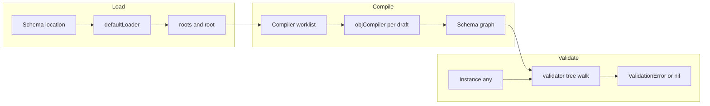
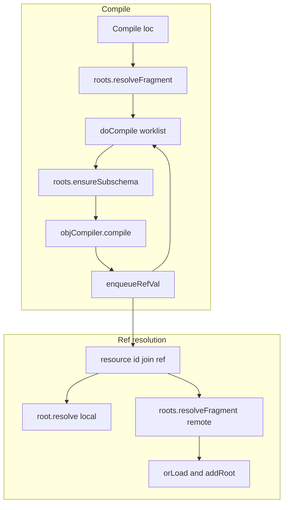

# jsonschema (santhosh-tekuri) — Research report

## Metadata

- **Library name**: jsonschema
- **Repo URL**: https://github.com/santhosh-tekuri/jsonschema
- **Clone path**: `research/repos/go/santhosh-tekuri-jsonschema/`
- **Language**: Go
- **License**: Apache-2.0
- **Analyzed version**: HEAD `953da5c` 2026-10-18 (release v6.0.3 commit `031fe8f` plus three later commits: `.sum` update, isInteger type-switch perf, format sign fix); module `github.com/santhosh-tekuri/jsonschema/v6`, `go 1.21`
- **Report date**: 2026-10-27

## Summary

jsonschema (santhosh-tekuri) is a JSON Schema **validation** library for Go. It does not generate code. It compiles JSON Schema documents into an internal `*Schema` representation and validates JSON instances against them at runtime. The library supports drafts 4, 6, 7, 2019-09, and 2020-12; passes the JSON-Schema-Test-Suite (excluding optional tests for ECMAScript regex, zero-terminated floats, IDN formats); and is validated against Bowtie. It offers a Go API (`Compiler`, `Schema.Validate`) and a CLI (`jv`) for schema and instance validation. Features include vocabulary-based validation, custom regex engine, format assertions (opt-in for draft >= 2019), content assertions (opt-in), introspectable error output (flag, basic, detailed), and custom vocabulary registration.

## JSON Schema support

- **Drafts**: draft-04, draft-06, draft-07, draft/2019-09, draft/2020-12. The draft is inferred from `$schema`; when `$schema` is missing, `Compiler.DefaultDraft` (or CLI `-d`) selects the draft (default 2020).
- **Scope**: Validation only. No code generation.
- **Subset**: Full support per JSON-Schema-Test-Suite for all drafts; optional tests skipped (ecmascript-regex, zeroTerminatedFloats, idn-email, idn-hostname). Custom `$schema` URLs, mixed dialect support, and infinite-loop detection for `$schema` cycles and validation cycles.

## Keyword support table

Keyword list derived from the vendored meta-schemas for every draft the library targets: 2020-12 (`specs/json-schema.org/draft/2020-12/meta/*.json`), 2019-09 (`specs/json-schema.org/draft/2019-09/meta/*.json`), draft-07, draft-06 and draft-04 (`specs/json-schema.org/draft-0{7,6,4}/`). Draft-specific keywords from older drafts are included (marked by draft in Notes); `hyper-schema` links vocabulary is out of scope. Implementation evidence from `objcompiler.go`, `validator.go`, `schema.go`, `draft.go`, `format.go`, `content.go`, and `roots.go`.

| Keyword | Implemented | Notes |
|---------|-------------|-------|
| $anchor | yes | Parsed in objcompiler; draft < 2019 from `id` fragment; draft >= 2019 from `$anchor`. Used in reference resolution. |
| $comment | yes | Draft-07+; parsed in compileDraft7; annotation only, stored in `Schema.Comment`. |
| $defs | yes | Collected as subschemas in roots (Draft2019/2020); used for `$ref` resolution. Draft-04 uses `definitions` instead. |
| $dynamicAnchor | yes | Parsed in compileDraft2020; used for `$dynamicRef` resolution. |
| $dynamicRef | yes | Parsed and validated; resolves via dynamic scope and `$dynamicAnchor`. |
| $id | yes | Draft-06+; parsed via `draft.getID`; sets base URI for resources. Draft-04 uses `id` (see that row). |
| $recursiveAnchor | yes | Draft 2019-09 only; read in `compileDraft2019` when the `core` vocab is active; drives `$recursiveRef` dynamic-scope resolution. |
| $recursiveRef | yes | Draft 2019-09 only; enqueued in `compileDraft2019` and validated in `validator.go` via `validateRef`. |
| $ref | yes | Resolved during compile; `enqueueRef` follows local and remote refs. Validation delegates to referenced schema. |
| $schema | yes | Parsed in loader/roots; selects draft and vocabulary. Custom URLs supported. |
| $vocabulary | yes | Parsed in `draft.getVocabs`; controls active vocabularies for draft >= 2019. |
| additionalItems | yes | Draft 4-2019-09; array `items` form only (`objcompiler` line ~109, `validator` ~370). Replaced by `items` after `prefixItems` in 2020-12. |
| additionalProperties | yes | Instance validation; boolean or schema. |
| allOf | yes | Instance validation; all subschemas must pass. |
| anyOf | yes | Instance validation; at least one subschema must pass. |
| const | yes | Instance validation; value must equal const via `equals`. |
| contains | yes | Instance validation; at least one array element must match. |
| contentEncoding | yes | Optional (assertContent); built-in base64; custom via `RegisterContentEncoding`. |
| contentMediaType | yes | Optional (assertContent); built-in application/json; custom via `RegisterContentMediaType`. |
| contentSchema | yes | Optional (assertContent); schema applied to decoded content when ContentMediaType.UnmarshalJSON set. |
| default | yes | Parsed and stored; annotation only; not enforced on instance. |
| definitions | yes | Draft 4-7 subschema container (`draft.go` subschemas `definitions/*`); no validation effect, used as `$ref` targets. |
| dependencies | yes | Draft 4-7; schema and string-array forms, split into dependent* in 2019+ (`objcompiler` ~129, `validator` ~226). |
| dependentRequired | yes | Instance validation; draft >= 2019. |
| dependentSchemas | yes | Instance validation; draft >= 2019. |
| deprecated | yes | Parsed in compileDraft2019; annotation only. |
| description | yes | Parsed; annotation only. |
| else | yes | Instance validation; conditional (if/then/else). |
| enum | yes | Instance validation; value must match one entry via type check and `equals`. |
| examples | yes | Parsed in compileDraft7; annotation only. |
| exclusiveMaximum | yes | Instance validation; draft-04 boolean or draft-06+ number. |
| exclusiveMinimum | yes | Instance validation; draft-04 boolean or draft-06+ number. |
| format | partial | Optional for draft >= 2019 (AssertFormat or metaschema); built-in formats (regex, uuid, ipv4, ipv6, hostname, email, date, time, date-time, duration, json-pointer, relative-json-pointer, uri, uri-reference, uri-template, iri, iri-reference, period, semver); custom via RegisterFormat. |
| if | yes | Instance validation; conditional. |
| id | yes | Draft-04 spelling of `$id` (`draft.go` id: "id"); sets base URI. |
| items | yes | Instance validation; single schema or array (draft < 2020); draft 2020: prefixItems + items for additional. |
| maxContains | yes | Instance validation; draft >= 2019. |
| maximum | yes | Instance validation. |
| maxItems | yes | Instance validation. |
| maxLength | yes | Instance validation. |
| maxProperties | yes | Instance validation. |
| minContains | yes | Instance validation; draft >= 2019. |
| minimum | yes | Instance validation. |
| minItems | yes | Instance validation. |
| minLength | yes | Instance validation. |
| minProperties | yes | Instance validation. |
| multipleOf | yes | Instance validation; uses `big.Rat` for precision. |
| not | yes | Instance validation. |
| oneOf | yes | Instance validation; exactly one subschema must pass. |
| pattern | yes | Instance validation; custom regex engine via `UseRegexpEngine`. |
| patternProperties | yes | Instance validation; map from pattern to schema. |
| prefixItems | yes | Instance validation; draft 2020. |
| properties | yes | Instance validation. |
| propertyNames | yes | Instance validation; draft >= 6. |
| readOnly | yes | Parsed; annotation only. |
| required | yes | Instance validation. |
| then | yes | Instance validation; conditional. |
| title | yes | Parsed; annotation only. |
| type | yes | Instance validation; single type or array; integer/number coercion. |
| unevaluatedItems | yes | Instance validation; draft >= 2019. |
| unevaluatedProperties | yes | Instance validation; draft >= 2019. |
| uniqueItems | yes | Instance validation. |
| writeOnly | yes | Parsed; annotation only. |

## Constraints

Validation keywords are enforced at **runtime** by the `validator`. Each keyword (type, const, enum, format, numeric bounds, string length/pattern, array/object constraints, applicators) is applied when the validator visits the corresponding field on the compiled `Schema`. Constraints are not used for structure only—they directly enforce instance validation. Format assertions are on by default for drafts 4/6/7 and opt-in for >= 2019 (`Compiler.AssertFormat()`, or a metaschema requiring the format vocabulary); content assertions are always opt-in (`Compiler.AssertContent()`).

## High-level architecture

Pipeline: **schema location** (file URL, or a document added with `AddResource`) -> **`defaultLoader`** (cache of parsed `any` documents; embedded metaschemas; pluggable `URLLoader`) -> **`roots`** (per-document `root` with resource/anchor tables; metaschema validation of the schema itself) -> **`Compiler`** (breadth-first worklist that turns each reachable schema location into a `*Schema` node) -> **`*Schema` graph** (immutable after compile; `$ref` edges are direct pointers, so it may be cyclic) -> **`validator`** (recursive tree walk over the instance, built per call to `Schema.Validate`) -> **`*ValidationError` tree** or `nil`.

The library has no code-generation stage; its "intermediate form" is the `Schema` graph and its "output" is the error tree.

## Medium-level architecture

- **Files**: `compiler.go` (`Compiler`, worklist `doCompile`, `queue`), `objcompiler.go` (`objCompiler`: per-draft keyword lowering, `enqueue*` helpers), `schema.go` (`Schema`, `Types` bitset, `Enum`), `roots.go` and `root.go` (resource/anchor discovery, ref resolution, metaschema validation), `loader.go` (`URLLoader`, `FileLoader`, `SchemeURLLoader`, embedded metaschemas, `defaultLoader`), `draft.go` (`Draft` values, `dialect`, vocabularies), `position.go` (`SchemaPath`/`Position` subschema locators), `validator.go` (evaluation), `util.go` (URL and JSON-pointer helpers, `equals`, `duplicates`), `format.go`, `content.go`, `output.go` plus `kind/kind.go` (error model), `vocab.go` (custom vocabulary API), `cmd/jv` (CLI, separate Go module joined via `go.work`). About 7,000 lines in the root package including tests. Dependencies: `golang.org/x/text` (message printer for localized errors); `regexp2` is used only by an example test. The library itself ships only `FileLoader` and `SchemeURLLoader`; an HTTP loader exists only in `example_http_test.go` and `cmd/jv/loader.go`.
- **Metaschemas** are embedded with `//go:embed metaschemas` and loaded from the embedded FS before any `URLLoader` is consulted (`defaultLoader.load` calls `loadMeta` first). `draft.go init()` compiles every draft metaschema and each vocabulary metaschema at package load time.
- **Dialect**: each `resource` carries a `dialect{draft, vocabs}`; `objCompiler.hasVocab` gates whole keyword groups (core / applicator / validation / unevaluated), so a custom `$schema` whose metaschema lists a restricted `$vocabulary` compiles only those keywords.

## Algorithms and data structures

### Schema representation

There are two representations. The **source form** is raw decoded JSON as `any` (`map[string]any`, `[]any`, `string`, `bool`, `json.Number`, `nil`), produced by `UnmarshalJSON` (`loader.go`) with `decoder.UseNumber()` so numbers keep their exact text. Parsed documents live in `defaultLoader.docs map[url]any` and are retained for the life of the `Compiler`, because `urlPtr.lookup(doc)` walks them by JSON pointer whenever a subschema is compiled.

The **compiled form** is `Schema` (`schema.go`), one fat struct per schema location (every `properties/x`, `allOf/0`, `$defs/y` gets its own node). It is a typed struct, not a keyword list: every keyword of every supported draft is a dedicated field. Optional scalars are pointers (`MinLength *int`, `Maximum *big.Rat`, `Const *any`), subschemas are `*Schema`, collections are `[]*Schema` or `map[string]*Schema`. Polymorphic keywords use `any` with a documented case set: `AdditionalProperties any // nil, bool or *Schema`, `Items any // nil, []*Schema or *Schema` (draft < 2020, with `Items2020`/`PrefixItems` for 2020), `Dependencies map[string]any` (`[]string` or `*Schema`). Boolean schemas set `Bool *bool`; an empty object `{}` is normalised to `Bool=true` in `compileObject`. `type` is a `Types` bitset (an `int`, one bit per `jsonType`, `Add`/`contains` are bit ops), and `Enum` caches a `Types` bitset of its member types (`newEnum`). `PatternProperties` is `map[Regexp]*Schema` keyed by the compiled-regex interface value, not by pattern string. Unknown keywords are dropped (not stored); custom vocabularies instead produce `Extensions []SchemaExt`. Private fields hold resolution state: `up urlPtr` (document URL plus JSON pointer), `resource *Schema` (the enclosing schema-resource root), `dynamicAnchors map[string]*Schema`, and the precomputed `allPropsEvaluated`, `allItemsEvaluated`, `numItemsEvaluated` used by the `unevaluated*` machinery. Ownership is plain Go GC pointers; the graph is shared and never mutated after `Compile` returns.

### Reference resolution and registry

Registry: `roots` (`roots.go`) holds `roots map[url]*root`, the `defaultLoader`, `defaultDraft`, the regex engine and user vocabularies. A `root` (`root.go`) is one document with `resources map[jsonPointer]*resource` and `subschemasProcessed map[jsonPointer]struct{}`. A `resource` is a subtree with its own base URI: `{ptr, id url, dialect, anchors map[anchor]jsonPointer, dynamicAnchors []anchor}`.

Discovery (`roots.collectResources` and `_collectResources`): from a document root it detects the draft via `loader.getDraft` (following custom `$schema` chains with a `cycle` set that raises `MetaSchemaCycleError`), reads `$id`/`id` (`Draft.getID`; draft <= 7 ignores `id` beside `$ref`), joins it against the parent base with `url.join` (Go `net/url.ResolveReference`, with a workaround for opaque URLs), and registers a `resource` at that JSON pointer. A duplicate `$id` at two pointers is a `DuplicateIDError`. Anchors (`$anchor`, draft 4-7 `id` fragments, `$dynamicAnchor`) are collected into the resource's `anchors` map (`collectAnchors`); duplicates raise `DuplicateAnchorError`. It then recurses into child subschema positions listed in `Draft.subschemas`, a data-driven table of `SchemaPath`s such as `"properties/*"`, `"allOf/[]"`, `"prefixItems/[]"` (`position.go`: `AllProp`, `AllItem`, `Prop`, `Item` each return a `map[jsonPointer]any`); active custom vocabularies contribute their own `Subschemas`. This recursion is Go-recursive over schema nesting depth.

Laziness: `addRoot` runs the root-level traversal when a document is first loaded; a subschema reached only via `$ref` is processed on demand by `ensureSubschema`, which, if `subschemasProcessed` lacks the pointer, clones the entire `root` (`root.clone` deep-copies the `resources` and anchors maps), runs `addSubschema`, validates that subschema against its metaschema, and swaps the clone into `roots.roots`. This copy-on-write keeps a failed compile from leaving half-registered state, at O(resources) copying per newly touched subschema.

Resolution (`objCompiler.enqueueRefVal`): the base is `c.res.id` (nearest enclosing resource id); `base.join(ref)` yields a `urlFrag{url, frag}`. `root.resolve` looks for a resource in the same root with `id == uf.url` (linear scan of `r.resources`); if found, `resolveFragmentIn` turns the fragment into a `jsonPointer` (empty or starting with `/`, appended to the resource's pointer) or an `anchor` name (looked up in `res.anchors`, else `AnchorNotFoundError`). If no local resource matches the ref is external: `roots.resolveFragment` calls `orLoad` (loader fetch plus `addRoot`, which also validates the new document against its metaschema unless it is a `json-schema.org` metaschema URL). The resulting `urlPtr` goes to `Compiler.enqueue`.

Dynamic resolution happens at validate time. For `$dynamicRef` (2020-12) the compiler resolves the static target and stores `DynamicRef{Ref, Anchor}`; `compileValue` also stores, on each resource-root `Schema`, a `dynamicAnchors map[string]*Schema` of that resource's `$dynamicAnchor`s. `validator.resolveDynamicAnchor` walks the `scope` parent chain from innermost to outermost and keeps the last (outermost) `scp.sch.resource.dynamicAnchors[name]` it finds, implementing the spec's dynamic-scope rule. `$recursiveRef` (2019-09) is the same walk looking for `resource.RecursiveAnchor`. Both cost O(scope-chain depth) per evaluation.

Cycles: at compile time a cycle is harmless because `Compiler.enqueue` creates the `*Schema` placeholder and appends it to the worklist before it is compiled, so a back-edge resolves to an existing node. At validate time `scope.checkCycle` detects reference loops that re-enter the same schema without consuming instance (see Core algorithm). A self-referential `$schema` yields `UnsupportedDraftError`; a longer chain, `MetaSchemaCycleError`.

### Compiled / intermediate form

The compiled form is the `*Schema` graph above: a pointer graph, not an arena or bytecode. Link types: tree edges (subschema fields); reference edges (`Ref`, `RecursiveRef`, `DynamicRef.Ref`, direct `*Schema` pointers that may point backwards); a back-pointer to the owning resource schema (`resource`); and `Extensions` for vocabulary plugins. Compilation (`compiler.go`) is a breadth-first worklist: `Compile(loc)` resolves the location to a `urlPtr`, `doCompile` seeds `queue` (`[]*Schema`), then loops `for q.len() > compiled`: for each queued `Schema` it ensures the subschema is registered, looks up the raw JSON by pointer, and calls `compileValue`, `compileObject`, `objCompiler.compile`. That runs `compileDraft4`, then cumulatively `compileDraft6/7/2019/2020` according to `s.DraftVersion` (newer drafts layer on older keyword handlers), then custom vocabularies. Each `enqueue*` call returns the `*Schema` pointer immediately (placeholder) and appends it to the queue if new. Dedup: `Compiler.enqueue` checks the finished-schema cache `c.schemas map[urlPtr]*Schema`, then `queue.get(up)`, a linear `slices.IndexFunc` scan over the in-flight queue (so compiling a schema with n subschemas is O(n^2) in that scan). Only when the whole queue compiles without error are the nodes inserted into `c.schemas`. Draft-04 `exclusiveMaximum: true` is rewritten at compile time into `ExclusiveMaximum = Maximum; Maximum = nil` (likewise minimum). For draft < 2019, `compileDraft4` returns right after setting `Ref`, so sibling keywords are ignored. `format` is resolved to a `*Format` (user registry first, then the global `formats` map) only when `assertFormat(draft)` is true; `pattern`/`patternProperties` are compiled immediately by the configured `RegexpEngine` (invalid pattern gives `InvalidRegexError` at compile time). Numeric keywords go through `fmt.Sprint` into `big.Rat` (`numVal`); integer keywords via `intVal` must be integral. The `unevaluated*` bookkeeping flags are derived at the end of `compileValue`.

### Core algorithm

`Schema.Validate(v any)` builds a root `validator` and calls `validator.validate()` (`validator.go`). A `validator` is created per (schema, instance) pair and carries the instance `v`, instance location `vloc []string` (capacity 8), the `*Schema`, a `*scope` linked-list node, an `*uneval` set, accumulated `errors []*ValidationError`, and a `boolResult` flag. Sub-validation allocates a fresh child `validator` via three helpers: `validateSelf` (same instance, new schema; used for `allOf/anyOf/oneOf/not/if/$ref/dependentSchemas`), `validateVal` (child instance at one token; `properties`, array items) and `validateValue` (multi-token path, for extension vocabularies).

`validate()` has a fixed keyword order: (1) boolean schema; (2) `scope.checkCycle`; (3) `typeOf(v)` classification, rejecting NaN/Inf and unknown Go types with `kind.InvalidJsonValue`; (4) `type` (bit test; `integer` also accepts integral numbers via `isInteger`); (5) `const`; (6) `enum`; (7) `format`; (8) `$ref`; (9) a type switch on the instance to `objValidate`, `arrValidate`, `strValidate` or `numValidate`; (10) if there are no errors, or full errors are wanted: `validateRefs` (`$recursiveRef`/`$dynamicRef`), `condValidate` (`not`, `allOf`, `anyOf`, `oneOf`, `if/then/else`), vocabulary `Extensions`, `unevalValidate`. Steps 3-8 return on the first failure, so a type mismatch never reports sibling errors. For draft <= 7, `$ref` returns immediately (siblings ignored); for >= 2019 the error is recorded and evaluation continues. Result: zero errors gives `(vd.uneval, nil)`; one gives that error; several give a `kind.Group` error whose `Causes` are the list.

Object validation (`objValidate`): `minProperties/maxProperties/required` first; `dependencies`; then a single loop over **instance** properties (`for pname, pvalue := range obj`): `properties[pname]` map lookup, then every `patternProperties` regex via `MatchString` (no caching), then `additionalProperties` if neither matched. `additionalProperties:false` collects offending names into one `kind.AdditionalProperties` error. Cost is O(instance properties x patternProperties) plus child validations. `propertyNames`, `dependentSchemas`, `dependentRequired` follow, gated by draft (early `return` for draft 4/6). Array validation: `minItems/maxItems`; `uniqueItems` via `duplicates`; `items`/`additionalItems` (draft < 2020) or `prefixItems`/`items` (2020); then `contains` with `minContains/maxContains`, recording matched indexes (which also feed the evaluated-items set for 2020).

`uniqueItems` / `duplicates` (`util.go`): up to 20 elements, pairwise comparison O(n^2) with `equals`; above 20, a `map[uint64][]int` bucket table keyed by a `maphash.Hash` of a canonical serialisation (`writeHash`: type-tag byte, object keys sorted, numbers hashed through `big.Rat` numerator/denominator bytes so `1` and `1.0` collide), with `equals` verifying bucket candidates. Expected O(n) plus deep-value hashing. `equals` is a structural recursive comparison with numbers compared as `big.Rat` (parsed from `fmt.Sprint`), so `1 == 1.0`, and booleans never equal numbers.

Annotation tracking for `unevaluatedProperties/Items` (`uneval`): `unevalFrom(v, sch, callerNeeds)` allocates a `map[string]struct{}` of all property names (or `map[int]struct{}` of indexes beyond the statically evaluated prefix) only when needed: the instance is an object/array, the schema is not already known to evaluate everything (`allPropsEvaluated`/`allItemsEvaluated`, computed at compile time from `additionalProperties`/`items`), and either the schema has an `unevaluated*` keyword or the parent needs the information (`callerNeeds = !vd.uneval.isEmpty()`). Evaluating a property deletes it from the set. `validateSelf`, on success, calls `uneval.merge(child)`, which intersects (keeps only names still unevaluated in both), implemented as delete-if-absent-in-other; this models `anyOf`/`oneOf`/`allOf` where each passing branch contributes its evaluated set. `anyOf` stops at the first match only if `vd.uneval.isEmpty()`, otherwise it evaluates all branches so annotations are complete. `unevalValidate` finally validates each remaining property/item against the `unevaluated*` subschema.

`oneOf`: iterates branches; after the first match, later branches run with `boolResult=true`, and a second match yields `kind.OneOf{Subschemas:[i,j]}` and `break`. `not` and the `if` condition run with `boolResult=true`.

Cycle detection (`scope`): each child gets a heap `scope{sch, refKeyword, vid, parent}` node. `vid` identifies "the value being validated": `validateSelf` keeps it, `validateVal` increments it. `checkCycle` walks up parents while `vid` is equal and reports a cycle if the same `*Schema` reappears, i.e. the same schema re-entered for the same instance without descending (e.g. `{"$ref":"#"}`), returning `kind.RefCycle`. Legitimate recursion (a tree schema) changes `vid` per level and is not flagged. Recursion over instance depth is ordinary Go recursion with no explicit depth limit; a very deeply nested instance is bounded only by the Go goroutine stack limit.

Meta-validation: schemas are validated against their metaschema with the same engine (`roots.validate`). `vd.meta`, `metaResource` and `handleMeta` switch to another dialect's metaschema when the metaschema's `$dynamicRef: "#meta"` recurses into an embedded subschema that declares a different dialect; `dialect.getSchema` synthesizes a `urn:mem:metaschema` `Schema` whose `AllOf` is the active vocabulary metaschemas.

### Error and output model

`ValidationError{SchemaURL string, InstanceLocation []string, ErrorKind ErrorKind, Causes []*ValidationError}` (`validator.go`). `ErrorKind` is an interface (`KeywordPath() []string`, `LocalizedString(*message.Printer) string`) implemented by 39 small structs in `kind/kind.go` (`Type{Got,Want}`, `Required{Missing}`, `Minimum{Got,Want *big.Rat}`, `AdditionalProperties{Properties}`, `Reference{Keyword,URL}`, `Group`, `Schema`, and so on), so callers can type-switch on failures. The error is a tree: composite keywords (`allOf`, `anyOf`, `oneOf`, `$ref` via `kind.Reference`, groups) hold per-branch errors in `Causes`. `SchemaURL` is the absolute dereferenced `Schema.Location`. The instance path is `[]string` tokens; `vloc` is shared during descent and cloned (`slices.Clone`) only when an error is built. The top-level `Validate` wraps everything in a `kind.Schema` error.

Output (`output.go`): `Error()`/`GoString()` render an indented bullet tree (`display`), skipping `Reference` nodes with a single cause; `%#v` adds keyword locations. `FlagOutput()` returns `{valid:false}`; `BasicOutput()` (flattened list) and `DetailedOutput()` (nested) produce `OutputUnit` values following the JSON Schema output format, computing `keywordLocation` by concatenating keyword paths along the cause chain and `AbsoluteKeywordLocation` once a reference was crossed. Messages are localisable through `golang.org/x/text/message`. In `boolResult` mode `vd.error()` returns an empty `&ValidationError{}` with no location/kind work, so internal true/false probes (`not`, `if`, later `oneOf` branches) pay minimal cost.

## Low-level details

- **Numbers**: all numeric schema keywords are `*big.Rat` parsed from decimal text; instance numbers are converted lazily (once per `numValidate` call via the `num()` closure, `new(big.Rat).SetString(fmt.Sprintf("%v", v))`), so `minimum`/`maximum`/`exclusive*` comparisons and `multipleOf` (`Quo(num, multipleOf).IsInt()`) are exact for decimals. Documents loaded with `UnmarshalJSON` keep `json.Number`; Go-native `float64` and `int*` instance values are also accepted. NaN and +/-Inf are rejected as invalid JSON values (`typeOf`). `isInteger` is a type switch (ints true; floats via `f == math.Trunc(f)`; `json.Number` via `big.Rat.IsInt`; fallback via `fmt.Sprint`), so `integer` accepts `1.0`.
- **String length**: `minLength`/`maxLength` count Unicode code points (`utf8.RuneCount([]byte(str))`), not UTF-16 units or bytes.
- **Regex**: `Regexp` interface (`MatchString`, `String`); default `regexp.Compile` (RE2, linear time). Compiled at schema compile time. `format: regex` is validated with the active engine and cannot be overridden. RE2 lacks lookaheads and backreferences, so ECMA-262 optional tests are skipped.
- **Format**: built-in validators are hand-written (`format.go`, 716 lines): `validateTime` is a manual parser (handles leap seconds, which Go `time` cannot), `validateHostname` enforces 253/63-character limits, `validateEmail` parses local part/domain and quoted strings, `validateIPV4/6` use `net/netip`, `validateURI*` use `net/url` plus extra checks, `duration`, `period`, `semver`, `uuid` are hand-rolled. `idn-email`/`idn-hostname` are not supported (tests skipped). Recent fixes reject a leading `+`/`-` in numeric parts.
- **Content**: `contentEncoding` (`Decoder.Decode`, built-in base64 via `StdEncoding`), then `contentMediaType` (`MediaType.Validate`, built-in `application/json` via `json.Unmarshal`), then optional `contentSchema` validated against the decoded value (`UnmarshalJSON`). Compiled only under `AssertContent()`; `ContentSchema` only if the media type provides `UnmarshalJSON`.
- **Annotations**: `default`, `title`, `description`, `$comment`, `readOnly`, `writeOnly`, `examples`, `deprecated` are stored on the `Schema` but never applied; no default filling.
- **Untrusted-input hardening**: infinite loops are guarded (validation cycles via `checkCycle`, `$schema` cycles, duplicate `$id`/anchor errors). There is no recursion-depth limit for schema or instance nesting and no remote-fetch allowlist: `FileLoader` loads any `file:` URL a schema references, and any user `URLLoader` is invoked for any external `$ref`. RE2 avoids ReDoS from `pattern`.
- **Instance types**: only Go types produced by `encoding/json` (plus numeric kinds) are valid instances; others produce `InvalidJsonValue`.

## Output and integration

- **Vendored vs build-dir**: Not applicable; validation-only, no generated output.
- **API vs CLI**: (1) **Library**: `c := jsonschema.NewCompiler()`, `c.Compile(loc)`, `sch.Validate(instance)`. (2) **CLI** `jv`: `jv [OPTIONS] SCHEMA [INSTANCE...]`; validates schema and instances; supports `-` for stdin; JSON and YAML files; http(s) URLs.
- **Writer model**: Errors returned as `*ValidationError`; CLI prints to stdout/stderr. Error formats: simple, alt, flag, basic, detailed via `ValidationError.FlagOutput()`, `BasicOutput()`, `DetailedOutput()`.

## Configuration

- **Draft**: `Compiler.DefaultDraft(draft)` or CLI `-d` (4, 6, 7, 2019, 2020).
- **Format assertions**: `Compiler.AssertFormat()` or CLI `-f`; enables format validation for draft >= 2019.
- **Content assertions**: `Compiler.AssertContent()` or CLI `-c`; enables contentEncoding, contentMediaType, contentSchema.
- **Custom format**: `Compiler.RegisterFormat(&Format{Name, Validate})`.
- **Custom content**: `RegisterContentEncoding`, `RegisterContentMediaType`.
- **Custom vocabulary**: `RegisterVocabulary`.
- **Regex engine**: `UseRegexpEngine`.
- **Loader**: `UseLoader(URLLoader)`; default FileLoader.
- **TLS**: CLI `--cacert`, `-k` (insecure).

## Changes since the previous report (v6.0.2 to HEAD)

- v6.0.3 release (2026-08) plus two later commits.
- Validator fixes: NaN/Inf floats are now rejected as invalid numbers; `equals` requires both operands numeric; corrected `instanceLocation` for `items`, `additionalItems`, `propertyNames` and `contentSchema` errors.
- Format fixes: `email` checks the closing quote; `time` and `ipv4` reject a leading `+` or `-` in numeric parts.
- Vocabularies: `CompilerContext.EnqueueRef` lets a custom vocabulary enqueue `$ref`s; new bytecount example vocabulary and package docs.
- Test suite harness gained support for expected errors; CI actions upgraded.

## Pros/cons

**Pros**: Full draft 4–2020-12 support; passes JSON-Schema-Test-Suite and Bowtie; vocabulary-based validation; custom regex engine; format and content assertions opt-in; introspectable errors; CLI and library; custom vocabularies; infinite-loop detection.

**Cons**: Validation-only; no code generation; format/content assertions off by default for draft >= 2019; optional tests (ECMAScript regex, IDN) skipped.

## Testability

- **Tests**: `go test` in repo root. Unit tests in `*_test.go` (compiler_test, validator logic, draft_test, loader_test, output_test, etc.).
- **Fixtures**: JSON-Schema-Test-Suite and Extra-Test-Suite under `testdata/JSON-Schema-Test-Suite`, `testdata/Extra-Test-Suite`; `suite_test.go` drives `testSuite` over draft4, draft6, draft7, draft2019-09, draft2020-12.
- **Skip**: `ecmascript-regex.json`, `zeroTerminatedFloats.json`, `idn-email.json`, `idn-hostname.json`.
- **Remotes**: Suite remotes from `remotes/` via `http://localhost:1234/`.
- **Bowtie**: Compliance badges for all drafts.

## Performance

Not verified: whether the committed `testdata/JSON-Schema-Test-Suite` is fully populated in this clone, Bowtie badge status, and actual runtime numbers (no benchmarks were run).

Analyzed from code only; nothing was built or run.

### Performance techniques

- **Compile vs interpret**: Schema text is compiled once into a typed `*Schema` graph (`Compiler.Compile`), so per-validation work is a direct field-driven tree walk with no JSON re-parsing, no `$ref` string resolution (refs are `*Schema` pointers), no regex compilation (`pattern`/`patternProperties` regexes are compiled at compile time), and no format lookup (`Schema.Format` is a resolved pointer). It is an interpreter over the struct, not code generation or specialization: every `validate()` call re-checks each non-nil field in a fixed order. Compile-time precomputation: `Types` bitset, `Enum.types` bitset, `allPropsEvaluated`/`allItemsEvaluated`/`numItemsEvaluated`, draft-04 exclusive-bound rewrite, `big.Rat` bounds. Compile itself is not cheap: each loaded document is validated against its metaschema (`roots.validate`), the worklist uses a linear scan (`queue.get`), and `ensureSubschema` clones a root's resource tables. The package `init()` also compiles all five draft metaschemas and the vocabulary metaschemas at program start.
- **Memory layout and allocation**: Pointer-rich graph of heap `Schema` structs (large, many nil pointer fields), `map[string]*Schema` for properties. Validation is allocation-heavy by design: a new `validator` struct (about a dozen fields) and a heap `scope` node per sub-validation, an `uneval` struct per node (maps only when needed), `strconv.Itoa` for array index tokens, and `big.Rat` plus `fmt.Sprintf("%v")` for numeric keyword checks and `equals`. Mitigations: `vloc` is preallocated with capacity 8 and extended with `append` (cloned only when an error is constructed); `unevalFrom` allocates tracking maps only when an `unevaluated*` keyword is reachable; `Types`/`Enum.types` bitsets allow cheap rejection; `numValidate` converts the instance to `big.Rat` lazily and at most once per call; `strValidate` computes rune count only if a length keyword exists; `boolResult` mode makes `vd.error()` return an empty struct. Errors are a tree of heap objects, so invalid-heavy workloads allocate more. No interning and no small-vector storage.
- **Caching and memoization**: `Compiler.schemas map[urlPtr]*Schema` caches compiled schemas by location (a repeated `Compile`, or a `$ref` to an already compiled location, reuses the node); `defaultLoader.docs map[url]any` caches loaded documents; `roots.roots` caches per-document resource tables; embedded metaschemas are parsed once per compiler. There is no cache of format results, regex matches or validation outcomes, and no per-instance memoization (the same `$ref` target evaluated twice against the same instance is re-evaluated).
- **Fast paths and short-circuiting**: `boolResult` propagation (`not`, `if`, post-first-match `oneOf` branches; `allOf` breaks on first failure) skips error construction and, in `objValidate`, aborts the property loop at the first error; `findMissing` returns immediately in that mode; the `type` check runs first and returns on mismatch; `enum` tests the member-type bitset before scanning values; `required`/`minProperties` run before child validation; `anyOf` stops at the first match when no unevaluated tracking is pending; `uniqueItems` switches from pairwise O(n^2) to a hash-bucket path above 20 items; `isInteger` was recently rewritten as a type switch (commit `044d629`) to avoid `big.Rat` for common numeric types; the `len(vd.errors)==0 || !vd.boolResult` guard skips conditional, ref and unevaluated phases once failure is known in boolean mode. Counter-notes: every `patternProperties` regex is tried against every instance property; `enum` is a linear scan with deep `equals` (numbers via `big.Rat` parsed from `fmt.Sprint`); `contains` evaluates every element (needed for min/maxContains).
- **Regex handling**: Go `regexp` (RE2, linear-time, no ReDoS), compiled once at schema compile time and stored in the `Schema`; swappable via `RegexpEngine func(string) (Regexp, error)` (the repo's example plugs in `regexp2` for ECMA-262 semantics, which has backtracking risk). Matching is unanchored `MatchString`. There is no pattern-string cache, so identical patterns in different subschemas are compiled separately.
- **Concurrency**: A compiled `*Schema` is immutable and `Validate` builds all mutable state (`validator`, `scope`, `uneval`, error slices) per call, with no `sync` primitives or package-level mutable state on the validate path, so one `Schema` can be shared across goroutines (inferred from code; the docs do not state it). `Compiler` is not safe for concurrent use (unsynchronised maps). There is no parallel evaluation of subschemas or items; validation is sequential and recursive.

### Benchmarks in repo

No `Benchmark*` functions exist anywhere in the repository (grep). Entry points for an external harness: `c := jsonschema.NewCompiler(); sch, _ := c.Compile(loc); err := sch.Validate(inst)`, where `inst` is decoded with `jsonschema.UnmarshalJSON` (keeps `json.Number`) or `encoding/json` into `any`; or the CLI `jv schema.json instance.json` (`cmd/jv`, a separate Go module). Schemas can be supplied from memory with `c.AddResource(url, doc)`.

## Determinism and idempotency

Not applicable to generated output (validation-only). For behavior: the valid/invalid verdict is deterministic. The **order of errors is not**: `objValidate` ranges directly over the instance `map[string]any` (`for pname, pvalue := range obj`), and over `s.Dependencies`, `s.DependentSchemas`, `s.DependentRequired` and `s.PatternProperties` (Go maps, randomized iteration order), and no sorting is applied in `validator.go` or `output.go` (the only sort is in `writeHash`). So `ValidationError.Causes` order, the order of names in `kind.AdditionalProperties.Properties`, and the rendered text/JSON can differ between runs when several properties fail. Slice-based keywords (`allOf`, `anyOf`, `oneOf`, `prefixItems`, `items`) are ordered. Compilation yields one node per `urlPtr` deterministically; only internal worklist order varies where `enqueueMap` ranges a Go map, which does not affect semantics.

## Enum handling

- **Validation**: `validator` checks instance type against `s.Enum.types`; iterates `s.Enum.Values` and uses `equals(v, item)` for match. First match succeeds.
- **Duplicate entries**: Not deduped. `["a","a"]` is accepted; both entries are checked; instance "a" matches either. No error on duplicate enum values in schema.
- **Namespace/case collisions**: Values are compared by JSON equality (`equals`); "a" and "A" are distinct. Both can appear in enum; instance must match one exactly.

## Reverse generation (Schema from types)

No. Validation-only library; cannot generate JSON Schema from Go structs.

## Multi-language output

No. Validation-only; output is validation result (errors), not generated code.

## Model deduplication and $ref/$defs

Not applicable to generated models (validation-only). For schema resolution: `$ref` and `$defs` are resolved by roots/loader; each distinct schema location (urlPtr) is compiled once and cached in `Compiler.schemas`. Identical inline object shapes at different locations are separate Schema nodes; no deduplication of schema structure—each is compiled independently. `$ref` allows reuse by reference.

## Validation (schema + JSON → errors)

Yes. Primary feature.

- **API**: `compiler := jsonschema.NewCompiler()`; `sch, err := compiler.Compile(loc)`; `err = sch.Validate(instance)`. Returns `*ValidationError` with `SchemaURL`, `InstanceLocation`, `ErrorKind`, `Causes`; or nil if valid.
- **CLI**: `jv SCHEMA [INSTANCE...]`; exit 1 for validation errors, 2 for usage. Output formats: simple, alt, flag, basic, detailed.
- **Inputs**: Schema from file, URL, or stdin; instance from file, URL, or stdin.
- **Error output**: FlagOutput (valid bool), BasicOutput (JSON Schema output format), DetailedOutput (verbose); LocalizedError, LocalizedGoString for human-readable messages.
