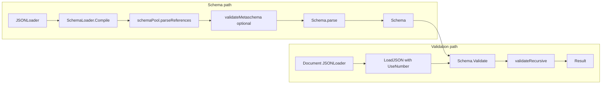

# gojsonschema — Research report

## Metadata

- **Library name**: gojsonschema
- **Repo URL**: https://github.com/xeipuuv/gojsonschema
- **Clone path**: `research/repos/go/xeipuuv-gojsonschema/`
- **Language**: Go
- **License**: Apache License 2.0 (see LICENSE-APACHE-2.0.txt in repo)
- **Analyzed version**: b076d39 2020-10-27 (`git describe`: v1.2.0-4-gb076d39, i.e. 4 commits after release v1.2.0); module `github.com/xeipuuv/gojsonschema`, deps gojsonpointer, gojsonreference, testify (go.mod)
- **Report date**: 2026-10-27

## Summary

gojsonschema is a JSON Schema **validation** library for Go. It does **not** generate code. It loads a JSON Schema (via reference, string, or Go value loaders), parses it into an internal schema representation (root schema and subSchemas), and validates JSON documents against that schema. Supported drafts are draft-04, draft-06, and draft-07; the default mode is Hybrid (auto-detect from `$schema`; draft-07 schemas can reference draft-04 schemas when autodetect is on). Validation is the only concern: schema + document loaders → `Validate` → `Result` (valid flag and list of errors with type, context, and details). Optional meta-schema validation and custom format checkers are supported.

## JSON Schema support

- **Drafts**: Draft-04, draft-06, draft-07. The `SchemaLoader` has a `Draft` field (`Draft4`, `Draft6`, `Draft7`, or `Hybrid`). With `AutoDetect` (default), the draft is taken from the `$schema` keyword; otherwise the configured draft is used. Hybrid allows mixing draft-07 and draft-04 schemas when `$schema` is specified in all of them.
- **Scope**: Validation only (schema + instance → valid/invalid + error list). No code generation.
- **Subset**: README states support for draft-04, draft-06, and draft-07. Meta-schemas for these drafts are embedded in `draft.go`. The repository is unmaintained (last commit 2020-10-27) and has no draft 2019-09 or 2020-12 support. Not all draft-07 meta-schema keywords are implemented: `$comment`, `default`, `readOnly`, `writeOnly`, `examples`, `contentMediaType`, and `contentEncoding` are not parsed or enforced. Format validation is optional and extensible (see Format checkers in README).

## Keyword support table

Keyword list derived from the `properties` of the vendored meta-schemas `specs/json-schema.org/draft-04/schema.json`, `draft-06/schema.json` and `draft-07/schema.json` (the three drafts the library targets): the union is the draft-07 set plus draft-04 `id`. Draft availability is noted per row. Implementation evidence from `subSchema.go` (key constants), `schema.go` (parseSchema), `validation.go` (validateRecursive, validateSchema, validateCommon, validateArray, validateObject, validateString, validateNumber), `draft.go`, and README (formats).

| Keyword | Implemented | Notes |
|---------|-------------|-------|
| $id | yes | Draft-06/07; parsed and used for scope in $ref resolution (KEY_ID_NEW in schema.go, schemaPool). |
| id | yes | Draft-04; parsed when draft is Draft4 or Hybrid with key present (KEY_ID). |
| $schema | yes | Accepted; used for draft detection and optional meta-schema validation. |
| $ref | yes | Resolved eagerly at parse time; `schemaReferencePool` (ref string to subSchema) memoizes targets and breaks cycles; a node with `$ref` delegates entirely to `refSchema` at validation (sibling keywords ignored). |
| $comment | no | Draft-07 only; not parsed or stored (no key constant). |
| title | yes | Parsed and stored on subSchema; not used for validation. |
| description | yes | Parsed and stored on subSchema; not used for validation. |
| default | no | Draft-04/06/07; not parsed (no key constant); allowed in schemas but ignored. |
| readOnly | no | Draft-07 only; not implemented. |
| writeOnly | no | Draft-07 only; not implemented (absent from the embedded draft-07 meta-schema in draft.go as well). |
| examples | no | Draft-06+; not implemented. |
| multipleOf | yes | Instance validation via validateNumber; big.Rat for precision. |
| maximum | yes | Instance validation. |
| exclusiveMaximum | yes | Draft-04: boolean modifier of `maximum`; draft-06/07: number; Hybrid accepts either form (switch on draft in schema.go). |
| minimum | yes | Instance validation. |
| exclusiveMinimum | yes | Draft-04: boolean modifier of `minimum`; draft-06/07: number; Hybrid accepts either form. |
| maxLength | yes | Instance validation; UTF-8 rune count. |
| minLength | yes | Instance validation. |
| pattern | yes | Instance validation; compiled regexp (Go regexp, RE2). |
| additionalItems | yes | Boolean or schema; validated in validateArray. |
| items | yes | Single schema or array of schemas; draft-06/07 boolean schema via pass. |
| maxItems | yes | Instance validation. |
| minItems | yes | Instance validation. |
| uniqueItems | yes | O(n) map of canonical JSON strings (`marshalWithoutNumber`), so `1` and `1.0` collide. |
| contains | yes | Draft-06/07 (gated on `draft >= Draft6` in schema.go); at least one array element must match; best-match error merging. |
| maxProperties | yes | Instance validation. |
| minProperties | yes | Instance validation. |
| required | yes | Instance validation. |
| additionalProperties | yes | Boolean or schema; validated in validateObject. |
| definitions | yes | Parsed; subschemas under definitions used for $ref resolution. |
| properties | yes | Instance validation; property name to subschema. |
| patternProperties | yes | Instance validation; regex match on keys. |
| dependencies | yes | Property and schema dependencies. |
| propertyNames | yes | Draft-06/07 (gated on `draft >= Draft6`); schema applied to each property name. |
| const | yes | Draft-06/07 (gated on `draft >= Draft6`); value must equal const (marshalWithoutNumber comparison). |
| enum | yes | Members canonicalised to JSON strings at parse; duplicate members rejected at parse; instance canonicalised and linearly compared (`isStringInSlice`). |
| type | yes | Single type or array; draft-06/07 boolean schema via pass. |
| format | yes | Optional; FormatCheckers chain (built-in + custom Add/Remove); README lists date, time, date-time, hostname, email, idn-email, ipv4, ipv6, uri, uri-reference, iri, iri-reference, uri-template, uuid, regex, json-pointer, relative-json-pointer. |
| contentMediaType | no | Draft-07 only; not implemented. |
| contentEncoding | no | Draft-07 only; not implemented. |
| if | yes | Draft-07 only (parsed only when `draft >= Draft7`); conditional; then/else applied when if passes/fails. |
| then | yes | Draft-07; validated when if passes. |
| else | yes | Draft-07; validated when if fails. |
| allOf | yes | All subschemas must pass; errors merged. |
| anyOf | yes | At least one must pass; best-match error when none pass. |
| oneOf | yes | Exactly one must pass. |
| not | yes | Instance must not satisfy subschema. |

## Constraints

Validation keywords are enforced at **runtime** by a recursive tree-walking validator; nothing is generated. Each `subSchema` holds the parsed constraint values (types, `*big.Rat` numeric bounds, compiled `*regexp.Regexp`, canonical-string enum/const, etc.) and `validateRecursive` dispatches on boolean-schema (`pass`), `refSchema`, instance kind/type, then `validateSchema` (anyOf, oneOf, allOf, not, dependencies, if/then/else), then the kind-specific validators (`validateNumber`, `validateString`, `validateArray`, `validateObject`) and `validateCommon` (const, enum, format). Optional meta-schema validation (`SchemaLoader.Validate`) validates the schema document against the draft meta-schema before it is parsed.

## High-level architecture

Pipeline: **JSONLoader** (reference / string / bytes / Go value / reader / raw) → `SchemaLoader.Compile` → load document, rewrite and register `$ref`/`$id` in `schemaPool` → optional meta-schema validation → `Schema.parse` builds a tree of `*subSchema` (with `$ref` targets linked as `refSchema` pointers) → `Schema.Validate(documentLoader)` loads the instance as `interface{}` → `validateDocument` → recursive `validateRecursive` → `*Result` (error slice plus a score). No code generation step.

## Medium-level architecture

- **`SchemaLoader`** (`schemaLoader.go`) holds one `schemaPool` shared by every schema compiled through it, plus `AutoDetect`, `Validate`, `Draft`. `AddSchema(url, loader)` / `AddSchemas(loaders...)` preload documents (the latter keyed only by their `$id`s). `Compile` creates a fresh `Schema` (its own `schemaReferencePool`) per call but reuses the loader's `schemaPool`.
- **`Schema`** (`schema.go`) = `{documentReference, rootSchema *subSchema, pool *schemaPool, referencePool *schemaReferencePool}`. `parseSchema` is one long function that checks each key, type-validates its value and copies it into the `subSchema` struct.
- **`schemaPool`** (`schemaPool.go`) is the document registry (raw `interface{}` documents by URI/`$id`) and the remote loader front-end.
- **`validation.go`** contains the evaluator as methods on `*subSchema`.
- **`result.go` / `errors.go` / `locales.go`** form the error model; **`jsonContext.go`** the instance path; **`format_checkers.go`** the `format` registry.

```mermaid
flowchart TB
  subgraph parseFlow [Schema parsing]
    Compile[Compile]
    ParseRefs[pool.parseReferences]
    ParseSchema[parseSchema]
    RefCheck["has $ref?"]
    RefPool[referencePool.Get]
    ParseRef[parseReference]
    GetDoc[pool.GetDocument]
    Compile --> ParseRefs
    ParseRefs --> ParseSchema
    ParseSchema --> RefCheck
    RefCheck -->|yes| RefPool
    RefPool -->|miss| ParseRef
    RefPool -->|hit| LinkRef[link refSchema]
    ParseRef --> GetDoc
    GetDoc --> ParseSchema
    RefCheck -->|no| Children[recurse into children]
    Children --> ParseSchema
  end
  subgraph validateFlow [Validation]
    VR[validateRecursive]
    PassCheck["pass set?"]
    RefSchemaCheck["refSchema set?"]
    TypeCheck[kind and type check]
    VS[validateSchema]
    KindValidators[number string array object]
    VC[validateCommon]
    VR --> PassCheck
    PassCheck --> RefSchemaCheck
    RefSchemaCheck --> TypeCheck
    TypeCheck --> VS
    VS --> KindValidators
    KindValidators --> VC
  end
```

## Algorithms and data structures

### Schema representation

The parsed form is a pointer tree of `subSchema` structs (`subSchema.go`), one per schema object, produced from the generic `interface{}` document (`map[string]interface{}`, `[]interface{}`, `json.Number`, string, bool, nil) that `encoding/json` yields when decoded with `Decoder.UseNumber()` (`decodeJSONUsingNumber`, `jsonLoader.go`). There is no arena and no typed AST of the raw input; the raw document is retained only inside `schemaPool` (for `$ref` re-resolution) and is **mutated** by the pool (see below).

`subSchema` is a flat struct with one field per implemented keyword:

- Optional scalars are pointers so that "absent" is distinguishable: `minLength/maxLength/minItems/maxItems/minProperties/maxProperties *int`, `title/description *string`, `_const *string`, `pass *bool` (boolean schema, draft 6+), `draft *Draft`.
- Numeric bounds are `*big.Rat` (`multipleOf, minimum, maximum, exclusiveMinimum, exclusiveMaximum`), parsed from the `json.Number` text via `big.Rat.SetString`, so decimals are exact.
- `pattern *regexp.Regexp` is compiled once at parse time; `format` is the raw string.
- `enum []string` and `_const *string` store the **canonical JSON text** of each value (see `marshalWithoutNumber` below), not the values.
- `types jsonSchemaType` wraps `[]string`; `Contains` and duplicate detection are linear scans.
- Children: `propertiesChildren []*subSchema` (an ordered slice, not a map; each child's `property` field holds its name), `itemsChildren []*subSchema` plus the flag `itemsChildrenIsSingleSchema` (distinguishes `items: {...}` from `items: [...]`), `patternProperties map[string]*subSchema` keyed by the regex source, `oneOf/anyOf/allOf []*subSchema`, `not/_if/_then/_else/contains/propertyNames *subSchema`.
- `additionalProperties` and `additionalItems` are `interface{}` holding either `bool` or `*subSchema` (type-switched at validation); `dependencies map[string]interface{}` holds `[]string` or `*subSchema`.
- Bookkeeping: `parent *subSchema`, `property string`, `id`/`ref *gojsonreference.JsonReference`, and `refSchema *subSchema` (the link to the `$ref` target).

Unknown keywords are silently dropped (parseSchema only reads known keys); there is no annotation retention, and `definitions` children are parsed (so syntax errors surface and the pool is populated) but are not stored on the parent. Boolean schemas set only `pass`. Draft is stored per node as a pointer inherited from the parent unless overridden (a `$ref` target document carries its own detected draft, enabling Hybrid mode).

### Reference resolution and registry

Two maps, with different roles:

1. **`schemaPool.schemaPoolDocuments map[string]*schemaPoolDocument`** (`schemaPool.go`): URI string → `{Document interface{}, Draft *Draft}`, i.e. raw JSON sub-documents. Populated by `parseReferences(document, ref, pooled)` → `parseReferencesRecursive`. This walk does a pre-pass over the *raw* JSON: it tracks a base URI (`localRef`), on each `$id`/`id` string computes `ref.Inherits(idRef)` (gojsonreference URL resolution) and registers the sub-document under that absolute URI (error "Reference already exists" on a duplicate), and for each `$ref` string **rewrites the value in place** to the absolute resolved reference (`m[KEY_REF] = absoluteRef.String()`). It skips the contents of `const`/`enum` and treats `properties`/`dependencies`/`patternProperties` as maps of schemas rather than schemas (so a property named `$ref` is not rewritten). Errors in this pass are deliberately swallowed ("fails silently"); the real parse reports them. Only `$id`/`id` are handled; there is no `$anchor`, `$dynamicRef` or `$recursiveRef` (not in drafts 4-7), and plain-name fragments (`#foo`) rely on the `$id: "#foo"` registration path.
2. **`schemaReferencePool.documents map[string]*subSchema`** (`schemaReferencePool.go`): absolute ref string → already-built `subSchema`. Per-`Schema` (not shared across `Compile` calls).

`GetDocument(ref)` order: (a) exact URI hit in `schemaPoolDocuments` (location-independent `$id`s and previously cached pointers); (b) strip the fragment, hit the base document, and evaluate the JSON pointer via `gojsonpointer` (`reference.GetPointer().Get(doc)`), caching the pointer result under the full ref; (c) if the ref is not canonical (relative with no base) error; (d) otherwise load remotely via `jsonLoaderFactory.New(ref).LoadJSON()` (file path, `http.FileSystem`, or `http.Get`), register the whole document with `parseReferences(..., pooled=true)`, then resolve the pointer. Draft meta-schema URLs short-circuit to embedded strings (`loadFromHTTP` consults `drafts.GetMetaSchema`), so the common `$schema` case needs no network.

Resolution is **eager and recursive at parse time**. In `parseSchema`, a `$ref` string is looked up in the `referencePool`; on a hit, `refSchema` is set to the cached node; on a miss `parseReference` creates `newSchema`, **adds it to `referencePool` before parsing it**, fetches the target document, and calls `parseSchema(target, newSchema)`. Registering before recursing is the cycle breaker: a recursive schema (`#/definitions/node` referencing itself) hits the pool on re-entry and receives a pointer to the not-yet-finished node, producing a cyclic pointer graph. Termination at parse time is therefore guaranteed, while evaluation termination relies on instance depth (each `$ref` hop is followed by consuming the instance); a schema like `{"$ref":"#"}` (a pure `$ref` loop with no instance descent) would recurse in `validateRecursive` without bound (not tested; inferred from code). Note that when the `$ref` has a pool hit, parsing continues over sibling keys, whereas on a miss `parseReference` returns immediately, so sibling handling is inconsistent, but validation ignores siblings in both cases because `refSchema != nil` returns early.

Cost: each distinct ref string is parsed once per `Schema`; two refs that name the same schema by different URI spellings are parsed twice. Pointer lookups are O(path length) over the raw maps.

### Compiled / intermediate form

The "compiled" form is the `subSchema` pointer graph itself; there are no closures, bytecode or per-keyword validator objects. Keyword checks are implemented as methods that read fixed fields of the node, and ordering is fixed in code rather than data. Linking is by pointers: tree edges via parent→child fields, `$ref` edges via `refSchema` (making the graph cyclic for recursive schemas). Pre-resolved values (`*big.Rat`, `*regexp.Regexp`, canonical enum strings) are the only precomputation.

### Core algorithm

`validateRecursive(currentSubSchema, currentNode, result, context)` (`validation.go`) is a single recursive function that accumulates into a shared `*Result`:

1. If `pass != nil`, emit `FalseError` for `false` and return.
2. If `refSchema != nil`, tail-recurse into it and return (siblings ignored).
3. Dispatch on the Go runtime kind of the instance: `nil`; `json.Number` (integer vs number decided by `checkJSONInteger`, which builds a `big.Rat` and tests `IsInt`, so `1.0` is an integer); otherwise `reflect.ValueOf(node).Kind()` switch over Slice/Map/Bool/String. If the schema is typed and does not contain the type, emit `InvalidTypeError` and **return** (no other keywords evaluated for that node).
4. Call `validateSchema` (combinators) and the kind validators plus `validateCommon`. Objects then loop `propertiesChildren`, recursing for each property present in the instance.
5. `result.incrementScore()`.

`validateSchema` implements combinators by evaluating each subschema into a **fresh `Result`** via `subValidateWithContext`, then merging:
- `anyOf`: evaluates until one is valid (early exit), remembering the failing result with the highest `score`; if none valid, adds `NumberAnyOfError` plus the best result's errors.
- `oneOf`: evaluates **all** branches (no early exit past the second match), counts valid ones; `!= 1` adds `NumberOneOfError`, and if zero matched merges the best-scoring failure.
- `allOf`: evaluates all, merges every branch's errors, adds `NumberAllOfError` if any failed.
- `not`: evaluates and errors if valid. `if/then/else`: evaluates `if` into a throwaway result, then the chosen branch; branch failures add `ConditionThenError`/`ConditionElseError` plus merged errors.
- `dependencies`: for each instance key with a registered dependency, check required names (`[]string`) or validate the whole object against the dependency schema.

The **score** is the library's "closest match" heuristic: every completed validator adds +1, each error nets -1 (`addInternalError` does `score -= 2`), and `mergeErrors` sums scores. It chooses which branch's errors to surface for anyOf/oneOf/contains so users see the most plausible failure.

`validateObject`: min/max properties; `required` (linear over the required slice with map lookups); for each instance key, a **linear scan of `propertiesChildren`** to see if it is declared (O(keys x properties)), then `validatePatternProperty`, which iterates every pattern and calls `regexp.MatchString(pk, key)`, so the regex is **recompiled on every call** even though it was validated at parse time; undeclared, unmatched keys go to `additionalProperties` (bool error or schema). `propertyNames` validates each key string as an instance. `validateArray`: single-schema items loops all elements; tuple form zips, then `additionalItems`; `uniqueItems` builds `map[string]int` of canonical JSON strings (O(n) plus marshal cost, and it records only the latest index per value); `contains` stops at the first valid element. `validateString`: lengths via `utf8.RuneCount([]byte(s))` (code points, with an extra byte-slice conversion), `pattern.MatchString`. `validateNumber`: converts the instance `json.Number` to `big.Rat` and compares with `Cmp`; `multipleOf` is `Quo(...).IsInt()`, exact for decimals.

`const`/`enum` (`validateCommon`): `marshalWithoutNumber(value)` marshals the instance to JSON, unmarshals **without** `UseNumber` (so numbers become `float64`), and marshals again, yielding a canonical string (Go sorts map keys; `1` and `1.0` converge). Equality is then string equality: O(size) marshal round-trip per check, linear scan over enum strings. Large integers beyond float64 precision can collide (e.g. 2^53+1 and 2^53), an inference from the float64 round trip.

### Error and output model

`Result{errors []ResultError; score int}`. `ResultError` is an interface; concrete types (`RequiredError`, `InvalidTypeError`, ... 40-odd in `errors.go`) embed `ResultErrorFields{errorType, context *JsonContext, description, descriptionFormat, value, details ErrorDetails}`. `newError` (a type switch in `errors.go`) sets a stable type string (e.g. `invalid_type`), picks the locale template, and renders the description with `text/template` via `formatErrorDescription`, which caches parsed templates in a package-level `errorTemplates` guarded by an RWMutex. Errors are **flat** (a slice, not a tree); combinator errors are followed by merged child errors.

The instance location is `JsonContext{head string; tail *JsonContext}`, an immutable linked list built by `NewJsonContext(prop, parent)` as validation descends (O(1) per level, shared structure, no string building until an error needs it); `String()` renders `(root).a.0.b` by recursively writing tail-first, pre-sizing a buffer. `Field()` trims the `(root).` prefix. There is no schema-path (keyword location) tracking, no JSON Pointer output, and no standard "basic/detailed" output format; the only output is the error slice with `Type/Field/Context/Description/Value/Details`. Locale (`locale` interface, `DefaultLocale`) and `ErrorTemplateFuncs` allow translation. Validation never stops at the first error: it collects all errors (apart from the type-mismatch early return per node).

## Low-level details

- **Loaders**: `JSONLoader` interface (`JsonSource, LoadJSON, JsonReference, LoaderFactory`) with implementations for reference (file/HTTP, optional custom `http.FileSystem`), string, bytes, Go value (json round trip), reader/writer (buffered tee), and raw. All decode with `UseNumber`.
- **Numbers**: `json.Number` text kept through parsing; `big.Rat` for all numeric comparisons; integer-ness is value-based (`1.0` is an integer). Size keywords (`minLength` etc.) go through `mustBeInteger` which narrows to `int` via `Int64()`.
- **String length**: Unicode code points (`utf8.RuneCount`).
- **Regex**: Go `regexp` (RE2); not ECMA-262 compatible (lookaheads and back-references fail to compile, producing a parse error); README says so.
- **Hybrid draft**: `Draft` ordering is numeric (`Hybrid = math.MaxInt32`), so gates like `draft >= Draft6` are true for Hybrid; draft-04 boolean `exclusiveMinimum/Maximum` is rewritten at parse time into the draft-06 numeric slot (`exclusiveMinimum = minimum; minimum = nil`). `id` vs `$id` choice in Hybrid prefers `id` if present on the node.
- **Hardening**: none. No recursion depth limit (parse or validate); remote `$ref`s fetched with the default `http.Get` (no timeout, no size cap, no allowlist, redirects followed); file refs read via the loader's filesystem. Metaschema validation sets `sl.Validate=false` while compiling the meta-schema to avoid infinite recursion (`validateMetaschema`).
- **Format checkers**: global `FormatCheckers` chain (map plus a package `sync.RWMutex`), unknown formats pass; checkers ignore non-string input. Implementations use `net/mail`, `net/url`, `net.ParseIP`, `time.Parse` and a few precompiled regexes (hostname, uri-template, uuid, json-pointer, relative-json-pointer); the `regex` format compiles the input with `regexp.Compile`.
- `internalLogEnabled` is a compile-time `const false`, so debug logging branches are dead-code-eliminated.

## Output and integration

- **Vendored vs build-dir**: N/A (validation only; no generated code output).
- **API vs CLI**: Library API only. No CLI. `gojsonschema.Validate(schemaLoader, documentLoader)` (compiles every call) or `schema, _ := gojsonschema.NewSchema(loader); schema.Validate(docLoader)`; reusable `SchemaLoader` with `AddSchema(s)` + `Compile`.
- **Writer model**: N/A (validation only).

## Configuration

- **Draft**: `SchemaLoader.Draft` (Draft4, Draft6, Draft7, Hybrid). Default Hybrid.
- **AutoDetect**: `SchemaLoader.AutoDetect` (default true) uses `$schema` to detect draft; when false, `Draft` is used.
- **Validate**: `SchemaLoader.Validate` (default false) validates added/compiled schemas against their meta-schema.
- **Format checkers**: global `FormatCheckers`; `Add(name, checker)`, `Remove(name)`; custom `FormatChecker` implements `IsFormat(input interface{}) bool`.
- **Locale / ErrorTemplateFuncs**: global variables for message templates and template functions.
- **Loader factory / filesystem**: `NewReferenceLoaderFileSystem` to resolve file refs through an `http.FileSystem`.

## Pros/cons

- **Pros**: drafts 4/6/7 plus Hybrid; exact decimal arithmetic via `big.Rat`; all errors collected with a "best match" heuristic for anyOf/oneOf/contains; flexible loaders and preloaded schema pool; embedded meta-schemas (no network for the common case); localisable errors; extensible format checkers; small codebase (about 5.9k lines including tests) that is easy to read; runs the official test suite for drafts 4/6/7.
- **Cons**: no code generation; unmaintained since 2020-10; `$comment`, `default`, `readOnly`, `writeOnly`, `examples`, `contentMediaType`, `contentEncoding` unparsed; no 2019-09/2020-12; RE2 regexes; recompiles `patternProperties` regexes per validation; linear property lookups; marshal round-trips for `enum`/`const`/`uniqueItems`; allocates a `Result` per subschema evaluation; no depth or remote-fetch hardening; global mutable state (`Locale`, `FormatCheckers`); no standardised error output (no schema location).

## Testability

- **How to run tests**: `go test ./...` from the repo root.
- **Test suite**: `jsonschema_test.go` discovers `testdata/draft\d+` directories, maps each to a `Draft`, compiles each test-suite schema with `SchemaLoader{Draft: ..., Validate: true}`, and compares `result.Valid()` with the expected flag; a local HTTP server serves `testdata/remotes` for remote-ref cases.
- **Testdata**: `testdata/draft4`, `draft6`, `draft7` (including `optional/` such as format), `testdata/remotes`, `testdata/extra`.
- **Other tests**: `schema_test.go`, `schemaLoader_test.go`, `format_checkers_test.go`, `utils_test.go`.
- Not verified: whether the whole suite passes at HEAD (not executed).

## Performance

Analysis from code only; nothing was built or run.

### Performance techniques

- **Compile vs interpret**: Partly. `Compile`/`NewSchema` does the heavy lifting once: parse to `subSchema`, resolve every `$ref` eagerly, build `*big.Rat` bounds, compile `pattern` regexes, canonicalise `enum`/`const` strings. Validation then interprets the pointer graph with a fixed keyword order. A `Schema` is reusable; the package-level `Validate(ls, ld)` recompiles on every call, so it is the slow path.
- **Memory layout and allocation**: Pointer-rich. One heap `subSchema` per schema node (a large struct, mostly nil pointers), slices for children. Per validation: a `Result` (and its `errors` slice) is allocated for every subschema evaluation in combinators, items, additionalProperties, contains, propertyNames (`subValidateWithContext`), and `NewJsonContext` allocates one node per descended property/index. `big.Rat` objects are allocated per numeric instance check (`SetString`, `Quo`, plus `big.Float` for error details). `utf8.RuneCount([]byte(s))` copies the string. Instance values are decoded to `interface{}` trees, reflect used for kind switching. Error path strings are built lazily only when an error is rendered. No pooling, interning, or small-vector tricks.
- **Caching and memoization**: `schemaReferencePool` (per `Schema`) memoizes resolved `$ref` targets so each ref string is parsed once; `schemaPool` caches loaded remote documents and resolved pointer fragments (`p.schemaPoolDocuments[reference.String()] = spd`); the draft meta-schemas are embedded and served from memory; `errorTemplates` caches parsed `text/template`s. No result memoization across validations and no regex caching beyond the parse-time compiled `pattern`.
- **Fast paths and short-circuiting**: boolean schemas return immediately; `$ref` nodes tail-dispatch; type mismatch returns before keyword checks; `anyOf` stops at the first valid branch; `contains` breaks at the first valid element; `oneOf` and `allOf` do not short-circuit (needed for counts/error merging). There is no boolean-only "is valid" mode: every validation builds full error objects, including templated descriptions (`newError` renders `text/template` eagerly on each error, even for branches that are later discarded by `anyOf`/`not`/`if`).
- **Regex handling**: Go RE2 engine, linear-time and immune to catastrophic backtracking. `pattern` is compiled once at parse; `patternProperties` regexes are validated at parse but then re-compiled by `regexp.MatchString` on each key at validation (`validatePatternProperty`), a clear avoidable cost. Format regexes are package-level `MustCompile`.
- **Concurrency**: No goroutines. A compiled `Schema` is read-only during `Validate` (all mutable state lives in the per-call `Result`/`JsonContext`), so concurrent `Validate` on one `Schema` looks safe by inspection; compile-time pool state (`schemaPool` maps) is unsynchronised, so concurrent `Compile`/`AddSchema` on one `SchemaLoader` is not safe. Only `FormatCheckers` (RWMutex) and `errorTemplates` (RWMutex) are synchronised. This was not verified by race testing.

### Benchmarks in repo

None: no `Benchmark*` functions in any `_test.go` file. Entry point for an external harness: build the schema once (`NewSchemaLoader().Compile(NewStringLoader(...))`), then call `schema.Validate(NewStringLoader(doc))` per iteration (document parsing is included in that cost; use `NewGoLoader`/`NewRawLoader` to isolate it).

## Determinism and idempotency

- **Generated output**: N/A (validation only).
- **Validation result**: the outcome is deterministic, but **error order is not strictly stable**: `propertiesChildren` is built by ranging over a Go map in `parseProperties` (random iteration order), `validateObject` ranges over the instance map and `patternProperties` map, and `dependencies` iterates an instance map. Error slices from object schemas can therefore differ in order between runs. `valid/invalid` is unaffected. (Enum/const/uniqueItems canonical strings are deterministic because `encoding/json` sorts map keys.)

## Enum handling

- **Implementation**: each enum member is passed through `marshalWithoutNumber` and stored in `subSchema.enum []string`; validation canonicalises the instance the same way and checks `isStringInSlice`. Equality is therefore structural JSON equality with numeric normalisation (`1` equals `1.0`; objects equal regardless of key order).
- **Duplicate entries**: rejected at schema parse time (`parseSchema` returns a `KeyItemsMustBeUnique` error), so `["a","a"]` fails compilation.
- **Case / namespace**: `"a"` and `"A"` are distinct strings and both accepted; no variants or naming exist because no code is generated.

## Reverse generation (Schema from types)

No. Validation-only; there is no Go type to schema facility (`NewGoLoader` only serialises a Go value to JSON to use as schema or instance).

## Multi-language output

N/A (validation only; no code generation).

## Model deduplication and $ref/$defs

- No models are generated. For validation, one `subSchema` is built per distinct absolute `$ref` string per compiled `Schema` (shared via `referencePool`), so repeated references to `#/definitions/foo` share one node, while inline duplicates are separate nodes with no structural dedup. `definitions` entries are parsed as they are encountered but are only reachable at validation time via `$ref`.

## Validation (schema + JSON → errors)

Yes; it is the library's purpose.

- **Inputs**: schema and instance, each via a `JSONLoader`.
- **API**: `gojsonschema.Validate(schemaLoader, documentLoader)` or `schema.Validate(documentLoader)`; returns `(*Result, error)` (the error covers load/parse failures, not validation failures).
- **Output**: `Result.Valid()`, `Result.Errors()`; each error has `Type()`, `Value()`, `Context()`, `Field()`, `Description()`, `DescriptionFormat()`, `Details()`; `Result.AddError` supports custom errors.
- **Meta-schema validation**: opt-in via `SchemaLoader.Validate = true`.
- **Format**: `format` is checked through `FormatCheckers` (assertion, not annotation); unknown formats pass.
