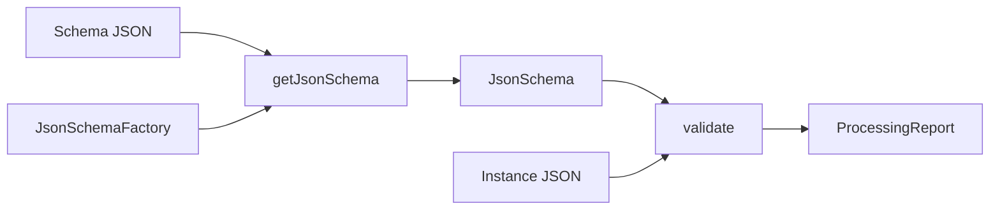
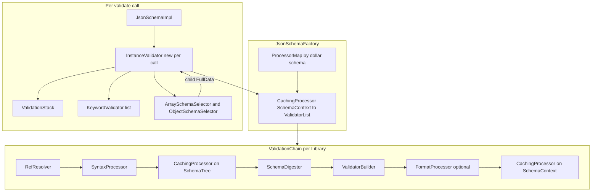

# json-schema-validator (java-json-tools) — Research report

## Metadata

- **Library name**: json-schema-validator
- **Repo URL**: https://github.com/java-json-tools/json-schema-validator
- **Clone path**: `research/repos/java/java-json-tools-json-schema-validator/`
- **Language**: Java
- **License**: LGPLv3 (or later) and ASL 2.0 (dual-licensed; wording clarified in latest commit)
- **Analyzed version**: d265c6b15 2020-09-28 (release 2.2.14 per `project.gradle`; git describe `v2.2.14-2-gd265c6b15`)
- **Report date**: 2026-10-27

## Summary

Status: effectively dormant since 2020-09 (only licence-wording and Dependabot commits after 2.2.14). Draft support unchanged (v3/v4 only); `JsonSchema` is an interface and KeywordValidators use a factory model (since 2.2.7); ValidationConfiguration has a configurable cache size (2.2.9); strict date-time format validation is opt-in (2.2.10).

json-schema-validator is a JSON Schema **validation** library for Java. It does **not** generate code. It loads a JSON Schema (via URI, JsonNode, or file), parses it via a five-step pipeline ($ref resolution, syntax validation, digesting, keyword building, instance validation), and validates JSON documents against that schema. Supported drafts are v3 (draft-03) and v4 (draft-04); v4 includes hyperschema support. Validation is the only concern: schema + instance → `ProcessingReport` (success flag and list of validation errors with paths and messages). Optional format validation and syntax validation are supported. The library uses Jackson for JSON and depends on json-schema-core for $ref resolution and syntax checking.

## JSON Schema support

- **Drafts**: Draft v3 (draft-03) and v4 (draft-04). Hyperschema support in v4 only (no hyperschema in v3).
- **Scope**: Validation only (schema + instance → valid/invalid + error list). No code generation.
- **Subset**: README and overview.html state complete validation support for v3 and v4. The implementation uses draft-specific libraries (DraftV3ValidatorDictionary, DraftV4ValidatorDictionary) and digester/validator pairs per keyword. $ref resolution is handled by RefResolver (json-schema-core); JSON Pointer (RFC 6901) and JSON Reference (draft-pbryan-zyp-json-ref-03) are supported.

## Keyword support table

Keyword list is the union of `properties` keys in the vendored draft-03 and draft-04 meta-schemas (`specs/json-schema.org/draft-03/schema.json`, `specs/json-schema.org/draft-04/schema.json`); Notes call out draft-specific keywords. Each row verified against the validator/digester dictionaries and keyword classes. Implementation evidence from validator and digester dictionaries (CommonValidatorDictionary, DraftV3ValidatorDictionary, DraftV4ValidatorDictionary), ObjectSchemaDigester, ArraySchemaDigester, FormatProcessor, and overview.html.

| Keyword | Implemented | Notes |
|---------|-------------|-------|
| $ref | yes | Resolved by RefResolver (json-schema-core) before validation; JSON Reference and JSON Pointer. |
| $schema | yes | Parsed; used for draft detection and library selection (ValidationChain per JsonRef). |
| id | yes | Used for $ref scope; LoadingConfiguration and URITranslator. |
| additionalItems | yes | AdditionalItemsValidator; ArraySchemaDigester digests hasAdditional, hasItems, itemsIsArray, itemsSize. |
| additionalProperties | yes | AdditionalPropertiesValidator; ObjectSchemaDigester digests hasAdditional. |
| allOf | yes | DraftV4 only; AllOfValidator. |
| anyOf | yes | DraftV4 only; AnyOfValidator. |
| default | no | Not enforced on instance; metadata only. |
| definitions | yes | Draft-04 only (not a draft-03 meta-schema property). Not a validator keyword; used for $ref resolution; subschemas referenced by pointer. |
| dependencies | yes | Both drafts. DependenciesValidator registered separately in DraftV3 and DraftV4 dictionaries; DraftV3DependenciesDigester, DraftV4DependenciesDigester. |
| description | no | Metadata; not used for validation. |
| disallow | yes | DraftV3 only; DisallowKeywordValidator. |
| divisibleBy | yes | DraftV3 only; DivisibleByValidator, DivisibleByDigester. |
| enum | yes | EnumValidator; JsonNumEquivalence for value comparison. |
| exclusiveMaximum | yes | MaximumValidator (NumericValidator) handles both exclusive and inclusive. |
| exclusiveMinimum | yes | MinimumValidator (NumericValidator) handles both exclusive and inclusive. |
| extends | yes | DraftV3 only; ExtendsValidator. |
| format | yes | FormatProcessor; on by default (cfg.getUseFormat()); DraftV3/DraftV4 attribute sets (Extra formats are not in the default libraries). |
| items | yes | ArraySchemaDigester; items, additionalItems drive schema selection per array index. |
| maximum | yes | MaximumValidator. |
| maxItems | yes | MaxItemsValidator. |
| maxLength | yes | MaxLengthValidator. |
| maxProperties | yes | DraftV4 only; MaxPropertiesValidator. |
| minimum | yes | MinimumValidator. |
| minItems | yes | MinItemsValidator. |
| minLength | yes | MinLengthValidator. |
| minProperties | yes | DraftV4 only; MinPropertiesValidator. |
| multipleOf | yes | DraftV4 only; MultipleOfValidator; uses BigDecimal for arbitrary precision. |
| not | yes | DraftV4 only; NotValidator. |
| oneOf | yes | DraftV4 only; OneOfValidator. |
| pattern | yes | PatternValidator; overview states ECMA 262 regex (JavaScript regex). |
| patternProperties | yes | ObjectSchemaDigester; digests pattern property names for ObjectSchemaSelector. |
| properties | yes | Both drafts: ObjectSchemaDigester digests property names for per-field subschema selection. DraftV3 additionally registers PropertiesValidator (handles the draft-03 boolean required flags). |
| required | yes | Draft-04 (array): RequiredKeywordValidator. Draft-03 (boolean inside each property schema): DraftV3PropertiesDigester collects required property names and the v3 PropertiesValidator reports missing members. |
| title | no | Metadata; not used for validation. |
| type | yes | DraftV3TypeValidator, DraftV4TypeValidator; type-checking per draft. |
| uniqueItems | yes | UniqueItemsValidator. |

## Constraints

Validation keywords are enforced at **runtime** by the InstanceValidator. Each keyword validator (e.g. EnumValidator, PatternValidator, MinimumValidator) is invoked during validation; constraints are not structure-only—they directly enforce instance validation (e.g. minLength, minItems, pattern, required). Schema digesting filters keywords by instance type (NodeType); the ValidatorBuilder produces a ValidatorList per schema context. The digested validator lists (not validation results) are cached per (schema location, instance type). Overview.html notes the implementation can validate numeric JSON data of arbitrary scale/precision (BigDecimal).

## High-level architecture

Pipeline: **Schema** (JsonNode or URI) → **JsonSchemaFactory.getJsonSchema()** or **JsonValidator.validate(schema, instance)** → **ValidationProcessor** → **InstanceValidator**. Internally, ValidationChain performs: (1) $ref resolution (RefResolver), (2) syntax validation (SyntaxProcessor), (3) digesting (SchemaDigester), (4) keyword building (ValidatorBuilder), (5) format processing (FormatProcessor, optional) → **ValidatorList** → per-keyword validation + recursive child validation (arrays, objects) → **ProcessingReport** (isSuccess, messages). No code generation step.

## Medium-level architecture

Everything is a `Processor<IN, OUT>` (interface from the separate json-schema-core dependency: `process(ProcessingReport, IN)`). The library is a graph of processors wired in `main/JsonSchemaFactory.buildProcessor()`:

- **Factory wiring**: `JsonSchemaFactory` builds one `RefResolver(loader)`, then one `ValidationChain` per `Library` registered in `ValidationConfiguration.getLibraries()` (keyed by `$schema` `JsonRef`; default = draft-04 library), places them in a `ProcessorMap<JsonRef, SchemaContext, ValidatorList>` whose selector function is `SchemaContext.getSchema().getDollarSchema()`, and wraps that map in a second `CachingProcessor` keyed by `SchemaContextEquivalence`. This outer processor is what `ValidationProcessor` hands to each `InstanceValidator`.
- **ValidationChain** (`processors/validation/ValidationChain.java`) has two sub-pipelines: `resolver` = `CachingProcessor(RefResolver -> SyntaxProcessor)` keyed by schema-tree equality (`SchemaHolderEquivalence`), and `builder` = `CachingProcessor(SchemaDigester -> ValidatorBuilder [-> FormatProcessor if useFormat])` keyed by `SchemaContextEquivalence`. A schema is resolved and syntax-checked first (failure returns `null`, which `InstanceValidator` turns into `InvalidSchemaException` carrying the collected syntax messages), then digested and turned into keyword validators.
- **Entry points**: `JsonSchemaFactory.getJsonSchema(JsonNode | URI | JsonNode+pointer)` returns a `JsonSchemaImpl` (immutable; holds the shared `ValidationProcessor`, a `SchemaTree`, and a `ReportProvider`). `JsonValidator.validate(schema, instance)` builds the `JsonSchemaImpl` on each call.
- **Per-call evaluation**: `JsonSchemaImpl.doValidate` wraps the instance in a `SimpleJsonTree`, builds `FullData(schema, instance, deepCheck)`, creates a fresh report from `ReportProvider`, and runs `ProcessingResult.of(processor, report, data)`. `ValidationProcessor.process` instantiates a **new `InstanceValidator` per call** (it holds mutable `ValidationStack` state and is `@NotThreadSafe`).
- **Libraries**: `Library` = four frozen `Dictionary<>` maps keyed by keyword name: syntax checkers, `Digester`s, `KeywordValidatorFactory`s, and `FormatAttribute`s. `DraftV3Library`/`DraftV4Library`/`DraftV4HyperSchemaLibrary` assemble them from the `library/{digest,validator,format}` dictionaries. Custom keywords are added by `LibraryBuilder`.

- **$ref resolution**: done inside `RefResolver` in json-schema-core (not in this repo); this repo only chains it and caches its output. See "Reference resolution and registry" below for what is and is not verifiable here.

## Algorithms and data structures

### Schema representation

There is no typed schema model. A schema is a Jackson `JsonNode` wrapped in json-schema-core's `SchemaTree` (a node plus a `JsonPointer` into it plus a base `JsonRef` "context", with the loaded `$schema`/`id` information). `SchemaTree.append(pointer)` / `setPointer(pointer)` produce new immutable trees that point at a subschema without copying the underlying JSON, so descending into `properties/foo` or `allOf/2` is an O(pointer length) operation on a shared document. Unknown keywords simply are not in any `Dictionary`, so they are ignored at digest time. Draft-04 has no boolean schemas, so none are modelled (`additionalProperties`/`additionalItems` booleans are handled by their digesters). The instance is similarly a `JsonTree` (`SimpleJsonTree`) pairing a Jackson node with a `JsonPointer` used for error locations. Both are bundled in the immutable `FullData` (`schema`, `instance`, `deepCheck`), which is re-created (`withSchema`, `withInstance`) at every descent.

### Reference resolution and registry

`$ref` handling is entirely in json-schema-core `RefResolver` + `SchemaLoader`; those sources are not in this clone, so details of its registry, base-URI tracking, and remote fetching could not be verified here. What the repo shows: `ValidationChain` runs `RefResolver` followed by `SyntaxProcessor` and caches the pair keyed by `SchemaTree` equality (`SchemaHolderEquivalence`: `equals`/`hashCode` of the tree). Resolution is therefore lazy and per validation-time subschema: each time `InstanceValidator.process` receives a `FullData` whose schema pointer lands on a `$ref` node, the chain resolves it to the target tree (resolution failure is fatal and yields `null`). `LoadingConfiguration` (json-schema-core) supplies URI translation and preloaded schemas. The only cycle protection in this repo is `ValidationStack` (see Core algorithm): a `$ref` loop that does not consume instance data (e.g. `{"$ref": "#"}`) is detected as a "validation loop" at validation time rather than at load time. Recursive schemas that consume instance depth (trees) are fine because each recursion pushes a new instance pointer. There is no `$anchor`, `$dynamicRef`, or `$recursiveRef` (draft-04/03 only; `id` scoping is delegated to core).

### Compiled / intermediate form

There is no whole-schema compile step. The IR is built lazily, per (schema location, instance type), by two stages:

1. `SchemaDigester` (`processors/digest/SchemaDigester.java`). At construction it inverts the library's `Dictionary<Digester>` into `digesterMap: Map<String, Digester>` and `typeMap: ListMultimap<NodeType, String>` (instance type -> keywords whose `Digester.supportedTypes()` include it). `process()` copies `digesterMap`, calls `retainAll` with the schema's field names (so only keywords present in the schema get digested), runs each `Digester.digest(schema)` to produce a small normalized `JsonNode` per keyword, then `retainAll(typeMap.get(instanceType))` so that e.g. `minLength` is dropped when the instance is a number. Output: `SchemaDigest` = `SchemaContext` + `ImmutableMap<String, JsonNode>`.
   Digesters pre-normalize: `DraftV4TypeDigester` turns `type` into an array of type names and adds `integer` when `number` is present; `RequiredDigester` sorts required names; `AdditionalPropertiesDigester` snapshots the sorted `properties` and `patternProperties` names so the validator can compute "additional" members; `NumericDigester` precomputes `valueIsLong` (true when the bound fits in `long` and is integral) and narrows to int/long/BigInteger; `DraftV3PropertiesDigester` collects draft-03 boolean `required` flags.
2. `ValidatorBuilder` (`processors/build/ValidatorBuilder.java`). For each digested keyword it fetches the `KeywordValidatorFactory` from the library, calls `getKeywordValidator(digest)`, and stores the result in a `TreeMap<String, KeywordValidator>` (so validators run in **alphabetical keyword order**), then `ValidatorList` (immutable list + `SchemaContext`). The stock factory `ReflectionKeywordValidatorFactory` does `clazz.getConstructor(JsonNode.class).newInstance(digest)` (reflection once per cache miss; since 2.2.7 factories are pluggable). A validator is a small object with the digest already unpacked into fields: `EnumValidator` holds the enum `JsonNode`; `RequiredKeywordValidator` an `ImmutableSet<String>`; `DraftV4TypeValidator` an `EnumSet<NodeType>`; `AdditionalPropertiesValidator` two `ImmutableSet<String>`; `DependenciesValidator` an `ImmutableMultimap<String,String>` for property deps plus a `Set<String>` of names with schema deps; `NumericValidator` the bound and `isLong`. Applicator validators (`AllOf`, `AnyOf`, `OneOf`, `Not`, `Dependencies`, `Extends`, `Disallow`) hold almost nothing and re-read `data.getSchema().getNode()` at run time, recursing through the `processor` argument.
3. `FormatProcessor` (optional, `useFormat` defaults to true) appends an anonymous `KeywordValidator` wrapping the `FormatAttribute` when the schema has a `format`, the attribute is registered, and it supports the instance's `NodeType`. An unknown format adds a warning to the report and no validator.

The child-selection logic (`properties`, `patternProperties`, `additionalProperties`, `items`, `additionalItems`) is not a `KeywordValidator`: it is compiled separately by `ObjectSchemaDigester` / `ArraySchemaDigester` into a tiny digest (sorted `properties` and `patternProperties` name arrays + `hasAdditional`; `hasItems`, `itemsIsArray`, `itemsSize`, `hasAdditional`) and wrapped in `ObjectSchemaSelector` / `ArraySchemaSelector`. Note these digests are recomputed on every container node visit (they are not cached).

### Core algorithm

`InstanceValidator.process(report, FullData)` is the evaluation loop, and is literally recursive (Java call stack; no explicit-stack alternative and no depth limit, so very deep instances or schemas can overflow the stack):

1. `stack.push(input)` for loop detection (below).
2. Build `SchemaContext(schema, NodeType of instance)`, call the cached `keywordBuilder` to get the `ValidatorList` (a `null` list means the schema is invalid, so throw `InvalidSchemaException`).
3. For each `KeywordValidator` in alphabetical keyword order, call `validate(this, report, bundle, data)`. Applicator validators call back into `processor.process(...)` with a sub-report and a re-pointed `SchemaTree`.
4. If the report already has an error and `deepCheck` is false, pop and return (no children are visited). With `deepCheck` true the walk continues so all errors are collected. Note this means that within one node *all* keyword validators run (errors across keywords accumulate), but descent into children is skipped after the first failure.
5. For containers, descend. Arrays: `ArraySchemaSelector.selectSchemas(index)` returns the schema pointer(s) for the index: no `items` -> `additionalItems` (only if it is an object schema); `items` is an object -> `items`; `items` is an array -> `items/<index>` if in range else `additionalItems`. Objects: field names are copied and `Collections.sort`ed (O(n log n)), and for each field `selectSchemas(name)` returns `properties/<name>` if the digest list `properties.contains(name)` (linear scan of a list), plus every `patternProperties/<regex>` whose regex matches via `RegexECMA262Helper.regMatch(regex, name)` (json-schema-core), and only if none matched, `additionalProperties` when it is an object schema. Each selected pair is recursed with `FullData.withInstance(instance.append(pointer))` and `withSchema(tree.append(ptr))`.
6. `stack.pop()`.

Composition: `AllOf`/`AnyOf`/`OneOf` (`keyword/validator/draftv4`) **do not short-circuit**: each loops over every subschema, creates a `ListProcessingReport(report.getLogLevel(), LogLevel.FATAL)` sub-report, runs the full recursive `processor.process`, stores `subReport.asJson()` into a `fullReport` ObjectNode keyed by subschema pointer, and counts successes. anyOf fails if `nrSuccess == 0`, oneOf if `nrSuccess != 1`, allOf if `nrSuccess != size`; the aggregated sub-reports are attached to the error message. `NotValidator` validates `not` into a sub-report and errors if it succeeded. Draft-03 `extends` validates each target directly into the main report (conjunction), `disallow` mixes a type-set check with schema sub-reports, `DependenciesValidator` handles property dependencies by set difference and schema dependencies by recursion on `dependencies/<field>`.

Loop detection: `ValidationStack` is a `Deque<Element(pointer, Deque<SchemaURI>)>`. `push` compares the instance pointer to the current one; if equal it checks whether the `SchemaURI` (schema context `JsonRef` + pointer, equality via XOR hash) is already in the current deque (a linear `contains`) and throws `ProcessingException("validation loop")` if so; if the instance pointer changed it opens a new element. `pop` removes the last schema URI and restores the previous element when empty. Cost is O(k) per push where k is the number of schemas applied to the same instance node.

Numeric and size keywords are straightforward: `NumericValidator.validate` picks `validateLong` (both bound and instance are integral and fit in `long`) or `validateDecimal` (BigDecimal `compareTo` / `remainder`). `multipleOf`/`divisibleBy` (`DivisorValidator`) use `long %` or `BigDecimal.remainder`. `MinLengthValidator` counts `String.codePointCount`. `UniqueItemsValidator` builds a `HashSet<Equivalence.Wrapper<JsonNode>>` using `JsonNumEquivalence` (jackson-coreutils-equivalence, so `1` equals `1.0`), O(n) expected, returning at the first duplicate. `EnumValidator` is a linear scan with `JsonNumEquivalence.equivalent`. `PatternValidator` calls `RegexECMA262Helper.regMatch(regex, value)` on every instance, reading the regex from the schema node each time.

### Error and output model

Errors are `ProcessingMessage` objects (json-schema-core): a JSON-backed map with `level`, `domain` (`"validation"`, `"syntax"`, ...), `keyword`, a `message` string from a `MessageBundle` (`JsonSchemaValidationBundle`, key e.g. `err.common.enum.notInEnum`), arguments (`putArgument`), and `schema` (loading URI + pointer) and `instance` (pointer) blocks attached by `FullData.newMessage()` via `AbstractKeywordValidator.newMsg`. Reports are `ProcessingReport`s (`ListProcessingReport` by default; `ReportProvider` is pluggable) with a log-level threshold and an exception threshold. `isSuccess()` is false once an error-level message is logged. Sub-reports for anyOf/oneOf/allOf/not/disallow use `exception threshold FATAL` so nested errors do not throw, and are embedded as JSON (`reports`) in the parent error. The message construction eagerly builds Jackson ObjectNodes (`toArrayNode`, `asJson`) even for sub-reports that are discarded when a branch simply fails. `validateUnchecked` / `validInstanceUnchecked` convert thrown `ProcessingException` (unresolvable `$ref`, loop) into report messages. Messages are localizable through the bundle classes. The CLI (`main/cli`) formats reports via `Reporter` implementations (brief / quiet / full JSON).

## Low-level details

- **Numerics**: integers that fit in `long` use primitive comparison; everything else uses `BigDecimal` (`NumericDigester.valueIsLong`, `NumericValidator.valueIsLong`). `type: number` digests also admit `integer`; draft-04 `integer` recognition is by Jackson node type (`NodeType.getNodeType`), and a mathematically integral decimal such as `1.0` is classified by core (not verified here). Equality in `enum`/`uniqueItems` uses `JsonNumEquivalence`, so numerically equal values of different scale are equal.
- **String length**: `minLength`/`maxLength` count Unicode code points (`codePointCount`), not UTF-16 units.
- **Regex**: `pattern`, `patternProperties` and `format: regex` call `RegexECMA262Helper` from json-schema-core (documented in `src/main/javadoc/overview.html` as ECMA 262 compatible). The engine and compile caching live in core and were not verifiable here. `PatternValidator` passes the regex string at every call, so any compile cache is entirely in that helper.
- **Format attributes** (`format/`, dictionaries in `library/format/`): Common: `date-time` (Joda `DateTimeFormatter`, RFC 3339 shape), `email` (`javax.mail.internet.InternetAddress` strict), `ipv6`, `regex`, `uri` (`java.net.URI` constructor), plus draft-04 `hostname`, `ipv4`; draft-03 `date`, `time`, `utc-millisec`, `phone` (libphonenumber), `ip-address`, `host-name`. `ExtraFormatsDictionary` (base64, json-pointer, mac, md5, sha1, sha256, sha512, uuid, uri-template) exists but is **not** included in the default `DraftV3/V4FormatAttributesDictionary`; users must add it to a library. Unknown format -> warning only; attributes only fire for types they declare.
- **Draft handling**: `$schema` selects a `ValidationChain`/`Library` via `ProcessorMap`; default is draft-04. Draft-04 and draft-03 differ in keyword dictionaries and digesters (`type` with schemas in v3, boolean `required` inside `properties`).
- **Recursion / hardening**: no depth limit, no instance-size limit; only the push/pop loop detector. Regex ReDoS is not mitigated in this repo.
- **Loaders**: `LoadingConfiguration` (URI translation, namespaces, path redirects); CLI sets the namespace to the CWD and supports `--fakeroot`.
- **Dependencies** (`project.gradle`): Guava 28.2-android, json-schema-core 1.2.14, jackson-coreutils-equivalence 1.0, javax mail API 1.6.2, joda-time 2.10.5, libphonenumber 8.11.1, jopt-simple; Java 7 source level; Gradle build with errorprone.

## Output and integration

- **Vendored vs build-dir**: N/A (validation only; no generated code output).
- **API vs CLI**: Library API and CLI. Entry points: `JsonSchemaFactory.byDefault().getJsonSchema(schema).validate(instance)`, `validator.validate(schema, instance)`, or `getJsonSchema(uri)` for URI-loaded schema. CLI: `Main` class (Main-Class in jar) with options `--help`, `-s`/`--brief`, `-q`/`--quiet`, `--syntax`, `--fakeroot`; args: schema file [instance file(s)].
- **Writer model**: N/A (validation only).

## Configuration

- **JsonSchemaFactoryBuilder**: setReportProvider, setLoadingConfiguration, setValidationConfiguration.
- **LoadingConfiguration**: URITranslatorConfiguration (namespace, path redirects).
- **ValidationConfiguration**: ReportProvider, default library (draft), libraries (JsonRef → Library), useFormat, cacheSize, syntax/validation message bundles.
- **Library**: DraftV3 and DraftV4 libraries include digesters, validators, format attributes, syntax checkers.

## Pros/cons

- **Pros**: Complete draft v3 and v4 validation; ECMA 262 regex; arbitrary-precision numeric validation (BigDecimal); extensible (custom keywords, format attributes via Library); dual draft support with $schema-based library selection; CLI for schema and instance validation; syntax validation; caching for schema/context reuse; Android-compatible (README).
- **Cons**: No code generation; no draft-06/07/2019-09/2020-12; RefResolver in separate json-schema-core dependency; default, title, description not enforced/used for validation.

## Testability

- **How to run tests**: From repo root, `./gradlew test`. Uses TestNG (useTestNG in build.gradle).
- **Test structure**: TestSuite base class; DraftV3TestSuite, DraftV4TestSuite load tests from `/testsuite/draftv3.json`, `/testsuite/draftv4.json`. Each test: description, schema, data, valid flag; asserts report.isSuccess() == valid. ValidationProcessorTest, FormatProcessorTest, keyword tests (e.g. NotKeywordTest, ExtendsKeywordTest). SelfValidationTest validates meta-schemas.
- **Fixtures**: `src/test/resources/testsuite/`, `keyword/` (validators, digest), `format/`, `object/`, `array/`, `other/` (e.g. google-json-api.json).
- **Entry point for shared fixtures**: `JsonSchemaFactory.byDefault().getJsonSchema(schema).validate(instance)` or `validator.validate(schema, instance)`.

## Performance

Analysis is from source only; nothing was built or run.

### Performance techniques

- **Compile vs interpret**: Partial, lazy, per-subschema compilation. For each (schema location, instance `NodeType`) pair the digest + `ValidatorList` is built once and cached (`ValidationChain.builder`, plus the outer `CachingProcessor` in `JsonSchemaFactory.buildProcessor`). Keywords irrelevant to the instance type are pruned at build time (`SchemaDigester` `retainAll(typeMap.get(type))`), so a string node never runs `minItems`. Validators pre-unpack their digest into immutable sets/enums/longs. What is **not** precomputed: the object/array child selectors (`ObjectSchemaDigester`/`ArraySchemaDigester` digests and `*Selector` objects are rebuilt at each container visit), regexes (read from the schema node on each `PatternValidator.validate`; compilation caching, if any, is inside json-schema-core), and combinator subschema lists (re-read from the schema node on every call).
- **Memory layout and allocation**: Pointer-tree of Jackson `JsonNode`s, immutable wrapper objects. No arenas or interning. Per instance node the validator allocates a `FullData`, a `SchemaContext`, a `FullData` again (from the cached list's context), a `JsonPointer` append for the instance and another for the schema (`SchemaTree.append`), and a `SchemaURI` in `ValidationStack.push`; object visits allocate a sorted `ArrayList` of field names and an `ImmutableList` per selected schema. A new `InstanceValidator` (and `ValidationStack` deque) is allocated per `validate()` call. Error paths are eager: messages are built as Jackson ObjectNodes when produced, and every anyOf/oneOf/allOf branch allocates a `ListProcessingReport` and serializes it with `asJson()` regardless of whether it will be reported. `AdditionalPropertiesValidator` allocates two `HashSet`s per object.
- **Caching and memoization**: Three `CachingProcessor`s (core class, a bounded cache): (1) `resolver` caches `ValueHolder<SchemaTree>` -> resolved+syntax-checked tree, keyed by `SchemaHolderEquivalence` (tree `equals`/`hashCode`); (2) `builder` caches `SchemaContext` -> `ValidatorList`, keyed by `SchemaContextEquivalence` (`schema.equals && instanceType ==`, hash `schema.hashCode ^ instanceType.hashCode`); (3) the outer factory-level cache with the same key above the `ProcessorMap`. Size is `ValidationConfiguration.cacheSize`, default 512 (`ValidationConfigurationBuilder.cacheSize`, accepted values >= -1; semantic of -1 defined in core, not verified). Because keys hash a `SchemaTree` (document node + pointer), a lookup cost depends on how `SchemaTree.hashCode`/`equals` are implemented in core (unverified); `JsonNode.hashCode` of a large schema could be expensive if not memoized. Invalidation: none (immutable schemas); eviction is by the cache's bound. No cache exists for format checks or ref targets beyond (1).
- **Fast paths and short-circuiting**: (a) once a node's keywords have produced an error and `deepCheck` is false, children are not visited (`InstanceValidator.process`), so invalid documents fail faster than a full scan; (b) type-pruned keyword lists; (c) `NumericValidator` uses `long` arithmetic when both sides fit, falling back to `BigDecimal`; (d) `AdditionalPropertiesValidator` returns immediately when additional properties are allowed (it also has an early `additionalOK` check); `UniqueItemsValidator` stops at first duplicate and returns immediately when `uniqueItems` is false; `EnumValidator` stops at first match; `ArraySchemaSelector` is O(1) per index. (e) `validInstance` is only a wrapper around the full report path: there is no separate boolean-only evaluator, and `allOf`/`anyOf`/`oneOf` never short-circuit between branches (all branches run and build sub-reports even after the outcome is decided), which is the most significant cost in composition-heavy schemas. No keyword ordering optimization (fixed alphabetical `TreeMap` order).
- **Regex handling**: delegated to `RegexECMA262Helper` (json-schema-core; documented as ECMA 262). `ObjectSchemaSelector` runs `regMatch` for every (member name x patternProperties regex) pair on every object, and `AdditionalPropertiesValidator` repeats the same matching for every member not in `properties`, i.e. regexes are evaluated roughly twice per member for schemas using `additionalProperties: false` with patternProperties. No ReDoS protection is present in this repo; whether core caches compiled patterns could not be verified.
- **Concurrency**: Compiled state is shareable: `JsonSchemaImpl` is `@Immutable`, `JsonSchemaFactory` is `@Immutable`, `ValidatorList`/`SchemaDigest`/`FullData` are immutable, and the `CachingProcessor`s are core classes designed for shared use (thread-safety of the cache implementation itself is in core and was not verified). The mutable pieces are per call: `InstanceValidator` is `@NotThreadSafe` but is created per `validate()`. `JsonSchemaFactoryBuilder` is `@NotThreadSafe`. No parallel validation within one instance. The README/javadoc here do not make an explicit thread-safety statement (grep found none).

### Benchmarks in repo

- `src/test/java/com/github/fge/jsonschema/NewAPIPerfTest.java`: a `main` method (not a JMH/TestNG test). It builds a `JsonSchema` for the draft-04 meta-schema (`SchemaVersion.DRAFTV4.getSchema()`), loads `/other/google-json-api.json`, treats each entry of its `schemas` object as an instance, validates all of them once ("initial validation", cold caches), then 500 more iterations printing elapsed ms every 20 iterations and exiting with status 1 on any failure. It measures steady-state validation throughput with warm caches and cold-start cost; no memory or comparison output.
- Entry points for a shared harness: build once with `JsonSchemaFactory.byDefault().getJsonSchema(schemaNode)` (parse/compile cost shows on first `validate`), then loop `schema.validate(instanceNode)` or `validInstance(instanceNode)`; or `JsonValidator.validate(schemaNode, instanceNode)`. CLI: `java -jar` with the jar's `Main` class (`-q` quiet). Only draft-03/04 fixtures are applicable.

## Determinism and idempotency

- **Generated output**: N/A (validation only).
- **Validation result**: For a given schema and instance, the validation outcome is deterministic. InstanceValidator processes object fields in sorted order (Collections.sort(fields)) for stable traversal. Error order depends on traversal; no explicit sorting of report messages. Keyword validators run in alphabetical keyword order (TreeMap in ValidatorBuilder); object members are visited sorted by name; error order follows that traversal.

## Enum handling

- **Implementation**: EnumValidator stores enum array from digest; validates by iterating values and comparing with JsonNumEquivalence.equivalent(enumValue, node). First match returns success; no match reports err.common.enum.notInEnum.
- **Duplicate entries**: Digest passes enum as-is; no deduplication. Test enum.json includes `{"enum":[1,{},[1,2,3]]}`. Duplicate values (e.g. `["a","a"]`) would be stored; instance "a" would match first occurrence. Draft-04 meta-schema requires uniqueItems on enum; draft-03 does not. Unknown whether schema syntax checker rejects duplicates.
- **Case/namespace**: JsonNumEquivalence compares JsonNode values; distinct "a" and "A" are both stored and both match their corresponding instance. No special case handling.

## Reverse generation (Schema from types)

No. json-schema-validator is a validation-only library; it does not generate JSON Schema from Java types.

## Multi-language output

N/A (validation only; no code generation).

## Model deduplication and $ref/$defs

- **Validation context**: There is no generated model; the question is how $ref and definitions are resolved for validation.
- **$ref**: RefResolver (json-schema-core) resolves JSON References; resolved schema is used for validation. Multiple $refs to the same URI resolve to the same schema; CachingProcessor caches by SchemaHolderEquivalence (SchemaTree equality).
- **definitions**: The "definitions" object holds subschemas; $ref to "#/definitions/foo" is resolved by JSON Pointer. Same definition is represented once per ref and shared across all $refs to it (via cache).

## Validation (schema + JSON → errors)

Yes. This is the library's main purpose.

- **Inputs**: (1) A JSON Schema document (JsonNode or URI). (2) A JSON instance (JsonNode).
- **API**: `JsonSchema.validate(JsonNode instance)` or `JsonSchema.validate(JsonNode instance, boolean deepCheck)`; or `JsonValidator.validate(JsonNode schema, JsonNode instance)`. Returns `ProcessingReport`.
- **Output**: `ProcessingReport.isSuccess()` is true if valid, false otherwise. Report is iterable (ProcessingMessage) with domain, keyword, path, message. `validInstance(instance)` returns boolean.
- **Syntax validation**: `SyntaxValidator.validateSchema(JsonNode schema)` returns ProcessingReport; use before getJsonSchema if schema validity is unknown.
- **Unchecked variants**: `validateUnchecked`, `validInstanceUnchecked` mask exceptions (e.g. unresolvable $ref) as report messages.
