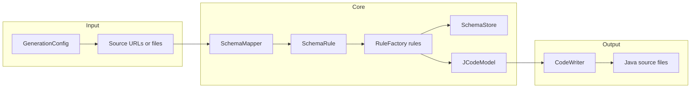
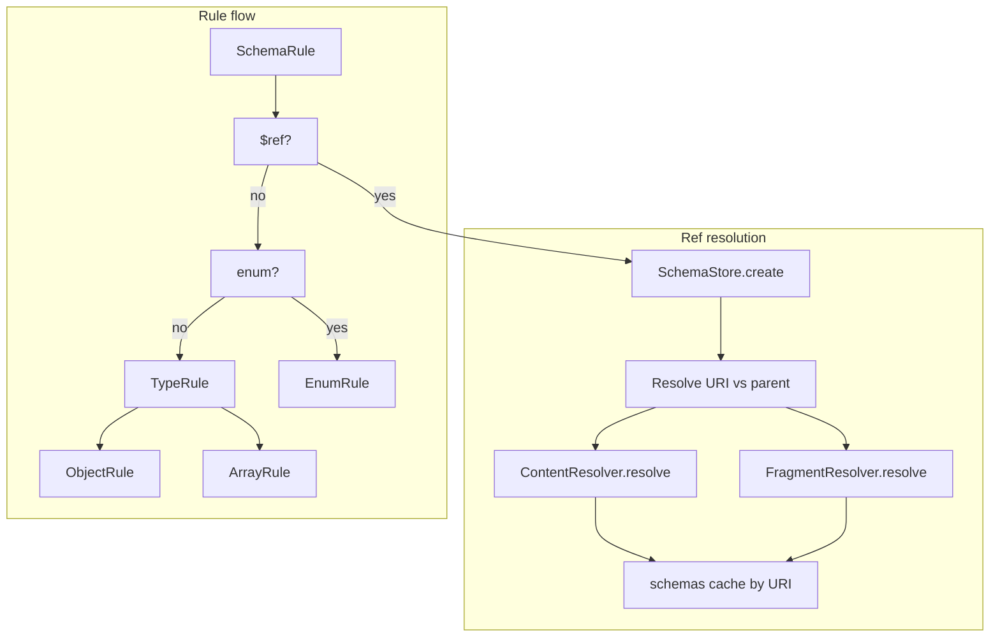

# jsonschema2pojo — Research report

## Metadata

- **Library name**: jsonschema2pojo
- **Repo URL**: https://github.com/joelittlejohn/jsonschema2pojo
- **Clone path**: `research/repos/java/joelittlejohn-jsonschema2pojo/`
- **Language**: Java
- **License**: Apache License, Version 2.0 (see root pom.xml and README)
- **Analyzed version**: `1c6b7664` 2026-02-13 (HEAD; `git describe`: jsonschema2pojo-1.3.3-12-g1c6b7664, i.e. 12 commits after release 1.3.3; pom version 1.3.4-SNAPSHOT)
- **Report date**: 2026-10-27

## Summary

jsonschema2pojo is a JSON Schema to Java code generation library. It reads JSON Schema (or example JSON, which it infers into a schema) and generates DTO-style Java types (POJOs), with optional annotations for Jackson 2.x, Jackson 3.x, Gson, Moshi, or JsonB. It can be used as a Maven plugin, Gradle plugin, command-line tool (jsonschema2pojo-cli), or embedded via the `Jsonschema2Pojo.generate(GenerationConfig, RuleLogger)` API. Requires JDK 17 as of 1.3.0; the Ant task was removed in 1.3.0. Output is Java source only; no other target languages. The core uses a rule-based pipeline: schema tree is traversed, and rules (TypeRule, ObjectRule, EnumRule, etc.) produce a CodeModel that is then written to the configured target directory.

## JSON Schema support

- **Drafts**: The codebase references draft-zyp (draft-03), draft-fge (validation), and draft-handrews in Javadocs. Integration tests use `$schema`: `http://json-schema.org/draft-07/schema#`. There is no explicit draft enum or `$schema`-based draft selection in the core; the implementation is effectively draft-03–draft-07 compatible for the keywords it supports. Newer draft-2019-09/2020-12 keywords (e.g. `$defs` as alias, `prefixItems`, `unevaluatedProperties`, `$dynamicRef`) are not advertised or specially handled.
- **Scope**: Code generation only. The library does not validate JSON instances against a schema; it only interprets schema structure to emit Java types.
- **Subset**: Not all meta-schema keywords are implemented. Supported constructs include type, properties, items, required, $ref, definitions (via fragment paths), enum, format, additionalProperties, pattern, default, minimum/maximum, minLength/maxLength, minItems/maxItems, uniqueItems, title, description, $comment, and draft-03 style "extends". allOf/anyOf/oneOf, const, if/then/else, patternProperties, propertyNames, contentEncoding/contentMediaType (as 2020-12 content vocabulary), and unevaluated* are not implemented for type generation.

## Keyword support table

Keyword list re-derived from the vendored draft 2020-12 meta-schemas (`specs/json-schema.org/draft/2020-12/meta/*.json`, 57 property keywords across core, applicator, unevaluated, validation, meta-data, format-annotation and content). Each row was checked against the rule classes in `jsonschema2pojo-core/src/main/java/org/jsonschema2pojo/rules` (grep for `has("<keyword>")`/`get(...)`). Implementation evidence from RuleFactory, SchemaRule, TypeRule, ObjectRule, PropertyRule, ArrayRule, EnumRule, AdditionalPropertiesRule, FormatRule, MediaRule, and related rules in the clone.

| Keyword | Implemented | Notes |
|---------|-------------|-------|
| $anchor | no | Not used in schema resolution or codegen. |
| $comment | yes | CommentRule; emitted as Javadoc. |
| $defs | partial | No explicit keyword; fragment paths like `#/$defs/Name` are resolved by FragmentResolver (path-based). definitions used in tests (`#/definitions/embedded`). |
| $dynamicAnchor | no | Not implemented. |
| $dynamicRef | no | Not implemented. |
| $id | no | The `$id`/`id` keyword is never read. `Schema.getId()` is the retrieval URI (source location plus fragment) assigned by SchemaStore, used to resolve relative `$ref` values. |
| $ref | yes | SchemaRule, PropertyRule, SchemaStore.create; FragmentResolver for in-document pointers; ContentResolver for remote. Reuse via SchemaStore cache (isGenerated). |
| $schema | no | Never read by the rules; not used to select a draft or validate the schema. |
| $vocabulary | no | Not implemented. |
| additionalProperties | yes | AdditionalPropertiesRule: boolean false = no map; true/absent = Map; schema = generated type for values. |
| allOf | no | Not implemented. ReflectionHelper supports draft-03 "extends" only. |
| anyOf | no | Not implemented. |
| const | no | Not in SchemaRule or TypeRule; only enum branch. |
| contains | no | Not implemented. |
| contentEncoding | no | Not implemented. MediaRule handles the draft-03/hyper-schema `media` object with `binaryEncoding` → byte[] (TypeRule checks `media`). |
| contentMediaType | no | Not implemented. |
| contentSchema | no | Not implemented. |
| default | yes | DefaultRule; applied to property field initializer. |
| dependentRequired | no | Not implemented. |
| dependentSchemas | no | Not implemented. |
| deprecated | no | Not implemented. |
| description | yes | DescriptionRule; Javadoc. |
| else | no | Not implemented. |
| enum | yes | EnumRule; Java enum with value field, fromValue factory; javaEnums/javaEnumNames extensions. |
| examples | no | Not implemented. |
| exclusiveMaximum | no | MinimumMaximumRule only handles minimum/maximum (and only when isIncludeJsr303Annotations). |
| exclusiveMinimum | no | Same as exclusiveMaximum. |
| format | yes | FormatRule; maps to Java types (date-time, date, time, uri, email, uuid, etc.) and optional JSR-303 @Email when configured. |
| if | no | Not implemented. |
| items | partial | ArrayRule; single-schema form gives the element type; List or Set (uniqueItems). Array-form (tuple) items yields Object elements; no prefixItems. |
| maxContains | no | Not implemented. |
| maximum | yes | MinimumMaximumRule when isIncludeJsr303Annotations (@DecimalMax). TypeRule also picks Long over Integer for `integer` when the bound is a long literal. |
| maxItems | yes | MinItemsMaxItemsRule when isIncludeJsr303Annotations; @Size. |
| maxLength | yes | MinLengthMaxLengthRule when isIncludeJsr303Annotations; @Size on String, Collection, Map and array fields. |
| maxProperties | no | Not implemented. |
| minContains | no | Not implemented. |
| minimum | yes | MinimumMaximumRule when isIncludeJsr303Annotations (@DecimalMin; not applied to Double/Float fields). TypeRule also picks Long over Integer for `integer` when the bound is a long literal. |
| minItems | yes | MinItemsMaxItemsRule when isIncludeJsr303Annotations; @Size. |
| minLength | yes | MinLengthMaxLengthRule when isIncludeJsr303Annotations; @Size on String, Collection, Map and array fields. |
| minProperties | no | Not implemented. |
| multipleOf | no | Not implemented. DigitsRule exists for custom "digits" (JSR-303 @Digits), not standard multipleOf. |
| not | no | Not implemented. |
| oneOf | no | Not implemented. |
| pattern | yes | PatternRule; optional JSR-303 @Pattern when isIncludeJsr303Annotations. |
| patternProperties | no | Not implemented. DynamicPropertiesRule adds dynamic get/set for declared properties, not patternProperties. |
| prefixItems | no | Not implemented. |
| properties | yes | PropertiesRule, PropertyRule; generates fields and accessors. |
| propertyNames | no | Not implemented. |
| readOnly | no | Not implemented. |
| required | yes | RequiredArrayRule (array form); ConstructorRule and PropertyRule (required vs optional); draft-03 and draft-04 style both supported. |
| then | no | Not implemented. |
| title | yes | TitleRule; Javadoc. |
| type | yes | TypeRule; object/array/string/number/integer/boolean; array of types supported only when exactly one non-null type remains, otherwise (and for absent type) Object. `null` alone maps to Object. |
| unevaluatedItems | no | Not implemented. |
| unevaluatedProperties | no | Not implemented. |
| uniqueItems | yes | ArrayRule; true → Set, false/absent → List. |
| writeOnly | no | Not implemented. |

## Constraints

Validation keywords are used primarily for **structure** (types, required, items, additionalProperties). When `isIncludeJsr303Annotations()` is true, the library also emits Bean Validation annotations so that constraints can be enforced at runtime by a validation framework: minimum/maximum → @DecimalMin/@DecimalMax, minLength/maxLength/minItems/maxItems → @Size, pattern → @Pattern, format email → @Email. ValidRule additionally adds `@Valid` to non-container, non-scalar types for cascading validation; since 1.3.3 it uses type-use annotations on collection items (`List<@Valid T>`) and map values (`Map<String, @Valid T>`), with JLS 9.7.4 placement fixed afterwards. So constraint enforcement is optional and delegated to JSR-303/Jakarta Validation; by default generated code does not enforce constraints itself.

## High-level architecture

Pipeline: **Source** (files or URLs from GenerationConfig) → **SchemaMapper.generate** (per source: read schema or infer from example JSON) → **SchemaRule** on root → recursive **RuleFactory** rules (TypeRule, ObjectRule, ArrayRule, EnumRule, etc.) with **SchemaStore** for $ref and **FragmentResolver** for in-document paths → **JCodeModel** (CodeModel) → **CodeWriter** (FileCodeWriterWithEncoding) → Java source files under target directory. Annotation styles now include Jackson 3 (Jackson3Annotator, added 1.3.0) alongside Jackson 2, Gson, Moshi 1, JsonB 1/2. Source type can be JSON Schema, YAML Schema, or example JSON/YAML (SchemaGenerator infers schema). For directories, files are processed in an order determined by SourceSortOrder (OS, FILES_FIRST, or SUBDIRS_FIRST).

## Medium-level architecture

- **Entry**: `Jsonschema2Pojo.generate(GenerationConfig, RuleLogger)` creates Annotator, RuleFactory, SchemaStore, SchemaMapper; iterates config.getSource(), calls mapper.generate(codeModel, className, packageName, sourceUrl). For directory sources, generateRecursive sorts files by config.getSourceSortOrder().getComparator() and processes each file (clearing schema cache for JSON/YAML example mode between files).
- **Schema loading**: SchemaMapper.readSchema: for JSONSCHEMA/YAMLSCHEMA builds a single node `{"$ref": schemaUrl.toString()}`; for JSON/YAML loads content and uses SchemaGenerator.schemaFromExample to infer a schema. SchemaRule and PropertyRule resolve $ref via SchemaStore.create(parent, path, refFragmentPathDelimiters). SchemaStore.create(Schema parent, String path, String refFragmentPathDelimiters) resolves path against parent.getId(), then create(URI id, ...). For URI id: normalize; if not in schemas cache, load base document (ContentResolver.resolve(baseId)), parse, store by baseId; if fragment present, FragmentResolver.resolve(baseSchema.getContent(), '#' + id.getFragment(), refFragmentPathDelimiters) returns sub-node and a new Schema(normalizedId, childContent, baseSchema) is cached. So $ref resolution is URI + JSON-Pointer-style fragment (delimiters configurable, default "#/.").
- **Rule dispatch**: SchemaRule: if $ref, resolve and recurse or return cached javaType; else if enum → EnumRule; else TypeRule. TypeRule: type/object → ObjectRule; array → ArrayRule; string/number/integer/boolean → ref or FormatRule; default Object. ObjectRule creates JDefinedClass, applies title/description/$comment, PropertiesRule, AdditionalPropertiesRule, DynamicPropertiesRule, RequiredArrayRule, ConstructorRule, etc. ArrayRule uses items schema (via SchemaStore path #/items or fragment/items), applies SchemaRule for item type, returns List or Set. PropertyRule resolves $ref for property schema, adds field and getter/setter, then DefaultRule, MinimumMaximumRule, MinItemsMaxItemsRule, MinLengthMaxLengthRule, PatternRule when applicable.
- **Key types**: Jsonschema2Pojo, SchemaMapper, SchemaStore, Schema, FragmentResolver, ContentResolver, RuleFactory, SchemaRule, TypeRule, ObjectRule, PropertyRule, ArrayRule, EnumRule, GenerationConfig, Annotator, JCodeModel, CodeWriter.

## Algorithms and data structures

All anchors are under `jsonschema2pojo-core/src/main/java/org/jsonschema2pojo/` unless stated. The library is a recursive tree walk over a Jackson `JsonNode` that emits `com.sun.codemodel` objects; there is no validator and no separate IR.

### Schema representation

There is no typed schema model. A schema is a raw Jackson `JsonNode` (`ObjectNode` backed by a `LinkedHashMap`, so key order is insertion order and a duplicate key keeps the last value). Each rule reads keywords with `node.has("x")` / `node.get("x")`; unknown keywords are simply never looked at, and there is no boolean-schema (`true`/`false`) support: a boolean node reaching `SchemaRule` has no `$ref`/`enum`/`type`, so it falls into `TypeRule` and becomes `Object`.

Wrapped around the node is the small `Schema` class (`Schema.java`): `URI id`, `JsonNode content`, `Schema parent` (a root points at itself; `getGrandParent()` walks to the root recursively) and a mutable `JType javaType`. `Schema` is both "a place in a document" and "the Java type generated for it": `isGenerated()` is just `javaType != null`, and `setJavaTypeIfEmpty` makes the first writer win. Every sub-schema the rules descend into (`properties/<name>`, `items`, `additionalProperties`, `extends`) is given its own `Schema` by calling `SchemaStore.create(parent, "#<fragment>/properties/<name>", delimiters)`; for example `PropertyRule` builds `"#" + schema.getId().getFragment() + "/properties/" + encodeReferenceToken(name)`. So a document of N schema locations touched by codegen produces N `Schema` objects stored in one `HashMap<URI, Schema>`, each holding a pointer into the same parsed tree (no copying; `content` is a shared reference). Ownership is plain Java GC; nothing is borrowed or lifetime-tracked.

Parsing is done by `ContentResolver` with a Jackson `ObjectMapper` configured with `ALLOW_COMMENTS` and `USE_BIG_DECIMAL_FOR_FLOATS` (so `1.0` and large numbers stay exact in the tree; keyword values such as `minimum` are read with `asText()` and emitted verbatim). A `YAMLFactory` is swapped in for YAML sources (`Jsonschema2Pojo.createContentResolver`).

### Reference resolution and registry

The registry is `SchemaStore.schemas`, a `HashMap<URI, Schema>` keyed by the normalized absolute URI including fragment (`SchemaStore.java`). Both public `create` overloads and `clearCache` coordinate through it; the `create(URI, ...)` and `clearCache` methods are `synchronized`, the `create(Schema parent, String path, ...)` overload is not.

`create(Schema parent, String path, delimiters)` is the entry used by every rule:
1. Strip trailing `#?&/` from the path (except bare `#`), re-encode the fragment through `new URI(null, null, fragment).getRawFragment()` so odd characters survive.
2. Resolve against the parent's id: `parent.getId().resolve(path)` (java.net.URI RFC 3986 resolution). `parent.getId() == null` for the in-memory root, in which case the path is used as is.
3. If the path is a self-reference without a file (`selfReferenceWithoutParentFile`, or an empty pre-fragment part), the pointer is applied directly to `parent.getGrandParent().getContent()` via `FragmentResolver` and the new `Schema` is cached under `id`.
4. Otherwise delegate to `create(URI id, ...)`: normalize; if not cached, derive `baseId` (URI minus fragment), load the whole document once through `ContentResolver.resolve(baseId)` and cache it as a root `Schema`; if the id carries a fragment, resolve the pointer against the base content and cache a child `Schema(normalizedId, childContent, baseSchema)`.

`FragmentResolver.resolve` splits the fragment on any character in `refFragmentPathDelimiters` (default `"#/."`, configurable) into a `List<String>` and then recurses, consuming one segment per level: arrays take `Integer.parseInt(segment)`, objects take `JsonPointerUtils.decodeReferenceToken(segment)` (handles `~0`/`~1`; URL-decoding comes from the earlier `URI` step). A missing key throws `IllegalArgumentException("Path not present: ...")`. Because `.` is a default delimiter, a property literally named `a.b` cannot be addressed unless the delimiter set is changed. Each step does `ArrayList.remove(0)`, so a path of depth d costs O(d^2) in list shifts, irrelevant at real depths. The recursion is literal (one frame per path segment), bounded by pointer depth rather than by input size.

What is not implemented: `$id`/`id` is never read (identity is purely retrieval location, `Schema.getId()` is the URI the store assigned), so embedded subschema ids and `$id`-based base-URI changes do not exist; `$anchor`, `$dynamicRef`/`$dynamicAnchor`, `$recursiveRef`, `$vocabulary` are ignored. A ref is always resolved as a URL: `ContentResolver.resolve` accepts any scheme `URL.openStream()` knows (`http`, `https`, `file`) plus `classpath`/`resource`/`java` (the latter via the thread context `ClassLoader.getResourceAsStream`). Remote fetching is eager and synchronous the first time a document is touched, with no timeout, allow-list or size cap set in this code.

Cycle handling is by "type registered before descent", not by visited-set detection. `ObjectRule.apply` creates the `JDefinedClass` first and immediately does `schema.setJavaTypeIfEmpty(...)` ("storing this type for future self refs") before generating properties. When a property later `$ref`s back to the same schema, `SchemaRule` calls `SchemaStore.create`, gets the cached `Schema`, sees `isGenerated()` and returns the half-built class. Arrays of self (`ArrayRule`) behave the same through `itemsSchema.isGenerated()`. The one subtlety is `rootSchemaIsArray = !schema.isGenerated()` in `ArrayRule`, which stores the `List<T>` type on a root array schema so a self-reference to a root array resolves (the 1.3.0 StackOverflowError fix concerned self-referencing roots).

Source documents enter through a trick in `SchemaMapper.readSchema`: for `JSONSCHEMA`/`YAMLSCHEMA` it synthesizes the node `{"$ref": "<file url>"}` and applies `SchemaRule` to it with a placeholder `new Schema(null, node, null)`. The whole pipeline therefore starts with an ordinary `$ref` resolution, and the Java class name for a ref'd document is derived by `SchemaRule.nameFromRef` (file base name, or the last `/`-, `\`- or `#`-separated token of a fragment ref, URL-decoded).

### Compiled / intermediate form

There is no compiled form of the schema. The "IR" is the in-memory `JCodeModel` (`com.sun.codemodel`): `JPackage` -> `JDefinedClass` (fields `JFieldVar`, methods `JMethod`, nested classes, enum constants `JEnumConstant`) with expression/statement trees (`JExpr`, `JBlock`, `JConditional`) for method bodies. A type reference is a `JType`; `JClass.narrow(...)` builds generic applications such as `List<Foo>`; `JAnnotatedClass` (`model/JAnnotatedClass.java`, local) wraps a `JClass` to carry type-use annotations like `List<@Valid Foo>`. `Schema.javaType` is the only link between the JSON tree and the model, and it is what makes `$ref` reuse work.

Rules are the "instruction set". `Rule<T, R>` (`rules/Rule.java`) has one method `R apply(String nodeName, JsonNode node, JsonNode parent, T generatableType, Schema currentSchema)`. `RuleFactory` is a factory-of-rules with one `getXxxRule()` per rule, and every getter does `return new XxxRule(this)` (for example `getObjectRule()` -> `new ObjectRule(this, new ParcelableHelper(), reflectionHelper)`), so rule instances are created per call, not shared. `GenerationConfig.getCustomRuleFactory()` lets users subclass the factory to override any rule. Only `reflectionHelper` and `nameHelper` are long-lived fields of the factory.

### Core algorithm

Codegen is a single depth-first traversal driven by `SchemaRule.apply`:

1. If the node has `$ref`: remember `parentSchema = schema.getParent()`, compute `nameFromRef`, call `SchemaStore.create(schema, ref, delimiters)`, swap `schemaNode`/`schema` for the target. If the target `isGenerated()`, return its stored `JType` (this is the only deduplication mechanism). If the target is not the former parent (reference identity via `Objects.equals` on a class without `equals`), recurse with the ref's own derived name so the generated class is named after the definition (`#/definitions/Foo` -> `Foo`), not after the referencing property.
2. If the node has `enum`: `EnumRule`. Else `TypeRule`. Whichever type comes back is stored with `schema.setJavaTypeIfEmpty`.

`TypeRule.apply` selects a Java type from `type`: `getTypeName` takes `type` as a string, or, for an array type, drops `"null"` entries and uses the one remaining element; two or more non-null types (or an absent `type`) yield `"any"` -> `java.lang.Object`. Order of precedence: `object` or any node with a non-empty `properties` -> `ObjectRule`; `existingJavaType`; `string` -> `String`; `number` -> `Double` (default, `isUseDoubleNumbers()` is `true`), `BigDecimal` if `useBigDecimals`, otherwise `Float`; `integer` -> `BigInteger` / `Long` (config, or `minimum`/`maximum` whose Jackson node `isLong()`, i.e. outside int range) / `Integer`; `boolean`; `array` -> `ArrayRule`; else `Object`. `useBigIntegers`, `usePrimitives` (`unboxify`) are applied afterward. Then `format` (via `FormatRule`) or the draft-03 `media.binaryEncoding` (`MediaRule` -> `byte[]`) may override the base type, and finally `ValidRule` may wrap a non-scalar, non-container class in a `@Valid` type-use annotation when JSR-303 is on.

`ObjectRule.apply` (`rules/ObjectRule.java`): resolve `extends`/`extendsJavaClass` through `ReflectionHelper.getSuperType` (the draft-03 `extends` keyword, applied through `SchemaRule` with the name `<node>Parent`); create the class (`createClass`: `existingJavaType` short-circuits to a `ClassAlreadyExistsException` carrying the existing class; `javaType` forces a name; otherwise `NameHelper.getUniqueClassName`); register `schema.setJavaTypeIfEmpty`; apply title/description/`$comment` Javadoc; optionally `BuilderRule`; `PropertiesRule`; `AdditionalPropertiesRule`; `DynamicPropertiesRule`; `RequiredArrayRule`; then `toString`, `hashCode`/`equals`, Parcelable, constructors, `Serializable` according to config. `PropertiesRule` iterates `node.fieldNames()` in document order and calls `PropertyRule` for each, then `annotator.propertyOrder` (Jackson: `@JsonPropertyOrder` listing the same order).

`PropertyRule.apply` computes the Java field name (`NameHelper.getPropertyName`: `javaName` override, replace illegal characters, `normalizeName`, lower-camel-case, prefix `_` and suffix `_` for Java keywords), builds the child `Schema` for the pointer `#.../properties/<name>`, calls `SchemaRule` for the type, then adds the field, getter, setter, builder method and per-field rules (`PatternRule`, `DefaultRule`, `MinimumMaximumRule`, `MinItemsMaxItemsRule`, `MinLengthMaxLengthRule`, `DigitsRule`). Note `resolveRefs` follows `$ref` chains iteratively-by-recursion to read `format`/`default`/limits from the target node, so annotations come from the referenced schema. Required-ness is determined in two places: `PropertyRule.isRequired` linearly scans the parent schema's `required` array (and also accepts draft-03 boolean `required: true` on the property), and `RequiredArrayRule` looks up each name in the generated class's `fields()` map and adds `@NotNull` / `@Nonnull` and Javadoc.

`ArrayRule` computes the element type through a child `Schema` at `#/items`; `uniqueItems: true` picks `Set` else `List`, and no `items` gives `Object`. If `items` is a tuple array (draft-04 style) the whole array node is passed to `SchemaRule`, finds no `type`, and the element type is `Object`; there is no `prefixItems`/tuple support. Element class names come from `Inflector.singularize(propertyName)`. `AdditionalPropertiesRule` adds a `Map<String,T> additionalProperties` field (initialized `LinkedHashMap`) with any-getter/any-setter unless the keyword is `false`, the config disables it, or the annotator style cannot support it; `T` is `Object` or the generated type of the sub-schema.

Naming and name collisions:
- Classes: `NameHelper.getClassName` applies `javaName`, or `title` if `useTitleAsClassname`, prefix/suffix, illegal character replacement, `normalizeName`. `getUniqueClassName` then calls the private `makeUnique(className, package)`, which tries `_package._class(className)` on the CodeModel, removes it again if it succeeded, and on `JClassAlreadyExistsException` retries recursively with `MakeUniqueClassName.makeUnique` (`Foo` -> `Foo__1` -> `Foo__2`, counter via a precompiled regex `(^.+__)(\d+)$`). Collisions are therefore resolved against whatever already exists in the package at that moment, which makes class names depend on generation order.
- Enum constants: see Enum handling.

Emission: `Jsonschema2Pojo.generate` creates one `JCodeModel`, runs `SchemaMapper.generate` for each source (directories are walked recursively, sorted by `SourceSortOrder`), then a single `codeModel.build(FileCodeWriterWithEncoding, FileCodeWriterWithEncoding)` serializes every class to `.java`. Package of a nested directory is `targetPackage + "." + sanitized dir name`.

Example-based input (`SourceType.JSON`/`YAML`) uses `SchemaGenerator.schemaFromExample`: object -> `{"type":"object","properties":...}`; array -> `items` from element 0, or, if element 0 is an object, a merge of all object elements (`mergeObjectNodes`: union of keys, nested objects merged recursively, arrays concatenated, differing scalar types: the later non-null value wins); `long` literals become `{"type":"integer","minimum":Long.MAX_VALUE}` (the `minimum` is a marker so `TypeRule.getIntegerType` selects `Long`); `int` -> integer; text -> string; other numbers -> number; boolean; null -> `{"type": null}`. It then feeds that synthesized schema to the same rules. `schemaFromExample` and `mergeObjectNodes` are recursive over the example structure.

### Error and output model

There is no structured diagnostic type. Failures are unchecked exceptions with message strings: `IllegalArgumentException` for unparseable/unreadable documents, unresolved fragments (`"Path not present: ..."`) and bad array indices; `GenerationException` for conflicting config such as `javaType` naming a primitive or carrying generics; `IllegalStateException` when `extends` and `extendsJavaClass` are both present; `UnsupportedOperationException` for non-primitive array fields in generated `toString`/`hashCode`. Warnings (`javaEnumNames` deprecated, enum name collision renames) and debug lines go to a `RuleLogger` (`getLogger()`: `debug`/`warn`/`error`), which the Maven/Gradle/CLI front-ends adapt to their own logging. No schema/instance path is carried in errors; `nodeName` is the only positional context rules receive. Output is files on disk through CodeModel's `CodeWriter`; there is no in-memory string output API from `Jsonschema2Pojo.generate`.

## Low-level details

- **Fragment delimiters**: `GenerationConfig.getRefFragmentPathDelimiters()` (default `"#/."`) controls how `FragmentResolver` splits a pointer; `#/definitions/Foo` and `#/$defs/Foo` both work because resolution is plain path traversal over the parsed tree, with no `definitions`/`$defs` special casing.
- **Numbers**: floats are parsed as `BigDecimal`-backed `DecimalNode`s (`USE_BIG_DECIMAL_FOR_FLOATS`), so `minimum`/`maximum`/`default` text is preserved exactly into `@DecimalMin`/`@DecimalMax` strings. `DefaultRule.getDefaultValue` converts a default with `Integer.parseInt`, `Long.parseLong`, `Double.parseDouble` or `Float.parseFloat` for primitives, and `new BigInteger("...")` / `new BigDecimal("...")` for the big types; an unparseable default throws `NumberFormatException` at generation time. `multipleOf` and `exclusiveMinimum`/`exclusiveMaximum` are not read.
- **Default values for collections**: list defaults build `new ArrayList<>(Arrays.asList(...))`, sets `new LinkedHashSet<>(Arrays.asList(...))`; empty ones are only initialized when `isInitializeCollections()` (default true). Enum defaults emit `Enum.fromValue(<default>)`. Date defaults accept epoch millis or any `StdDateFormat` string.
- **String length / regex**: nothing is evaluated at generation time. `pattern` is copied verbatim to `@Pattern(regexp=...)` (Java `java.util.regex` semantics at the consumer's validation time, so ECMA-262 syntax is not translated), and `minLength`/`maxLength` become `@Size` (code-unit semantics of the Bean Validation provider).
- **Format map**: `FormatRule.getFormatTypeMapping` builds a `HashMap` with `date-time`, `date`, `time`, `utc-millisec` (Long), `regex` (Pattern), `color`/`style`/`phone`/`email`/`ip-address`/`ipv6`/`host-name` (String), `uri` (URI), `uuid` (UUID). Draft-03 names (`ip-address`, `host-name`, `utc-millisec`, `color`, `style`, `phone`) are present but 2019-09+ names such as `hostname`, `ipv4`, `uri-reference`, `duration` are not mapped (stay `String`). `dateTimeType`/`dateType`/`timeType` config and `formatTypeMapping` overrides are loaded reflectively via the context class loader (`tryLoadType`), so a missing class raises `GenerationException`. Note a typo-like detail: the debug labels passed for the date/time lookups are `"data-time"` and `"data"`.
- **CodeModel**: `FileCodeWriterWithEncoding` writes to `config.getTargetDirectory()` with `config.getOutputEncoding()` (default UTF-8).
- **Source order**: `Collections.sort(schemaFiles, config.getSourceSortOrder().getComparator())`; `SourceSortOrder.OS` leaves `File.listFiles` order.
- **Hardening**: none specific. Remote `$ref` URLs are fetched without timeouts or allow-lists; parsing depth/size limits are whatever the bundled Jackson (2.21.0 per the root `pom.xml`) enforces by default (not verified from this repo's code); recursion in `SchemaRule`/`ObjectRule`/`PropertyRule`/`FragmentResolver`/`SchemaGenerator` follows schema nesting depth and uses the JVM stack.
- **Arbitrary class loading**: `existingJavaType`, `javaType`, `extendsJavaClass`, `javaInterfaces`, `formatTypeMapping` and `ReflectionHelper.isFinal` (`Class.forName`) cause the generator to load or name arbitrary classes from the build classpath, so schemas are trusted input.

## Output and integration

- **Vendored vs build-dir**: Output is written to a configurable target directory (e.g. Maven `${project.build.directory}/generated-sources/jsonschema2pojo`). Not vendored by default; typical use is build output directory, optionally added as source root.
- **API vs CLI**: Library API (`Jsonschema2Pojo.generate(GenerationConfig, RuleLogger)`), Maven plugin (goal `generate`), Gradle plugin, and CLI (jsonschema2pojo-cli, main in Jsonschema2PojoCLI). No macros; configuration via GenerationConfig (programmatic or Mojo/plugin parameters).
- **Writer model**: File-only. CodeWriter is FileCodeWriterWithEncoding wrapping the target directory; no generic Writer or in-memory string API exposed for generation.

## Configuration

- **Paths and packages**: getSource(), getTargetDirectory(), getTargetPackage(), getFileFilter(), getFileExtensions(), getSourceSortOrder(), getRefFragmentPathDelimiters().
- **Source type**: SourceType.JSONSCHEMA, YAMLSCHEMA, JSON, YAML (schema vs example; JSON/YAML trigger schema inference and cache clear per file).
- **Naming**: getClassNamePrefix(), getClassNameSuffix(), getPropertyWordDelimiters(), isUseTitleAsClassname(), getCustomDatePattern/getCustomTimePattern/getCustomDateTimePattern.
- **Types and primitives**: isUsePrimitives(), isUseLongIntegers(), isUseBigIntegers(), isUseDoubleNumbers(), isUseBigDecimals(), getFormatTypeMapping(), isUseJodaDates(), isUseJodaLocalDates(), isUseJodaLocalTimes(), getDateTimeType(), getDateType(), getTimeType().
- **Serialization**: getAnnotationStyle() (JACKSON, JACKSON2, JACKSON3, GSON, MOSHI1, JSONB, NONE), getInclusionLevel(), getCustomAnnotator(), isIncludeTypeInfo().
- **Validation annotations**: isIncludeJsr303Annotations(), isUseJakartaValidation() (for JSR-303 vs Jakarta); when true, minimum/maximum, min/max length/items, pattern, email format can emit annotations.
- **Behaviour**: isGenerateBuilders(), isUseInnerClassBuilders(), isIncludeConstructors(), isIncludeRequiredPropertiesConstructor(), isIncludeAllPropertiesConstructor(), isIncludeCopyConstructor(), isIncludeAdditionalProperties(), isIncludeGetters(), isIncludeSetters(), isUseOptionalForGetters(), isIncludeHashcodeAndEquals(), isIncludeToString(), getToStringExcludes(), isParcelable(), isSerializable(), isRemoveOldOutput(), isIncludeGeneratedAnnotation(), isIncludeConstructorPropertiesAnnotation(), isIncludeDynamicAccessors(), isIncludeJsr305Annotations(), getCustomRuleFactory(), getTargetVersion().

## Recent changes (1.3.0 to 1.3.3)

- 1.3.0: JDK 17 required; Ant task removed; Jackson 3 annotation support; fix StackOverflowError for self-referencing root; Gradle 8 fixes; URL sources in Gradle plugin; Maven Central Portal publishing.
- 1.3.1/1.3.2: packaging fixes (plexus-utils, Gradle plugin metadata).
- 1.3.3: type-use `@Valid` on array items and map values; null-safe array example inference; ValidRule isMap fix. Post-release on master: @Size on arrays, type-use annotation placement fix, removal of deprecated `ObjectMapper.readTree(URL)`.
- Still no support for the 2019-09/2020-12 applicator keywords (allOf/anyOf/oneOf/const/etc.); schema extension keywords `javaType`, `existingJavaType`, `javaInterfaces`, `extends`/`extendsJavaClass` remain the mechanism for type customization.

## Pros/cons

- **Pros**: Multiple integration options (Maven, Gradle, CLI, API); supports JSON and YAML schema or example input; configurable annotation styles (Jackson 2/3, Gson, Moshi, JsonB); optional JSR-303/Jakarta Validation annotations for constraints; $ref and definitions-style fragments with configurable path delimiters; SchemaStore caches resolved schemas so shared $refs produce a single Java type; enum with value field and fromValue factory; format mapping and custom format type mapping; builders and optional/getters; extensive GenerationConfig for naming and behaviour.
- **Cons**: No allOf/anyOf/oneOf or if/then/else; no const; no patternProperties or propertyNames; no validation (schema + JSON → errors) in this library; exclusiveMinimum/exclusiveMaximum and multipleOf not applied; source file order can be OS-dependent unless SourceSortOrder is set; no built-in benchmarks in repo.

## Testability

- **How to run tests**: From repo root, `mvn test`. Multi-module Maven build; each module has its own tests.
- **Unit tests**: jsonschema2pojo-core has unit tests under src/test/java (e.g. SchemaRuleTest, SchemaStoreTest, EnumRuleTest, ObjectRuleTest, PropertyRuleTest, TypeRuleTest, SourceSortOrderTest). Tests use JUnit and mock or in-memory config/schemas.
- **Integration tests**: jsonschema2pojo-integration-tests uses schema and YAML fixtures under src/test/resources (e.g. schema/yaml, schema/json, refs, type variants). Maven plugin tests under jsonschema2pojo-maven-plugin/src/test use filtered schema directories and run the plugin.
- **Fixtures**: Schemas in integration-tests and maven-plugin test resources; SchemaStoreTest uses "#/definitions/embedded". No shared external test-suite layout documented in clone.

## Performance

Analyzed from code only; nothing was built or run. jsonschema2pojo is a build-time generator, so performance means generation latency per run, not per-instance validation. The code is written for clarity and configurability and contains no performance engineering beyond a schema cache; the observations below are costs visible in the code.

### Performance techniques

- **Compile vs interpret**: Not applicable in the validator sense (the library never evaluates instances). The generator interprets the raw `JsonNode` tree directly with per-keyword `has`/`get` lookups, one rule object per visit; there is no ahead-of-time schema compilation. Work that is done once per document: parse (`ContentResolver.resolve`, cached by base URI in `SchemaStore.schemas`) and one-shot serialization (`JCodeModel.build`) at the end.
- **Memory layout and allocation**: Pointer-rich. Parsed documents are Jackson node trees (`LinkedHashMap`-backed `ObjectNode`); every visited sub-schema gets a `Schema` object plus a `URI` built by `URI.resolve` and a `URI.normalize()`, so each property/items/additionalProperties costs several string and URI allocations (`SchemaStore.create(Schema,...)`: `stripEnd`, `substringBefore/After`, `new URI(null,null,fragment)`, `getRawFragment`, `resolve`). `RuleFactory.getXxxRule()` instantiates a new rule per call; most are trivial, but `getFormatRule()` -> `new FormatRule(this)` rebuilds the 14-entry `HashMap` (and calls `tryLoadType` for configured date/time class names, i.e. `ClassUtils.getClass` through the context class loader) for every property/type that has a `format`, and `getObjectRule()` allocates a `ParcelableHelper` each time. `NameHelper.replaceIllegalCharacters` uses `String.replaceAll` with a regex string, recompiling the pattern on every call (called for every property, class and enum constant name). The `SchemaGenerator` (example mode) copies and merges whole subtrees for arrays of objects.
- **Caching and memoization**: One cache: `SchemaStore.schemas` (`HashMap<URI, Schema>`), keyed by normalized URI with fragment. It memoizes both document loading (a remote/file document is parsed once per run) and generated types (`Schema.javaType`), so a definition referenced from many places is built once. It is cleared per source file only in example mode (`Jsonschema2Pojo.generateRecursive`, because ids in that mode are fragment-relative to the previous document); in schema mode the cache lives across all sources of the run and is never evicted. Nothing is memoized across runs. `Inflector` precompiles its regex rules at class initialization; `MakeUniqueClassName` has a static precompiled pattern.
- **Fast paths and short-circuiting**: `SchemaRule` returns immediately on a cached generated `$ref` target. `AdditionalPropertiesRule` and the JSR-303 rules exit early on config flags. `ObjectRule` returns an existing class on `ClassAlreadyExistsException` (`existingJavaType`/`javaType` already generated). There is no keyword ordering optimization.
- **Quadratic or repeated-scan spots** (visible in code, not measured):
  - `RequiredArrayRule` calls `properties.findValue(name)` per required entry; Jackson's `findValue` is a depth-first search of the entire properties subtree (including nested schemas), not a direct-key lookup, so this is O(subtree size) per required name.
  - `PropertyRule.isRequired`/`hasEnumerated` scans the `required` array linearly for every property: O(properties x required).
  - `EnumRule.makeUnique` tests `ArrayList.contains` per constant and recurses on collision: O(n^2) per enum in the worst case; `getEnumName` copies the names of all classes in the container before checking.
  - `NameHelper.makeUnique` does a trial `_package._class(name)` plus `remove`, retried per collision; `ReflectionHelper.getBaseBuilderClass`/`getConcreteBuilderClass`/`getAllPackageClasses` build `LinkedList`s of all package classes and stream-filter by name, per call (used by inner-class builders and constructor generation).
  - `FragmentResolver` shifts an `ArrayList` per path segment (negligible).
- **Regex handling**: The generator never executes schema `pattern`; it copies it into `@Pattern`. Internal regexes are small and not user-controlled (`ILLEGAL_CHARACTER_REGEX`, `Inflector` rules, unique-name suffix). No ReDoS protection is needed or present for schema patterns because they are not run here; the generated annotation is evaluated later by the consumer's Bean Validation provider.
- **Concurrency**: Single-threaded generation. `SchemaStore.create(URI,...)` and `clearCache` are `synchronized`, but the `create(Schema,...)` overload mutates the same map outside the lock, `Schema.javaType` is mutable and `JCodeModel` is not thread-safe, so concurrent use of one `RuleFactory`/`SchemaStore` is not safe. Parallelism, if any, comes from the build tool running separate generate invocations (separate `JCodeModel`s). The Maven/Gradle plugins run one generation per execution.

### Benchmarks in repo

None. A search of the tree for `jmh`/`benchmark` finds no benchmark sources or build configuration (re-checked at `1c6b7664`). The `CHANGELOG`/pom changes around javadoc and site skipping only speed up the build, not generation. Entry points for an external harness: `Jsonschema2Pojo.generate(GenerationConfig, RuleLogger)` (API; requires a `GenerationConfig`, e.g. `DefaultGenerationConfig` subclass overriding `getSource()` and `getTargetDirectory()`), `org.jsonschema2pojo.cli.Jsonschema2PojoCLI` main (`-s <source> -t <target>`), the Maven goal `generate`, or the Gradle task. Wall time around a single `generate` call includes JVM start and Jackson/CodeModel class loading, and the output is written to disk (no in-memory sink), so a harness should measure end-to-end process time or time the in-process call after warmup.

## Determinism and idempotency

- **Source order**: `SourceSortOrder` (`OS`, `FILES_FIRST`, `SUBDIRS_FIRST`) is applied with `Collections.sort` in `generateRecursive`; `OS` keeps the filesystem's `listFiles` order, which can differ between machines. Because class-name collisions are resolved against what already exists in the package (`NameHelper.makeUnique` -> `Foo__1`), processing order can change which type gets the unsuffixed name.
- **Within a schema**: Properties are emitted in `node.fieldNames()` order, i.e. document order (Jackson `ObjectNode` is a `LinkedHashMap`); fields, constructors and `@JsonPropertyOrder` follow that order. Enum constants follow the `enum` array order. Nothing is sorted alphabetically, so reordering properties in the schema reorders the output (and a small edit is a localized diff). `ObjectRule` iterates `jclass.fields()` (a `LinkedHashMap` in CodeModel) for `toString`/`hashCode`/`equals`; `SerializableHelper` uses a `TreeMap` to produce a stable `serialVersionUID` computation.
- **Caching and identity**: Same resolved URI gives the same `Schema` and `JType`; no randomness, hash-order iteration over output-affecting collections was found on the main path (the `HashMap` used for `schemas` is only used for lookup). Repeated runs with the same config and a sorted source order should produce byte-identical output; the optional `@Generated` annotation (`AnnotationHelper.addGeneratedAnnotation`) carries no timestamp.
- **`serialVersionUID`**: `SerializableHelper` sorts methods and nested classes through `TreeMap`s before computing the id, so it is stable.

## Enum handling

- **Implementation**: `EnumRule` builds a Java `enum` with a private final `value` field, a constructor taking it, `value()` accessor, `toString()` (only when the backing type is `String`), a static `CONSTANTS` `HashMap<backing, Enum>` populated in a static initializer from `values()`, and `fromValue(backing)` which looks up `CONSTANTS` and throws `IllegalArgumentException` on a miss. The backing type is `String` unless the enum node has `type`, in which case `TypeRule` is applied to a copy of the node (so integer enums get an `Integer` backing). Entries that are JSON `null` are skipped (`if (!value.isNull())`); every other value is converted with `asText()`, so `1` and `"1"` are indistinguishable.
- **Constant names**: `getConstantName(value, customName)` uses `javaEnums[i].name` or `javaEnumNames[i]` if given; otherwise it splits with `StringUtils.splitByCharacterTypeCamelCase`, drops groups made only of illegal characters, joins with `_` and upper-cases (`fooBar` -> `FOO_BAR`, `a-b` -> `A_B`), prefixes `_` if it starts with a digit and uses `__EMPTY__` if nothing is left.
- **Duplicate entries**: `["a","a"]` are not deduplicated. The second gets a unique constant name through `makeUnique`, which appends `_` and warns via the logger (`"Enum name A already used; trying to replace it with A_"`), so the enum has constants `A` and `A_` that both carry the value `"a"`. No error. In the generated `CONSTANTS` map the later constant overwrites the earlier for the key `"a"`, so `fromValue("a")` returns `A_`, and JSON deserialization (through `fromValue`) maps to that one.
- **Case/namespace collisions**: `"a"` and `"A"` both map to constant name `A`; the second becomes `A_` by the same `makeUnique` rule. Both are retained with their distinct backing values (`"a"` and `"A"`) and are distinct `CONSTANTS` keys, so both round-trip through `fromValue`/`value()` correctly. The renamed constant is surprising but lossless. The same applies to values that differ only by punctuation (`a-b` / `a_b`).
- **Type-mixed or non-string**: `DefaultRule.getDefaultValue(type, value)` is used to emit each constant argument, so non-string backings are parsed from text at generation time.

## Reverse generation (Schema from types)

No. The library generates Java types from JSON Schema (or example JSON). The only schema-producing component is `SchemaGenerator`, which infers a schema from example JSON/YAML as an intermediate step for codegen; there is no facility to generate JSON Schema from existing Java classes or POJOs.

## Multi-language output

Java only. There is no module or option to emit other languages. Variation is in Java annotations (Jackson 2/3, Gson, Moshi 1, JsonB 1/2, none) and Java feature options (builders, constructors, Parcelable, `Optional` getters, `java.time` vs Joda).

## Model deduplication and $ref/$defs

- **`$ref` and fragment paths**: `SchemaStore` caches `Schema` instances by full normalized URI (document plus fragment). When `SchemaRule` meets a `$ref`, it resolves it to the cached `Schema`; if that schema is already `isGenerated()` it returns the existing `JType`, so any number of `$ref`s to one definition (`#/definitions/Foo`, `#/$defs/Foo`, a file, or a remote URL) yield exactly one Java class. Equivalent targets reached by different spellings of the URI are normalized (`URI.normalize()`) before lookup, but a ref via a different fragment spelling that resolves to the same node (for example `#/definitions/Foo` vs `#.definitions.Foo`) normalizes to a different cache key and would generate a second class.
- **Inline shapes**: There is no structural deduplication. Two identical inline object schemas at different locations each get their own `Schema` (distinct pointer ids) and each calls `ObjectRule`. Their class names derive from the property name (or `javaName`/`title`), and when the names clash within a package the second becomes `Name__1` (the `NameHelper.makeUnique` loop), so duplicate inline shapes produce parallel classes rather than a shared one. Inline shapes under distinct property names produce differently named classes with the same fields.
- **`$defs` / `definitions`**: Not a scope or a registry; they are only reachable as ordinary JSON-pointer paths. A definition that nothing references is never generated (the generator generates what is reachable from the source root, not everything under `definitions`).

## Validation (schema + JSON → errors)

No. jsonschema2pojo does not validate a JSON payload against a JSON Schema. It only reads schema (or example JSON) and generates Java types. Validation of JSON at runtime would require a separate library (e.g. a Java JSON Schema validator) and optionally the JSR-303 annotations that jsonschema2pojo can emit.
