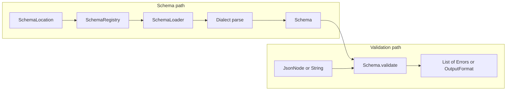
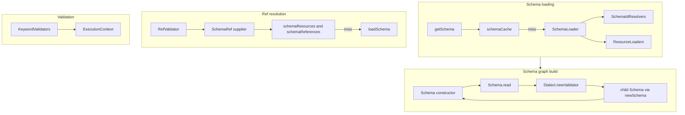

# json-schema-validator (networknt) — Research report

## Metadata

- **Library name**: json-schema-validator (networknt)
- **Repo URL**: https://github.com/networknt/json-schema-validator
- **Clone path**: `research/repos/java/networknt-json-schema-validator/`
- **Language**: Java
- **License**: Apache License 2.0 (see pom.xml)
- **Analyzed version**: b2ca3ea5 2026-10-23 (pom.xml version 3.0.8; CHANGELOG has an Unreleased section after 3.0.8, 2026-09-30)
- **Report date**: 2026-10-27

## Summary

networknt json-schema-validator is a JSON Schema **validation** library for Java. It does **not** generate code. It loads a JSON Schema (via SchemaRegistry and SchemaLoader, from classpath, URI, or in-memory resources), parses it into a Schema graph with KeywordValidators per dialect, and validates JSON (or YAML) documents against that schema. Supported drafts are draft-04, draft-06, draft-07, draft 2019-09, and draft 2020-12; the default dialect can be set (e.g. Draft 2020-12), and `$schema` in the schema data selects the dialect. Validation is the main concern: SchemaRegistry → getSchema(SchemaLocation) → Schema → validate(JsonNode) → List&lt;Error&gt; or format-specific output (Flag, List, Hierarchical). Custom dialects, vocabularies, keywords, and formats are supported. The 3.x line requires Java 17+ and uses Jackson 3 (`tools.jackson`, 3.2.3) for JSON/YAML (2.x remains a separate line) and is designed for performance as part of the light-4j framework.

## JSON Schema support

- **Drafts**: Draft-04, draft-06, draft-07, draft 2019-09, draft 2020-12. SchemaRegistry is created with `withDefaultDialect(SpecificationVersion.DRAFT_2020_12)` or `withDialect(Dialect)`; if the schema data specifies `$schema`, that dialect is used. Cross-dialect validation is supported (e.g. draft-07 schema referencing draft-04).
- **Scope**: Validation only (schema + instance → errors or machine-readable output). No code generation.
- **Subset**: README and doc/compatibility.md state full support for the required functionality of each draft. Format keyword is annotation-only by default since draft 2019-09; format assertions can be enabled via ExecutionConfig or meta-schema vocabulary. contentEncoding/contentMediaType do not generate assertions since 2019-09; contentSchema does not generate assertions. Pattern uses JDK regex by default (not ECMA-262); optional Joni or GraalJS for compliance. Annotation collection and output formats (Flag, List, Hierarchical) follow the machine-readable output specification.

## Keyword support table

Keyword list derived from the vendored meta-schemas of every supported draft: 2020-12 (`specs/json-schema.org/draft/2020-12/meta/*.json`), 2019-09 (`draft/2019-09/meta/*.json`), and draft-07/06/04 (`draft-07/schema.json`, `draft-06/schema.json`, `draft-04/schema.json`). Rows marked with a legacy draft are keywords absent from 2020-12. Implementation evidence from `keyword/KeywordType.java` (keyword to validator, with `SpecificationVersionRange`), `NonValidationKeyword`/`AnnotationKeyword` registrations in `vocabulary/Vocabulary.java` and `dialect/Draft*.java`, and doc/compatibility.md. Hyper-schema keywords (`base`, `links`) are not implemented.

| Keyword | Implemented | Notes |
|---------|-------------|-------|
| additionalItems | yes | Legacy (draft-04 to 2019-09). Registered as NonValidationKeyword but evaluated inside ItemsLegacyValidator (reads `additionalItems` from the parent schema); also consumed by UnevaluatedItemsValidator on 2019-09. |
| definitions | yes | Legacy (draft-04 to 2019-09; also registered for 2020-12/OpenAPI 3.1). NonValidationKeyword; registers subschemas for $ref like $defs. |
| dependencies | yes | Legacy (draft-04 to 2019-09). DependenciesValidator (KeywordType.DEPENDENCIES); handles both property-array and schema forms. |
| id | yes | Draft-04 only. NonValidationKeyword; used as the dialect's idKeyword for base-URI resolution (`$id` in draft-06+). |
| $recursiveAnchor | yes | 2019-09 only. NonValidationKeyword in the core vocabulary; Schema parses it (must be boolean, otherwise an error is reported) and records `recursiveAnchor`. |
| $recursiveRef | yes | 2019-09 only. RecursiveRefValidator. |
| $anchor | yes | 2019-09/2020-12; registered in NonValidationKeyword (readAnchor); used for $ref resolution. |
| $comment | yes | NonValidationKeyword (core vocabulary; draft-07 dialect); no validation. |
| $defs | yes | NonValidationKeyword; registers subschemas for $ref; 2019-09/2020-12. |
| $dynamicAnchor | yes | NonValidationKeyword (readDynamicAnchor); 2020-12. |
| $dynamicRef | yes | DynamicRefValidator; 2020-12. |
| $id | yes | Resolved via SchemaLoader/schemaIdResolvers; used for schema loading and $ref. |
| $ref | yes | RefValidator; resolves via SchemaRegistry.loadSchema, SchemaRef cache; URI + JSON Pointer. |
| $schema | yes | Accepted; used for dialect selection (DialectRegistry). |
| $vocabulary | yes | NonValidationKeyword; read from meta-schemas by AbstractDialectRegistry to build dialects from `$vocabulary`; custom vocabularies via VocabularyRegistry. |
| additionalProperties | yes | AdditionalPropertiesValidator. |
| allOf | yes | AllOfValidator. |
| anyOf | yes | AnyOfValidator. |
| const | yes | ConstValidator; draft-06+. |
| contains | yes | ContainsValidator; draft-06+. |
| contentEncoding | yes | draft-07: ContentEncodingValidator; 2019-09/2020-12: AnnotationKeyword (content vocabulary), no assertions. |
| contentMediaType | yes | draft-07: ContentMediaTypeValidator; 2019-09/2020-12: AnnotationKeyword, no assertions. |
| contentSchema | yes | 2019-09/2020-12 only; AnnotationKeyword, no assertions (compatibility.md). |
| default | yes | AnnotationKeyword; ApplyDefaultsStrategy in walk. |
| dependentRequired | yes | DependentRequired; 2019-09/2020-12. |
| dependentSchemas | yes | DependentSchemas; 2019-09/2020-12. |
| deprecated | yes | AnnotationKeyword (meta-data vocabulary); no validation. |
| description | yes | AnnotationKeyword (meta-data vocabulary); no validation. |
| else | yes | Part of IfValidator (if/then/else); draft-07+. |
| enum | yes | EnumValidator; value must match one of enum set (HashSet of JsonNode). |
| examples | yes | AnnotationKeyword (meta-data vocabulary); no validation. |
| exclusiveMaximum | yes | ExclusiveMaximumValidator; draft-06+ numeric; draft-04 boolean in legacy. |
| exclusiveMinimum | yes | ExclusiveMinimumValidator; draft-06+ numeric; draft-04 boolean in legacy. |
| format | yes | FormatValidator/FormatKeyword; optional assertions (formatAssertionsEnabled); many built-in formats. |
| if | yes | IfValidator; draft-07+. |
| items | yes | ItemsValidator (2020-12) or ItemsLegacyValidator (draft-07 and earlier). |
| maxContains | yes | MinMaxContainsValidator; 2019-09/2020-12. |
| maximum | yes | MaximumValidator. |
| maxItems | yes | MaxItemsValidator. |
| maxLength | yes | MaxLengthValidator. |
| maxProperties | yes | MaxPropertiesValidator. |
| minContains | yes | MinMaxContainsValidator; 2019-09/2020-12. |
| minimum | yes | MinimumValidator. |
| minItems | yes | MinItemsValidator. |
| minLength | yes | MinLengthValidator. |
| minProperties | yes | MinPropertiesValidator. |
| multipleOf | yes | MultipleOfValidator. |
| not | yes | NotValidator. |
| oneOf | yes | OneOfValidator. |
| pattern | yes | PatternValidator; default JDK regex; optional Joni/GraalJS for ECMA-262. |
| patternProperties | yes | PatternPropertiesValidator. |
| prefixItems | yes | PrefixItemsValidator; 2020-12. |
| properties | yes | PropertiesValidator. |
| propertyNames | yes | PropertyNamesValidator; draft-06+. |
| readOnly | yes | ReadOnlyValidator; draft-07+; asserts only when ExecutionConfig readOnly is enabled. |
| required | yes | RequiredValidator. |
| then | yes | Part of IfValidator; draft-07+. |
| title | yes | AnnotationKeyword (meta-data vocabulary); no validation. |
| type | yes | TypeValidator (UnionTypeValidator for union types). |
| unevaluatedItems | yes | UnevaluatedItemsValidator; 2019-09/2020-12; uses annotations. |
| unevaluatedProperties | yes | UnevaluatedPropertiesValidator; 2019-09/2020-12; uses annotations. |
| uniqueItems | yes | UniqueItemsValidator. |
| writeOnly | yes | WriteOnlyValidator; draft-07+; asserts only when ExecutionConfig writeOnly is enabled. |

Non-spec keywords also registered: `discriminator`, `nullable`, `example`, `externalDocs`, `xml` (OpenAPI dialects) and `propertyDependencies` (extension).

## Constraints

Validation keywords are enforced at **runtime** by per-keyword `KeywordValidator` objects that are built once when a `Schema` is created and then run for every instance. Each `Schema` holds a `List<KeywordValidator>` ordered by a fixed comparator (`Schema.VALIDATOR_SORT`: `discriminator`, `type`, `properties`, `patternProperties` first, `unevaluatedItems`/`unevaluatedProperties` last, everything else in schema document order). Constraints such as `minLength`, `minItems`, `pattern`, `required`, `multipleOf` are fully enforced. Meta-data keywords (`$comment`, `title`, `description`, `default`, `examples`, `deprecated`) are annotations only. Format is annotation-only for 2019-09+ unless assertions are enabled (`ExecutionConfig.formatAssertionsEnabled` or the format-assertion vocabulary); draft-04/06/07 assert by default (`BaseFormatValidator` constructor). `contentEncoding`, `contentMediaType` and `contentSchema` assert only in draft-07 (`ContentEncodingValidator`, `ContentMediaTypeValidator`) and are annotation-only in 2019-09/2020-12.

## High-level architecture

Pipeline: **Schema location** (e.g. URI or classpath) → **SchemaRegistry.getSchema(SchemaLocation)** → load schema document via **SchemaLoader** (SchemaIdResolvers, ResourceLoaders) → parse with **Dialect** (vocabularies, keywords) → **Schema** (tree of Schema nodes, each with KeywordValidators) → **Schema.validate(JsonNode)** (or validate with OutputFormat) → **List&lt;Error&gt;** or format-specific output (Flag, List, Hierarchical). No code generation step.

## Medium-level architecture

- **Schema loading**: `SchemaRegistry.getSchema(SchemaLocation)` calls `loadSchema`, which consults `schemaCache` (a `ConcurrentHashMap<SchemaLocation, Schema>`; a second `documentCache` is used when the load is for a JSON-pointer fragment and the loaded document is not itself validated as a schema). On a miss it takes `synchronized (this)` (a registry-wide lock, with double-checked `get`) and calls `getMappedSchema`, which asks `SchemaLoader.getSchemaResource(AbsoluteIri)` for an `InputStreamSource`, reads it with `NodeReader` (JSON, or YAML when the IRI ends in `.yml`/`.yaml`) and builds the root `Schema`. `SchemaLoader` applies optional allow/block predicates, then chains `SchemaIdResolver`s (e.g. `PrefixSchemaIdResolver`, `MapSchemaIdResolver`, then the built-in `MetaSchemaIdResolver`), tries the classpath first, then the configured `ResourceLoader`s (`ClasspathResourceLoader`, `IriResourceLoader` when `fetchRemoteResources` is set, `MapResourceLoader`).
- **Parsing and dialects**: A `Dialect` (Draft 4/6/7, 2019-09, 2020-12, OpenAPI 3.0/3.1, or custom) owns a `HashMap<String, Keyword>`; `Dialect.newValidator` looks the keyword up and calls `Keyword.newValidator(...)`. Built-in keywords are `KeywordType` enum constants carrying a constructor reference and a `SpecificationVersionRange`; non-asserting keywords are `NonValidationKeyword`/`AnnotationKeyword`. The dialect is chosen per schema document from `$schema` (`SchemaRegistry.withDialect`), falling back to the registry default.
- **Schema graph construction**: `Schema` is constructed eagerly and recursively. Its constructor calls `getValidators()`, which iterates every keyword of the schema node, builds a `KeywordValidator` for each, and each composite validator (e.g. `PropertiesValidator`, `AllOfValidator`) in its own constructor calls `schemaContext.newSchema(...)` for every child schema. `$ref` targets are the only edges deferred: `RefValidator` holds a `SchemaRef` whose `Supplier` resolves the target lazily.
- **$ref resolution**: see "Reference resolution and registry" below.
- **Validation**: `Schema.validate(ExecutionContext, node, rootNode, NodePath)` walks the validator list; errors accumulate in `ExecutionContext.errors`; annotations accumulate in `ExecutionContext.annotations` when needed.
- **Key types**: `Schema`, `SchemaRegistry`, `SchemaLoader`, `SchemaIdResolver`, `ResourceLoader`, `SchemaContext`, `ExecutionContext`, `KeywordValidator`, `Dialect`, `Vocabulary`, `OutputFormat`, `Error`, `NodePath`.

## Algorithms and data structures

### Schema representation

There is no separate typed schema model: a `Schema` (`Schema.java`, ~1700 lines) is a thin wrapper around the Jackson 3 `JsonNode` (`tools.jackson.databind.JsonNode`) it was read from. Fields: `JsonNode schemaNode`, `Schema parentSchema`, `SchemaLocation schemaLocation`, `SchemaContext schemaContext`, `String id`, the built `List<KeywordValidator> validators`, and the flags `unevaluatedPropertiesPresent`, `unevaluatedItemsPresent`, `recursiveAnchor`. The raw node is kept and re-consulted at validator construction time (many validators peek at siblings through `parentSchema.getSchemaNode().get("properties")`, e.g. `AdditionalPropertiesValidator`, `ItemsValidator` for `prefixItems`, `MinimumValidator` for draft-04 `exclusiveMinimum`) and at validation time for a few cases (`RequiredValidator.getFieldKeyword`, `AbstractKeywordValidator.hasAdjacentKeywordInEvaluationPath`). Boolean schemas are modeled as a `TrueValidator`/`FalseValidator` registered under pseudo-keywords `"true"`/`"false"` (`Schema.read`, `KeywordType.TRUE/FALSE`, only allowed for draft-06+, checked in `SchemaRegistry.validateSchemaNodeType`). Unknown keywords go through the dialect's `KeywordFactory`: by default `UnknownKeywordFactory` logs one warning per keyword name (cached in a `ConcurrentHashMap`) and returns an `AnnotationKeyword`; `DisallowUnknownKeywordFactory` turns this into an error; inside a "document container" (a JSON-pointer lookup into a non-schema document) unknown keywords silently become annotations. Schemas are immutable after construction apart from lazily built state; ownership is by reference (parent pointer plus child lists inside validators), the whole graph is garbage-collected together. `$ref` siblings are dropped for dialects older than 2019-09 (`Schema.read` clears all validators except `$ref` when the dialect order is below `DRAFT_2019_09`).

Paths are modeled by `NodePath` (`path/NodePath.java`), an immutable parent-linked cons list: each `append` allocates one node holding `parent`, a `String` segment or `int` index, and lazily caches its `toString` value and hash. `SchemaLocation` is the analogous structure for schema locations (an `AbsoluteIri` plus a `NodePath` fragment).

### Reference resolution and registry

State lives in three places. (1) `SchemaRegistry`: `schemaCache` and `documentCache`, keyed by `SchemaLocation`, each a `ConcurrentHashMap`. (2) `SchemaContext`, which is shared by every `Schema` built from one root document: `schemaResources` (`ConcurrentMap<String, Schema>`; absolute IRI or IRI#anchor to the schema that is a resource root or carries an `$anchor`), `schemaReferences` (location string to subschema, filled by `$defs`/`definitions` registration and by on-demand pointer resolution), `dynamicAnchors` (IRI#name to schema for `$dynamicAnchor`). When a `$ref` crosses into another document, `RefValidator.copySchemaResources` `putAll`s the other context's three maps into the referring context so subsequent lookups hit locally. (3) Per-`RefValidator` `SchemaRef`, which wraps a `Supplier<Schema>`.

Base-URI tracking: the `Schema` constructor calls `resolve(...)`, which reads the dialect's id keyword (`$id`, or `id` in draft-04) and resolves it against the parent location (`SchemaLocation.resolve`); if the id has a non-empty fragment (old-draft anchor-style ids) the fragment is stripped for the location. A schema without a fragment becomes a schema resource and is registered with `schemaResources.putIfAbsent(...)`; `$anchor` registers `absoluteIri + "#" + anchor`; `$dynamicAnchor` registers into `dynamicAnchors`. For draft-07 and earlier the `$ref` base is the parent when the referring schema itself has an `$id` (`RefValidator.resolve`).

`RefValidator.getRefSchema` branches on the shape of the ref text: (a) not starting with `#`: split into document URI and fragment, resolve against the base, build a supplier that first tries `schemaResources.get(uri)`, else `SchemaRegistry.loadSchema(location, validateLoadedSchema)` (which may fetch remotely), copies resources, then resolves the fragment against `schemaResources`/`dynamicAnchors` or, failing that, `Schema.getSubSchema(fragment)`; (b) `#anchor`: lookup in `schemaResources` then `dynamicAnchors`, else pointer walk; (c) exactly `#`: `parentSchema.findSchemaResourceRoot()`; (d) `#/json/pointer`: `getSchema` -> `schemaReferences` cache -> `Schema.getSubSchema(NodePath)`.

`Schema.getSubSchema` walks the pointer segment by segment from the schema resource root through the raw `JsonNode` tree. It only materializes a new `Schema` object (via `newSchema`) for segments that carry an `$id` or for the final segment, so a `$ref` to `#/$defs/foo/properties/bar` builds just the `bar` schema with the right parent. If a segment is absent it falls back to the old-style `id`-based retrieval (`fetchSubSchemaNode`) before raising `InvalidSchemaRefException`. Results are stored in `schemaReferences` under the resolved reference string, with the double-checked lookup done under `synchronized (schemaRegistry)`.

Laziness and cycles: the `SchemaRef` supplier is a `ThreadSafeCachingSupplier` (double-checked, volatile delegate nulled after first computation) when `SchemaRegistryConfig.cacheRefs` is true (default), else it recomputes on each validation. Recursive schemas therefore terminate at construction because resolving a `$ref` is deferred until first use and `schemaReferences`/`schemaResources` return the same `Schema` instance. During validation cycles are bounded by instance depth only; there is no visited-set for validation because every `$ref` consumes instance progress in well-formed schemas. During `walk` with a null instance node, `RefValidator.walk` scans `ExecutionContext.evaluationSchema` (a deque of active schemas) for the target location to break schema-only cycles. `$dynamicRef` (`DynamicRefValidator`) resolves per evaluation: if the static target has a `$dynamicAnchor`, it iterates `evaluationSchema` from outermost to innermost and, whenever the base IRI changes, looks for the same anchor name in that resource and takes the last match found (the supplier is never cached, `getSupplier(..., false)`). `$recursiveRef` (`RecursiveRefValidator`) similarly starts at the resource root and, if it has `$recursiveAnchor: true`, scans the evaluation stack for outer resources that also declare it. Remote fetching is off by default (the default `SchemaLoader` has only the classpath loader); `SchemaLoader.getRemoteFetcher()` adds `IriResourceLoader`.

### Compiled / intermediate form

The compiled form is the `Schema` tree itself: a graph of `Schema` objects, each with an ordered `List<KeywordValidator>` (`Collections.unmodifiableList`). `KeywordValidator` is an interface with `validate(ExecutionContext, JsonNode instance, JsonNode root, NodePath instanceLocation)` and `walk(...)`, plus `preloadSchema()`. Concrete validators are plain classes (~60 under `keyword/`), each extracting what it needs from the keyword value in its constructor and caching it in final fields:

- `PropertiesValidator`: `LinkedHashMap<String, Schema>` of child schemas (insertion order = schema order).
- `AllOfValidator`/`AnyOfValidator`/`OneOfValidator`: `List<Schema>`.
- `PatternValidator`: a `RegularExpression` compiled in the constructor (`RegularExpression.compile`).
- `PatternPropertiesValidator`: `IdentityHashMap<RegularExpression, Schema>`.
- `AdditionalPropertiesValidator`: a `HashSet<String>` of names from the sibling `properties` plus a `List<RegularExpression>` copied from sibling `patternProperties`, so it can decide membership without touching other validators.
- `EnumValidator`: `HashSet<JsonNodeValue>` (see Enum handling) and a precomputed error string.
- `MultipleOfValidator`: `BigDecimal divisor`, `BigInteger denominator` (the unscaled divisor), and `long longDivisor` when the divisor is integral.
- `MinimumValidator`/`MaximumValidator`: a `ThresholdMixin` strategy object chosen at construction (long-based fast path if the bound is int/long and the schema `type` is integer, else a BigDecimal path).
- `MinLengthValidator` etc.: `CountLimit` (supports limits beyond `int` range).
- `RefValidator`: the `SchemaRef` supplier.
- `TypeValidator`: a `JsonType` enum value, plus a `UnionTypeValidator` for array types.

Dispatch is virtual method calls over this list; nothing is compiled to bytecode or closures other than the `KeywordType` constructor references used at build time. The only "optimizer" pass is `Schema.initializeValidators()`/`preloadSchema()`, which forces `$ref` suppliers to resolve ahead of the first validation (see Performance).

### Core algorithm

`Schema.validate(ExecutionContext, JsonNode, JsonNode, NodePath)`:

1. `executionContext.enterEvaluation(...)` (limit accounting, a no-op unless `maxEvaluationSteps`/`maxEvaluationDepth` is configured) and push `this` on `evaluationSchema` (an `ArrayDeque<Schema>`).
2. Save then set the `unevaluatedPropertiesPresent`/`unevaluatedItemsPresent` flags on the context if this schema contains those keywords (restored in `finally`).
3. Record the current error-list size, then for each validator in order: push the keyword onto `evaluationPath` (`NodePath.append`) and onto `evaluationSchemaPath`, call `validator.validate(...)`, pop.
4. If new errors appeared, mark every annotation recorded at this instance location whose evaluation path starts with the current evaluation path as `valid=false` (this is how annotations from failed subschemas are dropped).

There is no boolean-only evaluation loop: the "is it valid" path is the same code with `failFast` enabled. When `ExecutionContext.isFailFast()`, `addError` throws `FailFastAssertionException` (its `fillInStackTrace` returns `this`, so it is cheap), which `Schema.validate(ExecutionContext, node, format, ...)` catches and turns into a single-element error list. `OutputFormat.FLAG` and `BOOLEAN` set `failFast(true)` and disable annotation collection; `OutputFormat.DEFAULT` disables annotation collection but collects all errors.

Keyword ordering is fixed by `VALIDATOR_SORT`: `type` runs before `properties`, which runs before `patternProperties`; `unevaluated*` run last so that sibling annotations exist. Individual validators short-circuit on type mismatch (`PropertiesValidator` returns immediately if the node is not an object; `PatternValidator` returns if not a string).

Composition: `allOf` validates every branch against the same error list (no short circuit). `anyOf` (`AnyOfValidator`) and `oneOf` (`OneOfValidator`) swap in a temporary `subSchemaErrors` list on the context, disable fail-fast, evaluate branches, then restore the real list. `anyOf` returns on the first passing branch only if `canShortCircuit` (no `unevaluated*` in the evaluation path, no annotation collection, no discriminator); otherwise all branches run so annotations from every passing branch are recorded. `oneOf` counts passing branches and stops after the second match only when `canShortCircuit`. On failure `oneOf` reports the count and indexes of matching branches plus (when `reportChildErrors`) the child errors; `anyOf` reports all branch errors, or only the discriminator-matched branch's errors. `not` evaluates its subschema into a scratch list and errors if that list is empty. `if/then/else` (`IfValidator`) evaluates `if` into a scratch list, then evaluates `then` or `else`, temporarily rewriting the last evaluation-path token from `if` to `then`/`else`. `$ref` simply calls `refSchema.validate` with the same instance and location (in 2019-09+ with siblings preserved).

`unevaluatedProperties` (`UnevaluatedPropertiesValidator`) is annotation-driven: `PropertiesValidator`, `PatternPropertiesValidator`, `AdditionalPropertiesValidator` and `UnevaluatedPropertiesValidator` itself publish an `Annotation` whose value is a `Set<String>` of matched property names, but only when `hasUnevaluatedPropertiesInEvaluationPath` is true (checked by scanning the `evaluationSchema` deque upward for a schema that has the keyword, stopping at the nearest `properties`/`items` boundary) or annotation collection is explicitly on. The unevaluated validator then streams all annotations stored at the same instance location (`Annotations` is a `LinkedHashMap<NodePath, List<Annotation>>`), filters by keyword name, by `isValid()` and by whether the annotation's evaluation path is under the parent of the current path, unions the names, and validates each remaining property against its schema (or errors for `false`). That is O(annotations at the instance location x 4 passes) per object and requires holding annotations for the whole document. `unevaluatedItems` follows the same pattern with `items`/`prefixItems`/`contains` annotations.

`uniqueItems` builds a `HashSet<JsonNodeValue>` per array (O(n) average, hash/equality defined by `JsonNodeValue` for numeric-aware JSON equality) but reports one error per duplicate encountered rather than one per array. `required` is a loop over a `List<String>` with `node.get`. `additionalProperties` iterates instance properties and, for each not in the `allowedProperties` set, runs all sibling `patternProperties` regexes (`handledByPatternProperties`), so cost is O(instance props x patterns) in the worst case.

`walk` is a second traversal mode sharing the validator list: `KeywordValidator.walk` with `WalkConfig` handlers (`KeywordWalkHandler`, `PropertyWalkHandler`, `ItemWalkHandler`) that can skip subtrees, and `ApplyDefaultsStrategy` that mutates the instance `ObjectNode`/`ArrayNode` to insert `default` values (following `$ref` through `SchemaRefs.from`). The walk can run with `shouldValidateSchema=true` to validate and walk at once, or with a null/absent instance to traverse the schema alone.

### Error and output model

`Error` (`Error.java`) is a value object: `keyword`, `evaluationPath` (`NodePath`), `schemaLocation` (`SchemaLocation`), `instanceLocation` (`NodePath`), `arguments` (`Object[]`), `messageKey`, a `Supplier<String> messageSupplier`, a `details` map (`property`, `index`), and optionally `instanceNode`/`schemaNode` references and a `customMessage` flag. Messages are lazy: validators build errors through `MessageSourceError.Builder` (`BaseKeywordValidator.error()`), which installs a `messageFormatter` that resolves the key and arguments against the configured `MessageSource` (resource bundles, locale-aware, per-keyword `errorMessage` overrides from the schema via `ErrorMessages`) only when `getMessage()` is called. `NodePath.toString()` is also lazy and cached.

Errors are appended to `ExecutionContext.errors` (`ArrayList<Error>`), which composite keywords temporarily replace with scratch lists. `OutputFormat<T>` is a strategy applied after traversal: `DEFAULT` returns `List<Error>`; `BOOLEAN` and `FLAG` return a boolean/`OutputFlag`; `LIST` and `HIERARCHICAL` convert errors into `OutputUnit` trees (`output/ListOutputUnitFormatter`, `HierarchicalOutputUnitFormatter`) following the machine-readable output spec; `RESULT` returns `Result` wrapping the execution context (errors, annotations). Errors can be serialized with Jackson (annotated `@JsonPropertyOrder`, `@JsonInclude(NON_NULL)`). `PathType` (`JSON_POINTER` default, `LEGACY`, `JSON_PATH`) selects the textual form of locations. Exhaustion of the optional evaluation limits throws `ValidationLimitExceededException` and records it in the context so that later accessors rethrow it.

## Low-level details

- **Execution limits (new, Unreleased)**: opt-in `ExecutionConfig.maxEvaluationSteps` and `maxEvaluationDepth`. `ExecutionContext.enterEvaluation` allocates an `EvaluationState` only when either limit is non-zero; unlimited runs return immediately, and a run that began unlimited stays unlimited. Each `Schema.validate`/`walk` entry and, when limited, each keyword dispatch (`admitKeyword`) counts as one step; exceeding either bound throws `ValidationLimitExceededException`, which is stored in `evaluationAbort` and re-thrown by `getErrors`/`getAnnotations`/`exitEvaluation` so no partial validity result escapes (doc/validation-execution-limits.md). Without limits there is no recursion-depth guard other than the JVM stack: validation recurses through `Schema.validate` -> `KeywordValidator.validate` and deep instances or schemas can overflow the stack.
- **Exact numeric semantics**: The built-in JSON/YAML readers wrap the Jackson parser in `PrecisionParser` (`serialization/SchemaNodeReader.java`, installed by `SelectiveTreeDeserializer`) so that float tokens that are not exactly representable as a double are read as `DecimalNode` (BigDecimal) while integers and exactly-representable floats stay as int/long/double nodes. `JsonNodeValue` (used by `enum`, `const` via `JsonNodeValue.same`, and `uniqueItems`) classifies numbers into WHOLE / DOUBLE / BIG / NON_FINITE and compares/hashes accordingly, so `1`, `1.0` and `1E0` are equal and large decimals compare by exact value. `MultipleOfValidator` converts instance and divisor to `BigDecimal` and tests divisibility on unscaled `BigInteger`s with scale alignment (`isMultipleOf`), with a `long` remainder fast path when the divisor is integral and the dividend has at most 19 digits; there is no floating-point remainder. `CountLimit` preserves count limits larger than `int`.
- **String length**: `minLength`/`maxLength` use `String.codePointCount`, i.e. Unicode code points (not UTF-16 units, not bytes).
- **Type checks**: `TypeFactory.getValueNodeType` and `JsonNodeTypes.equalsToSchemaType` implement `integer` for number nodes only when the dialect is draft-06 or later and the value is exactly integral (`canConvertToExactIntegral`, so `1.0` is an integer in draft-06+ but not in draft-04); `typeLoose` mode additionally accepts numeric strings (`Strings.isInteger`) and similar coercions.
- **Draft differences handled in-place**: `$ref` sibling dropping for drafts before 2019-09; draft-04 boolean `exclusiveMinimum/Maximum` read from the parent schema node by `MinimumValidator`/`MaximumValidator`; `items` is `ItemsLegacyValidator` (array or schema form, with `additionalItems` read from the parent) up to 2019-09 and `ItemsValidator` with `prefixItems` in 2020-12.
- **Format changes**: `date-time` follows RFC 3339 more strictly (rejects space separator) (#1316). Built-in formats live in `format/` (`Formats.java`: date, time, date-time, duration, email/idn-email, hostname/idn-hostname, ipv4 (and legacy `ip-address`), ipv6, uri/uri-reference/iri/iri-reference, uri-template, uuid, json-pointer, relative-json-pointer, regex, plus draft-03-era `alpha`, `alphanumeric`, `color`, `phone`, `style`, `utc-millisec`); `idn-hostname` uses an RFC 5892 check backed by a Unicode database (`utils/UCDLoader`, `UnicodeDatabase`).
- **OpenAPI**: `nullable` is resolved through allOf/oneOf/anyOf, if/then/else and ref ancestors (`JsonNodeTypes.isNullableAncestor` walks `evaluationSchema`); `DiscriminatorValidator`/`DiscriminatorState` store per-instance-location discriminator state in `ExecutionContext.discriminatorMapping` for `oneOf`/`anyOf`/`allOf`.
- **Errors**: `Error.getMessageKey()` and `isCustomMessage()` distinguish schema-supplied messages (#1319).
- **Loaders**: `SchemaLoader` holds `schemaIdResolvers`, `resourceLoaders`, and optional `allow`/`block` predicates on the IRI. Built-in: `ClasspathResourceLoader`, `IriResourceLoader`, `MapResourceLoader`. `SchemaRegistry.Builder.schemas(Map)` or `schemas(Function)` configures in-memory resources.
- **Regex**: see Performance techniques / Regex handling. `RegularExpressions.replaceDollarAnchors` rewrites unescaped `$` outside character classes so Java matches ECMA end-of-input semantics; `replaceLongformCharacterProperties` rewrites long-form Unicode property names for the JDK engine.
- **Unknown-keyword and meta-schema handling**: schemas are not validated against their meta-schema on load; structural checks happen per keyword constructor (e.g. `AllOfValidator` throws `SchemaException` for a non-array, `MinimumValidator` for a non-number, `RecursiveRefValidator` for a value other than `#`). `SchemaIdValidator` (optional) can reject invalid `$id` values.
- **Apply defaults**: `WalkHandler` and `ApplyDefaultsStrategy` apply default values during walk when configured.
- **Unverified**: `RefValidator.preloadSchema` calls `Schema.getEvaluationParentSchema()`, but that method is not defined anywhere under `src/` in this clone (grep finds only the two call sites), so the exact cycle-depth check used during preload could not be verified.

## Output and integration

- **Vendored vs build-dir**: N/A (validation only; no generated code output).
- **API vs CLI**: Library API only. No CLI. Entry: SchemaRegistry.withDefaultDialect(SpecificationVersion) or withDialect(Dialect); schemaRegistry.getSchema(SchemaLocation.of(uri)); schema.validate(JsonNode) or schema.validate(String, InputFormat, OutputFormat). Optional ExecutionContextCustomizer for locale, formatAssertionsEnabled, etc.
- **Writer model**: N/A (validation only). Validation result is in-memory (List&lt;Error&gt; or format object).

## Configuration

- **SchemaRegistry**: defaultDialectId, dialectRegistry, nodeReader, schemaLoader, schemaCacheEnabled, schemaRegistryConfig. withDefaultDialect(Version) or withDialect(Dialect) for standard dialects.
- **SchemaLoader**: schemaIdResolvers (e.g. mapPrefix for $id → retrieval IRI), resourceLoaders, allow/block predicates, fetchRemoteResources.
- **SchemaRegistryConfig**: regularExpressionFactory (JDK, Joni, GraalJS), formatAssertionsEnabled, pathType, typeLoose, cacheRefs, etc. ExecutionConfig (per validate call): formatAssertionsEnabled, readOnly, writeOnly, locale.
- **Custom dialect/keywords/formats**: doc/custom-dialect.md; Dialect.builder(base).keyword(...).build(); SchemaRegistry.withDialect(dialect). Custom Keyword and KeywordValidator; VocabularyRegistry for custom vocabularies.

## Pros/cons

- **Pros**: Validation-only; supports draft-04 through 2020-12 and custom dialects; optional format assertions; configurable regex (JDK/Joni/GraalJS); SchemaRegistry and SchemaLoader flexible (classpath, URI, map); custom keywords/vocabularies/formats; Flag/List/Hierarchical output; annotation collection; OpenAPI 3.0/3.1 dialects; Jackson-based (JSON and YAML); tested against JSON Schema Test Suite (100% pass per compatibility.md); performance-focused; minimal required dependencies; active maintenance (light-4j).
- **Cons**: No code generation; default pattern is not ECMA-262 compliant; format assertions off by default (2019-09+); unevaluatedProperties/unevaluatedItems require annotation collection (performance impact); optional Joni/GraalJS add dependency size.

## Testability

- **How to run tests**: From repo root, `mvn test`. Tests use JUnit 5.
- **Test suite**: JsonSchemaTestSuiteTest and other *Test classes extend AbstractJsonSchemaTestSuite; they discover test files under src/test/suite/tests/ (draft4, draft6, draft7, draft2019-09, draft2020-12). Each test case runs schema.validate(testSpec.getData(), OutputFormat.DEFAULT, ...) and asserts errors match expected valid/invalid. Format tests enable formatAssertionsEnabled when parent path ends with "format". README notes JSON Schema Test Suite is in src/test/suite; compatibility.md reports 100% pass for required tests (r and o) across drafts.
- **Other tests**: Unit tests for validators (e.g. PropertiesTest, PrefixItemsValidatorTest, UnevaluatedPropertiesTest), OpenAPI30JsonSchemaTest, V4JsonSchemaTest, benchmarks (NetworkntTestSuiteRequiredBenchmark, NetworkntTestSuiteOptionalBenchmark) in src/test/java.

## Performance

Analyzed from code only; no benchmark was run. Measured comparisons belong to the repo's `make benchmark` harness.

### Performance techniques

- **Compile vs interpret**: The library is a build-once, run-many interpreter. Per schema, at `Schema` construction time it parses keywords into `KeywordValidator` objects with precomputed state: compiled regexes (`PatternValidator`, `PatternPropertiesValidator`, `AdditionalPropertiesValidator`), `HashSet`s for `enum` and `additionalProperties`' allowed names, a `BigDecimal`/`BigInteger`/`long` triple for `multipleOf`, a typed threshold strategy for `minimum`/`maximum`, a `JsonType` enum for `type`, and pre-resolved child `Schema` objects. `$ref` targets are resolved lazily (cached supplier) but `SchemaRegistryConfig.preloadSchema` (default true) walks the validator tree after `getSchema` via `Schema.initializeValidators()` -> `KeywordValidator.preloadSchema()` to force refs before the first validation; `RefValidator.preloadSchema` limits nested preloading with `preloadSchemaRefMaxNestingDepth` and a circular check. There is no code generation or bytecode specialization. Per validation, work is: virtual dispatch per keyword, `JsonNode` lookups, comparisons, and `NodePath` allocation.
  Not everything is precomputed: `MinimumValidator`/`MaximumValidator` (the non-long path) execute `new BigDecimal(minimumText)` and `new BigDecimal(node.asString())` on every call, so numeric bounds on non-integer-typed schemas parse text each time.
- **Memory layout and allocation**: The graph is a pointer-linked tree of Java objects over Jackson `JsonNode`s; there are no arenas, flat arrays, or interning. Instance and evaluation locations are immutable linked `NodePath` nodes, so each descent into a property or keyword allocates one `NodePath` (`instanceLocation.append`, `evaluationPathAddLast`) with the string form built lazily and cached; paths are shared by sibling errors. `ExecutionContext` is allocated per validate call and holds an `ArrayList<Error>`, `ArrayDeque<Schema>` and `ArrayDeque<Object>` for the evaluation stacks; the `Annotations` map is created lazily on first access. `anyOf`/`oneOf`/`not`/`if` allocate a scratch `ArrayList<Error>` per evaluation (reused with `clear()` across branches in `anyOf`/`oneOf`). `Error` objects are only created on failure and their message string is a lazy supplier. `Schema.read` sizes its `ArrayList` from the node size and wraps it unmodifiable. The README's JMH sample reports about 320 KB allocated per operation (`gc.alloc.rate.norm` 320360 B/op) for the "basic" draft-04 workload; the README says results depend heavily on the workload.
- **Caching and memoization**: (1) `SchemaRegistry.schemaCache`/`documentCache` per `SchemaLocation` (`schemaCacheEnabled` default true), guarded by a registry-wide lock on miss. (2) `SchemaContext.schemaResources`, `schemaReferences`, `dynamicAnchors` memoize resource roots, anchors and pointer targets. (3) `SchemaRef` with `ThreadSafeCachingSupplier` memoizes `$ref` targets when `cacheRefs` is on; `$dynamicRef` and `$recursiveRef` are deliberately uncached because they depend on the evaluation stack. (4) `NodePath.toString`/`hashCode` are memoized. (5) `UnknownKeywordFactory` caches one `AnnotationKeyword` per unknown name. (6) `FormatKeyword` resolves the `Format` object once at build time. No per-instance result memoization (the same subschema/instance pair can be re-evaluated).
- **Fast paths and short-circuiting**: `failFast` plus `OutputFormat.FLAG/BOOLEAN` stop at the first error via a stackless exception. `anyOf` stops at the first success and `oneOf` at the second success, only when no annotations are required (`canShortCircuit`: no `unevaluated*` ancestor, annotation collection off, no discriminator). Validators return immediately on instance type mismatch (e.g. `PropertiesValidator` for non-objects, `PatternValidator` for non-strings). Keyword order puts `type` and `properties` first. `MultipleOfValidator` uses a `long` remainder when both operands are small integers; `MinimumValidator` uses a long comparison when the bound and the schema type are integer. Annotation collection is off by default and enabled implicitly only where an `unevaluated*` keyword is in the evaluation path, tracked by two booleans on the context so that the ancestor scan (`hasAdjacentKeywordInEvaluationPath`) is skipped unless the flag is set. Unlimited runs skip the evaluation-limit accounting entirely. `JsonNodeValue` precomputes a hash so equality starts with an integer compare.
- **Regex handling**: `RegularExpressionFactory` is pluggable (`SchemaRegistryConfig.regularExpressionFactory`). Default `JDKRegularExpressionFactory` compiles `java.util.regex.Pattern` after `replaceDollarAnchors`/`replaceLongformCharacterProperties` and matches with `matcher(value).find()` (unanchored per JSON Schema), which is not ECMA-262 and is a backtracking engine. `JoniRegularExpression` (optional `org.jruby.joni:joni`) uses an ECMAScript syntax and a UTF-8 byte encoding wrapper, with a pre-check regex (`INVALID_ESCAPE_PATTERN`) that rejects escapes invalid in ECMA-262. `GraalJSRegularExpression` (optional GraalJS) builds a JS function per pattern and executes it, with every compile and match `synchronized` on the shared polyglot `Context`, serializing matching across threads. `ECMAScriptRegularExpressionFactory` picks GraalJS when present, else Joni. Patterns are compiled once when the validator is built; no cache across validators (the same pattern text in two places compiles twice). The code has no ReDoS protection (no timeout, step limit or linear-time engine); the optional `maxEvaluationSteps` counts schema evaluation steps, not regex steps. `patternProperties` and `additionalProperties` run every pattern against every property name.
- **Concurrency**: A built `Schema` graph is intended to be shared across threads; per-validation state lives in `ExecutionContext`, which is documented as confined to one execution. Shared mutable state is concurrent: registry and context maps are `ConcurrentHashMap`s, `SchemaRef` uses double-checked locking with `volatile`, and schema loading and pointer resolution lock on the `SchemaRegistry` instance (a coarse lock to avoid the `computeIfAbsent` recursive-update problem the code comments mention). `Schema.validators` is a plain field populated in the constructor, so after construction it is read-only. Validation itself is single-threaded per call; no parallel evaluation of branches or items. GraalJS regex matching serializes on a lock.

### Benchmarks in repo

JMH benchmarks live under `src/test/java/com/networknt/schema/benchmark/` and run via the Maven `benchmark` profile (builds `target/benchmarks.jar`, main class `org.openjdk.jmh.Main`; JMH 1.37):

- `NetworkntBenchmark.basic` (throughput, 2 forks, 5 warmups and 5 measurements of 5 s, `GCProfiler`): runs `NetworkntBasicRunner`, a draft-04 properties-heavy schema/instance pair (also described in the README with the external `networknt/json-schema-validator-perftest` project).
- `NetworkntTestSuiteRequiredBenchmark` and `NetworkntTestSuiteOptionalBenchmark`: parametrized over drafts 4, 6, 7, 2019-09, 2020-12; run every JSON-Schema-Test-Suite case of the required or optional type under `src/test/suite/tests/<draft>` via `NetworkntTestSuiteRunner`.
- `DecimalTreeBenchmark` and `NumericUniqueItemsBenchmark`: tree-reading cost of the decimal-preserving reader and numeric `uniqueItems`; `doc/issue-1362-performance.md` records a historical comparison (JSON machine doubles about 2.3x native Jackson read time; marked as still open).
- `.github/workflows/benchmark.yml` runs the jar on pushes to master and publishes via `github-action-benchmark`.

Entry points for external harnesses: `SchemaRegistry.withDefaultDialect(SpecificationVersion.DRAFT_2020_12)`, `registry.getSchema(String/JsonNode/SchemaLocation)`, then `schema.validate(JsonNode)` (all errors) or `schema.validate(node, OutputFormat.FLAG)` / `OutputFormat.BOOLEAN` (fail-fast). Build the schema once outside the timed loop. doc/compatibility.md notes that annotation collection (for `unevaluated*`) hurts performance and that deeply nested `oneOf`/`anyOf` without `if/then` can force full evaluation.

## Determinism and idempotency

- **Generated output**: Not applicable (validation only).
- **Validation result**: Outcome is deterministic. Error order follows evaluation order: validators run in the `VALIDATOR_SORT` order (stable sort, so other keywords keep schema document order); `properties` iterates a `LinkedHashMap` (schema order); `required` iterates its list; instance properties are visited in Jackson object order (insertion order of the parsed document). One non-deterministic spot: `PatternPropertiesValidator` stores its patterns in an `IdentityHashMap<RegularExpression, Schema>`, whose iteration order depends on object identity hashes and can differ between runs, so when several patterns match one property the order of resulting errors and annotations is not guaranteed. No explicit sorting of errors; output formats present them in the order produced.

## Enum handling

- **Implementation**: `EnumValidator` builds `HashSet<JsonNodeValue>` from the enum array at construction (`JsonNodeValue.of(node)` precomputes a hash). Validation wraps the instance the same way and tests `contains`. `JsonNodeValue.equals` compares JSON-type first, then numbers by value (so `1`, `1.0` and `1e0` are one value, large decimals compare exactly), arrays element-wise in order and objects as key/value sets. The old `processNumberNode` hook is now an identity function; numeric normalization lives in `JsonNodeValue`. `typeLoose` mode adds two extra sets (`looseValues`, `looseNumbers`) so a string instance can match a non-string enum member by text or exact decimal value. With the `nullable` keyword enabled (OpenAPI), a null instance is accepted.
- **Duplicate entries**: Deduplicated silently by the set (`["a","a"]` keeps one; `[1, 1.0]` keeps one). The error message string still lists every original entry, duplicates included.
- **Case / namespace**: Comparison is exact and case-sensitive, so `"a"` and `"A"` are two distinct members and each matches only its own instance value; nothing is lost.

## Reverse generation (Schema from types)

No. networknt json-schema-validator is a validation-only library; it does not generate JSON Schema from Java types.

## Multi-language output

N/A (validation only; no code generation).

## Model deduplication and $ref/$defs

- **Validation context**: There is no generated model; the question is how `$ref` and `$defs` are shared in the compiled graph.
- **$defs / definitions**: `NonValidationKeyword.Validator` iterates the entries of `$defs`/`definitions` and builds a `Schema` for each (`schemaContext.newSchema(location, node, parentSchema)`), storing it in `schemaContext.getSchemaReferences()` under its location string. This registration is eager, even if nothing references the definition (so every definition is parsed and its keyword validators built).
- **$ref**: `#/$defs/foo` resolves through `schemaReferences` to that single `Schema` instance, shared by every referrer. For pointers that are not pre-registered, `getSubSchema` builds the target schema on first use and caches it under the resolved reference string. Two structurally identical inline subschemas at different locations are **not** merged; each location gets its own `Schema` and validator objects. Resolved refs are cached in the per-`RefValidator` `SchemaRef`, so repeated validation does not re-resolve. Cross-document refs reuse `SchemaRegistry.schemaCache` entries and copy resource maps into the referring `SchemaContext`.

## Validation (schema + JSON → errors)

Yes. This is the library's main purpose.

- **Inputs**: (1) A JSON Schema, obtained via SchemaRegistry.getSchema(SchemaLocation) where the location is a URI (or mapped via schemaIdResolvers to classpath/map). (2) A JSON or YAML instance, as JsonNode or String (with InputFormat.JSON/YAML) or AbsoluteIri.
- **API**: schema.validate(JsonNode rootNode) returns List&lt;Error&gt;; overloads with OutputFormat&lt;T&gt; return T (e.g. Flag, List or Hierarchical output); validate(String, InputFormat, ...) and validate(AbsoluteIri, InputFormat, ...) deserialize then validate. ExecutionContextCustomizer or Consumer&lt;ExecutionContext&gt; can set executionConfig (formatAssertionsEnabled, readOnly, writeOnly, locale).
- **Output**: List&lt;Error&gt; (DEFAULT format); or machine-readable output (Flag, List, Hierarchical) per Specification for Machine-Readable Output. Each Error has type, instanceLocation, evaluationPath, message, etc.
- **Meta-schema validation**: Not required before use; schemas are parsed with the dialect determined by $schema or default. Optional validation of schema documents against a meta-schema can be done by validating the schema node with a meta-schema Schema.
- **Format**: When format keyword is present, FormatValidator runs; assertions only if formatAssertionsEnabled (ExecutionConfig or format-assertion vocabulary in meta-schema).
