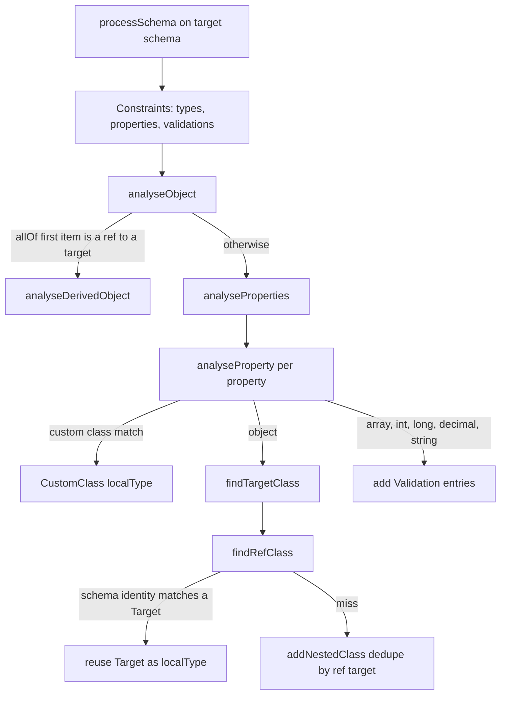

# json-kotlin-schema-codegen — Research report

## Metadata

- **Library name**: json-kotlin-schema-codegen
- **Repo URL**: https://github.com/pwall567/json-kotlin-schema-codegen
- **Clone path**: `research/repos/kotlin/pwall567-json-kotlin-schema-codegen/`
- **Language**: Kotlin
- **License**: MIT (see LICENSE in repo)
- **Analyzed version**: 76130d5 2025-07-02 (release 0.123, 2025-07-01; depends on json-kotlin-schema 0.57, mustache-k 3.11, kjson-core 10.2)
- **Report date**: 2026-10-27

## Summary

json-kotlin-schema-codegen is a JSON Schema to code generation library for Kotlin. It reads JSON or YAML schema files, parses them using the companion library json-kotlin-schema, and generates Kotlin, Java, or TypeScript source code via Mustache templates. The library can be used as an API (`CodeGenerator` with `generate()`, `generateClass()`, `generateAll()`), or via Gradle/Maven plugins (json-kotlin-gradle, json-kotlin-maven). It supports Draft-07 and some Draft 2019-09 features. Generated code includes init-block validations for constraints (minimum, maximum, pattern, enum, etc.) and optional format validation via the json-validation library. $ref and $defs are resolved by the underlying schema parser; cross-file references are resolved when multiple schemas are supplied in a single run.

## JSON Schema support

- **Drafts**: Draft-07 primary; some features from Draft 2019-09. README states the code generator targets Draft-07 and includes features from 2019-09. Test schemas use `$schema`: `http://json-schema.org/draft/2019-09/schema` and `http://json-schema.org/draft/2020-12/schema` in some fixtures.
- **Scope**: Code generation only. The library does not validate JSON instances itself; it emits generated code that performs init-block validation. The dependency json-kotlin-schema validates schemas and optionally validates `examples` and `default` during parsing.
- **Subset**: Not all meta-schema keywords are implemented. The schema library (json-kotlin-schema) implements a subset documented in its README (Core, Structure, Validation); codegen support follows that subset plus `not` (reversed validations). `$recursiveRef`, `$recursiveAnchor`, `$anchor`, `$vocabulary`, `unevaluatedProperties`, `unevaluatedItems`, `dependentSchemas`, `dependentRequired`, `contentEncoding`, `contentMediaType`, `contentSchema`, `deprecated`, `readOnly`, `writeOnly` are not implemented. `prefixItems` (draft 2020-12) is not implemented.

## Keyword support table

Keyword list derived from the vendored draft 2020-12 meta-schemas (`specs/json-schema.org/draft/2020-12/meta/`: core, applicator, validation, meta-data, unevaluated, format-annotation, format-assertion, content). The library targets Draft-07 (plus some 2019-09), so rows reflect what the codegen handles. Important caveat: the schema parser/validator (`json-kotlin-schema` 0.57) is an external dependency and is NOT in the clone. Codegen-side handling was verified in `CodeGenerator.kt` (`processSchema` dispatches on `JSONSchema.SubSchema`/`Validator`/`General`/`Not`, `True`/`False`); rows marked as 'schema library' for non-codegen keywords come from the earlier README-based analysis and could not be re-verified from this clone. Keywords with no handler in the codegen dispatch (it only handles the sub-schema types CombinationSchema, ItemsSchema, PropertiesSchema, PatternPropertiesSchema, AdditionalPropertiesSchema, RefSchema, RequiredSchema, ExtensionSchema and validators Default/Const/Enum/Format/Number/Properties/Pattern/String/Type/Array/UniqueItems) have no effect on generated code.

| Keyword | Implemented | Notes |
|---------|-------------|-------|
| $anchor | no | Not implemented (json-kotlin-schema README). |
| $comment | no | No reference in codegen sources or templates; never emitted. |
| $defs | yes | No direct handling in codegen; `$ref` targets are resolved by the schema library and `RefSchema.target` identity drives type reuse; the fragment's last segment can name nested classes. |
| $dynamicAnchor | no | Not implemented. |
| $dynamicRef | no | Not implemented. |
| $id | yes | Parsed; used for URI scope and class naming (uri-derived className). |
| $ref | yes | RefSchema; resolved by json-kotlin-schema; codegen emits class reference when target is in same run. |
| $schema | partial | Consumed only by the schema library (draft detection); codegen never reads it. |
| $vocabulary | no | Not implemented. |
| additionalProperties | yes | AdditionalPropertiesSchema; default IGNORE (treat as false); STRICT uses Map-based class when true/schema. |
| allOf | yes | Either base class (first element is a `$ref` to a target and no `properties` precede it, `analyseObject`) or flat merge of every member into one `Constraints` (`processCombinationSchema`). |
| anyOf | partial | Only the two-element nullable special case (`findNullableSpecialCase`: one branch is exactly `{type: null}`); any other anyOf is ignored (`else -> {}`). |
| const | partial | Emitted as init `require` for string/int/long/decimal/enum-class values; other JSON types (object, array, boolean, null) are not enforced. |
| contains | no | No codegen handler; no effect on output (schema-library support unverified). |
| contentEncoding | no | Not implemented. |
| contentMediaType | no | Not implemented. |
| contentSchema | no | Not implemented. |
| default | yes | `processDefaultValue` converts scalars/arrays to `DefaultPropertyValue` (object defaults are `fatal`); emitted as default parameter; dropped if type mismatches the property. |
| dependentRequired | no | Not implemented (dependencies typo in schema README). |
| dependentSchemas | no | Not implemented. |
| deprecated | no | Not implemented. |
| description | yes | Emitted as KDoc in generated code. |
| else | no | No IfThenElse handler in `processSubSchema`; no generated structure. |
| enum | yes | EnumValidator; generates Kotlin/Java enum or string union; extensible enum via extension keyword. |
| examples | partial | Not used for generation; the parser optionally validates them (`examplesValidationOption`). |
| exclusiveMaximum | yes | NumberValidator; emitted as init validation. |
| exclusiveMinimum | yes | NumberValidator; emitted as init validation. |
| format | yes | FormatValidator; date-time, date, time, duration, email, hostname, uri, uuid, ipv4, ipv6, etc.; some require json-validation; idn-email, idn-hostname, iri, iri-reference not implemented. |
| if | no | No codegen handler; no effect on output. |
| items | partial | `ItemsSchema` (single schema) feeds `arrayItems`; the tuple (array) form is not handled in `processSubSchema` (the report's earlier mention of `ItemsArraySchema` is not backed by the code). |
| maxContains | no | No codegen handler; no effect on output (schema-library support unverified). |
| maximum | yes | NumberValidator; emitted as init validation; Int/Long when min/max fit. |
| maxItems | yes | ArrayValidator; emitted as init validation. |
| maxLength | yes | StringValidator; emitted as init validation. |
| maxProperties | yes | PROPERTIES validation; requires additionalPropertiesOption STRICT. |
| minContains | no | No codegen handler; no effect on output (schema-library support unverified). |
| minimum | yes | NumberValidator; emitted as init validation. |
| minItems | yes | ArrayValidator; emitted as init validation. |
| minLength | yes | StringValidator; emitted as init validation. |
| minProperties | yes | PROPERTIES validation; requires additionalPropertiesOption STRICT. |
| multipleOf | yes | NumberValidator; emitted as init validation. |
| not | partial | JSONSchema.Not parsed; codegen v0.84+ emits reversed validations for format, enum, min/max in property subschemas. |
| oneOf | partial | Nullable special case collapses to nullable type; otherwise becomes interface + implementing classes only when branches are objects (`findOneOfDerivedClasses`); non-object oneOf ignored. |
| pattern | yes | PatternValidator; emitted as init validation. |
| patternProperties | yes | PatternPropertiesSchema; requires additionalPropertiesOption STRICT; Map-based class. |
| prefixItems | no | Draft 2020-12; not implemented. |
| properties | yes | PropertiesSchema; generates data class fields. |
| propertyNames | no | No codegen handler; no effect on output (schema-library support unverified). |
| readOnly | no | Not implemented. |
| required | yes | RequiredSchema accumulates names; non-required properties without default become nullable (`analysePropertiesRequired`). |
| then | no | No codegen handler; no effect on output. |
| title | no | No reference to `title` in `src/main` (Kotlin or templates); class names come from `$id`/file name, property name or `$ref` fragment, docs from `description`. |
| type | yes | TypeValidator; object, array, string, number, integer, boolean, null; type array for nullability. |
| unevaluatedItems | no | Not implemented. |
| unevaluatedProperties | no | Not implemented. |
| uniqueItems | yes | Only selects `Set` vs `List` (`analyseArray`); no runtime uniqueness check is emitted. |
| writeOnly | no | Not implemented. |

## Constraints

Validation keywords drive both **structure** (types, required, items, properties) and **runtime checks emitted into generated code**. Checks are `require(...)` calls in the generated class's `init` block (Kotlin) or equivalent Java/TypeScript templates (`validations.mustache`, `validations_2.mustache`). Covered: minimum/maximum/exclusiveMinimum/exclusiveMaximum (as Int, Long or decimal comparisons), multipleOf (`rem(...) == 0`), minLength/maxLength (`length in a..b`), pattern (`Regex.containsMatchIn`), minItems/maxItems, enum (string and int arrays via a static `setOf`), const (string/int/long/decimal/enum constants), format (see below), and, only with `additionalPropertiesOption = STRICT`, minProperties/maxProperties, patternProperties and additionalProperties schema checks. `required` becomes non-nullable constructor parameters. `uniqueItems` only changes the collection type; no uniqueness check is emitted. Format checks (email, hostname, ipv4, ipv6, duration, json-pointer, relative-json-pointer, uri-template) call `JSONValidation.isX(...)` from the external json-validation library; date-time, date, time, uuid, uri use JVM types (`OffsetDateTime`, `LocalDate`, `UUID`, `URI`, ...) in `applyFormat`. Constraints are merged per property in `processValidator`: the tightest bound wins (`maximumOf`/`minimumOf`, `coerceAtMost` for minProperties), so several `allOf` members collapse into one range. `not` is handled by `processNotSchema`, which attaches a second, `negated=true` `Constraints` whose `Validation` entries render with `!`/inverted conditions (supported for format, enum, const, string length, array size, numeric bounds, regex).

## High-level architecture

The pipeline has four phases, all in `CodeGenerator.kt`: (1) **parse** schemas with json-kotlin-schema's `Parser` (`addTarget`), producing a tree of `JSONSchema` objects with `$ref` already resolved to `RefSchema.target`; (2) **analyse** (`processTargetCrossReferences`): each root schema is flattened into a mutable `Constraints` object (`processSchema`), then `analyseObject`/`analyseProperties`/`analyseProperty` decide classes, nested classes, collection types, imports, statics and `Validation` entries; (3) **link** oneOf/allOf relationships (`findOneOfDerivedClasses`, base-class detection); (4) **render** each `Target` with a Mustache template selected by `generateTarget`, streaming through `AppendableFilter` (collapses runs of blank lines) to the `outputResolver` writer. Unlike an IR-based generator, the `Constraints` tree is both the IR and the template model: templates read its properties directly.

```mermaid
flowchart LR
  Input["Schema files, URIs or parsed schemas"] --> AddTarget[addTarget]
  AddTarget --> Parser["json-kotlin-schema Parser"]
  Parser --> Targets["targets list: Target + Constraints"]
  Targets --> ProcessSchema["processSchema flatten to Constraints"]
  ProcessSchema --> Analyse["analyseObject and analyseProperty"]
  Analyse --> OneOf[findOneOfDerivedClasses]
  OneOf --> GenTarget[generateTarget]
  GenTarget --> Mustache["Mustache templates"]
  Mustache --> Resolver[outputResolver]
  Resolver --> OutFiles["Kotlin, Java or TypeScript files"]
```

## Medium-level architecture

- **Entry points**: `generate(File|URI|Path...)` (clear targets, add, generate all), `generateClass`, `generateClasses`, `generateAll(base, pointer, ...)` / `addCompositeTargets` (one target per key under a JSON pointer such as `/definitions`, via `Parser.parseSchema(base, pointer.child(name), documentURI)`). `addTargets` calls `parser.preLoad(file)` for every input first so cross-file `$ref`s resolve against already-registered documents.
- **Target vs nested class**: `Target` (extends `ClassDescriptor`) is one output file; `NestedClassDescriptor` is a class nested in a target's file. Both hold a `Constraints`. `Target` also owns `imports`, `systemClasses`, `statics`, `nestedClasses`, `baseClass`/`derivedClasses`/`interfaces`.
- **Class naming**: root classes derive from a `classNameMapping` entry, else the URI's last path segment with `.json/.yaml/.yml` and `.schema`/`-schema`/`_schema` stripped, split on `-`/`.` and capitalised, else `GeneratedClass<N>`. Nested classes use the `$ref` fragment's last segment (`USE_NAME_FROM_REF_SCHEMA`) or the property name (singularised by dropping a trailing `s` for array items); collisions get numeric suffixes up to 999.
- **Template selection** (`generateTarget`): `generateAsInterface` -> interface template; `isObject` -> class (Kotlin chooses `class_normal` vs `class_map` by `additionalPropertiesOption` and additionalProperties/patternProperties, see the decision-table comment above `analyseProperties`); object-bearing `oneOf` -> interface; string enum of valid identifiers -> enum template; otherwise "nothing to generate".

## Algorithms and data structures

The library has no validator of its own; it is a two-stage code generator. Stage 1 lowers json-kotlin-schema's schema tree into `Constraints` objects; stage 2 is Mustache rendering. The schema library (json-kotlin-schema 0.57) is an external jar and is NOT in the clone, so its internals (parser, registry, regex compilation) are described only from how this repo consumes it.

### Schema representation

The generator does not own a schema model; it consumes `net.pwall.json.schema.JSONSchema`, a sealed-style hierarchy that `processSchema` dispatches on: `SubSchema` (structural: `CombinationSchema` (allOf/anyOf/oneOf, with `.name` and `.array`), `ItemsSchema`, `PropertiesSchema`, `PatternPropertiesSchema`, `AdditionalPropertiesSchema`, `RefSchema` (with `.target`), `RequiredSchema`, `ExtensionSchema`), `Validator` (leaf keyword checkers: `TypeValidator`, `NumberValidator`, `StringValidator`, `ArrayValidator`, `PropertiesValidator`, `PatternValidator`, `FormatValidator`, `EnumValidator`, `ConstValidator`, `DefaultValidator`, `UniqueItemsValidator`, `DelegatingValidator`), `General` (an object schema holding `children: List<JSONSchema>`), `Not`, and the boolean schemas `True`/`False`. Keywords therefore are pre-split into typed child nodes; unrecognised keywords are dropped by the parser unless registered as `ExtensionSchema` (used for `x-*` keywords like the extensible-enum keyword). Boolean schemas map to `nullable = true` in `processSchema` (a quirk: both `true` and `false` set it).

The codegen's own model is `Constraints` (`Constraints.kt`, ~365 lines), an open mutable class with one field per concept: `types: MutableList<Type>`, `nullable: Boolean?`, `properties: MutableList<NamedConstraints>` (ordered; lookups are linear `find { it.name == name }`), `patternProperties: MutableList<Triple<Regex, Constraints, Target.Static?>>`, `additionalProperties: Constraints?`, `required: MutableList<String>`, `arrayItems: Constraints?`, numeric bounds as `Number?` (Int, Long or BigDecimal), `enumValues: JSONArray?`, `constValue: JSONValue?`, `format`, `regex`, `oneOfSchemata: List<Constraints>`, `negatedConstraints`, plus resolution results `localType: ClassId?`, `systemClass`, `baseProperty`, and the accumulated `validations: MutableList<Validation>`. Type predicates (`isObject`, `isString`, `isInt`, `isLong`, `isDecimal`, `isArray`) are computed properties with inference: untyped constraints with properties are objects; an untyped schema with format/pattern/length/string enum is a string; an integer is `Int` iff both bounds (after exclusive adjustment) fit in 32 bits, or a const/enum is all-int, or format `int32` is present, else `Long`. `NamedConstraints` adds name sanitising (`checkKotlinName` backticks reserved words and odd characters; `checkJavaName` appends `_` to reserved words and hex-escapes illegal chars, using a 128-entry `ByteArray` mask table) with `Deferred` lazy properties. `Validation(type, value, negate)` is a small value object (`Validation.Type` enumerates ~60 kinds such as `RANGE_LENGTH`, `MINIMUM_DECIMAL_ZERO`, `PATTERN_PROPERTIES`) with value equality so `addValidation` can `addOnce`.

### Reference resolution and registry

Resolution happens entirely in json-kotlin-schema's `Parser`: `$id` scoping, JSON-pointer and URI refs, and cross-document refs are resolved at parse time so each `RefSchema` already holds its `target: JSONSchema`. The codegen's contribution is (a) `parser.preLoad(file)` over all inputs before parsing any of them, so refs between input files find each other; (b) the `targets: MutableList<Target>` list acts as the codegen-side registry, searched linearly by **object identity** (`targets.find { it.schema === ref.target }` in `findRefClass`/`JSONSchema.findTarget`) or by location (`locationMatches`: same `uri` and `location`, used for allOf base-class lookup; `findClassDescriptorInTargets` compares `absoluteLocation` and also scans nested classes). `$anchor`, `$dynamicRef`, `$recursiveRef` are not supported at all. The generator walks refs by calling `processSchema(subSchema.target, constraints)` for a `RefSchema`, i.e. it inlines the referenced schema's constraints into the referring node (it is a plain recursive Kotlin call; no visited set is used in this repo, so termination on cyclic `$ref`s relies on json-kotlin-schema/`Constraints` structure and could not be verified from this clone).

Custom class overrides are a second, parallel lookup: `findCustomClass` tests `customClassesByExtension` (match an `ExtensionSchema` name/value among a `General`'s children), then `customClassesByURI` (the schema's URI plus `#location` fragment, compared with `equalIgnoringEmptyFragment`), and `analyseProperty` additionally checks `customClassesByFormat` and the custom class of a `$ref` child's target. All are linear lists scanned per property.

### Compiled / intermediate form

There is no separate IR. The intermediate form is the populated `Constraints` tree hanging from each `Target`, with these derived structures: `Target.statics: List<Static(type, staticName, value)>` (deduped by `(type,value)` in `addStatic`; names `cg_regex0`, `cg_array1`, `cg_str2`, `cg_dec3`... are `prefix + statics.size`), `Target.imports`/`localImports`/`systemClasses` (sets maintained with `addOnce`; the `SystemClass` enum with an `order` field sorts JDK imports), `Target.nestedClasses` (`NestedClassDescriptor`), and the inheritance graph (`baseClass`, `derivedClasses`, `interfaces`, `Constraints.interfaceProperties`). Static values are rendered by templates into the generated class's `companion object` (`add_statics.mustache`): `private val cg_regexN = Regex("...")`, `private val cg_arrayN = setOf(...)`, `private const val cg_strN = "..."`, `private val cg_decN = BigDecimal("...")`.

Templates (mustache-k 3.11) are loaded from classpath `/templates/{common,kotlin,java,typescript}/`, parsed lazily through `DefaultValue` property delegates (`templateParser`, `template`, `interfaceTemplate`, `enumTemplate`), and take the `Target` (and through `Context(GeneratorContext).child(target)` the global options) as the Mustache context. Control flow in templates is heavy: `validations_2.mustache` is one large section-per-`Validation.Type` template; `{{>cond_le}}` partials flip comparisons for negated validations.

### Core algorithm

**Phase A, flatten (`processSchema`).** For each target root, a depth-first walk visits `General.children` and merges everything into one `Constraints`: validators set scalar fields (numeric bounds merge by tightest value, `NumberValidator` -> `maximumOf`/`minimumOf` that compare as BigDecimal when either side is one, as Long otherwise); `PropertiesSchema` creates or reuses a `NamedConstraints` per property name and recurses into the property schema; `RefSchema` recurses into the target (so `$ref` is inlined); `allOf` members are all merged into the same constraints; `oneOf` with a null branch collapses to nullable, otherwise each branch becomes its own `Constraints` in `oneOfSchemata`; `anyOf` is honoured only for the null special case (`findNullableSpecialCase`: exactly two branches, one being only `{type:null}`).

**Phase B, classify (`analyseObject` / `analyseProperties` / `analyseProperty`).** `analyseObject` first looks at the `General` children: if an `allOf` appears before any `properties` and its first member contains a `$ref` to another Target (`findRefChild` + `locationMatches`), the current class becomes a derived class (`classDescriptor.baseClass = refTarget`, import added, base analysed first, `refTarget.derivedClasses` updated) and `analyseDerivedObject` handles properties: for properties that exist in the base it records `baseProperty`, re-applies only the additional constraints that tighten the base (`processAdditionalConstraintsString/Int/Long/Array/Enum`, comparing to the base's `minimumLong`, `multipleOf`, etc.), and flags `extendedFromBase` when `sameType` fails; new properties go through `analyseProperty`. Otherwise `analyseProperties` runs, with a documented decision table for `additionalPropertiesOption` (IGNORE vs STRICT) choosing a normal class or a Map-backed class and which extra validations (`PATTERN_PROPERTIES`, `ADDITIONAL_PROPERTIES`, `UNEXPECTED_PROPERTIES`, `MINIMUM/MAXIMUM/RANGE/CONST_PROPERTIES`) are added. `analyseProperty` is a priority chain: custom class (extension, URI, format, via-ref) -> object (`findTargetClass`) -> array (`analyseArray`: List vs Set, recurse into `arrayItems`, singularising the name by stripping a trailing `s`) -> int -> long -> decimal (adds `SystemClass.DECIMAL`) -> string (`analyseString`: formats, enum, const, length, regex) -> boolean -> fallback `findRefClass`.

**Phase C, link oneOf.** `findOneOfDerivedClasses`: for each oneOf branch that is a `$ref` to a Target, the branch target adds the parent as an interface (`implementInterface`: the parent is flagged `generateAsInterface`, its properties become `interfaceProperties`, matching branch properties are marked `overridesInterface`, missing ones are inserted at the front); inline object branches become nested classes via `createCombinedClass` (parent properties copied, branch properties merged, named `A`, `B`, ... via `toColumnId`). `addBaseClass` is retained but unused.

**Phase D, emit.** `generateTarget` applies class/field annotation templates, sorts `systemClasses` by `order` and `imports` lexicographically, then renders the template into the writer.

Complexity: linear scans dominate. `findRefClass` is O(T) per ref (T targets), `addNestedClass` is O(N) per nested class, property lookup in `Constraints` is O(P), `addOnce` is O(n). For typical schema sets this is trivial; it is quadratic-ish for thousands of targets.

### Error and output model

There is no diagnostic data structure. Failures are `fatal(message)` -> `JSONSchemaException` thrown immediately (duplicate/conflicting enum or const merges, invalid config, "Can't handle object as default value", too many identically named inner classes, directory errors). Validation of `examples`/`default` is delegated to the parser; `checkValidationErrors` logs each error as `<uri><keywordLocation>: <error>, at <instanceLocation>` through log-front and, under `BLOCK`, calls `fatal("Validation errors encountered")`. Output is a stream: `outputResolver(TargetFileName): Writer` is invoked per target and the template is rendered into it (`use {}` closes it). Generated runtime errors are plain `IllegalArgumentException`s from Kotlin `require(...)` with messages such as `"name length not in range 1..10 - $name"`.

## Low-level details

- **Template sets**: `/templates/kotlin` (31 files), `java` (20), `typescript` (4: class, enum, index, type), `common` (header, annotations, `cond_*`, `log_and`/`log_or`). Custom templates via `setTemplateDirectory` replace the whole `MustacheParser`. Main source is ~4.8k lines of Kotlin, 2400 in `CodeGenerator.kt`.
- **Numbers**: bounds are `Number` (Int/Long/BigDecimal from kjson). `asLong()` truncates BigDecimal toward zero (`RoundingMode.DOWN`) for integer bounds; exclusive bounds are converted by +/-1 (`minimumLong`/`maximumLong`). Decimal properties use `BigDecimal` (or `decimalClassName`), compared with `compareTo`, with special `*_ZERO` validations to avoid constructing zero constants; `multipleOf` for decimals is `rem(...).compareTo(ZERO) == 0`. Number-type properties are always decimals; integer ones are Int/Long.
- **String length**: generated code uses Kotlin `String.length` (UTF-16 code units), not code points.
- **minItems bug**: `processArrayValidator` merges `MIN_ITEMS` with `maximumOf(constraints.minLength, ...)`, i.e. it reads `minLength` rather than `minItems` as the prior value, so multiple `minItems` merged across `allOf` can be combined incorrectly (reading code only).
- **Names**: identifiers are sanitised (`sanitiseName`, `checkKotlinName`, `checkJavaName`); property names beginning uppercase get a lower-cased `propertyName` when equal to a nested class name.
- **Duplicate detection**: `processConstValidator` / `processEnumValidator` `fatal` when two different const/enum values are merged for one schema.
- **Hardening**: none for untrusted schemas; recursion is literal (`processSchema`, `analyseObject`), no depth limits, no remote-fetch controls in this repo (the Parser fetches `$ref` URIs).
- **OpenAPI/Swagger**: `generateAll` extracts definitions by JSON pointer; `CodeGeneratorSwaggerTest` covers it.
- **Format-checker plug-ins**: `Configurator.CustomValidator`/`CustomFormat` let config files declare extra validators/formats that `processValidator` unwraps with `processSchema(validator.schema, ...)`.

## Output and integration

- **Vendored vs build-dir**: Output is written to `baseDirectoryName` (default `.`). Not vendored by default; typical use is a build output directory (e.g. Gradle `build/generated/`). Configurable via `baseDirectoryName`.
- **API vs CLI**: Library API (`CodeGenerator.generate()`, `generateClass()`, `generateAll()`); build plugins: json-kotlin-gradle, json-kotlin-maven. No standalone CLI in this repo.
- **Writer model**: File-only. `outputResolver: (TargetFileName) -> Writer` defaults to `targetFileName.resolve(File(baseDirectoryName)).writer()`; can be overridden for custom output.

## Configuration

- **Target language**: `targetLanguage` (KOTLIN, JAVA, TYPESCRIPT).
- **Package and naming**: `basePackageName`, `derivePackageFromStructure`, `classNames` (URI → class name), `nestedClassNameOption` (USE_NAME_FROM_REF_SCHEMA, USE_NAME_FROM_PROPERTY).
- **Additional properties**: `additionalPropertiesOption` (IGNORE, STRICT); IGNORE treats additionalProperties as false by default; STRICT enables Map-based classes for additionalProperties true/patternProperties.
- **Validation options**: `examplesValidationOption`, `defaultValidationOption` (NONE, WARN, BLOCK).
- **Custom classes**: `addCustomClassByURI`, `addCustomClassByFormat`, `addCustomClassByExtension`; config file supports `customClasses` (extension, format, uri).
- **Extensions**: `extensionValidations`, `nonStandardFormat` for x-* keywords and custom formats.
- **Decimal**: `decimalClassName` for KMP (non-JVM decimal type).
- **Annotations**: `annotations` (classes, fields) with Mustache templates.
- **Companion object**: `companionObject` (boolean or list of class names).
- **Configuration file**: `configure(File)` or `configure(Path)`; JSON or YAML.

## Pros/cons

- **Pros**: Multi-language output (Kotlin, Java, TypeScript); template-based (Mustache) for customization; init-block validations in generated code; oneOf polymorphism (interface + implementations); allOf for base classes; custom classes via URI, format, or extension; OpenAPI/Swagger support via generateAll; build tool plugins; configuration file (JSON/YAML); optional examples/default validation.
- **Cons**: additionalPropertiesOption IGNORE by default (strict interpretation); patternProperties/additionalProperties require STRICT for Map-based output; TypeScript coverage less advanced; no $anchor/$dynamicRef; no reverse generation; validation is emitted code, not a separate validation API.

## Testability

- **How to run tests**: Maven (`pom.xml`, parent `kstuff-maven` 2.0); `mvn test` from repo root. No Gradle build in this repo (Gradle support is via the separate json-kotlin-gradle plugin).
- **Unit tests**: Tests under `src/test/kotlin/net/pwall/json/schema/codegen/` (e.g. CodeGeneratorAdditionalPropertiesTest, CodeGeneratorFindClassDescriptorTest) and `src/test/kotlin/net/pwall/util/`. Tests compare generated output to expected files (`resultFile()`).
- **Integration tests**: Test schemas in `src/test/resources/` (test-polymorphic-group*.schema.json, test-derived-class/, test-enum.schema.json, etc.). Generated classes under `src/test/kotlin/.../generated/` and `.../codegen/test/`.
- **Framework**: Kotlin `kotlin.test` with the `should-test` assertions library (`shouldBe`); ~84 test files under `src/test/kotlin/net/pwall/json/schema/codegen/`, outputs captured via `CodeGeneratorTestUtil.outputCapture` and compared against full golden strings or checked-in generated files. CI: `.github/workflows/build.yml` (Maven build, `pom.xml`; the earlier Gradle claim was wrong).
- **Fixtures**: Numerous schema fixtures (`src/test/resources/`, incl. `json-schema-org/` getting-started example); some use JSON Schema test-suite style. OpenAPI fixture: test-swagger.yaml with definitions.

## Performance

Analysis by reading code only; the library is an offline generator, so performance is about generation time and the cost of the generated runtime checks.

### Performance techniques

- **Compile vs interpret**: The library itself "compiles" schemas ahead of time into Kotlin/Java source; all keyword interpretation is done at generation time into specialised `require(...)` lines (e.g. `RANGE_LENGTH` -> `name.length in 1..10`, int-vs-long chosen from the bounds). Per-instance runtime cost in generated code is therefore a handful of inline comparisons, with no schema interpretation. At generation time there is no further compilation: templates are re-evaluated per target.
- **Memory layout and allocation**: Plain object graphs of mutable `Constraints`/`NamedConstraints` with `MutableList` fields; no arenas, interning or small-vector tricks. `copyFrom` deep-copies constraints for derived/combined classes. `Target.addStatic` dedupes constants per file so each regex, enum set or BigDecimal is allocated once as a `companion object` member of the generated class (not per instance). `Deferred` is a lightweight lazy delegate (a single `Any?` slot) for name sanitising.
- **Caching and memoization**: `Constraints.objectValidationsPresent` memoises `analyseObject` per constraints (also protecting base classes analysed twice); templates are parsed once and cached by the `DefaultValue` delegates; `Target.addStatic` caches constants. No cross-run caches.
- **Fast paths and short-circuiting**: `analyseObject` returns early when `objectValidationsPresent` is set; `findRefClass` returns on first match; `analyseString` returns immediately for system-class (formatted) types. In generated code `minItems == 1` renders as `isNotEmpty()`, zero-valued decimal bounds use `compareTo(ZERO)` constants, and Int/Long selection avoids boxing to BigDecimal where bounds allow.
- **Regex handling**: Patterns are not translated; they are emitted as `Regex("...")` (java.util.regex, backtracking) in a companion object and checked with `containsMatchIn` (unanchored, matching JSON Schema semantics). Compile-once per generated class. No ReDoS protection. Inside the generator the schema library's `PatternValidator.regex` is a precompiled `Regex`, used only for `toString()` and `patternProperties` keys.
- **Concurrency**: `CodeGenerator` is stateful and not thread-safe (mutable `targets`, shared `nameGenerator`, per-run mutation of `Constraints`); generation is single-threaded and sequential per target. Generated classes are immutable data classes and thread-safe, with shared `private val` statics.

### Benchmarks in repo

None. There are no JMH/benchmark sources or scripts. Entry points for a harness: `CodeGenerator(...).generate(File(...))` / `generate(vararg File)` / `generateClass(schema, name)` with `outputResolver` overridden to a `StringWriter`, or the Gradle/Maven plugins.

## Determinism and idempotency

- **Likely deterministic for a fixed input set and order, with caveats.** Targets are processed in insertion order; per-target outputs are written to separate files, so order mostly affects shared counters rather than content.
- **Ordering that is stable**: `target.systemClasses.sortBy { it.order }` and `target.imports.sort()` run before rendering; statics are numbered in discovery order (`cg_regex0`, `cg_array1`, ...); properties follow the schema library's `PropertiesSchema.properties` iteration order (insertion order of the source document, unverified in the external jar); nested classes appear in discovery order; collisions are suffixed deterministically (`Name1`, `Name2`, ...).
- **Not guaranteed**: directory input uses `File.listFiles()` / `Files.newDirectoryStream` with no sort, whose order is filesystem-dependent, so with directory inputs the target order, cross-file nested-class naming and `GeneratedClassN` fallbacks can vary between machines. `NameGenerator` (`cg_N`) is a shared counter that is replaced with a fresh instance at the start of each `generateTarget`, but targets created earlier keep the old instance, so counters depend on processing order.
- **Diff stability**: no reordering of properties; a small schema change touches only the affected lines, except statics numbering, which shifts if a new constant is discovered earlier. The header contains no timestamp (only the file name, optional `generatorComment`).

## Enum handling

- **Implementation**: `analyseString` takes the enum path only when every value is a JSON string that is a valid Java identifier (`allIdentifier`, `isJavaIdentifierStart/Part`). Then it marks `isEnumClass`, calls `findTargetClass` (so the enum becomes a separate Target or nested class, reused via `$ref` identity), and rewrites a matching string `default` into an `EnumValue`. `enum_body.mustache` emits `enum class X { a, b, c }` using the raw values verbatim (no case conversion, no `@SerialName`); reserved words are not escaped in the enum template. If any value is not an identifier but all are strings, the property stays a `String` with an `ENUM_STRING` validation using a generated `setOf(...)` static; int-only enums on integer properties get `ENUM_INT`. Mixed or other enums get no enforcement. `x-extensible-enum` (configurable keyword via `extensibleEnumKeyword`, read via `ExtensionSchema`) yields a `@JvmInline value class X(val name: String) : CharSequence` with a companion of constants, `valueOf` falling back to `X(name)`, and `entries`.
- **Duplicate entries**: No deduplication in codegen. `["a","a"]` renders `a` twice in the `enum class`, which is a Kotlin compile error (not verified by compiling). In the `ENUM_STRING` form, duplicates collapse harmlessly because the runtime container is a `setOf`. The only duplicate check is `fatal("Duplicate enum - ...")` when two different enum arrays are merged into one schema (`processEnumValidator`), which compares arrays, not entries. Whether the parser dedupes the array is unverified.
- **Case/namespace collisions**: `"a"` and `"A"` yield distinct constants `a`/`A` (names are verbatim); no collision handling needed or attempted for other transformations because there are none. Different values that are identical after identifier rules cannot arise since only valid identifiers qualify.

## Reverse generation (Schema from types)

No. The library generates Kotlin, Java, or TypeScript from JSON Schema. There is no facility to generate JSON Schema from existing Kotlin/Java/TypeScript types.

## Multi-language output

Yes. Target languages: Kotlin (default), Java, TypeScript. `targetLanguage` parameter; `TargetLanguage.KOTLIN`, `TargetLanguage.JAVA`, `TargetLanguage.TYPESCRIPT`. README notes TypeScript coverage is not as advanced as Kotlin/Java. Templates exist under `templates/kotlin/`, `templates/java/`, `templates/typescript/`.

## Model deduplication and $ref/$defs

- **By `$ref`**: `findRefClass` first looks for a Target whose `schema === constraints.schema`, then for the property's `RefSchema` child (`findRefChild`, which also sees through the nullable `anyOf/oneOf [$ref, null]` pattern) and a Target whose schema `===` the ref target. A hit sets `localType` to that Target and adds an import, so one class is reused across all referrers. This only works when the referenced schema is itself one of the supplied targets.
- **Nested classes via `$defs`**: when the ref target is not a Target, `findTargetClass` creates a `NestedClassDescriptor` through `Target.addNestedClass`, which first searches existing nested classes (and the base class target's nested classes) by schema identity (`comparisonSchema`) **or** by `sameReference` (both constraints are a single `RefSchema` child pointing at the same target). So two properties both `$ref: #/$defs/Address` share one nested class in that file, but the same `$defs` entry referenced from two different files produces one nested class per file. Naming is by the fragment's last segment.
- **Inline structural dedup**: none. Two identical inline object schemas in different locations become separate nested classes (`Nested1`, `Nested2`; see `CodeGeneratorRepeatedNestedClassTest`). `Constraints.sameType` is not a dedupe mechanism; it only compares generated types of base vs derived properties and array items.
- **Constants** are deduped within a file (`addStatic`).

## Validation (schema + JSON → errors)

The codegen library does **not** validate a JSON payload against a JSON Schema. It generates code that validates at instantiation (init blocks). The dependency json-kotlin-schema provides validation: `JSONSchema.validate(json)` and `validateBasic(json)` return success/errors. Codegen optionally validates `examples` and `default` entries during schema parsing (examplesValidationOption, defaultValidationOption) and reports or blocks on errors, but that is schema-level validation, not instance validation. For instance validation at runtime, users would use json-kotlin-schema directly or rely on the generated init-block checks when deserialising into the generated types.
