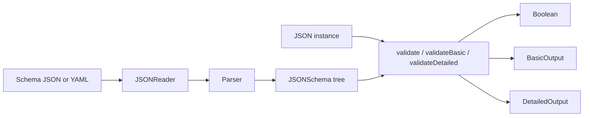
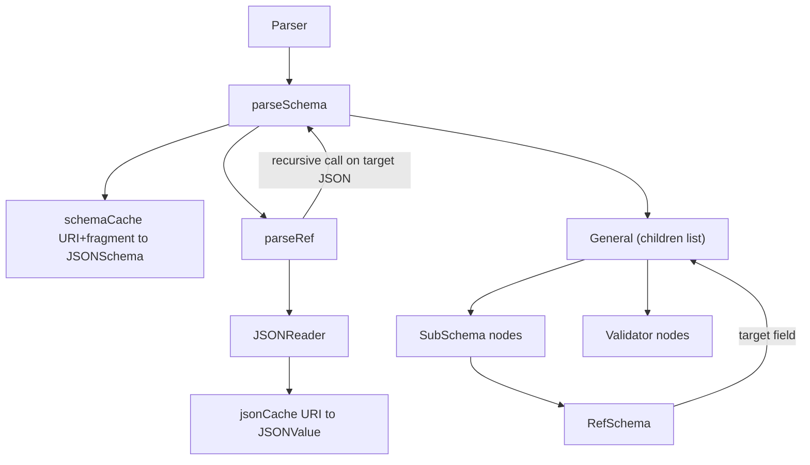

# json-kotlin-schema — Research report

## Metadata

- **Library name**: json-kotlin-schema
- **Repo URL**: https://github.com/pwall567/json-kotlin-schema
- **Clone path**: `research/repos/kotlin/pwall567-json-kotlin-schema/`
- **Language**: Kotlin
- **License**: MIT (see LICENSE in repo)
- **Analyzed version**: c87e752 2026-06-04 (release 0.58, per `pom.xml` and CHANGELOG; tag list in the clone ends at 0.9.1 but `pom.xml` is authoritative)
- **Report date**: 2026-10-27

## Summary

json-kotlin-schema is a JSON Schema parsing and validation library for Kotlin. It reads JSON or YAML schema files, parses them into an internal tree of `JSONSchema` nodes, and validates JSON instances against that schema. The library exposes `validate(json)` (returns boolean) and `validateBasic(json)` (returns `BasicOutput` with a list of errors) for instance validation. It supports much of Draft-07 and some Draft 2019-09 features (version 0.58; recent releases are dependency/POM maintenance only, per CHANGELOG, built on the author's `kjson-*` libraries). Its main source is 37 Kotlin files (about 3,800 lines); Java 8 target, Maven build. There is no code generation; this is a pure validator. It is used as a dependency by json-kotlin-schema-codegen for schema parsing.

## JSON Schema support

- **Drafts**: Draft-07 primary; some features from Draft 2019-09. README states "Kotlin implementation of JSON Schema (Draft-07)" and that it covers much of Draft 07 and a few features from 2019-09. `Parser.parse` matches `$schema` against `schemaVersion201909` and `schemaVersionDraft07` lists; `parseDraft07` is a stub that simply calls `parseSchema` ("temporary - treat as 201909"), and any other or missing `$schema` is also parsed that way. A `schemaVersion202012` constant exists (marked `@Suppress("unused")`) but is not used: 2020-12 is not supported. Draft-04/06 are not targeted.
- **Scope**: Schema parsing and instance validation only. No code generation.
- **Subset**: Not all meta-schema keywords are implemented. README documents "Implemented Subset" (Core, Structure, Validation) and "Not Currently Implemented" (e.g. `$recursiveRef`, Draft-07 `dependencies`, `$recursiveAnchor`, `$anchor`, `$vocabulary`, `unevaluatedProperties`, `unevaluatedItems`, `dependentSchemas`, `dependentRequired`, `contentEncoding`, `contentMediaType`, `contentSchema`, `deprecated`, `readOnly`, `writeOnly`, format `idn-email`, `idn-hostname`, `iri`, `iri-reference`).

## Keyword support table

Keyword list derived from the vendored draft 2020-12 meta-schemas (`specs/json-schema.org/draft/2020-12/meta/`), plus Draft-07/2019-09 keywords the library actually targets (`additionalItems`, `definitions`, `dependencies`, `$recursiveRef`, `$recursiveAnchor`). Implementation evidence verified against `Parser.kt` (the keyword `when` in `parseSchema`), subschema/, validation/, README and test resources. Unrecognized keywords are ignored unless `customValidationHandler` handles them; keys starting with `x-` become `ExtensionSchema` nodes.

| Keyword | Implemented | Notes |
|---------|-------------|-------|
| $anchor | no | Not implemented (README); falls to the unknown-keyword path. |
| $comment | yes | Must be a string (fatal otherwise); not used in validation. |
| $defs | partial | Skipped in the keyword loop (never parsed on its own); an entry is parsed lazily only when a `$ref` points at it, so unreferenced definitions are never validated. |
| $dynamicAnchor | no | Not implemented. |
| $dynamicRef | no | Not implemented. |
| $id | yes | Skipped in the keyword loop; read separately (Parser ~line 674) for URI scope and ref resolution. |
| $ref | partial | RefSchema; resolved eagerly at parse time; internal and external refs supported. Self-referential (recursive) schemas are rejected with a fatal "Recursive $ref" error; the suite's `ref.json` is skipped. Siblings of `$ref` are still evaluated (2019-09 behaviour). |
| $schema | yes | Must be a string and only at document root; used for draft detection, but Draft-07 and 2019-09 are handled identically. |
| $recursiveAnchor | no | Not implemented (2019-09; README). |
| $recursiveRef | no | Not implemented (2019-09; README). |
| $vocabulary | no | Not implemented. |
| additionalItems | yes | AdditionalItemsSchema; only effective when a sibling array-form `items` exists and no single-schema `items` (sibling lookup via `parent.children`). |
| additionalProperties | yes | AdditionalPropertiesSchema; looks up sibling `properties`/`patternProperties` in `parent.children` on every validation call. |
| allOf | yes | CombinationSchema; all subschemas must validate. |
| anyOf | yes | CombinationSchema; at least one subschema must validate. |
| const | yes | ConstValidator; value must equal const. |
| contains | yes | ContainsValidator; counts all matches (no early exit); minContains/maxContains read from siblings. |
| contentEncoding | no | Not implemented. |
| contentMediaType | no | Not implemented. |
| contentSchema | no | Not implemented. |
| default | yes | DefaultValidator (always valid); optionally validated against the schema when `options.validateDefault`. |
| definitions | partial | Not handled as a keyword, but `$ref: "#/definitions/X"` resolves by JSON Pointer. |
| dependencies | no | Draft-07 keyword; not handled (test-suite `dependencies.json` is skipped). |
| dependentRequired | no | Not implemented (README; typo "dependentcies"). |
| dependentSchemas | no | Not implemented. |
| deprecated | no | Not implemented. |
| description | yes | Parsed and stored in General schema. |
| else | yes | IfThenElseSchema; conditional validation. |
| enum | yes | EnumValidator; linear scan with `JSONValue.equals`. |
| examples | yes | Type-checked only (must be an array); optional validation via `options.validateExamples` (also validates non-standard `example`). |
| exclusiveMaximum | partial | NumberValidator; same integer-truncation caveat. |
| exclusiveMinimum | partial | NumberValidator; same integer-truncation caveat. |
| format | yes | FormatValidator; date-time, date, time, duration, email, hostname, uri, uri-reference, uri-template, uuid, ipv4, ipv6, json-pointer, relative-json-pointer, regex; idn-email, idn-hostname, iri, iri-reference not implemented. |
| if | yes | IfThenElseSchema; conditional validation. |
| items | yes | ItemsSchema, ItemsArraySchema; single schema or array. |
| maxContains | yes | ContainsValidator. |
| maximum | partial | NumberValidator; decimal limit compared via `toLong()` when the instance is an integer (see Low-level details). |
| maxItems | yes | ArrayValidator. |
| maxLength | yes | StringValidator. |
| maxProperties | yes | PropertiesValidator. |
| minContains | yes | ContainsValidator. |
| minimum | partial | NumberValidator; same integer-truncation caveat as `maximum`. |
| minItems | yes | ArrayValidator. |
| minLength | yes | StringValidator. |
| minProperties | yes | PropertiesValidator. |
| multipleOf | yes | NumberValidator; exact `BigDecimal.rem` for decimals, `Long` remainder for integers. |
| not | yes | JSONSchema.Not; nested schema must not validate. |
| oneOf | yes | CombinationSchema; exactly one subschema must validate. |
| pattern | yes | PatternValidator; `java.util.regex` via Kotlin `Regex.containsMatchIn` (unanchored search), compiled once at parse time. |
| patternProperties | yes | PatternPropertiesSchema; ordered list of (Regex, schema); regex compiled at parse time. |
| prefixItems | no | 2020-12; not in Parser (array-form `items` is the Draft-07/2019-09 equivalent). |
| properties | yes | PropertiesSchema; property name → schema. |
| propertyNames | yes | PropertyNamesSchema; each key is wrapped in a fresh `JSONString` and validated at root pointer. |
| readOnly | no | Not implemented. |
| required | yes | RequiredSchema; listed properties must be present. |
| then | yes | IfThenElseSchema; conditional validation. |
| title | yes | Parsed and stored in General schema. |
| type | yes | TypeValidator; null, boolean, object, array, number, string, integer; type array for union. |
| unevaluatedItems | no | Not implemented. |
| unevaluatedProperties | no | Not implemented. |
| uniqueItems | yes | UniqueItemsValidator; `toHashSet().size == size`. `uniqueItems:false` creates no node. |
| writeOnly | no | Not implemented. |

## Constraints

Validation keywords are enforced **at validation time** when `validate()`, `validateBasic()` or `validateDetailed()` is called; nothing is generated. Each keyword becomes a node in the schema tree (see Algorithms). `format` is an assertion here, not just an annotation: unknown format names get a `NullFormatChecker` that always passes. `default`, `title`, `description`, `$comment`, and `x-*` extension keywords never fail validation.

## High-level architecture

Pipeline: **Schema (JSON/YAML)** -> `JSONReader` (parse via kjson / kjson-yaml into `JSONValue`, cached per URI) -> **Parser.parseSchema** (recursive, one `JSONSchema.General` per schema object, with one child node per recognised keyword) -> immutable **JSONSchema tree** -> **validate / validateBasic / validateDetailed** over a kjson `JSONValue` instance -> `Boolean`, `BasicOutput` or `DetailedOutput`.



## Medium-level architecture

- **JSONSchema** (`JSONSchema.kt`): sealed class with `True`, `False`, `Not`, `General`, and two abstract families, `SubSchema` (structural/applicator keywords, in `subschema/`) and `Validator` (leaf assertion keywords, in `validation/`). Every node carries `uri: URI?` and `location: JSONPointer` (its position in the source document) and implements three entry points: `validate` (boolean), `validateBasic` (flat error list) and `validateDetailed` (nested tree).
- **Parser** (`parser/Parser.kt`, 684 lines): one `parseSchema(json, pointer, parentUri)` function that loops over the object's entries and `when`-dispatches on the keyword string. `$ref` handling is in `parseRef`. State: `schemaCache: MutableMap<URI, JSONSchema>`, a `JSONReader`, options, and the `customValidationHandler` / `nonstandardFormatHandler` hooks.
- **JSONReader** (`parser/JSONReader.kt`): `jsonCache: MutableMap<URI, JSONValue>` of parsed documents; resolves files, `Path`s, and arbitrary URIs through a pluggable resolver; also indexes documents by their root `$id`.
- **Validators**: `TypeValidator`, `NumberValidator`, `StringValidator`, `FormatValidator`, `EnumValidator`, `ConstValidator`, `ArrayValidator`, `PropertiesValidator` (min/maxProperties), `ContainsValidator`, `UniqueItemsValidator`, `PatternValidator`, `DefaultValidator`, `DelegatingValidator` (wraps user handler output).
- **Output**: `BasicOutput`, `BasicErrorEntry`, `DetailedOutput`, base `Output`.



## Algorithms and data structures

### Schema representation

The parsed schema is a **typed object tree**, not a raw JSON value. `Parser.parseSchema` returns a `JSONSchema.General(schemaVersion, title, description, uri, location, children: List<JSONSchema>)` for every schema object, and boolean schemas become `True`/`False` instances (`booleanSchema`). Each recognised keyword in the object is turned into one child node appended to `children` in the object's entry order (so `type`, `properties`, `required`, ... are siblings in a flat list, each an independent `JSONSchema` subclass). A few keywords are consumed by a neighbour rather than getting their own node: `then`/`else` by `IfThenElseSchema` (created when `if` is hit), `minContains`/`maxContains` by `ContainsValidator`, and `$id`, `$defs`, `title`, `description`, `example` by the parent. Unknown keywords go to the user's `customValidationHandler` (producing a `DelegatingValidator` if it returns one) or are dropped; `x-*` keys additionally become an `ExtensionSchema` holding a plain Kotlin value (`toSimpleValue`). `definitions` and `$defs` are not nodes at all. Values are copied into typed fields (`Regex` for `pattern`/`patternProperties`, `Number` for numeric limits, `List<Pair<String, JSONSchema>>` for `properties`, `List<String>` for `required`, the raw kjson `JSONArray` for `enum`, raw `JSONValue` for `const`), so validators do not retain the source document. Ownership is a plain JVM object graph under GC; the tree is immutable after construction except that `AdditionalPropertiesSchema`/`AdditionalItemsSchema` hold a back-reference `parent: General`, which is why their `equals` deliberately ignores the parent.

### Reference resolution and registry

There are two caches. `JSONReader.jsonCache` (`MutableMap<URI, JSONValue>`) maps document URI to its parsed JSON; every successful read also registers the document under its root `$id` (`cacheById`, fragment dropped), and `preLoad(file|dir)` can pre-fill it for offline resolution. `Parser.schemaCache` (`MutableMap<URI, JSONSchema>`) maps the URI with the JSON Pointer as fragment (`uri.withFragment(pointer)`) to the parsed node, so any subschema of any document is memoised by location.

Resolution is **eager and at parse time**. `parseSchema` computes a node's base URI from a local `$id` (`parentUri.resolve(id).dropFragment()`), but there is no scope stack beyond passing `parentUri` down the recursion; a subschema `$id` changes the URI recorded for that subtree and its cache key, yet `$ref` JSON Pointer targets are looked up in the root JSON passed down (`json`), not in a per-`$id` resource index. `parseRef` splits the string at `#`: (a) no fragment: resolve against the base URI and `jsonReader.readJSON(refURI)`; (b) fragment only: the current document with `JSONPointer.fromURIFragment`; (c) URI plus fragment: current document if the string equals the base URI, else read the other document. It checks `refPointer.existsIn(refJSON)` (fatal `$ref not found` otherwise), then builds `RefSchema(target = parseSchema(refJSON, refPointer, refURI))`. The target is parsed (or fetched from `schemaCache`) immediately and stored by object reference; at validation time a ref costs one virtual call. `$anchor`, `$dynamicRef`, `$recursiveRef` and plain-name fragments are unsupported (only JSON Pointer fragments).

Cycles are **not supported**. Before parsing a schema with a known URI, `parseSchema` looks up `schemaCache[fragmentURI]`; on a hit it returns the cached node unless it is the `JSONSchema.False` placeholder, in which case it throws `fatal("Recursive $ref")`. On a miss it inserts that `False(uri, pointer)` placeholder, parses the children, then overwrites the entry with the finished `General`. So a schema that reaches itself during its own parse (e.g. `$ref: "#"` in a tree schema) aborts parsing. The placeholder is only inserted when a URI is known (`uri?.let`); for a string parsed with `uri == null` there is no cache, so a recursive `$ref` would recurse until `StackOverflowError` (inferred from code, not executed). Remote documents are fetched via `defaultURIResolver` (`URL.openConnection`, `connectionFilters`, 404 -> null) or an `extendedResolver` that also returns content type; there are no size or time limits and no allow-list beyond user filters.

### Compiled / intermediate form

The compiled form **is** the `JSONSchema` tree: an interpreter-style composite where each node encapsulates its own evaluation. There is no bytecode, closure compilation or arena. Shape: `General` -> `children: List<JSONSchema>`; applicator nodes hold nested references (`ItemsSchema.itemSchema`, `Not.nested`, `PropertiesSchema.properties: List<Pair<String, JSONSchema>>`, `CombinationSchema.array`, `IfThenElseSchema.{if,then,else}`, `RefSchema.target`); leaf `Validator`s hold primitive parameters. Because a `$ref` target is shared by identity, the structure is a DAG when a definition is referenced twice. Work hoisted to parse time: regex compilation (`Regex(...)` in `parsePattern`/`parsePatternProperties`, invalid patterns are fatal), numeric limit coercion to `Int`/`Long`/`BigDecimal`, `type` name to enum mapping, format-name to checker lookup (`FormatValidator.findChecker`), required-name lists. `uniqueItems: false` produces no node.

### Core algorithm

Evaluation is a recursive interpreter over `(json: JSONValue?, instanceLocation: JSONPointer)`. A key design choice: **the whole root instance is passed down unchanged together with a JSON Pointer to the current location**, and each node re-derives its instance with `val instance = json[instanceLocation]` (kjson-pointer lookup from the root). Every keyword node therefore pays an O(depth) pointer walk, and each descent allocates a new `JSONPointer` via `instanceLocation.child(name|index)`. `propertyNames` is the exception: it validates a fresh `JSONString(propertyName)` against `JSONPointer.root`.

`General.validate` loops over `children` and returns `false` at the first failing child (AND semantics, short-circuit). Order is the keyword order in the schema document; there is no reordering or type-first check. Leaf validators first check applicability (`NumberValidator` is true for non-numbers, `StringValidator` for non-strings), so `type` is a separate sibling check. `TypeValidator` loops over its list; `integer` means `JSONNumber.isIntegral()`.

Combinators: `AllOfSchema.validate` returns on first false; `AnyOfSchema` returns on first true; `OneOfSchema` returns false as soon as a second subschema matches. `Not` negates its nested result. `IfThenElseSchema` runs `if` via the boolean `validate` and then only the chosen branch. `PropertiesSchema` iterates declared properties and validates those present (`containsKey`); `PatternPropertiesSchema` runs a nested loop (every pattern x every instance key, `containsMatchIn`); `AdditionalPropertiesSchema` finds its siblings with `parent.children.filterIsInstance<PropertiesSchema>().firstOrNull()` (and the same for pattern properties) on **each call**, then tests each instance key with `properties.any { it.first == key }`. `AdditionalItemsSchema` caches its sibling lookups with `by lazy` and applies only if a sibling `ItemsArraySchema` exists and no `ItemsSchema`. `ContainsValidator` counts all matches (no early exit). `EnumValidator` is a linear scan using kjson `equals`; `UniqueItemsValidator` builds a `HashSet` (O(n) average). `StringValidator` counts code points by running a `UTF16_CodePoint(IntCounter())` pipeline over the string on each check (O(length), uncached).

There is **no annotation collection** for `unevaluatedProperties/Items` (unsupported). Sibling-dependent keywords work through direct sibling references or parser pre-reading.

### Error and output model

Three result shapes. `validate` returns `Boolean` with no error objects. `validateBasic` returns `BasicOutput(valid, errors: List<BasicErrorEntry>?)`, where `BasicErrorEntry(keywordLocation, absoluteKeywordLocation, instanceLocation, error)` are strings (`#/...` fragments from `JSONPointer.schemaURIFragment()`; absolute location = schema `uri` + location). Each node takes a `relativeLocation: JSONPointer` (dynamic schema path) and extends it as it descends (`childLocation`, `child(i)`). `General.validateBasic` folds all children's errors (it does **not** stop at the first failure), and prepends an "A subschema had errors" entry; `CombinationSchema` prepends a "Combination schema ... fails - n of m valid" entry followed by failed branches' errors. A singleton `BasicOutput.trueOutput` is reused for success. `validateDetailed` builds a nested `DetailedOutput` tree with both `errors` and success `annotations` (messages like "Validation successful"), collapsing single-error lists. `IfThenElseSchema.validateBasic` evaluates `if` with the boolean path, then delegates to the chosen branch. Parse-time failures throw `JSONSchemaException` with `uri#pointer` text (`fatal`). Error strings are built eagerly when a failure occurs; pointers are allocated on every descent regardless.

## Low-level details

- **Numbers**: kjson distinguishes `JSONInt`, `JSONLong`, `JSONDecimal` (BigDecimal-backed). `multipleOf` uses exact `BigDecimal.rem(...) == 0` for decimals and `Long` remainder for integers. Likely defect read from code (not executed): for a non-decimal instance, `maximum/minimum/exclusive*` compare `instance.toLong()` with `value.toLong()`, so a decimal limit such as `exclusiveMaximum: 2.5` is truncated to 2 and instance `2` would be judged invalid. `parseNumberLimit` stores `Int`, `Long` or `BigDecimal` only.
- **String length**: counted in Unicode code points, not UTF-16 units.
- **Regex**: `java.util.regex` via Kotlin `Regex`, unanchored `containsMatchIn`; no ECMA-262 translation.
- **Format**: built-in `int32` and `int64` (OpenAPI) in `FormatValidator.checkers`; every other name resolves through `JSONValidation.validations[keyword]` of the external `json-validation` library (a required Maven dependency), wrapped in `StringFormatChecker` (applies only to string instances). Unknown formats pass (`NullFormatChecker`). `nonstandardFormatHandler` takes precedence.
- **Parse-time checks**: `$schema` only at root and a string; `$comment` a string; `examples` an array; `multipleOf` > 0; integer limits for length/size keywords; invalid regex rejected; `type` names validated.
- **Draft handling**: `$schema` selects nothing; `parseDraft07` and the default branch call the same `parseSchema`. `General.schemaVersion` is always the 2019-09 URI string.
- **Recursion limits**: parsing and validation are literally recursive with no depth limit (bounded by JVM stack).
- **Untrusted input**: external `$ref` URLs are fetched at parse time via the default resolver unless replaced; `allowDescriptionRef` (opt-in) reads an arbitrary URL for `description`. Connection filters can veto/authorize/redirect but no defaults limit anything. No ReDoS protection.
- **JSONReader**: YAML vs JSON by file extension or response content type (`looksLikeYAML`); `jar:` URIs supported via `extendedPath`.

## Output and integration

- **Vendored vs build-dir**: N/A; library does not emit files. Validation returns in-memory BasicOutput or boolean.
- **API vs CLI**: Library API only. `JSONSchema.parseFile(filename)`, `JSONSchema.parse(string, uri?)`, `schema.validate(json)`, `schema.validateBasic(json)`. Parser can be used directly with custom options.
- **Writer model**: N/A for output; validation results are returned as objects.

## Configuration

- **Parser options**: `options.validateExamples` (validate examples/default during parse), `options.validateDefault`, `options.allowDescriptionRef`.
- **Custom validation**: `customValidationHandler` for unknown keywords; `nonstandardFormatHandler` for custom format strings.
- **Connection filters**: `addConnectionFilter`, `addAuthorizationFilter`, `addRedirectionFilter` for HTTP/URI resolution.
- **URI resolver**: Parser accepts custom `uriResolver: (URI) -> InputStream?` for external refs.

## Pros/cons

- **Pros**: Pure validation API; Basic output format follows spec; YAML schema support; optional examples/default validation during parse; JSON Schema test suite integration (TestSuiteTests); extensible via customValidationHandler and nonstandardFormatHandler.
- **Cons**: Subset of keywords; no $anchor/$dynamicRef/$dynamicAnchor; no prefixItems; no unevaluatedProperties/unevaluatedItems; some format strings (idn-email, idn-hostname, iri, iri-reference) not implemented.

## Testability

- **How to run tests**: Maven build (`pom.xml`, parent `io.kstuff:kstuff-maven:2.0`); `mvn test` from repo root. CI (`.github/workflows/build.yml`) uses Java 8. No Gradle wrapper exists. Tests use `kotlin-test-junit` and `should-test`.
- **Unit tests**: Tests under `src/test/kotlin/net/pwall/json/schema/` (JSONSchemaTest, ParserTest, FormatValidatorTest, JSONSchemaExamplesTest, JSONSchemaItemsTest, etc.).
- **Integration tests**: TestSuiteTests runs only `src/test/resources/test-suite/tests/draft7` (the suite checkout also contains draft3/4/6/2019-09/2020-12/latest, unused); it skips id.json, ref.json, definitions.json, dependencies.json and the refRemote.json group "base URI change - change folder in subschema". Also MetaSchemaTest with schemas under `src/test/resources/metaschema`. Fixtures under `src/test/resources/` (test-suite, test schemas).

## Performance

Analyzed from code only; nothing was built or run.

### Performance techniques

- **Compile vs interpret**: Parse-then-interpret. Done once at parse time: tree construction, regex compilation, numeric limit coercion, type/format-checker lookup, `$ref` target binding (object reference, no per-validation lookup). Per validation: everything else, including pointer walks, sibling lookups and code-point counting. No specialisation beyond one class per keyword.
- **Memory layout and allocation**: Pointer-linked object graph with `List` children; no arenas, interning or inline storage. Per node visit the instance is re-fetched with `json[instanceLocation]` (O(depth) from the root), and every descent allocates a new `JSONPointer`. `validate()` creates no error objects; `validateBasic` allocates on failure and reuses `BasicOutput.trueOutput` on success, but `General.validateBasic` builds a `MutableList` per call even on success. `propertyNames` allocates a `JSONString` per key.
- **Caching and memoization**: `Parser.schemaCache` (parsed node per URI+fragment; shared `$ref` targets parsed once) and `JSONReader.jsonCache` (documents per URI and `$id`); plain `HashMap`s, no eviction. No caching of validation results, regex matches or format results. `AdditionalItemsSchema` caches sibling lookups (`lazy`); `AdditionalPropertiesSchema` re-filters `parent.children` on every call.
- **Fast paths and short-circuiting**: `validate()` stops at the first failure in `General`, `AllOfSchema`, `ItemsSchema`, `PropertiesSchema`, etc.; `AnyOfSchema` stops on first match, `OneOfSchema` on the second. Leaf validators return early for non-applicable types. Absent: type-first ordering, early exit in `contains`, hashed `enum`, set lookup for `required`/declared properties. The error-collecting paths do not short-circuit across siblings.
- **Regex handling**: JDK regex via Kotlin `Regex`, compiled once per node at parse time; `containsMatchIn` per check; no ECMA-262 translation or backtracking guard.
- **Concurrency**: The tree is immutable after parse and nodes keep no per-call mutable state (`lazy` is thread-safe by default), so a parsed schema should be shareable across threads for validation. `Parser`, `schemaCache`, `jsonCache` are unsynchronised `HashMap`s and `JSONSchema.parser` is a shared lazy singleton, so concurrent parsing is not safe. Inferred from code; the repo does not document thread safety.

### Benchmarks in repo

None: no JMH, no benchmark directory, and no mention in `pom.xml` or the README. Entry points for an external harness: `JSONSchema.parseFile(path)` / `JSONSchema.parse(string, uri)`, then `schema.validate(json)`, `validateBasic(json)` or `validateDetailed(json)`; or `Parser(options)` directly.

## Determinism and idempotency

- **Validation**: Pure function of schema and instance; no randomness or clocks. `validateBasic` error order follows schema-document key order (children are appended in entry order; `properties` kept as an ordered `List<Pair>`), which depends on kjson's object iteration order.
- **Idempotency**: Not applicable to generated output (no codegen). Parsing the same URI twice returns the cached `JSONSchema`.

## Enum handling

- **Implementation**: `EnumValidator(array: JSONArray)` keeps the raw kjson array; `validate` scans linearly and succeeds when `instance == it` for any element (kjson value equality). Failure message: "Not in enumerated values: ...".
- **Duplicate entries**: not deduplicated or rejected; harmless for validation.
- **Case collisions**: `"a"` and `"A"` are distinct and both accepted if listed. No code is generated, so no variant naming issues.

## Reverse generation (Schema from types)

No. The library parses and validates; it does not generate JSON Schema from Kotlin types.

## Multi-language output

N/A. This is a validation-only library; it does not emit code.

## Model deduplication and $ref/$defs

- **$ref**: Eagerly resolved to a node reference; the same target reached via several refs is parsed once (`schemaCache` keyed by URI+fragment), giving a shared DAG node. A schema reaching itself is rejected.
- **$defs / definitions**: Not parsed as keywords; an entry is parsed only when a `$ref` points to it, so unreferenced definitions are never checked.
- **Inline deduplication**: None. Identical inline objects get separate `General` nodes. Nodes define structural `equals`/`hashCode` (uri + location + content) but it is not used for merging.

## Validation (schema + JSON → errors)

Yes. This is the primary purpose of the library.

- **Inputs**: Schema (JSON or YAML string/file/URI) and JSON instance (string or JSONValue).
- **API**: `schema.validate(json)` returns `Boolean` (true = valid). `schema.validateBasic(json)` returns `BasicOutput(valid, errors?)`; when invalid, `errors` is a list of `BasicErrorEntry` with `keywordLocation`, `absoluteKeywordLocation`, `instanceLocation`, `error`.
- **Usage** (from README):
  ```kotlin
  val schema = JSONSchema.parseFile("/path/to/example.schema.json")
  val output = schema.validateBasic(json)
  output.errors?.forEach { println("${it.error} - ${it.instanceLocation}") }
  ```
- **Basic output format**: Follows [Basic output](https://json-schema.org/draft/2019-09/json-schema-core.html#rfc.section.10.4.2) specification. `validateDetailed` returns DetailedOutput with annotations/errors structure.
- **Optional examples/default validation**: When `Parser.options.validateExamples = true` or `validateDefault = true`, the parser validates `examples` and `default` entries during parse; errors collected in `parser.examplesValidationErrors` and `parser.defaultValidationErrors`.
