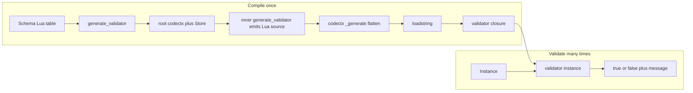
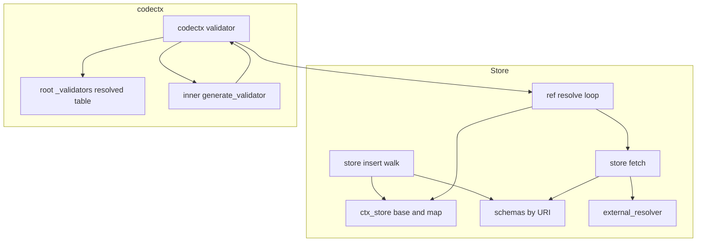

# jsonschema (api7) — Research report

## Metadata

- **Library name**: jsonschema
- **Repo URL**: https://github.com/api7/jsonschema
- **Clone path**: `research/repos/lua/api7-jsonschema/`
- **Language**: Lua
- **License**: Apache License 2.0 (rockspec `license` field; LICENSE file carries copyright for ShenZhen ZhiLiu Technology and Julien Desgats). Older rockspecs (0.4) say MIT.
- **Analyzed version**: ea67dcd 2026-04-29 (release v0.9.13)
- **Report date**: 2026-10-27

## Summary

api7 jsonschema is a pure Lua JSON Schema validator library for Lua 5.2, Lua 5.3, and LuaJIT 2.1 beta. It compiles a JSON Schema into a Lua validator function at runtime via `generate_validator(schema)`. Validation is not limited to JSON and can validate Lua tables, msgpack, bencode, and other key-value formats. The library is designed for validating HTTP requests and is optimized for OpenResty (uses `ngx.re.find` for pattern matching, FFI-based IPv4/IPv6 parsing). Dependencies (rockspec 0.9.13): net-url and lrexlib-pcre 2.9.1-1; optional cjson.safe for null token and JSON-encoding `required` lists in anyOf error messages. Forked from jdesgats/ljsonschema. Single main module (`lib/jsonschema.lua`, 1241 lines) plus `lib/jsonschema/store.lua` (258 lines). Validation stops at the first failure and returns one error string.

## JSON Schema support

- **Drafts**: Draft-04, draft-06, draft-07 (from README). Draft-05 is not supported.
- **Scope**: Validation only (schema + instance → valid/invalid + error message). No static code generation; generates in-memory Lua functions at runtime.
- **Vendored specs**: `specs/json-schema.org/draft-04/schema.json` and `draft-07/schema.json` exist and were used for the keyword list; draft-06 is covered by the same code path (tests in `t/draft6.lua`). 2019-09 and 2020-12 are not targeted.
- **Draft-04 caveat**: draft-04 boolean `exclusiveMinimum`/`exclusiveMaximum` are not supported; the code treats them as draft-06+ numeric values and `t/draft4.lua` blacklists those suites.
- **Subset**: Supports draft-07 validation keywords where implemented. Known gaps from test blacklist in `t/draft7.lua`: empty object/array distinction (Lua limitation), unsupported regex constructs, required/minProperties on arrays, propertyNames schema validation (partial), contains for non-arrays, remote refs (requires user-provided external_resolver), recursive refs, location-independent identifiers with absolute URI or base URI change.

## Keyword support table

Keyword list derived from vendored draft-07 meta-schema (`specs/json-schema.org/draft-07/schema.json`), plus draft-04 `id`. Each row verified against `lib/jsonschema.lua` (the `generate_validator` function, roughly lines 600-1200), `lib/jsonschema/store.lua`, and tests.

| Keyword | Implemented | Notes |
|---------|-------------|-------|
| id (draft-04) | yes | `schema.id` read in codectx/store for scope; temporarily set/cleared by `generate_validator`. |
| $id | partial | Only location-independent (fragment-only, e.g. `#foo`) `$id` is supported: `store:insert` raises `Only location independent id is supported` for any `$id` with a scheme or without a fragment. Registered in the root `map` for `$ref: "#foo"` lookup. |
| $schema | yes | Accepted; not explicitly validated; schema passed through. |
| $ref | yes | Resolved in `ref_mt:resolve` (store.lua) via net.url; in-document JSON Pointer and id-alias fragments; external refs require `external_resolver`. A schema containing `$ref` is replaced entirely by its target (sibling keywords ignored). Cyclic refs work because validators are registered before their body is generated. Remote-ref and id-based recursive suites blacklisted. |
| $comment | yes | Passed through schema; not used for validation (metadata). |
| title | yes | Passed through; not used for validation. |
| description | yes | Passed through; not used for validation. |
| default | partial | For `properties` entries with scalar/table default, missing properties are filled in by mutating the instance; not a validation constraint. |
| readOnly | no | Not in generate_validator; passed through but not enforced. |
| writeOnly | no | Not in generate_validator; passed through but not enforced. |
| examples | yes | Passed through; not used for validation. |
| multipleOf | yes | Integer: modulo; float: quotient rounding with 1e-12 relative tolerance (v0.9.11 fix). |
| maximum | yes | Instance validation. |
| exclusiveMaximum | yes | Draft-07 number semantics. |
| minimum | yes | Instance validation. |
| exclusiveMinimum | yes | Draft-07 number semantics. |
| maxLength | yes | Instance validation; UTF-8 character length via validatorlib.utf8_len. |
| minLength | yes | Instance validation. |
| pattern | yes | Instance validation; ngx.re.find or lrexlib-pcre; some pattern constructs blacklisted. |
| additionalItems | yes | Instance validation; boolean or schema. |
| items | yes | Single schema (list form), array (tuple form), or boolean. Caveat: `items: true` emits `do return true end`, which skips all keyword checks generated after it for that schema. |
| maxItems | yes | Instance validation. |
| minItems | yes | Instance validation. |
| uniqueItems | yes | Instance validation; validatorlib.unique_item_in_array with deepeq. |
| contains | partial | Implemented inverted: counts items that FAIL the subschema and rejects when count equals `#array` (>0), so an empty array or no match behaves per this logic; `true`/`false` forms emit an early `return`. Blacklist: "not array is valid". |
| maxProperties | yes | Instance validation. |
| minProperties | yes | Instance validation; blacklist: "ignores arrays". |
| required | yes | Instance validation; blacklist: "ignores arrays". |
| additionalProperties | yes | Instance validation; boolean or schema. |
| definitions | yes | Not a validation keyword; `store:insert`'s `walk` visits it (is_schema allows it) so `$ref` targets get a `base` ctx. |
| properties | yes | Instance validation. |
| patternProperties | yes | Instance validation; regex keys. |
| dependencies | yes | Instance validation; property and schema dependencies. |
| propertyNames | partial | Only boolean `true`/`false` handled (and they emit an early `return`); schema-valued propertyNames is ignored (blacklisted test "some property names invalid"). |
| const | yes | Instance validation; lib.deepeq. |
| enum | yes | Unrolled `or` chain of `==` (number/boolean/string) or `lib.deepeq` against a uservalue (table); null/other types raise `unsupported enum type` at compile time. |
| type | yes | Instance validation; single type or array; includes extra types: table, function (README). |
| format | partial | `reg_map` (jsonschema.lua) covers email, ipv4, ipv6, hostname, uuid, date, date-time, uri; checked only for string instances; all other formats ignored. ipv4/ipv6 use FFI `inet_pton` when `ngx` is present, otherwise the regex. |
| contentMediaType | no | Not in generate_validator. |
| contentEncoding | no | Not in generate_validator. |
| if | yes | Instance validation; conditional then/else. |
| then | yes | Instance validation. |
| else | yes | Instance validation. |
| allOf | yes | Instance validation. |
| anyOf | yes | Instance validation. |
| oneOf | yes | Instance validation; exactly one must match. |
| not | yes | Instance validation. |

**Extra keywords** (README): `table` (matches arrays or objects; faster), `function` (checks for Lua functions).

## Constraints

Validation keywords are enforced at **runtime** by the generated validator function. Each constraint (type, enum, const, numeric bounds, string length/pattern, array items, object properties, etc.) is applied when the validator executes. Constraints are enforced directly on the instance. Format validation is limited to email, ipv4, ipv6, hostname, uuid, date, date-time, uri. Default values are applied by mutating the instance when a property is missing and the subschema has a default. A `skip_validation(value, schema)` custom hook (v0.9.13) lets callers bypass validation per value (e.g. placeholder secret references).

## High-level architecture

Pipeline: **Schema** (Lua table) -> `generate_validator(schema, custom)` -> `generate_main_validator_ctx` builds a root **codectx** which owns a **Store** (`store.new`, $id/$ref index) -> `codectx:validator` recursively calls the inner `generate_validator(ctx, schema)`, which appends Lua source text for every keyword -> `_generate` flattens the ctx tree into a string table -> `loadstring` (`as_func`) -> the chunk is called with `(uservalues, validatorlib, customlib)` and returns the root validator closure -> `validator(instance)` returns `true` or `false, message`. Instances can be Lua tables or any value; nothing is JSON-specific.

## Medium-level architecture

- **`generate_validator` (public, end of jsonschema.lua)**: builds `customlib` (`null`, `match_pattern`, `parse_ipv4`, `parse_ipv6`, `skip_validation`) from the options plus defaults, remembers whether `schema.id` pre-existed (the store writes `schema.id = 'root:'` into the caller's table, which is removed afterwards so the schema is not polluted), then `generate_main_validator_ctx(schema, custom):as_func(name, validatorlib, customlib)`. Non-table (boolean) schemas are wrapped as `{_org_val = schema}`.
- **Root vs child codectx**: `codectx()` creates the root (`_idx = 0`, `_preface`, `_body`, `_globals`, `_uservalues`, `_validators`, `_skip_validation`). `codectx:child(ref)` creates a per-subschema context (`_idx` = parent+1, own `_nloc`, `_nlabels`, `_nparams`, `_body`) that renders as one `function(p_1) ... end`. All children share `_root`.
- **Store (store.lua)**: `store.new(schema, resolver)` gives `{ctx_store, schemas, resolver}`. `ctx_store` is a side table keyed by schema table identity holding `base` (owning root schema) and, for roots, `map` (fragment id -> subschema). `schemas` maps normalized URIs to root schema tables. `ref_mt` objects (`{store, schema}`) represent a location in a schema.
- **$ref flow**: `codectx:validator(path, schema)` -> `self._schema:child(path)` (walks path segments via `decodepart`) -> `ref:resolve()` (loops while the node has `$ref`) -> look up `root._validators[resolved]`; on miss, allocate and generate.

## Algorithms and data structures

### Schema representation

There is no parsed schema model. The schema is the user's own Lua table (typically from `cjson.decode`), used as-is by both the store and the emitter. Keywords are table fields (`schema.minLength`); unknown keywords are simply never read. Boolean schemas are literal `true`/`false` values; at the top level they are wrapped in `{_org_val = v}` and unwrapped at the start of the inner `generate_validator`. Metadata that must not be put on the schema (owning root, id map) lives in `store.ctx_store`, a table keyed by schema-table identity (`store_mt:ctx`). The exception is the `id` field: `store.new` sets `schema.id = 'root:'` if absent and `store:fetch` sets `schema.id = uri` on resolved remotes; `insert` rewrites `schema.id` to its normalized form. Draft-04/06/07 are handled by one code path with no per-draft dispatch. Everything is held by Lua GC references; there are no lifetimes or ownership concerns beyond mutation.

### Reference resolution and registry

Registry: `store.schemas[normalized_uri] = root_schema` plus per-root `map[fragment] = subschema` for location-independent ids. `store:insert(schema)` parses `schema.id` with `net.url`, normalizes it, stores it, and runs an eager recursive `walk(s, path)` over every table-valued member (skipping `enum` and keys starting with `_`; it does not skip `const`/`default`/`examples`, so those values are also visited). The walk (a) records `$id` fragments (`#foo`) in `map` and raises for any other `$id` form, (b) for nested `id` values in schema positions (decided by `is_schema(path)`) either records a `#` alias or resolves it against the base, rewrites `s.id`, and recursively inserts it as its own root, and (c) sets `ctx(s).base = schema` so any subschema can find its root. Note the walk itself is literally recursive.

Resolution is lazy and happens at code-generation time. `ref_mt:resolve()` loops `while schema['$ref']`: it finds the base via `ctx(schema).base.id`, resolves the `$ref` string against it with `net.url`'s `:resolve`, strips the fragment, `fetch`es the document (cache hit in `schemas`, otherwise calls the user `resolver`, which defaults to a function that raises), then applies the fragment: first an `map` alias lookup, else a JSON Pointer walk through `[^/]+` parts with `decodepart` (numeric parts get +1 for Lua arrays, others percent- and `~0/~1`-unescaped). Chains of refs are followed iteratively. Because the loop replaces the node with its target, sibling keywords next to `$ref` are never seen. Missing pointer targets raise `reference not found`. Remote fetches are synchronous callbacks supplied by the user; nothing is fetched by the library.

Cycle handling is in the codegen step, not the store: `codectx:validator` allocates a slot `locals.var_0_N`, writes it to `root._validators[resolved]` BEFORE emitting the body, so a self-referential schema finds the slot and emits a call to the not-yet-assigned variable (resolved at runtime through the shared `locals` table). The same mechanism provides sharing: the cache key is the resolved schema table, so every path that resolves to the same table (any number of `$ref`s) reuses one function. Known limitations (README/blacklist): absolute-URI `$id`, base-URI change in subschemas, and id-based remote recursion.

### Compiled / intermediate form

The intermediate form is generated Lua source text. The root chunk is: a preface (`local uservalues, lib, custom = ...`, `local locals = {}`, then `local type = type`-style aliases added by `libfunc`), followed by body statements that assign each validator into `locals.var_0_N = function(p_1) ... end`, ending with `return locals.var_0_K` for the root validator. Each node of the codectx tree is a Lua table with `_body` (a list of strings and nested child ctx objects) and renders as one function. `_generate` walks `_body`; strings are inserted into a flat `code_table`, ctx objects (detected by `getmetatable(stmt) == codectx_mt`) are rendered inline recursively. The result is joined with `table.concat` and compiled by `loadstring(src, 'jsonschema:' .. name)` (chunk name aids stack traces). Helpers:

- `libfunc(name)`: memoized in `root._globals`; emits one `local string_format = string.format` line in the preface so validators access library functions as upvalues rather than globals/table lookups.
- `uservalue(v)`: stores non-literal data (enum/const tables, the schema passed to `skip_validation`) in `root._uservalues` and returns the expression `uservalues[N]`. The comment explains this avoids consuming local/upvalue slots.
- `localvar` (per-function `local var_<idx>_<n>`) vs `localvartab` (`locals.var_<idx>_<n>`, a shared table field): the latter exists because Lua limits a function to ~200 locals and 60 upvalues; `t/200more_variables.lua` builds 256 properties to verify this. Per-subschema validators and the `additionalProperties` key set live in the `locals` table.
- `param(n)`: parameter `p_n`; `label()`: unique `label_N` for `goto` in tuple `items`.

Compile cost is linear in schema size, with each keyword emitting a few lines; constants (property names, bounds, patterns, error strings) are baked in as literals via `%q`/`%d`/`%s`.

### Core algorithm

The inner `generate_validator(ctx, schema)` (jsonschema.lua ~597-1200) is one long function that, in a fixed keyword order, appends code for each keyword present:

1. Locals `datatype = type(p_1)` and `datakind = datatype == "table" and tablekind(p_1)` are emitted first as real locals (the comment explains shared fields caused cross-recursion bugs).
2. Boolean schema: `do return true end` / `do return false, "expect false always" end`.
3. Optional `skip_validation(value, schema)` hook: `if p_1 ~= nil and skip(p_1, uservalues[n]) then return true end`.
4. `type` (string or array; `object`/`array` use the `tablekind` result, `integer` uses `% 1.0 == 0.0` and accepts cdata, plus the non-standard `table` and `function`).
5. Object block, guarded by `if datatype == "table" and datakind <= 1`: for each `properties` entry it emits a `do local propvalue = p_1[key] ... end` calling the subschema validator, inlines `dependencies` and `required` for that property, and injects `default` values by assigning into the instance when missing. Remaining `required` and `dependencies` keys are emitted after. `additionalProperties` builds a `propset` table (`locals.var = {}; locals.var["k"] = true`, emitted once at load) and a `pairs` loop; `patternProperties` and `additionalProperties` share one `pairs` loop (comment: walk once); `minProperties`/`maxProperties` count during that walk or in their own loop.
6. Array block, guarded by `datatype == "table" and datakind >= 1`: `minItems`/`maxItems` via `#`, tuple `items` unrolled as one `do` block per index with `goto after` on nil, `additionalItems`, list `items` via `ipairs`, and `uniqueItems` via `lib.unique_item_in_array`.
7. String block (`minLength`, `maxLength` via `utf8_len`, `pattern` via `custom.match_pattern`), number block (bounds, `multipleOf`), `enum`, `allOf`, `anyOf`, `oneOf`, `if/then/else`, `not`, `propertyNames` (bool only), `format`, `const`, `contains`, and finally `return true`.

Composition: `allOf` is a sequence of validator calls; `anyOf` is `not (v1(p) or v2(p) ...)`, short-circuiting on the first match; `oneOf` calls every branch in order and errors on a second match; `if` evaluates the condition validator and conditionally calls `then`/`else`. `not` negates a call. There is no annotation tracking (no `unevaluated*`, out of scope for drafts 4-7).

Instance classification relies on `validatorlib.tablekind`, because Lua has a single table type: `#t == 0` plus `nkeys == 0` means empty (kind 1, accepted as both object and array), `nkeys == #t` means array (kind 2), else object (kind 0). `table.nkeys` (OpenResty) is used if available, otherwise a `pairs` count, making each object/array classification O(n) unless the cheap `#` check decides. The code has a TODO noting it is critical for performance. The type name `table` skips this.

Quirks found in the emitter: `items: true`, `propertyNames: true`, and boolean `contains` emit unconditional `return`s in the middle of the function, so any keyword emitted after them is skipped for that schema; `required: []` emits a check that the instance is an empty table; `contains` with a schema counts items that fail and rejects when ALL fail; `anyOf` failure message optionally JSON-encodes sibling `required` lists via cjson.

### Error and output model

The output is `true` or `false, string`. There is no error object, no instance path, no schema path, no collection of multiple errors: the first failing check returns. Context is built by string concatenation as the failure unwinds through nested validator calls, for example `property foo validation failed: ` .. inner, `failed to validate item 3: ` .. inner, `allOf 2 failed: ` .. inner, `failed to validate <prop> (matching "<pattern>"): ` .. inner. The result is a message chain which acts as a path but is not machine-readable. `oneOf`/`anyOf` messages do not include sub-branch errors. Errors emitted are formatted at runtime with `string.format`, which allocates only on failure paths. `generate_validator_code` returns the generated Lua source for debugging; with env `DEBUG=1` `as_func` prints the numbered source (chunked to 3900 chars for OpenResty log limits).

## Low-level details

- **String length**: `validatorlib.utf8_len` counts code points by walking bytes with a UTF-8 validity table (`accept_range`, rejecting overlongs/surrogates); invalid sequences count the lead byte as one character and continue. It is called once per `minLength` and once per `maxLength` (twice if both) and is O(n) in Lua.
- **Numbers**: bounds are interpolated into source with `%s`/`%d` formatting (`addRangeCheck`, `minProperties`, `minItems` use `%d`); non-integer bounds depend on `tostring` precision of the Lua version (I did not verify precision loss on LuaJIT). `multipleOf`: integer divisor uses `p % N ~= 0`; non-integer uses `quotient = p / m`, `rounded = floor(quotient + 0.5)`, tolerance `1e-12 * max(1, |rounded|)`.
- **`integer` type**: `(type == "number" or cdata convertible by tonumber) and p % 1.0 == 0.0`; cdata (LuaJIT int64) is accepted.
- **Equality**: `lib.deepeq` is a recursive comparison with a loop guard (`avoid_loops`), table-key matching, and is documented as slow. `uniqueItems` (`unique_item_in_array`) hashes primitives in a set (O(n)), collects tables, then compares tables pairwise with `deepeq` (O(m^2) in table items). Note NaN/nil keys and `1` vs `1.0` collapse in Lua tables.
- **enum/const**: enum values must be number, boolean, string, or table (null raises at compile time). `const` always goes through `deepeq`.
- **Source injection hygiene**: property names and patterns are emitted with `%q` or `str_filter` (which post-processes `%q` output for newlines and single quotes); `default` tables are serialized with `to_lua_code`.
- **Root-local leakage**: `contains` calls `ctx._root:localvar` for its loop variables, emitting root-level `local` declarations; many such schemas consume root local slots (limit ~200). Other state uses the `locals` table to avoid this.
- **Recursion**: instance validation is recursive through generated function calls (Lua call-depth limits apply; no explicit depth cap). The store walk and `deepeq` are literally recursive. No limits for untrusted schemas (large patterns, deep nesting); regex execution is delegated to PCRE and is not hardened against ReDoS.
- **Side effects**: validation mutates the instance when `default` is present (`p_1[key] = default`); table defaults are shared literals constructed per call.
- **Patterns**: unanchored search semantics (`ngx.re.find` / `rex.find`), PCRE rather than ECMA-262.

## Output and integration

- **Vendored vs build-dir**: N/A (validation only; no generated file output).
- **API vs CLI**: Library API only. `jsonschema.generate_validator(schema, custom)` returns validator function; `jsonschema.generate_validator_code(schema, custom)` returns raw Lua code string (debug). No CLI.
- **Writer model**: N/A (returns in-memory function).

## Configuration

- **Extension points** (README, generate_validator): `null` (token for null; default cjson.null or nil), `match_pattern` (function(string, patt) → boolean), `external_resolver` (function(url) → schema table; required for remote refs), `name` (string for stack traces), `parse_ipv4`/`parse_ipv6` overrides, and `skip_validation` (predicate receiving value and schema; returning true accepts the value).
- **Dependencies**: net-url, lrexlib-pcre pinned 2.9.1-1 in rockspec (OpenResty uses ngx.re instead at runtime); optional cjson.safe, table.nkeys.

## Pros/cons

- **Pros**: Pure Lua; JIT-friendly; OpenResty optimizations (ngx.re, FFI); extension points for null, pattern, external refs; JSON-Schema-Test-Suite coverage; supports Lua tables and other formats; validator deduplication for $ref; default value injection.
- **Cons**: Boolean `items`/`propertyNames`/`contains` emit early returns that skip later keywords; `$ref` siblings ignored; absolute `$id` rejected; numeric bounds are formatted into source text with `%s`; Empty table/array ambiguity in Lua; no remote ref resolver by default; limited format support (8 formats); propertyNames schema validation partial; enum null unsupported; blacklisted edge cases.

## Testability

- **Run tests**: `make deps` (git submodule + luarocks install --tree=deps), then `make test` (resty runs t/draft4.lua, t/draft6.lua, t/draft7.lua, t/default.lua, t/200more_variables.lua). Requires OpenResty (resty). CI is `.github/workflows/ci.yml` (installs OpenResty); `release.yml` publishes rocks.
- **Fixtures**: JSON-Schema-Test-Suite submodule in `spec/JSON-Schema-Test-Suite/`; `spec/extra/` (sanity, empty, dependencies, table, ref, format, default).
- **Regression coverage**: `t/default.lua` and `t/200more_variables.lua` cover default injection and the Lua local-variable limit; recent fixes (recursive datatype sharing #100, multipleOf float #98) are exercised via these suites.
- **Test layout**: Each t/*.lua loads supported descriptors, generates validators, runs cases; blacklist skips known failures.

## Performance

Analysis is from code only; nothing was run.

### Performance techniques

- **Compile vs interpret**: This is the central design. Schema -> Lua source -> `loadstring` happens once in `generate_validator`; at validation time there is no schema walking, no keyword dispatch, no string-keyed lookup of schema fields. Property names, bounds, lengths, patterns, enum members, and key sets are literals in the generated code. Required-key sets, `dependencies`, and `properties` are resolved at generation time (the `required` set is built once and consumed while emitting the per-property blocks). The Lua/LuaJIT compiler (including the JIT trace compiler under OpenResty) then optimizes the generated functions. README states the OpenResty-specific optimizations make it much faster than the upstream ljsonschema.
- **Memory layout and allocation**: Validators are plain closures; library functions are hoisted into upvalue locals (`libfunc` -> `local string_format = string.format` in the preface); per-subschema validators are stored in a shared `locals` table (one table-field read per call). Enum/const tables are held in the `uservalues` array. Valid instances allocate nothing in the common path; error strings are built by `string.format`/concatenation only on failure. `additionalProperties` key sets are built once at load. Costs per call: `tablekind` (O(n) `pairs` count unless OpenResty `table.nkeys` is present), `utf8_len` O(n), and for `uniqueItems` a set plus pairwise `deepeq`. The emitted `datatype`/`datakind` locals are computed at the top of every validator call even when the schema has no table keywords.
- **Caching and memoization**: `root._validators[resolved_schema_table]` memoizes one generated function per distinct schema table (including through `$ref`), which bounds code size and is how recursion terminates. `root._globals` caches library-function locals. `store.schemas` caches fetched/inserted documents by URI. There is no cache across `generate_validator` calls (callers should keep the returned function; README advises reuse), and no regex or format-result caches beyond what `ngx.re` provides.
- **Fast paths and short-circuiting**: Type check is emitted first, then keyword groups are each wrapped in a cheap guard (`datatype == "string"`, `datakind >= 1`) so irrelevant keywords cost one comparison. Everything returns at the first failure. `anyOf` is a short-circuiting `or`; `minItems`/`maxItems` are checked before per-item validation ("rather cheap so do it before"); `patternProperties` and `additionalProperties` share one `pairs` walk, and property counting piggybacks on it; tuple `items` are unrolled. The non-standard `table` type avoids `tablekind` ("much faster", README). `format: ipv4/ipv6` use FFI `inet_pton` under OpenResty. Code TODOs acknowledge unrealized optimizations: hash set for big `enum`s (currently a linear unrolled `or` chain), static table for `additionalProperties` keys, integer `multipleOf`, and `tablekind`/`typeexpr`.
- **Regex handling**: Under OpenResty `ngx.re.find(s, p, "jo")` (PCRE JIT, `o` compile-once cache keyed by pattern); otherwise lrexlib-pcre `rex.find` (loaded lazily on first use; its own caching is not examined here). Patterns are passed as literals from the generated code, so each call re-passes the pattern string to the matcher. No ECMA-262 translation and no ReDoS protection; callers can override via `custom.match_pattern`. Format checks other than ipv4/ipv6 are also regex-based.
- **Concurrency**: Not applicable in the thread sense (Lua is single-threaded per state; OpenResty uses per-worker Lua VMs). A compiled validator is an immutable closure over `locals`/`uservalues` and is reentrant within a worker (no per-call mutable shared state except `default` injection into the instance), so it can be shared across requests/coroutines. Compilation mutates the user's schema (`id`) and store state and is not designed for concurrent use.

### Benchmarks in repo

There is no dedicated benchmark suite. `t/draft7.lua` is described as a "JSON schema validator benchmarking tool": it compiles all supported JSON-Schema-Test-Suite and `spec/extra` suites, printing the time to load/generate (`ngx.update_time`/`ngx.now`) and then the time to run every case once. It runs under OpenResty `resty` only (`make test`). The programmatic entry points for an external harness are `jsonschema.generate_validator(schema, opts)` (compile) and the returned `validator(instance)`; `generate_validator_code` shows the emitted Lua.

## Determinism and idempotency

- **Generated code**: Not guaranteed deterministic. Variable names come from counters, but the emitter iterates `pairs(properties)`, `pairs(patternProperties)`, `pairs(required)` and `pairs(dependencies)`, whose order in Lua is unspecified (string hash order can vary between runs/builds), so the order of emitted checks, and therefore which of several simultaneous failures is reported first, may differ. The accept/reject decision is unaffected. Generated code is a runtime artifact, not committed output.
- **Validation result**: For a given schema and instance, result is deterministic.

## Enum handling

- **Implementation**: Unrolled linear `or` chain generated at compile time; primitives compared with `==` against literals, tables with `lib.deepeq` against a uservalue. Passes if instance equals any enum value.
- **Duplicate entries**: No deduplication; duplicates just emit redundant comparisons and the schema is accepted. Draft-07 meta-schema requires uniqueItems on enum; invalid schemas may have duplicates.
- **Case/namespace**: Value-based equality; "a" and "A" are distinct; both valid if both in enum.
- **null**: Error "unsupported enum type: " when enum contains null; null not supported in enum.

## Reverse generation (Schema from types)

No. Validation-only library; does not generate JSON Schema from Lua types.

## Multi-language output

N/A (validation only; no code generation to files).

## Model deduplication and $ref/$defs

- **Validator deduplication**: `codectx:validator(path, schema)` resolves schema (including $ref) and keys `root._validators` by the resolved schema object. Multiple $refs to the same definition resolve to the same schema node and reuse the same generated validator variable; one validator function is shared.
- **definitions**: Store walks schema including definitions; subschemas under definitions are $ref targets. In-document $ref to definitions works; same definition = same validator.
- **Identical inline shapes**: No structural deduplication; two identical inline object definitions produce two separate validators unless they are the same table reference or reached via $ref.

## Validation (schema + JSON → errors)

Yes. This is the library's main purpose.

- **Inputs**: (1) JSON Schema as Lua table. (2) Instance as Lua value (table, string, number, etc.); not limited to JSON.
- **API**: `validator = jsonschema.generate_validator(schema, custom)`; `ok, err = validator(instance)`.
- **Output**: `ok` is true when valid, false when invalid; `err` is error message string when invalid (nil when valid).
- **Error format**: Plain string (first error only; see Error and output model) (e.g. "wrong type: expected string, got number", "property foo is required", "failed to match pattern ..."). No structured instance path or schema path; single message per failure (first error only). Other messages include "matches none of the enum values", "object matches none of the required", "value should match only one schema, but matches none", "expect valid <format> format but got: ...".
