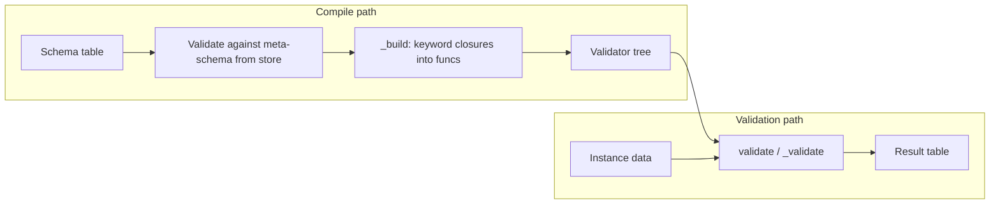
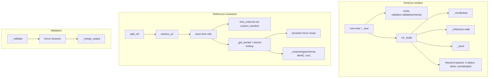

# lua-schema (fperrad) — Research report

## Metadata

- **Library name**: lua-schema
- **Repo URL**: https://framagit.org/fperrad/lua-schema
- **Clone path**: `research/repos/lua/fperrad-lua-schema/`
- **Language**: Lua
- **License**: MIT/X11 (see LICENSE in repo)
- **Analyzed version**: 4196700 (2026-10-19); release 0.4.0 (CHANGES, `_VERSION` in `src/schema.lua`)
- **Report date**: 2026-10-27

## Summary

lua-schema (fperrad) is a JSON Schema **validation** library for Lua. It does not generate code. It compiles a JSON Schema (Lua table) into an internal validator via `schema.new(schema)` and validates data with `validator:validate(data)`, returning a result table with `valid`, `instanceLocation`, `keywordLocation`, `absoluteKeywordLocation`, and `error`/`errors` or `annotation`/`annotations`. Supported dialects are draft-04, draft-06, draft-07, draft-2019-09, draft-2020-12, v1-2026 (default meta-schema) and the OpenAPI 3.1 / 3.2 Schema Object dialects (`oas31`, `oas32`). Draft-03 is not supported (`test/51-test-suite-draft-03.lua` does `skip_all 'draft-03 not supported'`). As of 0.4.0 all dialects live in the `schema.dialect.*` namespace (old `schema.<name>` names still work through a package searcher shim). Validation supports output formats `flag`, `basic`, and `detailed`. Optional format assertion, custom keywords/formats, and a custom resolver for external `$ref`s are supported. Internally the schema is validated against its meta-schema, then compiled into a tree of validator objects holding arrays of keyword closures. Lua-specific extensions include extra `type` values (e.g. `nil`, `function`, `table`, `cdata`) and optional `luaPattern`/`luaPatternProperties`/`lpegPattern` and formats `lua-regex`/`lpeg-regex`. Type definitions for Teal are in `types/schema.d.tl`.

## JSON Schema support

- **Drafts**: Draft-04, draft-06, draft-07, draft-2019-09, draft-2020-12, v1-2026, plus OpenAPI 3.1/3.2 dialects (`src/schema/dialect/*.lua`; adds `discriminator`, `example`, `externalDocs`, `xml` as no-op keywords and formats `int32`, `int64`, `float`, `double`, `password` via `src/schema/openapi.lua`). Draft-03 is not supported. Default is v1-2026 (only that meta-schema is loaded by default); other dialects are used by requiring the corresponding module (e.g. `require'schema.dialect.draft-07'`) and setting `schema.default_schema`. Draft is determined by the schema’s `$schema` (`id` is used instead of `$id` for draft-04) and validated against the appropriate meta-schema from `store`.
- **Scope**: Validation only (schema + instance → valid/invalid + error/annotation output). No code generation.
- **Subset**: Full validation keyword set per draft; applicator, validation, and metadata keywords implemented. Vocabulary-driven format behaviour for draft-2019-09 and later (`_vocabulary` in core.lua). Optional format assertion (`format_assertion`); content keywords are annotation-only.

## Keyword support table

Keyword list derived from vendored draft 2020-12 meta-schemas (`specs/json-schema.org/draft/2020-12/meta/*.json`). Legacy keywords handled for older dialects but absent from 2020-12: `definitions`, `dependencies` (draft-07), `additionalItems`, `$recursiveRef`, draft-04 `id`; v1-2026 proposal keyword `propertyDependencies`; Lua extensions `luaPattern`, `luaPatternProperties`, `lpegPattern`. Implementation evidence from `src/schema/keyword.lua`, `src/schema/core.lua`, `src/schema/format.lua`, `src/schema/utils.lua`, and draft meta-schema modules.

| Keyword | Implemented | Notes |
|---------|-------------|-------|
| $anchor | yes | Parsed in _reference; used for ref resolution (resolve_uri(base, '#' .. anchor)). |
| $comment | yes | Parsed and ignored for validation (metadata). |
| $defs | yes | Collected in _reference walk; subschemas resolved via $ref. draft-04 uses definitions. |
| $dynamicAnchor | yes | Indexed in _reference (refs[base#anchor]); _dynamic_ref resolves at compile time by walking the parent chain for the outermost matching ancestor with $id. |
| $dynamicRef | yes | Resolved eagerly in _build via _dynamic_ref (aliases ancestor funcs); falls back to _ref. |
| $id | yes | Parsed; sets base URI, registers schema in store and refs. draft-04 uses id. |
| $ref | yes | Resolved eagerly in _build via _ref (split_ref, store/refs, get_jsonptr; external via custom_resolver); target re-compiled per reference, ancestor recursion aliased; siblings merged for 2019-09+, ignored for draft-04/06/07. |
| $schema | yes | Used for meta-schema selection and schema validation in _new. |
| $vocabulary | yes | Read from the meta-schema's validator (store[meta_schema].schema) in _vocabulary, not from the instance schema; yields format_annotation, format_assertion, validation flags inherited by descendants. |
| additionalProperties | yes | Instance validation in keyword.lua; respects properties, patternProperties, luaPatternProperties. |
| allOf | yes | Instance validation; all subschemas must pass; evaluated merged. |
| anyOf | yes | Instance validation; at least one subschema must pass. |
| const | yes | Instance validation via same() for tables, equality for primitives. |
| contains | yes | Instance validation; minContains/maxContains supported. |
| contentEncoding | yes | Annotation only (_mk_output_anno). |
| contentMediaType | yes | Annotation only. |
| contentSchema | yes | Annotation only when contentMediaType present. |
| default | yes | Annotation only (keyword __index fallback). |
| dependentRequired | yes | Instance validation in keyword.lua. |
| dependentSchemas | yes | Instance validation. |
| deprecated | yes | Annotation only. |
| description | yes | Annotation only. |
| else | yes | Instance validation; conditional with if/then. |
| enum | yes | Instance validation; type check and same()/equality; first match wins. |
| examples | yes | Annotation only. |
| exclusiveMaximum | yes | Instance validation; draft-04 boolean or number. |
| exclusiveMinimum | yes | Instance validation; draft-04 boolean or number. |
| format | partial | Assertion when format_assertion/vocabulary says so (unknown format names fail in assertion mode); built-in formats in format.lua (date-time, date, time, duration, email, idn-email and idn-hostname (both need the optional `idn2` module), hostname, ipv4, ipv6, uri, uri-reference, iri, iri-reference, uuid, uri-template, json-pointer, relative-json-pointer, regex, lua-regex, lpeg-regex); regex requires Lrexlib-PCRE2; custom_format table. |
| if | yes | Compiled with then/else read from the parent schema; then/else keys themselves are skipped in the keyword pass. |
| items | yes | Instance validation; single schema or array; integrates with prefixItems. |
| maxContains | yes | Instance validation with contains. |
| maximum | yes | Instance validation; draft-04 exclusiveMaximum boolean supported. |
| maxItems | yes | Instance validation. |
| maxLength | yes | Code points via utf8.len (nil on invalid UTF-8, which would raise on comparison). |
| maxProperties | yes | Instance validation. |
| minContains | yes | Instance validation; default 1. |
| minimum | yes | Instance validation; draft-04 exclusiveMinimum boolean. |
| minItems | yes | Instance validation. |
| minLength | yes | Instance validation. |
| minProperties | yes | Instance validation. |
| multipleOf | yes | Integer divisor: data % multiple == 0; float divisor: q = data/multiple, q - floor(q) == 0.0 (IEEE double, rounding-prone). |
| not | yes | Instance validation; negates subschema result. |
| oneOf | yes | Instance validation; exactly one subschema must pass. |
| pattern | yes | PCRE2 via rex_pcre2, compiled at schema build; build raises if rex_pcre2 missing. |
| patternProperties | yes | Instance validation; regex keys. |
| prefixItems | yes | Instance validation; draft 2020-12 style. |
| properties | yes | Instance validation. |
| propertyNames | yes | Instance validation; schema applied to each key. |
| readOnly | yes | Annotation only. |
| required | yes | Instance validation. |
| then | yes | Instance validation; conditional with if. |
| title | yes | Annotation only. |
| type | yes | Instance validation; single or array; integer/number; Lua types (nil, function, userdata, thread, table, cdata). |
| unevaluatedItems | yes | Instance validation; uses evaluated from prefixItems/items/contains. |
| unevaluatedProperties | yes | Instance validation; uses evaluated from properties/patternProperties/additionalProperties. |
| uniqueItems | yes | Primitives via hash table O(n); table items pairwise same() O(m^2); one error per duplicate pair. |
| writeOnly | yes | Annotation only. |

## Constraints

Validation keywords are enforced at **runtime** by closures built at schema-construction time (`core._new` -> `mt:_build` -> `core.keyword[k](value, validator)`). Every keyword that asserts (type, enum, const, numeric bounds, string length/pattern, array and object constraints, applicators, `unevaluated*`) is applied in `mt:_validate` when the node's `funcs` list is run against the instance. Which keywords assert versus merely annotate is vocabulary-driven: `mt:_vocabulary` reads `$vocabulary` from the *meta-schema's* validator, and when the validation vocabulary is not required (`self.validation == false`) the `_mk_output(..., schema.validation)` calls turn failures into annotations. `format` asserts when `format_assertion` is true (module default, or the vocabulary requires `format-assertion`) and otherwise annotates; an **unknown format name is itself a failure** in assertion mode (`keyword.format`, "unknown format: ..."). `contentEncoding`/`contentMediaType`/`contentSchema` are annotation-only (`_mk_output_anno`); `contentSchema` is only emitted when `contentMediaType` is a sibling.

## High-level architecture

Pipeline: **Schema** (Lua table) -> **`schema.new(schema)`** -> the schema is first **validated against its meta-schema** (itself a validator held in the module-level `store`), then **compiled** into a tree of validator objects, each owning a flat list of keyword closures (`funcs`) -> **`validator:validate(data)`** -> **result table** (`valid`, `instanceLocation`, `keywordLocation`, `absoluteKeywordLocation`, `error`/`errors`, `annotation`/`annotations`, or only `valid` in `flag` mode).

## Medium-level architecture

- **Source layout** (about 3,000 lines of Lua outside the dialect files): `src/schema.lua` wires `core.keyword`, `core.format`, loads the default `v1-2026` dialect and installs a `package.searchers` shim mapping legacy `schema.<name>` module names to `schema.dialect.<name>`; `src/schema/core.lua` (685 lines) is construction, reference resolution and output merging; `keyword.lua` (1170) holds one constructor function per keyword; `format.lua` (519) holds LPeg grammars for formats; `utils.lua` (195) has RFC 3986 URI resolution and JSON Pointer traversal; `dialect/*.lua` are each a meta-schema written as a Lua table and instantiated with `core.new` (which registers it in `store` by `$id`); `openapi.lua` adds no-op keywords and numeric formats through `core.custom_format`.
- **Schema creation**: `core.new(schema)` calls `_new(schema)`. `_new` picks the meta-schema URI (own `$schema`, else parent's, else `core.default_schema`), looks up its validator in `store` (or asks `custom_resolver` and builds it), **validates the schema value against that meta-schema** (`assert(result.valid, 'invalid schema')`), computes the JSON Pointer `ptr` and the absolute URI `abs` for the node, allocates the node table with `{ __index = mt }`, and either installs a constant function for boolean schemas or calls `mt:_build(parent)`.
- **`_build`**: the root additionally runs `_vocabulary` and `_reference` (collect `$id`/`$anchor` into `refs`); children inherit `base`, `refs`, the vocabulary flags and `level = parent.level + 1`. `_store` registers any node with `$id` in the global `store`. Then, in order: `$dynamicRef`, `$recursiveRef`, `$ref` (each of these *returns early*, so siblings are only seen through the `merge` in `_ref`); otherwise three passes over `pairs(schema)`: in-place applicators (`allOf`, `anyOf`, `oneOf`, `not`, `if`, `then`, `else`, `dependentSchemas`), all remaining keywords (custom keywords first, then built-in, then the `__index` annotation fallback), then `unevaluatedItems`/`unevaluatedProperties` last so they run after sibling annotations are collected.
- **`$ref` resolution**: see the Algorithms section; in short `split_ref`, `resolve_uri` against the parent's `base`, lookup in the global `store`, then the root's `refs`, then `custom_resolver` (`new_external`), then anchor lookup or JSON Pointer walk, followed by **re-compilation** of the target with `_new` (or reuse of an ancestor's `funcs` to break cycles).
- **Validation**: `validate(data)` -> `_validate(data, data_ptr, ofs, evaluated)` runs every closure in `funcs` with `(self, data, data_ptr, evaluated)`, always (no early exit), collects the output tables and merges them with `_merge_output` according to the module-global `core.output_format`.

## Algorithms and data structures

### Schema representation

There is no parsed schema model: the schema is the user's **raw Lua table** (typically produced by a JSON decoder such as dkjson, or written literally). Each node of the compiled tree keeps a reference to its source subtable in `obj.schema`; keywords are read back out of it with plain indexing (`parent.schema.prefixItems`, `schema_p.minContains`, `schema_p.exclusiveMaximum`, ...) so sibling-dependent keywords look at the raw table rather than at a decoded struct. Unknown keywords are not stored anywhere special: they hit the `__index` metamethod on the `keyword` table (`keyword.lua`, final `setmetatable`) which synthesises an annotation-emitting closure, so *every* unrecognised key becomes an annotation output (this is how `title`, `description`, `default`, `examples`, `deprecated`, `readOnly`, `writeOnly`, `$comment`-adjacent metadata, and vendor keywords such as OpenAPI `discriminator` behave). Boolean schemas are represented as the Lua values `true`/`false` and compiled to a constant one-element `funcs` list. Core/identification keywords (`_core` set in `core.lua`: `$schema`, `$vocabulary`, `id`, `$id`, `$anchor`, `$recursiveAnchor`, `$dynamicAnchor`, `$ref`, `$recursiveRef`, `$dynamicRef`, `definitions`, `$defs`, `$comment`) are skipped in the keyword passes. JSON `null` is a configurable sentinel (`core.json.null`), and array/object predicates are pluggable (`core.json.is_array`/`is_object`, defaulting to "is a Lua table"), because Lua tables cannot distinguish `[]` from `{}`. Ownership is trivially by-reference: the compiled tree holds the user's tables, so later mutation of the schema table would change behaviour only for keywords that read the table at validation time (essentially none, since values are captured as closure upvalues at build time).

The validator node itself (created in `_new`) is a table with fields `schema`, `meta_schema`, `ptr` (JSON Pointer of the keyword location, built with `table.concat({parent.ptr, kw, ofs1, ofs2}, '/')`), `abs` (absolute URI plus fragment, when an `$id` is in scope), `funcs` (array of closures), and, from `_build`, `parent`, `base` (current base URI), `refs` (shared table: absolute URI or `URI#anchor` -> raw subschema), `format_annotation`, `format_assertion`, `validation`, `level`. Methods live in the shared metatable `mt` (`_build`, `_validate`, `validate`, `_ref`, `_mk_output`, `_merge_output`, ...).

### Reference resolution and registry

Two registries exist. (1) The **global module-level `store`** (`local store = {}` in `core.lua`): absolute URI -> validator object. It holds every dialect meta-schema (registered by `core.new` of the dialect module through `_store`) and every user schema or subschema carrying an `$id`, *across all `schema.new` calls and all callers*; entries are never removed and are overwritten on re-registration of the same `$id`. (2) A **per-root `refs` table** built by `mt:_reference`: a **recursive** `walk(t, base)` over every sub-table of the schema (skipping the values of `enum` and `const`) that records `refs[resolved_id] = t` for each `$id`/`id` (draft-04) and `refs[base .. '#' .. anchor] = t` for each `$anchor`/`$dynamicAnchor`, updating `base` as nested `$id`s are crossed. `$id` values that look like `urn:uuid:` or contain `://` are taken verbatim; others go through `resolve_uri(base, id)`. Children share the root's `refs` table by reference (`self.refs = parent.refs`), so lookups are O(1) hash reads.

Base-URI tracking is eager and structural: `_store` sets `self.base = id` and `self.abs = id` at each node with an `$id`; `_new` builds `abs` for children by appending `/kw/ofs`. `utils.resolve_uri` is a hand-written RFC 3986 section 5.2 implementation (`parse_uri` using Lua patterns, `merge_path`, `remove_dot_segments`, `recompose`); `utils.get_jsonptr` walks a pointer through raw tables, validates `~0`/`~1` escapes, converts numeric tokens to 1-based Lua indices (`tok = 1 + tonumber(tok)` unless the key exists literally), handles `-` as the last element, and updates the base while crossing `$id`s. Percent-decoding of the fragment happens in `_get_jsonptr`.

`mt:_ref(ref)` runs **at compile time** (eager) and sets `self.funcs`:

1. `split_ref` -> `(path, fragment)`; a relative `path` is resolved against `self.parent.base` (or own base).
2. Whole-document refs (`fragment == ''`): look in `store[path]`, then the root's `refs[path]`, then `new_external(path)` which calls `core.custom_resolver(path)`, stamps `$id = path` onto the returned table if it has none, and builds it with `_new` (error "no external resolver for <path>" if no resolver is configured). A bare `#` walks up the parent chain to the nearest node with `$id` (or the root) and **aliases its `funcs` table**.
3. Fragment refs: pick the document (`store[path]`, the current `refs`, or an external load), then either an anchor lookup `curr.refs[new_base .. '#' .. fragment]` (fragment starts with a word character) or `_get_jsonptr`, which for a same-document pointer tries each ancestor in turn (`v = v.parent`) so a pointer is resolved relative to the closest enclosing resource that contains it.
4. **Cycle handling**: before re-compiling, it walks `self.parent` upward and if any ancestor's `schema == deref` (raw-table identity) it does `self.funcs = v.funcs` and returns. Because `_build` assigns `self.funcs = {}` *before* filling it, the alias refers to a table that is still being populated; when the ancestor finishes, the alias sees the full list. This turns recursive schemas into a cyclic graph of closure lists with no extra node. A second, blunt guard `assert(parent.level < 99, "infinite recursion")` bounds nesting depth of validator construction (every `$ref` expansion adds a level), catching recursion that the identity check cannot see (notably when a `$ref` with siblings is expanded through `merge`, which creates a fresh table each time).
5. Otherwise the target is **re-compiled from scratch** under the referencing node as parent: `_new(merge(schema, deref), curr, kw)` for 2019-09 and later (siblings of `$ref` are honoured), or `_new(deref, curr, kw)` for dialects whose meta-schema URI contains `draft-0` (draft-04/06/07 ignore siblings). Importantly there is **no memoisation of compiled targets**: two `$ref`s to the same `$defs` entry compile it twice (two separate closure trees, two meta-schema validations). Only ancestor recursion is shared.

`merge(orig, deref)` copies all non-reference keys of the referencing schema into a fresh table `t` and then folds `deref` in: keys absent from `t` are copied; when both sides have a table at the same key, the sibling's table is **mutated in place** to gain any missing sub-keys from `deref`'s table (`t_k[kk] = vv` when `t_k[kk] == nil`). Read literally this is a one-level, index-wise union. For array-valued keywords such as `required`, this fills by index, so a sibling `required = {'a'}` merged with a target `required = {'b','c'}` yields `{'a','c'}` (observed from the code; not exercised here), and the in-place write also alters the user's original sibling tables.

`$dynamicRef` (`_dynamic_ref`) is also resolved **statically at compile time**: if the fragment is anchor-like (starts with a word character) it walks the parent chain and remembers the *outermost* ancestor that has `$dynamicAnchor == fragment`, an `$id`, and no `$ref`; if found it aliases that ancestor's `funcs` and returns, otherwise it falls back to `_ref`. Since expansion through `_ref` makes the referencing node the parent of the compiled target, the parent chain at compile time models the dynamic scope. `$recursiveRef` (2019-09, `_recursive_ref`) asserts the value is `#` and similarly walks ancestors for a `$recursiveAnchor` resource, else the nearest `$id`/root.

Unknown `$schema` values do not fail: `_new` falls back to `store[core.default_schema]` as the meta-validator when the requested one is not loaded (the string stored in `meta_schema` stays as written, which makes `_vocabulary` take its permissive defaults). Remote fetching is never done by the library; only the user-supplied resolver loads external documents.

### Compiled / intermediate form

The IR is a **tree of validator objects whose behaviour is a Lua array of closures**. For each keyword the constructor `core.keyword[k](value, validator)` runs once and returns `function(schema, data, data_ptr, evaluated) -> output_table`, capturing everything pre-computable as upvalues: sub-validators (`allOf` builds `validators[i] = core._new(schemas[i], parent, 'allOf', tostring(i-1))`), compiled regexes (`pcre_new(patt)` for `pattern`, `patternProperties`, and for the `additionalProperties` pattern list; `re_compile` for `lpegPattern`), the `is_array`/`is_object` predicate chosen at build time, the `isa` function table for `type`, the minimum/maximum constants, and the `min`/`max` of `contains`. Keywords that depend on siblings read them at build time from `parent.schema`: `items` reads `prefixItems` to know where to start, `contains` reads `minContains`/`maxContains`, `additionalProperties` reads `properties`/`patternProperties`/`luaPatternProperties`, `if` reads `then`/`else`, `maximum`/`minimum` read draft-04 boolean `exclusiveMaximum`/`exclusiveMinimum`, `contentSchema` reads `contentMediaType`. Some constructors specialise by shape: `type` has distinct closures for a string versus array `type`; `const` for table versus primitive; `multipleOf` for integer versus float divisor; `items` for 2020-12 single schema versus 2019-09 tuple form (using a `__index` metatable on the validator array to serve `additionalItems` for all remaining positions). The keyword list per node is in `pairs()` order within each of three phases, so the **execution order of sibling keywords is not defined by the schema** (Lua hash iteration order), apart from the phase split. Nodes link through `parent` back-pointers (used for dynamic-ref and cycle detection), through captured sub-validators, and, for references, through shared `funcs` tables.

No bytecode, arena, or flat instruction array exists; all nodes are ordinary Lua tables and closures.

### Core algorithm

`mt:_validate(data, data_ptr, ofs, evaluated)` extends the instance pointer (`tconcat({data_ptr or '', ofs}, '/')`), creates an `evaluated` table if none was passed, iterates `funcs`, ANDs the validity, appends each output, and returns `self:_merge_output(valid, outputs, nil, data_ptr)`. There is **no short-circuiting**: all keywords run and all array items/properties are visited even after a failure, because the output model wants complete annotation/error trees and sibling keywords share `evaluated`.

Dispatch is per-type inside each closure: a keyword closure checks the instance type itself and trivially passes when it does not apply (`type(data) == 'number'` in numeric keywords, `is_array(data)` in array keywords, etc.), so there is no up-front type switch.

Annotation tracking for `unevaluatedItems`/`unevaluatedProperties` uses the **`evaluated` table**: a map keyed by array index or property name whose value is the boolean validity of the subschema that evaluated it (`evaluated[k] = output.valid`). A location counts as evaluated only if the value is truthy, so a failed sub-evaluation is treated as unevaluated. `properties`, `patternProperties`, `luaPatternProperties`, `additionalProperties`, `prefixItems`, `items`, `contains` write to it; `unevaluated*` run last and validate every position where `not evaluated[k]`. Applicators propagate it with copy-merge semantics: `allOf`/`anyOf`/`oneOf` give each branch a **clone** (`clone(evaluated)`, a shallow `pairs` copy) and, afterwards, fold only the clones of branches that passed (all of them for `allOf`, the passing ones for `anyOf`, the single passing one for `oneOf`) back into the parent table (`if v then evaluated[k] = v end`). `not` passes no table. `if`/`then`/`else` and `dependentSchemas` pass the parent's `evaluated` directly (so annotations from a failed `if` leak in as `false` entries and are ignored by the truthiness test). Child validators for `properties`/`items` get a fresh table (called without `evaluated`), correctly scoping annotations to instance depth. `$ref` aliasing means the referenced `funcs` run in the context of the referencing node, so annotations flow through references.

Keyword algorithms of note (all in `keyword.lua`):

- `properties` iterates **the instance's keys** (`pairs(data)`) and looks each up in a precomputed `validators[k]` hash; cost O(instance keys), independent of schema property count. `patternProperties` is O(keys x patterns) PCRE matches. `additionalProperties` re-tests every instance key against `properties` and all patterns each call.
- `required` is a linear scan with `data[r] == nil`; `maxProperties`/`minProperties` count with `pairs`.
- `uniqueItems` splits items: primitives are de-duplicated through a hash table keyed by the value itself (O(n)); tables go in a side list compared pairwise with `same()` (O(m^2) deep comparisons). It reports *every* duplicate pair as a separate error output.
- `same(a, b)` (deep equality) allocates a `seen` set per call and compares by `pairs` in both directions; it treats an already-seen left table as equal (cycle guard), which can also make a shared (aliased, non-cyclic) left sub-table compare equal on second visit without comparing it (observed from the code).
- `enum` is a linear scan comparing `type()` first then `==` or `same()`; `const` is a single comparison.
- `multipleOf`: integer divisors use `data % multiple == 0`; float divisors use `q = data / multiple; q - floor(q) == 0.0`, i.e. plain IEEE-754 double arithmetic, so results are subject to floating-point rounding.
- `maxLength`/`minLength` count code points with `utf8.len` (compat53 is loaded on Lua < 5.3). `utf8.len` returns `nil` on invalid UTF-8, which would make the following comparison raise a Lua error (inferred from the code; not tested here).
- `contains` validates every item (no early exit once `minContains` is met) and counts matches against `minContains` (default 1) and optional `maxContains`.
- `format` looks up `core.custom_format[fmt] or core.format[fmt]` once at build time. Built-in formats are **LPeg grammars** compiled once at module load (`format.lua`): RFC 3339 date/time (with calendar round-trip check through `os.time`/`os.date`), RFC 3986 URI/URI-reference, RFC 3987 IRI, RFC 5321/6531 email, hostname (label <= 63, domain <= 253), full RFC 3986 IPv6 alternation, uuid, RFC 6570 uri-template, JSON Pointer, relative JSON Pointer, ISO 8601 duration, and `lua-regex` (a hand-written LPeg grammar for Lua patterns). `regex` compiles with PCRE2 if available and otherwise accepts everything. Each format is anchored with `* -1` (end of input) and run through `lpeg.match`.

### Error and output model

A result node is a plain table `{ valid, instanceLocation, keywordLocation, absoluteKeywordLocation, error | annotation, errors | annotations }` following the JSON Schema output format. Locations are strings: the instance pointer is passed down as `data_ptr` (extended per `_validate` via `tconcat`), the keyword location is the node's precomputed `ptr .. '/' .. kw`, and `absoluteKeywordLocation` is derived from `abs`, switching to `#/...` once a fragment is needed. Leaf keywords call `_mk_output(valid, msg, kw, data_ptr, assertion)` (fixed English messages such as "must be <= N", "must have required property X"; when `assertion` is false the same call yields `valid = true` plus an `annotation`), annotation keywords call `_mk_output_anno`, and composite keywords call `_merge_output(valid, outputs, kw, data_ptr, msg)`. The module-global `core.output_format` selects the merge strategy **at validation time**:

- `flag`: returns only `{ valid = valid }` (the leaf tables are still built and discarded by the merge).
- `basic`: a *flat* list. `merge_output_basic` concatenates child `errors` (or the leaf node itself) into one `errors` array, or child `annotations` into `annotations`.
- `detailed` (default): a *hierarchy*. `merge_output_detailed` keeps only invalid children as `errors` (single child collapsed to the child itself, no wrapper when there is no message), and only valid children that carry annotations as `annotations`.

Errors propagate purely by return values (no exceptions during validation); exceptions (`error`/`assert`) are reserved for schema construction problems: "invalid schema" (meta-schema validation failed), "unknown schema", "infinite recursion", "not found <ref>", "no external resolver for <path>", missing `rex_pcre2`.

## Low-level details

- **Custom keywords/formats**: `core.custom_keyword[kw]` is consulted in the second keyword pass in `_build` (`core.custom_keyword[k] or core.keyword[k]`) and receives `(value, validator)`, returning a closure with the standard `(schema, data, data_ptr, evaluated)` signature. `core.custom_format[fmt]` is consulted once in `keyword.format` **when the schema is built**, so custom formats must be registered before `schema.new`.
- **Global mutable configuration**: `default_schema`, `output_format`, `format_assertion`, `custom_*`, `json` are module-level fields. `format_assertion` is captured per root at build time (`_vocabulary`), but `output_format` is read at every `_merge_output`, so it affects already-built validators.
- **Vocabulary handling** (`_vocabulary`): reads `$vocabulary` from the meta-schema validator in `store` (not from the instance schema), then pattern-matches vocabulary URIs (`vocab/format-annotation`, `vocab/format-assertion`, `vocab/validation`, 2019-09 `vocab/format` with value `false`) into three booleans inherited by all descendants. Without a `$vocabulary` (draft-04/06/07) all three behave as defaults (annotation on, assertion per `core.format_assertion`, validation on).
- **Lua types**: `type` accepts JSON names plus `nil`, `function`, `userdata`, `thread`, `table`, `cdata`; `integer` is `type == 'number'` and `math.tointeger(data)` non-nil (so `1.0` is an integer, as required by recent drafts). Equality is Lua `==`, so `1 == 1.0`. JSON arrays must be Lua sequences, and an empty table is both an empty array and empty object (unless `core.json.is_array/is_object` are customised).
- **Regex engines**: `pattern`/`patternProperties` use PCRE2 via `rex_pcre2` (loaded with `pcall(require, ...)`; if absent, constructing a schema that uses these keywords raises "rex_pcre2 missing"); Lua-pattern (`luaPattern`, `luaPatternProperties`) and LPeg `re` (`lpegPattern`) extensions exist as alternatives. Note that `pattern` as dialect meta-schema usage is replaced by `luaPattern` inside the bundled meta-schemas so the library bootstraps without PCRE2.
- **Recursion limits**: construction depth is capped at 99 levels (`level < 99`). Validation itself recurses through closures with no explicit depth limit, so instance depth is bounded only by the Lua C/stack limits; `core.lua`'s `_reference` walk and `same()` are literally recursive.
- **Untrusted input**: schema input is validated against the meta-schema before use, but `custom_resolver` results are trusted, `pcre_new(patt)` compiles attacker-controllable patterns with no backtracking limit configured in this code, and there are no size limits.
- **Dialect specifics**: draft-04's boolean `exclusiveMaximum`/`exclusiveMinimum` are handled inside `maximum`/`minimum`; draft-07 `dependencies` is a combined string-array/schema keyword (`keyword.dependencies`); `additionalItems` is consumed by the tuple form of `items`; OpenAPI dialects add `int32`, `int64` (integer checks), `float`, `double`, `password` (always true) formats via `core.custom_format` and no-op metadata keywords.

## Output and integration

- **Vendored vs build-dir**: N/A (validation only; no generated code).
- **API vs CLI**: Library API only. `schema.new(schema)` returns a validator; `validator:validate(data)` returns a result table. No CLI. Distributed via LuaRocks (rockspec pins `lua >= 5.1`, `lpeg`; `lrexlib-pcre2` and `idn2` are optional), Debian packaging and a `make install`. Teal type definitions in `types/schema.d.tl`.
- **Writer model**: N/A (validation only).

## Configuration

- **default_schema**: String; the meta-schema URI to use when a schema has no `$schema` (default `https://json-schema.org/v1`, i.e. v1-2026). Other dialects are loaded by `require'schema.dialect.<name>'` (which `core.new`-registers the meta-schema) and then selected by this field.
- **output_format**: `"flag"` | `"basic"` | `"detailed"` (default).
- **format_assertion**: Boolean (default true; `v1-2026` sets it true on load; docs show setting it to false after loading draft-07 to get annotation-only formats).
- **custom_keyword**: Table; name -> `function(value, validator)` returning the keyword closure.
- **custom_format**: Table; format name -> `function(data)` returning `true` or `false, err`.
- **custom_resolver**: `function(uri)` -> decoded schema table or nil; used for external `$ref`s and for unknown `$schema` URIs.
- **json**: `json.null` sentinel and `json.is_array`/`json.is_object` predicates to integrate a JSON decoder (tests use dkjson metatables).

## Pros/cons

- **Pros**: Compiles once to closures with sibling-dependent keywords resolved ahead of time; multi-draft support (draft-04 through v1-2026) plus OpenAPI 3.1/3.2 dialects, driven by meta-schemas written as data; vocabulary-aware format/validation behaviour; complete output formats (flag/basic/detailed) with instance, keyword and absolute keyword locations; `unevaluated*` implemented with a per-branch annotation set; recursive schemas handled by aliasing ancestor `funcs`; custom keywords, formats and resolver; pure-Lua with optional C dependencies (PCRE2, idn2); Lua-native `type` extensions and Lua-pattern/LPeg alternatives; very extensive LPeg-based format coverage; Teal types.
- **Cons**: No code generation; no early exit (even `flag` mode builds full result tables); no compiled-target memoisation, so repeated `$ref`s recompile their targets and each sub-schema is meta-validated again; global mutable configuration and global `store`; `pattern` needs Lrexlib-PCRE2 (no ECMA-262 translation, no ReDoS guard); idn formats need `idn2`; content keywords are annotation-only; empty array/object ambiguity in Lua tables; sibling keyword execution order is hash order; the `$ref` sibling `merge` has index-wise merging and in-place mutation quirks.

## Testability

- **Run tests**: `make test` (or `make check`) runs `prove --exec=$(LUA) test/*.lua` with `LUA_PATH="$(CURDIR)/src/?.lua;;"`; `make sanity` runs only `test/[01]*.lua`; `make test-dev` runs `test/dev/01-test-suite-one.lua` verbosely. `make bed` provisions a hererocks environment with dkjson, idn2, lpeg, lrexlib-pcre2, lua-testassertion, luacheck, luacov, lyaml and tl. Also `make luacheck`, `make tlcheck`, `make coverage`/`lcov`.
- **Fixtures**: Tests use `Test.Assertion` (TAP). Unit tests are `test/00-require.lua` .. `test/12-resolve-uri.lua` (keywords by category, registry, resolve_uri, JSON pointer), `31-custom-keyword`, `32-custom-format`, `33-35` (OpenAPI formats and oas31/oas32 dialects). The conformance tests `51`-`57` (drafts; `51` skips draft-03), `62`-`67` (annotations), `75`-`77` (output format), `82`-`87` (optional format tests) run the **JSON-Schema-Test-Suite git submodule** (`test/JSON-Schema-Test-Suite`, per `.gitmodules`; CHANGES says it follows suite 1.040). The submodule is **not present in the analyzed clone**, and those tests `skip_all` when the directory, `dkjson`, or `rex_pcre2` is missing; so the conformance coverage could not be inspected here. A few cases are skipped with comments (e.g. heterogeneous enum with null).
- **Our generator**: N/A directly (validator); the JSON-Schema-Test-Suite is the reusable asset.

## Performance

Analysis is by reading code only; nothing was executed or measured.

### Performance techniques

- **Compile vs interpret**: Closure compilation. `_new`/`_build` and each `keyword.<name>` constructor run once per schema and precompute everything that does not depend on the instance: sub-validators, PCRE2/LPeg regex objects, the `type` predicate table, specialised closure variants (integer vs float `multipleOf`, string vs array `type`, draft-04 vs modern `maximum`), `$ref`/`$dynamicRef` targets (resolved at compile time into aliased `funcs`), JSON Pointer strings `ptr` and `abs`. At validation time each node is a loop over a `funcs` array. Not specialised further (no code generation or `load`). Offsetting this, construction is expensive: **every `_new` (every subschema, every `$ref` expansion) validates its schema against the meta-schema** (`meta_validator:validate(schema)` in `_new`), so a schema of size n and depth d costs roughly O(n x d) meta-validation work at build time, and a repeatedly referenced definition pays it each time it is expanded.
- **Memory layout and allocation**: Pointer-rich: one table per validator node (about 12 fields), one closure plus upvalues per keyword, one `funcs` array per node. Per validation call, allocation is heavy: every keyword closure returns a fresh result table, every `_validate` builds `outputs`, an `evaluated` table and a string via `tconcat` for the instance pointer, and each `allOf`/`anyOf`/`oneOf` branch clones `evaluated`. `ptr`/`abs` strings are precomputed (interned by Lua) rather than rebuilt per call for the keyword location, but `_mk_output` still concatenates `self.ptr .. '/' .. kw` and `abs` per output. Subschemas share `refs` by reference (not copied) and recursive refs share `funcs` tables. No lazy error construction: even when valid or in `flag` mode the leaf result tables are created and then discarded by `_merge_output`.
- **Caching and memoization**: Compile-time only and partial: global `store` caches meta-schema validators and `$id`-registered schemas for lookup by URI; the per-root `refs` table caches `$id`/`$anchor` -> raw table; PCRE2 and LPeg `re` objects are compiled once per keyword instance. There is **no cache of compiled `$ref` targets**, no cache of format results, no per-instance memoisation, and `pcre_new` is not shared between identical patterns across nodes.
- **Fast paths and short-circuiting**: Mostly absent. All keywords are evaluated (`_validate` never breaks), `oneOf`/`anyOf` evaluate every branch, `contains` and `items` scan the full array, `properties` and `additionalProperties` always iterate every instance key. Cheap shape checks happen first inside each closure (non-applicable types return valid immediately), `uniqueItems` hashes primitives for O(n), and `unevaluated*` run last so their work is limited to leftovers. Constant boolean schemas are a single trivial closure. `if` without `then`/`else` returns a bare success output without evaluating a branch.
- **Regex handling**: `pattern`/`patternProperties`: PCRE2 through Lrexlib (`pcre.new(patt)` once at build; `regex:match(str)` per use, unanchored search semantics as required by JSON Schema); no ECMA-262 translation (PCRE2 syntax differences are not handled) and no ReDoS limits set. Alternatives: Lua patterns via `string.match` (`luaPattern`, `luaPatternProperties`) and LPeg `re` (`lpegPattern`), which are non-backtracking-regex style. `patternProperties` and `additionalProperties` loop over all patterns per key with no pre-merged automaton. Formats use precompiled LPeg grammars (`format.lua`), which are linear-time PEG matchers without catastrophic backtracking by construction (ordered choice with limited alternation).
- **Concurrency**: Lua is single-threaded per state; the library holds no per-call mutable state in validators (all state is passed through arguments), so a built validator can be reused across calls and coroutines. Configuration (`core.output_format`, `custom_*`, `store`) is process-global, so it is shared by all validators in the Lua state and not safe to vary concurrently from different coroutines. No parallelism.

### Benchmarks in repo

None. No benchmark target in `Makefile`, no benchmark directory or fixtures. Useful entry points for an external harness: `require'schema'` (optionally `require'schema.dialect.draft-07'` etc. and set `schema.default_schema`), `schema.output_format = 'flag'`, `local v = schema.new(schema_table)` (compile once), `v:validate(instance).valid` (hot path). JSON-Schema-Test-Suite fixtures can be decoded with dkjson (set `schema.json.null` and `is_array`/`is_object` from `__jsontype` metatables, as the tests do).

## Determinism and idempotency

- **Generated output**: N/A (validation only).
- **Validation result**: Verdict (`valid`) is deterministic for a given schema and instance. The **order and grouping of errors/annotations is not guaranteed**: sibling keywords are compiled by iterating `pairs(schema)` (three phases: in-place applicators, other keywords, `unevaluated*`), and `properties`, `patternProperties`, `dependentSchemas`, `additionalProperties` iterate `pairs(data)` or `pairs(validators)`; Lua table iteration order is unspecified, so `errors` arrays can differ in order between runs/Lua builds. No sorting is applied. Compiling is idempotent apart from the global `store`, which re-registers `$id`s on each `schema.new`.

## Enum handling

- **Implementation**: `keyword.enum` linearly scans the enum array; an element matches when `type(data) == type(elt)` and either `data == elt` (primitives) or `same(data, elt)` (tables, deep equality). First match short-circuits the loop. Integer and float representations of the same number are equal (`1 == 1.0`). The `null` sentinel (`core.json.null`) is compared by identity like any other value.
- **Duplicate entries**: No deduplication or rejection in this library; duplicates are just checked in order (first match wins). The bundled meta-schemas may constrain `enum` (e.g. `uniqueItems`) when the schema is validated against them in `_new`, which is the only place duplicates could be rejected.
- **Case / namespace**: Value-based exact comparison; `"a"` and `"A"` are distinct and both accepted when both are listed. No variants are generated (no codegen).

## Reverse generation (Schema from types)

No. Validation-only library; it does not generate JSON Schema from Lua types.

## Multi-language output

N/A (validation only; no code generation).

## Model deduplication and $ref/$defs

- **Validation context**: No generated types; the relevant question is how `$ref` and definitions are reused.
- **$ref**: Resolved eagerly in `_ref`. Recursion is shared (an ancestor whose raw `schema == deref` has its `funcs` table aliased), but non-recursive repeated references are **not** shared: each `$ref` to the same `$defs` entry calls `_new` again and builds a separate validator subtree (and re-runs meta-schema validation on it). Targets with `$id` registered in the global `store` are looked up by URI but still re-compiled per reference through `_new(deref, curr, kw)`.
- **definitions / $defs**: Not compiled on their own (they are in `_core`, skipped by the keyword passes); they are only indexed by `_reference` (`$id`/`$anchor`) and reached through pointers. No deduplication of identical inline shapes.

## Validation (schema + JSON -> errors)

Yes. This is the library's sole purpose.

- **Inputs**: (1) JSON Schema as a Lua table (usually decoded by a JSON library, with `core.json.null`/`is_array`/`is_object` configured to match). (2) Instance as any Lua value.
- **API**: `validator = schema.new(schema)` (throws if the schema is invalid against its meta-schema or a reference cannot be resolved); `result = validator:validate(data)`.
- **Output**: Result table with `valid`, `instanceLocation`, `keywordLocation`, `absoluteKeywordLocation` and `error`/`errors` or `annotation`/`annotations` depending on `core.output_format` (`flag` returns only `valid`).
- **Error format**: Detailed mode is a tree of nodes mirroring the schema structure; basic mode is a flat list of leaf errors; messages are fixed English strings.

## Could not verify

- JSON-Schema-Test-Suite conformance results (submodule absent from the clone; nothing executed).
- Behaviour on invalid UTF-8 in `maxLength`/`minLength`, the `merge` array-index quirk, and the `same()` aliasing quirk are inferred from reading code, not tested.
- Actual performance characteristics (no benchmarks run).
