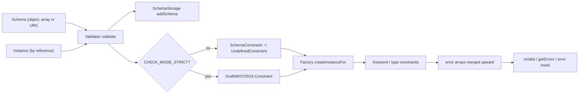
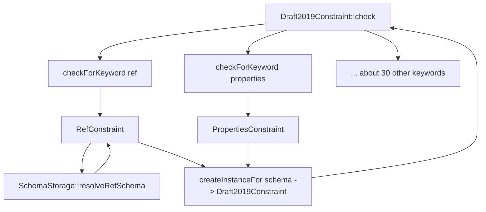

# json-schema (jsonrainbow) — Research report

## Metadata

- **Library name**: json-schema (justinrainbow/json-schema, jsonrainbow/json-schema)
- **Repo URL**: https://github.com/jsonrainbow/json-schema
- **Clone path**: `research/repos/php/jsonrainbow-json-schema/`
- **Language**: PHP
- **License**: MIT (see LICENSE in repo)
- **Analyzed version**: bae415e 2026-10-24 (release 6.14.0)
- **Report date**: 2026-10-27

## Summary

jsonrainbow/json-schema is a JSON Schema **validation** library for PHP. It does **not** generate code. It loads a JSON Schema (inline object, file URI, or via SchemaStorage), resolves `$ref` through SchemaStorage and UriRetriever, and validates JSON instances against the schema using constraint classes. Supported drafts are Draft-3, Draft-4 (default in non-strict mode), Draft-6, Draft-7, and (since 6.x, newest addition) Draft 2019-09. Strict mode (CHECK_MODE_STRICT) uses draft-specific constraint pipelines (Draft06Constraint, Draft07Constraint, Draft2019Constraint) and supports only Draft-6, Draft-7 and 2019-09; non-strict mode uses SchemaConstraint and UndefinedConstraint and supports Draft-3/4 features (extends, disallow, dependencies). Validation is the only concern: schema + instance → Validator::validate() → isValid() / getErrors(). Optional features include type coercion, default application, format validation, and meta-schema validation.

## JSON Schema support

- **Drafts**: Draft-3, Draft-4, Draft-6, Draft-7, Draft 2019-09. README lists all five and shows Bowtie compliance badges for each. In strict mode the pipeline is chosen from `$schema` (or Factory default dialect, Draft-6). DraftIdentifiers also defines DRAFT_2020_12 but Factory constraintMap registers only draft06, draft07 and draft2019-09; the JSON Schema Test Suite runner explicitly skips draft2020-12, draft-next, latest and v1. 2020-12 is therefore not supported. Non-strict mode defaults to draft-04–style behavior (SchemaConstraint::DEFAULT_SCHEMA_SPEC).
- **Scope**: Validation only (schema + instance → valid/invalid + error list). No code generation.
- **Subset**: Not all meta-schema keywords are implemented. Draft-07 adds if/then/else and contentMediaType/contentEncoding (partial: base64, application/json; Draft07 ContentConstraint only). Draft 2019-09 adds dependentRequired, dependentSchemas, minContains/maxContains, and unevaluatedProperties (6.14.0; evaluated-property collection walks properties, patternProperties, additionalProperties, allOf/anyOf/oneOf, if/then/else, dependentSchemas and $ref). Not implemented: prefixItems, $anchor, $recursiveRef/$dynamicRef, unevaluatedItems, contentSchema, $vocabulary. The 2019-09 ContentConstraint is an empty stub. Format is optional (CHECK_MODE_DISABLE_FORMAT). Draft-03/04–specific: extends, disallow, id, dependencies (string, array, or schema) are supported in non-strict path.

## Keyword support table

Keyword list derived from vendored draft 2020-12 meta-schemas (`specs/json-schema.org/draft/2020-12/meta/`); 2019-09 and Draft-3/4/6/7 keywords are cross-checked against the vendored `draft/2019-09` and `draft-0x` directories. The "Notes" column reports the newest supported draft (2019-09) and fallbacks. Implementation evidence from Factory, Draft06/Draft07/Draft2019 Constraint and Factory classes, UndefinedConstraint, SchemaStorage, RefConstraint, FormatConstraint, ContentConstraint, IfThenElseConstraint, and tests under tests/Constraints/, tests/Drafts/, tests/RefTest.php.

| Keyword | Implemented | Notes |
|---------|-------------|-------|
| $anchor | no | Not implemented (no handling in SchemaStorage). |
| $comment | no | Not parsed or used for validation. |
| $defs | yes | Subschemas with $id/id are registered by SchemaStorage::scanMembersForSubschemas / registerAndScanSubschema; $ref to #/definitions/… or #/$defs/… resolved via JsonPointer and resolveRef. |
| $dynamicAnchor | no | Not implemented (also no $recursiveRef/$recursiveAnchor from 2019-09). |
| $dynamicRef | no | Not implemented. |
| $id | yes | Parsed (SchemaStorage::findSchemaIdInObject); used for URI scope and sub-schema registration. Draft-04 `id` also supported. |
| $ref | yes | RefConstraint (Draft06/07/2019); siblings of $ref are ignored in Draft-06/07 (Draft06/07Constraint return right after the ref check) but NOT in 2019-09 (Draft2019Constraint keeps running all keywords); unresolvable $ref now throws instead of passing; non-strict path resolves via Constraint::checkUndefined → resolveRefSchema before delegating to UndefinedConstraint. SchemaStorage::expandRefs normalizes refs; resolveRef/resolveRefSchema resolve to schema. |
| $schema | yes | Accepted; used for strict dialect selection and optional meta-schema validation (CHECK_MODE_VALIDATE_SCHEMA). |
| $vocabulary | no | Not implemented. |
| additionalProperties | yes | AdditionalPropertiesConstraint (Draft06/07); ObjectConstraint/UndefinedConstraint in non-strict. |
| allOf | yes | AllOfConstraint (Draft06/07); UndefinedConstraint::validateOfProperties in non-strict. |
| anyOf | yes | AnyOfConstraint (Draft06/07); UndefinedConstraint::validateOfProperties. |
| const | yes | ConstConstraint (Draft06/07); UndefinedConstraint::checkConst in non-strict. |
| contains | yes | ContainsConstraint (Draft06/07/2019); 2019-09 version counts matches for minContains/maxContains (default min 1). |
| contentEncoding | partial | Draft07 ContentConstraint validates base64; Draft2019 ContentConstraint is an empty stub. |
| contentMediaType | partial | Draft07 ContentConstraint validates application/json; Draft2019 is a stub. |
| contentSchema | no | ContentConstraint does not apply a subschema to decoded content. |
| default | yes | Applied when CHECK_MODE_APPLY_DEFAULTS; UndefinedConstraint::applyDefaultValues. |
| dependentRequired | yes | DependentRequiredConstraint (Draft2019). DependenciesConstraint implements draft-04/06/07 `dependencies`. |
| dependentSchemas | yes | DependentSchemasConstraint (Draft2019). |
| deprecated | no | Not implemented. |
| description | no | Not used for validation. |
| else | yes | IfThenElseConstraint (Draft07/2019). |
| enum | yes | EnumConstraint (Draft06/07); UndefinedConstraint::checkEnum in non-strict. |
| examples | no | Not validated. |
| exclusiveMaximum | yes | ExclusiveMaximumConstraint (Draft06/07). |
| exclusiveMinimum | yes | ExclusiveMinimumConstraint (Draft06/07). |
| format | yes | FormatConstraint; date, time, date-time, duration, utc-millisec, regex, color, style, phone, uri, uriref, uri-reference, iri, iri-reference, uri-template, uuid, email, idn-email, ipv4/ip-address, ipv6, hostname, idn-hostname (2019 set); unknown formats ignored; optional (CHECK_MODE_DISABLE_FORMAT). |
| if | yes | IfThenElseConstraint (Draft07/2019). |
| items | yes | ItemsConstraint (Draft06/07); CollectionConstraint/UndefinedConstraint in non-strict. |
| maxContains | yes | Draft2019 ContainsConstraint (MAX_CONTAINS error). |
| maximum | yes | MaximumConstraint (Draft06/07); NumberConstraint in non-strict. |
| maxItems | yes | MaxItemsConstraint (Draft06/07). |
| maxLength | yes | MaxLengthConstraint (Draft06/07); StringConstraint in non-strict. |
| maxProperties | yes | MaxPropertiesConstraint (Draft06/07); ObjectConstraint::validateMinMaxConstraint. |
| minContains | yes | Draft2019 ContainsConstraint (MIN_CONTAINS error). |
| minimum | yes | MinimumConstraint (Draft06/07); NumberConstraint in non-strict. |
| minItems | yes | MinItemsConstraint (Draft06/07). |
| minLength | yes | MinLengthConstraint (Draft06/07); StringConstraint in non-strict. |
| minProperties | yes | MinPropertiesConstraint (Draft06/07); ObjectConstraint::validateMinMaxConstraint. |
| multipleOf | yes | MultipleOfConstraint (Draft06/07); NumberConstraint (DivisibleBy) in non-strict. |
| not | yes | NotConstraint (Draft06/07); UndefinedConstraint in non-strict. |
| oneOf | yes | OneOfConstraint (Draft06/07); UndefinedConstraint::validateOfProperties. |
| pattern | yes | PatternConstraint (Draft06/07); StringConstraint in non-strict. |
| patternProperties | yes | PatternPropertiesConstraint (Draft06/07); ObjectConstraint::validatePatternProperties. |
| prefixItems | no | Not implemented (Draft 2020-12). |
| properties | yes | PropertiesConstraint (Draft06/07); ObjectConstraint in non-strict. |
| propertyNames | yes | PropertiesNamesConstraint (Draft06/07). |
| readOnly | no | Not implemented (ReadOnlyTest exists but validates presence only; no write-only path). |
| required | yes | RequiredConstraint (Draft06/07); UndefinedConstraint supports draft-04 array and draft-03 boolean. |
| then | yes | IfThenElseConstraint (Draft07/2019). |
| title | no | Not used for validation. |
| type | yes | TypeConstraint (Draft06/07); TypeConstraint/UndefinedConstraint in non-strict; strict/loose type check. |
| unevaluatedItems | no | Not implemented. |
| unevaluatedProperties | yes | UnevaluatedPropertiesConstraint (Draft2019 only, added in 6.14.0). Re-validates sub-branches to rebuild the evaluated set instead of consuming annotations (see Core algorithm). |
| uniqueItems | yes | UniqueItemsConstraint (Draft06/07). |
| writeOnly | no | Not implemented. |

Draft-03/04–specific keywords (not in 2020-12 core): **extends** (yes, UndefinedConstraint::validateCommonProperties); **disallow** (yes, UndefinedConstraint); **id** (yes, as $id above); **dependencies** (yes, DependenciesConstraint and UndefinedConstraint::validateDependencies — string, array, or schema).

## Constraints

Validation keywords are enforced at **runtime** by the recursive constraint pipeline. In non-strict mode, SchemaConstraint delegates to UndefinedConstraint, which applies type checks, extends, required, default, disallow, not, dependencies, allOf/anyOf/oneOf, and type-specific checks (object, array, string, number, enum, const). In strict mode (Draft06, Draft07 or Draft2019), the draft-specific root constraint (Draft06Constraint, Draft07Constraint or Draft2019Constraint) invokes keyword-specific constraints in a fixed order. Constraints are used for instance validation only (e.g. minLength, pattern, required); there is no generated code. Type coercion (CHECK_MODE_COERCE_TYPES) and default application (CHECK_MODE_APPLY_DEFAULTS) mutate the instance when enabled.

## High-level architecture

Pipeline: **schema (PHP object from `json_decode`, array, or URI)** -> `Validator::validate(&$value, $schema, $checkMode)` -> schema registered in **SchemaStorage** (`addSchema`: sub-schema scan + `$ref` rewriting) -> a **root constraint** chosen by mode -> a **tree of per-keyword constraint objects**, created through a **Factory** -> **error arrays** merged upward -> `isValid()` / `getErrors()`.

There are two independent engines behind the one `Validator` facade:

- **Legacy / non-strict engine** (default, `CHECK_MODE_NORMAL`): `SchemaConstraint` -> `UndefinedConstraint` -> type-specific constraints (`ObjectConstraint`, `CollectionConstraint`, `StringConstraint`, `NumberConstraint`, `TypeConstraint`, `EnumConstraint`, `ConstConstraint`, `FormatConstraint`). One class handles many keywords at once. Draft-03/04 oriented (`extends`, `disallow`, `divisibleBy`, boolean `required`), with later keywords bolted on.
- **Strict / per-draft engine** (`CHECK_MODE_STRICT`): the root is `Draft06Constraint`, `Draft07Constraint` or `Draft2019Constraint` (picked from `$schema`, default dialect Draft-6). Each calls one small constraint class per keyword in a hard-coded order; each draft has its own `Factory` subclass and its own copy of every keyword class under `Constraints/Drafts/DraftNN/`.

## Medium-level architecture

- **Validator** (`Validator.php`): extends `BaseConstraint`. `validate()` resets state, optionally swaps the factory's check mode, registers the schema in `SchemaStorage` under `INTERNAL_PROVIDED_SCHEMA_URI` (or its `id`/`$id`), re-reads it back with `getSchema`, short-circuits boolean schemas, then picks the root constraint (`schema` constraint, or in strict mode `DraftIdentifiers::byValue($dialect)->toConstraintName()`), calls `check($value, $schema)`, and finally copies `array_unique($validator->getErrors(), SORT_REGULAR)` into itself.
- **Factory** (`Constraints/Factory.php`): holds `SchemaStorage`, `UriRetriever`, the check-mode bitmask, a `constraintMap` (keyword/type name -> class), a prototype `instanceCache`, and a per-check-mode `TypeCheck` cache. Draft factories (`Drafts/DraftNN/Factory.php`) replace the map entirely (about 35 entries: `schema`, `properties`, `items`, `ref`, ...).
- **SchemaStorage / UriRetriever / UriResolver**: see Reference resolution below.
- **Constraints**: every constraint is a `BaseConstraint` subclass (legacy) or implements `ConstraintInterface` + `ErrorBagProxy` (drafts). Sub-schema recursion always goes back through the factory (`createInstanceFor('schema')` / `checkUndefined`).

## Algorithms and data structures

### Schema representation

There is no parsed schema model. The schema is the raw `json_decode($json, false)` result: JSON objects are `\stdClass`, arrays are PHP lists, booleans/null/numbers are PHP scalars. Constraints read keywords directly with `property_exists($schema, 'x')` / `isset($schema->x)`. Unknown keywords are simply never looked at (no validation of the schema shape unless `CHECK_MODE_VALIDATE_SCHEMA` validates it against its meta-schema). Boolean schemas are handled at the top of each draft root constraint (`is_bool($schema)`; `false` adds `ConstraintError::FALSE`), and `UndefinedConstraint::check` silently returns for non-object schemas. Array schemas (PHP assoc arrays) are converted by `BaseConstraint::arrayToObjectRecursive`, which is a `json_encode` + `json_decode` round trip (`SchemaStorage::addSchema`, `SchemaConstraint::check`).

The schema is **mutable shared state**: `addSchema` rewrites every `$ref` string in place to an absolute pointer; `UndefinedConstraint` rewrites `$schema->extends` when it is a string; `UriRetriever::retrieve` injects `id`/`$id` into the fetched object. Instances are also mutable: `validate(&$value, ...)` takes the instance by reference because type coercion (`LooseTypeCheck`/`TypeConstraint`) and `applyDefaultValues` write into it. Instance objects may be `stdClass` or (with `CHECK_MODE_TYPE_CAST`) associative arrays; `TypeCheck/StrictTypeCheck` vs `LooseTypeCheck` abstract `isObject/propertyGet/propertyExists/propertySet`, chosen per check mode via `Factory::getTypeCheck()` (cached in `$typeCheck[$checkMode]`).

A missing property is represented by passing an `UndefinedConstraint` instance as the value (`ObjectConstraint::getProperty(..., $fallback)` returns the fallback; later code tests `$value instanceof self`). This sentinel-object trick is how the legacy engine distinguishes "absent" from `null` and implements draft-03 `required: true`, `default` application and `requires`.

### Reference resolution and registry

Registry: `SchemaStorage::$schemas`, a plain `array<string, object>` keyed by absolute URI string. `getSchema($id)` is lazy: on a miss it calls `addSchema($id)` with no schema, which makes `UriRetriever::retrieve($id)` fetch it. A document can therefore be loaded on first `$ref` use.

`addSchema($id, $schema)` does four things in order: (1) fetch if null; (2) array -> object conversion; (3) patch the Draft-03/04 meta-schemas' own `id`/`$ref` property format (a test-suite workaround); (4) compute a base URI (root `id`/`$id` resolved against `$id`) and run `scanMembersForSubschemas`, which walks every member of every container (objects and arrays), and for each object that declares `id`/`$id` registers it directly in `$schemas[resolve(subId, parentBase)]` and continues the scan with that as the new base. `enum` and `const` values are skipped unless the enclosing keyword is a schema-map keyword (`properties`, `patternProperties`, `definitions`, `$defs`, `dependencies`, `dependentSchemas`), so a property literally named `enum` is still scanned. Then `expandRefs` walks the whole tree again and rewrites each string `$ref` to `(string) new JsonPointer($uriResolver->resolve($ref, $baseId))`, tracking `id` changes down the tree. Both walks are literal recursion over the schema (no explicit stack), O(size of schema), so a very deeply nested schema is bounded by PHP's stack.

Lookup at validation time (`resolveRef`): parse the absolute ref into `JsonPointer` (`filename` before `#`, then `propertyPaths` split on `/` with `~1`/`~0`/`%25` decoding), `getSchema(filename)` for the document, then descend one path segment at a time with `property_exists`/`array_key_exists`, calling `resolveRefSchema` on each hop so intermediate `$ref`s are followed. There is no `$anchor`, `$dynamicRef`, or `$recursiveRef` support, so references are always URI + JSON Pointer; plain-name fragments (`#foo`) can only work if an `$id: "#foo"`-style sub-schema was registered by the scan.

Cycle handling: `resolveRefSchema($refSchema, $resolveStack)` appends each `$ref`-carrying object to `$resolveStack` and throws `UnresolvableJsonPointerException` ("infinite loop") if the same object identity is already on it (`in_array(..., true)` on objects is an identity check). This catches **chains of pure `$ref`s** (`a -> b -> a`). Legitimate structural recursion (a tree schema referring to `#`) is not cycle-checked at all and does not need to be: resolution is lazy and per-instance-node, so recursion depth is bounded by instance depth. Remote fetching is done by `UriRetriever` with a swappable `UriRetrieverInterface` (`FileGetContents`, `Curl`, `PredefinedArray`); `translationMap` rewrites `http(s)://json-schema.org/draft-0N/schema` and the 2019-09 URI to local files in `dist/schema/`, so the meta-schemas never hit the network. `loadSchema` caches decoded documents in `$schemaCache[$fetchUri]` (no invalidation). `UriResolver::resolve` is a hand-written RFC 3986-ish resolver (regex `parse`, `combineRelativePathWithBasePath` collapses `..` segments with an array-shift loop, throws `UriResolverException` when `..` escapes the root).

### Compiled / intermediate form

None. There is no compile step: the "IR" is the decoded schema itself, and the "validator tree" is built **dynamically per instance node**. Each time a (sub)schema is applied, `Factory::createInstanceFor($name)` returns `clone $this->instanceCache[$name]`, i.e. a shallow copy of a per-name prototype (constructed once with `new $class($factory)`). Constraint objects are therefore short-lived and one-per-application, not one-per-schema-node. Dispatch is a hard-coded call list: in `Draft07Constraint::check`/`Draft2019Constraint::check` a fixed sequence of `checkForKeyword('ref'|'required'|'contains'|'properties'|... 'content', ...)` runs, each one `createInstanceFor` + `check` + `addErrors($validator->getErrors())`. Each keyword class begins with `if (!property_exists($schema, 'kw')) return;`, so a schema using 3 keywords still pays about 30 object clones and 30 `property_exists` calls per node it is applied to. The order matters semantically: `$ref` first (Draft-06/07 stop afterwards), `required`, `contains`, `properties`... `format`, `pattern`, `content` last.

The legacy engine is a hand-written decision procedure instead: `UndefinedConstraint::check` runs `validateCommonProperties` (extends, defaults, required, type, disallow, not, dependencies), then `validateOfProperties` (allOf/anyOf/oneOf), then `validateTypes` (dispatch by runtime type of the instance to `checkArray`/`checkObject`/`checkString`/`checkNumber`, plus enum/const).

### Core algorithm

**Evaluation loop (strict engine).** Recursive descent over the instance, driven by the schema. Applicators (`PropertiesConstraint`, `ItemsConstraint`, `AdditionalPropertiesConstraint`, `PatternPropertiesConstraint`, `AllOf/AnyOf/OneOf/NotConstraint`, `IfThenElseConstraint`, `ContainsConstraint`, `DependentSchemasConstraint`, `PropertiesNamesConstraint`) call `createInstanceFor('schema')` (which maps to the draft root constraint) for each child and merge `getErrors()` upward. Examples:

- `PropertiesConstraint`: iterate `$schema->properties`, skip names absent from the instance, extend a `JsonPointer` with the name, recurse. Cost O(properties in schema).
- `AdditionalPropertiesConstraint`: `array_diff_key(get_object_vars($value), (array) $schema->properties)`, then for each remaining key tests every `patternProperties` regex (O(keys x patterns), one `preg_match` each), then either validates the leftovers against the schema object or reports each as `ADDITIONAL_PROPERTIES`.
- `AnyOfConstraint`: try branches in order; first valid one resets the bag and returns; otherwise accumulate every branch's errors plus `ANY_OF`. `OneOfConstraint`: always evaluates **all** branches (no early exit on second match), counts valid ones, adds `ONE_OF` unless exactly one matched.
- `ContainsConstraint` (2019): evaluates `contains` against every element (no early exit), then checks `minContains` (default 1) / `maxContains`.
- `ItemsConstraint`: array-form `items` is positional; boolean/object form applies to all. There is no `prefixItems`.
- `UniqueItemsConstraint` / `CollectionConstraint`: nested double loop with `DeepComparer::isEqual`, O(n^2) in array length.
- `EnumConstraint`: linear scan with `DeepComparer::isEqual` plus a numeric float comparison fallback.
- `TypeConstraint` (draft): `gettype`-based; `integer` accepts floats with zero fractional part (`fmod($v,1.0)===0.0`); schema type is cast with `(array)`.

`DeepComparer::isEqual` recurses over arrays/`stdClass` (cast to arrays), compares scalars with `===` except that two numbers compare equal as floats (`1 == 1.0`).

**Annotation tracking / `unevaluatedProperties`.** The engine has no annotation collection (the class comment says so). `UnevaluatedPropertiesConstraint::collectEvaluatedProperties` recomputes the evaluated name set by *re-walking the schema*: names from `properties`, `patternProperties` (`preg_match` per name x pattern), `additionalProperties` (true, or those that validate against its schema), and recursively into `$ref` (resolved, with a `$visitedRefs` list to stop loops), `allOf`/`anyOf` branches that **re-validate** successfully (via a fresh `schema` constraint), a `oneOf` only when exactly one branch is valid, `if/then/else` and `dependentSchemas`. Result is `array_values(array_unique(...))`, then `array_diff_key` against the instance. Trade-off: no annotation plumbing and no changes to the other keyword classes, but sub-schemas under `allOf`/`anyOf`/`oneOf` are validated a second time for every object with `unevaluatedProperties`, and `unevaluatedItems`, `$dynamicRef`, and `$ref` inside nested-vocabulary cases are not covered.

**Legacy engine specifics.** `UndefinedConstraint::validateOfProperties` implements `allOf` by running every branch against the same error list and comparing `count($this->getErrors())` before/after; `anyOf` keeps the first passing branch and **replaces the value** with the branch's (possibly coerced) copy; `oneOf` resets `$this->errors = []` per branch, collects matches, and with coercion or defaults on works on `DeepCopy::copyOf($value)` (a `json_encode`/`json_decode` round trip) per branch so mutations from a failed branch do not leak. `not` runs the sub-schema and inverts by error-count comparison. `ObjectConstraint` validates `patternProperties` first (building `$matches`), then `properties`, then `validateElement` for additional properties / `minProperties` / `maxProperties`; `in_array($i, $matches)` makes additional-property checks O(keys x matched). `CollectionConstraint::validateItems` handles object-form items with an `additionalItems` re-check, tuple items, and "more schema items than values" for defaults.

**Defaults and coercion.** `applyDefaultValues` (only with `CHECK_MODE_APPLY_DEFAULTS`) writes `default` values into the instance for missing properties/items, cloning object defaults, and flags the path `fromDefault` so defaults themselves are not re-defaulted. `TypeConstraint::validateTypesArray` loops the type list, optionally attempting a loose coercion second pass (or first, with `CHECK_MODE_EARLY_COERCE`).

**Root-level dispatch.** In legacy mode `SchemaConstraint::check` optionally validates the schema against its meta-schema first (error count delta, temporarily removing `VALIDATE_SCHEMA|APPLY_DEFAULTS` from the config and switching error context to `ERROR_SCHEMA_VALIDATION`), then `checkUndefined`, which first runs `resolveRefSchema` so `$ref` is transparent.

### Error and output model

Errors are plain PHP arrays, not objects: `{property, pointer, message, constraint: {name, params}, context}` (`BaseConstraint::addError` for legacy, `Entity\ErrorBag::addError` for the draft engine; the two bodies are copies). `ConstraintError` is a `marc-mabe/php-enum` enum whose value is the constraint name and whose `getMessage()` is a `vsprintf` template; `$more` params are scalar-formatted (`json_encode` for non-scalars) and the message is `ucfirst`ed. `pointer` is built from `JsonPointer::__toString`, `property` by `convertJsonPointerIntoPropertyPath` (`.a[0].b` style). Path tracking is an **immutable `JsonPointer` copied per step**: `withPropertyPaths(array_merge($old, [$name]))` clones the object and copies the segment array, so each child step is O(depth) and a leaf at depth d costs O(d^2) total path work.

Collection is bottom-up by array concatenation: a child constraint's `errors` array is `array_merge`d into the parent (`addErrors`), and an `errorMask` int ORs the `context` bits (`ERROR_DOCUMENT_VALIDATION` = 1, `ERROR_SCHEMA_VALIDATION` = 2). Output formats: only this array list; `isValid()` is `errors === []`. `Validator::validate` finally runs `array_unique($errors, SORT_REGULAR)` to drop duplicate error entries. `CHECK_MODE_EXCEPTIONS` makes `addError` throw `ValidationException` on the first error instead of collecting. Errors are always fully collected (no "valid only" boolean fast path) except in that exception mode.

**Suspected defect (read-only analysis, not executed).** The draft engine's `ErrorBagProxy::__clone` calls `$this->errorBag()->reset()`, but PHP `clone` is shallow, so every clone of the same cached keyword prototype shares one `ErrorBag` object with it. Every `createInstanceFor('properties')` clone therefore resets the single bag shared by all `PropertiesConstraint` instances, including ones whose `check()` is still running higher up the stack. By reading, a `properties` constraint that has already recorded an error for an earlier property could have it wiped when a later sibling's sub-validation clones another `PropertiesConstraint` (every nested schema check clones one, because `checkForKeyword` instantiates every keyword class unconditionally). The upstream JSON-Schema-Test-Suite is run in CI so such a case is evidently masked in common shapes (e.g. the failing property being last), but this could not be confirmed without running code.

## Low-level details

- **Numbers**: no big-number support; PHP `int`/`float` from `json_decode` (large ints become floats). `multipleOf` uses a float remainder with a fixed epsilon (`$number1 - round($number1/$number2)*$number2` within +/-1e-10) in both `NumberConstraint::fmod` and `Draft*/MultipleOfConstraint::isMultipleOf`; a test skip documents a 32-bit failure for `1e-8` multiples. `DeepComparer` equates `1` and `1.0`; `TypeConstraint` treats integral floats as integers.
- **String length**: `mb_strlen($v, 'UTF-8')` (code points), falling back to byte `strlen` only if mbstring is missing (legacy `StringConstraint`); draft `MinLength/MaxLength` use `mb_strlen`.
- **Regex translation**: two paths. Strict engines use `Tool\EcmaPatternConverter::toPcre`, a character scanner that wraps pattern in `/.../u`, escapes bare `/`, rewrites `\d \D \w \W \s` to explicit ASCII-ish classes (also inside bracket expressions) to undo PCRE's Unicode-aware meaning under `/u`, and maps `\p{digit}`/`\p{Letter}` to `\p{Nd}`/`\p{L}`. The legacy path (`BaseConstraint::jsonPatternToPhpRegex`) is only `'~' . str_replace('~', '\~', $p) . '~u'`. Format `regex` checks only that `preg_match` on the pattern does not return `false`.
- **Formats** are a `switch ($schema->format)` in `FormatConstraint` (legacy), `Draft06/07/2019 FormatConstraint`: date/time via `DateTime::createFromFormat` + round-trip compare, date-time via `Rfc3339::createFromString`, ipv4/ipv6/email via `filter_var`, uri via `Tool/Validator/UriValidator`, hostname/iri/uri-template/duration/uuid custom code (the 2019 set adds `duration`, `iri`, `iri-reference`, `uri-template`, `uuid`, `idn-*`); unknown formats pass. Comments in Draft07/2019 format code note possessive quantifiers to keep long values inside PCRE backtracking limits.
- **Content**: Draft-07 `ContentConstraint` base64-checks with a regex and `base64_decode`, and for `application/json` validates with `json_decode`; 2019-09 `ContentConstraint` is a stub.
- **Recursion limits**: none enforced; validation recursion follows the instance, schema scanning recursion follows the schema, both limited only by PHP stack. `JsonDecodingException` maps `JSON_ERROR_DEPTH` (json_decode default depth 512) to a message.
- **Untrusted input**: `$ref`/`$id` URIs are fetched through `file_get_contents`/cURL retrievers with no allow-list, so untrusted *schemas* can reach local files or the network (`UriRetriever` only checks media type). `preg_match` on schema-supplied patterns is subject to PCRE backtrack limits and returns `false` rather than throwing (`PatternConstraint` only accepts `=== 1`, so a failed match is reported as a pattern violation). `SECURITY.md` exists.
- **Unresolvable `$ref`** in the draft engines throws (since 6.14.0) rather than passing.
- **Compatibility**: PHP `^7.2 || ^8.0`, so no typed properties/enums; style is untyped docblock PHP.

## Output and integration

- **Vendored vs build-dir**: N/A (validation only; no generated code).
- **API vs CLI**: Library API: `new Validator()`, `$validator->validate($data, $schema)`, `$validator->isValid()`, `$validator->getErrors()`. Optional Factory with SchemaStorage for $ref resolution. CLI: `bin/validate-json` (data.json [schema.json]); validates JSON file, optional schema file or from document `$schema` / Link header.
- **Writer model**: N/A (validation only).

## Configuration

- **Check mode flags** (third argument to validate() or Factory constructor): CHECK_MODE_NORMAL, CHECK_MODE_TYPE_CAST, CHECK_MODE_COERCE_TYPES, CHECK_MODE_APPLY_DEFAULTS, CHECK_MODE_ONLY_REQUIRED_DEFAULTS, CHECK_MODE_EXCEPTIONS, CHECK_MODE_DISABLE_FORMAT, CHECK_MODE_EARLY_COERCE, CHECK_MODE_VALIDATE_SCHEMA, CHECK_MODE_STRICT. README documents these.
- **Strict mode**: CHECK_MODE_STRICT uses draft from schema `$schema` or Factory default dialect (Draft-6). Only Draft-6, Draft-7 and 2019-09 have dedicated constraint pipelines. Draft boolean schemas (`true`/`false`) are handled in the strict pipelines.
- **Custom constraints**: Factory::setConstraintClass() allows replacing constraint implementations.
- **SchemaStorage / UriRetriever**: Can inject custom retriever or preload schemas via addSchema().

## Pros/cons

- **Pros**: Mature PHP validator; supports Draft-3 through 2019-09 (Bowtie compliance badges per draft); type coercion and default application; optional meta-schema validation; inline and remote $ref; Bowtie compliance badges; PHPUnit test suite and JSON Schema Test Suite usage; CLI for quick checks.
- **Cons**: No code generation; strict mode only for Draft-6/7/2019-09; no 2020-12; no $anchor, $recursiveRef/$dynamicRef, prefixItems, unevaluatedItems, contentSchema; content keywords only partially supported (Draft-07 only); README warns that features of newer drafts might not be supported; PHP 7.2 compatibility and mutable-instance design (coercion/defaults).

## Testability

- **Framework**: PHPUnit ^8.5; PHPStan (baseline file); php-cs-fixer; CI workflows for tests, 32-bit, coverage, lint, phpstan, style. `bin/run-test-case` runs a single test-suite case or complete file. Composer scripts: `composer test`, `composer testOnly TestClass`, `composer testOnly TestClass::testMethod`.
- **Structure**: tests/Constraints/ (per-keyword tests: EnumTest, FormatTest, RefTest, etc.), tests/Drafts/ (Draft3Test, Draft4Test), tests/Constraints/Draft06, Draft07, Draft2019 (per-draft ref/format/pattern/error-path tests), tests/JsonSchemaTestSuiteTest.php (runs the official JSON-Schema-Test-Suite via composer dev dependency for all drafts except 2020-12/next/latest/v1, with a maintained skip list, remotes loaded into SchemaStorage under http://localhost:1234), tests/RefTest.php, tests/ValidatorTest.php, tests/JsonSchemaTestSuiteTest.php, tests/SchemaStorageTest.php. Fixtures under tests/fixtures/.
- **Running**: From repo root, `composer test`. Style: `composer style-check`, `composer style-fix`.

## Performance

Analysis is from code only; nothing was built or run.

### Performance techniques

- **Compile vs interpret**: Pure interpretation. There is no schema compilation, code generation, or specialization: every `validate()` call re-walks the raw decoded schema. The only ahead-of-time work is in `SchemaStorage::addSchema` (one sub-schema scan and one `$ref`-rewriting pass over the whole schema, O(schema size)), done once per distinct schema URI and then memoized in `$schemas`. `Validator::validate` however calls `addSchema` on **every call** for the provided schema (`INTERNAL_PROVIDED_SCHEMA_URI` or its `$id`), so passing the same schema object repeatedly re-runs both walks each time unless the caller validates against a URI already in the storage. Per instance node, the strict engines dispatch through about 30 fixed keyword slots, each of which clones a prototype constraint and does a `property_exists` before bailing out.
- **Memory layout and allocation**: Allocation-heavy by design. Per applied schema node: one `clone` per keyword slot (shallow copy of a small object), one `JsonPointer` clone plus an `array_merge`d segment array per child step (O(depth) per step), and error arrays built with `array_merge` while bubbling up. Instances and schemas are `stdClass` property bags / PHP arrays (hash tables), not flat structures. Instances are passed by reference to avoid copying for coercion/defaults; the one deliberate deep copy is `DeepCopy::copyOf` (a `json_encode`+`json_decode` round trip) used per branch in legacy `anyOf`/`oneOf` when coercion or defaults are enabled. Schema arrays are converted to objects via the same JSON round trip. Messages are formatted (`vsprintf`, `json_encode` of params) eagerly at error creation, even if the caller only checks `isValid()`.
- **Caching and memoization**: (1) `Factory::$instanceCache` caches one prototype constraint per keyword name (saves constructor cost, but each use still clones). (2) `Factory::$typeCheck` caches the type-check strategy per check-mode value. (3) `UriRetriever::$schemaCache` caches decoded remote/file documents by fetch URI (no invalidation, per retriever instance). (4) `SchemaStorage::$schemas` memoizes registered documents and sub-schemas by absolute URI. No cache of resolved `$ref` targets (each use re-parses the ref string into `JsonPointer` and walks segments), no compiled-regex cache in userland (relies on PHP's internal PCRE compile cache, which is runtime behavior rather than repo code), and no format-check caching.
- **Fast paths and short-circuiting**: Limited. Early returns on non-applicable instance types (`if (!is_object($value)) return;` in object keywords; `!is_string` for string keywords). `AnyOfConstraint` stops at the first valid branch; `TypeConstraint::validateTypesArray` stops once a type matches; `UniqueItemsConstraint` stops at the first duplicate; `Draft06/07Constraint` skip all other keywords when `$ref` is present; `UnevaluatedPropertiesConstraint` returns immediately when the keyword value is `true`; `FormatConstraint` returns immediately under `CHECK_MODE_DISABLE_FORMAT`. There is **no boolean-only path**: errors (with formatted messages and pointers) are always built, and `OneOf`/`Contains`/`AllOf` always evaluate every branch/element. `CHECK_MODE_EXCEPTIONS` is the only "stop at first error" mode, implemented by throwing from `addError`. Keyword order is fixed, not cost-ordered (e.g. `required`, `contains`, `properties` run before cheap `type`).
- **Regex handling**: PHP's `preg_*` (PCRE2). `pattern`, `patternProperties`, `additionalProperties` pattern exclusion and `propertyNames` convert the ECMA-262 pattern to PCRE with `EcmaPatternConverter::toPcre` on **every check** (a per-call character scan, allocation of the translated string, no memoization), then `preg_match`. Legacy path uses the naive `~...~u` wrapper. No ReDoS guard of its own: it relies on PHP's `pcre.backtrack_limit` / `pcre.jit` ini settings (a failed match returns `false`, not an exception); format validators for long values were adjusted to use possessive quantifiers for this reason (Draft07/2019 `FormatConstraint` comments).
- **Concurrency**: None. PHP request-scoped; `Validator`, `Factory`, and `SchemaStorage` hold mutable state (check mode, error context, caches, in-place schema/instance mutation), so a `Validator` is not reentrant for concurrent use and `validate()` temporarily mutates and restores the factory config. Sharing a `SchemaStorage`/`UriRetriever` across `Validator` instances (as `Draft0N Constraint::__construct` does) shares caches within a process only.
- **Algorithmic hot spots** worth knowing: `uniqueItems` O(n^2) with recursive deep-compare; `additionalProperties` x `patternProperties` O(keys x patterns) regex runs with re-translation each time; `JsonPointer` path building O(depth) per step; `UnevaluatedPropertiesConstraint` re-validates `allOf`/`anyOf`/`oneOf` branches; `Validator::validate` final `array_unique(..., SORT_REGULAR)` over error arrays (loose comparison of nested arrays).

### Benchmarks in repo

None. No benchmark harness, phpbench config, or timing scripts exist; `tests/Constraints/LongArraysTest.php` is a correctness test only. Entry points for an external harness: `(new JsonSchema\Validator())->validate($data, $schema, Constraint::CHECK_MODE_STRICT)` for the draft engines (strict mode with `$schema` set to the draft URI, or default Draft-6), or the CLI `bin/validate-json data.json [schema.json]` (one process per run, so it includes PHP startup). Using a shared `Factory(new SchemaStorage())` and pre-registered schema avoids re-fetching remotes.

## Determinism and idempotency

N/A for validation-only library (no generated files). Validation output is deterministic for a given schema and instance: errors are appended in a fixed keyword order (draft engines) or fixed legacy order, with object keys visited in `json_decode` insertion order; nothing is sorted, and `Validator::validate` removes duplicates with `array_unique(SORT_REGULAR)` which keeps first occurrences.

## Enum handling

- **Implementation**: EnumConstraint (Draft06/07) and UndefinedConstraint iterate over the schema `enum` array and compare the instance value with DeepComparer::isEqual(); numeric comparison also allows float equality. No deduplication of enum values in the schema. The scan is linear with `DeepComparer::isEqual` and a numeric float fallback, so `1` and `1.0` match.
- **Duplicate entries**: Duplicate values in the enum array (e.g. `["a", "a"]`) both match the same instance; no error or dedupe. Not explicitly documented.
- **Case/namespace collisions**: Distinct values (e.g. `"a"` and `"A"`) are both valid; no special handling for case collisions. Unknown whether duplicate keys or naming in generated artifacts is applicable (no codegen).

## Reverse generation (Schema from types)

No. Validator only; no schema-from-PHP-types or code generation.

## Multi-language output

No. PHP only; validation only.

## Model deduplication and $ref/$defs

- **Validation only**: The library does not generate types; it only validates instances. There is no “model” deduplication in a codegen sense.
- **$ref / definitions**: SchemaStorage::scanForSubschemas() registers subschemas that have `id` or `$id`; addSchema() and expandRefs() normalize $ref to full URIs + pointer. resolveRefSchema() dereferences $ref (with cycle detection). So multiple $refs to the same #/definitions/foo resolve to the same in-memory schema; validation is consistent. No deduplication of inline object shapes beyond what the schema author defines via $ref/definitions.

## Validation (schema + JSON → errors)

- **Inputs**: (1) JSON instance (PHP value, typically from json_decode); (2) JSON Schema (object or reference such as `(object)['$ref' => 'file://...']`). Schema can be pre-registered via SchemaStorage::addSchema().
- **API**: `$validator = new JsonSchema\Validator();` (optionally `new Validator(new Factory($schemaStorage))`); `$validator->validate($value, $schema, $checkMode);` then `$validator->isValid()` and `$validator->getErrors()`.
- **Error shape**: Each error is an array: `property` (human-readable path), `pointer` (JSON Pointer without leading #), `message` (ucfirst’d message), `constraint` (`name`, `params`), `context` (Validator::ERROR_DOCUMENT_VALIDATION or ERROR_SCHEMA_VALIDATION). CHECK_MODE_EXCEPTIONS throws ValidationException on first error.
- **CLI**: `bin/validate-json data.json [schema.json]` loads data and schema (or schema from data’s `$schema` / Link header), runs Validator::validate(), exits 23 on validation failure and prints errors.
