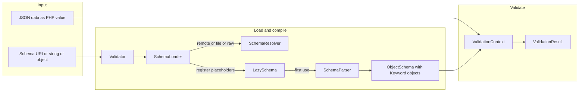
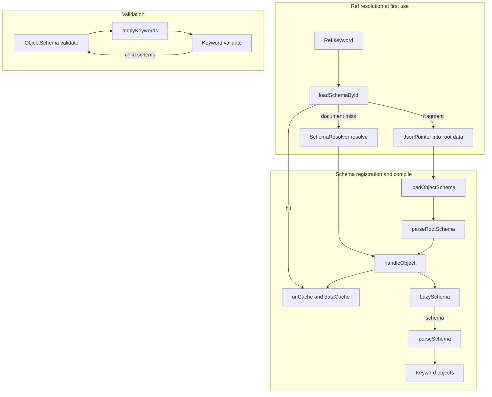

# Opis JSON Schema — Research report

## Metadata

- **Library name**: Opis JSON Schema
- **Repo URL**: https://github.com/opis/json-schema
- **Clone path**: `research/repos/php/opis-json-schema/`
- **Language**: PHP
- **License**: Apache License 2.0 (README, composer.json)
- **Analyzed version**: 85d8523 (2026-04-30), tag 2.6.0 plus 1 commit (`git describe`: 2.6.0-1-g85d8523)
- **Report date**: 2026-10-27
- **Runtime requirements**: PHP ^7.4 || ^8.0, ext-json; dependencies `opis/string` ^2.1 and `opis/uri` ^1.0 (composer.json). Dev: phpunit ^9, ext-bcmath, ext-intl.

## Summary

Opis JSON Schema is a JSON Schema **validation** library for PHP. It does **not** generate code. It loads a JSON Schema (via URI, string, or object), parses it through SchemaLoader and SchemaParser into an internal tree of lazily compiled Schema/Keyword objects, and validates JSON data against that schema. Supported drafts are draft-2020-12, draft-2019-09, draft-07, and draft-06; the default draft is 2020-12. Validation is the only concern: schema + data → `Validator::validate()` → `ValidationResult` (valid flag and validation error tree). The library also supports custom features: `$error`, `$filters`, `$map`, slots, `$data`, casting pragma, and custom format/media-type resolvers.

## JSON Schema support

- **Drafts**: Draft-06, draft-07, draft-2019-09, draft-2020-12 (draft-04 is not supported). The parser has a `defaultDraft` option (default `'2020-12'`); draft is taken from the `$schema` keyword when present, otherwise from the option or parent. Each draft has a dedicated class in `Parsers/Drafts/` (Draft06, Draft07, Draft201909, Draft202012).
- **Scope**: Validation only (schema + instance → valid/invalid + error tree). No code generation.
- **Subset**: README states support for all keywords from all drafts (draft-2020-12 down to draft-06). Meta-schema keywords `$comment`, `$vocabulary`, `deprecated`, `readOnly`, `writeOnly`, and `examples` were not found in the codebase and are not implemented. `title` and `description` have no dedicated keyword parsers (accepted in schema but not used for validation). All other draft 2020-12 core/applicator/validation/unevaluated/format/content keywords are implemented.

## Keyword support table

Keyword list derived from vendored draft 2020-12 meta-schemas (`specs/json-schema.org/draft/2020-12/meta/*.json`; 2019-09, draft-06 and draft-07 are also vendored under `specs/json-schema.org/`). Legacy-draft keywords handled by the library are listed after the table. Implementation evidence from `src/Parsers/Keywords/*.php`, `src/Keywords/*.php`, `src/Parsers/Drafts/Draft202012.php`, `src/Parsers/SchemaParser.php`, `src/Resolvers/`, and README.

| Keyword | Implemented | Notes |
|---------|-------------|-------|
| $anchor | yes | `SchemaParser::parseAnchor` (draft must `supportsAnchorId()`, name checked against `ANCHOR_REGEX`); `SchemaLoader::handleObject` registers the schema in `uriCache` under `base#anchor`. |
| $comment | no | Not parsed or stored. |
| $defs | yes | No dedicated parser; `SchemaLoader::handleObject` walks every object-valued property (so `$defs` entries get a `LazySchema` registered under their JSON-pointer URI); `$ref` to `#/$defs/X` hits that `uriCache` entry. |
| $dynamicAnchor | yes | Not a keyword object; read directly from schema data by `RecursiveRefKeyword::hasRecursiveAnchor` (`$data->{$anchor} === anchorValue`). Draft202012 also registers a `$recursiveRef` variation. |
| $dynamicRef | yes | RefKeywordParser variation; compiled to `RecursiveRefKeyword` (shared with `$recursiveRef`), which walks the `ValidationContext` sender chain to find the outermost schema carrying a matching `$dynamicAnchor`. |
| $id | yes | Parsed in parseId, parseRootSchema; used for scope and cache (uriCache, handle_id). |
| $ref | yes | `RefKeywordParser` produces `URIRefKeyword`, `PointerRefKeyword`, `TemplateRefKeyword` or `RecursiveRefKeyword`; resolved lazily on first validation via `SchemaLoader::loadSchemaById` and `SchemaResolver`. Placed in `after` list (`TYPE_AFTER_REF`). |
| $schema | yes | Parsed in parseSchemaDraft; used for draft version detection. |
| $vocabulary | no | Not implemented. |
| additionalProperties | yes | AdditionalPropertiesKeywordParser; validated in object context. |
| allOf | yes | AllOfKeywordParser; all subschemas must pass. |
| anyOf | yes | AnyOfKeywordParser; at least one must pass. |
| const | yes | ConstKeywordParser; value must equal const (Helper::equals). |
| contains | yes | `ContainsKeyword`; note it calls `markAllAsEvaluatedItems()` unconditionally, so for `unevaluatedItems` every item counts as evaluated, not just matching ones. |
| contentEncoding | yes | ContentEncodingKeywordParser; ContentEncodingResolver for decoding. |
| contentMediaType | yes | ContentMediaTypeKeywordParser; ContentMediaTypeResolver. |
| contentSchema | yes | ContentSchemaKeywordParser. |
| default | partial | `DefaultKeywordParser` (`TYPE_APPEND`, gated by `allowDefaults`): `DefaultKeyword::validate` mutates the instance object, filling absent properties from `properties.*.default` (and a `default` object), via `Helper::cloneValue`. Not a pure annotation. |
| dependentRequired | yes | DependentRequiredKeywordParser. |
| dependentSchemas | yes | DependentSchemasKeywordParser. |
| deprecated | no | Not implemented. |
| description | partial | No dedicated parser; accepted in schema but not used for validation. |
| else | yes | IfThenElseKeywordParser; applied when if fails. |
| enum | yes | EnumKeywordParser, EnumKeyword; values grouped by type; Helper::equals for match. |
| examples | no | Not implemented. |
| exclusiveMaximum | yes | ExclusiveMaximumKeywordParser; draft-07 number or legacy boolean. |
| exclusiveMinimum | yes | ExclusiveMinimumKeywordParser; draft-07 number or legacy boolean. |
| format | yes | FormatKeywordParser; FormatResolver with built-in string formats (date, time, date-time, duration, uri, uri-reference, uri-template, regex, ipv4, ipv6, uuid, email, hostname, json-pointer, relative-json-pointer, idn-hostname, idn-email, iri, iri-reference); custom formats via resolver. |
| if | yes | IfThenElseKeywordParser; conditional. |
| items | yes | ItemsKeywordParser (items with prefixItems); schema or array (prefixItems). |
| maxContains | yes | In ContainsKeywordParser. |
| maximum | yes | MaximumKeywordParser. |
| maxItems | yes | MaxItemsKeywordParser. |
| maxLength | yes | MaxLengthKeywordParser. |
| maxProperties | yes | MaxPropertiesKeywordParser. |
| minContains | yes | In ContainsKeywordParser. |
| minimum | yes | MinimumKeywordParser. |
| minItems | yes | MinItemsKeywordParser. |
| minLength | yes | MinLengthKeywordParser. |
| minProperties | yes | MinPropertiesKeywordParser. |
| multipleOf | yes | MultipleOfKeywordParser. |
| not | yes | NotKeywordParser. |
| oneOf | yes | OneOfKeywordParser; exactly one must pass. |
| pattern | yes | PatternKeywordParser; PCRE. |
| patternProperties | yes | PatternPropertiesKeywordParser. |
| prefixItems | yes | ItemsKeywordParser('prefixItems', ONLY_ARRAY); tuple validation. |
| properties | yes | PropertiesKeywordParser. |
| propertyNames | yes | PropertyNamesKeywordParser. |
| readOnly | no | Not implemented. |
| required | yes | RequiredKeywordParser. |
| then | yes | IfThenElseKeywordParser; applied when if passes. |
| title | partial | No dedicated parser; accepted in schema but not used for validation. |
| type | yes | TypeKeywordParser; single type or array. |
| unevaluatedItems | yes | UnevaluatedItemsKeywordParser. |
| unevaluatedProperties | yes | UnevaluatedPropertiesKeywordParser. |
| uniqueItems | yes | UniqueItemsKeywordParser. |
| writeOnly | no | Not implemented. |

Legacy keywords (from drafts 06/07/2019-09, re-checked against `src/Parsers/Keywords/` and `src/Keywords/`): `additionalItems` (AdditionalItemsKeywordParser), `dependencies` (DependenciesKeywordParser), `$recursiveRef`/`$recursiveAnchor` (RefKeywordParser variation, draft 2019-09) are implemented. Library-specific extensions: `$error`, `$filters`, `$map`, `$slots`, `$data` references, `$pragma`.

## Constraints

All validation keywords are enforced at **runtime**; there is no code generation and no structure-only use of constraints. Each keyword is compiled into a small `Keyword` object (`src/Keywords/*.php`) whose `validate(ValidationContext, Schema): ?ValidationError` returns `null` on success or a `ValidationError`. Schemas are not validated against a meta-schema by default, but each keyword parser checks the shape of its own value and throws a `ParseException` (a `SchemaException`) for bad schemas (for example `minLength` must be a non-negative integer, `pattern` must compile, `enum` must be a non-empty array). That exception is not thrown at load time: `SchemaParser::parseSchema` catches it and returns an `ExceptionSchema` that rethrows when it is first validated against.

## High-level architecture

Pipeline: schema input (URI string / `Uri`, JSON string, decoded `stdClass`, boolean, or a pre-built `Schema`) enters `Validator::validate`. A URI goes to `uriValidation` and then `SchemaLoader::loadSchemaById`; an object or boolean goes to `dataValidation` and `SchemaLoader::loadObjectSchema` / `loadBooleanSchema`. The loader walks the raw schema tree once, registering a `LazySchema` placeholder per subschema object in two caches. A `LazySchema` calls `SchemaParser::parseSchema` the first time it is validated against; that builds an `ObjectSchema` (or `EmptySchema`/`BooleanSchema`) holding `Keyword` objects. `Schema::validate(ValidationContext)` runs the keywords and returns `?ValidationError`, which `Validator` wraps in `ValidationResult`.

## Medium-level architecture

- **Loader** (`src/SchemaLoader.php`): owns `uriCache` (PHP array, string key to `Schema|LazySchema|object`) and `dataCache` (`SplObjectStorage`, object identity to `Schema|LazySchema`). `loadObjectSchema` hits `dataCache` first, then calls `SchemaParser::parseRootSchema`, which validates the root `$id` and picks the draft, then calls back into `handleObject`, which recursively registers placeholders for every nested object/array/boolean. Nothing is compiled yet.
- **Parser** (`src/Parsers/`): `SchemaParser` holds one `Draft` object per supported draft (`Draft06`, `Draft07`, `Draft201909`, `Draft202012`; each a `Vocabulary` = list of `KeywordParser`, `KeywordValidatorParser`, `PragmaParser`). Each `KeywordParser::parse(SchemaInfo, SchemaParser, shared)` reads its keyword from the raw object and returns a `Keyword` or `null`.
- **Compiled schemas** (`src/Schemas/`): `ObjectSchema`, `EmptySchema` (only a keyword-validator chain), `BooleanSchema`, `LazySchema`, `ExceptionSchema`.
- **Ref keywords** (`src/Keywords/*RefKeyword.php`): resolve through `SchemaLoader::loadSchemaById` on first use and memoize the target on the keyword instance.
- **Runtime** (`src/ValidationContext.php`): data cursor, path stack, per-schema "shared object" stack for evaluated-property tracking, globals and slots, error limits.
- **Output** (`src/Errors/`): `ValidationError` tree, `ErrorContainer`, `ErrorFormatter`.

## Algorithms and data structures

### Schema representation

Schemas stay as **raw decoded JSON**: `json_decode($s, false)` yields `stdClass` objects, PHP lists and scalars; there is no typed schema struct. `SchemaLoader` and `Validator` also accept a `Schema` instance directly. Objects (not assoc-arrays) are required; `Helper::convertAssocArrayToObject` exists to convert. A parsed schema is a `Schema` (`src/Schema.php`: `info(): SchemaInfo` + `validate`). `SchemaInfo` (`src/Info/SchemaInfo.php`) carries the raw `data` (object or bool), `id`, `base`, `root` URIs, the `path` (list of keys from the document root) and the draft string. Notably `SchemaInfo` nulls `root` when it equals `id`, and nulls `base` when `root` is null; `idBaseRoot()` returns the first non-null of id, base, root and is what keyword parsers use as the resolution base. Boolean schemas become `BooleanSchema`; empty-object schemas become `EmptySchema`. Unknown keywords are ignored (no parser, so never read) but remain in the raw data, where `handleObject` still registers their object-valued subtrees as potential `$ref` targets. Subschemas inside keywords (e.g. `properties`, `allOf`) are held **as raw objects inside the `Keyword`** (`protected array $properties`) and are swapped for a loaded `Schema` the first time they are used (`$prop = $this->properties[$name] = $context->loader()->loadObjectSchema($prop)` in `PropertiesKeyword::validate`; same idiom in `AllOfKeyword`, `AnyOfKeyword`, `OneOfKeyword`, `ItemsKeyword`, `NotKeyword`, ...). Because the loader's `dataCache` is keyed on object identity, that call returns the `LazySchema`-backed schema registered during `handleObject` instead of re-registering. `parseRootSchema` temporarily writes a synthetic `$id` into the user's object for the duration of registration and removes it afterwards. Boolean subschemas are kept as PHP `true`/`false` and handled inline by each keyword without a `Schema` object.

### Reference resolution and registry

Registry: `SchemaLoader::$uriCache` maps a string key to a `Schema`, `LazySchema` or raw object; `cacheKey()` returns the string itself unless it is longer than 32 chars, then its `md5` (collision risk accepted). `handleObject` registers each subschema under up to three keys: its JSON-pointer-based position (`$pointer`, e.g. `schema:///...json#/properties/a`), its resolved `$id` (via `Uri::merge($schema_id, $base, true)`), and `base#anchor` for `$anchor`. If a key already exists with an absolute `$id` it throws `DuplicateSchemaIdException`. Base-URI tracking is done during the walk: `$base` is updated to a child's `$id` when present, and passed down together with `$root`.

`loadSchemaById(Uri)` (the single resolution entry point): makes the URI absolute against `$this->base` if needed; `checkExistingUri` returns a hit (replacing `LazySchema` in the cache with its parsed target); a miss with an empty fragment calls `resolve()` on `SchemaResolver`; a miss with a non-empty fragment first loads the document root, then, if the fragment is an absolute `JsonPointer`, follows it through the **raw** root data (`$pointer->data($schema->info()->data())`) and registers the found object through `loadObjectSchema`/`loadBooleanSchema`, caching the result under the full URI. So plain-name anchors and `$id`-subschemas are found by cache lookup, while arbitrary pointers into a loaded document are computed on demand.

`SchemaResolver` (`src/Resolvers/SchemaResolver.php`) is only a fetch layer: lookup order is registered protocol handler (callable per scheme), `raw` map (id to pre-decoded schema), then `registerFile`/prefix/dir paths turned into `file_get_contents` + `json_decode`. There is no built-in HTTP fetching; remote documents must be registered or served by a protocol callable. Missing documents yield `null`, and the ref keyword throws `UnresolvedReferenceException` at validation time.

Refs are **lazy and memoized per keyword**: `URIRefKeyword`/`PointerRefKeyword` have `protected $resolved = false`; first `doValidate` calls `loadSchemaById` and stores the result (or `null`, which throws). `TemplateRefKeyword` (`$ref` containing a URI-template, with `$vars` and `$globals`) renders the template per call and memoizes into `$cached[md5-or-string]`. Cycles need no detection: since refs resolve to cached `Schema` objects (which compile lazily) a recursive `$ref: "#"` just points to the same instance; infinite recursion only happens on data of unbounded depth. `$recursiveRef`/`$dynamicRef` use `RecursiveRefKeyword`: it resolves the static target, and if that target has the anchor (`$recursiveAnchor: true` or `$dynamicAnchor: name`, checked on raw data) walks up the `ValidationContext::sender()` / `parent()` chain collecting the outermost schema with the anchor (`resolveSchema`), i.e. dynamic scope is emulated through the chain of contexts created by each ref (`AbstractRefKeyword::createContext` -> `$context->create($schema, ...)`), at O(depth) per evaluation. Draft 06/07 hide siblings of `$ref` (`Draft::allowKeywordsAlongsideRef()` false; `SchemaParser::parseSchemaKeywords` then only keeps `prepend`/`append`/`after_ref` keywords).

### Compiled / intermediate form

The "compiled" form is an object tree of `Keyword` instances, **built lazily per schema object**. `parseSchemaKeywords` iterates the draft's ordered `KeywordParser` list (`Draft::__construct` prepends the `$ref` parser; the rest come from `getKeywordParsers()`), and buckets each produced keyword by `KeywordParser::type()`: `_prepend`, `_before`, type-specific buckets keyed `string|number|array|object`, `_after`, `_after_ref`, `_append`. These are merged into three arrays on `ObjectSchema`: `before` (prepend + before), `types[type]` and `after` (after + after_ref + append). So `type`, `enum`, `const`, `format` run first; then keywords for the instance's JSON type; then `allOf/anyOf/oneOf/not/if`, then `$ref`, `unevaluated*`, `default`/`$filters`/`$slots`. An optional singly linked chain of `KeywordValidator`s (`$pragma` handling: `PragmaKeywordValidator` calls `enter`/`leave` on `MaxErrorsPragma`, `CastPragma`, ...) wraps `doValidate` via `setNext(new CallbackKeywordValidator([$this,'doValidate']))`. Many keywords have a `*DataKeyword` twin (`MinLengthDataKeyword`, `EnumDataKeyword`, ...) for the non-standard `{"$data": "<pointer>"}` form, which reads its parameter from the instance. The parse step also does some static work: `EnumKeywordParser` collapses `enum` against a co-located `const` and against `type` (drops values of impossible types, builds `$shared->types`), `MinLength: 0` and `$ref`-free empty schemas compile to nothing, `items` that is always valid sets `alwaysValid`, `oneOf` detects multiple `true`/`{}` entries, `PatternKeyword` precomputes its regex string.

### Core algorithm

`ObjectSchema::validate` pushes itself on `ValidationContext`'s shared-object stack, runs the keyword-validator chain (if any) into `doValidate`, then pops. `doValidate` applies `before`, then `types[currentDataType()]` and, for integers, also `types['number']` (`Helper::getJsonSuperType`), then `after`, returning the first non-null result of each group. `applyKeywords` has two modes: with `stopAtFirstError` (default true) it returns the first failing keyword's error (short-circuit, no allocation of lists); otherwise it runs every keyword, collects errors, and returns the single error or a wrapper `ValidationError('', ..., 'Data must match schema', subErrors)`.

Data cursor: `ValidationContext` keeps `currentData` as a stack `[value, cachedType|false]` and `pushDataPath($key)`/`popDataPath()` descend into array/object children (O(1) per step, no copy of the instance). `currentDataType()` computes `Helper::getJsonType` lazily once per stack frame. `getJsonType` maps PHP types, and treats floats with integral value as `integer` through `isMultipleOf($v,1)`; a PHP array is JSON `array` only if it is a list (`isIndexedArray`, O(n)). Parameterless child contexts are cheap, but ref keywords call `ValidationContext::create`, which allocates a new context (new data stack, `globals`, `slots`, parent link) per `$ref` hop.

Combinators and unevaluated tracking: evaluated property/item sets live in a "shared object" (`stdClass`, lazily created) attached to the top of `shared[]`. Draft 2019-09/2020-12 schemas enable tracking (`pushSharedObject` sets `unevaluated = !in_array(draft, ['06','07'])` and `allowUnevaluated`). `PropertiesKeyword` adds the property names whose subschema passed via `addEvaluatedProperties`, `PatternProperties`/`AdditionalProperties` add theirs; `allOf/anyOf/oneOf/if/dependentSchemas` call `validateSchemaWithoutEvaluated($schema, $max, $resetOnErrorOnly, ArrayObject $out)`, which snapshots the shared sets, validates, collects the delta into `$out`, and restores the snapshot, so that only schemas that passed (per keyword semantics) are merged back by `OfTrait::addEvaluatedFromArrayObject`. On `popSharedObject`, a child's evaluated sets are merged into its parent (or the parent context when crossing a `$ref`). `unevaluatedProperties` then computes `array_diff(objectProperties, evaluated)`. Sets are plain PHP arrays deduplicated with `array_unique(array_merge(...))`, so merges are O(n log n) in property count. `getObjectProperties()` caches `array_keys(get_object_vars($data))` on the shared object, and `additionalProperties` uses `getUncheckedProperties` (`array_diff` against `checkedProperties` filled by `properties`/`patternProperties`). `ContainsKeyword` calls `markAllAsEvaluatedItems()` regardless of which items matched (a simplification versus the spec). `UnevaluatedProperties/Items` are `TYPE_AFTER_REF` so they run after applicators and refs.

Per-keyword algorithms of note: `anyOf` returns at the first success unless tracking is on (then all branches run so evaluated sets are complete); `oneOf` always evaluates all non-boolean branches and counts matches; `not` validates with `maxErrors` 1; `uniqueItems` is a double loop with `Helper::equals` (O(n^2)); `enum` and `const` use `Helper::equals` (deep structural compare, numbers by `==` so `1` equals `1.0`; objects compared via `get_object_vars` independent of key order); `PatternPropertiesKeyword::matchedProperties` runs `preg_match` for every pattern x property pair; `propertyNames` creates a new context per property name (`newInstance`); `if` is validated with `validateSchemaWithoutEvaluated(..., resetOnErrorOnly=true)` so annotations from a passing `if` are kept.

### Error and output model

`ValidationError` (`src/Errors/ValidationError.php`) holds `keyword`, the `Schema` that produced it, a `DataInfo`, a message **template** with `{placeholders}`, an `args` map and a `subErrors` array: a tree. `DataInfo::fromContext` snapshots value, type, root and path and links a parent `DataInfo` per parent context (recursively), so every error allocates path info eagerly; `fullPath()` is lazily merged. The schema location is not stored as a string: it is derived by `ErrorFormatter` from `SchemaInfo::path()`/`id()`. `ErrorContainer(maxErrors)` is the accumulator keywords use for children (`isFull()` truncates iteration; `maxErrors < 0` means unlimited, `0` is 1). Defaults are `maxErrors = 1`, `stopAtFirstError = true`; `Validator::setMaxErrors`/`setStopAtFirstError` and the `$pragma: {maxErrors}` keyword change them. `ValidationResult` (`isValid()`, `error()`) wraps the root `?ValidationError`. `ErrorFormatter` (`src/Errors/ErrorFormatter.php`) renders templates (`formatErrorMessage` substitutes `{arg}`), flat/nested/keyed lists, and the JSON-Schema output formats via `formatOutput($error, 'flag'|'basic'|'detailed'|'verbose')`. Custom error text is supported via `$error` keyword and `CustomError` thrown from format callables.

## Low-level details

- **Instance model**: data must be decoded with `json_decode($json, false)` (objects as `stdClass`). Assoc-array "objects" are not treated as JSON objects (`getJsonType` returns `null` for non-list arrays, which fails `type`). Instance cursor uses `property_exists`/`->{$key}`.
- **Numbers**: PHP `int` is JSON `integer`; `float` with integral value is also `integer`. `multipleOf` (`Helper::isMultipleOf`) tries `fmod`, then, if `ext-bcmath` is loaded and `Helper::$useBCMath` is true, formats both operands with `number_format` at `Helper::$numberScale` (default 14) and tests the remainder with `bcdiv/bcmul/bcsub/bccomp`; without bcmath it uses `abs(n - round(n/d)*d) < 10^-scale`. `minimum`/`maximum` take `float`, so large integers lose precision above 2^53. No big-number or decimal support for the instance beyond PHP's own `json_decode`.
- **String length**: `ValidationContext::getStringLength` uses `Opis\String\UnicodeString::getStringLength` (code points), cached on the shared object once per instance/schema evaluation. (The `opis/string` implementation could not be read because `vendor/` is absent.)
- **Regex**: PHP PCRE with delimiter `\x07` and flags `u` (patterns) / `uD` in `Helper::patternToRegex`; `isValidPattern` rejects `\Z`. See Performance.
- **Formats**: `FormatResolver` maps `[type][name] => callable|Format`; format is applied only when the instance type matches a registered type (string only by default). Built-ins: `date`, `time`, `date-time` (regexes in `DateTimeFormats`), `duration`, `uri`, `uri-reference`, `uri-template`, `regex`, `ipv4`/`ipv6` (`filter_var`), `uuid`, `email` (`filter_var`), `hostname`, `json-pointer`, `relative-json-pointer`, `idn-hostname`, `idn-email`, `iri`, `iri-reference` (`ext-intl` helps for IDN). Unknown formats are ignored. Formats are always asserted (not annotation-only).
- **Content**: `contentEncoding`/`contentMediaType`/`contentSchema` decode only for drafts in `decodeContent` option (default `['06','07']`); decoded content is cached on the shared object (`setDecodedContent`).
- **Pragmas and extensions**: `$pragma` (`maxErrors`, `cast`, `globals`, `slots`), `$map`, `$globals`, `$vars`, `$inject`, `$filters` (`FilterResolver`, user callbacks), `$error`, `$data`. All are toggled by `SchemaParser` options (`allowFilters`, `allowDataKeyword`, ...).
- **Recursion and hardening**: validation recurses through PHP call frames (`Schema::validate` -> keyword -> child `validate`), so depth is bounded by PHP's stack (no explicit depth limit); the loader's `handleObject`/`handleArray` is also recursive over schema depth. No ReDoS protection (PCRE with default `pcre.backtrack_limit`; a failed `preg_match` returns `false` and is treated as a non-match, unverified for all keywords). Remote retrieval is opt-in only (no default HTTP resolver), which limits SSRF exposure.
- **Mutation of inputs**: `DefaultKeyword` writes defaults into the instance object; `parseRootSchema` transiently mutates the schema object; keywords mutate themselves on lazy resolution.
- **Shared mutable state**: `AbstractRefKeyword::$lastRefUri` is per keyword instance and set/cleared around a call, used only for error text.

## Output and integration

- **Vendored vs build-dir**: N/A (validation only; no generated code output).
- **API vs CLI**: Library API only. No CLI. Entry point: `$validator->validate($data, $schema)` or `$validator->uriValidation($data, $uri)` / `$validator->dataValidation($data, $schemaObject)` with optional globals and slots. Returns ValidationResult. SchemaLoader can be configured with custom SchemaResolver (e.g. registerPrefix for test remotes).
- **Writer model**: N/A (validation only).

## Configuration

- **Draft**: SchemaParser option `defaultDraft` (default `'2020-12'`). Draft is also inferred from `$schema` on each schema.
- **Validator**: `setMaxErrors(int)`, `setStopAtFirstError(bool)`; `setLoader(SchemaLoader)`, `setParser(SchemaParser)`, `setResolver(SchemaResolver)`.
- **SchemaLoader**: `setBaseUri(Uri)`, `setParser`, `setResolver`, `decodeJsonString` (constructor). `clearCache()` clears uriCache and dataCache.
- **SchemaParser**: options in DEFAULT_OPTIONS (allowFilters, allowFormats, allowMappers, allowSlots, allowDataKeyword, allowKeywordsAlongsideRef, allowUnevaluated, allowRelativeJsonPointerInRef, etc.). Resolvers array (format, filter, content media type, content encoding) and optional extra Vocabulary.
- **SchemaResolver**: registerRaw(schema, id), registerFile(id, file), registerPrefix(prefix, dir), registerProtocol(scheme, callable).

## Pros/cons

- **Pros**: Full draft-06 through draft-2020-12 support; all standard validation keywords plus unevaluatedProperties/unevaluatedItems, prefixItems, $dynamicRef/$dynamicAnchor; flexible ref resolution (URI, JSON Pointer, URI templates); custom $error, $filters, $map, slots, $data, casting; extensible format and content resolvers; official JSON Schema test suite used (tests/official); Apache 2.0 license.
- **Cons**: Validation only (no code generation); interpreted object tree in PHP with eager error-object allocation, `uniqueItems` is O(n^2), no ReDoS guard, `contains` over-marks items as evaluated, recursion bounded by PHP stack; $comment, $vocabulary, deprecated, readOnly, writeOnly, examples not implemented; title/description not used; no built-in benchmarks in repo.

## Testability

- **How to run tests**: From clone root, `composer install` then `composer tests` (runs `./vendor/bin/phpunit --verbose --color`) or `./vendor/bin/phpunit`.
- **Test suite**: AbstractOfficialDraftTest subclasses (OfficialDraft202012Test, OfficialDraft201909Test, OfficialDraft7Test, OfficialDraft6Test) run the JSON Schema test suite. CompliantValidator is used; resolver registers prefixes for `http://json-schema.org/` and `https://json-schema.org/` to tests/official/drafts and `http://localhost:1234/` to tests/official/remotes. Each test calls doValidation(schema, description, data, valid); schema is passed as object with draft set via getDraft(). Test data lives under tests/official/tests/draft2020-12/, draft2019-09/, draft-07/, draft-06/ (and optional subdirs).
- **Vendored test data**: The repo carries its own copy of the official suite under `tests/official/tests/{draft06,draft07,draft2019-09,draft2020-12}`, remotes under `tests/official/remotes`, and meta-schemas under `tests/official/drafts/{draft,draft-06,draft-07}`. CI is a GitHub Actions workflow named Tests (README badge).
- **Other tests**: Unit tests (BasicTest, RefTest, SlotTest, MapperTest, FiltersTest, PragmaTest, DataTest, type tests, ErrorFormatterTest, etc.) in tests/.

## Performance

Analysis is from code only; nothing was built or run.

### Performance techniques

- **Compile vs interpret**: A schema is lowered once into `Keyword` objects (see Compiled form), then reused for every validation; parse-time work includes validating keyword shapes, precomputing the regex delimiter string (`PatternKeyword::__construct`), bucketing keywords by JSON type so only relevant keywords run (`ObjectSchema::$types`), dropping no-op keywords (`minLength: 0`, empty/`true` schemas become `EmptySchema`/`alwaysValid`), and filtering `enum` by `type`/`const` at parse time. Compilation is **lazy per subschema** (`LazySchema`, and raw subschemas inside keywords are loaded on first use), so only branches that actually get exercised are compiled. It is an interpreter of an object tree (virtual call per keyword), not generated code or closures. Per validation, everything else (type detection, path stack, error objects) is computed at run time.
- **Memory layout and allocation**: PHP arrays/objects throughout; the schema is a pointer graph of objects. The instance is never copied: the context keeps a stack of references to values and only pushes `[value, type]` pairs. Per-instance derived data is cached on the `ValidationContext` shared object: `objectProperties` (`array_keys(get_object_vars())`), `stringLength`, `decodedContent`. Costs: each `$ref` hop allocates a new `ValidationContext`; `DataInfo::fromContext` eagerly builds a linked `DataInfo` chain for every produced error; evaluated-property sets are arrays rebuilt with `array_merge`/`array_unique`/`array_diff`. With default `stopAtFirstError=true`, `applyKeywords` returns at the first error without building error lists. `ArrayObject` collection for combinators is created only when `trackUnevaluated()` is true (draft 2019-09/2020-12 and `allowUnevaluated`), otherwise `null`.
- **Caching and memoization**: `SchemaLoader::$uriCache` (string-keyed, md5 for keys over 32 chars) and `$dataCache` (`SplObjectStorage` by object identity) cache registered/compiled schemas; `LazySchema::schema()` memoizes the parse; `checkExistingUri`/`checkExistingObject` replace the lazy wrapper by the real schema in the cache after first use. Ref keywords memoize their resolved target (`$resolved`), `TemplateRefKeyword` memoizes per rendered URI. Compiled schema persists across `validate()` calls as long as the same `Validator`/`SchemaLoader` (and, for object schemas, the same `stdClass` instance) is reused; `clearCache()` drops both caches. Formats have no result cache; PCRE results are not cached by the library (PHP caches compiled patterns internally).
- **Fast paths and short-circuiting**: type-first dispatch (`before` group holds `type`/`enum`/`const`/`format`, which run before type-specific keywords); first-error return in `stopAtFirstError` mode; `ErrorContainer::isFull()` stops iterating `properties`/`items`; `required` stops after `maxErrors` misses; `anyOf` returns on the first passing branch when unevaluated tracking is off; `contains` without min/max returns on first match; `EnumKeyword` looks up a per-JSON-type bucket and `Helper::equals` starts with `===`; `ItemsKeyword` skips when `startIndex >= count` and handles `alwaysValid` without iterating; `isMultipleOf` tries `fmod` first, `PropertiesKeyword` skips absent properties via `property_exists`. There is no separate boolean-only `is_valid` path: even with `maxErrors=1`, error objects are built for the failing branch (and for every failed `anyOf`/`oneOf` branch before the combinator itself fails).
- **Regex handling**: PHP's PCRE (backtracking) via `preg_match` with UTF-8 mode (`u`) and `D` (dollar end-only) for validation patterns, delimiter `\x07` to avoid escaping `/`. No ECMA-262 translation beyond `isValidPattern` rejecting `\Z`; semantic differences (e.g. `\d`, `\w`, Unicode classes, lookbehind) versus ECMA 262 are inherited from PCRE. `PatternKeyword` builds the regex string once but `preg_match` is invoked per call; `PatternPropertiesKeyword::matchedProperties` re-derives the regex string for each pattern per validation (cheap string concat). No timeout or ReDoS guard besides PHP's `pcre.backtrack_limit`/JIT settings.
- **Concurrency**: None in the library. PHP's request model means no shared state across requests unless the compiled `Validator` is cached in a long-running process (Swoole, RoadRunner); in that case compiled schemas mutate themselves lazily (not thread-safe, but fine for single-threaded fibers/workers), and `SchemaResolver`/`FormatResolver` implement `__serialize`/`__unserialize` so resolvers can be cached/serialized. Compiled `Schema` graphs are not designed to be serialized.

### Benchmarks in repo

None found: no benchmark directory, scripts or timing code (`composer.json` has only the `tests` script). To benchmark externally: decode the schema once (`json_decode($s)`), call `$validator->loader()->loadObjectSchema($schemaObject)` or `loadSchemaById($uri)` once to get a `Schema`, then loop `$validator->schemaValidation($data, $schema)` (returns `?ValidationError`) with pre-decoded instances. Note `$validator->validate($data, $jsonStringSchema)` would re-decode the schema each time and so measures load cost.

## Determinism and idempotency

- **Generated output**: N/A (validation only).
- **Validation result**: For a given schema and data, the validation outcome is deterministic. Errors are collected during traversal; order depends on keyword validator order and schema structure. stopAtFirstError and maxErrors limit how many errors are collected. Order is deterministic: keywords run in the fixed order of the draft's parser list bucketed as before/type/after, `properties` iterate in schema key order, and instance properties in PHP insertion order; there is no explicit sorting of errors (`array_unique`/`array_diff` results are re-indexed with `array_values`); ValidationResult holds the first (root) error and its subErrors tree.

## Enum handling

- **Implementation**: `EnumKeywordParser` (`TYPE_BEFORE`) requires a non-empty array, optionally filters values by an already-seen `type` and checks it against a sibling `const`, then `EnumKeyword` stores values grouped by JSON type (`listByType`, integers and numbers are separate buckets: note `getJsonType` of `1.0` is `integer`) for faster lookup. `validate()` uses Helper::getJsonType and checks the matching type bucket; Helper::equals for value comparison. Error message: "The data should match one item from enum".
- **Duplicate entries**: listByType appends each value to the list for its type; duplicate enum values (e.g. `["a", "a"]`) both appear in the bucket. Instance "a" matches the first; no deduplication or error. Not explicitly documented.
- **Case / namespace**: `Helper::equals` is used; comparison is deep structural equality (numbers via `==`, so `1` equals `1.0`); object key order is ignored. Comparison is value equality (PHP semantics). Distinct values "a" and "A" are both stored and both match the corresponding instance; no special handling for case or naming.

## Reverse generation (Schema from types)

No. Opis JSON Schema is a validation-only library; it does not generate JSON Schema from PHP types.

## Multi-language output

N/A (validation only; no code generation).

## Model deduplication and $ref/$defs

- **Validation context**: There is no generated model; the question is how $ref and $defs are resolved and cached.
- **$ref**: Resolved lazily at first validation, when the ref keyword first evaluates; never during parse. SchemaLoader::loadSchemaById resolves the URI (with base), checks uriCache, then resolver or JsonPointer into an already-loaded root. Resolved Schema is cached in uriCache (by full URI string) and in dataCache (by object identity). Multiple $refs to the same URI resolve to the same cached Schema. LazySchema defers full parse until first use; then the same Schema instance is stored in cache.
- **$defs**: Definitions under $defs are just nested objects in the schema; they are registered in uriCache when the root (or parent) is handleObject'd, keyed by document URI + fragment (e.g. #/$defs/name). `$ref` to `#/$defs/name` normally hits the `uriCache` entry registered under the pointer-based key during `handleObject`; only pointers not already registered fall back to loading the root and following `JsonPointer` over raw data, then `loadObjectSchema` and caching under the full URI. So one Schema instance per distinct resolved ref; $defs entries are shared when multiple $refs point to them.

## Validation (schema + JSON → errors)

Yes. This is the library's main purpose.

- **Inputs**: (1) A JSON Schema: URI (string or Uri), schema as JSON string, or schema as PHP object. (2) JSON data as PHP value (array, object, scalar).
- **API**: `$validator->validate($data, $schema)` or `$validator->uriValidation($data, $uri)` or `$validator->dataValidation($data, $schema, $globals, $slots)`. Optional globals and slots for $data/slots feature. Returns ValidationResult.
- **Output**: ValidationResult::isValid() is true if valid, false otherwise. ValidationResult::error() returns the root ValidationError or null. ValidationError has keyword(), schema(), data(), message(), subErrors(). ErrorFormatter can format errors with locations.
- **Meta-schema validation**: Not built into the default flow; schemas are not validated against a meta-schema before use.
- **Format**: When the schema has a "format" keyword, FormatResolver::resolve is used; built-in string formats and custom formats (via parser resolvers) are supported.
