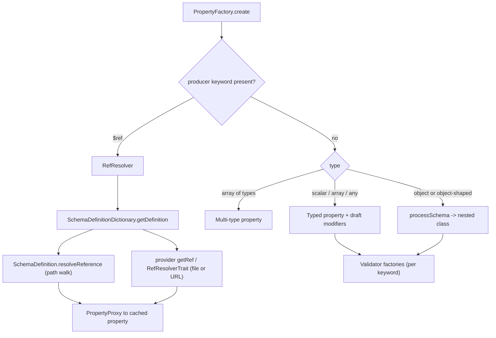

# php-json-schema-model-generator — Research report

## Metadata

- **Library name**: php-json-schema-model-generator (Composer: `wol-soft/php-json-schema-model-generator`)
- **Repo URL**: https://github.com/wol-soft/php-json-schema-model-generator
- **Clone path**: `research/repos/php/wol-soft-php-json-schema-model-generator/`
- **Language**: PHP (requires PHP >= 8.4, `ext-mbstring`; CI matrix 8.4 and 8.5)
- **License**: MIT
- **Analyzed version**: f1e1ad9a 2026-10-23 (release 0.26.2 plus 471 commits, unreleased master)
- **Report date**: 2026-10-27

## Summary

php-json-schema-model-generator turns JSON Schema documents (or the `#/components/schemas` of an OpenAPI v3 file) into PHP 8.4+ model classes that embed the validation logic. A generated class takes an array in its constructor (and in setters, when immutability is disabled), validates it against all schema keywords, and throws exceptions (or collects them into a combined exception) on violation. The generator is a dev-time tool; the generated classes depend on a companion runtime package, `wol-soft/php-json-schema-model-generator-production` (exception classes, `JSONModelInterface`, filter callables, format validators). Entry point: `ModelGenerator::generateModels(SchemaProviderInterface, string $destination)` with a fluent `GeneratorConfiguration`. Output is PHP only. Since the previous report the library has been substantially re-architected: a pluggable draft system (Draft 7, 2019-09, 2020-12 with `$schema` auto-detection), `unevaluatedProperties`/`unevaluatedItems`, `minContains`/`maxContains`, `contentMediaType`/`contentEncoding`, `$ref` siblings in 2019-09+, a non-standard `filter` keyword, PHP attributes on generated code, and several optional post processors.

## JSON Schema support

- **Drafts**: Draft 7, 2019-09 and 2020-12 (`src/Draft/Draft_07.php`, `Draft_2019_09.php` extends 07, `Draft_2020_12.php` is an empty subclass of 2019-09). Draft-04/06 are not targeted (no `draft-04` entry in `AutoDetectionDraft::DRAFT_BY_IDENTIFIER`).
- **Draft selection**: `GeneratorConfiguration::setDraft()` accepts a fixed `DraftInterface` or a `DraftFactoryInterface`. Default is `AutoDetectionDraft`, which reads the effective `$schema` URI (propagated down through `JsonSchema::navigate()`, so an embedded resource root can override) and maps `draft-07/schema`, `draft/2019-09/schema`, `draft/2020-12/schema` (http/https, with or without `#`). Absent or unrecognised `$schema` falls back to Draft 2020-12. Custom drafts/modifiers are supported (`docs/source/generator/custom/customDraft.rst`).
- **Draft differences actually implemented**: Draft 7 treats `$ref` as exclusive (siblings ignored, `ExclusiveProducer`); 2019-09+ merges `$ref` with sibling keywords (`mergeProducedPropertyWithSiblings`), adds `unevaluatedItems`/`unevaluatedProperties`, and enables `minContains`/`maxContains` (`ContainsValidatorFactory(supportMinMaxContains: true)`).
- **Gaps**: The 2020-12 draft class does not add anything beyond 2019-09: `prefixItems`, `$dynamicRef`/`$dynamicAnchor`, `$anchor`, `dependentRequired`/`dependentSchemas`, `$recursiveRef`, `contentSchema`, `$vocabulary` are not implemented. `items` as an array (draft-07 tuple form) and `additionalItems` are used for tuples in every draft. Unimplemented keywords are silently ignored (no error), except that a few unsupported combinations raise `UnsupportedSchemaFeatureException` (e.g. `unevaluated*` inside a composition branch that cannot see names/indices of the enclosing schema).
- **Scope**: Code generation with validation embedded in generated code. No standalone validator API.

## Keyword support table

Keyword list derived from the vendored meta-schemas: `specs/json-schema.org/draft/2020-12/meta/*.json` (applicator, content, core, format-annotation, format-assertion, meta-data, unevaluated, validation), plus keywords of the other targeted drafts (`draft/2019-09/meta/*`, `draft-07/schema.json`) not present in 2020-12 (last five rows). Each row verified against the draft registration in `src/Draft/Draft_07.php` / `Draft_2019_09.php`, the validator factories in `src/Model/Validator/Factory/`, `PropertyFactory`, `SchemaDefinitionDictionary` and tests.

| Keyword | Implemented | Notes |
|---------|-------------|-------|
| $anchor | no | Only read as a fallback class-name source in `ClassNameGenerator`; `$ref: "#name"` resolution is done via `$id: "#name"` (Draft-07 style plain-name `$id`), not `$anchor`. |
| $comment | yes | `PropertyFactory` stores it on the property; emitted in the getter PHPDoc. Not validation. |
| $defs | yes | Any root-level key holding an object/array is registered as a definition source; `#/$defs/Name` resolved by path walk in `SchemaDefinition::resolveReference`. Also used for class naming (`extractDefinitionName`). |
| $dynamicAnchor | no | No handling anywhere in `src/`. |
| $dynamicRef | no | No handling; only a code comment mentions it as a future second producer. |
| $id | yes | `fetchDefinitionsById` registers every subschema with `$id` (normalized to `#...`); relative `$ref`s resolve against nearest enclosing `$id` (`JsonSchema::getBaseId`); also drives class naming (basename). |
| $ref | yes | `RefResolver` producer. In-document paths, `#id`, empty/`#` self reference (recursion), relative/absolute file paths, network URLs, fragments into other files (`RefResolverTrait`, `SchemaProviderInterface`). Draft 7: exclusive (siblings dropped); 2019-09+: merged with siblings. |
| $schema | partial | Used only to pick the draft (`AutoDetectionDraft`). The schema is not validated against its meta-schema. |
| $vocabulary | no | Not handled. |
| additionalProperties | yes | `AdditionalPropertiesValidatorFactory`; `false` -> `NoAdditionalPropertiesValidator`, schema -> typed additional values; `AdditionalPropertiesPostProcessor`; optional accessor post processor; global `denyAdditionalProperties` option. |
| allOf | yes | `AllOfValidatorFactory`; object branches merged into the class, property type intersection, default-conflict detection; allOf-of-objects re-routed to a real nested class (`rerouteAllOfObjectShape`). |
| anyOf | yes | `AnyOfValidatorFactory`; branch classes, composed type hints. |
| const | yes | `ConstModifier` (registered on `any`); also generates enum-like checks and type inference. |
| contains | yes | `ContainsValidatorFactory`; boolean `true`/`false` schemas handled (`false` logs a warning and always fails). |
| contentEncoding | partial | `MediaStringModifier` (string type, all drafts incl. 07) wires built-in `mediaString`/`immutableMediaString` transforming filter; validation only if a `ContentValidatorInterface` is registered via `addContentValidator()`. |
| contentMediaType | partial | Same as contentEncoding. |
| contentSchema | no | Not handled. |
| default | yes | `DefaultValueModifier`; validated against type/enum at generation time; also `defaultArraysToEmptyArray` option. |
| dependentRequired | no | Not implemented as a validator. Only appears in `SchemaSignatureNormalizer` (dedup normalization). Draft-07 `dependencies` (property form) is implemented instead. |
| dependentSchemas | no | Not implemented; the test using it (`DependentSchemasWithUnevaluated`) is marked skipped/unreachable. Draft-07 `dependencies` (schema form) is implemented instead. |
| deprecated | yes | Emits a `#[Deprecated]` PHP attribute (attribute `DEPRECATED`, enabled by default); annotation only. |
| description | yes | Property description in PHPDoc. |
| else | yes | `IfValidatorFactory`, with `if`/`then`. |
| enum | yes | `EnumValidatorFactory` (runtime `in_array` check, `array_unique` dedupe, type inference when `type` absent, empty enum is a `SchemaException`, default must be a member); optional `EnumPostProcessor` generates PHP enums. |
| examples | yes | Emitted as `@example` lines in PHPDoc. Annotation only. |
| exclusiveMaximum | yes | Numeric-type factory (`ExclusiveMaximumValidatorFactory`, numeric form only; separate int/float registrations). |
| exclusiveMinimum | yes | As above. |
| format | yes | `FormatValidatorFactory`. Built-ins in `GeneratorConfiguration::initFormatValidator`: date-time, date, time, email, idn-email, hostname, idn-hostname, ipv4, ipv6, json-pointer, relative-json-pointer, uri, uri-reference, uri-template, iri, iri-reference, regex. Custom via `addFormat()`. An unknown format throws a `SchemaException` at generation time (not ignored). Only registered on `string` type. |
| if | yes | `IfValidatorFactory` (conditional composition with then/else). |
| items | partial | `ItemsValidatorFactory`: single schema, boolean `true`/`false`, and draft-07 tuple form (array of schemas) in all drafts. The 2020-12 meaning (items applies after `prefixItems`) is not implemented. |
| maxContains | yes | 2019-09+ only; validated at generation time (integer >= 1, min <= max). |
| maximum | yes | `MaximumValidatorFactory`. |
| maxItems | yes | `MaxItemsValidatorFactory`. |
| maxLength | yes | `MaxLengthValidatorFactory` (mbstring-based). |
| maxProperties | yes | `MaxPropertiesValidatorFactory`. |
| minContains | yes | 2019-09+ only; `minContains: 0` supported. |
| minimum | yes | `MinimumValidatorFactory`. |
| minItems | yes | `MinItemsValidatorFactory`. |
| minLength | yes | `MinLengthPropertyValidatorFactory`. |
| minProperties | yes | `MinPropertiesValidatorFactory`. |
| multipleOf | yes | `MultipleOfPropertyValidatorFactory` (integer and number variants). |
| not | yes | `NotValidatorFactory`. |
| oneOf | yes | `OneOfValidatorFactory`. |
| pattern | yes | `PatternPropertyValidatorFactory`. |
| patternProperties | yes | `PatternPropertiesValidatorFactory`; `PatternPropertiesPostProcessor`, `ExtendObjectPropertiesMatchingPatternPropertiesPostProcessor`, optional accessor post processor. |
| prefixItems | no | Only in the signature normalizer; no validator. Tuples use array-form `items`. |
| properties | yes | `PropertiesValidatorFactory`; boolean `false` property schema denied (`DeniedPropertyValidator`). |
| propertyNames | yes | `PropertyNamesValidatorFactory`. |
| readOnly | yes | Makes property read-only (no setter), `#[ReadOnlyProperty]` attribute; cannot combine with writeOnly (SchemaException). |
| required | yes | `RequiredValidatorFactory`; affects nullability and native types; `#[Required]` attribute. |
| then | yes | `IfValidatorFactory`. |
| title | yes | Used for class naming (and enum naming). |
| type | yes | Single and multi-type (`type` array) including `null`; `TypeCheckModifier`, `MultiTypeCheckValidator`; implicit null optional (`setImplicitNull`). `base`/`any` are internal pseudo-types. |
| unevaluatedItems | yes | 2019-09+ (`UnevaluatedItemsValidatorFactory`, `AbstractUnevaluatedItemsValidator`); evaluation tracking across composition branches; docs in `array.rst`. |
| unevaluatedProperties | yes | 2019-09+ (`UnevaluatedPropertiesValidatorFactory`, `UnevaluatedPropertiesPostProcessor`, optional accessor post processor); `UnsupportedSchemaFeatureException` for branch cases it cannot yet see. |
| uniqueItems | yes | `UniqueItemsValidatorFactory`. |
| writeOnly | yes | Property treated as write-only/immutable-style, `#[WriteOnlyProperty]` attribute. |
| additionalItems | yes | Draft 7 / 2019-09 tuple companion (`AdditionalItemsValidator`, `ArrayTupleValidator`). |
| dependencies | yes | Draft 7 (`PropertyDependencyTrait`): property dependencies (`PropertyDependencyValidator`) and schema dependencies (`SchemaDependencyValidator`, dependent properties transferred to the base class). Applied regardless of draft because it is registered as a side-channel read of `properties`/`required`. |
| definitions | yes | Same mechanism as `$defs` (any root-level object key). |
| $recursiveAnchor | no | Not handled. |
| $recursiveRef | no | Not handled. |

Non-standard keywords: `filter` (registered on the `any` type; see Configuration) and `enum-map` (names for generated PHP enum cases, `EnumPostProcessor`).

## Constraints

Validation keywords both shape the generated types (native PHP types, nullability, nested classes, array/tuple/union hints) and are enforced at runtime in generated code. The constructor and, when `setImmutable(false)`, setters run the same validators; setters that touch an object-level keyword (composition, dependencies, min/maxProperties, etc.) re-validate the whole model and roll back state on failure (`SchemaProcessor/ModelUpdate/*`, `ModelStateRollback`). Errors follow the production-library exception hierarchy (e.g. `MinimumException`, `PatternException`, `InvalidTypeException`); by default errors are collected and thrown as one `ErrorRegistryException` (`setCollectErrors(true)`, the default) or the first error is thrown (`false`; custom `errorRegistryClass`). Some constraints are checked at generation time as well (invalid `minContains`, contradictory `allOf` types, conflicting defaults, unknown formats) and fail with `SchemaException`, which includes file, JSON pointer, and line/column when the provider supplies raw source.

## High-level architecture

Pipeline: a `SchemaProviderInterface` yields `JsonSchema` objects; `ModelGenerator` hands each to `SchemaProcessor::process()`, which builds a `Schema` (one future PHP class) by running `PropertyFactory::create()` for every property. `PropertyFactory` asks the per-schema `Draft` (resolved by `DraftResolver`/`AutoDetectionDraft`) for producers (`$ref`) and the ordered list of `Type` modifiers/validator factories for the property's type(s), then registers the result on the `Schema`. Each class becomes a `RenderJob` in the `RenderQueue`. After all schemas are processed, `RenderQueue::execute()` runs every post processor on every job first (so a post processor on schema A can mutate schema B), then renders all jobs with `.phptpl` templates (php-micro-template) and writes the files; each rendered file is also `require`d so later generation steps can reflect on the class.

```mermaid
flowchart LR
  Provider["SchemaProviderInterface"] --> Gen["ModelGenerator.generateModels"]
  Gen --> SP["SchemaProcessor.process"]
  SP --> PF["PropertyFactory.create"]
  PF --> DR["DraftResolver / Draft"]
  DR --> Mods["Type modifiers and validator factories"]
  Mods --> Schema["Schema model"]
  PF --> Schema
  Schema --> Queue["RenderQueue (RenderJobs)"]
  Queue --> PP["Post processors (all jobs)"]
  PP --> Render["Render .phptpl templates"]
  Render --> Files["PHP class files in destination"]
```

## Medium-level architecture

- **Entry**: `ModelGenerator` constructor registers always-on internal post processors (`CompositionValidationPostProcessor`, `UnevaluatedPropertiesPostProcessor`, `AdditionalPropertiesPostProcessor`, `PatternPropertiesPostProcessor`, `ExtendObjectPropertiesMatchingPatternPropertiesPostProcessor`, `CompositionRequiredPromotionPostProcessor`, `TransformingFilterOutputTypePostProcessor`); `SerializationPostProcessor` is added when serialization is enabled. User post processors: `BuilderClassPostProcessor`, `EnumPostProcessor`, `PopulatePostProcessor`, `AdditionalPropertiesAccessorPostProcessor`, `PatternPropertiesAccessorPostProcessor`, `UnevaluatedPropertiesAccessorPostProcessor`, plus custom ones. `generateModels` requires an existing, empty destination (`generateModelDirectory` creates or empties it).
- **Draft system (`src/Draft/`)**: `DraftInterface::getDefinition()` returns a `DraftBuilder`; `build()` yields an immutable `Draft` of `Type` entries (`object`, `array`, `string`, `integer`, `number`, `boolean`, `null`, `any`). Each `Type` holds keyword -> `AbstractValidatorFactory` registrations plus `ModifierInterface` instances (`TypeCheckModifier`, `ConstModifier`, `DefaultValueModifier`, `NullModifier`, `IntToFloatModifier`, `MediaStringModifier`, `ObjectModifier`, `DefaultArrayToEmptyArrayModifier`). `getCoveredTypes($type)` always includes `any`, so composition/enum/const apply to every type. Producers (`$ref`) are keyword-keyed (`RefResolver`, wrapped by `ExclusiveProducer` in Draft 7). Built drafts are cached per draft class.
- **Type dispatch (`PropertyFactory::create`)**: producers first; then `type` array -> multi-type property; untyped schemas may be re-routed to object classes (`rerouteAllOfObjectShape`, `rerouteBareObjectValidator` using `ObjectShapeResolver`); then match on `object`/`base`/`any`/scalar types. Object schemas go through `SchemaProcessor::processSchema` to create nested classes.
- **Composition**: `AbstractCompositionValidatorFactory` subclasses build per-branch properties (`CompositionPropertyDecorator`), merge object branch properties into the owning class, and use `PropertyMerger`/`TypeIntersection` for allOf narrowing. `CompositionBranchClassifier`/`CompositionCompatibilityChecker` support filters in branches.
- **References**: `SchemaDefinitionDictionary` maps keys (`#`, `#id`, `definitions`/`$defs` entries, file names) to `SchemaDefinition`; `getDefinition` splits path fragments, resolves in-document paths by walking JSON, and delegates external files/URLs to the provider (`RefResolverTrait`). Resolved definitions are cached per path/required/dependency flags (`ResolvedDefinitionsCollection`) and later sites receive a `PropertyProxy` onto the same property, which also makes recursive refs work.
- **Deduplication**: `SchemaProcessor::generateModel` keys classes by `JsonSchema::getSignature()` (see below).

## Algorithms and data structures

The generator is a compile-time pipeline written in PHP. Its "intermediate form" is an in-memory graph of `Schema` (a future class) objects holding `Property` objects, each carrying an ordered list of validator objects that later render themselves into PHP source. There is no runtime schema interpreter: after generation, validation is plain PHP in the generated classes.

### Schema representation

- **Raw JSON as nested PHP arrays.** Providers call `json_decode($text, true)` (associative mode, no `JSON_BIGINT_AS_STRING`), so objects become arrays and an empty `{}` becomes `[]`. `RecursiveDirectoryProvider::getSchemas` skips files whose top-level value is not an array; `RefResolverTrait::getRef` rejects them. Boolean schemas (`true`/`false`) are therefore handled only at sub-schema positions (`properties`, `items`, `contains`, composition branches), not as whole documents.
- **`JsonSchema` (`src/Model/SchemaDefinition/JsonSchema.php`)** is a small immutable-by-cloning cursor: `array $json` (the current node), `string $file`, `string $pointer` (RFC 6901 pointer from the file root), `?string $rawSource` (whole file text, for error line/column), `string $baseId` (nearest enclosing `$id`, normalised to start with `#`), and `?string $schemaUri` (nearest `$schema`, inherited down the tree). `navigate($pointer)` clones the cursor and walks one segment at a time (`explode('/')`, `decodePointer`), updating `pointer`, `json`, `baseId` (when the node has `$id`) and `schemaUri` (when the node has `$schema`). `withJson()` and `withPointer()` clone with a substituted node. Because every navigate copies the cursor but PHP arrays are copy-on-write, the subtree is not duplicated; cost is O(path length) per navigation.
- **Unknown keywords** are simply left in the array; nothing validates against a meta-schema and no keyword list is enforced. Keywords are consulted only when a registered factory/modifier reads `$json[$key]`. The generator also injects pseudo-keywords into the array before dispatch: `type: 'base'` (marks the root of a class so `PropertyFactory::create` routes to `createBaseProperty`), `propertySchema` (a nested `JsonSchema` object stored inside the array for merged-class naming), and `_dependencies` (draft-07 `dependencies` side channel).
- **Draft selection** uses `schemaUri` per node (`AutoDetectionDraft::getDraftForSchema`), so a `$defs` entry with its own `$schema` can switch dialect for its subtree; `DraftResolver::getBuiltDraft` memoises the built `Draft` per draft class.
- **Model graph.** `Schema` (`src/Model/Schema.php`) owns `properties` (array keyed by raw property name), `baseValidators` (object-level validators and compositions), `postCompositionValidators`, `methods` (name to `MethodInterface`), `usedClasses`, `namespaceTransferDecorators`, `schemaHooks`, a `SchemaDefinitionDictionary`, a `PropertyMerger`, an `attributeIndex` (normalised attribute name to raw name, to detect `a-b` vs `a_b` collisions with a `SchemaException`) and a counter of resolved properties. `PropertyInterface` implementations are `Property` (concrete), `PropertyProxy` (alias to a shared resolved property in a `ResolvedDefinitionsCollection`), `CompositionPropertyDecorator` (a composition branch viewed as a property) and `BaseProperty`. A `Validator` wrapper pairs a `PropertyValidatorInterface` with an int priority.
- **Ownership.** Everything is PHP object references; sharing between sites is via `PropertyProxy` and `ResolvedDefinitionsCollection`, with explicit `detach()`/`clone` when a site needs to mutate its copy (`Schema::addProperty`, `SchemaProcessor::cloneTransferredProperty`).

### Reference resolution and registry

- **Per-class dictionary.** Each class-producing schema owns a `SchemaDefinitionDictionary` (an `ArrayObject` subclass, `src/Model/SchemaDefinition/SchemaDefinitionDictionary.php`). `setUpDefinitionDictionary` registers (1) key `#` for the root, (2) every top-level key whose value is an array (`definitions`, `$defs`, but also `properties`, `allOf`, etc.) as `SchemaDefinition(navigate($key))`, and (3) via `fetchDefinitionsById`, a full recursive DFS over every nested array, adding any node with `$id` under key `normalizeId($id)` (prefixing `#` if missing). `addDefinition` is first-write-wins. The DFS is literal PHP recursion over the whole subtree. Nested classes share their parent's dictionary (`createObjectProperty` passes `$schema->getSchemaDictionary()`), but `generateModel` calls `setUpDefinitionDictionary` again with the nested schema, and `createBaseProperty` and `resolveBaseReference` call it once more for the root, so a subtree is re-walked once per enclosing class level and once more per base-level processing; first-write-wins makes the repeats idempotent but not free (roughly O(size x nesting depth)).
- **`getDefinition($key, ..., &$path, $baseId)`** is the lookup. An empty `$ref` is rewritten to `$baseId` (nearest enclosing `$id`, RFC 3986 behaviour). A key starting with `#` and containing `/` is split on `/`: for `#/definitions/Foo` the leading `#` is dropped, `definitions` becomes the dictionary key and the remaining segments (`Foo`) are returned in `$path`; the caller (`SchemaDefinition::resolveReference`) then calls `source->navigate(implode('/', $path))` inside that top-level definition, i.e. an in-document pointer is resolved by walking the decoded array. If the key is not in the dictionary it is treated as `file#fragment`: first a `rawRefToCanonical` cache (raw ref string to canonical file) is checked, otherwise `parseExternalFile` asks the provider's `getRef($currentFile, $baseIdWithoutHash, $ref)`.
- **External files/URLs.** `RefResolverTrait::getRef` resolves a ref to a URL (`filter_var(FILTER_VALIDATE_URL)`, or relative to an `$id` that is a URL, with manual `.`/`..` normalisation) or to a local path (relative to the current file's directory, or for `/`-prefixed refs by walking up parent directories until the file exists), reads it with `file_get_contents` (so `allow_url_fopen` governs remote fetch; no HTTP client, no cache, no timeout/size limit, no allow-list), decodes it, and returns a fresh `JsonSchema`. `SchemaProcessor::processedFileSchemas` (canonical path to `Schema`) ensures a file is parsed and generated once even if referenced from many places; `SchemaDefinitionDictionary::parsedExternalFileSchemas` and `rawRefToCanonical` are per-dictionary shortcuts. A file inside the provider's base directory is processed eagerly as a top-level class (so it gets the filename-derived class name regardless of discovery order, issue #116 per the code comment); a file outside it, or one without a top-level object/composition, becomes an `ExternalSchema` placeholder so fragment refs still resolve without emitting a class.
- **Resolved-definition cache and cycles.** `SchemaDefinition::resolveReference` builds a key `path-required-isArrayItem-md5(json_encode(dependencies))` and looks in a `ResolvedDefinitionsCollection`. On a miss it first stores a `null` placeholder for the key, then runs `PropertyFactory::create` on the navigated sub-schema. A recursive ref that arrives while the placeholder is `null` gets a `PropertyProxy` registered in `unresolvedProxies[$key]`; when the original property is created, all proxies are `resolve()`d. On a hit it returns a new `PropertyProxy(name, source, collection, key)` bound to the same cached property but carrying its own name. So a definition is processed once per (path, required, array-item, dependency) combination, and cycles terminate because the recursion re-enters through the placeholder. There is no explicit depth counter, cycle detector for non-object refs, or limit; `ObjectShapeResolver::classify` carries a `visitedReferences` list for its own static peeking and reports `Undecidable` on cycles.
- **Base-level `$ref`.** `RefResolver::resolveBaseReference` (a `$ref` at the root of a class) rejects `""`/`#` (self-merge has no fixed point) and otherwise copies the referenced schema's base validators and properties into the current `Schema` (using allOf semantics when names clash), or transfers a referenced anyOf/oneOf composition.
- **What is not resolved.** `$anchor`, `$dynamicRef`/`$dynamicAnchor`, `$recursiveRef`, and `$vocabulary` have no registry entry. A plain `$id: "#name"` is the only anchor-like mechanism. `$id` values with a URL base are used as a base only for resolving relative external refs, not as keys of a global URI registry: as far as the code shows, a `$ref` to an absolute `$id` URI that is declared inside the same document is not matched against the registry (keys are stored as `#<id>`), so it would fall through to the external-file path; only the `#name` form is matched by identity. Not verified by running it.

### Compiled / intermediate form

- **Draft as a keyword registry.** A `DraftBuilder` collects `Type` objects and producers; `build()` returns an immutable `Draft`. A `Type` holds an ordered map `keyword => AbstractValidatorFactory` plus an unkeyed list of `ModifierInterface`s (`src/Draft/Element/Type.php`). `Type('x')` with type-check adds a `TypeCheckModifier` first. `Draft_07` registers, for example, `object` (`properties`, `required`, `propertyNames`, `patternProperties`, `additionalProperties`, `minProperties`, `maxProperties`, `ObjectModifier`), `array`, `string`, `integer` and `number` (separate factories parameterised with `is_int`/`is_float`), `boolean`, `null`, and the catch-all `any` (`enum`, `allOf`, `anyOf`, `oneOf`, `not`, `if`, `filter`, `DefaultValueModifier`, `ConstModifier`). `getCoveredTypes($type)` returns the requested types intersected with the registry plus `any`.
- **Factories produce validators, validators produce source.** `AbstractValidatorFactory::modify($schemaProcessor, $schema, $property, $propertySchema)` reads its keyword and calls `$property->addValidator($validator, $priority)`. The common validator classes carry a PHP condition as a string: `PropertyValidator` holds `$check` (e.g. `is_int($value) && $value < 5`, `is_string($value) && mb_strlen($value) > 10`, `!in_array($value, [...], true)`), an exception class and params. `PropertyTemplateValidator` renders a `.phptpl` template with `$templateValues` (array items, tuples, contains, pattern properties, additional properties, compositions, dependencies, unevaluated*). `ExtractedMethodValidator` (array items, composed validators, filter guards) renders its check into a separate private method `_validate<Prop>_<ValidatorClass>_<md5(property schema JSON)>` and the call site becomes `$this->method($value, $modelData);`. Method names are made unique per schema by `Schema::reserveMethodName` (suffix `_2`, `_3`).
- **Validator order.** `Property::getOrderedValidators` runs `usort` by priority each time it is called (PHP's sort is stable). Priorities seen in code: `TypeCheckModifier` adds the type check at 2, `EnumValidatorFactory` at 3, everything else defaults to 99, so a property's chain is: required, type check, enum, then constraint validators in registration order (the order the keyword appears in the draft's `Type`, not in the schema JSON).
- **Lazy resolution protocol.** Many items are not known at creation time (recursive refs, nested classes under construction, composition branches). `ResolvableTrait` gives properties, validators and schemas `isResolved/onResolve/resolve`. `Property::addValidator` counts `pendingValidators` and resolves the property when the last pending validator resolves; `Schema::onAllPropertiesResolved` fires callbacks when `resolvedProperties === count(properties)`. Composition transfer (`SchemaProcessor::transferComposedPropertiesToSchema`) uses nested closures on these hooks to move branch properties into the owning class after all branch classes are complete.
- **Output stage.** Each finished `Schema` becomes a `RenderJob` in `RenderQueue`. `RenderQueue::execute` calls every `PostProcessor::preProcess`, then `process` on every job (so a post processor on one class can modify another), then `render` on every job, then `postProcess`. `RenderJob::render` renders `Templates/Model.phptpl` via `php-micro-template` (a `Render` instance cached per template base path in `RenderFactory`), collapses blank lines, writes the file (refusing to overwrite) and `require`s it. The class template emits properties, a constructor that runs `_executeBaseValidators` / `_executePostCompositionValidators` then `_process<Prop>` for each property, getters, setters, and `renderMethods`, which loops with an index (not foreach) because rendering one method may add more.

### Core algorithm

**Entry and class creation.** `ModelGenerator::generateModels` requires an empty destination, iterates `$provider->getSchemas()` (a generator), and calls `SchemaProcessor::process` per file. `process` computes the class path from the directory relative to the provider's base directory and the class name (`ClassNameGenerator`), then `processSchema`. A schema yields a class only if `type === 'object'` or it has one of `anyOf/allOf/oneOf/if/$ref`; otherwise `null` (a nested non-object schema becomes just a property).

**`generateModel`.**
1. Reject reserved PHP class names.
2. Compute `JsonSchema::getSignature()`. If not the initial class and `processedSchema[$signature]` exists, log "Duplicated signature" and return the existing `Schema` (inline dedup).
3. Create the `Schema`, run `setUpDefinitionDictionary`, register it in `processedSchema` and `processedFileSchemas` (before processing, so recursion finds it).
4. `checkObjectRepresentability`: `ObjectShapeResolver` classifies the JSON as `ObjectAsserting`, `ObjectDescribing`, `NotObject` or `Undecidable`; compositions that cannot be shown to be objects raise a `SchemaException` unless `setImplicitObjectComposition(true)` accepts `ObjectDescribing`.
5. Re-label the JSON as `type: 'base'` and call `PropertyFactory::create`, which builds the class's properties and validators.
6. Queue a `RenderJob`.

**`PropertyFactory::create` dispatch.**
1. Ask the draft for producers whose keyword exists in the JSON (`$ref`). With an `ExclusiveProducer` (Draft 07) siblings are discarded. Otherwise, with siblings, `mergeProducedPropertyWithSiblings` builds the sibling property, resolves the `$ref` property, and merges them (object siblings produce a merged class `<Parent>_Merged_<Name>` via `createObjectRefSiblingMergedSchema`; scalar siblings via `applyScalarSiblingMerge` after a type-compatibility check).
2. A `type` array goes to `createMultiTypeProperty`: one sub-property per type is created, then `finalizeMultiTypeProperty` builds a union type and a `MultiTypeCheckValidator`.
3. Without `type` and `filter`, two re-routes: `rerouteAllOfObjectShape` (an `allOf` whose static shape is `ObjectAsserting` becomes an object property) and `rerouteBareObjectValidator` (object keywords without `type` become a guarded object property, with a warning, because it must still accept non-objects).
4. `match` on the resolved type: `object` to `createObjectProperty` (calls `SchemaProcessor::processSchema`, i.e. a nested class, then applies the nested-schema decorators); `base` to `createBaseProperty` (runs the object type's modifiers on the root); `any` to `createUntypedProperty`; everything else to `createTypedProperty`.
5. `buildProperty`/`applyModifiers` iterate `Draft::getCoveredTypes($type)` and for each `Type` run its modifiers/factories in registry order (`runModifier` wraps a modifier exception in a `SchemaException` with location).

**Composition (`AbstractCompositionValidatorFactory`, about 1,050 lines).** For `allOf/anyOf/oneOf/not/if` the factory creates one `CompositionPropertyDecorator` per branch (each branch processed via `PropertyFactory` on `navigate("allOf/<i>")`), builds a `ComposedPropertyValidator` (or `ConditionalPropertyValidator` for if/then/else) whose template `ComposedItem.phptpl` evaluates every branch and counts successes. The acceptance expressions are literal: allOf `$succeeded === $available`, anyOf `> 0`, oneOf `=== 1`, not `=== 0`. The generated code does not short-circuit anyOf or oneOf; it runs every branch (needed to also collect annotations, merged values and, for oneOf, to detect more than one match). For object branches, the branch's properties are copied into the parent class (`transferComposedPropertiesToSchema` with `cloneTransferredProperty`, which strips the branch's own validators, makes the property optional/nullable unless allOf, and widens its type when branches disagree) and merged by `PropertyMerger::merge` using `TypeIntersection` for allOf narrowing, with default-conflict detection. If several branches have nested schemas, `createMergedProperty` builds a merged class keyed by signature (`processedMergedProperties`).

**Emission shape.** For each property the constructor calls `_process<Name>(array $modelData)`, which reads `$value` from the input (or the default), runs property decorators (e.g. instantiate a nested class, convert arrays to tuples), then `_validate<Name>($value, $modelData)` runs the ordered validators and returns the possibly transformed value. Each validator is rendered as `if (<check>) { throw|addError(new Exception(...)); }` (`RenderHelper::renderValidator`, `validationError`), optionally preceded by set-up code.

**Runtime semantics of key generated validators** (what the emitted code does):
- Numeric bounds are interpolated as PHP literals into the condition (`AbstractRangeValidatorFactory`: `"{$typeCheck}(\$value) && \$value < $value"`). The integer and number types are separate registrations (`is_int` vs `is_float`).
- `multipleOf`: integers use `%`; numbers use `fmod($value, $m) != 0`; a zero divisor is special-cased.
- `pattern`/`patternProperties`: `preg_match` with the pattern wrapped in `/.../` (slashes escaped), validated at generation time with `@preg_match("/$p/", '')`, embedded base64-encoded in the generated code. No `u` flag is added, so matching is bytewise on UTF-8.
- `minLength`/`maxLength`: `mb_strlen` (code points, via `ext-mbstring`).
- `enum`: `!in_array($value, [...], true)` (strict, so `1` and `1.0` differ).
- `uniqueItems` (`ArrayUnique.phptpl`): `asort` a copy, then compare adjacent elements with `===`; O(n log n); equal elements are detected only if `asort` places them next to each other, and `===` makes `1` and `1.0` distinct.
- `items` (`ArrayItem.phptpl`): an immediately-invoked closure loops over the items by reference, runs the nested property's decorators and ordered validators per item, and collects failures into `$invalidItems_<md5(name)>[$index]` (error-registry swapped per item in collect-errors mode); `InvalidItemException` reports them.
- `contains` (`ArrayContains.phptpl`): loops items, catching exceptions per item, counts matches only if `minContains/maxContains` need counting; otherwise returns on the first match.
- `format`: `FormatValidator` emits `is_string($value) && !\<Class>::validate($value, '<regex>')`; built-in formats are regex based (`FormatValidatorFromRegEx`), so `date` is `^\d{4}-\d{2}-\d{2}$` and does not check calendar validity.

**Naming and dedup.** See Low-level details and Model deduplication.

**Setters.** `Model.phptpl` generates a setter per mutable property. `SetterValidationRenderer` emits only the validation that the update can affect: for a key already stored it skips object-level validators such as `maxProperties`; for an added key it runs them; compositions are re-run for the changed property, and when `setImmutable(false)` the composition template caches per-branch results in `$this->_propertyValidationState[$validatorIndex][$branchIndex]` and reuses a cached branch result unless the update touches a property that branch declares (`getAffectedObjectProperties`) or adds a key a branch depends on. A rejected update restores state through `ModelStateRollback`.

**Unevaluated tracking.** For `unevaluatedProperties`, composition templates record per-branch evaluated keys in `$this->_compositionEvaluations[$validatorIndex][$branchIndex]` (either `true` for "all keys", a nested object, or the result of `collectEvaluatedProperties($modelData, $declaredNames, $patterns)`); failed branches and `not` branches reset their entries. For `unevaluatedItems`, indices evaluated by tuples, `additionalItems`, `contains` matches and branches are accumulated in `_evaluatedItemIndices[property]` / `_compositionAnnotated[slotKey]` (`array_fill`, array union). The check runs after compositions (`_executePostCompositionValidators`).

### Error and output model

- **Exceptions generated into the code.** Generated code uses the production package's exception hierarchy (`ValidationException` subclasses such as `MinimumException`, `PatternException`, `InvalidTypeException`, `InvalidItemException`, `InvalidComposedValueException`, `ErrorRegistryException`). Each is constructed as `new \Cls($value ?? null, ...[$propertyName, $jsonPointer, ...extraParams])` (`RenderHelper::validationError`; `AbstractPropertyValidator::getExceptionParams` prepends the property name and the schema JSON pointer of the keyword, e.g. `/properties/age/minimum`, that each factory attached with `withJsonPointer`).
- **Two modes.** `collectErrors(true)` (default): `$this->_errorRegistry->addError(...)` and the constructor throws the registry after all properties were processed, so all errors are reported; nested validators that need to test sub-values (items, composition branches, patternProperties) temporarily swap `$this->_errorRegistry` for a fresh registry and restore it. `collectErrors(false)`: `throw new ...` on first error; composition templates use `try/catch (\Exception)` to count branch failures. The error-registry class is replaceable (`setErrorRegistryClass`).
- **Paths.** The schema location is a JSON pointer baked in at generation; the instance location is the property name plus the nested array index/key carried by `InvalidItemException` and similar aggregated exceptions. There is no output format (flag/list/hierarchical) as in the standard; consumers read exception objects and messages.
- **Generation-time errors.** `SchemaException` (`src/Exception/SchemaException.php`) carries the `JsonSchema` cursor, so messages include file, pointer, and, if `rawSource` is present, a line/column found by `Utils/Json/JsonPointerLocator` (a hand-written `JsonLexer` that scans the raw text; last duplicate key wins to match `json_decode`). Syntax errors use `JsonSyntaxErrorLocator`.

## Low-level details

- **Class naming** (`ClassNameGenerator`): `<ParentClass>_<Name>`, where Name is `title`, else basename of `$id`, else `$anchor`, else the `definitions`/`$defs` key (from the JSON pointer), else the inline `properties/<name>` key, else array-item base name + `Item`, else property name + md5 of the JSON; then `ucwords(trim($className,'_'), '_-. ')` and `preg_replace('/\W/', '', ...)`. Merged classes use `<Parent>_Merged_<Name>`. `ReservedClassNames` rejects reserved words. Pluggable via `ClassNameGeneratorInterface`. Two different schemas that normalise to the same name write the same target file, which `RenderJob::render` refuses ("File ... already exists. Make sure object IDs are unique").
- **Schema signature**: `JsonSchema::getSignature()` = `md5(json_encode(...))` of `SchemaSignatureNormalizer::normalize($json)` restricted to 17 relevant keys (`type, properties, $ref, allOf, anyOf, oneOf, not, if, then, else, additionalProperties, required, propertyNames, minProperties, maxProperties, dependencies, patternProperties`) via `ArrayHash::hash($array, $relevantFields, sortLists: false)`, which recursively `ksort`s associative arrays (lists keep order). The normalizer sorts only true set-lists (`type`, `required`, `enum`, property-dependency lists) with `usort` on canonical JSON; filter order, tuple order and composition-branch order are preserved. Consequences: `title`, `description`, `default`, `enum` and constraint keywords such as `minimum` on nested property schemas are included only through `properties` sub-trees (which are hashed whole), but top-level keywords outside the 17 are ignored (so `title` differences do not split classes; the class name derives from the first schema seen). Unknown keywords keep their order and are not normalised (a missed dedupe costs an extra class, a wrong dedupe would generate wrong code).
- **Numbers.** Constraint values are interpolated into PHP source from the decoded JSON (`is_numeric` check), so very large integers (decoded to float by `json_decode` without bigint flags) and float printing follow PHP's string conversion. Integer `multipleOf` uses the `%` operator (PHP casts to int), number `multipleOf` uses `fmod` with no epsilon handling. `IntToFloatModifier` lets `number` properties accept ints. JSON `1.0` decodes to a PHP float and an `integer`-typed check is `is_int`, so `1.0` is rejected for `integer` and, because enum uses strict `in_array`, `[1]` rejects `1.0`.
- **Strings.** Length is code points (`mb_strlen`); `pattern` is bytewise (no `/u`), which differs for non-ASCII classes and quantifiers over multibyte characters. Patterns are validated at generation time with `@preg_match`. The ECMA-262 regex dialect is not translated; PCRE semantics apply.
- **Unevaluated tracking**: evaluation tracking is activated only for keywords of a schema's own class; `unevaluated*` inside branches that cannot see sibling/enclosing names throws `UnsupportedSchemaFeatureException`.
- **Filters** (non-standard `filter` keyword): `FilterProcessor` attaches `FilterInterface` / `TransformingFilterInterface` callables; built-ins include `trim`, `notEmpty`, `dateTime`, `mediaString`, `immutableMediaString`; filter callables must live in the production package because they are embedded in generated code. Type compatibility between property type and filter accepted types is checked at generation time via `FilterReflection` (PHP reflection on the callable signature).
- **Hooks**: `SchemaHookInterface` family (getter, setter before/after validation, constructor before/after validation, serialization) lets post processors inject code into the templates.
- **Attributes**: generated classes/properties get `JsonPointer` and `SchemaName` always; `Required`, `ReadOnlyProperty/WriteOnlyProperty`, `Deprecated` by default; `Source` and `JsonSchema` (full schema JSON as attribute) opt-in via `enableAttributes`.
- **Generation executes generated code**: `RenderJob::render` writes the file and `require`s it, so a class must be loadable in the generator process and the PHP process holds all generated classes in memory afterwards.
- **Recursion and hardening.** The generator uses ordinary PHP recursion throughout (`fetchDefinitionsById`, `SchemaSignatureNormalizer::normalize`, `ArrayHash::array_multiksort`, `PropertyFactory` descent into nested schemas, `ObjectShapeResolver::classify`), with no explicit depth limit; very deep schemas rely on PHP's own limits. Remote `$ref` fetching has no allow-list, size limit or timeout beyond PHP stream defaults, so untrusted schemas should not be generated from. Embedded values are escaped with `var_export`/`RenderHelper::varExportArray` and patterns are base64-encoded into the output, which keeps schema text from breaking out of PHP string literals.
- **Property names.** Non-identifier property names are normalised to attribute names (`NormalizedName`); two raw names that normalise to the same attribute raise a `SchemaException` (`Schema::addProperty`).

## Output and integration

- **Vendored vs build-dir**: Output goes to a caller-supplied destination directory that must exist and be empty (`generateModelDirectory()` creates/empties it). The README recommends running generation as a dev/build step; the generator is a `require-dev`, the production package is a runtime dependency.
- **API vs CLI**: PHP library API only (`ModelGenerator`, `GeneratorConfiguration`, `SchemaProviderInterface`); no CLI binary. `tests/manual/test.php` is a runnable example.
- **Writer model**: Filesystem only (`file_put_contents` in `RenderJob`); no string/stream writer. Providers: `RecursiveDirectoryProvider` (all `*.json` under a directory, sorted), `SingleFileProvider` (one file), `OpenAPIv3Provider` (`components/schemas`), or custom.

## Configuration

`GeneratorConfiguration` (fluent): `setNamespacePrefix`, `setImmutable` (default **true**), `setImplicitNull`, `setImplicitObjectComposition`, `setDefaultArraysToEmptyArray`, `setDenyAdditionalProperties`, `setCollectErrors` (default true), `setErrorRegistryClass`, `setSerialization`, `setLogger` (PSR-3; default `EchoLogger`), `setDraft`, `setClassNameGenerator`, `addFilter`, `addFormat`, `addContentValidator`, `setEnabledAttributes`/`enableAttributes`/`disableAttributes`. Post-processor options: `EnumPostProcessor(targetDir, namespace, skipNonMappedEnums)`, `BuilderClassPostProcessor`, `PopulatePostProcessor`. No config file; configuration is programmatic. Documentation (Sphinx/readthedocs) is under `docs/source/`.

## Pros/cons

- **Pros**: Validation embedded in generated, strongly typed (native PHP types, union types, nested classes) models with no runtime schema interpretation; broad keyword coverage through Draft 2020-12 minus a short list; real per-draft semantics with `$schema` auto-detection and an extensible draft/modifier system; composition (allOf/anyOf/oneOf/if/not) with merged properties; unevaluated*, contains with min/max, dependencies, propertyNames, patternProperties; generation-time rejection of contradictory schemas with file/line diagnostics; error collection with detailed nested messages; setter re-validation with rollback; optional builder/populate/serialization/enum post processors; PHP attributes carrying JSON pointers; deterministic output tests; very large integration test suite.
- **Cons**: No standalone validator (schema + instance); runtime dependency on the production package; no `prefixItems`/2020-12 `items`, `$anchor`, `$dynamicRef`, `dependentRequired`/`dependentSchemas`, `contentSchema`, `$recursiveRef`; unknown `format` fails generation; unsupported keywords are silently ignored; top-level schemas must be objects; PHP 8.4+ only; destination must be empty; generation `require`s generated code; enum case-name collisions silently drop a value; large schemas produce large classes with extracted per-validator methods.

## Testability

- **How to run**: `composer update`, then `./vendor/bin/phpunit` (`composer test` = `phpunit --no-coverage --testdox`; `composer test-full-draft-coverage` sets `PHPUNIT_FULL_DRAFT_COVERAGE=1`). PHPUnit 13, configured to fail on deprecations/warnings/notices. CI (`.github/workflows/main.yml`) runs PHP 8.4 and 8.5, coverage via Clover/Qlty/Coveralls. `phpcs` (PSR-12 based) and `rector` are configured.
- **Style**: Atomic integration tests: each test generates classes from a schema fixture (about 128 test classes, about 919 JSON fixtures in `tests/Schema/<TestClass>/`), instantiates them and asserts behavior, exception messages, and native type signatures via reflection. Generated output goes to a per-session temp dir; failures are copied to `./failed-classes/`.
- **Multi-draft expansion**: `#[ApplicableDrafts(from:, until:)]` plus `DraftExpansionExtension` runs one test method once per applicable draft (07, 2019-09, 2020-12).
- **Other suites**: `tests/Issues/` regressions, `tests/Basic/GeneratedOutputDeterminismTest`, `tests/CodeQuality/` (generated-code phpcs audit), `tests/Filter/`, `tests/PostProcessor/`, `tests/ComposedValue/`, `tests/Draft/`. No official JSON-Schema-Test-Suite harness was found.
- **Running another generator against their fixtures**: schemas in `tests/Schema/**` are plain JSON and reusable; expected behavior lives in PHP assertions, not alongside the schemas. Fixtures are written multi-line by convention (see `CLAUDE.md`).

## Performance

Analysis is from code only; no benchmark was run. Two cost centres exist: generation time (the generator process) and the runtime cost of the generated classes.

### Performance techniques

- **Compile vs interpret**: This is the library's central design choice. All keyword dispatch happens at generation time: factories read keywords once and emit PHP conditions (`$value < 5`, `!in_array($value, [...], true)`, `mb_strlen($value) > 10`) into the class, so there is no per-instance keyword lookup, no schema tree walk and no `$ref` resolution at runtime. Computed once: draft building, class/type decisions, validator order (`usort` on priority), regex validity, format validator choice, merged properties, composition type narrowing, setter validation plan (`SetterValidationRenderer`). Computed per instance: the constructor runs `_executeBaseValidators`, compositions, then `_process<Prop>` for every declared property, so cost is linear in declared properties, plus nested class instantiation for nested objects (each nested object is a full constructor call that re-validates). Each validation is invoked through generated private methods; array items, compositions, contains and pattern properties are rendered as immediately-invoked closures (`(function (&$items) use (...) {...})($value)`), which allocates a Closure object per evaluation.
- **Memory layout and allocation**: Runtime state per model: typed protected properties plus `$_rawModelDataInput` (a copy of the input array kept for later setter validation and `meta()`), `$_errorRegistry` (one registry per model in collect mode), and lazily-initialised accessor/evaluation arrays. In collect-errors mode each array item and each composition branch allocates a new `ErrorRegistryException` and swaps it into `$this->_errorRegistry`. Composition branches call `$originalModelData = $value` and restore afterwards. With `setImmutable(false)`, extra per-model state `_propertyValidationState` caches per-branch outcomes. Generator side: schema fragments are PHP arrays shared copy-on-write; `JsonSchema` cursors are cloned per navigation (cheap, array not duplicated); `Schema::getProperties()` runs `uasort` on every call, and `Property::getOrderedValidators()` runs `usort` on every call (called repeatedly during rendering). `ExtractedMethodValidator` names compute `md5(json_encode(propertySchema))` per validator.
- **Caching and memoization**: (1) built `Draft` per draft class (`DraftResolver::$builtDraftCache`) and `AutoDetectionDraft::$draftInstances`; (2) `RenderFactory::$renderers` caches one template `Render` per base path (templates are re-rendered per use, but the renderer is reused); (3) `SchemaProcessor::processedSchema` (by signature), `processedFileSchemas` (by canonical path), `processedMergedProperties` (by merged-schema signature), so identical inline schemas, files and merged compositions generate once; (4) `SchemaDefinition::resolvedPaths` (`ResolvedDefinitionsCollection`) caches a resolved `$ref` target per (path, required, isArrayItem, md5(dependencies)) with `PropertyProxy` aliases; (5) `SchemaDefinitionDictionary::rawRefToCanonical` and `parsedExternalFileSchemas` for external files; (6) lazily-built `ObjectShapeResolver` closure inside `PropertyFactory::create`; (7) for mutable models the generated code caches composition branch results (`_propertyValidationState`). No cache for network fetches across runs; every `generateModels` call re-reads files.
- **Fast paths and short-circuiting**: Validator order puts required and the type check first (priority 1 for `required`, 2 for the type check) and enum next (3); filters start at 10, the default is 99 and composition validators sit around 100, so cheap checks precede constraint checks; each constraint condition starts with its own type guard (`is_string($value) && ...`), so non-applicable keywords cost one type test. In throw mode (`collectErrors(false)`) the first failure aborts the constructor. `contains` returns at the first match when no min/max counting or evaluation tracking is needed. Setters skip validation entirely when the new value is identical to the current one and the key is stored, and skip object-level validators when the key is already stored (`SetterValidationRenderer`); mutable composition branches reuse cached results unless affected. There is no short-circuit in generated `anyOf`/`oneOf` evaluation (`ComposedItem.phptpl` always runs every branch), and `uniqueItems` is O(n log n) via `asort`.
- **Regex handling**: PHP PCRE (`preg_match`); patterns are checked at generation time with `@preg_match("/$p/", '')` and embedded in the generated code (base64-encoded, decoded at each call with `base64_decode(...)`). PCRE caches compiled patterns internally per process, but there is no ECMA-262 translation, no `u` flag, and no ReDoS protection other than PHP's `pcre.backtrack_limit` (an overrun makes `preg_match` return `false`, which the generated `!preg_match(...)` test treats as a non-match, i.e. a validation failure rather than an error). Built-in `format` validators are fixed regexes (`FormatValidatorFromRegEx`).
- **Concurrency**: None. The generator is single-threaded and uses mutable shared state (`SchemaProcessor`, static `RenderFactory::$renderers`, `require` of generated files into the running process). Generated classes carry per-instance state (`_errorRegistry`, `_rawModelDataInput`, evaluation arrays), so instances must not be shared across concurrent requests, but PHP's request model makes this moot. Parallel generation is not supported.

### Benchmarks in repo

None: there are no benchmark files, scripts or CI jobs (a search for `benchmark`, `microtime`, `hrtime` in `src`, `tests`, `docs`, `composer.json` and the workflow found nothing relevant). `CLAUDE.md` notes that each `generateClassFromFile` call dominates the test-suite runtime. Entry points for an external harness: generation `(new ModelGenerator($config))->generateModels(new RecursiveDirectoryProvider($dir) | new SingleFileProvider($file), $emptyDestination)` (destination must exist and be empty; the generator `require`s the output, so a second schema set needs a fresh PHP process or distinct namespace); validation `new GeneratedClass($decodedArray)` (throws `ErrorRegistryException` or `ValidationException`). Generation and validation are separate steps, so a harness must time them separately.

## Determinism and idempotency

- `RecursiveDirectoryProvider` sorts file paths (`sort($schemaFiles, SORT_REGULAR)`); `RenderQueue` renders jobs in insertion order; property order follows schema key order.
- Class names derive from `title`/`$id`/`$anchor`/definition name/property name or an md5 of the schema JSON; no randomness.
- `tests/Basic/GeneratedOutputDeterminismTest` explicitly asserts that regenerating an unchanged schema reproduces output byte for byte, including when unrelated schema files are present (extracted method names `_validate*_*` and `_getModifiedValues_*` must not depend on object identity or processing order).
- Dedupe by schema signature and enum signature yields the same class/enum on repeated runs. Order-insensitive normalization applies only to `type`, `required`, `enum` and dependency lists.
- Idempotency caveat: destination must be empty, so regeneration needs `generateModelDirectory()` first; output of a changed schema stays localized to the affected classes (names derived from stable inputs), though content-hash-based names change when the inline JSON changes.

## Enum handling

- **Runtime enum validation**: `EnumValidatorFactory` uses `array_unique($allowedValues)` (duplicates such as `["a","a"]` are deduped silently; note `array_unique` defaults to `SORT_STRING`, so distinct JSON values with the same string cast, e.g. `1`, `"1"` and `true`, or `false` and `null`, collapse to the first one and the later ones become rejected at runtime). The emitted check is strict (`!in_array($value, [...], true)`), so `1` and `1.0` differ, errors on an empty enum, validates `default` membership, and infers a type from the values when `type` is absent.
- **Optional PHP enums** (`EnumPostProcessor`): generates `enum` classes for string-only enums (backed string; all-int enums backed int) or mapped enums via the non-standard `enum-map`; unmapped non-string enums throw `SchemaException` unless `skipNonMappedEnums` is true. Values incompatible with the declared `type` are dropped with a warning. Enum class name from `title`, `$id` basename or `<Class><Property>`; identical enum signatures (hash of `enum`, `enum-map`, `title`, `$id`, `type`) reuse one enum; distinct enums with a clashing name get `_1` appended.
- **Case collisions**: Case names are built by `NormalizedName::from` (split on non-alphanumerics, camelCase boundaries, `ucfirst(strtolower(...))`; leading digit gets `_`). `"a"` and `"A"` both normalize to `A`; the cases array is keyed by case name (`$cases[$caseName] = ...`), so the later value overwrites the earlier and one value is lost from the generated enum (no collision detection found). Without `EnumPostProcessor` there is no variant concept and both values remain accepted by the runtime `in_array` check.

## Reverse generation (Schema from types)

No. The library generates PHP models from JSON Schema only. Generated classes can carry the source schema as a `#[JsonSchema]` PHP attribute (opt-in) and JSON pointers, but there is no facility for deriving JSON Schema from arbitrary PHP types.

## Multi-language output

PHP only. Templates (`src/Templates/*.phptpl`) emit PHP; no other target languages.

## Model deduplication and $ref/$defs

- **$ref**: `ReferenceProcessor` is now `RefResolver` (producer). A given definition path resolves once and later `$ref` sites reuse it through `PropertyProxy`/`ResolvedDefinitionsCollection`, so `#/definitions/Foo` and `#/$defs/Foo` yield one generated class regardless of reference count. Recursive refs (`"$ref": ""`/`#`) are supported; base-level self-reference is rejected.
- **Inline deduplication**: `SchemaProcessor::generateModel` returns the existing `Schema` when `JsonSchema::getSignature()` matches (logged as "Duplicated signature ... Redirecting"); `IdenticalNestedSchemaTest` covers identical nested object shapes mapping to one class. Merged composition properties are deduplicated by signature too (`processedMergedProperties`). Signatures are order-normalized only for set-like lists, so semantically equal schemas with different filter/branch order stay separate.
- **$defs/definitions**: Any root-level key with an object value is a definition source; `$id`-anchored subschemas (`#name`) are registered separately. Sibling keywords of `$ref` are merged into a new class in 2019-09+ (object x object merge creates a merged schema) and ignored in Draft 7. Enums deduplicate by `EnumPostProcessor` signature.

## Validation (schema + JSON -> errors)

No standalone API that takes a schema and an instance and returns errors. Validation is performed by the generated models: instantiating a generated class with decoded JSON (array) runs all validators and throws `ValidationException` subclasses or a combined `ErrorRegistryException` listing all violations (with `collectErrors`), including nested, composition, tuple and additional-property messages. A caller wanting a validator must generate the class first (dev time) and then instantiate it with data at runtime using the production package.
