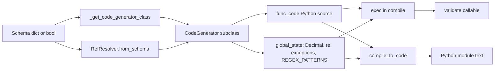
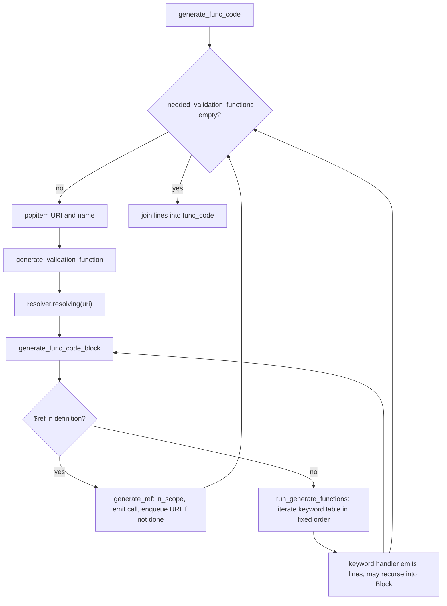

# Fast JSON Schema (horejsek/python-fastjsonschema) — Research report

## Metadata

- **Library name**: Fast JSON Schema (fastjsonschema)
- **Repo URL**: https://github.com/horejsek/python-fastjsonschema
- **Clone path**: `research/repos/python/horejsek-python-fastjsonschema/`
- **Language**: Python
- **License**: BSD-3-Clause (LICENSE, setup.py)
- **Analyzed version**: 738da70 2026-10-21 (`git describe`: v2.22.2-12-g738da70, i.e. release 2.22.2 plus 12 unreleased commits; `fastjsonschema/version.py` has `VERSION = '2.22.2'`)
- **Report date**: 2026-10-27

## Summary

Fast JSON Schema is a JSON Schema **validation** library for Python that achieves high performance by **generating Python validation code** from a schema at compile time. It supports draft-04, draft-06, and draft-07, plus a thin `draft2019` generator that is draft-07 with the `uuid` and `duration` formats added (no 2019-09 applicator/vocabulary keywords). Requires Python >= 3.10 and ships type hints (`py.typed`). The flow is: schema (dict) → CodeGenerator → Python source string → either `exec()` (in-memory) or `compile_to_code()` (write to file). The generated code is then invoked to validate JSON-like data. It does not generate data models (e.g. dataclasses, Pydantic); it generates imperative validation logic. Primary focus is performance (README cites ~25 ms for valid inputs vs ~5 s for jsonschema).

## JSON Schema support

- **Drafts**: Draft-04, draft-06, draft-07, and a `CodeGeneratorDraft2019` (`draft2019.py`, subclass of draft-07 that only adds `uuid` and `duration` format regexes; no `$defs`, `unevaluated*`, `dependentRequired`, etc.). Draft selection is via `$schema` substring match (`draft-04`, `draft-06`, `draft-07`, `draft/2019` or `draft-2019`); when absent or unrecognized, **`CodeGeneratorDraft2019` is the default** (previously draft-07), which behaves as draft-07 plus the two formats (`_get_code_generator_class` in `__init__.py`). 2020-12 is not supported.
- **Scope**: Validation (schema + instance → valid/invalid + exception) and validation code generation (schema → Python source).
- **Subset**: All core validation keywords from draft-04/06/07 are implemented. Meta-schema keywords `$comment`, `title`, `description`, `readOnly`, `writeOnly`, and `examples` are not implemented (accepted in schema but ignored).

## Keyword support table

Keyword list is the union of the `properties` of the vendored meta-schemas `specs/json-schema.org/draft-04/schema.json`, `draft-06/schema.json`, `draft-07/schema.json` (the library's effective target; draft-06/07 differ from draft-04 by adding `$id`, `$ref`, `const`, `contains`, `propertyNames`, `examples`, plus in draft-07 `$comment`, `if`/`then`/`else`, `readOnly`, `writeOnly`, `contentEncoding`, `contentMediaType`). Draft-04's `id` is also listed. The 2019-09 meta-schemas (`draft/2019-09/meta/*.json`) add `$anchor`, `$defs`, `$recursiveAnchor`, `$recursiveRef`, `$vocabulary`, `contentSchema`, `dependentRequired`, `dependentSchemas`, `deprecated`, `maxContains`, `minContains`, `unevaluatedItems`, `unevaluatedProperties`; none of these is handled anywhere in the code (grep finds no occurrences), so the new `draft2019.py` generator is draft-07 plus `uuid`/`duration` formats only. 2020-12 keywords (e.g. `prefixItems`) are likewise not implemented. Implementation evidence from `draft04.py`, `draft06.py`, `draft07.py`, `generator.py`, and `ref_resolver.py`.

| Keyword | Implemented | Notes |
|---------|-------------|-------|
| id | yes | Draft-04 spelling; `get_id` in ref_resolver.py reads `$id` or `id` for resolution scope. |
| $id | yes | Used by RefResolver for resolution scope; `walk` stores the node in `store` under its normalized URI (only for nodes reached through dict values, not through list elements). |
| $ref | yes | generate_ref; resolves via RefResolver.resolving(); emits call to generated validation function per ref. |
| $schema | yes | Used for draft detection in _get_code_generator_class. |
| $comment | no | Not in `_json_keywords_to_function`; ignored. |
| additionalItems | yes | Handled in generate_items (draft04) when items is array; can be false or schema. |
| additionalProperties | yes | generate_additional_properties. |
| allOf | yes | generate_all_of. |
| anyOf | yes | generate_any_of. |
| const | yes | generate_const (draft06). |
| contains | yes | generate_contains (draft06). |
| contentEncoding | yes | generate_content_encoding (draft07); base64 decoding only. |
| contentMediaType | yes | generate_content_media_type (draft07); application/json only. |
| default | yes | Applied in generate_properties and generate_items when use_default; returns transformed data. |
| definitions | partial | No dedicated handler; $ref to #/definitions/X resolved via RefResolver.resolve_path (JSON Pointer). |
| dependencies | yes | generate_dependencies (draft04); supports both array and schema forms. |
| description | no | Ignored. |
| enum | yes | generate_enum; `if variable not in enum`. |
| examples | no | Not implemented. |
| exclusiveMaximum | yes | generate_exclusive_maximum (draft06); numeric form. |
| exclusiveMinimum | yes | generate_exclusive_minimum (draft06); numeric form. |
| format | yes | generate_format; built-in regex for date-time, email, hostname, ipv4, ipv6, uri, json-pointer, uri-reference, uri-template, date, time, iri, iri-reference, idn-email, idn-hostname, relative-json-pointer; `regex` (compile check), plus `uuid` and `duration` under the 2019 generator; `date-time` and `time` now range-check month/day/hour/minute/second/offset and allow leap second `60`. Unknown formats are ignored (no error). Custom via `formats` param (regex string or callable). |
| if | yes | generate_if_then_else (draft07): the `if` subschema is wrapped in a generated `try`; a raised validation exception selects the `else` branch, success selects `then` (`try/except/else`). |
| then | yes | Only emitted as the `else:` arm of the `if` try-block; a `then` without `if` is ignored (keyword dispatch is keyed on `if`). |
| else | yes | Emitted in the `except` arm of the `if` try-block; an `else` without `if` is ignored. |
| items | yes | generate_items; supports schema, array (tuple), boolean (draft06+). |
| maxItems | yes | generate_max_items. |
| maxLength | yes | generate_max_length. |
| maxProperties | yes | generate_max_properties. |
| maximum | yes | generate_maximum; same boolean-`exclusiveMaximum` reading and same draft-06/07 inheritance caveat as `minimum`. |
| minItems | yes | generate_min_items. |
| minLength | yes | generate_min_length. |
| minProperties | yes | generate_min_properties. |
| minimum | yes | generate_minimum (draft04). Draft-04 boolean `exclusiveMinimum` is read from the same dict via `.get('exclusiveMinimum', False)`. Draft-06/07 inherit this method unchanged, so a numeric non-zero `exclusiveMinimum` is truthy and appears to turn `minimum` into a strict `<=` check as well (read from code, not executed). |
| multipleOf | yes | generate_multiple_of; when the schema value is a float, computes `Decimal(repr(x)) / Decimal(repr(m))` and tests `int(q) == q`; otherwise plain `/`. Adds an infinity guard. |
| not | yes | generate_not; supports boolean schema (draft06+). |
| oneOf | yes | generate_one_of. |
| pattern | yes | generate_pattern; Python `re.search`; un-escaped `$` is replaced with `\Z`. |
| patternProperties | yes | generate_pattern_properties. |
| properties | yes | generate_properties. |
| propertyNames | yes | generate_property_names (draft06). |
| readOnly | no | Not implemented. |
| required | yes | generate_required. |
| title | no | Ignored. |
| type | yes | generate_type; single or array; draft06 treats integer distinct from float. |
| uniqueItems | yes | generate_unique_items. |
| writeOnly | no | Not implemented. |

## Constraints

Validation keywords are enforced at **runtime** by the generated Python code; nothing is structure-only. Each keyword handler emits guarded conditionals (`if isinstance(data, str): if data_len < 3: raise ...`) so a keyword only applies to the JSON types it targets. Numeric keywords (`minimum`, `maximum`, `multipleOf`, `exclusiveMinimum`, `exclusiveMaximum`) explicitly exclude `bool` (`isinstance(x, (int, float, Decimal)) and not isinstance(x, bool)`; unreleased fix, CHANGELOG UNRELEASED). Some constraints are also checked at **compile time** against the schema itself: keyword value types (e.g. `minLength must be a number`, `enum must be an array`, `required must contain unique elements`), unknown `type` names, and a `required` entry that `additionalProperties: false` makes impossible (`generate_required`). The schema is not validated against the draft meta-schema, so these checks are partial. `use_default=True` (default) additionally makes the validator a transformer: `default` values of missing properties/tuple items are written into the input object, which is returned.

## High-level architecture

Pipeline: **schema (dict or bool)** -> `RefResolver.from_schema` (walks the schema, builds the URI store) -> a `CodeGenerator` subclass picked by `$schema` (`_get_code_generator_class`; Draft04 / 06 / 07 / 2019, and **Draft2019 is the fallback** for absent or unrecognized `$schema`) -> **func_code** (Python source text assembled line by line) -> either `exec(func_code, global_state)` inside `compile()` and return the function named after the root scope, or return the text from `compile_to_code()` (prefixed by `VERSION = "..."`, imports and a serialized `REGEX_PATTERNS` dict).



The library never produces data models; its only artifact is validation code. There is no runtime interpretation layer: after `compile()` returns, schema and generator are unreachable from the validator (only the function, its globals and, for custom formats, a `functools.partial`).

## Medium-level architecture

- **`RefResolver`** (`ref_resolver.py`, adapted from python-jsonschema): fields `base_uri`, `resolution_scope`, `schema`, `store` (dict URI -> schema), `cache`, `handlers`, `_walked_uris`. Two context managers, `in_scope(ref)` (push `urljoin(old, ref)`) and `resolving(ref)` (switch `base_uri`/`schema` to the target document and yield the subschema).
- **`CodeGenerator`** (`generator.py`) holds output buffer `_code` (list of lines), indentation level, current `_definition`/`_variable`/`_variable_name`, `_needed_validation_functions` (dict URI -> function name, the work list), `_validation_functions_done` (set of URIs), `_compile_regexps`, and `_json_keywords_to_function` (an `OrderedDict` keyword -> bound method). Per-draft subclasses extend that table in `__init__`: Draft04 registers 24 keywords, Draft06 adds `exclusiveMinimum/Maximum`, `propertyNames`, `contains`, `const`, Draft07 adds `if`, `contentEncoding`, `contentMediaType`, Draft2019 only extends `FORMAT_REGEXS`.
- **`indent.py`**: a decorator turning `self.l(...)` into both a line emitter and a context manager that indents the body, with duplicate-condition merging and scope tracking (detailed below).
- **`exceptions.py`**: `JsonSchemaValueException`, `JsonSchemaValuesException`, `JsonSchemaDefinitionException`.



## Algorithms and data structures

### Schema representation

There is no parsed schema model. The schema is the raw Python `dict` (or `bool` for draft-06+ boolean schemas) the caller passes in, kept as `CodeGenerator._root_definition` and `RefResolver.schema`. Keywords are read directly with `self._definition['minLength']`; unknown keywords are simply never looked up (the generator iterates its own keyword table and tests `key in definition`, so unknown or unsupported keys cost nothing and raise nothing). The definition dict doubles as the `str.format` context for emitted lines: `CodeGenerator.l()` builds `context = dict(self._definition, variable=..., name=...)`, so templates like `'if {variable}_len < {minLength}:'` interpolate schema values straight into source text (this is why escaping bugs were a security issue, see Low-level details).

Importantly, `RefResolver.walk` **mutates the caller's schema in place**: every `$ref` string is rewritten to an absolute URI (`node['$ref'] = urljoin(resolution_scope, ref)`). Rewriting is idempotent for already-absolute refs. Ownership: the generator holds references, never copies.

### Reference resolution and registry

Registry: `RefResolver.store`, a plain dict keyed by normalized URI (`urlsplit(uri).geturl()`), populated in two ways. (1) `walk(schema)` at construction: depth-first over dict values only (lists are not descended into, so `$id`/`$ref` nested directly inside `allOf`/`anyOf`/`items`-array elements are neither registered nor pre-rewritten). When a node has `$ref` (string) it is rewritten and *not* descended into (a `$ref` node's siblings are ignored, matching draft<=7). When a node has `$id`/`id` (`get_id`), it enters `in_scope(id)`, stores the node under the joined URI and walks its children; so `$id: "#foo"` plain-name anchors become store entries. (2) Remote documents fetched by `resolve_remote` are stored when `cache=True` (the default).

Base-URI tracking is a single mutable string `resolution_scope` saved/restored by the `in_scope` context manager. `resolving(ref)`: join against the current scope, `urldefrag` into document URI and fragment; pick the document from `store` (by normalized URI), else the root schema if the URI is empty or equals `base_uri`, else fetch via `resolve_remote` (a handler keyed by URI scheme, otherwise `urllib.request.urlopen` + `json.loads` with the response charset). It then swaps `base_uri`/`schema`, ensures the remote document has been walked once (`_ensure_walked`, tracked in `_walked_uris`, with `rewrite_refs=False` so refs stay relative to their own scope), and resolves the fragment: a plain-name fragment (not starting with `/`) is looked up in `store` or raises `JsonSchemaDefinitionException('Unresolvable ref')`; a JSON Pointer fragment goes through `resolve_path`, which percent-decodes, splits on `/`, un-escapes `~1`/`~0`, indexes lists with `int(part)` and dicts by key.

Resolution is **lazy and per-use**: nothing is resolved until the generator meets a `$ref`. There is no `$anchor`/`$dynamicRef`/`$recursiveRef` support (grep finds none).

Cycle handling is by the generator, not the resolver: `generate_validation_function` adds the URI to `_validation_functions_done` before generating its body, and `generate_ref` only enqueues a URI that is not yet done. A recursive schema (`{"$ref": "#"}` or `#/definitions/node` pointing at itself) therefore emits a call to a function that already exists or is queued, terminating after one body per URI. Draining the work list is `while _needed_validation_functions: popitem()` (LIFO, dict keyed by URI so repeated enqueues are free). Function names derive from the scope URI via `get_scope_name` (`'validate_' + sanitized(scope)`, lowercased, non-alphanumerics to `_`, trailing `_` stripped); the root becomes `validate`. Names are not checked for uniqueness, so two distinct URIs that sanitize identically (e.g. differing only in `-` versus `_`) would map to the same function name, which was not verified at runtime.

### Compiled / intermediate form

The intermediate form is **Python source text** held as `self._code`, a list of already-indented strings; there is no AST or IR. Each referenced URI becomes one top-level function `def validate_x(data, custom_formats={}, name_prefix=None):` that ends in `return data`. Inside a function, every subschema that is not behind a `$ref` is **inlined**: nested `properties`, `items`, `allOf` members and so on become nested `if`/`for` blocks, with Python local variables named by suffixing the parent variable (`data__name`, `data__name_len`, `data_keys`, `data_is_dict`). Generated shape for `{"type":"object","required":["a"],"properties":{"a":{"type":"string"}}}` is, in spirit:

```python
def validate(data, custom_formats={}, name_prefix=None):
    if not isinstance(data, (dict)):
        raise JsonSchemaValueException("" + (name_prefix or "data") + " must be object", value=data, ...)
    data_is_dict = isinstance(data, dict)
    if data_is_dict:
        data__missing_keys = set(['a']) - data.keys()
        if data__missing_keys: raise ...
        data_keys = set(data.keys())
        if "a" in data_keys:
            data_keys.remove("a"); data__a = data["a"]
            if not isinstance(data__a, (str)): raise ...
    return data
```

Two source-level optimizations live in the emitter. (a) **Cached derived variables**: `create_variable_with_length/keys/is_list/is_dict` emit `x_len = len(x)`, `x_keys = set(x.keys())`, `x_is_list`, `x_is_dict` at most once per scope. Visibility is tracked with `_variables` (name -> tuple of scope ids at definition) and `_scope_stack`; `_is_variable_in_scope` accepts a cached name only if the defining scope tuple is a prefix of the current stack, so a variable made in a sibling `if` is not reused where it might be unbound. (b) **Block merging** in `indent.py`: `l()` is wrapped so that if the new line equals the previous emitted line (`_indent_last_line`) it pops the duplicate and re-enters the previous block with the same scope id (`_last_closed_scope`). Consecutive keywords that guard on the same condition (`if data_is_dict:`) therefore share one block. `optimize=False` is passed where merging would be wrong (`try:`, anyOf/oneOf counters).

For `compile()`, the text is `exec`'d with `global_state` (`Decimal`, `re`, both exception classes, `REGEX_PATTERNS` holding already-compiled `re.Pattern` objects, and `custom_formats`); for `compile_to_code` the `global_state_code` property renders imports and `serialize_regexes` (a hand-rolled `repr`-based dict literal with `re.compile(pattern, flags)`, because `pprint` failed on big regexes) at the top of the module.

### Core algorithm

`generate_func_code_block(definition, variable, variable_name, clear_variables)` saves `(definition, variable, variable_name)`, installs the new triple, dispatches, and restores. Dispatch (`_generate_func_code_block`): non-dict raises `JsonSchemaDefinitionException` (draft-06+ first handles `bool`: `True` -> `pass`, `False` -> raise "must not be there"); if `'$ref' in definition`, only `generate_ref` runs (siblings ignored); otherwise `run_generate_functions` iterates `_json_keywords_to_function` **in table order**, calling each handler whose key is present. Order matters and is fixed by the OrderedDict: `type, enum, allOf, anyOf, oneOf, not, minLength, maxLength, pattern, format, minimum, maximum, multipleOf, minItems, maxItems, uniqueItems, items, minProperties, maxProperties, required, dependencies, properties, patternProperties, additionalProperties`, then draft-06 keys, then draft-07 keys. `type` is first so cheap type failure raises early; `dependencies` is before `properties` so defaults are not injected before dependency checks (comment in code). The recursion is literal Python recursion over schema depth, bounded by `MAX_SCHEMA_WALK_DEPTH` only in `walk`, not in `generate_func_code_block`.

Per keyword mechanisms:

- **type**: `if not isinstance(x, (types)) [or isinstance(x, bool)]:`; JSON `number` maps to `(int, float, Decimal)`, `array` to `(list, tuple)`, `object` to `dict`. Draft04 treats `integer` as Python `int` only; draft-06+ adds `and not (isinstance(x, float) and x.is_integer())` so `1.0` is an integer.
- **enum / const** (`_enum_value_matches`): compiled into an `or`-chain of type-strict comparisons, recursively for dict (key presence, `len(x) == n`, each member) and list (length plus indexed elements). `True is val` for bools; numbers exclude bool. Cost is O(enum size) sequential tests, no hashing.
- **allOf**: sequential inline emission of each member. **anyOf**: counter `x_any_of_countN = 0`; each member is `if not count: try: <member>; count += 1; except (JsonSchemaValueException, JsonSchemaValuesException): pass`, so members after the first success are skipped. **oneOf**: same with `if count < 2:` so evaluation stops after a second match; final check `count != 1` with the match count appended to the message. **not**: `try: <sub> except ...: pass else: raise`.
- **if/then/else**: `try: <if> except: <else> else: <then>`.
- **properties**: builds `x_keys = set(x.keys())` once; per declared property `if "k" in x_keys: x_keys.remove("k"); x__k = x["k"]; <subschema>` plus `else: x["k"] = default`. Removing handled keys from `x_keys` is how `additionalProperties` later knows the remainder: `patternProperties` loops every item against every pattern (`REGEX_PATTERNS[p].search(key)`, O(keys x patterns)) and removes matched keys; `additionalProperties: false` raises if `x_keys` non-empty, and a schema form loops the remaining keys (also skipping names in a literal `properties` list).
- **required**: `set([...]) - x.keys()` then error listing `sorted(missing)`.
- **items**: list form emits `if x_len > i:` per index (with optional default append) and `additionalItems` as `for ... enumerate(x[n:], n)` or a length check; schema form emits one `for x_x, x_item in enumerate(x):` with the subschema inlined.
- **uniqueItems**: defines an inline `fn` that recursively converts dicts to `frozenset` of items, lists to tuples and bools to `str`, then compares `len(x)` against `len(set(fn(i) for i in x))` (hash-based, O(n) with recursion into elements; the docstring records the timeit comparison that chose this).
- **contains / propertyNames**: loop with `try/except` around the inlined subschema; `contains` sets a flag and `break`s on first match.
- **format**: a static `FORMAT_REGEXS` dict per draft (regexes end in `\Z`; the generator uses `.match`); custom string formats join the same mechanism, callables are invoked as `custom_formats["name"](x)`. Unknown formats are skipped at generation time; `regex` emits `re.compile(x)` inside `try`.
- **multipleOf**: see Low-level details.

### Error and output model

Failure = a raised `JsonSchemaValueException(message, value, name, definition, rule)` (subclass of `ValueError` through `JsonSchemaException`). Messages are assembled at generation time into the string literal of the `raise` statement by `exc()`; the instance path is spliced as `"" + (name_prefix or "data") + ".a[" ... "]"`, with loop-dependent segments (`[{x_x}]`, `.{x_key}`) completed by `.format(**locals())` only when the error is raised. `$ref` calls pass the current path as `name_prefix` so errors inside a referenced function report the full path from the root. The exception carries the **subschema** (`definition=repr_default(expanded_definition)`, where `_expand_refs` substitutes the resolved target for `$ref` dicts one level) as a literal embedded in the generated code, `rule` (keyword name), and derived properties `path` (split of `name` by `SPLIT_RE`) and `rule_definition`. With `detailed_exceptions=False`, only the message is passed, which both shrinks generated code and avoids building those literals when failing.

Modes: **fast_fail=True** (default) raises at the first failing check. **fast_fail=False** makes every function declare `errors = []`; `exc()` emits `errors.append(...)`; the function ends with `if errors: raise JsonSchemaValuesException(errors)`; `$ref` calls are wrapped in `try/except JsonSchemaValuesException as e: errors.extend(e.errors)`. The `trial_validation()` context temporarily sets `_fast_fail=True` while generating subschemas of anyOf/oneOf/not/if/contains/propertyNames, because their failure is control flow, caught by `VALIDATION_EXCEPTIONS = (JsonSchemaValueException, JsonSchemaValuesException)`. Success returns the (possibly default-augmented) `data`. There are no other output formats (no flag/list/basic/detailed output units, no annotations).

## Low-level details

- **Regex**: full Python `re`; JSON Schema `$` is replaced by `\Z` for `pattern` using `DOLLAR_FINDER = (?<!\\)\$`. `patternProperties` keys are compiled **without** that substitution. Both use the same dict `_compile_regexps` keyed by the pattern text, so a string used as both a `pattern` and a `patternProperties` key would share one entry and the later compile overwrites the earlier (read from code, not executed). `pattern` uses `.search`; format regexes use `.match`.
- **String length**: `len(str)`, i.e. Unicode code points (not UTF-16 units, not bytes).
- **Numerics**: Python `int` is arbitrary precision (no overflow for big integers); floats are IEEE; `Decimal` instances are accepted as numbers. `multipleOf` with a float multiplier uses `Decimal(repr(x)) / Decimal(repr(m))` to avoid `19.01/0.01 = 1901.0000000000002`; with an int multiplier it uses float/int true division then `int(q) != q`; a second check rejects `x / m == float("inf")`. Booleans are excluded from numeric keywords and from `integer`/`number` types.
- **Boolean vs number in enum/const**: type-strict (`True` does not equal `1`); but `1` and `1.0` compare equal as numbers.
- **default**: object/array defaults are emitted as `repr_default(...)` literals (non-finite floats rendered as `float('nan')`), so each call constructs a fresh object. Defaults are written into the caller's input dict/list (mutation) and the same object is returned.
- **contentEncoding / contentMediaType**: `base64` decode via `base64.b64decode` and `application/json` via `json.loads`; both *rebind the local variable* to the decoded value (visible to later keywords, and for the root also the returned value); other encodings/media types ignored.
- **Deep-nesting protection**: `MAX_SCHEMA_WALK_DEPTH = min(500, sys.getrecursionlimit() // 2)`; `walk` raises `JsonSchemaDefinitionException` beyond it (2.22.0). The code generator itself recurses through several Python frames per schema level, so whether depth 500 always fits within the recursion limit was not verified. At validation time, inline nesting maps to nested blocks and `$ref` recursion maps to Python calls, so deeply nested *data* through recursive refs is subject to `RecursionError`. Python's compiler also limits statically nested `for/try/with` blocks; whether a pathological schema could trip that was not verified.
- **Code-injection hardening**: because schema content is formatted into source, 2.22.2 escapes property names in boolean `dependencies`, and `{`/`}` in property names are no longer treated as format fields (CHANGELOG UNRELEASED); `e()` escapes strings (`unicode_escape`, quotes); `tests/test_security.py` parses the generated code with `ast` to check injected text stays inside string literals. `l()` additionally replaces `\n`/`\r` in emitted lines with escape sequences. Remote `$ref` goes through `urlopen` by default (SSRF risk documented in `compile` docstring; mitigated only by supplying `handlers`).
- **Format correctness trade-offs**: format checks are hand-written regexes ("not 100% precise but good enough, fast and without dependencies", comment in `draft04.py`, which records that `ipaddress` was >10x slower). Draft-07 `idn-hostname` ends with `$` instead of `\Z`.
- **Compile-to-code import quirk**: the `format: regex` branch assigns `self._extra_imports_lines = ['import re']`, replacing the list (which initially holds `from decimal import Decimal`); for `compile_to_code` output of such a schema this appears to drop the `Decimal` import (read from code; the in-process `exec` path is unaffected because `Decimal` comes from `global_state`).
- **Draft-04 vs later**: draft-04 booleans for `exclusiveMinimum/Maximum` are read inside `generate_minimum/maximum`; see the keyword table caveat for draft-06+.

## Output and integration

- **Vendored vs build-dir**: Neither. Output is either in-memory (compile) or user writes `compile_to_code` result to file. No checked-in or build-dir convention.
- **API vs CLI**: Both. API: `compile(schema)` returns callable; `compile_to_code(schema)` returns string. CLI: `python -m fastjsonschema` reads schema from stdin or argv, prints generated code to stdout.
- **Writer model**: String only. `compile_to_code` returns str; user writes to file if desired.

## Configuration

- **handlers**: Dict mapping URI scheme to callable(uri) for remote schema fetch.
- **formats**: Dict of format name → regex string or callable(value) → bool for custom formats.
- **use_default**: If True, apply `default` for missing properties/items (default True).
- **use_formats**: If True, validate `format` keyword (default True).
- **detailed_exceptions**: If True, exceptions include value, name, definition, rule (default True).
- **fast_fail**: If True, stop at first error; if False, collect all errors in JsonSchemaValuesException (default True). The `fast_fail=False` mode (added 2.22.0) was fixed in 2.22.2 for anyOf/oneOf/not/if-then-else/contains/propertyNames and for errors behind `$ref`; `JsonSchemaValuesException` now has a joined `message` (unreleased).

## Pros/cons

**Pros**: Very fast validation (compiled code, regex caching); simple API; supports draft-04/06/07; `compile_to_code` allows precompilation and distribution; custom formats; remote refs via handlers; `default` support with transformed output.

**Cons**: Regex uses full Python semantics (not JSON Schema subset); `$` → `\Z` substitution may surprise users; only base64 and application/json for contentEncoding/contentMediaType; no real draft-2019-09/2020-12 keyword support (only uuid/duration formats); no readOnly/writeOnly/title/description/examples; codegen uses string concatenation (maintainability).

## Testability

- **Framework**: pytest. `make test` runs `pytest -W default --benchmark-skip` in a virtualenv after fetching the JSON Schema Test Suite (`make jsonschemasuitcases`, directory `JSON-Schema-Test-Suite/` at repo root).
- **Official suite**: `tests/json_schema/test_draft04.py`, `test_draft06.py`, `test_draft07.py`, `test_draft2019.py` parametrize the suite via `resolve_param_values_and_ids` / `template_test` in `tests/json_schema/utils.py` (which also serves suite `remotes/` at `http://localhost:1234/` through a handler and local meta-schemas from `tests/json_schema/metaschemas`). Skipped files, visible in those modules: all drafts skip `ecmascript-regex.json`, `float-overflow.json`, `date-time.json`, `id.json`; draft-06 also skips `ref.json`; draft-07 skips `ref.json`, `cross-draft.json`, `iri`, `idn-hostname`, `date`, `time`, `unknownKeyword`; draft-2019 additionally skips `refRemote`, `not`, `anchor`, `content`, `defs`, `dependentRequired/Schemas`, `min/maxContains`, `recursiveRef`, `unevaluated*`, `vocabulary` (marked "TODO" or "not implemented yet"). So `$ref`/`$id` handling for draft-06+ is not covered by the official suite here.
- **Unit tests**: `tests/test_*.py` per type or feature (array, object, number, string, composition, const, default, format, fast_fail, pattern_properties, pattern_serialization, compile_to_code, boolean_schema, exceptions, integration, examples, security).
- **Fixtures**: `tests/examples/` (path_with_definition, issue-109, issue-109-regex-only, conditional) used by `test_examples.py`.
- **Tox**: `tox.ini` envlist still lists py34 to py313 and lint although `setup.py` requires Python >= 3.10.
- **Use for a shared harness**: the JSON Schema Test Suite directory is vendored in the clone and is the natural fixture source; the library's behaviour is pass/raise on `compile(schema)(instance)`.

## Performance

Analysis is from code only; no benchmark was run.

### Performance techniques

- **Compile vs interpret**: This is the library's central technique. Schema interpretation (keyword dispatch, `$ref` resolution, string formatting of messages, regex compilation, type-to-Python-type mapping) all happens once in `CodeGenerator` at `compile()` time. The per-validation work is a straight-line Python function: static `isinstance` checks, literal comparisons and constants baked in as source (e.g. `if data_len < 3`, `set(['a','b']) - data.keys()`). There is no keyword loop, no schema lookup and no dispatch at run time. `compile_to_code()` moves even `exec` out of process: the generated module can be imported later (`fast_file` in `performance.py`), skipping generation entirely. Calling `validate()` or `compile()` per call re-runs the whole generator and `exec` (the repo's own benchmark shows `fast_not_compiled` roughly 100x slower than `fast_compiled`).
- **Memory layout and allocation**: Python objects only; no custom layout. Per-validation allocation is minimized by the emitter: `x_len`, `x_keys` (`set(x.keys())`), `x_is_list/is_dict` are computed once per scope and reused; `required` and `properties` consume the `x_keys` set instead of scanning. Subschemas are inlined into one function (no per-subschema call frames) except for `$ref` targets, which become one function each. Error objects and the `definition=` dict literal are constructed only inside the `raise`/`errors.append` statement, so the success path allocates no error state. `detailed_exceptions=False` further shrinks failure cost and generated code (the repo's benchmark shows the valid case roughly halving). `x_keys` copying (`set(...)`) and `uniqueItems` (`fn` re-defined per call inside the generated block, building frozensets/tuples) are per-call allocations.
- **Caching and memoization**: Compile-time only. Regexes are compiled once into `REGEX_PATTERNS` (keyed by pattern text; format regexes keyed `"<format>_re_pattern"`) and shared across all call sites in the generated module; `store` caches fetched remote documents when `cache=True`; `_walked_uris` avoids re-walking documents; one function per URI means each `$ref` target is generated once regardless of reference count. There is no cache of compiled validators across `compile()` calls (no LRU, no schema-hash key), and `store={}` is fresh per `_factory` call.
- **Fast paths and short-circuiting**: Keyword order puts `type` first so wrong-typed data fails early and later keywords can be guarded by `isinstance`. `anyOf` guards each remaining alternative with `if not count` so a success skips later `try` blocks (comment: "expensive try-except"); `oneOf` guards with `count < 2`. `fast_fail=True` raises at the first error; `fast_fail=False` is the slow collection path. `contains` `break`s on first match. Identical consecutive guards are merged into one block (`indent.py`). Trivially true subschemas (`True`, `{}` additionalProperties, `items: true`, empty `patternProperties`) emit nothing. `additionalProperties: false` becomes a single non-empty-set test on the keys left after `properties`/`patternProperties` removed theirs. `enum` and `const` are inline `or` chains rather than runtime generic equality.
- **Regex handling**: Python's backtracking `re`; each pattern compiled once at generation. `.search` for `pattern`/`patternProperties`, `.match` for format regexes. There is **no** ECMA-262 translation (only the `$` -> `\Z` rewrite) and **no ReDoS protection**: no timeout, no linear-time engine, no complexity analysis. `patternProperties` evaluation is O(keys x patterns) regex searches. The README states full Python regex semantics are deliberately allowed because it is "faster to compile without limits".
- **Concurrency**: Generated validators are plain module-level functions with immutable shared state (compiled `re.Pattern` objects, imported classes) and per-call locals, so one compiled validator can be called from multiple threads. The exception is `use_default`, which mutates the input data in place. The generator itself has no locks and mutates the schema dict (`$ref` rewrite) and uses per-instance mutable state, so compiling the same schema object concurrently from several threads is not guaranteed safe (not verified). No async/parallel validation or generation features; the GIL is irrelevant to design.

### Benchmarks in repo

- `performance.py` (`make performance`): builds one draft-04 schema (tuple `items`, nested array/object, `enum`, `not`, `oneOf` of two `multipleOf`) and uses `timeit` with `NUMBER = 1000`, looping 4 valid values (`VALUES_OK`) or 8 invalid values (`VALUES_BAD`, exceptions swallowed). Variants: `fast_compiled`, `fast_compiled_without_exc`, `fast_file` (`compile_to_code` written to a temp file and imported), `fast_not_compiled` (compile on every call), `jsonschema.validate`, `jsonschema_compiled` (reused `Validator`), `jsonspec`, `validictory`. It imports all competitors, so it needs them installed. Sample results are embedded in the module docstring in `fastjsonschema/__init__.py` (e.g. `fast_compiled valid 0.099`, `jsonschema valid 5.22`, `jsonschema_compiled valid 0.44`; seconds per 1000 loops).
- `tests/benchmarks/test_benchmark.py`: pytest-benchmark (`@pytest.mark.benchmark(min_rounds=20)`) over the same schema (draft-less, so Draft2019 generator) with valid and invalid parametrized values. `make benchmark-save` stores a baseline; `make benchmark` compares and fails on a >5% regression of `min` (`--benchmark-compare-fail=min:5%`, GC disabled via `--benchmark-disable-gc`). `make test` runs with `--benchmark-skip`.
- **Entry points for an external harness**: `fastjsonschema.compile(schema)` returns the callable (call it with parsed JSON; it raises `JsonSchemaException` subclasses on failure, returns data on success); `fastjsonschema.compile_to_code(schema)` returns source text; CLI `python -m fastjsonschema '<json>'` (or JSON on stdin) prints that source (via `__main__.py`).

## Determinism and idempotency

Generation appears deterministic. The keyword table is an `OrderedDict` with fixed order per draft; the work list `_needed_validation_functions` is an insertion-ordered dict drained with `popitem()` (LIFO), so function emission order follows schema traversal; schema dict iteration order is insertion order; no hash-ordered containers are iterated when emitting (the emitted `set([...])` literals follow `required` list order, and `sorted()` appears only in the generated runtime message). Counters (`_any_or_one_of_count`, `_scope_counter`) are per-generator. `REGEX_PATTERNS` is serialized in dict insertion order. Output therefore should be byte-identical for the same input and library version, and a small schema change should only alter the affected function body (function order can shift because of LIFO draining). No test asserts byte-for-byte idempotency; `test_pattern_serialization.py` only checks that `serialize_regexes` evals back to equal patterns.

## Enum handling

- **Duplicate entries** (e.g. `["a", "a"]`): Generated code is an `or`-chain of type-strict equality checks per enum element (`isinstance(v, str) and v == 'a' or ...`; bool/int distinguished, dicts and lists compared recursively), not `in`. Duplicates remain in the chain; validation passes if value equals any element. An empty enum generates `if True:` (always fails). No deduplication. Draft-07 meta-schema requires `uniqueItems: true` for enum, but fastjsonschema does not validate schema against meta-schema, so duplicate enum values are accepted.
- **Case collisions** (e.g. `"a"` and `"A"`): Python strings are case-sensitive; both are distinct and both valid. No collision issue.

## Reverse generation (Schema from types)

No. The library generates validation code from schema only. There is no facility to produce JSON Schema from Python types or classes.

## Multi-language output

No. Output is Python source only. `compile_to_code` emits a single Python module with a `validate` function and optional `REGEX_PATTERNS`.

## Model deduplication and $ref/$defs

- **$ref**: Each distinct resolved URI produces one validation function. Refs to the same URI (e.g. multiple `$ref: "#/definitions/Person"`) all call the same generated function. Deduplication by URI.
- **definitions**: Schemas under `definitions` are referenced by `$ref`; no separate "definitions" handler. Same definition ref’d multiple times → one function, many calls.
- **Inline duplicates**: Two identical inline object schemas in different branches are not deduplicated; each generates its own inline validation block. Only `$ref`-backed schemas are deduplicated.

## Validation (schema + JSON → errors)

Yes. Primary feature.

- **Input**: Schema (dict or bool) and data (JSON-like Python object).
- **Output**: On success, returns data (with defaults applied if `use_default`). On failure, raises `JsonSchemaValueException` (or `JsonSchemaValuesException` when `fast_fail=False`) with message, value, name, definition, rule, path, rule_definition.
- **API**: `validate(schema, data, ...)` (convenience, compiles each call) or `compile(schema, ...)(data)` (recommended for reuse).
- **compile()**: Generates code, exec’s it, returns the validation callable.
- **Exceptions**: `JsonSchemaDefinitionException` for invalid schema during compile; `JsonSchemaValueException` for validation failure; `JsonSchemaValuesException` (list of JsonSchemaValueException) when `fast_fail=False`.
