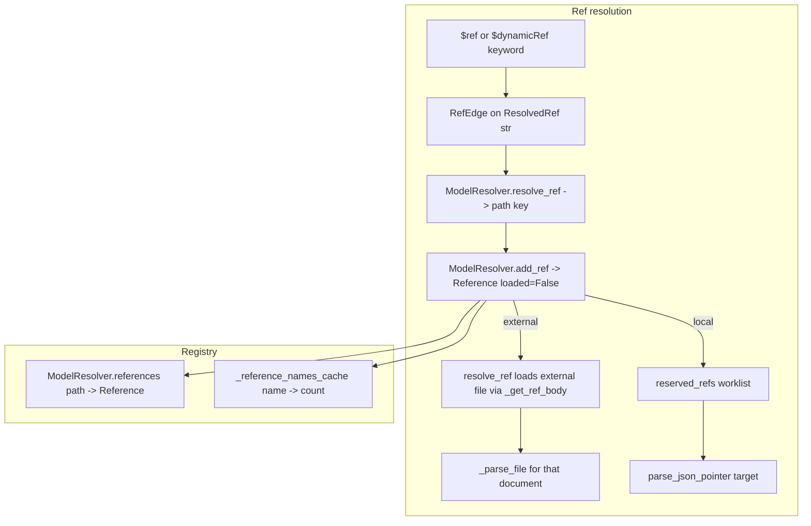

# datamodel-code-generator — Research report

## Metadata

- **Library name**: datamodel-code-generator
- **Repo URL**: https://github.com/koxudaxi/datamodel-code-generator (pyproject now points at https://github.com/datamodel-code-generator/datamodel-code-generator; org moved from koxudaxi)
- **Clone path**: `research/repos/python/koxudaxi-datamodel-code-generator/`
- **Language**: Python (generated code targets Python only)
- **License**: MIT (pyproject.toml)
- **Analyzed version**: fd9a87e65 2026-10-27 (`git describe`: 0.86.0-239-gfd9a87e65; last tagged release 0.86.0)
- **Report date**: 2026-10-26

## Summary

datamodel-code-generator turns JSON Schema (and OpenAPI, AsyncAPI, GraphQL, Avro, XML Schema, Protocol Buffers, MCP tool schemas, and sample JSON/YAML/CSV/dict data via genson) into Python source: Pydantic v2 (BaseModel, RootModel, Pydantic dataclass), stdlib `dataclasses`, `TypedDict`, or `msgspec.Struct`. Every non-GraphQL input is normalized to a JSON-Schema-shaped dict and parsed by one `JsonSchemaParser` (`parser/jsonschema.py`, about 17.6k lines), which builds a mutable graph of `DataModel`/`DataType`/`Reference` objects held in a `GenerationStore`. A declarative, 109-entry pass pipeline (`parser/_pass_decls.py`, `parser/_passes/_tables.py`) then sorts, deduplicates, splits into modules, resolves import cycles with an iterative Tarjan SCC, names and renders. Rendering uses project-owned Jinja templates that are pre-compiled to plain Python renderers; output is formatted by black+isort (default), ruff, or a dependency-free builtin formatter. There is a CLI (`datamodel-codegen`), a `generate()` API, a reverse path (`--input-model`, Python types to schema to models), presets, watch/check modes and a generated Python client/FastAPI helper layer for OpenAPI. There is no standalone (schema, instance) validator; optional `--generate-schema-validators` emits runtime validator code for a subset of keywords.

## JSON Schema support

- **Drafts**: draft-04, draft-06, draft-07, 2019-09, 2020-12. `--schema-version` forces one; `auto` detects from `$schema` or heuristics (`$defs` vs `definitions`); see `parser/schema_version.py` (`detect_jsonschema_version`, `JsonSchemaFeatures`, each feature tagged supported/partial/not_supported).
- **Scope**: code generation only. Typing and structure come from the schema; validation keywords become Pydantic/msgspec constraints only with `--field-constraints`.
- **Supported**: type, properties, required, items/prefixItems, additionalProperties, patternProperties, propertyNames, enum, const, format, default, `$ref`/`$defs`/`definitions`/`$id`/`$anchor`, `$recursiveRef`/`$recursiveAnchor`, `$dynamicRef`/`$dynamicAnchor`, allOf/anyOf/oneOf, readOnly/writeOnly, numeric/string/array/object constraints.
- **Partial**: contains/minContains/maxContains, contentEncoding/contentMediaType/contentSchema, unevaluatedProperties/unevaluatedItems, deprecated, and if/then/else/not (only as optional runtime validators).
- **Not supported**: `$vocabulary`, dependentRequired, dependentSchemas, general if/then/else typing.
- **Conformance**: CI runs the JSON-Schema-Test-Suite (pinned commit) against generated Pydantic v2 models: 640 groups / 2,226 tests for draft7 and draft2020-12, per `docs/conformance.md` (count taken from that doc, not re-run). Unsupported cases are classified in tests.

## Keyword support table

Keyword list derived from vendored draft 2020-12 meta-schemas (`specs/json-schema.org/draft/2020-12/meta/*.json`). Implementation evidence from `parser/jsonschema.py` (JsonSchemaObject, JsonSchemaParser), `parser/schema_version.py` (JsonSchemaFeatures), and `reference.py`.

| Keyword | Implemented | Notes |
|---------|-------------|-------|
| $anchor | yes | `JsonSchemaObject.anchor` (alias `$anchor`); `walk_schema_resources`/`ResourceRegistry` register anchors; `_find_json_schema_anchor_pointer`; `JsonSchemaFeatures` status "supported" (was unsupported in the previous analysis). |
| $comment | no | Listed among annotation-only keywords (`_ANNOTATION_KEYWORDS`, `_NON_ASSERTING_KEYWORDS`); docs say "Ignored: comments not preserved in output". |
| $defs | yes | SCHEMA_PATHS includes "#/$defs"; definitions_key in JsonSchemaFeatures; parsed and resolved. |
| $dynamicAnchor | yes | JsonSchemaObject has dynamicAnchor (alias); JsonSchemaFeatures.dynamic_ref true for 2020-12. |
| $dynamicRef | yes | JsonSchemaObject has dynamicRef (alias); resolved with dynamic ref support. |
| $id | yes | JsonSchemaObject.id (alias "$id"); model_resolver.ids, set_root_id; used for ref resolution. |
| $ref | yes | JsonSchemaObject.ref (alias "$ref"); get_ref_type, parse_ref, _load_ref_schema_object; full resolution. |
| $schema | yes | Used in detect_jsonschema_version to select draft. |
| $vocabulary | no | JsonSchemaFeatures "not_supported". |
| additionalProperties | yes | JsonSchemaObject.additionalProperties; drives Dict/value type or forbidden extra. |
| allOf | yes | JsonSchemaObject.allOf; merged or class hierarchy per allof_merge_mode/allof_class_hierarchy. |
| anyOf | yes | JsonSchemaObject.anyOf; emitted as Union types. |
| const | yes | In __constraint_fields__ and extras; const_support in JsonSchemaFeatures; Literal/single value. |
| contains | partial | JsonSchemaFeatures "partial": count constraints (`minContains`/`maxContains`) modeled when `contains` matches every item; general schema-valued `contains` unsupported (docs/supported_formats.md). |
| contentEncoding | partial | JsonSchemaFeatures "partial" (contentMediaType/contentEncoding); `format: byte` base64 handled via `--type-mappings` (`Base64Bytes`/`EncodedBytes` since 0.86.0). |
| contentMediaType | partial | Same feature row as contentEncoding; recognized, non-asserting (`_NON_ASSERTING_KEYWORDS`). |
| contentSchema | partial | JsonSchemaFeatures "partial"; recognized but not modeled as a decoded-content type. |
| default | yes | JsonSchemaObject.default; applied to field default/initializer. |
| dependentRequired | no | JsonSchemaFeatures "not_supported"; ignored. |
| dependentSchemas | no | JsonSchemaFeatures "not_supported"; ignored. |
| deprecated | partial | In EXCLUDE_FIELD_KEYS/extras; JsonSchemaFeatures.deprecated_keyword "partial". |
| description | yes | JsonSchemaObject.description; docstrings or Field(description=...). |
| else | partial | Type generation: not supported (`if_then_else` "not_supported"). Under `--generate-schema-validators`, `_get_conditional_schema`/`_has_conditional_validator` emit validators for simple required-property `if` predicates with `then`/`else` required branches. |
| enum | yes | JsonSchemaObject.enum; Enum or Literal; x-enum-varnames/x-enumNames supported. |
| examples | partial | JsonSchemaObject.examples; stored in extras; not used for codegen structure. |
| exclusiveMaximum | yes | JsonSchemaObject; boolean converted to number for draft-04 compat (validate_exclusive_maximum_and_exclusive_minimum). |
| exclusiveMinimum | yes | Same as exclusiveMaximum. |
| format | yes | JsonSchemaObject.format; json_schema_data_formats maps to Types (date-time, uuid, etc.). |
| if | partial | See `else`: only required-property predicates (`_get_conditional_predicate`) become runtime validators; no conditional types. |
| items | yes | JsonSchemaObject.items; single schema or legacy array; prefixItems for tuples. |
| maxContains | partial | Read from `extras` (`obj.extras["maxContains"]`) with `contains` for array count constraints in `parser/jsonschema.py`. |
| maximum | yes | JsonSchemaObject.maximum; Field(ge=/le=) when field_constraints. |
| maxItems | yes | JsonSchemaObject.maxItems; Field when field_constraints. |
| maxLength | yes | JsonSchemaObject.maxLength; Field when field_constraints. |
| maxProperties | yes | In __constraint_fields__; minProperties/maxProperties supported. |
| minContains | partial | Read from `extras` and applied as min item count when `contains` matches all items. |
| minimum | yes | JsonSchemaObject.minimum; Field(ge=/le=) when field_constraints. |
| minItems | yes | JsonSchemaObject.minItems; Field when field_constraints. |
| minLength | yes | JsonSchemaObject.minLength; Field when field_constraints. |
| minProperties | yes | In __constraint_fields__. |
| multipleOf | yes | JsonSchemaObject.multipleOf; optional Decimal via use_decimal_for_multiple_of. |
| not | partial | No negated-type generation; `_get_not_required_groups` turns a required-only `not` into a validator under `--generate-schema-validators`; `not` also in the allOf/keyword-intersection tables. |
| oneOf | yes | JsonSchemaObject.oneOf; Union/discriminator when discriminator present. |
| pattern | yes | JsonSchemaObject.pattern; Field(pattern=...) when field_constraints. |
| patternProperties | yes | JsonSchemaObject.patternProperties; Dict with key/value types. |
| prefixItems | yes | JsonSchemaObject.prefixItems; tuple types (use_tuple_for_fixed_items). |
| properties | yes | JsonSchemaObject.properties; object model fields. |
| propertyNames | yes | JsonSchemaObject.propertyNames; JsonSchemaFeatures.property_names "supported"; key schema for Dict. |
| readOnly | yes | JsonSchemaObject.readOnly; read_only_write_only_model_type / serialization. |
| required | yes | JsonSchemaObject.required; required vs Optional fields. |
| then | partial | See `else`. |
| title | yes | JsonSchemaObject.title; class name or docstring. |
| type | yes | JsonSchemaObject.type; string or array (incl. null); type-driven Types. |
| unevaluatedItems | partial | `JsonSchemaObject.unevaluatedItems`; `false` / schema forms influence tuple/tail item typing (`parse_array_fields`); JsonSchemaFeatures "partial". |
| unevaluatedProperties | partial | `JsonSchemaObject.unevaluatedProperties`; with `--read-unevaluated-properties` a schema-valued form is read as `additionalProperties`; JsonSchemaFeatures "partial". |
| uniqueItems | yes | JsonSchemaObject.uniqueItems; use_unique_items_as_set → Set type. |
| writeOnly | yes | JsonSchemaObject.writeOnly; write-only model handling. |

Table rows re-verified against `parser/jsonschema.py` and `parser/schema_version.py` (second pass, 64 keywords from the 2020-12 meta-schemas). Legacy keywords from earlier drafts (vendored `draft-04`/`06`/`07`): `definitions` (yes, SCHEMA_PATHS), `additionalItems` (recognized in array-constraint tables), boolean `exclusiveMinimum/Maximum` (converted), `dependencies` (no; only appears in skip/passthrough keyword lists, no model generated), `id` (draft-04 alias of `$id`, yes), `$recursiveRef/$recursiveAnchor` (yes).

## Constraints

Validation keywords (minimum, maximum, minLength, maxLength, minItems, maxItems, pattern, multipleOf, uniqueItems, ...) always influence structure (types, optionality, `uniqueItems` to `Set`). With `--field-constraints` (or the deprecated `--validation`) they are also written as Pydantic `Field()`/`Annotated` constraints (`ge`, `le`, `min_length`, `pattern`, ...) or msgspec `Meta`, so the target runtime enforces them. Without the flag they are folded into constrained-type calls such as `conint(...)`/`constr(...)` where the backend has them. Keywords that are not constraint-shaped but could be asserted (required-groups, simple if/then/else, patternProperties, property counts, `not`) are emitted as generated validator code only under `--generate-schema-validators` (`model/runtime_validation.py`, `model/pydantic_v2/...schema_runtime_validation*`). `JsonSchemaObject.__constraint_fields__` (11 keywords) drives `has_constraint`; `_constraint_applicability.py` keeps constraints off types that cannot carry them. Regex patterns are scanned statically (`_regex_syntax.py`) to decide whether a pattern is portable to the target engine.

## High-level architecture

The CLI (`__main__.py`) builds a `Config` from arguments, `pyproject.toml` and presets, then calls the same `generate()` (`__init__.py`) a library user calls. `generate()` infers the input type, loads/normalizes the source (fetch, YAML/JSON, conversion of Avro/XSD/proto/MCP/sample data to JSON Schema), builds a parser, runs `Parser.parse()`, formats and writes files or stdout. `docs/architecture.md` numbers the stages L0 to L8:

- L0 input loading and schema-graph registration (`_parse_file`, `_prepare_schema_resources`)
- L1 parsing into `Reference`/`DataModel`/`DataType` objects (`parse_obj`, dispatch tables)
- L2 settle (naming, diagnostics, `sort_data_models`, base-class MRO sort)
- L3 module structure (module grouping, same-name dedup, tree-scope reuse, circular-import merge)
- L4 cross-module pre-pass (plans)
- L5 per-module processing (the long list of per-module transforms)
- L6 cross-module finalization (tag repair, generic base class, decision phase, render preparation, imports)
- L7 rendering (templates), L8 formatting and output

Some conditions rerun the whole pipeline with a fresh parser (`__init__.py:_parse_generation`: collapse of root models that would make a data type contain itself, yielding names that class-keyed options name, untyped nullable maps, invalid dotted stdout modules).

```mermaid
flowchart LR
  subgraph input [Input]
    Src["File, URL, stdin, dict"]
    Model["--input-model Python type"]
    Norm["Normalize to JSON Schema shape"]
    Src --> Norm
    Model --> Norm
  end
  subgraph parse [Parse L0-L1]
    Graph["Schema graph + ResourceRegistry"]
    JP["JsonSchemaParser parse_obj dispatch"]
    Store["GenerationStore: DataModel / DataType / Reference"]
    Norm --> Graph
    Graph --> JP
    JP --> Store
  end
  subgraph passes [Passes L2-L6]
    Settle["settle: sort, MRO"]
    Struct["structure: modules, dedup, SCC"]
    Mod["per-module transforms"]
    Fin["cross-module, decisions, render prep"]
    Store --> Settle --> Struct --> Mod --> Fin
  end
  subgraph out [Output L7-L8]
    Render["compiled renderers or Jinja"]
    Fmt["CodeFormatter: black/isort, ruff, builtin"]
    Files["Python files or stdout"]
    Fin --> Render --> Fmt --> Files
  end
```

## Medium-level architecture

- **Parser classes**: `Parser` (`parser/base.py`, ~3.6k lines: source iteration, `parse()`, module output) is subclassed by `JsonSchemaParser` and `GraphQLParser`. `OpenAPIParser`, `AsyncAPIParser`, `AvroParser`, `XMLSchemaParser`, `ProtobufParser` extend `JsonSchemaParser` and mostly convert their documents to JSON Schema and mount them into the same graph.
- **Dispatch**: `parser/_schema_dispatch.py` holds `DispatchTable`s of ordered `Step`s (rewrite the site, e.g. merge a `$ref` with sibling keywords) and `Row`s (predicate plus builder). `_DEFINITION_TABLE` (definitions/roots), `_FIELD_TABLE` (fields, items, map values), `_OPENAPI_OPERATION_TABLE` pick `parse_object`, `parse_array`, `parse_all_of`, `parse_one_of`, `parse_enum`, `parse_root_type`, etc.
- **Schema graph (L0)**: `parser/_schema_graph.py` (see Algorithms) registers every schema resource and gives each `$ref`/`$dynamicRef` a `RefEdge`.
- **ModelResolver** (`reference.py`): path-keyed registry of `Reference` objects, `$id` tables, class-name allocation.
- **Generation graph**: `GenerationStore` (`parser/generation.py`) owns the model list and a `GenerationIndex` of facts and reference sites; mutations go through store operations so the index and memo epochs stay valid.
- **Pass pipeline**: `parser/_pipeline.py` (`Runner`, `Segment`, `PassSpec`, `ForEachModule`, `HookCall`, `DecisionPhase`), tables in `parser/_passes/_tables.py`, per-pass read/write fact declarations in `parser/_pass_decls.py`, fact definitions in `parser/_facts.py`, optional debug checks in `parser/_finality.py`.
- **Output backends**: `model/` has `pydantic_v2/` (BaseModel, RootModel, dataclass, ConfigDict), `dataclass.py`, `typed_dict.py`, `msgspec.py`, plus `enum.py`, `type_alias.py`, `union.py`, `scalar.py`; a per-backend `DataTypeManager` maps `Types` enum values to Python types.

## Algorithms and data structures

### Schema representation

**`JsonSchemaObject`** (`parser/jsonschema.py:1793`) is a Pydantic v2 `BaseModel` (`defer_build=True`) with typed fields for the keywords the generator reads: `items` (single schema, legacy list, or bool), `prefixItems`, `additionalItems`, `additionalProperties`, `unevaluatedProperties`/`unevaluatedItems`, `patternProperties: dict[str, JsonSchemaObject | bool]`, `propertyNames`, `properties`, `required: list[str]`, `oneOf/anyOf/allOf: list[JsonSchemaObject | bool]`, `enum: list[Any]`, `type: str | list[str]`, `format`, `pattern`, the numeric/length/item bounds, `discriminator`, `nullable`, `$ref/$recursiveRef/$dynamicRef/$id/$anchor` (via aliases), plus extension fields (`x-enum-varnames`, `x-enumNames`, `x-enum-descriptions`, `x-enum-field-as-literal`, `customTypePath`, `customBasePath`). Boolean schemas are not stored as `bool` at the top: `_validate_schema_object` maps `True` to an empty object and `False` to an object with `is_boolean_schema_false=True`; booleans survive only inside the typed unions above.

Unknown or untyped keywords are not dropped. A `mode="before"` validator (`collect_extra_fields`) copies every key not in `EXCLUDE_FIELD_KEYS` into an `extras: dict[str, Any]` (aliased to a private `#-datamodel-code-generator-#-extras` key). `EXCLUDE_FIELD_KEYS` is computed at import as `set(JsonSchemaObject.get_fields()) - DEFAULT_FIELD_KEYS - {"readOnly","writeOnly"}` plus the ref/anchor keys, where `DEFAULT_FIELD_KEYS` = example(s), description, discriminator, title, const, default_factory, deprecated, contentEncoding/contentMediaType/contentSchema, externalDocs, xml. Consequently `const`, `contains`, `minContains`, `maxContains`, `not`, `if`, `then`, `else`, `dependentSchemas`, `dependentRequired`, `$comment` and `deprecated` have no typed field and are read from `extras` at the few sites that care (`_get_data_type` checks `"const" in obj.extras`; `contains`/`minContains` are read at `parser/jsonschema.py:3487`; `_get_conditional_schema` reads `if/then/else/not`).

Normalizing before-validators: `validate_exclusive_maximum_and_exclusive_minimum` rewrites draft-04 boolean `exclusiveMaximum/Minimum` into the draft-06+ numeric form (moving `maximum`/`minimum` into the exclusive slot); `validate_required` filters non-string entries (tolerating `{"allOf": [...]}` junk); `validate_null_type` turns a YAML `null` type into `"null"`; `read_unevaluated_properties_as_additional` (context-flag gated) reads a schema-valued `unevaluatedProperties` as `additionalProperties` when no in-place applicator evaluates properties. `model_post_init` also maps `x-propertyNames` to `propertyNames`. Derived predicates (`is_object`, `is_array`, `has_constraint`, `has_default`, `type_has_null`, `has_ref_with_schema_keywords`, `is_ref_with_nullable_only`) are `cached_property`s computed from `model_fields_set`, which is how "was this keyword written" is distinguished from "has default value".

Ownership is by identity, not by borrowing: the schema graph stores `id(dict) -> SchemaLocation` for every JSON object of every loaded document (`SchemaGraphBuilder.locations`), and `JsonSchemaObject` instances remember the `SchemaLocation` (document + token path) of the object they were built from in `__dict__[SCHEMA_LOCATION_KEY]` (`__get_pydantic_core_schema__` wraps validation with `_located_model_schema`). `with_schema_location` makes a shallow copy rather than mutating, and `model_dump` records the location of each dumped sub-dict (`_locate_dump`) so merged/copied schemas still point back at the source. The model is the immutable-by-convention input; the mutable output is the generation graph below.

**Output-side structures.**

- `DataType` (`types.py:637`) is a Pydantic model describing one node of a Python type-annotation tree: `type: str`, `reference: Reference | None`, `data_types: list[DataType]` (children), `dict_key`, flags (`is_optional`, `is_dict/list/set/frozen_set/mapping/sequence/tuple`, `tuple_item_count`, `is_func` + `kwargs` for constrained-type calls), `literals`/`enum_member_literals`, `import_`, `alias`, and `parent` (a back pointer to the owning field or node). A `DataType` that names a model holds the model's shared `Reference` and registers itself in `Reference.children`. `all_data_types` and `walk` traverse the tree recursively.
- `Reference` (`reference.py:226`) is `{path, original_name, name, duplicate_name, loaded, source, children}` plus a process-wide integer **model key** assigned in `model_post_init` from a counter (`_graph_ids.py`/`_model_keys.py`). Keys are never reused, copies keep them, and they identify a model independently of its (mutable) name and path; all graph algorithms key on `ModelKey`, not names.
- `DataModel` (`model/base.py:2431`) is an ABC with a very large set of `ClassVar` capability flags (`SUPPORTS_DISCRIMINATOR`, `FLATTENS_CONFLICTING_BASE_LAYOUTS`, `SUPPORTS_KW_ONLY`, ...) that let generic passes branch on backend capabilities instead of backend names. Fields: `reference`, `fields: list[DataModelFieldBase]`, `base_classes: list[BaseClassDataType]`, `decorators`, `methods`, `extra_template_data`, plus rendering hooks (`render`, `imports`, `class_name`, `module_path`).
- `DataModelFieldBase` carries name/alias, `data_type`, `required`, `nullable`, `default`, `constraints`, `extras`, and builds a frozen **render plan** (`model/_render_plan.py`) late in the pipeline.
- `GenerationStore` + `GenerationIndex` (`parser/generation.py`): the store owns the model list (`_GenerationModelList`) and a `GenerationFacts` snapshot keyed by stable integer ids: `model_facts`, `data_type_facts`, `model_by_path`, `model_by_ref_id`, `sites_by_target` (`ModelKey -> ordered set of reference sites`), `data_types_by_model`. `GenerationIndexBuilder.update` records only appended/changed/renamed models; rebuild is full only when the list otherwise changes. Queries such as `referenced_keys_for_model`, `has_data_type_references_other_than` give O(1)-ish "who points at this model" answers to later passes, replacing repeated tree walks.

### Reference resolution and registry

Resolution has two layers: (1) a schema-resource layer (L0) that decides which URI names which schema, and (2) a path-keyed `Reference` registry (L1) that decides what class a reference becomes.

**Layer 1: schema graph (`parser/_schema_graph.py`).**
- `walk_schema_resources(raw, implicit, document, base, id_field, children, identifier)` walks a document once, tracking the base URI (`urljoin(base, id)`), and produces a frozen `DocumentResources`: `names` (every absolute URI declared by the root, `$id`/`id`, `$anchor`, `$dynamicAnchor`, to a `document#pointer` location), `resources` (pointers of resource roots, including OpenAPI implicit component resources), `embedded` (embedded `$id`s per resource), `dynamic_anchors` (per resource, first wins), `document_dynamic_anchors`, `recursive_anchors`. The inner `visit` is a literal recursive function (depth proportional to schema nesting).
- `ResourceRegistry.register(DocumentResources)` merges these into dicts shared by the parser: `locations` (URI to location), `root_bases`, `resources`, `dynamic_anchors` and `embedded` keyed by `(document, resource)`, `anchor_tables`. `ResourceRegistry.location(absolute)` first tries the exact URI, then splits `resource#/pointer` and appends the pointer to the resource root location. Documents re-register idempotently (`forget` drops stale URIs).
- `SchemaGraphBuilder.with_ref_edges` rewrites a loaded document copy-on-write so every `$ref`/`$dynamicRef` string value becomes a `ResolvedRef` (a `str` subclass with `__slots__ = ("edge",)`): the string is unchanged for all consumers, but `ResolvedRef.edge` is a frozen `RefEdge(source: SchemaLocation, keyword, document, ref, spelling, origin: RefOrigin, home)`. Only schema-valued positions are rewritten (`RefReading` says which keys hold schemas, so enum values, examples, extension data, OAuth scopes are not touched). `RefOrigin` records who produced a ref string (keyword, discriminator mapping/subtype/schema, `x-python-type`, recursive-ref merge, `itemSchema` projection, dynamic scope).
- `SchemaGraphBuilder.index_document` turns the loaded document into a tree and records `id(obj) -> SchemaLocation` for every dict; an object seen twice at different locations (YAML alias, shared object) is copied for the new position so each object has exactly one location; cycles are broken by copying once and not descending the back edge. `SchemaGraphBuilder.schema(raw, kind, validate)` caches the validated `JsonSchemaObject` per `(id(raw), type)`, so all readers share one validated instance per JSON object (validated once per parse); `edge_key` caches the resolved `RefKey` per edge.
- Cost: one pass per document for the walk, one for edge insertion, one for indexing; lookups are dict-based.

**Layer 2: `ModelResolver` (`reference.py:869`).** State: `references: dict[str, Reference]` keyed by the resolved path string (`<file-or-url>#<json-pointer>`), `ids: defaultdict[str, dict[str,str]]` (per root scope, `$id`/anchor spelling to resolved path), `_resolved_local_file_parts` (bounded 256-entry cache of resolved local file paths), `_reference_names_cache: dict[str,int]` (name to use count), `exclude_names`, base path/URL/current-root context stacks.
- `resolve_ref(path)` canonicalizes a reference string: root `#`; absolute-path normalization; for local files it resolves against `current_base_path` into a path relative to the base (cached); anchor lookups `ids[file][#anchor]`; `$id`-style `#name` refs are looked up in `ids[current_root]` and raise `Error("Unresolved $id reference ...")` listing known ids if missing; URL refs are joined with `root_id`/`base_url`. The result is the canonical key.
- `JsonSchemaParser._ref_key(ref)` takes the key from the edge when the ref is a `ResolvedRef`: the edge's spelling is resolved once, in its own document's context (`_home_context`: location, root `$id`, `$self`), through external mappings, embedded resources and `resolve_ref`; the result is memoized in `SchemaGraphBuilder.edge_key`. A plain string has no edge and resolves in the caller's context.
- `ModelResolver.add_ref(ref)` creates (or returns) the `Reference` at the key with `loaded=False` and a name from `ref_original_name` (last pointer segment or file stem). So a `DataType` can point at a class that is not parsed yet; `loaded=True` is set when its body is parsed.
- `get_ref_data_type(ref)` (called when a field's schema is a `$ref`) checks the `--external-ref-mapping` table (a mapped ref becomes an import, not a model), computes the key, then consults a per-key cache `_ref_data_type_facts[resolved_ref] = (x-python-import extra, admits_null)` so the target is validated at most once per key for this purpose, and returns `data_type(reference=add_ref(ref), is_optional=...)`. Every use gets a fresh `DataType` that points at the one shared `Reference`.
- **Lazy vs eager loading**. `parse_ref` (a recursive `_traverse_schema_objects`/`_walk_schema_objects` walk) calls `resolve_ref` on every `$ref` of a parsed definition (skipped when `_loads_only_used_references`). `resolve_ref` splits behavior by ref kind: a local ref registers a `Reference` and adds the key to `reserved_refs[current_root]`; a ref to another file or URL calls `_get_ref_body` (file read, or HTTP via `http.py` honoring `--allow-remote-refs` / `--allow-private-network`; the default is deprecated-warning behavior) and recursively `_parse_file`s that document under `current_base_path_context`/`base_url_context`; an already-loaded target returns immediately; a target in a file later in the input list (`is_after_load`) is reserved.
- **Reserved-targets worklist**. After the document's root and its `#/definitions|$defs` entries are parsed, `_parse_reserved_targets` (and across sources `_resolve_unparsed_json_pointer`) pops the not-yet-loaded reserved keys in sorted order, parses each pointer target with `parse_json_pointer`/`parse_obj`, and repeats while a round added keys or models. This handles `$ref`s into arbitrary locations (not only `definitions`) and keeps the order deterministic.
- **Cycle handling in resolution**. A cycle is benign here: `Reference` objects are registered before bodies are parsed, so a recursive `$ref` finds the existing `Reference` (`add_ref` returns it) and no re-parse happens. Cycles in the *generated* code are handled later by the sort/SCC passes (below).
- **`$dynamicRef`/`$recursiveRef`** are the exception to edge-based resolution: they resolve against the dynamic scope of the model being parsed (`_dynamic_scope_target`, `_dynamic_bindings`). The parser analyzes which `$dynamicAnchor`s are used (`_dynamic_anchors_used`, `_dynamic_ref_edges`, keyed by schema-graph node) and creates *specialized* models per distinct binding set (`_dynamic_specializations: dict[(node, frozenset[(name,target)]), Reference]`), drained from a `deque` (`_pending_dynamic_specializations`).
- Debug-only cross-check: `DATAMODEL_CODE_GENERATOR_CHECK_SCHEMA_GRAPH=1` (set by the test suite) compares each edge's key to the legacy resolution at the site, and fingerprints shared validated schemas at the end of L1 to prove no reader mutated them.

### Compiled / intermediate form

There are two intermediates.

1. **The generation graph** described above (`DataModel`/`DataModelFieldBase`/`DataType`/`Reference` in a `GenerationStore`). Models are Python objects with mutable lists; the passes mutate them in place, but through `GenerationStore` operations so the `GenerationIndex` and memo epochs are kept consistent. `parser/_facts.py` classifies every attribute as `fact` (semantic, frozen at point B1), `presentation`, `cache`, or `bookkeeping`; `Fact` members are MODELS_EXIST, MODEL_KIND, BASES, FIELD_SET, FIELD_NAMES, FIELD_TYPES, CONTAINERS, REQUIRED, NULLABLE, DEFAULTS, CONSTRAINTS, DISCRIMINATOR_TAGS, TYPE_OVERRIDES, FIELD_ALIASES, METADATA; `RenderFact` members (FIELD_ORDER, KEYWORD_ONLY, ASSIGNMENT_FORM, QUOTING, CLASS_NAMES, MODEL_ORDER, MODULE_IMPORTS, ...) freeze at B2.

2. **The declarative pass pipeline.** `parser/_pass_decls.py` defines 109 `PassDecl`s (name, `Phase`, `Scope` GLOBAL or MODULE, `PassKind` TRANSFORM/PLAN/REPAIR/CHECK/SETUP/BOOKKEEPING, `reads`/`writes` fact sets, `after` edges, optional `removed_by`). `parser/_passes/_tables.py:PIPELINE` arranges them into `Segment`s of `PassSpec`/`ForEachModule`/`HookCall`/`DecisionPhase` steps; `_pipeline.py:Runner` is the only caller of a pass and runs each inside `fact_pass(decl)`. `check_order` derives the required ordering: if pass B reads a fact that earlier pass A writes, B must follow A (a derived edge); any other read/write overlap in one segment needs an explicit `After(pass, reason)`. `Phase` has ten values: PARSE, SETTLE, STRUCTURE, PLAN, MODULES, CROSS_MODULE, DECIDE, RENDER_PREPARATION, IMPORTS, RENDER. Boundaries: PARSED (L1 done, write guards armed), MODULE_DONE, B1 FACTS_FINAL, DECIDED, B2 RENDER_READY. Declared counts by phase (from `Phase.` in `_pass_decls.py`): 7 SETTLE, 10 STRUCTURE, 5 PLAN, 29 MODULES; the remaining declarations are parse, cross-module, decision/render-preparation and import/render.

What the main passes do (see `docs/architecture.md` for the full tables):
- **L2 settle**: `settle_yielding_names` (references created under `yielding_new_references()` give their names to later non-yielding ones), `sort_data_models` (order so each model follows what it references; see Core algorithm), `sort_base_classes_for_mro` (reorder multi-base lists so subclasses precede bases, via C3 helpers `sort_data_models_for_mro`/`c3_merge`/`linearize_data_models`).
- **L3 structure**: `group_models_by_module`, `snapshot_union_tags`, `delete_duplicate_models` (same-class-name dedup, always on), `replace_duplicate_name_in_module`, `reuse_model_tree_scope` (cross-module reuse into a shared module), `resolve_circular_imports` (merge module SCCs into `_internal` modules).
- **L4 plans**: `flatten_conflicting_base_layouts` (msgspec), `unconstrain_union_members_in_modules`, `set_circular_root_model_paths` (root models on a cycle are kept named).
- **L5 per-module** (29 declared): `override_required_field`, `replace_unique_list_to_set`, `change_from_import`, `extract_inherited_enum`, `reuse_model`, `collapse_root_models`, `set_default_enum_member`, `sort_models` (keep-model-order), `change_field_name`, `apply_discriminator_type`, `type_const_narrowed_values`, `set_one_literal_on_default`, `rename_fields_hiding_types`, `remove_overridden_models`, `apply_field_type_overrides`, `type_dict_keys_by_root_types`, `apply_base_class_type_overrides`, ...
- **L6**: msgspec tag repair, `import_removed_reuse_canonicals`/`import_renamed_types` (repair imports after later-module reuse or renames), `apply_generic_base_class`, the **decision phase** (`parser/_phases.py`: decisions read an immutable `FinalFacts` of read-only model views, write through a typed writer protocol, and are ordered by `decision_order`), then render preparation (`fix_constructor_field_ordering`, `update_type_aliases` quoting forward references, `set_validate_default_on_fields`, `freeze_field_render_plans`), `plan_module_imports`/`ModuleImportLedger`, `change_imported_model_name`.

`GenerationStore.seal_facts` freezes the final-fact view at B1; optional env-var checks (`DATAMODEL_CODE_GENERATOR_CHECK_FACT_FINALITY`, `_STORE_WRITES`, `_MODULE_IMPORTS`, `_MODEL_GRAPH`, `_RENDER_MEMOS`, `_SCHEMA_GRAPH`, ...; see `parser/_finality.py`, `_checks.py:CheckArea`) fingerprint models around each pass to prove a pass wrote only the facts it declared. They install nothing when unset.

### Core algorithm

**Parsing (L1) and composition.** `parse_obj` dispatches via `DispatchTable.choose`, which scans entries in order, applying `Step` rewrites until a `Row` predicate matches, else the default. Object-like schemas go to `parse_object` / `_parse_object_common_part`, which creates the `Reference` with `ModelResolver.add(path, name, class_name=True, ...)`, builds `DataModelField`s through `parse_object_fields`, and registers the model in the store. `_get_data_type` maps scalar types: `const` in `extras` becomes a Literal; `type` list becomes a union (`build_union`, nullable if `"null"` present); otherwise `_get_constrained_data_type` maps `(type, format)` through `json_schema_data_formats` (`Types` enum) and passes constraint kwargs to the backend `DataTypeManager.get_data_type`.

*allOf* (`parse_all_of`): (1) unsatisfiable `false` branches raise; (2) `_parse_all_of_single_ref` handles `allOf: [{$ref}]`; (3) `_merge_all_of_root_schema` handles non-object value schemas by merging into a root; (4) `_merge_all_of_object` merges members into one schema *only when* members declare the same property name with different signatures (`_schema_signature` set per property) and there is not exactly one `$ref` and `allof_class_hierarchy` is not `Always`; the merge is `_merge_all_of_schema` (constraint-aware intersection through `parser/_intersection.py:intersect_keywords`: tightest bounds, lcm `multipleOf`, common `type`/`enum`, union of `required`, regex `conjoin_patterns`) or a plain `_deep_merge` under `--allof-merge-mode none`; an `additionalProperties: false` in any member closes the merged schema; (5) otherwise members are walked by `_parse_all_of_item`: each `$ref` member becomes a **base class** (`base_classes`), inline members contribute fields/required; inherited placeholder fields are resolved by `override_required_field` in L5. A pending-stack loop (no recursion) collects declared property names from nested inline `allOf`s to decide overrides. If some members are `oneOf/anyOf` unions, each alternative becomes a subclass of (union member, allOf base) and the holder becomes a union root model.

*anyOf/oneOf* (`parse_combined_schema`): each branch (skipping `false` schemas, null-only branches per null mode, and `true` as the base) is merged with the parent's sibling keywords via `_merge_all_of_schema` (parent's own keywords minus the combinator and title), then parsed by `_parse_combined_schema_items`; both keywords produce the same union of member `DataType`s (no exclusivity check for `oneOf`). A `$ref` branch that carries extra keywords becomes a derived subclass (`_parse_object_common_part` with `base_classes=[ref]`). A oneOf/anyOf of constants can become a synthetic enum (`_extract_const_enum_from_combined`). Discriminators are captured in `field.extras["discriminator"]` and applied in L5 (`apply_discriminator_type`).

**Ordering (`settle.py:sort_data_models`).** Input: models in parse order; each model's reference set comes from `GenerationIndex.referenced_keys_for_model`. Round 1 partitions models into resolved (no references, only self-reference, or all references already emitted) versus unresolved. If any progress was made, it **recurses on the unresolved remainder** (bounded by `MAX_RECURSION_COUNT = sys.getrecursionlimit()`; a `RecursionError` falls through). The fallback for a cycle: (a) iterate sorting unresolved models by `max(index of base class / root-type reference within unresolved)` until a fixed point or a repeated ordering signature (then sort by path), (b) walk the models once more and admit a model if its unresolved references are all within the still-unsorted set, adding it to `require_update_action_models` (these get a forward-reference update such as `model_rebuild()`/quoted annotations), (c) otherwise raise "A Parser can not resolve classes". So cycles are tolerated by emitting forward references rather than by condensing SCCs; cost is roughly O(passes x models x refs) with passes typically small. Self-referencing models are flagged but kept in place.

**Tarjan SCC (`_scc.py`).** Used for graphs of modules (and `ReferenceGraph` snapshots over models). `strongly_connected_components(graph)` is a genuinely iterative Tarjan: `_Frame(node, neighbor_idx, phase)` entries on an explicit `call_stack` replace the recursion; `VISIT` pushes an unvisited neighbor after saving a `POSTVISIT` frame for the parent so lowlink is updated on return; `index`, `lowlinks` are dicts, `on_stack` a set. Determinism comes from visiting `sorted(all_nodes)` and `get_sorted_neighbors` (lazily memoized sorted neighbor lists), giving O(V + E log deg) work; SCCs come back leaves first. `find_circular_sccs` keeps components with more than one node or a self-loop, sorted by their minimum. The nodes must be sortable (a `_SortableNode` protocol).

**`ReferenceGraph` (`_reference_graph.py`).** A frozen snapshot `(nodes: tuple[ModelKey], edges: {EdgeKind: {ModelKey: tuple[ModelKey]}})` with 11 `EdgeKind`s (REFERENCE, ANY_REFERENCE, MAPPING_KEY, CONTAINER_ITEM, RULE_TYPE, CLASS_BODY, DEFINITION, FIELD, BASE, ROOT_TYPE, MAPPING_DEFAULT) and 14 named `GraphSnapshot` sites (module dependencies, class body order, circular root models, keep-model-order, alias cycles, nested default factories, inherited fields, ancestors, cyclic ancestry, base-class C3 order, struct tags, protected namespaces, root constraints, mapping defaults). Passes ask it: `components`, `circular_components`, `reached` (iterative DFS), `acyclic_order`, `preorder`, `postorder` (iterator stack, no recursion), `quotient(group_of, kinds)` (collapse models to modules), `dependency_order` (via `stable_toposort`), `meets_a_group_twice`. `_graph.py:stable_toposort` is Kahn's algorithm with a heap keyed by `(key(node), original_index)`; leftover cyclic nodes are appended in key order. On-demand predicates (`walk_graph`) snapshot just the models they reach.

**Module splitting and circular imports.** `Parser._build_module_structure` groups models by `DataModel.module_path` (derived from the source file path or dotted names via `treat_dot_as_module`; `--module-split-mode single` puts each class in its own module named from `camel_to_snake(class_name)`). `_group_models_by_module` sorts by `(len(key), key)` descending and inserts empty package levels. `module_dependency_cycles` builds a `ReferenceGraph`, takes the **quotient** to a module graph, and runs `find_circular_sccs`; `_failing_import_cycles`/`_joined_merges` widen merges until no merged `_internal` import would still cycle. `resolve_circular_imports` then moves all models of each cyclic SCC into one `_internal` module (`compute_internal_module_path`, `rename_and_relocate_scc_models` renames collisions to `<name>_<n>`), re-sorts them by class-body dependency, and turns the original modules into thin forwarders that re-export from `_internal` (`forwarder_map`). Output module order: `_internal` modules first, then the tree-scope shared module, then modules longest-path first.

**Naming and collision resolution.** Class names are decided in `ModelResolver.add`/`get_class_name`: the raw name (path segment, `title` when `--use-title-as-name`, or class-name option) goes through `default_class_name_generator` (`FieldNameResolver.get_valid_name(upper_camel=True)`: strips non-word characters, prefixes numeric starts with the special prefix, avoids leading `_`, appends `_` to keywords, `snake_to_upper_camel`, and for non-ASCII non-identifiers falls back to `_u<hex>_` escaping), optional singularization (inflect, `lru_cache(4096)`) with an `Item`/`Enum` suffix, affix prefix/suffix by scope (all/models/enums), then uniqueness. `_get_unique_name` builds candidates `name`, `name1`/`name_1` (numbered), or `name<Suffix>`, `name<Suffix>1` when `--duplicate-name-suffix` (per model type: default `Model`/`Enum`), and tests membership in `_reference_names_cache` (a name to count dict, updated incrementally on every rename) plus `exclude_names`. A per-sequence hint cache `_unique_name_start_hints[(name, suffix, delimiter)] = next count` makes repeated collisions O(1) amortized and is invalidated (`_invalidate_unique_name_hints`) when a name is released. `NamingStrategy`: Numbered (default), ParentPrefixed (`Parent_child`), FullPath (parent class + CamelCase child, found by walking up the path to the nearest registered parent `Reference`), PrimaryFirst (names under `#/definitions|$defs|components/schemas` get the clean name and a colliding external one is renamed via `_rename_external_ref_with_same_name`). `--model-name-map` renames after generation and "yielding" references (created in `yielding_new_references()`, e.g. inline map values) cede names to later references; `settle_yielding_names` finalizes them. Dotted names may split into module path plus class name. Late renames (`change_field_name`, `change_imported_model_name`, `import_renamed_types`) happen in later passes with dedicated repairs.

**Dedup and reuse.** Three mechanisms, all comparing *rendered model text*:
1. Always on, L3 `delete_duplicate_models` with the `SAME_NAME` row: within a module, models sharing a `class_name`/`duplicate_class_name` whose masked rendering and referenced-model shapes match are merged: users are redirected to the first and the duplicates are dropped. Root models that merely duplicate another root's type are dropped first (`_get_duplicate_root_reference`).
2. `--reuse-model` (L5 `reuse_model`, per module) plus `--reuse-scope tree` (L3 `reuse_model_tree_scope`, across modules, canonical definitions moved to `--shared-module-name`): `parser/_model_shapes.py:ModelShapes.key(model)` renders the model under the placeholder class name `M` (or its own name for SAME_NAME) and combines it with the discriminated-union tags captured before any merge. Identical keys are candidates; `iter_matching_duplicates` groups by key, then pairs only models whose referenced models also match. `references_match` runs an iterative pairwise comparison of referenced models' *masked shapes* (`shape`: the rendering with referenced class names replaced by `<n>` placeholders in order of first occurrence outside string literals/field declarations), assuming pairs already under comparison match so recursive models terminate. A confirmed duplicate becomes an empty subclass of the canonical (`model.create_reuse_model`) for models, and is removed with users redirected (`redirect_removed_reuse_users`) for Enums or under `--collapse-reuse-models`. Cost is dominated by rendering each model once per pass (keys are memoized in the parse memo, `MemoTable.DEDUP_KEYS`), with `ShapeRow` encoding legacy per-user differences (`legacy-same-name-dedup`, `legacy-tree-scope`, `legacy-reuse-model`, `legacy-collapse-reuse`).
3. `--collapse-root-models` inlines root-model wrappers; a cycle among root models is detected up front (`set_circular_root_model_paths` over a `ReferenceGraph`) and, if inlining would make a type contain itself, `_CollapseRootModelsRecursionError` triggers a full re-parse with circular roots kept named.

**Enum generation**: see Enum handling. **Emission order**: `sort_data_models` order within module, `--keep-model-order` re-sorts per module via `stable_toposort` over a `KEEP_MODEL_ORDER` snapshot; `fix_constructor_field_ordering` orders dataclass-like fields (required before defaulted) once all facts are final.

**Rendering (L7).** `_generate_module_output` builds the import block (`ModuleImportLedger.rendered`) and calls each model's `render()`. `DataModel.render` collects `class_name`, template fields, decorators, base class, methods, description, dataclass arguments and `extra_template_data`, then `_render` (see Performance techniques). Type hints come from `type_expr_of(data_type)`: a small immutable expression tree (`TypeLeaf`, `RefLeaf`, `TypeApply`) built from the `DataType` tree and rendered late by `render_type_expr`, so names and quotes read at render time reflect the final renames. Unions are built by `build_union`; `Optional`/`| None` are applied at render with `get_optional_type`.

### Error and output model

Errors are Python exceptions: `Error` (in `__init__.py`) for fatal conditions (unresolved `$id`, disabled remote fetch, "A Parser can not resolve classes", unsatisfiable schema), `SchemaParseError(message, path, original_error)` wrapping Pydantic validation errors of a schema node with its JSON path (`_validate_schema_object`). Paths shown to users are redacted (`_url_redaction.py:redact_reference`/`redact_path`). Non-fatal issues are Python `warnings` (`warn_deprecated`, `warn_unsatisfiable` for keyword intersections without a common value, `--model-name-map` unmatched keys, required-assignments-after-defaults, nested default-factory decisions). Output is Python text: one string for single-module output (`generate()` returns it or prints to stdout) or `dict[module-path-tuple, result]` written as a package (`__init__.py`, forwarder modules, `_internal.py`). Optional machine-readable outputs: `--output-format-json-schema` for config/generation/structured-output schemas, structured JSON command output, and model metadata (`_build_model_metadata`, `model_metadata.py`). `--check` diffs generated output against files on disk.

## Low-level details

- **Enum member naming**: `parse_enum` (`parser/jsonschema.py:15511`) derives a name per value (string value text, `x-enum-varnames`/`x-enumNames`, for dict values `title`/`name`/`const`, for numbers `<type>_<value>`), validates through `ModelResolver.get_valid_field_name(model_type=ENUM)` with an `excludes` set of names already used in this enum, so repeated names are suffixed (`name_1`, ...). `EnumFieldNameResolver` forbids `mro` and, under `--use-subclass-enum`, member names that collide with attributes of the `int`/`str`/`float`/`bytes` base type (per target Python version). `null` members: `_null_facts` decides between `enum-null-as-nullable` (drop the member, make the field nullable) and `enum-null-member`; an enum with only null becomes a null root model. Enum class kind (`Enum`/`StrEnum`/`IntEnum`) comes from `model/_decisions/enum_kind.py:decide_enum_kind`, which uses a value-base class only when `T(v) == v` holds for every member (NaN equal to itself).
- **Literal vs enum value identity**: `enum.py:_json_value_key` builds hash keys distinguishing bool from int/float, so `True` and `1` stay different values for member lookup (`ENUM_MEMBER_INDEX` memo); `_safe_non_finite_value` handles NaN/Infinity.
- **Numbers**: constraint values are carried as `UnionIntFloat` or `FloatConstraint` that preserve the written precision; `Fraction` helpers (`_get_fraction_floor/ceil`) normalize integer-type bounds; `multipleOf` optionally maps to `Decimal` (`use_decimal_for_multiple_of`); `math.gcd/lcm` combine `multipleOf` in `_intersection.py`; non-finite constraint values are kept as written.
- **String length**: no counting is done by the generator; `minLength/maxLength` are emitted as constraints and counted by the runtime (Python `len` code points for Pydantic).
- **Regex**: patterns pass through to the target runtime; `_regex_syntax.py` scans them against the Rust (pydantic-core) grammar without importing it, to decide portability (`is_portable_pattern`), to compute implication (`pattern_implies`) and to conjoin patterns for allOf (`conjoin_patterns` via lookaheads or pairwise).
- **Hardening**: external `$ref`s are validated (`_validate_external_ref`); remote fetching is opt-in with private-network blocking; local path resolution caps cached resolutions at 256 and does not cache across symlinks; `customBasePath`/`x-python-import` import paths are validated; URLs are redacted in messages; YAML tags that cannot be represented are rejected (`reject_unsupported_yaml_tags`); nesting of JSON client-protocol settings is capped (`_json_limits.py`, depth 64), but schema depth itself is limited only by the Python recursion limit.
- **Recursion**: iterative where it matters for scale (Tarjan, reference-graph walks, `stable_toposort`, `_parse_all_of` pending stack, schema graph `with_ref_edges` is recursive but guarded by `active` ids), but plain recursion remains in `walk_schema_resources.visit`, `_walk_schema_objects`, `DataType.all_data_types/walk`, `flatten_base_layouts.collect`, `sort_data_models` (limited by `sys.getrecursionlimit()`) and the parse methods themselves; the test `test_main_nesting_within_recursion_limit` pins the per-level frame cost of nested schemas, and root-model collapse converts `RecursionError` into a retry.
- **Python-target tables**: `_target_unicode*.py`, `_python_target_names.py`, `_requirements.py` encode which identifiers, builtins and typing features exist per target Python version (`python_target_meets(...)`), so identifier validity and annotation forms are decided statically, not from the running interpreter.
- **Other helpers**: `_null_markers.py`/`_null_facts.py`/`_held_null.py` model nullability as explicit facts; `_constraint_applicability.py` keeps constraints off types that cannot carry them; `_intersection.py` merges allOf/`$ref`-sibling keywords; `_builtin_formatter.py` is the dependency-free formatter.

## Output and integration

- **Vendored vs build-dir**: output goes to `--output` (file, or a directory for multi-module); nothing is vendored by the tool. Configuration also comes from `pyproject.toml` `[tool.datamodel-codegen]` (with profiles and inheritance) and presets.
- **API vs CLI**: both. CLI `datamodel-codegen` (`__main__:main`, with fast paths for `--version`/`--help`/schema output that skip heavy imports); API `generate()` with the same options plus `generate` for dynamic models (`dynamic.py`) and a client/FastAPI generation layer (`_client`, `_fastapi`, `_api_generation.py`). No macros.
- **Writer model**: string return or stdout when `output` is None; otherwise path-based writing (single file, or one file per module in a directory with `__init__.py` exports). When output is a directory, formatting is deferred (`defer_formatting`) and run once over the directory (`CodeFormatter.format_directory`, one ruff invocation). No generic `Write` abstraction.

## Configuration

- **Model/serialization**: `output_model_type` (pydantic_v2.BaseModel, pydantic_v2.dataclass, dataclasses.dataclass, typing.TypedDict, msgspec.Struct), `target_pydantic_version`, `target_python_version`, `use_annotated`, `field_constraints`, `use_serialization_alias`, `read_only_write_only_model_type`, `allow_extra_fields`, `use_default_kwarg`, `use_closed_typed_dict` (PEP 728), `strict_nullable`, `generate_schema_validators`.
- **Naming**: `class_name`, `class_name_prefix/suffix`, `class_name_affix_scope`, `snake_case_field`, `capitalise_enum_members`, `naming_strategy` (Numbered/ParentPrefixed/FullPath/PrimaryFirst), `duplicate_name_suffix`, `empty_enum_field_name`, `model_name_map`, `aliases` and `default_values` files, `treat_dot_as_module`.
- **Composition/dedup**: `allof_merge_mode`, `allof_class_hierarchy`, `reuse_model`, `reuse_scope`, `shared_module_name`, `collapse_root_models`, `collapse_reuse_models`, `keep_model_order`.
- **Maps/collections**: `additionalProperties` to `Dict[str, V]` or forbidden extras; `patternProperties` to dict with key/value types; `use_standard_collections`, `use_unique_items_as_set`, `use_generic_container_types`.
- **Counts**: `GenerateConfig` has 215 fields and `ParserConfig` 165 according to the generated inventory in `docs/architecture.md`.
- **Optional extras**: `[http]` (remote `$ref`, httpx), `[httpx2]`, `[graphql]`, `[protobuf]` (grpcio-tools), `[validation]` (OpenAPI spec validation), `[watch]`, `[ruff]`, `[debug]`, `[ryaml]` (Rust YAML parser), `[black]`/`[isort]` (becoming optional per a FutureWarning).

## Pros/cons

- **Pros**: broad input coverage (JSON Schema drafts 4 to 2020-12, OpenAPI, AsyncAPI, GraphQL, Avro, XSD, protobuf, sample data); five output styles; a very large option surface; a principled, declared pass pipeline with fact finality checks that makes order-dependence explicit; module splitting with automatic circular-import repair; structural reuse/dedup; JSON-Schema-Test-Suite conformance in CI; dependency-free compiled templates and an optional builtin formatter; deterministic ordering design (sorted reserved refs, stable toposort, sorted directory input); reverse generation from Python types.
- **Cons**: generation-only (no instance validation API); no if/then/else typing, dependentRequired/dependentSchemas, `$vocabulary`; contains/content/unevaluated only partially; `oneOf` does not enforce exclusivity (same union as `anyOf`); very large mutable-object parser (`jsonschema.py` ~17.6k lines, 109 passes) whose correctness relies on debug-time fingerprint checks; rendered-text keyed dedup (`legacy-stale-dedup-keys` rows document known stale-key behaviors kept for output stability); recursion still used in several walkers, so deeply nested schemas can hit the interpreter limit; startup and parse cost are Python-bound.

## Testability

- **Framework**: pytest (xdist `-n auto` in tox envs), markers `perf` (excluded from normal CI with `-m "not perf"`) and `benchmark` (CodSpeed); tox envs for conformance suites, docs sync and install tests.
- **Running**: `pytest` / `uv run pytest` from the repo root. Debug check env vars (`DATAMODEL_CODE_GENERATOR_CHECK_*`) are set by `tests/conftest.py`, so every test also validates schema-graph edges, store writes, fact finality, memo staleness, module imports and the model graph.
- **Golden outputs**: expected files under `tests/data/expected/...` compared via per-module `.refs` indexes (`tests/expected_access.py`) so identical expected files are stored once; architecture-boundary and docs-generation tests (`tests/test_architecture_boundaries.py`, `scripts/check_*.py`).
- **Conformance**: JSON-Schema-Test-Suite (pinned commit) via `scripts/run_jsonschema_suite_conformance.py`; W3C XSD, AsyncAPI, Avro and protobuf corpora.
- **Fixtures**: `tests/data/jsonschema/`, `tests/data/openapi/`, `tests/data/performance/`; parser tests `tests/parser/test_jsonschema.py`, CLI tests `tests/main/jsonschema/test_main_jsonschema.py`.
- **Running against external schemas**: `datamodel-codegen --input <schema> --input-file-type jsonschema --output <path>` or `generate(input_=..., input_file_type=InputFileType.JsonSchema, output=...)`.

## Performance

All analysis is from reading code; nothing was run.

### Performance techniques

- **Compile vs interpret**: the generator pre-computes aggressively in several places.
  - *Built-in templates are compiled to Python*: `scripts/_template_compiler/compiler.py` (development-time, the only Jinja importer) translates each project template's Jinja AST into a standalone module under `model/_compiled_templates/` (for example `enum.py`: a `render(**context)` that builds a `_parts` list with f-strings, `for field, last in _loop_last_iter(...)`, and `_stringify`). Generated modules depend only on `model/_compiled_template_runtime.py` (a tiny `Scope`, `Namespace`, `MISSING` and the handful of filters used). The header records the source template hash. At run time `DataModel._render` calls `get_builtin_renderer(self.TEMPLATE_FILE_PATH)` (a `_RENDERER_MODULES` map, `lru_cache`d `import_module`) only for classes defined in `datamodel_code_generator.model.*`, with no positional args and no custom template dir; otherwise it falls back to Jinja (`get_template`, `lru_cache`d environments). So default runs can avoid loading Jinja templates (whether Jinja is imported elsewhere on every path was not checked).
  - *Field render plans*: `freeze_field_render_plans` builds one frozen plan per field at B2 so rendering does not recompute defaults/annotations.
  - *Type expression trees* are built once per type hint and rendered lazily.
  - *Builtin formatter*: see below.
- **Memory layout and allocation**: object graphs are plain Python objects, but several choices cut allocation: `@dataclass(frozen=True, slots=True)` for graph records (`RefEdge`, `RefKey`, `DocumentResources`, `ShapeRow`, `_Slot`, `TypeLeaf`...); `ResolvedRef` is a `str` subclass with one slot, so edges ride on existing strings; the schema graph is *copy-on-write* (`with_ref_edges`, `index_document` copy only changed containers) so loaded documents are not deep-copied; `SchemaGraphBuilder.schema` returns one validated `JsonSchemaObject` per JSON object instead of re-validating; `ModelKey` integers and `NodeKey = id(data type)` replace name/path string keys; `_ModuleNames`, ordered sets and dict-of-tuples snapshots are built once per pass; `_custom_template_fields` allocates proxy field objects only when a docstring needs escaping; compiled templates use list-append plus a single `"".join`; YAML construction has an inlined fast constructor (below). `Reference.children` back-pointers make "rewrite all users of this class" O(users) rather than O(models).
- **Caching and memoization**:
  - `ParseMemo` (`_parse_memo.py`): per-parse memo tables (`MemoTable`: DEDUP_KEYS, ENUM_MEMBER_INDEX, COERCED_ENUM_MEMBER_INDEX, SELF_REFERENCE, FIELD_RENDER_PLAN, FIELD_IMPORTS, UNION_MEMBERS, NESTED_MODEL_REQUIRED_FIELDS_*) keyed by `ModelKey`/`FieldKey`/`NodeKey`, each slot storing the *owner object* and an **epoch**; `forget`/`bump_field`/`bump_node`/`bump_model`/`bump_deep` advance revisions on mutation. Derived field values record the revisions of every model they read (`note_reads`, own and deep revisions) and are reused only while those are unchanged. Under `RENDER_MEMOS` each hit is recomputed and compared to catch stale values; two tables are documented as intentionally returning stale values to keep output (`LEGACY_ROWS`).
  - `ModelResolver`: `_reference_names_cache` (name to count), `_unique_name_start_hints`, `_resolved_local_file_parts`, `_ref_data_type_facts[resolved_ref]`, `SchemaGraphBuilder._edge_keys`, `_schemas`.
  - Module-level `lru_cache`/`cache`: `get_ref_type`, `get_optional_type` (4096), `is_python_type_annotation`, `snake_to_upper_camel` and `get_singular_name` (4096), `_get_template_with_custom_dir`, `_get_environment`, `get_safe_loader`, `_stdlib_module_names`, `Import.from_full_path` (4096), compiled-renderer loading, and the YAML-by-path loader keyed on `(path, mtime, encoding)` (`_source.py`, 128 entries).
  - `GenerationIndex._recorded_references_cache` is versioned by `facts_version`.
- **Fast paths and short-circuiting**:
  - CLI: `__main__.py` returns for `--version`, `--help`, schema-output and agent-skill commands before importing generation modules; `format.py` lazily imports black/isort/builtin formatter; `test_perf_cli_fast_path_subprocesses` pins this.
  - Parsing: `_walk_schema_objects` returns early for plain `JsonSchemaObject`s with none of the child-bearing fields set (`model_fields_set.isdisjoint(_SCHEMA_OBJECT_CHILD_FIELDS)`); `parse_ref` returns immediately under `_loads_only_used_references` (the OpenAPI parser sets it so only referenced components are loaded); `get_ref_data_type` serves repeat refs from `_ref_data_type_facts`; `_merge_all_of_object` returns None unless members actually conflict on property signatures; `sort_data_models` places models with no/only-resolved references in the first pass and only revisits the unresolved remainder; `iter_matching_duplicates` pairs models that reference the identical objects without rendering anything further.
  - Rendering/formatting: `_try_apply_builtin_generated_formatter` formats trusted generated code *without parsing the module*: if any line exceeds the width or contains `ConfigDict(`, `TypeAlias`, `TypedDict(`, `if TYPE_CHECKING:` or a docstring quote, it bails to the general path; otherwise it `ast.parse`s only the import prefix, rebuilds a sorted import block, and passes the body through with normalized spacing. The general builtin path (`_apply_builtin_formatter`) parses once and computes line replacements (`_collect_builtin_replacements`) applied by line index rather than regenerating code.
  - Names: `_get_unique_name` resumes from a remembered counter instead of rescanning `name1, name2, ...`.
- **Regex handling**: the generator does not execute schema regexes. `_regex_syntax.py` tokenizes patterns with one compiled `re` (`_REGEX_TOKEN`) to find lookarounds, possessive quantifiers, atomic groups, flags and Unicode escapes, so it can say whether a pattern is portable to pydantic-core's Rust engine and whether one pattern implies another; no ReDoS defense is needed on the generator side, and none is implemented for the generated code (the runtime library owns it). Internal fixed regexes (`ID_PATTERN`, `LOOKAROUND_PATTERN`, mask patterns) are module-level compiled.
- **Concurrency**: none inside generation (no threads or processes in `src`; verified by search). The pipeline is single-threaded and uses `ContextVar`s (`SCHEMA_GRAPH`, `PARSE_MEMO`, check modes) for parse-scoped state; the process-wide `ModelKey` counter is a plain `itertools.count`. Parallelism exists only in the repo's tests (xdist) and CI. Ruff, when used, runs as a subprocess once per module string or once per output directory.
- **YAML loading**: `_source.py` prefers `ryaml` (a Rust YAML parser, optional extra) when installed and falls back to PyYAML for documents ryaml cannot read; `util.py:_fast_construct_document` is a hand-inlined replacement for PyYAML's `construct_document` that handles plain map/seq/str nodes without per-node dispatch while sharing PyYAML's `constructed_objects` memo and `state_generators` queue for aliases and merge keys; `get_safe_loader` prefers `CSafeLoader` when available.
- **Other**: `_reset_for_reuse` lets hot paths reuse a `ModelResolver` instead of constructing one; `yielding` references defer final naming to avoid renumbering churn; the `GenerationIndexBuilder.update` incremental path avoids rebuilding facts for unchanged models.

### Benchmarks in repo

- **Release benchmarks**: `docs/performance-benchmarks.md` renders `docs/data/release-benchmarks.json`, collected on GitHub Actions `ubuntu-24.04` by `scripts/collect_release_benchmarks.py` (per release from PyPI venvs, plus `main`): scenarios Small/Large x JSON Schema/OpenAPI over `tests/data/jsonschema/person.json`, `tests/data/openapi/api.yaml`, `tests/data/performance/large_models.json`, `tests/data/performance/openapi_large.yaml`; formatter variants default (black/isort), builtin, ruff; median/min/max/stdev ms after warmups.
- **pytest benchmarks**: `tests/main/test_performance.py` has `@pytest.mark.benchmark` tests (CodSpeed) for config loading, field construction, name resolution, inherited required fields, false-reference validation, local reference file resolution, array-constraint generation, unique-items validators, scalar-root collapse, pattern-properties adapter reuse, YAML construction on `openapi_large.yaml`; `@pytest.mark.perf` tests check CLI fast paths and `scripts/measure_startup.py` import-time cases. Fixtures in `tests/data/performance/` also include `deep_nested.json`, `complex_refs.json`, `duplicate_names.json`, `kubernetes_style.json`, `stripe_style.json`, `aws_style.json`, `graphql_style.json`, `multiple_files/`.
- **Micro-benchmark**: `scripts/benchmark_builtin_templates.py` (development aid, not asserted in CI) times standalone renderers and buffer strategies.
- **Entry points for our harness**: CLI `datamodel-codegen --input <schema> --input-file-type jsonschema --output <path>` (expect Python startup plus black/isort cost unless `--formatters builtin`/ruff), or `generate(...)` in-process.

## Determinism and idempotency

Design is deterministic by construction in the places that matter: directory inputs are read in `sorted(path.rglob("*"), key=name)` order (`parser/base.py:1689-1693`); reserved ref targets are processed in `sorted` key order and re-run until a fixed point; Tarjan visits `sorted` nodes and `sorted` neighbors; module grouping sorts by `(len(path), path)`; `stable_toposort` breaks ties by `(key, original index)`; `sort_data_models`'s cycle fallback sorts by `path` when its ordering iteration has no fixed point; sets of names are sorted before use in repair passes (`sorted(colliding)`, `sorted(normalized_to_module)`); name collisions get numeric/suffix names assigned in model-creation order (parse order). Model order otherwise follows schema document order refined by the dependency sort, so inserting or reordering definitions in the schema can move classes and change suffix numbers; there is no alphabetical sort of fields or models (`--keep-model-order` only re-orders by dependency). Output is expected to be identical for identical input and options, and the repo ships `scripts/compare_release.py` (diffs generated output between two released versions) and golden files; per-release output changes do occur (the docs call out stale-key legacy rows kept "for output stability"). Idempotency (feeding output back as input) is not a goal. A bug-prone area is string-keyed legacy behavior documented in `LEGACY_ROWS`.

## Enum handling

- **Mechanism**: `parse_enum` iterates `obj.enum` (after `_literal_view`, which drops values excluded by a sibling `const` or other constraints) and creates one `DataModelField` per entry; the class is `Enum`, `StrEnum` or `IntEnum` per `decide_enum_kind`; `--enum-field-as-literal` / `x-enum-field-as-literal` and `--use-one-literal-as-default` switch to `Literal` types; `--use-single-value-enum-as-const` (L0 rewrite) turns one-value enums into const; `x-enum-varnames`, `x-enumNames`, `x-enum-descriptions` name and document members.
- **Duplicate entries** (`["a", "a"]`): not deduplicated and not an error. Each entry gets a member; the second `"a"` is named `a_1` because `get_valid_field_name` is called with `excludes={"a"}` (`exclude_field_names`), producing `a = 'a'` and `a_1 = 'a'`. In Python's `Enum` the second is an alias of the first, so the class is valid, de/serialization works, and `a_1` is just another name for the same member. (Not verified by running; derived from `parse_enum` and `get_valid_name`.)
- **Case/namespace collisions** (`"a"`, `"A"`): kept distinct. Member names are case-sensitive Python identifiers, so `a = 'a'` and `A = 'A'` coexist. With `--capitalise-enum-members` both become `A`, and the second is suffixed `A_1`, so both values remain usable. Names that are keywords/reserved (`mro`, or attributes of the subclass base under `--use-subclass-enum`) get an underscore or numeric suffix; non-identifier characters are replaced or escaped as `_u<hex>_`.
- **Null and non-string**: `null` in an enum either becomes nullability (member dropped) or a `None` member depending on the output (msgspec lacks a null member: `SUPPORTS_NULL_ENUM_MEMBER`); dict-valued entries use `title`/`name`/`const` for names, else `value_<i>`; numeric entries are `<type>_<value>`; member lookup distinguishes `True` from `1` (`_json_value_key`).
- Equal enums elsewhere in the schema are removed by `--reuse-model` (Enums are removed and their users redirected rather than subclassed).

## Reverse generation (Schema from types)

Yes. `--input-model` (module path of a Pydantic model, dataclass, TypedDict or msgspec Struct) is loaded in `__main__` and converted by `input_model.py` (`load_model_schema`) into a JSON Schema dict (with `x-python-type`/`x-python-import` extension metadata and `input_model_result.py` field overrides); that schema then enters the normal pipeline, so the flow is Python types to JSON Schema to generated models (round trip or schema export). `--input-model-ref-strategy` controls how referenced types become `$ref`s or imports.

## Multi-language output

Python only (Pydantic v2, dataclasses, TypedDict, msgspec). Inputs span many formats; emitted code is always Python. Auxiliary generated artifacts are Python as well (client helpers, FastAPI layer).

## Model deduplication and $ref/$defs

- **Identity by `$ref` target**: `ModelResolver.references` is keyed by the resolved path string, so all `$ref`s to one target share one `Reference` and one class; each use makes a new `DataType` pointing at it.
- **Inline shapes**: inline object schemas at different locations each get their own `Reference` (named from their path/title/key, numbered on collision). They are merged only by the dedup passes: always-on same-class-name dedup (`delete_duplicate_models`), and, when enabled, `--reuse-model` (structural, by rendered text with names masked, models in a module), `--reuse-scope tree` (across modules, canonical moved to a shared module named by `--shared-module-name`), `--collapse-reuse-models`, `--collapse-root-models`. So the earlier statement that inline shapes are never structurally deduplicated is true only with default options.
- **Result shape**: a duplicate model normally becomes an empty subclass of the canonical one (`class Pet(Animal): pass`) so names stay stable; for enums or with `--collapse-reuse-models` it is removed and users redirected. Equality includes referenced models' masked shapes, discriminator tags and (for same-name dedup) base-class sets, with cycle-safe assumed-pair handling.
- **`$defs`/`definitions`**: parsed as definition entries after the root; `SCHEMA_PATHS` (`#/definitions`, `#/$defs`, OpenAPI components) are treated as primary definitions (`_is_primary_definition`), which `PrimaryFirst` naming gives the clean name to.

## Validation (schema + JSON → errors)

No standalone (schema, instance) to errors API. `--generate-schema-validators` emits validator code inside generated models for a subset (required-groups from `anyOf/oneOf/not`, simple `if/then/else` required predicates, patternProperties, property counts, uniqueItems of objects; `model/runtime_validation.py`), and `--validators` injects user functions. The JSON-Schema-Test-Suite conformance run validates instances through the *generated Pydantic v2 models*, not through a validator in this package. Consumers validate with `Model.model_validate(...)`; the `[validation]` extra validates OpenAPI documents, not instances.
