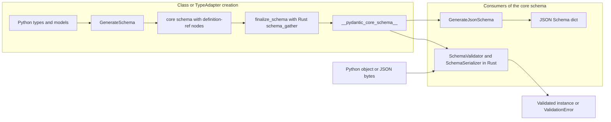
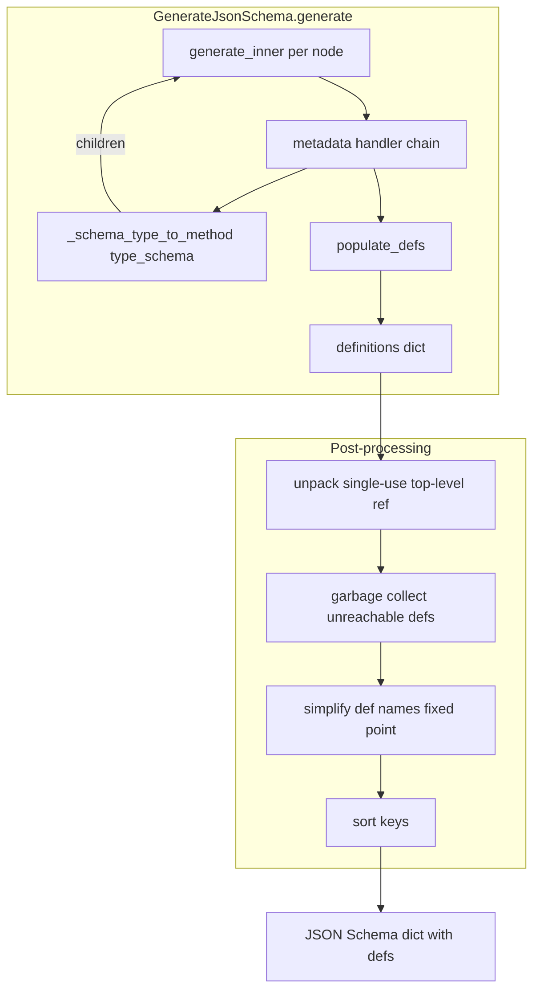

# Pydantic — Research report

## Metadata

- **Library name**: Pydantic
- **Repo URL**: https://github.com/pydantic/pydantic
- **Clone path**: `research/repos/python/pydantic-pydantic/`
- **Language**: Python
- **License**: MIT (pyproject.toml)
- **Analyzed version**: 4c65dbda9 (2026-10-27); `pydantic/version.py` VERSION `2.15.0a0+dev`, in-repo `pydantic-core/Cargo.toml` version 2.50.0 (latest release in HISTORY.md: v2.14.0, 2026-10-08)
- **Report date**: 2026-10-27

## Summary

Pydantic is a data validation library using Python type hints. It generates JSON Schema from Python models and types (reverse direction: types → schema) via `BaseModel.model_json_schema()` and `TypeAdapter.json_schema()`. Pydantic does **not** generate code from JSON Schema (no schema → codegen). Validation is model-based: Pydantic validates data against Python models, not against a raw JSON Schema. Generated schemas comply with JSON Schema Draft 2020-12 and OpenAPI v3.1.0. Core validation logic lives in `pydantic-core` (Rust, in-repo under `pydantic-core/`, version 2.50.0). Since the previous refresh, schema generation gained handlers for newer core schema types: `fraction` (`type: string, format: fraction`), `ordered_dict`, `counter`, `frozendict`, `complex`, `missing_sentinel`, `arguments_v3`, `multi_host_url` (`format: multi-host-uri`), plus a `json_schema_mode_override` config option and v2.14 fixes (consistent encoding of JSON Schema defaults, config propagation for stdlib dataclasses/TypedDicts).

## JSON Schema support

- **Drafts**: Draft 2020-12. The `GenerateJsonSchema` class uses `schema_dialect = 'https://json-schema.org/draft/2020-12/schema'` (pydantic/json_schema.py).
- **Scope**: Reverse generation only (types → schema). No schema → code; no direct schema + JSON → validation errors API.
- **Subset**: Pydantic emits many Draft 2020-12 keywords when generating schemas from types. It does not emit `$anchor`, `$vocabulary`, `if`/`then`/`else`, `contains`, `dependentRequired`, `dependentSchemas`, `unevaluatedProperties`, `unevaluatedItems`, or `contentEncoding`. For the `Json` type it emits `contentMediaType` and `contentSchema`.

## Keyword support table

Keyword list derived from vendored draft 2020-12 meta-schemas (`specs/json-schema.org/draft/2020-12/meta/*.json`). Implementation evidence from `pydantic/json_schema.py` (GenerateJsonSchema, ValidationsMapping, schema handlers).

| Keyword | Implemented | Notes |
|---------|-------------|-------|
| $anchor | no | Not emitted in generated schemas. |
| $comment | no | Meta-data; not emitted by default. |
| $defs | yes | Used for nested models and reusable definitions; `definitions` dict, `DEFAULT_REF_TEMPLATE = '#/$defs/{model}'`. |
| $dynamicAnchor | no | Not emitted. |
| $dynamicRef | no | Not emitted. |
| $id | no | Not emitted; `GenerateJsonSchema.generate()` comment notes `$schema` can be added by override. |
| $ref | yes | Always emitted as a `$ref` to a `$defs` entry via `ref_template`; sibling keys next to `$ref` are allowed (`handle_ref_overrides` strips only siblings equal to the target's). |
| $schema | no | `GenerateJsonSchema.schema_dialect` is a class constant, but `generate()` never writes it (a comment says a subclass can add `json_schema['$schema']`). |
| $vocabulary | no | Not emitted. |
| additionalProperties | yes | `typed_dict_schema`; `extra_behavior` forbid/allow; dict schemas. |
| allOf | no | Not emitted by the v2 `GenerateJsonSchema` (no `allOf` in `pydantic/json_schema.py` or `_internal/`); only the legacy `pydantic/v1/schema.py` wraps `$ref` with overrides in `allOf`. Union handling uses `anyOf`/`oneOf`. |
| anyOf | yes | Union and `Optional` types; `union_schema`, `nullable_schema`, `get_union_of_schemas` / `get_flattened_anyof` (flattens nested `anyOf`, dedups members; collapses to a single member if one remains). |
| const | yes | `literal_schema`: single-value `Literal` → `const` (+ inferred `type` when all values share one Python type). |
| contains | no | Not emitted; no CoreSchema equivalent. |
| contentEncoding | no | Not emitted. |
| contentMediaType | yes | Emitted for `Json` type: `contentMediaType: 'application/json'` with `contentSchema`. |
| contentSchema | yes | Emitted for `Json` type alongside `contentMediaType`. |
| default | yes | `default_schema` (static default only; `get_default_value` ignores `default_factory`); value encoded by `encode_default` via a `TypeAdapter(type(default)).dump_python(mode='json')`; non-serializable defaults are dropped with a warning. |
| dependentRequired | no | Not emitted. |
| dependentSchemas | no | Not emitted. |
| deprecated | yes | From `__deprecated__` on classes (`_update_class_schema`) and from `Field(deprecated=...)` (`_extract_json_schema_info_from_field_info`). |
| description | yes | From docstrings, Field(description=...). |
| else | no | if/then/else not supported. |
| enum | yes | `enum_schema` (Enum classes: values from `schema['members']`) and `literal_schema` (multi-value `Literal`); no dedup of values. |
| examples | yes | `Field(examples=...)` (via `pydantic_js_updates`), the `Examples` annotation class, or `json_schema_extra`. |
| exclusiveMaximum | yes | `ValidationsMapping.numeric`: `lt` → `exclusiveMaximum`. |
| exclusiveMinimum | yes | `ValidationsMapping.numeric`: `gt` → `exclusiveMinimum`. |
| format | yes | date, date-time, time, uuid, uri, etc.; `str_schema`, `url_schema`, `uuid_schema`, etc. |
| if | no | Not supported. |
| items | yes | List, tuple schemas; `list_schema`, `tuple_schema`. |
| maxContains | no | Not emitted. |
| maximum | yes | `ValidationsMapping.numeric`: `le` → `maximum`. |
| maxItems | yes | `ValidationsMapping.array`: `max_length` → `maxItems`; tuple fixed length. |
| maxLength | yes | `ValidationsMapping.string`/`bytes`: `max_length` → `maxLength`. |
| maxProperties | yes | `ValidationsMapping.object`: `max_length` → `maxProperties`. |
| minContains | no | Not emitted. |
| minimum | yes | `ValidationsMapping.numeric`: `ge` → `minimum`. |
| minItems | yes | `ValidationsMapping.array`: `min_length` → `minItems`. |
| minLength | yes | `ValidationsMapping.string`/`bytes`: `min_length` → `minLength`. |
| minProperties | yes | `ValidationsMapping.object`: `min_length` → `minProperties`. |
| multipleOf | yes | `ValidationsMapping.numeric`: `multiple_of` → `multipleOf`. |
| not | no | No CoreSchema equivalent; not emitted. |
| oneOf | yes | Tagged (discriminated) unions only; `tagged_union_schema` emits `oneOf` plus an OpenAPI-style `discriminator` object (`propertyName`, `mapping`), which is not a 2020-12 keyword. Plain unions use `anyOf`. |
| pattern | yes | `ValidationsMapping.string`: `pattern` → `pattern`. |
| patternProperties | yes | Dict schemas with key schema; `dict_schema`. |
| prefixItems | yes | Tuple schemas; `tuple_schema` emits `prefixItems` with `minItems`/`maxItems`. |
| properties | yes | TypedDict, model schemas; `typed_dict_schema`, `model_schema`. |
| propertyNames | yes | Dict key schema; `dict_schema` emits `propertyNames`. |
| readOnly | yes | Computed fields (`_internal/_generate_schema.py` sets `pydantic_js_updates={'readOnly': True}`). |
| required | yes | From TypedDict/model required fields; `typed_dict_schema`. |
| then | no | if/then/else not supported. |
| title | yes | Model/type names; ConfigDict(title=...); Field(title=...). |
| type | yes | All primitive and composite types; `int_schema`, `str_schema`, etc. |
| unevaluatedItems | no | Not emitted. |
| unevaluatedProperties | no | Not emitted. |
| uniqueItems | yes | Set/frozenset; `set_schema` emits `uniqueItems: True`. |
| writeOnly | yes | SecretStr/SecretBytes (`pydantic/types.py` sets `writeOnly=True` in the JSON schema hook). |

## Constraints

Pydantic enforces constraints at **runtime** during validation of Python data against models. Validation keywords (minimum, maximum, minLength, maxLength, pattern, etc.) are emitted in the generated JSON Schema to document the validation rules. The schema is an output of the model; validation is performed by `pydantic-core` against the internal CoreSchema, not against the JSON Schema itself. So constraints are enforced by the model, and the schema reflects those constraints.

## High-level architecture

Two cooperating layers, both driven by a single intermediate representation, the **core schema** (a plain nested Python `dict`/`TypedDict` tree defined in `pydantic-core/python/pydantic_core/core_schema.py`):

1. **Types to core schema** (`pydantic/_internal/_generate_schema.py`, class `GenerateSchema`): inspects Python type annotations (models, dataclasses, TypedDicts, `Annotated`, unions, `Literal`, enums, generics, stdlib types) and builds a core schema. This runs once per class at class-creation time (`complete_model_class` in `_internal/_model_construction.py`) or once per `TypeAdapter`. The result is cleaned (`GenerateSchema.clean_schema` -> `_Definitions.finalize_schema`, which calls the Rust helper `_schema_gather`) and stored as `cls.__pydantic_core_schema__`.
2. **Core schema consumers**: (a) **pydantic-core** (Rust, in-repo `pydantic-core/`) compiles the core schema into a tree of validator/serializer objects (`SchemaValidator`, `SchemaSerializer`) used for runtime validation/serialization; (b) **`GenerateJsonSchema`** (`pydantic/json_schema.py`) walks the same core schema and emits a JSON Schema dict. JSON Schema is therefore a *projection of the core schema*, not of the Python types directly.

There is no JSON Schema input anywhere in the pipeline: JSON Schema is output only. No code generation.

## Medium-level architecture

- **Entry points**: `BaseModel.model_json_schema()` -> `pydantic.json_schema.model_json_schema()`; `TypeAdapter.json_schema()`; and the multi-input forms `models_json_schema()` / `TypeAdapter.json_schemas()` which call `GenerateJsonSchema.generate_definitions()`. Each constructs a fresh `GenerateJsonSchema(by_alias, ref_template, union_format)`, first calling `MockCoreSchema.rebuild()` if the model has unresolved forward references. A generator instance is single-use (`_used` flag; second use raises `json-schema-already-used`).
- **`GenerateJsonSchema`** (`pydantic/json_schema.py`, ~3.3k lines): the visitor. State: `definitions: dict[DefsRef, JsonSchemaValue]`, four ref maps (`core_to_json_refs`, `core_to_defs_refs`, `defs_to_core_refs`, `json_to_defs_refs`), `_prioritized_defsref_choices` (name-simplification candidates), collision counters, `_core_defs_invalid_for_json_schema` (deferred errors), and a `ConfigWrapperStack`. `build_schema_type_to_method()` builds a dispatch dict from every core schema `type` literal to the bound method `<type>_schema` (about 80 methods) at construction time and raises `TypeError` if a type has no method.
- **Handler chain** (`_generate_inner`): per core schema node, a chain of closures is built from the node's `metadata`: base `handler_func` -> `pydantic_js_updates` -> `pydantic_js_extra` -> each `pydantic_js_functions` entry -> each `pydantic_js_annotation_functions` entry. Each wrapper is a `GenerateJsonSchemaHandler` (`_internal/_schema_generation_shared.py`) exposing `resolve_ref_schema`. User hooks (`__get_pydantic_json_schema__`, `WithJsonSchema`, `Examples`, `SkipJsonSchema`) are all expressed as entries in this chain.
- **Modes**: `validation` vs `serialization` (`self.mode`, overridable per class by `json_schema_mode_override`). Mode is part of the cache key (`CoreModeRef = (CoreRef, mode)`), so one model may yield two defs (`Model-Input` / `Model-Output` names when both exist in one run).
- **Ref flow**: nodes carrying a `ref` become `$defs` entries; `definition-ref` nodes become `{'$ref': ...}`. See the ref section below.

## Algorithms and data structures

This section covers both halves of the pipeline: types -> core schema (`_generate_schema.py`) and core schema -> JSON Schema (`json_schema.py`), plus the Rust core where it bears on the schema model.

### Schema representation

There are three in-memory forms.

1. **Python types** are the real input; there is no parsed JSON Schema model at all.
2. **Core schema**: a `TypedDict`-typed plain `dict` tree. Every node has a `type` discriminator string (`'model'`, `'model-fields'`, `'typed-dict'`, `'union'`, `'tagged-union'`, `'definition-ref'`, `'with-default'`, `'nullable'`, `'int'`, `'str'`, ...), type-specific keys (e.g. `fields: dict[str, ModelField]`, `choices`, `items_schema`, `ge/le/min_length/pattern`), optional `ref` (identity string), `metadata` (a dict carrying Pydantic-internal keys: `pydantic_js_functions`, `pydantic_js_annotation_functions`, `pydantic_js_updates`, `pydantic_js_extra`, `pydantic_internal_union_discriminator`, ...), and optional `serialization` (a `SerSchema`). Dict-ness is deliberate: the same object is handed to Rust (`SchemaValidator(schema)` reads it through PyO3) and to the Python JSON Schema visitor, and it can be mutated in place (definition inlining clears and `update()`s dicts). The type unions `CoreSchemaOrField` / `CoreSchemaOrFieldType` list all node kinds.
3. **JSON Schema output** is also a plain `dict` (`JsonSchemaValue = dict[str, Any]`), built bottom-up by return value; no typed model, no AST. Unknown/extension keywords are simply extra dict keys (`json_schema_extra`, `pydantic_js_updates` merge straight into it). Boolean schemas appear only as literal `True` (e.g. `items: True`, `additionalProperties: True`).

Ownership is Python reference semantics: handlers frequently `.copy()` child results before mutation (`_named_required_fields_schema`, `_common_dict_schema`, `tagged_union_schema`) because child schemas for refs/defs are shared objects stored in `self.definitions`.

### Reference resolution and registry

There is no `$id`/`$anchor`/`$dynamicRef` resolution and no remote fetching: refs are generated, never parsed. The registry is a set of dicts, at two levels.

**Level 1, core schema definitions** (`_Definitions` in `_generate_schema.py`):
- `_definitions: dict[str, CoreSchema]` (ref string -> schema) and `_recursively_seen: set[str]` (currently-being-generated refs).
- `get_definition_ref_schema(ref=...)` is a context manager entered for every referenceable type (models, dataclasses, TypedDicts, NamedTuples, `TypeAliasType`, enums). If `ref` is already in `_recursively_seen` (cycle) or in `_definitions` (already built), it yields a `definition-ref` node and the caller returns immediately; otherwise it adds the ref to `_recursively_seen`, yields `None`, and the body builds the schema. On completion `create_definition_reference_schema(schema)` stores it in `_definitions` and returns a `definition-ref` node. Cycles are thus handled by marking-in-progress; no graph algorithm needed.
- Refs are strings built in `_internal/_type_refs.py` (e.g. `module.QualName:<id(cls)>`), so identity is by Python object, not structure.
- `finalize_schema` (`clean_schema`) then post-processes: `gather_schemas_for_cleaning` (Rust, `pydantic-core/src/schema_gather.rs`) walks the whole core schema with an explicit work stack (not native recursion) using a `SmallVec<[Bound<PyAny>; 8]>` of children per node, validates that every `definition-ref` points at an existing definition (`MissingDefinitionError` otherwise), counts occurrences, and returns `collected_references: ref -> Some(the single DefinitionReferenceSchema) | None` plus the deferred-discriminator schemas. A definition referenced exactly once (and with no `serialization` or non-discriminator metadata, `_inlining_behavior`) is inlined in place (`clear()` + `update(resolved)`); all others stay as `remaining_defs` wrapped in a top-level `definitions` schema. `_resolve_definition` follows chains of intermediate `definition-ref` nodes (PEP 695 aliases) with a `visited` set and raises `circular-reference-schema` for genuine self-cycles. Deferred discriminated unions are applied here via `_discriminated_union.apply_discriminator`.

**Level 2, JSON Schema `$defs`** (`GenerateJsonSchema`):
- `core_to_defs_refs / core_to_json_refs` map `(core_ref, mode)` -> `DefsRef` / `JsonRef`; `defs_to_core_refs` and `json_to_defs_refs` are the inverses. `get_cache_defs_ref_schema` is lookup-or-create: it calls `get_defs_ref`, fills all four maps, and returns `(defs_ref, {'$ref': ref_template.format(model=defs_ref)})`.
- `_generate_inner` early-returns `{'$ref': ...}` if the `(core_ref, mode)` already has a def stored in `self.definitions`. Otherwise it generates the node, then `populate_defs` stores the result under `definitions[defs_ref]` and substitutes the `$ref` (refusing to store a def that is just a `$ref` to itself). A `definition-ref` node (`definition_ref_schema`) just calls `get_cache_defs_ref_schema` and returns the `$ref`; the actual body arrives when the `definitions` node (`definitions_schema`) iterates its definitions first and calls `generate_inner` on each. Failures building a definition (`PydanticInvalidForJsonSchema`) are stashed in `_core_defs_invalid_for_json_schema` and re-raised lazily only if something actually references that def (`get_schema_from_definitions`, `get_json_ref_counts`).
- Forward/unresolved refs: `resolve_ref_schema` loops `while '$ref' in json_schema` through `get_schema_from_definitions`, raising `RuntimeError` if the target is not yet defined; `_extract_discriminator` catches that and downgrades to a `skipped-discriminator` warning.
- **Def naming** (`get_defs_ref`): from the core ref it derives up to six candidate names, ordered simplest first: `Name`, `Name-Mode`, `module.qualname` (dots -> `__`), `module.qualname-Mode`, `module.qualname__N`, `module.qualname__N-Mode`, where `N` is a per-qualname occurrence index (`_collision_counter`, `_collision_index`) assigned in first-encounter order. The *longest* form is returned and used during generation, and the list is recorded in `_prioritized_defsref_choices`. This guarantees unique names while generating, and the simplification happens afterwards (next section).

### Compiled / intermediate form

Two distinct "compiled" forms exist.

**Core schema** (described above) is the IR between types and everything else. It is also what the JSON Schema generator consumes, so the JSON Schema generator never sees Python types except through `cls` fields on nodes (used for title/docstring/config in `_update_class_schema`) and `metadata` callables.

**Rust validator tree** (`pydantic-core/src/validators/mod.rs`): `SchemaValidator::py_new` calls `build_validator(schema, config, &mut DefinitionsBuilder)`, a recursive descent that reads the `type` string, matches it through the `validator_match!` macro against each `<Validator>::EXPECTED_TYPE`, and invokes `<Validator>::build`. The result is `Arc<CombinedValidator>`, an `#[enum_dispatch]` enum with one variant per validator kind (`TypedDict`, `Union`, `TaggedUnion(Box<..>)`, `Model`, `ModelFields`, `Str`, `Int`, `DefinitionRef`, ...) implementing the `Validator` trait (`validate`, `validate_assignment`, `default_value`, `get_name`); enum_dispatch turns trait calls into a `match` on the variant (no vtable). Recursion is implemented in `pydantic-core/src/definitions.rs`: `Definitions<T>(AHashMap<Arc<String>, Definition<T>>)`, where each `Definition` holds `Arc<OnceLock<T>>`; a `DefinitionRef` holds a `Weak<OnceLock<T>>` (to avoid an Arc cycle) and is resolved at validate time via `read(|v| ...)`. `DefinitionsBuilder::finish` checks every definition got filled. `DefinitionRef::id()` is the weak pointer address, used as the recursion-guard node id. Built objects are `Send + Sync` (`trait Validator: Send + Sync + Debug`), and a matching serializer tree is built by the same pattern in `src/serializers/`.

### Core algorithm

**Types -> core schema** (`GenerateSchema.generate_schema`): (1) if the object defines `__get_pydantic_core_schema__` (user hook; `BaseModel`'s own is ignored), call it with a `CallbackGetCoreSchemaHandler`; (2) else `_generate_schema_inner`, which dispatches in order: `Self`, unions (`_union_schema`), `Annotated` (`_annotated_schema` -> `_apply_annotations` folds each metadata item, e.g. `Gt`, `Field`, validators, into the schema or into `metadata`), `Literal`, raw dict (assumed already a core schema), forward refs, BaseModel subclasses (`_model_schema`), recursive refs, then `match_type`. `match_type` first looks up the exact object in the class-level dict `_handlers` (about 60 entries mapping `str`, `int`, `datetime.date`, `UUID`, `Decimal`, `Path`, `collections.deque`, ... to lambda factories built once at class creation) or, for parametrized generics, `_generic_handlers` keyed on `get_origin`; falls through to TypedDict, Enum (`_enum_schema`), NamedTuple, NewType, TypeVar, callables, dataclasses, and finally `_arbitrary_type_schema` (an `is-instance` node if `arbitrary_types_allowed`) or `PydanticSchemaGenerationError`. Union handling: `None` members become a `nullable` wrapper, a single remaining member is unwrapped, `MISSING` becomes `missing-sentinel`; multiple members form a `union` node (choices may be tagged for discriminated unions, resolved later in `finalize_schema`). `_model_schema` builds `model-fields` from `__pydantic_fields__` with per-field `_generate_md_field_schema`, applies field/model validators and serializers as function-wrapper nodes, and reuses an already-built `cls.__dict__['__pydantic_core_schema__']` when present, so a model nested in another model is not regenerated.

**Core schema -> JSON Schema** (`GenerateJsonSchema.generate`):
1. `generate_inner(schema)` (pushes class config for `model`/`dataclass`/`typed-dict` nodes) -> `_generate_inner`: ref cache check, metadata handler chain, dispatch to `<type>_schema`, then `populate_defs`. The traversal is ordinary Python recursion over core schema children (each `<type>_schema` method calls `generate_inner` on its children); depth is bounded by Python's recursion limit.
2. Node mappings of note: `model_schema` -> inner `model_fields_schema` -> `_named_required_fields_schema` builds `properties`/`required` (alias or name per `by_alias`/mode, `field_is_present` excludes `serialization_exclude` fields in serialization mode, computed fields are added only in serialization mode and marked `readOnly`), then `_update_class_schema` adds `title` (config title, `model_title_generator`, or class name), docstring `description`, `additionalProperties` from `extra`, `json_schema_extra` (dict merged, or callable invoked on the schema), and `deprecated`. Field `title` is auto-derived from the name via `str.title()` unless the field schema is ref-bearing (`field_title_should_be_set`). Dicts (`_common_dict_schema`) split key-schema `pattern` into `patternProperties`, put other constraints in `propertyNames`, and put values in `additionalProperties`. Tuples use `prefixItems` + `minItems/maxItems` (or `items` for the variadic tail). Sets use `uniqueItems`. `Literal`/enum use `const`/`enum` and infer `type` only when all values share one Python type (`{type(e) for e in expected} == {str}` etc.). `default_schema` encodes defaults with a `TypeAdapter` dump in `mode='json'`, sorts set defaults for determinism, and in serialization mode applies a plain serializer function to the default. `tagged_union_schema` generates each choice, dedups them (`_deduplicate_schemas`), emits `oneOf` and an OpenAPI `discriminator` mapping when a compatible property name is found. Numeric/string/array/object constraints are copied by `update_with_validations` using the `ValidationsMapping` class dicts.
3. **Post-processing in `generate`**: (a) `get_json_ref_counts` counts `$ref` occurrences (a DFS that descends into each referenced def once). If the top-level schema is a bare `$ref` with count 1 and no sibling keys, it is replaced by a copy of the def (so a single non-recursive model is not wrapped in `$defs`). (b) `_garbage_collect_definitions`: iterative worklist from the root's refs through `_get_all_json_refs` (explicit stack; skips `examples` lists) keeping only reachable defs. (c) `_build_definitions_remapping` (below). (d) `sort`.
4. **Def name simplification** (`_DefinitionsRemapping.from_prioritized_choices`): the goal is to turn `module.qualname__2-Mode` into the shortest name that is unambiguous. It deep-copies the definitions, then iterates (up to 100 times) to a fixed point: for each candidate name collect the set of *distinct* def bodies that would map to it (deduplicated with `_deduplicate_schemas`, using `_make_json_hashable`: dict -> sorted tuple of items), and pick for each original def the first candidate whose body set has size 1; then apply the remapping to the copy and compare against the previous iteration (outer defs only become equal after inner refs are rewritten). Equal bodies under different Python classes (e.g. same model imported twice, or input/output mode with identical schema) therefore collapse to one name; genuinely different bodies keep longer, disambiguated names. Cost is O(iterations x total schema size) plus a deep copy; iteration count is usually small (2-3).

**Validation** (core, for context): `Validator::validate(py, input, &mut ValidationState)`; `ModelFieldsValidator::validate_fields` for JSON input does a single pass over the object's keys using a prebuilt `LookupTree` (see Performance), then validates each field's best-matching input; non-JSON input uses per-field lookup. Unions (`validators/union.rs`) in `smart` mode try each choice, track `Exactness` (Exact/Strict/Lax) and `fields_set_count`, returning immediately on an exact match with no fields-set data, otherwise picking the best; `left_to_right` returns the first success; `TaggedUnionValidator` looks the discriminator up in a `LiteralLookup` and validates only one choice.

### Error and output model

- **JSON Schema generation errors**: `PydanticInvalidForJsonSchema` (raised by `handle_invalid_for_json_schema` for `callable`, `is-instance`, `is-subclass`, `ellipsis`, `arguments`... node kinds with no JSON representation), `PydanticOmit` (control-flow exception: drop this property/choice; used by `SkipJsonSchema`, `missing_sentinel_schema`), `PydanticUserError` (misuse, e.g. reusing a generator). Union and tagged-union handlers catch `PydanticInvalidForJsonSchema` per member, emit a `PydanticJsonSchemaWarning` (`kind='skipped-choice'`, filtered by `ignored_warning_kinds`) and continue with the remaining members; a lone remaining member is returned unwrapped.
- **Validation errors** (Rust): `ValError` enum (`LineErrors(Vec<ValLineError>)`, `InternalErr(PyErr)`, `Omit`, `UseDefault`). `ValLineError { error_type: ErrorType, location: Location, input_value: InputValue }`; `Location` is `Empty | List(Vec<LocItem>)` stored in reverse so that adding an outer location is a `push`, reversed on display. Union errors prefix each member's lines with the member label (`with_outer_location`). At the boundary they are converted to a Python `ValidationError` with `loc`, `type`, `msg`, `input`, `ctx`, `url`; `hide_input_in_errors` config suppresses input echo. Errors are all collected (no fail-fast) except in union-smart mode after a success.
- **Output format** of schema generation: a Python `dict`; the caller serializes. There is no JSON Schema "output format" (flag/list/hierarchical) concept because validation is not against JSON Schema.

## Low-level details

- **ValidationsMapping**: class-level dicts mapping core schema attribute names to keywords: `numeric` (`multiple_of`->`multipleOf`, `le`->`maximum`, `ge`->`minimum`, `lt`->`exclusiveMaximum`, `gt`->`exclusiveMinimum`), `string`/`bytes` (`min_length`/`max_length`; `pattern` for strings), `array` (`minItems`/`maxItems`), `object` (`minProperties`/`maxProperties`). Subclasses can override the nested class. Values are copied verbatim, so numeric bounds are Python `int`/`float` and later JSON-encoded by the caller.
- **Handler coverage**: about 80 `*_schema` methods including newer `fraction_schema` (`type: string, format: fraction`, wrapped in `anyOf` with a float schema in validation mode), `ordered_dict_schema`, `counter_schema`, `frozendict_schema`, `complex_schema`, `arguments_v3_schema`, `missing_sentinel_schema`, `multi_host_url_schema` (`format: multi-host-uri`, a Pydantic-specific format). Nodes with no JSON form go through `handle_invalid_for_json_schema` (raises `PydanticInvalidForJsonSchema`).
- **Patterns pass through unchanged** (`str_schema`): `pattern` is copied as the Python `re`/Rust `regex` source string; a compiled `re.Pattern` is reduced to `.pattern` (flags dropped, a TODO in code). No ECMA-262 translation. `Decimal` patterns are synthesized (`_decimal_validation_pattern`, `_int_range_pattern`) using `[0-9]` instead of `\d` explicitly to keep patterns portable and small.
- **Numeric representation**: Python ints are arbitrary precision; core-schema ints in `LiteralLookup` (Rust) are `i64`-keyed with a Python-dict fallback; `Decimal` is emitted as `anyOf [number, string pattern]` in validation mode. `multipleOf` is passed through as given; float-precision handling is in the Rust validator, not in schema generation.
- **String length**: `minLength`/`maxLength` are emitted from core `min_length/max_length`, enforced by the Rust string validator, which counts `str.chars()` (Unicode scalar values / code points).
- **Default encoding**: `encode_default` instantiates a `TypeAdapter` for the default's runtime type on every call and dumps in JSON mode (not cached here); failures drop the default with a `non-serializable-default` warning. Temporal serialization config is intentionally stripped in validation mode.
- **`remap_json_schema` quirk**: it rewrites *every string* value that equals a known `$ref` string (relying on "no collisions between JsonRefs and other strings"), and mutates dicts in place; it uses native recursion.
- **Recursion limits**: schema generation uses Python recursion (stack limited by `sys.getrecursionlimit`) in `_generate_inner`, `get_json_ref_counts`, `remap_json_schema` and `sort`; `_get_all_json_refs` and the Rust `schema_gather` are explicitly iterative. Runtime validation guards cyclic input and deep nesting with `RecursionGuard` (`pydantic-core/src/recursion_guard.rs`): a set of `(input object id, definition node id)` pairs detects cycles (`recursion_loop` error) and a depth counter (`u8`, limit 255 on most platforms, 99/49 on Windows/PyPy/wasm) bounds depth. JSON parsing depth is bounded by jiter.
- **Sorting**: `sort()` recursively sorts dict keys alphabetically except under `properties` and `default`, which retain insertion order; list order is preserved.
- **OpenAPI leakage**: `tagged_union_schema` adds a `discriminator` object by default (a code comment says it reflects v1 behavior and should become excludable).

## Output and integration

- **Vendored vs build-dir**: Schema generation returns a dict (JsonSchemaValue); no vendored output. Caller serializes with `json.dumps()` or uses in OpenAPI tooling.
- **API vs CLI**: API only. `BaseModel.model_json_schema()`, `TypeAdapter.json_schema()`, `models_json_schema()` for multiple models. No CLI for schema generation; Pydantic is a library.
- **Writer model**: Returns dict; caller writes to file or string as needed.

## Configuration

- **Schema generation**: `by_alias`, `ref_template`, `union_format` (`any_of` or `primitive_type_array`). Passed via `model_json_schema(by_alias=..., ref_template=...)` or custom `GenerateJsonSchema` subclass.
- **Model config**: `ConfigDict` for ser_json_bytes, ser_json_timedelta, etc., affecting schema output (e.g. bytes as base64 vs binary).
- **Field-level**: `Field(description=..., title=..., deprecated=...)`; `WithJsonSchema`, `Examples` for custom schema snippets.

## Pros/cons

- **Pros**: Mature, widely used; Draft 2020-12 compliant schemas; OpenAPI 3.1 compatible; `validation` vs `serialization` modes; extensible via `GetJsonSchemaHandler`, `pydantic_js_updates`, custom `GenerateJsonSchema` subclasses; fast validation via pydantic-core (Rust); supports BaseModel, TypeAdapter, TypedDict, dataclasses, Literal, Enum.
- **Cons**: No schema → codegen; no direct schema + JSON → errors validation (validation is model-based); does not emit if/then/else, contains, dependentRequired, dependentSchemas, unevaluatedProperties, unevaluatedItems, $anchor, $dynamicRef/$dynamicAnchor.
- **Further trade-offs from the mechanism**: JSON Schema is derived from an internal core schema, so any type without a core schema representation cannot be expressed; output is identity-based (no structural dedup of inline shapes); schema generation is uncached per call; patterns are not translated to ECMA-262; `discriminator` (OpenAPI) leaks into `oneOf` output; default handling ignores `default_factory`.
## Testability

- **Framework**: pytest; pytest-benchmark for performance.
- **Running tests**: From repo root, `pytest` or `uv run pytest`. Tests in `tests/`; JSON Schema tests in `tests/test_json_schema.py`.
- **Fixtures**: Test models and assertions on `model_json_schema()` and `TypeAdapter(...).json_schema()` output. `tests/benchmarks/` for validation/serialization benchmarks.
- **Entry point for external fixtures**: `TypeAdapter(SomeType).json_schema()` or `SomeModel.model_json_schema()` can be called with any Pydantic-compatible type; no CLI to run against arbitrary schemas (Pydantic consumes types, not schemas).
- **Scale**: `tests/test_json_schema.py` (7.9k lines) holds the JSON Schema output tests; `pydantic-core` has its own pytest suite under `pydantic-core/tests` and Rust tests; `tests/pydantic_core/` mirrors core tests inside the main repo.
- **Could not verify**: whether the `tests/` schema fixtures can be re-used as an input corpus; they are Python type definitions and cannot be fed JSON Schema documents.
## Performance

Analysis is from code only; nothing was built or run.

### Performance techniques

- **Compile vs interpret**: Heavily compiled at class-definition time. `complete_model_class` generates the core schema once per model, cleans it, and constructs `SchemaValidator` and `SchemaSerializer` immediately; validation never re-walks Python types. `GenerateSchema._model_schema` reuses an already-built `__pydantic_core_schema__` for nested models. In Rust, `build_validator` lowers the core schema dict into an `Arc<CombinedValidator>` tree once; per-validation work is pure traversal with pre-resolved definition refs (`DefinitionRef` -> `Weak<OnceLock<..>>`). JSON Schema generation is *not* cached: each `model_json_schema()` call builds a new `GenerateJsonSchema` and walks the whole core schema again (including all nested models), then post-processes. When schemas are unresolved, `MockCoreSchema`/`MockValSer` stand in and lazily rebuild on first use (`_internal/_mock_val_ser.py`).
- **Memory layout and allocation**: Python side is dict trees with frequent `.copy()` and a `deepcopy(definitions)` in the name-simplification step. Rust side: `enum_dispatch` enum (no vtable indirection), `Box` on large variants, `SmallVec` for union error lists (`SMALL_UNION_THRESHOLD`), alias lookup paths (`SmallVec<[LookupPath; 1]>`) and the schema-gather child list (`SmallVec<[_; 8]>`), `AHashMap` for lookups, interned Python strings (`intern!`), `Location::Empty` avoiding a Vec for empty locations, errors built lazily only on failure (`ValLineError` holds input lazily as `InputValue`). Validators are shared by `Arc`; recursion uses `Weak` to avoid cycles.
- **Caching and memoization**: (1) `(core_ref, mode) -> DefsRef/JsonRef` maps give each def one generation per run. (2) Per-model `__pydantic_core_schema__`, `__pydantic_validator__`, `__pydantic_serializer__` are the persistent caches. (3) Rust `LiteralLookup` precomputes `AHashMap<i64,_>` / `AHashMap<String,_>` for `Literal`/enum/tagged-union tags. (4) `LookupTree` (`validators/shared/lookup_tree.rs`) is built once per model: `NoAliases(AHashMap)`, `Flat`, or `Nested` depending on alias complexity, so a JSON object is validated by one pass over its keys instead of one lookup per field (`validate_json_by_iteration`). (5) A process-wide `REGEX_CACHE: LazyLock<Mutex<LruCache<String, Regex>>>` (capacity 50) caches compiled Rust regexes; compile happens outside the lock with `get_or_insert` to tolerate races. (6) jiter `cache_strings` (default `All`) caches Python string objects for repeated keys/values during JSON parse (`new_py_string`). (7) In Python `functools.lru_cache` is used sparingly (e.g. `_internal/_known_annotated_metadata.py`, `networks.py`). `encode_default` and `_deduplicate_schemas` are not cached.
- **Fast paths and short-circuiting**: Schema gen: ref-cache early return before any generation; single-use refs inlined and the top-level bare `$ref` unpacked; `anyOf` of a single member collapsed. Validation: union `smart` mode returns immediately on an `Exact` match with no fields-set count, otherwise scans all choices; tagged unions do an O(1) tag lookup and validate one branch; `left_to_right` returns on first success; strict/lax exactness tracking avoids re-validation; `DefinitionRefValidator` only takes the recursion guard when the input has a Python identity.
- **Regex handling (validation side)**: Rust `regex` crate by default (linear-time, no backreferences/lookaround; ReDoS-safe by construction), selectable per schema/config with `regex_engine='python-re'` (backtracking, ReDoS-prone) which is forced if a compiled `re.Pattern` is supplied. Patterns are compiled at validator build time. JSON Schema generation does no regex work.
- **Concurrency**: `Validator: Send + Sync`, so built validators are shareable across threads; the shared regex cache is behind a `Mutex` (`lock_py_attached` to avoid GIL/lock deadlocks). `SchemaValidator` is `frozen`. `GenerateJsonSchema` instances are single-use and not thread-safe; the Python code path relies on the GIL for the `__pydantic_core_schema__` attribute sharing. No parallel schema generation.

### Benchmarks in repo

- `tests/benchmarks/` (pytest-benchmark, run in CI by CodSpeed, `.github/workflows/codspeed.yml`: `pytest ./tests/benchmarks ./tests/pydantic_core/benchmarks --codspeed`): `test_model_schema_generation.py` (simple/nested/recursive/complex models, lots of fields, tagged unions with str and callable discriminators, stdlib/custom type parametrizations; these measure *core schema construction*, not JSON Schema output), `test_north_star.py` (validate/dump JSON and Python, strict/lax), `test_validators_build.py`, `test_discriminated_unions.py`, `test_regex.py`, `test_model_validation.py`, `test_model_serialization.py`, attribute access/eq/isinstance, import time, FastAPI startup.
- `pydantic-core/benches/main.rs` (nightly `#![feature(test)]`, 65 `Bencher` functions) builds `SchemaValidator`s from Python-eval'd schema dicts.
- No dedicated benchmark of `model_json_schema()`/`GenerateJsonSchema` output was found. Entry points for an external harness: `Model.model_json_schema()` / `TypeAdapter(T).json_schema()` (Python only, requires defining types, no schema-file input).

## Determinism and idempotency

- **Key order**: `GenerateJsonSchema.sort()` sorts all dict keys alphabetically except those under `properties` and `default`, which keep insertion (field-declaration) order; `required` and `enum` lists keep their source order. `generate()` and `generate_definitions()` both return the sorted result. `sort` is overridable.
- **Set defaults** are sorted before encoding (`default_schema`), when sortable, to avoid hash-order nondeterminism.
- **Def names**: candidates are derived from type qualnames and a first-encounter occurrence index (`_collision_counter`), so names depend on traversal order only when two distinct types share a qualname. Final names are chosen by the fixed-point simplification (shortest name with a unique body), so the same set of types yields the same names across runs; identical bodies from different classes may merge. `$defs` output is sorted by name in `generate_definitions`; in `generate()` the top-level sort covers `$defs` too.
- **Minimal diffs**: adding a field changes only that model's def and the properties list; adding a colliding class name can rename defs (`Foo` -> `module__Foo`), which changes `$ref` strings across the schema.
- Repeated calls with the same model/config produce identical output; `json_schema_extra` callables or custom generators can break this.

## Enum handling

- **Python `Enum` classes** (`_enum_schema` in `_generate_schema.py`, `enum_schema` in `json_schema.py`): cases come from `enum_type.__members__.values()` (includes aliases, which are the same member object listed once per alias name in `__members__`; the `.values()` iteration therefore may yield the same member more than once). The JSON Schema `enum` is `[to_jsonable_python(m.value) for m in schema['members']]` with no dedup, plus `title` (class name) and `description` (docstring, ignoring the default "An enumeration."); `type` is inferred when all values share one Python type or the enum subclasses `str`/`int`/`float`. The enum is a ref-bearing def (`enum_type_ref`), so it appears in `$defs`. An enum with no members becomes an `is-instance` node with a JSON hook still producing a schema.
- **Duplicate entries**: for `Literal`, `get_literal_values(..., unpack_type_aliases='eager')` supplies the values and `literal_schema` emits them in order with no dedup, so `Literal['a','a']` could emit duplicate array entries (if typing did not already collapse them; `typing.Literal` deduplicates on construction in recent Python versions, so this is rarely observable). For Enums, duplicate *values* make later names aliases in Python, so the member list has unique values unless aliases are listed.
- **Case/namespace collisions** (`"a"` vs `"A"`): both are distinct JSON strings in the `enum`/`const` array and both validate (Rust `LiteralLookup` uses exact string hashing). There are no generated identifiers, so no variant-name collision concept applies.

## Reverse generation (Schema from types)

- **Yes**. Pydantic's primary JSON Schema feature. `BaseModel.model_json_schema()` and `TypeAdapter.json_schema()` generate JSON Schema from Python models, TypedDicts, dataclasses, Literal, Enum, and other annotated types. `models_json_schema()` generates schemas for multiple models with shared `$defs`. Supports `mode='validation'` or `mode='serialization'` for different field sets (e.g. computed fields). Mechanism: see Algorithms and data structures (types -> core schema -> JSON Schema via the visitor in `GenerateJsonSchema`). Customization via `WithJsonSchema`, `Examples`, `GetJsonSchemaHandler`, and `GenerateJsonSchema` subclasses.

## Multi-language output

- **Python only**. Pydantic generates JSON Schema (a JSON-serializable dict), not code. The schema can be consumed by any JSON Schema–aware tool (OpenAPI, code generators, validators). Pydantic itself does not emit TypeScript, Go, or other language code.

## Model deduplication and $ref/$defs

- **By identity, not structure**: dedup is keyed on the core `ref` string (type identity incl. `id(cls)`), so one Python model used in many places yields one `$defs` entry with `$ref` everywhere (`core_to_defs_refs`, `populate_defs`). Two structurally identical but distinct classes get separate defs *during generation*; inline (ref-less) shapes such as `dict[str, int]` or anonymous unions are re-emitted inline at each use.
- **Post-hoc structural merge of names**: `_DefinitionsRemapping` only merges *names*: when two defs have different long names but equal bodies and share a short candidate, both map to the same short name and, as `$defs` is a dict, collapse into one def. This is body-equality dedup limited to candidate-name groups (e.g. same class in validation and serialization mode with identical schema, or the same class re-created).
- **Single-use inlining**: at core-schema level, a definition referenced exactly once is inlined (not a `$defs` entry); at JSON Schema level only a root-level lone `$ref` is unpacked. Non-root refs stay `$ref`s even if used once.
- **Recursion**: recursive models yield `$ref` cycles through `$defs`; generation terminates thanks to the `_recursively_seen` set (core) and the `core_to_defs_refs` check (JSON).
- **`ref_template`** (`#/$defs/{model}` by default) controls ref strings; defs are always collected in one flat `$defs` at the root (no nested `$defs`, no `$id`-scoped subschemas).
- **Garbage collection**: unreachable defs are dropped (`_garbage_collect_definitions`).

## Validation (schema + JSON → errors)

- **No** dedicated API. Pydantic validates data against Python models (or TypeAdapter types), not against a raw JSON Schema. The flow is: define model → validate with `model.model_validate(json_data)` or `TypeAdapter(T).validate_json(json_str)` → get validated instance or `ValidationError`. To validate arbitrary JSON against a schema, use a separate library (e.g. `jsonschema`) with the schema produced by `model_json_schema()`. Pydantic does not provide schema + JSON → errors directly.

For model-based validation the engine is `pydantic-core` (see Algorithms and data structures: Compiled / intermediate form and Error model). The `CoreSchema` consumed by the validator is a Pydantic-internal format, not JSON Schema.
