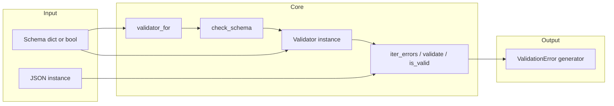
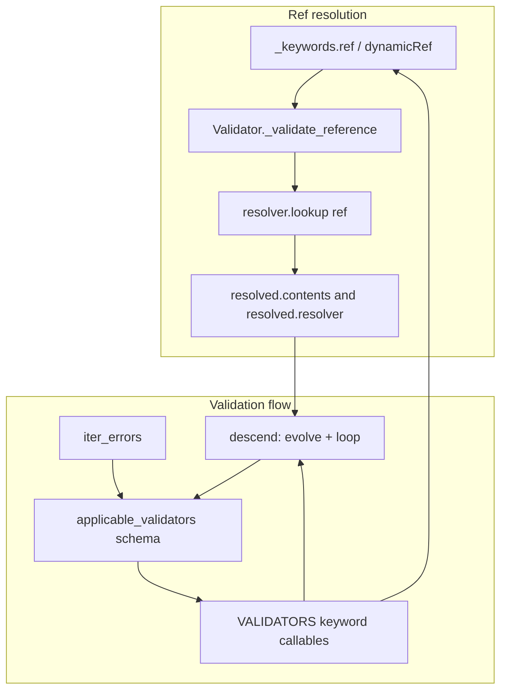

# jsonschema — Research report

## Metadata

- **Library name**: jsonschema
- **Repo URL**: https://github.com/python-jsonschema/jsonschema
- **Clone path**: `research/repos/python/python-jsonschema-jsonschema/`
- **Language**: Python
- **License**: MIT (see pyproject.toml, COPYING)
- **Analyzed version**: c497561 2026-10-07 (`git describe`: v4.26.0-183-gc497561; CHANGELOG head is the unreleased v4.27.0). Version is VCS-derived (hatch-vcs); last tagged release v4.26.0.
- **Report date**: 2026-10-27

## Summary

jsonschema is the reference implementation of JSON Schema for Python. It is a **validator only**: given a schema and a JSON instance, it reports whether the instance is valid and can yield one or all validation errors. It does not generate code from schemas. The library supports Draft 3, Draft 4, Draft 6, Draft 7, Draft 2019-09, and Draft 2020-12. Validators are registered by meta-schema URI; `validator_for(schema)` selects the validator from the schema’s `$schema` keyword. Reference resolution is delegated to the `referencing` library (with a deprecated legacy `RefResolver`). Requires Python >=3.12 (3.10/3.11 dropped in the unreleased v4.27.0); runtime deps are attrs, jsonschema-specifications, referencing and rpds-py. Validation is lazy and can report all errors via `iter_errors()`; the main entry point is `validate(instance, schema)` or a concrete validator class (e.g. `Draft202012Validator`).

## JSON Schema support

- **Drafts**: Draft 3, Draft 4, Draft 6, Draft 7, Draft 2019-09, Draft 2020-12. Declared in README and in `jsonschema/__init__.py` (Draft3Validator through Draft202012Validator). Meta-schemas come from the `jsonschema_specifications` package; validators are registered via `validates(version)` and keyed by meta-schema ID in `_META_SCHEMAS`.
- **Scope**: Validation only. No code generation.
- **Subset**: For Draft 2020-12, the library implements the core applicator and validation keywords used in validation. Meta-data keywords (`$comment`, `description`, `title`, `default`, `examples`, `deprecated`, `readOnly`, `writeOnly`) are not enforced as validators. Content vocabulary (`contentEncoding`, `contentMediaType`, `contentSchema`) is not implemented. `$schema` and `$id` are used for validator selection and reference resolution, not as validation keywords. `$anchor`, `$dynamicAnchor` and `$recursiveAnchor` are used during reference resolution by the `referencing` library (and, for plain anchors, by legacy `_RefResolver.resolve_fragment`). Hyper-schema (`links`, `base`) is not supported. Draft 3 `required`, `extends`, `disallow`, `divisibleBy` and draft 3/4 boolean `exclusiveMinimum`/`exclusiveMaximum` are supported through legacy keyword functions.

## Keyword support table

Keyword list derived from the vendored meta-schemas under `specs/json-schema.org/`: `draft/2020-12/meta/*.json` (core, applicator, unevaluated, validation, meta-data, format-annotation, format-assertion, content), `draft/2019-09/meta/*.json`, and `draft-07/`, `draft-06/`, `draft-04/`, `draft-03/` `schema.json` (the union across the six drafts the library targets, including draft-specific keywords). Implementation evidence from the per-draft keyword dicts in `jsonschema/validators.py` (Draft3Validator through Draft202012Validator), `jsonschema/_keywords.py`, and `jsonschema/_legacy_keywords.py`. "Implemented" means a validator callable is registered for at least one draft; Notes give the drafts.

| Keyword | Implemented | Notes |
|---------|-------------|-------|
| $anchor | partial | 2019-09/2020-12. Not a validator callable; plain-name fragments are resolved by `referencing` (and legacy `_RefResolver.resolve_fragment`, which searches `$anchor`/`$dynamicAnchor`). |
| $comment | no | Meta-data; ignored (no validator registered). |
| $defs | no | No validator callable; subschemas reachable via `$ref` JSON-pointer fragments (e.g. `#/$defs/x`) through `referencing`. |
| $dynamicAnchor | partial | 2020-12. No validator callable; handled by `referencing` for `$dynamicRef` resolution; legacy resolver only matches it as a plain anchor. |
| $dynamicRef | yes | Draft 2020-12 only; `_keywords.dynamicRef` delegates to `_validate_reference` (dynamic scope handled by `referencing`). |
| $id | partial | Used for resolution base URI and subschema discovery (`id_of`); not itself a validating keyword. |
| $recursiveAnchor | partial | Draft 2019-09. No validator callable; consumed by `referencing.jsonschema.lookup_recursive_ref`. |
| $recursiveRef | yes | Draft 2019-09 only; `_legacy_keywords.recursiveRef` via `lookup_recursive_ref`. |
| $ref | yes | All drafts; `_keywords.ref` -> `_validate_reference`. Drafts 3/4/6/7 use `ignore_ref_siblings` so `$ref` siblings are ignored; 2019-09+ evaluate siblings. |
| $schema | partial | Used by `validator_for()` to pick the validator class; not validated as a keyword. |
| $vocabulary | no | Not implemented; vocabularies are not interpreted (each draft has a fixed keyword set). |
| additionalItems | yes | Drafts 3, 4, 6, 7, 2019-09: `_legacy_keywords.additionalItems`. Not registered for 2020-12 (replaced by `items`). |
| additionalProperties | yes | All drafts; `_keywords.additionalProperties`. |
| allOf | yes | Draft 4+; `_keywords.allOf`. |
| anyOf | yes | Draft 4+; `_keywords.anyOf`. |
| base | no | 2019-09 hyper-schema meta only; hyper-schema is not supported. |
| const | yes | Draft 6+; `_keywords.const`. |
| contains | yes | Draft 6+; `contains_draft6_draft7` for 6/7, `_keywords.contains` for 2019-09+ (also enforces minContains/maxContains). |
| contentEncoding | no | No validator in any draft; annotation only (ignored). |
| contentMediaType | no | No validator in any draft; ignored. |
| contentSchema | no | Not implemented; ignored. |
| default | no | Annotation; ignored. |
| definitions | no | Draft 4/6/7 container; no validator; reachable via `$ref` fragments. |
| dependencies | yes | Drafts 3 (`dependencies_draft3`) and 4/6/7 (`dependencies_draft4_draft6_draft7`); not registered for 2019-09+. |
| dependentRequired | yes | Draft 2019-09+; `_keywords.dependentRequired`. |
| dependentSchemas | yes | Draft 2019-09+; `_keywords.dependentSchemas`. |
| deprecated | no | Annotation; ignored. |
| description | no | Annotation; ignored. |
| disallow | yes | Draft 3 only; `_legacy_keywords.disallow_draft3`. |
| divisibleBy | yes | Draft 3 only; mapped to `_keywords.multipleOf`. |
| else | yes | Draft 7+; evaluated inside `_keywords.if_` (no standalone callable). |
| enum | yes | All drafts; `_keywords.enum` using `_utils.equal` (0/1 distinct from False/True). |
| examples | no | Annotation; ignored. |
| exclusiveMaximum | yes | Draft 6+: numeric, `_keywords.exclusiveMaximum`. Draft 3/4: boolean modifier handled inside `maximum_draft3_draft4`. |
| exclusiveMinimum | yes | Draft 6+: numeric, `_keywords.exclusiveMinimum`. Draft 3/4: boolean modifier handled inside `minimum_draft3_draft4`. |
| extends | yes | Draft 3 only; `_legacy_keywords.extends_draft3`. |
| format | yes | All drafts; `_keywords.format` uses the instance `format_checker`, which defaults to `None`; no format assertion unless a format_checker is passed. |
| id | partial | Draft 3/4 identifier; used by `id_of` for resolution, not a validating keyword. |
| if | yes | Draft 7+; `_keywords.if_`. |
| items | yes | Draft 3/4: `items_draft3_draft4`; 6/7/2019-09: `items_draft6_draft7_draft201909`; 2020-12: `_keywords.items` (after `prefixItems`). |
| links | no | 2019-09 hyper-schema meta only; hyper-schema not supported. |
| maxContains | yes | 2019-09+; read inside `_keywords.contains`. |
| maximum | yes | `maximum_draft3_draft4` (3/4) / `_keywords.maximum` (6+). |
| maxItems | yes | All drafts; `_keywords.maxItems`. |
| maxLength | yes | All drafts; `_keywords.maxLength`. |
| maxProperties | yes | Draft 4+; `_keywords.maxProperties`. |
| minContains | yes | 2019-09+; read inside `_keywords.contains`. |
| minimum | yes | `minimum_draft3_draft4` (3/4) / `_keywords.minimum` (6+). |
| minItems | yes | All drafts; `_keywords.minItems`. |
| minLength | yes | All drafts; `_keywords.minLength`. |
| minProperties | yes | Draft 4+; `_keywords.minProperties`. |
| multipleOf | yes | Draft 4+; `_keywords.multipleOf`. |
| not | yes | Draft 4+; `_keywords.not_`. |
| oneOf | yes | Draft 4+; `_keywords.oneOf`. |
| pattern | yes | All drafts; `_keywords.pattern` (`re.search`). |
| patternProperties | yes | All drafts; `_keywords.patternProperties`. |
| prefixItems | yes | Draft 2020-12 only; `_keywords.prefixItems`. |
| properties | yes | `properties_draft3` (3, also handles per-property `required`) / `_keywords.properties`. |
| propertyNames | yes | Draft 6+; `_keywords.propertyNames`. |
| readOnly | no | Annotation; ignored. |
| required | yes | Draft 4+: `_keywords.required`. Draft 3: boolean inside `properties_draft3`. |
| then | yes | Draft 7+; evaluated inside `_keywords.if_`. |
| title | no | Annotation; ignored. |
| type | yes | `type_draft3` (3, supports schema/any types) / `_keywords.type`; per-draft TypeChecker. |
| unevaluatedItems | yes | 2019-09: `unevaluatedItems_draft2019`; 2020-12: `_keywords.unevaluatedItems`. |
| unevaluatedProperties | yes | 2019-09: `unevaluatedProperties_draft2019`; 2020-12: `_keywords.unevaluatedProperties`. |
| uniqueItems | yes | All drafts; `_keywords.uniqueItems`. |
| writeOnly | no | Annotation; ignored. |

## Constraints

All validation keywords are enforced at runtime when validating an instance; there is no code generation. Violations are yielded as `ValidationError` objects. `format` is **opt-in**: each validator class carries a draft-specific `FORMAT_CHECKER` class attribute, but the per-instance `format_checker` field defaults to `None` (`validators.create`), and `_keywords.format` does nothing when it is `None`. Only `check_schema` uses `cls.FORMAT_CHECKER` by default (when validating a schema against its meta-schema). Callers enable format assertion by passing `format_checker=Draft202012Validator.FORMAT_CHECKER` (or a custom `FormatChecker`).

## High-level architecture

Pipeline: **Schema** (dict or bool) -> **validator_for(schema)** (looks up `$schema` in `_META_SCHEMAS`, a `URIDict`; falls back to the latest draft, warning on unknown `$schema`) -> **Validator.check_schema(schema)** (builds a validator for the meta-schema and raises `SchemaError` from the first error) -> **Validator(schema, ...)** (an attrs class; `__attrs_post_init__` builds a `referencing` resolver and pre-filters the keyword list) -> **iter_errors / is_valid / validate** (a generator-driven tree walk applying one Python callable per keyword, resolving `$ref` through the resolver). No code emission; output is validity plus lazily produced error objects.

## Medium-level architecture

- **Entry**: `validators.validate(instance, schema, cls=None)`: `cls = validator_for(schema)` if unset, `cls.check_schema(schema)` (every call; not cached), `cls(schema, ...)`, then `best_match(validator.iter_errors(instance))` and raise if non-None. `best_match` consumes the whole iterator, so the module-level `validate` is a full all-errors pass; `Validator.validate` instead raises the first error produced. Best-match relevance was reworked in the unreleased v4.27.0 (see Error and output model).
- **Validator classes**: `validators.create(meta_schema, validators, version, type_checker, format_checker, id_of, applicable_validators)` defines an attrs `@define class Validator` inside the function (a closure over the arguments), sets class attributes `VALIDATORS` (keyword -> callable dict), `META_SCHEMA`, `TYPE_CHECKER`, `FORMAT_CHECKER`, `ID_OF`, and registers it by meta-schema id via `validates(version)`. `Draft3Validator` .. `Draft202012Validator` are six `create(...)` calls with different keyword dicts drawn from `_keywords.py` (modern) and `_legacy_keywords.py` (draft-specific variants). `extend()` copies the dict and calls `create` again.
- **Keyword callables**: every keyword is a generator function `(validator, value, instance, schema)` yielding `ValidationError`s (or returning nothing). Composition is by `yield from validator.descend(...)`.
- **Reference resolution**: delegated to the external `referencing` package (Registry/Resolver); see Algorithms. A deprecated in-repo `_RefResolver` remains for callers that pass `resolver=`.
- **Other modules**: `_types.py` (TypeChecker), `_format.py` (FormatChecker + per-draft instances), `_utils.py` (`equal`, `uniq`, evaluated-item/property discovery, `URIDict`), `exceptions.py` (error classes, `ErrorTree`, `best_match`), `protocols.py` (typing Protocol), `cli.py` (deprecated CLI).

## Algorithms and data structures

### Schema representation

There is no parsed or typed schema model. A schema is the raw Python value (`dict` for objects, `True`/`False` for boolean schemas) exactly as supplied; the library never copies, normalizes or walks it up front. Unknown keywords are simply keys that have no entry in `Validator.VALIDATORS` and are skipped. Boolean schemas are special-cased at the top of `iter_errors` and `descend` (`True` returns, `False` yields `ValidationError("False schema does not allow ...")`). The meta-schema is held as `META_SCHEMA = dict(meta_schema)` (shallow copy) per validator class. The schema is stored on the instance as an attrs field `schema` (repr truncated with `reprlib.repr`). Because the schema is a mutable dict held by reference, mutating it after construction would desynchronise the cached `_validators` list (see below).

### Reference resolution and registry

Modern path (default; `validators.py`): each Validator holds `_registry` (default `_REMOTE_WARNING_REGISTRY = SPECIFICATIONS.combine(Registry(retrieve=_warn_for_remote_retrieve))`, where `SPECIFICATIONS` is the `jsonschema_specifications` registry of all official meta-schemas/vocabularies) and `_resolver`. In `__attrs_post_init__`, if no resolver was passed, the schema is wrapped with `specification.create_resource(self.schema)` (a `referencing.Specification` chosen by `specification_with(dialect_id=id_of(meta_schema))`) and `registry.resolver_with_root(resource)` yields the resolver. Both `Registry` and `Resolver` are provided by the external `referencing` package (backed by `rpds` persistent maps); their source is not in this clone, so internals (anchor indexing, base-URI joining, `$dynamicRef` dynamic-scope stack, cycle handling) could not be verified here.

`_validate_reference(ref, instance)` calls `self._resolver.lookup(ref)`, converting `referencing.exceptions.Unresolvable` into `_WrappedReferencingError`, then `self.descend(instance, resolved.contents, resolver=resolved.resolver)`: the returned `Resolved` carries both the target contents and a resolver whose base URI/dynamic scope has been advanced, so scope is threaded functionally through the call chain rather than via a mutable stack. `$dynamicRef` and `$ref` share the same function (`_keywords.dynamicRef` just delegates; dynamic behaviour lives inside `referencing`). `$recursiveRef` (2019-09) uses `referencing.jsonschema.lookup_recursive_ref(validator._resolver)` in `_legacy_keywords.recursiveRef`. Sub-resources with their own `$id` are handled in `descend`: when no resolver is supplied, `self._resolver.in_subresource(specification.create_resource(schema))` rebinds the base URI.

Cycle handling: none in jsonschema itself. A recursive `$ref` to an ancestor is fine because evaluation is driven by the instance (recursion bottoms out as the instance is consumed), but an instance-independent cycle (`{"$ref": "#"}`) recurses until Python's `RecursionError`. Resolution is **lazy** (at validation time, per `$ref` encounter) and there is **no memoization of resolved targets in this repo**; every encounter calls `lookup`. (Whether `referencing` caches internally is not verifiable from this clone.) Remote retrieval: the default registry's `retrieve` hook (`_warn_for_remote_retrieve`) does a blocking `urllib.request.urlopen` for unknown URIs and emits a DeprecationWarning; passing a custom `Registry` avoids it.

Legacy path (`_RefResolver`, deprecated since v4.18, used only when the caller passes `resolver=`): `_scopes_stack` (list of URIs) with `push_scope`/`pop_scope`, `store` (a `URIDict` pre-populated with all spec meta-schemas, `_META_SCHEMAS` meta-schemas, and any user-supplied store; also keyed by each stored schema's `$id`), `resolve(ref)` = `urljoin(resolution_scope, ref)` through an `lru_cache(1024)`-wrapped `urljoin`, then `_find_in_subschemas(url)` (matches `$id`-bearing subschemas collected once by `_get_subschemas_cache`, a `deque`-based sweep `_search_schema` over the whole referrer), else `_remote_cache(url)` (an `lru_cache(1024)` around `resolve_from_url`, which looks in `store`, falls back to `resolve_remote` via `requests` or `urllib`, then `resolve_fragment`). `resolve_fragment` first scans for `$anchor`/`$dynamicAnchor`/`id`/`$id` matches (a full-schema search when the document is not the referrer), then walks JSON Pointer parts with `~0`/`~1` unescaping. In this mode `descend` uses `self.evolve(schema=schema)` and the resolver stack is mutated in place with `try/finally pop_scope`, and `_validate_reference` eagerly `list()`s the errors so the scope is popped at the right time.

### Compiled / intermediate form

There is essentially no compile step. The only precomputed artifact is, per Validator instance, `self._validators = [(VALIDATORS[k], k, v) for k, v in applicable_validators(self.schema) if k in self.VALIDATORS]`: a flat list of (callable, keyword name, keyword value) triples for the *root* schema of that instance, filtering out unknown/annotation keywords once (the `useless_keywords` benchmark documents this intent). `applicable_validators` is `methodcaller("items")` for 2019-09/2020-12, and `_legacy_keywords.ignore_ref_siblings` for drafts 3-7 (returns just `[("$ref", ref)]` when `$ref` is present). Sub-schemas have no persistent compiled form: each `descend` builds a transient evolved Validator (below) and iterates `applicable_validators(schema)` afresh. Boolean schemas map to an empty list.

### Core algorithm

`iter_errors(instance)`: for each `(callable, k, v)` in `_validators`, call `callable(self, v, instance, schema)`; iterate the resulting generator; for each error call `error._set(validator=k, validator_value=v, instance=instance, schema=schema, type_checker=...)` (fills only still-unset attributes, so deeper errors keep their own context) and `error.schema_path.appendleft(k)` unless `k` is `if` or `$ref`; then `yield error`. Errors therefore stream lazily; `is_valid` is `next(self.iter_errors(instance), None) is None`, so it stops at the first error (generator never resumed) and is the short-circuit path used for `not`, `if`, `contains`, `oneOf` extras, and `unevaluated*` helpers.

`descend(instance, schema, path=None, schema_path=None, resolver=None)` is the recursion primitive. It handles boolean schemas, then builds `evolved = self.evolve(schema=schema, _resolver=resolver or self._resolver.in_subresource(specification.create_resource(schema)))`, loops `applicable_validators(schema)` directly (not `evolved._validators`), calls each keyword callable with `evolved`, tags errors with `validator`, prepends the keyword to `schema_path`, and prepends `path` (instance index/key) and `schema_path` (extra schema segment) via `deque.appendleft`. `evolve` re-runs `validator_for(schema, default=cls)` (a `$schema` dict lookup, so a subschema with a different `$schema` switches draft class) and the attrs constructor, whose `__attrs_post_init__` rebuilds the `_validators` list for that subschema even though `descend` then ignores it. This is a notable per-subschema constant overhead (one object construction plus one redundant list build plus one `create_resource`/`in_subresource` per descent).

Per-keyword mechanics (`_keywords.py`):
- Type gating: nearly every keyword begins with `validator.is_type(instance, "object"|"array"|"string"|"number")` and returns if not applicable (`TypeChecker.is_type` = `HashTrieMap` lookup + call).
- `properties`: iterate schema `properties`, descend for those present in the instance (O(schema props)). `patternProperties`: nested loop patterns x instance keys with `re.search` (O(P x K)). `additionalProperties`: `find_additional_properties` yields instance keys absent from `properties` and not matching `"|".join(patternProperties)` (one combined regex); the result is put in a `set`, then iterated (so the order of per-extra sub-errors follows set iteration order).
- `items` (2020-12): `prefix = len(schema.get("prefixItems", []))`, descends only for indices >= prefix; `prefixItems` zips instance with schemas. `contains` evolves one validator for the subschema, counts matches via `is_valid`, early-exits once `matches > maxContains`.
- `anyOf`: for each branch collects `list(descend(...))`; breaks at the first branch with no errors (earlier-branch errors are discarded as no error is yielded); if none match, yields one error with `context=all_errors`. `oneOf`: same scan to the first valid branch, then continues the remaining branches with `evolve(schema=each).is_valid(instance)` to detect multiple matches. `allOf`: plain `yield from` per branch. `not`/`if`: `evolve(...).is_valid` then `descend` into `then`/`else`.
- `enum`/`const`: linear scan using `_utils.equal`. `equal(one, two)`: identity first, then `str` equality, then recursive element-wise `_sequence_equal`/`_mapping_equal`, else `unbool(a) == unbool(b)` where `unbool` maps `True`/`False` to unique sentinels so `1 != True`. Enum is O(len(enum) x value size) per instance with no hashing/precomputed set.
- `uniqueItems`: `_utils.uniq` builds a canonical hashable key per element via `_uniq_key` (tagged tuples: `("scalar", x)`, `("sequence", tuple(keys))`, `("mapping", frozenset((k, key)...))`, with `unbool` sentinels), inserting into a `set` for O(n) expected time; NaN, unhashable values or odd mappings return `_UNSUPPORTED`, which fall back to an O(m^2) pairwise `equal` scan over the unsupported elements only.
- `unevaluatedItems`/`unevaluatedProperties` (`_utils.find_evaluated_item_indexes_by_schema` / `find_evaluated_property_keys_by_schema`): no annotation collection during validation. Instead, when an `unevaluated*` keyword runs, it **re-derives** which items/keys were evaluated by recursively inspecting the schema (`$ref`/`$dynamicRef` via `_resolver.lookup`, `properties`, `additionalProperties`, `patternProperties`, `dependentSchemas`, `allOf/anyOf/oneOf` for branches that currently validate, `if/then/else`, `prefixItems`, `items`, `contains`) and re-running `is_valid`/`descend` on subschemas to see which applied. This is an independent second traversal over (sub)schemas, with cost that can multiply with nesting (the `nested_schemas` benchmark exists to guard against exponential blow-up, issue #1097). 2019-09 variants live in `_legacy_keywords.py` and additionally handle `$recursiveRef`.
- `multipleOf`: if the schema divisor is a float, `quotient = instance / dB; int(quotient) != quotient`, with a `Fraction` exact fallback only on `OverflowError`; otherwise `instance % dB`. `minLength`/`maxLength` use `len(str)` (Unicode code points).
- `type`: `ensure_list(types)` then `any(is_type(...))`.

### Error and output model

`exceptions._Error(Exception)` (subclasses `ValidationError`, `SchemaError`) holds `message`, `path`/`relative_path` and `schema_path`/`relative_schema_path` as `collections.deque` (cheap `appendleft` while bubbling up the recursion), `context` (list of sub-errors for `anyOf`/`oneOf`, each with `.parent` set), `cause`, `validator` (keyword), `validator_value`, `instance`, `schema`, and a captured `_type_checker`. Unset values use an `_unset` sentinel so `_set` can fill them exactly once from the innermost frame. Paths are built bottom-up: each `descend` frame prepends its segment, so path construction costs O(depth) deque pushes per error and nothing for valid instances. `absolute_path`/`absolute_schema_path` walk `parent` links; `json_path` renders `$.a[0]['odd key']` with escaping. `__str__` pretty-prints schema and instance with `pprint`.

`ErrorTree(errors)` builds a nested dict-of-trees keyed by path element, storing at most one error per validator name per node. `best_match(errors, key=relevance)` picks via `_most_relevant` using `relevance(error) = (-len(error.path), validator not in WEAK_MATCHES{anyOf,oneOf}, validator in STRONG_MATCHES, not error._matches_type())` (max key wins, ties broken by smaller `path` so the result is independent of production order); if the chosen error has `context`, it loops: group context errors by `schema_path[0]` (the branch index), rank each branch by (its best error key, number of errors in the branch), descend into the best branch, and stop if two branches tie. It is documented as a heuristic that may change between versions. Output formats: Python exceptions/iterables only; the deprecated CLI prints `plain` or `pretty` text. No JSON Schema standard output format (flag/list/hierarchical) is produced.

## Low-level details

- **Numbers**: `is_number` = not `bool` and `isinstance(x, numbers.Number)` (so `Decimal`, `Fraction`, and even `complex` pass); `is_integer` is `int` (not bool) and, from draft 6, also floats with `.is_integer()`. JSON ints are unbounded Python ints; no precision loss for big integers. `multipleOf` with float divisors is subject to float rounding, with the `Fraction` fallback only for overflow.
- **Strings**: lengths are Python `len` (code points). `pattern` uses Python's `re.search` (unanchored, per spec), not ECMA-262 semantics (e.g. `\d`, `\w` are Unicode-aware by default).
- **Equality**: `enum`/`const`/`uniqueItems` keep `0`/`1` distinct from `False`/`True`, recursing into lists and dicts (v4.21.0); mapping/sequence comparisons accept any `Mapping`/`Sequence` (though `is_array`/`is_object` themselves require exact `list`/`dict`).
- **Recursion**: validation is literally recursive (nested generators). Deep instances or cyclic `$ref` chains hit Python's recursion limit and raise `RecursionError`; there is no explicit depth limit or iterative driver.
- **Untrusted input**: arbitrary `pattern` values go straight to `re` with no backtracking protection; `re.compile` errors for bad patterns propagate. Remote `$ref` retrieval is possible by default via a deprecation-warned `urlopen` hook; the legacy resolver can also use `requests` when installed.
- **FormatChecker** (`_format.py`): `checkers: dict[str, (callable, raises)]`; `check` returns for unknown formats, runs the callable, converts a falsy result or one of the declared exceptions to `FormatError` (cause preserved). Six module-level checkers (`draft3_format_checker` .. `draft202012_format_checker`) are populated by the `_checks_drafts` decorator at import time; optional-dependency formats (`rfc3987`/`rfc3986_validator` URIs, `idna`, `fqdn`, `webcolors`, `jsonpointer`, `uri_template`, `isoduration`, `rfc3339_validator`) register only if the import succeeds. `_checks_drafts` also writes to the class-level `FormatChecker.checkers` (documented "bad global state" kept for deprecated `cls_checks`). `regex` format check is `re.compile(instance)`; `date` uses a compiled ASCII regex plus `date.fromisoformat`. These run only if a format checker is attached to the validator.
- **TypeChecker** (`_types.py`): frozen attrs class wrapping an `rpds.HashTrieMap` of type name -> `fn(checker, instance)`; `redefine`/`remove` return new checkers (persistent, structurally shared). Draft 3 adds `any`; draft 4 removes it; draft 6+ redefines `integer`.
- **Keyword variants** (`_legacy_keywords.py`): draft 3 `properties` handles per-property boolean `required`, `type` accepts schemas and `any`, `extends`, `disallow`; drafts 3/4 `minimum`/`maximum` read boolean `exclusiveMinimum/Maximum`; `dependencies` split by draft; `additionalItems` reads sibling `items`.
- **Recent behavior fixes** (CHANGELOG): `false`-subschema errors carry correct `path`/`schema_path`; `ErrorTree` no longer materializes empty indices; `json_path` escaping (v4.24.1); `enum`/`const` distinguish `0`/`1` from `False`/`True` (v4.21.0); `unevaluatedProperties` with `additionalProperties` fix (v4.24.0); `iri`/`iri-reference` formats (v4.25.0).

## Output and integration

- **Vendored vs build-dir**: N/A (no code generation). Validation is in-memory; no file output.
- **API vs CLI**: Library API: `validate(instance, schema)`, `Validator(schema).validate(instance)`, `Validator(schema).iter_errors(instance)`, `is_valid`. CLI in `jsonschema/cli.py` (deprecated in favor of check-jsonschema): `python -m jsonschema <schema> [-i instance...]`, optional `--validator`, `--base-uri`, `--output plain|pretty`.
- **Writer model**: N/A. Results are returned as exceptions or iterables of `ValidationError`.

## Configuration

- **Draft / validator**: Implicit via `$schema` (`validator_for`) or an explicit validator class. `validator_for(schema, default=...)` for fallback.
- **Reference resolution**: Validator accepts `registry=` (a `referencing.Registry`); default is the specifications registry plus a deprecated remote-retrieve hook. Legacy: `resolver=_RefResolver(base_uri, referrer, store, cache_remote, handlers)`.
- **Format checking**: Opt-in per instance via `format_checker=` (e.g. `Draft202012Validator.FORMAT_CHECKER`); default `None`. Extras `[format]`, `[format-nongpl]` add more format checkers.
- **Type checking**: Per-validator `TypeChecker`; `create(..., type_checker=...)` or `extend()` customize it.

## Pros/cons

- **Pros**: Draft 3 through 2020-12; lazy all-errors iteration with rich error objects (path, schema_path, context, `best_match`, `ErrorTree`); simple extension model (`create`/`extend`, custom formats and types); `referencing`-based compliant reference resolution; minimal precompute keeps construction cheap.
- **Cons**: Pure-Python tree-walking interpreter with per-subschema validator construction overhead; no compiled form or `$ref`/regex memoization in this repo; recursion-based (no depth limit); `unevaluated*` re-traverses schemas; Python `re` rather than ECMA-262; content vocabulary and annotations not implemented; no standard output format; CLI and legacy RefResolver deprecated.

## Testability

- **How to run tests**: From repo root, `nox` runs the default sessions (e.g. tests). Tests session is parametrized by Python version and installable (no-extras, format, format-nongpl). Alternatively install deps and run the test runner (e.g. `virtue` or pytest) on `jsonschema/tests`. noxfile sets `JSON_SCHEMA_TEST_SUITE` to `ROOT/json` for JSON Schema Test Suite.
- **Unit tests**: Under `jsonschema/tests/` (test_validators.py, test_format.py, test_exceptions.py, test_types.py, test_cli.py, etc.). test_validators.py exercises keyword behavior per draft, ref resolution, enum, contains/minContains/maxContains, error paths.
- **Fixtures**: Tests use inline schemas and instances (also test_deprecations.py, test_jsonschema_test_suite.py, a fuzz_validate.py fuzz target, and typing tests). The nox `tests` session runs via `virtue`; uv/uv.lock manage environments; a `license_check` session verifies the format-nongpl extra. JSON Schema Test Suite can be used when `json` directory is present (see nox env JSON_SCHEMA_TEST_SUITE). Entry point for external benchmarking: `Validator(schema).validate(instance)` or `list(Validator(schema).iter_errors(instance))`.

## Performance

Analyzed from code only; nothing was run or built.

### Performance techniques

- **Compile vs interpret**: Essentially a tree-walking interpreter over the raw schema dict. The only ahead-of-time work is the per-Validator `_validators` list (keyword filtering via `applicable_validators`, `$ref`-sibling dropping for drafts 3-7) built in `__attrs_post_init__` (`validators.py`) and the one-time construction of each draft class (`create`) with its `VALIDATORS` dict. Sub-schemas are not precompiled: each `descend` constructs a throw-away evolved Validator (attrs init + `validator_for` + `_validators` rebuild that `descend` then does not use) and re-iterates `applicable_validators(schema)`. Nothing is specialised per keyword value (no precompiled regex, enum sets, or closure generation). Resolver and resource objects (`create_resource`, `in_subresource`) are created per descent when no resolver is passed.
- **Memory layout and allocation**: Python dict/list objects, no arena or interning. Persistent `rpds.HashTrieMap` is used for `TypeChecker` and in `referencing`, giving cheap functional updates. Errors are created only on failure; errors carry `deque` paths built by `appendleft` while unwinding. Generators avoid materialising error lists except where required (`anyOf`/`oneOf` branches are `list()`-ed to build `context`; `_validate_reference` in legacy mode also lists). `contains` and `not`/`if` call `evolve` once per keyword application (the v4.26.0 changelog notes `contains` was changed to avoid re-creating a validator per item).
- **Caching and memoization**: In the modern path, jsonschema itself caches nothing: no compiled-schema cache, no `$ref` target cache, no `check_schema` cache (so `validators.validate()` re-validates the schema against the meta-schema on every call). The legacy `_RefResolver` has `lru_cache(1024)` on `urljoin` and on `resolve_from_url`, an `lru_cache` on `_get_subschemas_cache`/`_find_in_subschemas`, plus a `store` that caches remote documents (`cache_remote`). Format checkers are plain functions with no result cache. Any caches inside `referencing` are not visible in this clone (not verified). `import` time was reduced by delaying `urllib.request` import (v4.26.0, `_warn_for_remote_retrieve`).
- **Fast paths and short-circuiting**: `is_valid` stops at the first error (lazy generator), used for `not`, `if`, `contains`, extra `oneOf` branches, and `unevaluated*` helpers. `anyOf` breaks at the first valid branch; `contains` returns once `maxContains` is exceeded; `items` skips when there are no extra items; `uniq` uses O(n) hashing with brute-force fallback only for unhashable/NaN elements; `equal` begins with an identity check (v4.26.0). Every keyword checks the instance type first and returns immediately on mismatch. `Validator.validate` raises on the first error, while module-level `validate` pays for all errors via `best_match`. Boolean schemas short-circuit before any keyword work. Drawbacks: `oneOf` evaluates all remaining branches after the first match; `properties`/`required`/`enum` are linear scans; `unevaluated*` re-traverses subschemas.
- **Regex handling**: Python stdlib `re` only; patterns are passed as strings to `re.search` on every use (`pattern`, `patternProperties`, `find_additional_properties` with `"|".join(patterns)`), relying on the stdlib's internal compiled-pattern cache rather than an explicit compile-once. There is no ECMA-262 translation and no ReDoS protection; backtracking is unbounded. Compiled regex objects are used in `_format.py` for fixed patterns (e.g. `_RE_DATE`).
- **Concurrency**: No locks and no parallelism. Validator objects are attrs instances whose stored state (schema, registry, resolver, format/type checkers) is not mutated during validation in the modern path (resolvers are immutable, `evolve` creates new objects), so sharing a Validator across threads is plausible, but this is not documented in the code. The legacy `_RefResolver` mutates `_scopes_stack` and `store`, so it is not thread-safe. Module-level `_VALIDATORS`/`_META_SCHEMAS` and `FormatChecker.checkers` are global mutable dicts populated at import. CPU-bound under the GIL; generators are single-threaded.

### Benchmarks in repo

`jsonschema/benchmarks/` uses `pyperf` (`Runner().bench_func`), one script each: `validator_creation.py` (time to construct `Draft202012Validator`), `subcomponents.py` (compares costs of validator subparts: `rpds` maps/sets, `referencing` registry operations, validator construction), `nested_schemas.py` (guards against exponential time on highly nested `$dynamicRef`/`unevaluatedProperties` meta-schema-like schemas, issue #1097), `unused_registry.py` (an unused `Registry` must not slow validation, issue #1088), `useless_keywords.py` (100k useless keywords; checks they are filtered once ahead of time), `useless_applicator_schemas.py` (applicators containing 100k trivial subschemas), `contains.py`, `const_vs_enum.py`, `issue232.py` (+ `issue232/` fixtures, a large-schema regression), `import_benchmark.py` (import time), `json_schema_test_suite.py` (runs the official JSON-Schema-Test-Suite from `json/` under pyperf via `tests/_suite.py`). Entry points for a shared harness: construct once with `Draft202012Validator(schema)` (optionally `format_checker=Draft202012Validator.FORMAT_CHECKER`), then call `validator.is_valid(instance)` (boolean) or `list(validator.iter_errors(instance))` (all errors); `Draft202012Validator.check_schema(schema)` for schema validation.

## Determinism and idempotency

- **Validation result**: For the same schema and instance the valid/invalid outcome is deterministic. Error order follows keyword order in the schema dict (dict insertion order for 2019-09+; drafts 3-7 with `$ref` yield only `$ref`) and instance/schema iteration order. One exception: `additionalProperties` with a schema value iterates `extras`, a `set` of property names, so per-property sub-error order can vary across processes under Python's hash randomization for strings (the aggregated "Additional properties are not allowed" message uses `sorted(...)`, so it is stable). `best_match` was made independent of production order in v4.27.0 (ties resolved by smaller `path`).
- **Idempotency**: Not applicable (no generated output); repeated validation with the same inputs yields the same result.

## Enum handling

- **Implementation**: `_keywords.enum` checks that the instance is equal to one of the values in the enum array using `_utils.equal`. No deduplication or normalization of the schema enum array.
- **Duplicate entries**: Draft 6+ allows non-unique enum items in the schema (test_enum_allows_non_unique_items); check_schema passes for `{"enum": [12, 12]}`. Validation only requires instance to match one of the values; duplicates do not change behavior.
- **Namespace/case collisions**: Enum values are compared by value (equal); distinct values such as `"a"` and `"A"` are both allowed and validated independently. No name mangling (this is validation, not codegen).

## Reverse generation (Schema from types)

No. The library only validates JSON instances against JSON Schema. There is no facility to generate JSON Schema from Python types or classes.

## Multi-language output

N/A. The library does not generate code; it only validates. Output is validation result (and errors) in Python.

## Model deduplication and $ref/$defs

N/A for code generation. For validation: **$ref** and **$defs** are used only for resolution. The `referencing` library (or legacy RefResolver) resolves URIs and fragments; the validator recurses into the resolved schema. Each `$ref` is looked up afresh every time it is encountered during validation (no memoization in this repo); the same definition can be applied multiple times to different instance locations. There is no “model” to deduplicate; resolution is by URI/fragment and does not merge or deduplicate schema objects beyond what the schema author defined with $ref.

## Validation (schema + JSON → errors)

Yes. This is the library’s primary function.

- **Inputs**: Schema (dict or bool) and instance (JSON-like Python data). Optional: validator class, format_checker, registry/resolver.
- **API**: `validate(instance, schema)` raises `ValidationError` on first error (via `best_match`). `Validator(schema).validate(instance)` same. `Validator(schema).iter_errors(instance)` yields all validation errors. `Validator(schema).is_valid(instance)` returns bool.
- **Output**: `ValidationError` with message, path (instance path), schema_path, validator, validator_value, instance, schema, context (sub-errors). `exceptions.best_match(errors)` returns one representative error. ErrorTree in exceptions can organize errors by path.
- **CLI**: Deprecated CLI in `jsonschema/cli.py`: schema file and optional instance file(s); outputs success or error messages (plain or pretty). Users are directed to check-jsonschema for CLI use.
