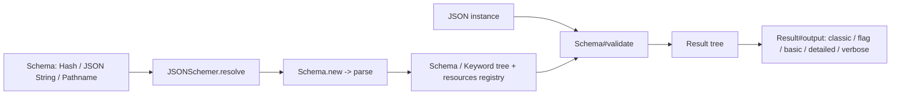
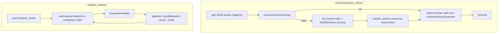

# json_schemer — Research report

## Metadata

- **Library name**: json_schemer
- **Repo URL**: https://github.com/davishmcclurg/json_schemer
- **Clone path**: `research/repos/ruby/davishmcclurg-json_schemer/`
- **Language**: Ruby
- **License**: MIT (see json_schemer.gemspec, LICENSE.txt)
- **Analyzed version**: 7f1b816 (2025-12-08), release v2.5.0 (`lib/json_schemer/version.rb`)
- **Report date**: 2026-10-27
- **Requirements**: Ruby >= 2.7; runtime deps bigdecimal, hana (JSON Pointer), regexp_parser, simpleidn

## Summary

json_schemer is a JSON Schema **validator** for Ruby. It is validation only: given a schema (Hash, JSON string, or Pathname) and a JSON-like instance, it reports validity and yields errors or annotations. It does not generate code. It supports Draft 4, 6, 7, 2019-09, 2020-12, OpenAPI 3.0 and 3.1, selected via `$schema` or the `meta_schema` option. A schema is parsed once into a tree of `Schema` and `Keyword` objects (one object per keyword occurrence); validation walks that tree and builds a `Result` tree, from which the requested output format (classic, flag, basic, detailed, verbose) is derived lazily.

## JSON Schema support

- **Drafts**: Draft 4, 6, 7, 2019-09, 2020-12, OpenAPI 3.0, OpenAPI 3.1. Meta-schemas are Ruby hash literals in `draft*/meta.rb`, instantiated lazily as singleton `Schema` objects (`JSONSchemer.draft202012` etc.) through `META_SCHEMAS_BY_BASE_URI_STR`, a `Hash.new` with a default block that memoizes. A version-less `http://json-schema.org/schema#` maps to Draft 4.
- **Vocabularies**: `VOCABULARIES` (json_schemer.rb) maps vocabulary URIs to keyword hashes. A schema's `$vocabulary` (or the meta-schema's) selects which hashes are merged into the effective keyword table; unknown required vocabularies raise `UnknownVocabulary`.
- **Scope**: validation only; no code generation.
- **Default format behavior**: the `format` option defaults to `true`, so formats are asserted for all drafts even when the 2020-12 meta-schema lists only `format-annotation` (see keyword table). `readOnly`/`writeOnly` are asserted only when `access_mode` is set.

## Keyword support table

Keyword list derived from vendored draft 2020-12 meta-schemas (`specs/json-schema.org/draft/2020-12/meta/`). Implementation evidence from `lib/json_schemer/draft202012/vocab.rb`, `vocab/core.rb`, `vocab/applicator.rb`, `vocab/validation.rb`, `vocab/unevaluated.rb`, `vocab/format_annotation.rb`, `vocab/format_assertion.rb`, `vocab/content.rb`, `vocab/meta_data.rb`.

| Keyword | Implemented | Notes |
|---------|-------------|-------|
| $anchor | yes | Core::Anchor; registers lexical scope for ref resolution. |
| $comment | yes | Core::Comment; parsed, no `validate` (returns nil, produces no result). |
| $defs | yes | Core::Defs; parses subschemas; $ref can target definitions. |
| $dynamicAnchor | yes | Core::DynamicAnchor; registers dynamic scope. |
| $dynamicRef | yes | Core::DynamicRef; resolves via dynamic scope. |
| $id | yes | Core::Id; sets base URI and lexical scope. |
| $ref | yes | Core::Ref; resolves via root.resolve_ref. |
| $schema | yes | Core::Schema; selects meta-schema and vocabularies. |
| $vocabulary | yes | Core::Vocabulary; selects keyword vocabularies. |
| additionalProperties | yes | Applicator::AdditionalProperties. |
| allOf | yes | Applicator::AllOf. |
| anyOf | yes | Applicator::AnyOf. |
| const | yes | Validation::Const. |
| contains | yes | Applicator::Contains; minContains/maxContains in Validation. |
| contentEncoding | partial | Content::ContentEncoding; base64 built in; custom via content_encodings. Always returns valid; decoded value is an annotation only (never asserts, even on bad base64). |
| contentMediaType | partial | Content::ContentMediaType; application/json built in. Always valid; parsed value is an annotation only. |
| contentSchema | partial | Content::ContentSchema; validates the parsed media-type annotation but always reports valid; the sub-result is stored as an annotation (`to_output_unit`). |
| default | partial | `MetaData::Default` is commented out of `META_DATA`; the keyword parses as `UnknownKeyword` (emits its value as an annotation). Read by `Result#insert_property_defaults` via `default_keyword_instance`, which inserts the default into the instance. |
| dependentRequired | yes | Validation::DependentRequired. |
| dependentSchemas | yes | Applicator::DependentSchemas. |
| deprecated | no | Meta-data class commented out in `META_DATA`; parsed as `Core::UnknownKeyword`, which always succeeds and emits its raw value as an annotation (so it appears in verbose/basic annotation output but asserts nothing). |
| description | no | Meta-data class commented out in `META_DATA`; parsed as `Core::UnknownKeyword`, which always succeeds and emits its raw value as an annotation (so it appears in verbose/basic annotation output but asserts nothing). |
| else | yes | Applicator::Else; conditional with if/then. |
| enum | yes | Validation::Enum; instance must be in array. |
| examples | no | Meta-data class commented out in `META_DATA`; parsed as `Core::UnknownKeyword`, which always succeeds and emits its raw value as an annotation (so it appears in verbose/basic annotation output but asserts nothing). |
| exclusiveMaximum | yes | Validation::ExclusiveMaximum. |
| exclusiveMinimum | yes | Validation::ExclusiveMinimum. |
| format | yes | `FormatAnnotation::Format` or `FormatAssertion::Format` depending on vocabulary. With the default `format: true` option both actually assert (annotation variant looks up the checker with default `false`, i.e. unknown formats pass; assertion variant raises `UnknownFormat`). Extensible via `formats`. |
| if | yes | Applicator::If; conditional. |
| items | yes | Applicator::Items; Draft 2020-12 with prefixItems. |
| maxContains | yes | Validation::MaxContains. |
| maximum | yes | Validation::Maximum. |
| maxItems | yes | Validation::MaxItems. |
| maxLength | yes | Validation::MaxLength. |
| maxProperties | yes | Validation::MaxProperties. |
| minContains | yes | Validation::MinContains. |
| minimum | yes | Validation::Minimum. |
| minItems | yes | Validation::MinItems. |
| minLength | yes | Validation::MinLength. |
| minProperties | yes | Validation::MinProperties. |
| multipleOf | yes | Validation::MultipleOf. |
| not | yes | Applicator::Not. |
| oneOf | yes | Applicator::OneOf. |
| pattern | yes | Validation::Pattern; regexp via regexp_resolver (Ruby or ECMA). |
| patternProperties | yes | Applicator::PatternProperties. |
| prefixItems | yes | Applicator::PrefixItems. |
| properties | yes | Applicator::Properties. |
| propertyNames | yes | Applicator::PropertyNames. |
| readOnly | yes | MetaData::ReadOnly; validated when access_mode is set. |
| required | yes | Validation::Required. |
| then | yes | Applicator::Then; conditional with if/else. |
| title | no | Meta-data class commented out in `META_DATA`; parsed as `Core::UnknownKeyword`, which always succeeds and emits its raw value as an annotation (so it appears in verbose/basic annotation output but asserts nothing). |
| type | yes | Validation::Type. |
| unevaluatedItems | yes | Unevaluated::UnevaluatedItems. |
| unevaluatedProperties | yes | Unevaluated::UnevaluatedProperties. |
| uniqueItems | yes | Validation::UniqueItems. |
| writeOnly | yes | MetaData::WriteOnly; validated when access_mode is set. |

**Other drafts / extensions** (verified in code): vocabularies are plain Ruby hashes (keyword name -> `Keyword` subclass). `Draft201909::Vocab` copies the 2020-12 hashes, deletes `$dynamicAnchor`/`$dynamicRef`/`prefixItems`, and adds `$recursiveAnchor`/`$recursiveRef`, array-form `items`, `additionalItems`, and `unevaluatedItems` (draft201909/vocab/applicator.rb). `Draft7::Vocab::ALL`, `Draft6`, `Draft4` are successively derived by `dup` + `delete` + `merge!`; Draft 7 and earlier make `$ref` *exclusive* (siblings ignored, see `Schema#parse`), and draft 4 renames `$id` to `id`. The 2020-12 `CORE` table also maps legacy `definitions` (to `Core::Defs`), the non-standard `x-error` (`Core::XError`), and `APPLICATOR` maps legacy `dependencies` (to `Applicator::Dependencies`). OpenAPI 3.1 adds a `base` vocabulary (`discriminator`, `xml`, `externalDocs`, `example`) whose `AllOf`/`AnyOf`/`OneOf` subclasses cooperate with `Discriminator` (applied before unevaluated keywords since 2.5.0), plus OpenAPI `format` extensions (int32/int64 etc.). OpenAPI 3.0 reuses the Draft 4 vocabulary plus an `openapi30` base vocabulary. `JSONSchemer.openapi(document)` validates a whole OpenAPI document against its document meta-schema (`openapi31/document.rb`, `openapi30/document.rb`, ~1.5k lines each of embedded schema data) and offers `schema(name)` / `ref(value)` to get a `Schema` for `#/components/schemas/<name>`.

Re-derived against the vendored 2020-12 meta-schemas: every keyword has a row; none is absent from the code mapping, but `default`, `deprecated`, `description`, `examples`, `title` are not first-class keywords.

**Recent changes (v2.4.0 to v2.5.0, CHANGELOG)**: discriminator ordering fix, hostname format hardening (no trailing dots, size limit, extended separators), more interpolation variables for custom error messages; v2.4.0 fixed config propagation to subschemas and OpenAPI int32/int64 bounds.

## Constraints

All validation keywords are enforced at runtime when validating an instance. There is no code generation; constraints (minLength, minimum, pattern, etc.) are applied during validation. The library yields error hashes (or output units) via `validate` enumerator or structured output (classic, flag, basic, detailed, verbose). Format checks are on by default (`format: true`) and extensible/disable-able per format via `formats` (`name => proc` or `false`). Content keywords (`contentEncoding`, `contentMediaType`, `contentSchema`) never fail validation; they only produce annotations.

## High-level architecture

Pipeline: **input** (Hash, JSON String, or Pathname) -> `JSONSchemer.schema` (`resolve` normalizes the input; a Pathname becomes a `file:` base URI plus a `CachedResolver` wrapping `FILE_URI_REF_RESOLVER`) -> `Schema.new` (eagerly parses the whole schema tree into `Keyword` objects and registers `$id`/`$anchor` resources) -> `Schema#validate` / `#valid?` (recursive tree walk producing a `Result` tree) -> `Result#output(format)` (enumerator-backed output). Nothing is compiled to closures or code: the parsed tree *is* the executable form and the interpreter is `Schema#validate_instance`.

## Medium-level architecture

- **Entry** (`lib/json_schemer.rb`): `JSONSchemer.schema(schema, **options)`; `valid_schema?`/`validate_schema` validate a schema against its meta-schema (`meta_schema(schema, options)` builds a throwaway `Schema` of `{'$schema' => ...}` to find the meta-schema object).
- **`Schema`** (`schema.rb`, 433 lines): one per (sub)schema value. Holds `value` (deep-stringified copy), `parent`, `root`, `base_uri`, `meta_schema`, a per-schema `Configuration` struct, and `parsed` (Hash keyword name -> `Keyword`). Only the root owns `resources`.
- **`Keyword`** (`keyword.rb`): base class; `parse` hook runs in the constructor, `validate(instance, instance_location, keyword_location, context)` returns a `Result` or `nil`. Subschemas are created with `Keyword#subschema` which constructs `Schema.new(value, self, root, keyword, ...)`.
- **Vocabularies** (`draft*/vocab*.rb`): constant hashes of keyword name -> class, one file per vocabulary.
- **`Result`/`Output`** (`result.rb`, `output.rb`): result struct and output-format projections.
- **`Location`** (`location.rb`): interned linked paths for instance and keyword locations.
- **Support**: `Format` + `format/*` checkers, `EcmaRegexp`, `CachedResolver`, `Configuration`, `OpenAPI` wrapper, CLI `exe/json_schemer`.

## Algorithms and data structures

### Schema representation

A parsed schema is a tree of two kinds of Ruby objects. `JSONSchemer::Schema` (`schema.rb`) wraps one schema value (`@value = deep_stringify_keys(value)`, so symbol-keyed Hashes are copied to string keys up front) and a `@parsed` Hash mapping keyword name to a `Keyword` instance. `JSONSchemer::Keyword` (`keyword.rb`) stores the raw `value`, `parent`, `root`, owning `schema`, and a `parsed` field produced by the subclass `parse` hook: for `Pattern` it is a compiled `Regexp`, for `Properties`/`Defs` a `Hash` of name -> `Schema`, for `AllOf` an `Array` of `Schema`, for `Not`/`Items`/`If` a single `Schema`, and for scalar keywords the raw value. Boolean schemas are not a separate type: a `Schema` whose `value` is `true`/`false` has an empty `parsed` and `validate_instance` short-circuits on `value == false` / `value == true || value.empty?`. Unknown keywords become `Core::UnknownKeyword`, which keeps raw Hash/Array values lazily wrapped (`fetch` builds child `UnknownKeyword`s on demand), emits its value as an annotation, and can still be a `$ref` target (`parsed_schema` does `subschema(value)`), so `$ref: "#/x-custom/foo"` works.

Keyword order within `parsed` matters. `Schema#parse` sorts `value` by `meta_schema.keyword_order` (an index map built in `Core::Vocabulary#parse` from vocabulary order in `VOCABULARY_ORDER` then insertion order within each vocab hash), with unknown keywords last (`keyword_order.fetch(k, last)`). Hence `$schema`/`$id`/`$ref`, then applicators (`properties`, `patternProperties`, `additionalProperties`, `items`...) precede `unevaluated*`, and `if` precedes `then`/`else`, which is what lets later keywords read earlier keywords' results. If the schema has an "exclusive" `$ref` (Draft 7 and earlier, `Ref.exclusive?` true for those drafts), only `$ref` and the defs keyword are parsed and all siblings are dropped. Memory: each keyword occurrence is a heap object, plus a stringified deep copy of the schema, and Schema-level `Configuration` structs are re-created per subschema (`Schema#initialize` builds a fresh `Configuration.new(...)` for every subschema, copying about 17 fields). All objects are ordinary mutable Ruby objects with lazily memoized fields (`@ref_schema`, `@absolute_keyword_location`, `@schema_pointer`, `@x_error`). Parent links make the structure a cyclic graph, so location strings are derived by walking `parent`.

### Reference resolution and registry

The registry is `Resources` (`resources.rb`): a thin wrapper over a Hash keyed by `uri.to_s`. The *root* schema owns two registries, `root.resources[:lexical]` and `root.resources[:dynamic]` (`Schema#resources`). Registration happens as a side effect of keyword parsing, i.e. eagerly at schema construction: `Core::Id#parse` computes `URI.join(schema.base_uri, value)`, **mutates `schema.base_uri`** (so later keywords and children see the new base) and stores the schema under the resulting URI; `Core::Anchor` registers `base_uri#name`; `Core::DynamicAnchor` registers in both registries; Draft 2019-09 `RecursiveAnchor` registers `base_uri` in `:dynamic` when `true`. For a root schema lacking an id, `parse` instantiates an `Id` keyword with the configured `base_uri` (default `json-schemer://schema`) so the root is always registered. Because ids are processed in keyword order (`$id` is early in vocabulary order) the base URI is correct for subschema parsing.

`Schema#resolve_ref(uri)` (called on the root) works in three steps. (1) If `uri.fragment` is a valid JSON pointer (`Format.valid_json_pointer?`), it is split off as `pointer` and the fragment cleared, so `base#/definitions/a` becomes lookup of `base` plus a pointer walk. A non-pointer fragment (e.g. `#foo` anchor) stays in the URI and is matched as a plain registry key. (2) Lookup in `resources[:lexical]`, retrying with an empty fragment. (3) On a miss, the document is fetched with `ref_resolver.call(uri)` (fragment stripped), wrapped in a *new* root `JSONSchemer.schema(..., base_uri: uri, configuration:, meta_schema:, ref_resolver:, regexp_resolver:)`, and the target is read from **the remote schema's own** `resources[:lexical]`. Note the remote schema is not merged into the caller's registry; it is re-fetched on each cache miss, which is why the default `net/http` resolver is wrapped in `CachedResolver` (`cached_resolver.rb`: a Hash keyed by the args array, memoizing `nil` too). Finally the pointer is walked with `Hana::Pointer.parse(pointer).reduce(schema) { |obj, token| obj.fetch(token) }`; `Schema#fetch` and `Keyword#fetch` index into `parsed` (Arrays by `to_i`), so a JSON pointer navigates the *parsed object graph*, not the raw JSON; a missing token raises `InvalidRefPointer`, as does a result that is not a `Schema`. Failing to resolve a remote raises `UnknownRef` (default resolver) or `InvalidRefResolution`.

Resolution is lazy at the reference level: `Core::Ref#ref_schema` memoizes `root.resolve_ref(ref_uri)` on first use, when validation reaches the `$ref`. This makes recursive schemas safe: parsing never follows `$ref`, so there is no cycle at parse time, and at validation time recursion is bounded by instance depth. There is no explicit cycle detection; a schema like `{"$ref": "#"}` validating any instance recurses until Ruby's stack overflows (not verified by execution). `$dynamicRef` (`Core::DynamicRef#validate`) resolves the static target first, and if that target has a `$dynamicAnchor` matching the fragment, iterates `context.dynamic_scope` from the outermost ancestor inward (the array is pushed in `validate_instance`), computing `URI.join(ancestor.base_uri, "#anchor")` and checking `ancestor.root.resources[:dynamic]`; the first (outermost) hit wins. This is O(scope depth) URI joins per dynamic reference evaluation. 2019-09 `$recursiveRef` is the same shape keyed on the base URI. Schemas can also be pulled in via `Schema#ref(value)` (`URI.join(base_uri, value)`), used by the OpenAPI helper.

`Schema#bundle` produces a compound document: a BFS (`values = [self]; while value = values.shift`) over parsed Schemas, Keywords and raw Hash/Array values, collects every `Keyword` that responds to `ref_uri` and `ref_schema`, copies each referenced remote root's raw `value` into `$defs` (or `definitions`) under its URI as an embedded resource with `$id`/`$schema`, and enqueues it; a `ref_schema == root || embedded_resources.key?(id)` check is the cycle guard.

### Compiled / intermediate form

There is no compile step beyond parsing; the intermediate form is the `Schema`/`Keyword` object graph described above, with some work done once in `parse`: `Pattern#parse` and `patternProperties` call `root.resolve_regexp` (compiles the regex once and stores it), `Format#parse` looks up the checker proc once (`root.format && root.fetch_format(value, false)`), `ContentEncoding`/`ContentMediaType#parse` look up the decoder proc, `Type`'s `parsed` is the raw type name or array, and `Core::Vocabulary#parse` builds the keyword table. Dispatch is dynamic: `Schema#validate_instance` iterates `parsed.each` and calls `keyword_instance.validate(...)` virtually, with each keyword class doing its own `is_a?` type guard on the instance (`return result(..., true) unless instance.is_a?(Hash)`). Data flows between sibling keywords through `Context#adjacent_results` (see Core algorithm), not through compile-time linkage. `Format::*` checkers are `proc`s of `(instance, format)`; custom formats and keywords are arbitrary callables (`keywords:` option: name -> callable returning true/false/string/array).

### Core algorithm

`Schema#validate(instance, ...)` creates a `Context = Struct.new(:instance, :dynamic_scope, :adjacent_results, :short_circuit, :access_mode)`, deep-stringifies the instance (copy), and calls `validate_instance(instance, instance_location, keyword_location, context)` on the root. `validate_instance` is the recursive interpreter loop:

1. push `self` on `context.dynamic_scope`; save and replace `context.adjacent_results` with a fresh `{}` (so each schema object has its own sibling-result scope; restored in `ensure`).
2. `false` schema -> invalid result; `true` or empty -> valid result.
3. For each `[keyword, keyword_instance]` in `parsed`: call `validate`; skip `nil` returns (annotation-only keywords such as `$comment`, `$defs`, `$id`); AND the validity into `valid`; **if `short_circuit` and `!valid`, return an invalid result immediately**; otherwise append to `nested` and store `adjacent_results[keyword_instance.class] = keyword_result`.
4. Run any user `keywords:` callables.
5. Return `result(..., valid, nested)`.

Applicators recurse with `subschema.validate_instance`, passing child instance and location. `allOf`/`anyOf`/`oneOf` always evaluate **every** subschema (`parsed.map.with_index { ... }` then `.all?/.any?/.count`), never short-circuiting between branches, because annotations from all branches and a full error tree are needed; `oneOf` marks `ignore_nested: true` when more than one branch matches so the error output does not list passing branches. `if` always returns valid and stores the sub-result validity as its annotation; `then`/`else` read `context.adjacent_results[If]`. `items` reads `adjacent_results[PrefixItems].annotation` (the last evaluated index) for its offset; `additionalProperties` reads `adjacent_results[Properties]`/`[PatternProperties]` annotations (key lists) and validates only remaining keys (via `Set` membership); `minContains`/`maxContains` read the `Contains` annotation (list of matching indexes); `contentMediaType` reads the `ContentEncoding` annotation; `Required` consults `access_mode` and sibling `properties` to exempt read/write-only properties. This makes keyword ordering semantically load-bearing.

`unevaluatedProperties`/`unevaluatedItems` use annotation collection by tree walk: `collect_evaluated_keys(result, evaluated_keys)` recurses through `adjacent_results.each_value` and each result's `nested` list, but only descends into sub-results that are `valid` and have the same `instance_location` (annotations from failed branches or from child instances do not count), merging `Properties`/`PatternProperties`/`AdditionalProperties`/`UnevaluatedProperties` annotations into a `Set`. For items it subtracts `0..prefix_idx`, clears on `items`/`unevaluatedItems` annotation `true`, and subtracts `contains` index lists. Cost is proportional to the size of the result subtree at that instance node; the algorithm relies on results being fully built (no short-circuit, which is why `short_circuit` is off unless output is `flag` and defaults are not being inserted... see Performance). The only recursion in this walk is Ruby recursion over result nesting.

Numeric handling: `type: integer` accepts any `Numeric` with `floor == instance` (so `1.0` is an integer); `multipleOf` does `BigDecimal(instance.to_s).modulo(value).zero?` to avoid float error; comparisons use native Ruby numeric `<=`. `uniqueItems` uses `instance.size == instance.uniq.size` (Ruby `uniq`, which hashes with `eql?`/`hash`; behavior for `1` versus `1.0` is not verified here). `enum` uses `Array#include?` (`==`, a linear scan per validation) and `const` uses `==`.

`insert_property_defaults`: when enabled, `validate` first runs the normal pass, then `Result#insert_property_defaults` (explicit-stack walk over the result tree, tracking validity through ancestors and skipping `not`) collects, for each valid `properties` result whose instance lacks a property, the `default` found on that property schema (following `$ref`s via `default_keyword_instance`), then a resolver proc (default: insert only if all candidate annotations agree, cloning the value) mutates the *original* (non-stringified) instance, and validation runs a second time. Hooks `before_property_validation`/`after_property_validation` mutate the original instance around `properties` and then `instance.replace(deep_stringify_keys(original_instance))`.

### Error and output model

Every keyword's `validate` returns a `Result` Struct (`result.rb`): `source` (the Keyword or Schema), `instance`, `instance_location`, `keyword_location`, `valid`, `nested` (child results), `type`, `annotation`, `details`, `ignore_nested`, `nested_key`. Results are built for **valid and invalid** evaluations alike (annotations are first-class), which is why the full tree exists even when only a boolean is asked for, unless `short_circuit` applies. Locations are not strings but `Location` nodes (`location.rb`): `Location.root` is `{}`, and `Location.join(location, name)` interns child nodes in the parent's Hash (`location[name] ||= { name:, parent: location }`), so repeated joins return the same node without string allocation; `Location.resolve` builds the `/a/b` pointer string lazily and caches it in `location[:resolve]`. Instance locations are fresh per `validate` call; keyword locations hang off a memoized root (`@root_keyword_location`), so their trie is shared across calls and bounded by schema size. The absolute keyword location (URI form) and schema pointer are computed lazily on the `Schema`/`Keyword` and memoized (the code notes `URI::Generic#==` is slow and uses `equal?`).

Output formats (`Result#output`): `flag` -> `{'valid'=>bool}`; `classic` -> an `Enumerator` over leaf errors with `data`, `data_pointer`, `schema`, `schema_pointer`, `root_schema`, `type`, `error`, optional `details`; `basic`, `detailed`, `verbose` -> hashes whose `errors`/`annotations` value is an `Enumerator`. `classic` and `basic` traverse with an explicit stack (`results = [self]; while result = results.pop`, pushing `nested.reverse_each` entries whose `valid` equals the root's), so large result trees do not recurse. `detailed` and `verbose` recurse. Because the enumerators are lazy, error messages are formatted only as consumed; `resolve_enumerators: true` forces them (`resolve_enumerators!`). Error messages are generated by `Keyword#error(formatted_instance_location:, details:)` methods per keyword class, optionally overridden by `x-error` (with `%{instance}`, `%{keywordValue}`, ... interpolation via `gsub` on `X_ERROR_REGEX`) or by I18n lookup through a fallback key chain (`i18n!`; `i18n?` is checked once and cached in a class variable).

## Low-level details

- **String length**: `maxLength`/`minLength` use `String#size`, i.e. characters (code points) for UTF-8 strings, matching the spec; not bytes or UTF-16 units.
- **Numbers**: Ruby `Integer` is arbitrary precision, `Float` is IEEE double; `multipleOf` goes through `BigDecimal(instance.to_s)`. `type: integer` accepts `x.0` floats.
- **Property order**: Hash iteration follows insertion order, so `properties`, `required` and error order follow the schema/instance document order.
- **Regex**: `regexp_resolver: 'ruby'` (default) uses `Regexp.new(pattern)` directly, so Ruby syntax and anchors (`^`/`$` are line anchors in Ruby) apply. `'ecma'` runs `EcmaRegexp.ruby_equivalent`, which scans the pattern with `regexp_parser` (`Regexp::Scanner.scan`), validates each token against a custom `Regexp::Syntax` subclass restricted to ECMA-262 features, rewrites `^`/`$` to `\A`/`\z` and `\s`/`\S` to explicit ECMA whitespace classes, and raises `InvalidEcmaRegexp` otherwise. All built-in meta-schemas use `'ecma'`. Note the default for user schemas is `ruby`. The `format: regex` checker reuses `EcmaRegexp`.
- **Formats** (`format.rb`, `format/*.rb`): hand-written checkers; `date-time` uses `DateTime.rfc3339` plus regex checks for hour 24 and leap seconds; `date`/`time` borrow the date-time parser by padding a template; `ipv4`/`ipv6` use `IPAddr.new(data, family)` plus a character whitelist regex; `uri`/`uri-reference` use `URI::RFC3986_PARSER.split` and reject whitespace in query/opaque; `iri` percent-encodes non-ASCII first; `idn-hostname` uses `simpleidn` plus large generated RFC 5892 context regexes in `format/hostname.rb`; `uuid` is a regex; `duration`, `email`, `json-pointer`, `uri-template` have dedicated modules. All checkers pass non-strings (`!instance.is_a?(String) || ...`).
- **Content**: `ContentEncoding::BASE64` uses `unpack1('m0')` (strict base64), `ContentMediaType::JSON` uses `JSON.parse`; failures return `[false, nil]` and are not reported as errors.
- **Deep inputs**: `validate_instance`, `Schema.new`/`parse`, `deep_stringify_keys`, `detailed`/`verbose` and the unevaluated annotation walks are recursive Ruby methods with no depth limit; very deep schemas or instances can raise `SystemStackError` (not exercised). `classic`/`basic` output and `insert_property_defaults`/`bundle` use explicit stacks/queues.
- **Untrusted input**: the default `ref_resolver` raises on any unknown ref (no network); `'net/http'` is opt-in and does an unrestricted `Net::HTTP.get(uri)` (no allow-list or size limit in code); `file:` refs are read from disk when the schema is loaded from a Pathname. User-supplied `pattern` strings are compiled to Ruby regexes (backtracking engine); no ReDoS protection beyond whatever Ruby's regex engine offers is present in the library.
- **Hostname hardening** (2.5.0): hostname formats reject trailing dots and enforce overall size limits.

## Output and integration

- **Vendored vs build-dir**: N/A (no code generation). Validation is in-memory; no file output.
- **API vs CLI**: Library API: `JSONSchemer.schema(schema).valid?(instance)`, `JSONSchemer.schema(schema).validate(instance)`. CLI in `exe/json_schemer`: schema file and data file(s); `--errors MAX`; `-` for stdin.
- **Writer model**: N/A. Validation results returned as hashes or output structures.

## Configuration

- **meta_schema**: Inferred from `$schema` or passed explicitly. Default draft 2020-12.
- **ref_resolver**: Proc or `'net/http'` (cached). Default raises UnknownRef.
- **regexp_resolver**: `'ruby'` or `'ecma'` or proc. Default `'ruby'`.
- **format**: true/false to enable format validation. Default true.
- **formats**: Hash of format name => proc or false (disable).
- **content_encodings**, **content_media_types**: Custom encodings/media types.
- **insert_property_defaults**: true/false/:symbol. Inserts schema `default` into instance.
- **property_default_resolver**: Custom resolver for defaults.
- **before_property_validation**, **after_property_validation**: Hooks.
- **output_format**: classic, flag, basic, detailed, verbose.
- **access_mode**: `'read'` or `'write'` to validate readOnly/writeOnly.
- **resolve_enumerators**: Whether to fully resolve output enumerators.
- **Global config**: `JSONSchemer.configuration` and `JSONSchemer.configure`.

## Pros/cons

- **Pros**: Multiple draft support (4 through 2020-12); OpenAPI 3.0 and 3.1; full vocabulary model with $vocabulary; unevaluatedProperties/unevaluatedItems; content vocabulary (contentEncoding, contentMediaType, contentSchema); format annotation and assertion; readOnly/writeOnly with access_mode; insert_property_defaults; x-error and I18n for custom errors; ECMA regex support; schema bundling; subschema validation via ref; rich output formats; CachedResolver for refs.
- **Cons**: No code generation; meta-data keywords (title, description, deprecated, examples, default) are annotations only; content keywords never assert; whole result tree is built unless `flag` output; recursive evaluator with no depth guard; `allOf`/`anyOf`/`oneOf` evaluate all branches; default `regexp_resolver` is Ruby, not ECMA, for user schemas; remote refs are re-wrapped per miss unless the resolver is cached.

## Testability

- **How to run tests**: From repo root, `rake test` or `bin/rake test`. Test files under `test/**/*_test.rb`.
- **Unit tests**: `test/json_schemer_test.rb`, `test/ref_test.rb`, `test/format_test.rb`, `test/output_format_test.rb`, `test/open_api_test.rb`, `test/errors_test.rb`, `test/configuration_test.rb`, `test/pretty_errors_test.rb`, `test/hooks_test.rb`, `test/pointers_test.rb`, etc.
- **Fixtures**: `test/fixtures/draft4.json`, `draft6.json`, `draft7.json`, `draft2019-09.json`, `draft2020-12.json`. `JSON-Schema-Test-Suite/` is vendored in the repo and driven by `test/json_schema_test_suite_test.rb`; also `test/regex_test.rb`, `test/uri_template_test.rb`, `test/exe_test.rb` (CLI).
- **Entry point**: `JSONSchemer.schema(schema).validate(instance)` or `valid?(instance)`.

## Performance

Analysis is from code only; nothing was run.

### Performance techniques

- **Compile vs interpret**: Interpreted. `Schema.new` does the one-time work: building the keyword object tree, sorting keywords into vocabulary order, registering ids/anchors, compiling `pattern` regexes (`Pattern#parse` -> `resolve_regexp`), and looking up format and content-decoder procs (`Format#parse`, `ContentEncoding#parse`). Per validation, every keyword still does a virtual `validate` call and allocates a `Result`. `$ref` targets are resolved lazily on first use and memoized per `Ref` keyword (`@ref_schema ||=`). `patternProperties` keys are not compiled at parse; each validation calls `root.resolve_regexp(pattern)` per pattern, hitting the `CachedResolver` hash (key = `[pattern]` array, so one array allocation plus hash lookup per call). The README/benchmarks treat "initialized" (parsed once, validate many) as the fast path.
- **Memory layout and allocation**: Pointer-chasing object graph (Ruby objects/Hashes), not flat arenas. Allocation-heavy by design: one `Result` Struct per keyword evaluation (valid or not), a `nested` array per applicator, a fresh `adjacent_results` Hash per `validate_instance`, `deep_stringify_keys` copies of schema and instance on every `validate` call, and a new `Configuration` struct per subschema at parse. Mitigations: interned `Location` nodes so instance/keyword paths cost a hash lookup instead of string building, with pointer strings only built on demand (`Location.resolve`); lazy error text (messages are only formatted in `Result#error`, called when an output unit is produced); lazy `Enumerator`s for output; memoized location strings and pointers; frozen constant tables (`BINARY_TO_PERCENT_ENCODED`, regex constants).
- **Caching and memoization**: `CachedResolver` (Hash keyed by call args) for `net/http`, Pathname file loads, and for both built-in regexp resolvers; `@ref_schema`, `@ref_uri`, `@dynamic_anchor`, `@absolute_keyword_location`, `@schema_pointer`, `@id_keyword`, `@defs_keyword`; memoized singleton meta-schemas (`@draft202012 ||=`, `META_SCHEMAS_BY_BASE_URI_STR` default-block memoization); `CLASSIC_ERROR_TYPES` Hash with default block caching class-name-derived type strings; I18n availability cached in `@@i18n`. There is no cache of validation results across calls, and no invalidation story since schemas are treated as immutable after construction.
- **Fast paths and short-circuiting**: `Context#short_circuit` is set to `!insert_property_defaults && output_format == 'flag'`; `valid?` always uses `flag`, so `validate_instance` returns on the first invalid keyword in a schema (this does not stop `allOf`/`anyOf`/`oneOf` from visiting every branch, since those keywords run `parsed.map` over all subschemas, and results from failed branches inside them are built before aggregation; it only short-circuits sibling keywords in each schema object). `true`/`false`/empty schemas return immediately. Most keywords begin with a cheap `instance.is_a?(...)` guard and return valid. Vocabulary ordering places structural keywords before `unevaluated*`. `additionalProperties` uses a `Set` for excluded keys. `Items` slices from the prefix offset. For OpenAPI `discriminator`, only the selected subschema is validated rather than all of `oneOf`/`anyOf` (those keywords return nil when a discriminator is present). No type-first dispatch table, no schema-specialized validators for common shapes.
- **Regex handling**: Ruby's built-in Onigmo engine (backtracking; no linear-time engine, no timeout) via `Regexp.new`. Optional ECMA translation through `regexp_parser` (`EcmaRegexp.ruby_equivalent`) rewrites anchors/whitespace classes once per distinct pattern thanks to `CachedResolver`. Patterns are compiled once per schema (`pattern`) or once per distinct pattern string across the resolver (`patternProperties`). No ReDoS mitigation in the library.
- **Concurrency**: No locks or thread-local state in the library. Per-validation mutable state lives in a `Context` created per call, so concurrent `validate` calls do not share the evaluation context; but `Schema`/`Keyword` objects lazily memoize into themselves, `CachedResolver` mutates a shared Hash, and `Location.join` mutates the shared keyword-location trie, so thread-safety of a shared `Schema` rests on MRI's GVL and idempotent memoization and is not documented or tested in the code read. CI runs on MRI, JRuby and TruffleRuby (`.github/workflows`), which does not establish thread safety. No parallel evaluation.

### Benchmarks in repo

- `test/performance/benchmark.rb`: benchmark-ips (installed via `bundler/inline`) comparing json_schemer with jschema, json-schema, json_schema, json_validation and rj_schema on a small "simple" object schema (properties `firstName`/`lastName`/`age`, `required`), valid and invalid instances, initialized (pre-parsed) versus uninitialized (parse on each call), and json_schemer variants with basic vs classic output and `to_a` resolution.
- `test/performance/benchmark_json_schema_test_suite.rb`: runs the JSON-Schema-Test-Suite (Draft 4) cases with the same set of libraries, using a local `$ref_resolver` over `JSON-Schema-Test-Suite/remotes`.
- `test/performance/profile.rb`: profiling script.
- **Harness entry points**: `JSONSchemer.schema(schema)` once, then `schemer.valid?(instance)` (boolean, short-circuits) or `schemer.validate(instance).to_a` / `output_format: 'flag'`; CLI `exe/json_schemer <schema> <data>...`.

## Determinism and idempotency

- **Validation result**: For the same schema and instance, validation outcome is deterministic. Error order follows keyword application order, which is the sorted `keyword_order` from the active vocabularies (not the document order of the schema's keys), then instance Hash insertion order for per-property results.
- **Idempotency**: N/A (no generated output). Repeated validation with same inputs yields same result.

## Enum handling

- **Implementation**: `Validation::Enum#validate` is `!value || value.include?(instance)` (linear `==` scan over the raw array each time; no precomputed set). No deduplication of the schema enum array.
- **Duplicate entries**: Schema can contain duplicate enum values; validation only requires instance to match one.
- **Namespace/case collisions**: Enum values compared by value; distinct values like `"a"` and `"A"` are both allowed. No name mangling (validation only).

## Reverse generation (Schema from types)

No. The library only validates JSON instances against JSON Schema. There is no facility to generate JSON Schema from Ruby types or classes.

## Multi-language output

N/A. The library does not generate code; it only validates. Output is validation result (and errors) in Ruby.

## Model deduplication and $ref/$defs

N/A for code generation. For validation: **$ref** and **$defs** are used for resolution. `resolve_ref` splits off a JSON-pointer fragment, looks up the lexical registry, fetches remote documents via `ref_resolver` on a miss (wrapping them in a fresh root `Schema`), and walks the pointer over the parsed object graph with Hana::Pointer; `$dynamicRef` consults the dynamic registry through the runtime dynamic scope. Each $ref resolves to a Schema; the same definition can be applied to multiple instance locations. No model deduplication; resolution is by URI/fragment. Schema bundling (`Schema#bundle`) copies referenced remote roots into `$defs` keyed by URI, de-duplicating by `ref_id`. Within one schema, resolved `$ref`s point at the same shared `Schema` object (via the registry/pointer walk), and each `Ref` memoizes its target, so a definition is parsed once and reused.

## Validation (schema + JSON → errors)

Yes. This is the library's primary function.

- **Inputs**: Schema (Hash, Pathname, or JSON string) and instance (JSON-like Ruby data). Options: meta_schema, ref_resolver, regexp_resolver, format, formats, output_format, access_mode, etc.
- **API**: `JSONSchemer.schema(schema).valid?(instance)` returns boolean. `JSONSchemer.schema(schema).validate(instance)` returns enumerator (classic) or output hash (basic/detailed/verbose). `JSONSchemer.valid_schema?(schema)`, `JSONSchemer.validate_schema(schema)` for schema validation.
- **Output**: Classic: `data`, `data_pointer`, `schema`, `schema_pointer`, `root_schema`, `type`, `error`. Basic: `valid`, `keywordLocation`, `instanceLocation`, `errors`/`annotations`. Custom errors via x-error or I18n.
- **CLI**: `json_schemer <schema> <data>...`; outputs errors as JSON lines; `--errors MAX`; exits non-zero on failure.

## Unverified

- Behavior under deep recursion (`SystemStackError`), `{"$ref":"#"}` self-reference, and `uniq` semantics for `1` versus `1.0` were inferred from code, not run.
- Thread safety of a shared `Schema` is not documented; analysis above is inferred.
- The embedded OpenAPI document schemas (`openapi30/document.rb`, `openapi31/document.rb`, ~1.6k lines of data each) and the `discriminator` internals in `openapi31/vocab/base.rb` and `openapi30/vocab/base.rb` were skimmed, not read in full. Format checker modules (`format/email.rb`, `duration.rb`, `uri_template.rb`) were not read line by line.
