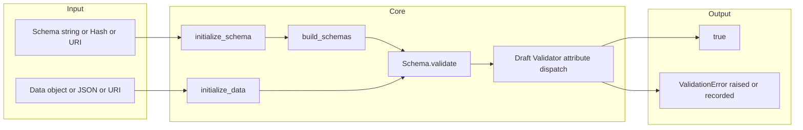

# json-schema (voxpupuli) — Research report

## Metadata

- **Library name**: json-schema (Ruby JSON Schema Validator)
- **Repo URL**: https://github.com/voxpupuli/json-schema
- **Clone path**: `research/repos/ruby/voxpupuli-json-schema/`
- **Language**: Ruby
- **License**: MIT (see LICENSE.md, json-schema.gemspec)
- **Analyzed version**: d4acb3a 2026-10-11 (gem version 6.2.1, released 2026-10-03; requires Ruby >= 2.7, runtime deps `addressable`, `bigdecimal`)
- **Report date**: 2026-10-27

## Summary

voxpupuli/json-schema is a Ruby library that validates JSON-like data (Ruby hashes, arrays, primitives) against a JSON Schema. It does **not** generate code from schemas. The library supports JSON Schema Draft 1 through Draft 6; **Draft 6 is the default** (README and load order agree: `validators/*.rb` are required in sorted order and draft6.rb calls `register_default_validator` last, overriding draft4.rb). Validation is the only concern: given a schema and data, it returns a boolean, raises a `JSON::Schema::ValidationError`, or returns a list of error messages/objects via `JSON::Validator.validate`, `validate!`, and `fully_validate`. Schema and data can be provided as Ruby objects, JSON strings, or file/URI paths. Optional features include schema validation (against the draft meta-schema), fragment validation, insert defaults, and configurable schema reading for `$ref` resolution.

## JSON Schema support

- **Drafts**: Draft 1, Draft 2, Draft 3, Draft 4, Draft 6. Declared in README and implemented as separate validator classes in `lib/json-schema/validators/` (Draft1 through Draft6). Draft 6 is the default (draft6.rb is loaded last and registers itself as default validator; draft4.rb also registers but is overridden). Hyper-schema meta-validators (`hyper-draft1..6.rb`) also exist for validating hyper-schema documents. Specs: no Draft 2019-09/2020-12, no draft-07.
- **Scope**: Validation only; no code generation.
- **Draft selection**: The schema’s `$schema` keyword selects the validator via `JSON::Validator.validator_for_uri`; otherwise the `:version` option (e.g. `:draft1`, `:draft2`) or the default validator is used. Meta-schemas live in `resources/` (`draft-01.json`, `draft-02.json`, `draft-03.json`, `draft-04.json`, `draft-06.json`).
- **Subset**: Applicator and validation keywords are implemented per draft. Meta-data keywords (`title`, `description`, `default`, `examples`) are not validated. Draft-06 `contains` and `examples` are not implemented. Draft-06 `$id` is not used for scope (only `id` is read in `schema.rb` and `validator.rb`). Boolean schemas (`true`/`false`) are not supported as subschemas (`Schema#initialize` indexes `@schema['id']`), except `propertyNames: false`/`additionalProperties: false` special cases. Numeric draft-06 `exclusiveMaximum`/`exclusiveMinimum` are treated as booleans (truthy) against `maximum`/`minimum` (limits/maximum.rb), so the draft-06 numeric semantics are not honored.

## Keyword support table

Keyword list derived from the vendored meta-schemas `specs/json-schema.org/draft-06/schema.json` and `specs/json-schema.org/draft-04/schema.json` (union of `properties` keys; the library targets drafts 1-6, default 6). Draft-03 keywords `extends` and `disallow` (not in these meta-schemas) are also implemented (ExtendsAttribute, DisallowAttribute) in draft3/4/6 validators. Implementation evidence from `lib/json-schema/validators/draft4.rb`, `draft6.rb`, `draft3.rb`, and `lib/json-schema/attributes/`.

| Keyword | Implemented | Notes |
|---------|-------------|-------|
| $id | no | Draft-06; not read. Only `id` (draft-04 style) is used for URI scope in schema.rb. |
| $ref | yes | RefAttribute; lookup in the class-level `@@schemas` cache by base URI plus JSON-Pointer walk of the fragment. Sibling keywords are NOT ignored (every key of the schema hash is dispatched). Plain-name fragments (`#foo`, `$anchor`-style) are treated as pointer segments, not anchors. |
| $schema | partial | Used to select validator (validator_for_uri); not validated. |
| additionalItems | yes | AdditionalItemsAttribute. |
| additionalProperties | yes | AdditionalPropertiesAttribute. |
| allOf | yes | AllOfAttribute. |
| anyOf | yes | AnyOfAttribute. |
| const | yes | ConstAttribute (Draft 6 only); plain Ruby `==` (so `1 == 1.0` is true, `true == 1` is false). |
| contains | no | Not in the Draft6 attributes hash. |
| default | partial | Not a constraint, but read when the `:insert_defaults` option is set: PropertiesAttribute copies `default` into missing properties (skipped when `readonly` is truthy) and RequiredAttribute accepts a missing required property that has a non-nil default. |
| definitions | partial | No validator, but `build_schemas` walks every value so nested `id`/`$ref`/`enum` get preprocessed; `$ref` can target entries via JSON-Pointer fragments. |
| dependencies | yes | DependenciesV4Attribute (draft4/6), DependenciesAttribute (draft3). Schema-valued dependencies are not individually walked by `build_schemas` (see Algorithms). |
| description | no | Meta-data; not validated. |
| enum | yes | EnumAttribute; `build_schemas` replaces the array with `ArraySet`, a Set-backed lookup that normalizes every Numeric to Float before hashing (so `1` matches `1.0`). |
| examples | no | Meta-data; not validated. |
| exclusiveMaximum | partial | Boolean (draft-04) semantics inside MaximumAttribute; draft-06 numeric form is only treated as truthy. |
| exclusiveMinimum | partial | Boolean (draft-04) semantics inside MinimumAttribute; draft-06 numeric form is only treated as truthy. |
| format | partial | FormatAttribute; only runs when the data's Ruby class matches the sibling `type` (or `type` is absent). Draft6 built-ins are only date-time, ipv4, ipv6, uri (draft3 adds date, time, etc.); unknown formats ignored; `register_format_validator` for custom. |
| id | partial | Used in schema.rb for schema URI scope and resolution; not validated. |
| items | yes | ItemsAttribute. |
| maximum | yes | MaximumAttribute. |
| maxItems | yes | MaxItemsAttribute. |
| maxLength | yes | MaxLengthAttribute; `String#length` (characters/code points, not bytes or UTF-16 units). |
| maxProperties | yes | MaxPropertiesAttribute. |
| minimum | yes | MinimumAttribute. |
| minItems | yes | MinItemsAttribute. |
| minLength | yes | MinLengthAttribute; `String#length` (characters). |
| minProperties | yes | MinPropertiesAttribute. |
| multipleOf | yes | MultipleOfAttribute (draft4/6) subclasses DivisibleByAttribute: `BigDecimal(data.to_s) % BigDecimal(factor.to_s)`, avoiding float error; factor 0 is reported as a violation. |
| not | yes | NotAttribute. |
| oneOf | yes | OneOfAttribute. |
| pattern | yes | PatternAttribute: `Regexp.new(pattern)` on every call, unanchored `match`; Ruby (Onigmo) regex semantics, not ECMA-262. |
| patternProperties | yes | PatternPropertiesAttribute. |
| properties | yes | PropertiesV4Attribute (draft4/6); PropertiesAttribute (draft3); PropertiesOptionalAttribute (draft1/2). |
| propertyNames | yes | PropertyNames (Draft 6 only); schema hash or `false` supported, `true` ignored. Not walked by `build_schemas`, so a remote `$ref` inside it is not preloaded. |
| required | yes | RequiredAttribute. |
| title | no | Meta-data; not validated. |
| type | yes | TypeV4Attribute (draft3–6); TypeAttribute (draft1/2). |
| uniqueItems | yes | UniqueItemsAttribute: `data.clone.uniq!`, which uses `hash`/`eql?`, so `1` and `1.0` count as distinct (draft-06 says equal). |

## Constraints

All validation keywords are enforced at runtime when validating an instance. There is no code generation; constraints (minLength, minimum, pattern, maxItems, etc.) are applied during validation. The validator iterates over the schema’s attributes and invokes the corresponding attribute class (e.g. MinLengthAttribute, PatternAttribute). Format checks are applied when the `format` keyword is present; built-in and custom format validators can be registered. Options such as `:strict` (all properties required, no additional properties) and `:allPropertiesRequired` / `:noAdditionalProperties` further constrain object validation.

## High-level architecture

The library is a pure interpreter over plain Ruby Hashes. There is no compile step that produces a validator tree: a `JSON::Validator` instance holds a `@base_schema` (`JSON::Schema`, a thin wrapper of Hash + URI + draft validator), and validation recursively wraps each subschema Hash in a fresh `JSON::Schema` object while a draft `Validator` object dispatches each keyword to a stateless class-method "attribute" handler.

Pipeline: **Schema** (String, Hash, or path/URI) → `JSON::Validator.new(schema, opts)` → `initialize_schema` (stringify keys, wrap in `JSON::Schema`, register in the global `@@schemas` cache under a synthetic or `id`-derived URI) → `build_schemas` (walk the schema, eagerly load remote `$ref` targets through the `Reader`, wrap and register subschemas that carry an `id`, convert `enum` arrays to `ArraySet`) → `validator.validate(data)` (`initialize_data` parses/stringifies the data, then `@base_schema.validate(data, [], error_recorder, options)`) → draft `Validator#validate` loops over the schema's keys and calls the matching attribute class → result is `true`, a raised `ValidationError` (default), or an array of errors (`record_errors`).



## Medium-level architecture

- **Entry points** (`lib/json-schema/validator.rb`, `class << self`): `validate` (calls `validate!` and rescues `ValidationError`/`SchemaError` into `false`), `validate!` (raises on the first error), `fully_validate` (`validate!` with `record_errors: true`, returns strings or hashes). `*_json` / `*_uri` variants only add `json: true` / `uri: true` to the options. Every call constructs a new `JSON::Validator`, i.e. re-runs schema initialization and `build_schemas`; reuse requires holding the instance and calling `#validate`.
- **Classes**: `JSON::Validator` (orchestrator, owns all class-level registries: `@@schemas`, `@@validators`, `@@default_validator`, `@@mutex`), `JSON::Schema` (Hash + `uri` + `validator`), `JSON::Schema::Validator` (a draft; subclasses `Draft1..4`, `Draft6`, plus `HyperDraft*` subclasses that only change `@uri`), `JSON::Schema::Attribute` and ~50 subclasses (one per keyword/draft variant), `JSON::Schema::Reader` (file/URI loader), `JSON::Util::URI` (Addressable subclass), `ArraySet`, `ValidationError`, `ErrorRecorder`.
- **Draft registry**: each `validators/draftN.rb` builds a Hash `@attributes` (keyword string → attribute class), a `@formats` Hash, a metaschema file name from `resources/`, and calls `JSON::Validator.register_validator(new)`, keyed by `"scheme://host/path"` of the meta-schema URI. `json-schema.rb` requires attributes then validators in sorted order, so `draft6.rb` registers itself as default last. `Schema#initialize` picks the draft from the schema's `$schema` (via `validator_for_uri`), else the parent's validator, else the default.
- **Ref resolution**: see the Algorithms section; in summary a `$ref` is normalised against the schema's URI, the part before `#` is looked up in a process-global Hash, and the fragment is walked as a JSON Pointer on the stored Hash.

```mermaid
flowchart TB
  subgraph refResolution [Ref resolution]
    NormalizeRef[normalize_ref ref against schema uri]
    SchemaKey[schema_key = uri before hash plus hash]
    SchemaForUri[schema_for_uri lookup in schemas cache]
    FragmentResolve[Walk fragment segments on stored Hash]
    NewSchema[Schema.new target subschema]
    NormalizeRef --> SchemaKey
    SchemaKey --> SchemaForUri
    SchemaForUri --> FragmentResolve
    FragmentResolve --> NewSchema
  end
  subgraph validationFlow [Validation flow]
    ValidateEntry[Schema.validate]
    EachAttr[Validator.validate iterates schema keys]
    AttrDispatch[attributes key validate]
    SubSchema[Schema.new per subschema and instance child]
    ValidateEntry --> EachAttr
    EachAttr --> AttrDispatch
    AttrDispatch --> SubSchema
    SubSchema --> ValidateEntry
  end
```



## Algorithms and data structures

### Schema representation

A schema is never converted into a typed model. It is the Ruby `Hash` produced by the JSON parser (or supplied by the caller), deep-copied by `JSON::Schema.stringify` (`schema.rb`), which recursively turns Symbol keys/values into Strings and rebuilds Hashes and Arrays (the Hash path rebuilds via `map ... .to_h`, preserving key order, and it is itself recursive, so very deep schemas are bounded by Ruby's stack). Boolean subschemas are not representable: `Schema#initialize` does `@schema['id']` and `@schema['$schema']`, which fails on `true`/`false`; only `additionalProperties: false`, `additionalItems: false` and `propertyNames: false` are special-cased inside their own attribute classes. Unknown keywords are kept in the Hash and simply not dispatched (`Validator#validate` checks `@attributes.has_key?`), so extension keywords are silently ignored.

`JSON::Schema` has three fields: `schema` (the Hash), `uri` (`JSON::Util::URI`, an Addressable subclass, stripped of fragment) and `validator` (the draft object). In the constructor an `id` String is parsed and, if relative, joined onto the parent URI, which becomes the schema's base URI. The wrapper is allocated cheaply and constantly: every attribute that descends (`properties`, `items`, `allOf`, ...) calls `JSON::Schema.new(subschema_hash, current_schema.uri, validator)` per subschema per use, so the "tree" is implicit in the Hash and the wrapper objects are short-lived. Data is also normalised: `initialize_data` parses a String (JSON, or falls back to treating it as a URI/path), then `stringify`s it, so Symbol-keyed Ruby input is copied once up front.

Special in-place mutation: `build_schemas` replaces `schema['enum']` with an `ArraySet` in the stored Hash (see Compiled form), and `Validator.new(..., insert_defaults: true)` mutates the data Hash (`merge_missing_values` copies defaults back to the caller's original object in an `ensure` block).

### Reference resolution and registry

The registry is `@@schemas`, a class-variable `Hash` from normalised URI string (always ending in `#`) to `JSON::Schema`. `schema_key_for(uri)` = `Util::URI.normalized_uri(uri).to_s` (relative paths become `file://` URIs against `Dir.pwd`) with `#` appended if missing; `schema_for_uri` tries the raw key first to skip normalization. `add_schema` uses `||=`, so the first registration for a URI wins; a different schema later registered under the same key is silently ignored until `clear_cache`.

Base URIs: a string schema or Hash gets a synthetic URI by SHA-1 UUID of its content (`fake_uuid(schema)` is a UUIDv5 over the raw string or over `serialize(schema)`: JSON/YAML dump of the Hash; uses `uuidtools` if installed, otherwise the vendored `util/uuid.rb`). File/URI schemas use their location. An `id` (draft 3/4 spelling; `$id` is never read) on any schema reached by `build_schemas` (`handle_schema`) or in `Schema#initialize` changes that schema's `uri` and, in `handle_schema`, registers it in `@@schemas`. This gives only per-`id` documents, not anchors or `$dynamicRef`; plain-name fragments are not supported.

Resolution is eager for remote documents and lazy for fragments. `build_schemas(parent)` (called at construction, under `@@mutex`) walks `$ref`, `extends`, `type`/`disallow` unions, `definitions`/`properties`/`patternProperties` values, `additionalProperties`/`additionalItems`/`dependencies`/`extends` when Hash, `allOf`/`anyOf`/`oneOf`/`not`, and `items`, recursing through `handle_schema` (which wraps each Hash in a `JSON::Schema` and, if it has `id`, registers it). For each `$ref` it calls `load_ref_schema`: `absolutize_ref` makes an absolute URI minus fragment, `schema_loaded?` short-circuits when already cached (this is also the cycle guard: a document is added to `@@schemas` before `build_schemas` recurses into it, so mutually-referencing remote documents terminate), a `$schema`-matching meta-schema URI is redirected to the vendored file in `resources/`, otherwise `@options[:schema_reader].read(uri)` loads and parses it. Known walk gaps: `dependencies` is handled by `handle_schema(parent, schema['dependencies'])`, which treats the whole dependencies map as one schema rather than each value, `propertyNames` and `contains` are not walked, so remote `$ref`s there are never preloaded and fail at validation with "The referenced schema ... cannot be found".

At validation time `RefAttribute.get_referenced_uri_and_schema` (`attributes/ref.rb`): `normalize_ref(ref, current_schema.uri)` (Addressable merge/join; absolute path refs go through `Pathname#cleanpath`), `schema_key = uri.split('#')[0] + '#'`, `schema_for_uri(schema_key)`, then the fragment is split on `/`, each segment unescaped (`~0`→`~`, `~1`→`/`) and used to index into the stored Hash (or Array via `to_i`); a missing segment raises `SchemaError`. The result is wrapped in a new `JSON::Schema` whose URI is the ref URI (fragment stripped by the constructor), so relative refs inside the target resolve against the target document. There is no cycle detection at validation: recursion terminates only because instance data is finite; a schema like `{"$ref": "#"}` recurses until `SystemStackError`. The same pointer walk is repeated on every visit (no memoisation of resolved targets).

### Compiled / intermediate form

None in the compiler sense. The only "compiled" artefacts are: (1) the draft's `@attributes` Hash mapping keyword strings to attribute classes (built once at require time, shared across all validations); (2) `ArraySet` replacing `enum` arrays; (3) the global schema cache. Attribute classes are stateless: all handlers are `def self.validate(current_schema, data, fragments, processor, validator, options)` and everything they need is derived from the schema Hash on each call (e.g. `Regexp.new(pattern)`, `BigDecimal(...)`, `Set` construction in the allOf error diff). Because the schema Hash is mutable and shared, the "form" is effectively the user's JSON plus the in-place `enum` rewrite.

`ArraySet` (`util/array_set.rb`) subclasses `Array`, overriding `include?`: the first call lazily builds `@values = Set.new` with every element passed through `convert_to_float_if_numeric` (`Numeric#to_f`), then lookup is `@values.include?(convert(obj))`. Cost: O(n) once per enum, O(1) per lookup (Ruby `hash`/`eql?`); trade-offs: `1` and `1.0` collapse to the same key (matches JSON number equality), large integers beyond 2^53 lose precision, and arrays/hashes inside the enum compare by Ruby `eql?` (so `[1]` does not equal `[1.0]`).

### Core algorithm

`Schema::Validator#validate` (`schema/validator.rb`) is the whole evaluation loop:

```ruby
current_schema.schema.each do |attr_name, _|
  if @attributes.has_key?(attr_name.to_s)
    @attributes[attr_name.to_s].validate(current_schema, data, fragments, processor, self, options)
  end
end
```

Dispatch is a Hash lookup per schema key, in the schema Hash's insertion order, with no keyword ordering or priority (so `type` is not checked before `properties`; each handler checks `data.is_a?` itself and returns early for non-applicable types). There is no short-circuit across keywords within a schema: after a failing keyword, remaining keywords still run (when recording errors) or the first failure raises (default).

Error propagation has two modes selected by `options[:record_errors]` in `Attribute.validation_error`: when false it `raise`s a `ValidationError` (control flow by exception, first error aborts the whole `validate!`); when true it pushes the error onto `processor` (an `ErrorRecorder`, a `SimpleDelegator` over the `Validator`, holding `@errors`). Descent builds the instance path with `fragments + [key]` (a new Array per child) and the "property" error string with `"#/#{fragments.join('/')}"`.

Composition keywords run each branch by rebuilding a `JSON::Schema` and calling `validate`, then diffing the recorder:
- `anyOf` (`anyof.rb`): for each branch, remember `errors.count`, call `validate` inside `begin/rescue ValidationError`, compute `diff = count_after - count_before`, pop those errors off the recorder into a local `errors["anyOf #i"]` bucket, set `valid = false if diff > 0`, `break` on first success; restore `data` from a shallow clone between branches (because `insert_defaults` may mutate it). On total failure it emits one error and attaches the buckets as `sub_errors`.
- `oneOf` (`oneof.rb`): same pattern but evaluates all branches, counts failures; success iff exactly `length - 1` failed (data replaced by the clone captured from the passing branch); otherwise message "did not match any" or "matched more than one".
- `allOf` (`allof.rb`): evaluates every branch, collecting each branch's errors into `errors["allOf #i"]`; with `noAdditionalProperties` it forces record mode and intersects the per-branch "undefined properties" sets (`common_missing_properties`, via `Set#&`) so a property defined in any branch is allowed, and filters out `PropertiesV4Attribute` errors. This is a special-case workaround for the lack of annotation tracking.
- `not` (`not.rb`): snapshots `processor.validation_errors.clone`; the subschema "matches" when no new errors appeared, in which case it reports failure; else the snapshot is restored.
- `type` union with schema members (draft3 `TypeAttribute`) and `disallow` reuse the same diff-and-pop technique; `DisallowAttribute` calls the draft's `type` attribute with `options.merge(disallow: true)`.
- `extends` (draft3, also wired in draft4/6) validates against each extended schema and, in `additionalProperties`, `remove_valid_properties` recursively subtracts properties defined by extended schemas, `properties` and `patternProperties` keys.
- Objects: `properties` iterates the schema's properties (O(P) lookups in the data Hash), builds a `JSON::Schema` for each present property, and optionally inserts defaults. `patternProperties` is O(patterns x data keys) with `Regexp.new` per pattern per call. `additionalProperties` computes extra keys with Array subtraction (`data.keys - properties.keys`, then `reject!` per pattern), O(K). `items` iterates the array once per element; tuple form builds a `JSON::Schema` per position. `uniqueItems` is `data.clone.uniq!`, O(n) expected via hashing (it clones the Array first). `required` loops the required names with `has_key?`.
- There is no annotation tracking (draft-06 has no `unevaluated*`); `strict`/`noAdditionalProperties`/`allPropertiesRequired` are option flags threaded through `options` instead.

`type` checking: `Attribute::TYPE_CLASS_MAPPINGS` maps type names to Ruby classes (`integer` -> `Integer`, `number` -> `Numeric`, `boolean` -> `[TrueClass, FalseClass]`, `null` -> `NilClass`, `any` -> `Object`); unknown type names return `true` (`fetch ... { return true }`). A float with zero fractional part such as `1.0` is not an `integer` (draft-06 treats it as integer). `type_of_data` (used only to build error messages) sorts the mapping by ancestor-chain depth and finds the first class that matches.

### Error and output model

`JSON::Schema::ValidationError < StandardError` (`errors/validation_error.rb`) has `message`, `fragments` (a clone of the instance-path Array), `schema` (the `JSON::Schema` in whose context it fired, giving the schema URI), `failed_attribute` (the attribute class), `sub_errors` (Hash from branch label such as `"anyOf #1"` to an Array of errors, for composition keywords) and `properties` (names of undefined properties, used by `allOf` + `noAdditionalProperties`). The message string "…in schema <uri>" is built eagerly in the constructor. Output formats: `to_string` (indented tree of sub_errors, `INDENT = '    '`) and `to_hash` (`schema`, `fragment`, `message`, `failed_attribute` name derived by string-splitting the class name, and nested `errors` keyed by downcased snake-cased labels). `fully_validate` returns `error_recorder.validation_errors.map(&:to_string)` or `map(&:to_hash)` with `errors_as_objects`. Only the instance-location is tracked (`fragments`); there is no keyword/schema-location path, no JSON Schema "output format" (flag/basic/detailed). Other exceptions: `SchemaError`, `SchemaParseError`, `JsonParseError`, `JsonLoadError`, `UriError`, `ReadFailed`, `ReadRefused`, `CustomFormatError`.

## Low-level details

- **Numeric limits**: `LimitAttribute` (`attributes/limit.rb`) is a template-method base: subclasses provide `acceptable_type`, `value`, `limit_name`, `exclusive?`. `invalid?` picks the comparison from whether `limit_name` starts with `max`. `exclusive?` for Maximum/Minimum returns the raw `exclusiveMaximum`/`exclusiveMinimum` value, so any truthy value (including a draft-06 numeric bound) means "exclusive against `maximum`"; the numeric form is not compared. Draft 1/2 use `MaximumInclusiveAttribute`/`MinimumInclusiveAttribute` and `MaxDecimalAttribute` (splits `data.to_s` on `.`) / `DivisibleByAttribute`.
- **Numbers and strings**: integers are Ruby `Integer` (arbitrary precision); floats are IEEE doubles; `multipleOf` goes through `BigDecimal(x.to_s)` and `.to_f != 0` for the remainder, avoiding binary float error. Numeric `type: number` is `Numeric`, so BigDecimal/Rational instances also match. `minLength`/`maxLength` use `String#length` (characters in the string's encoding). `parse_integer: false` stops integer-looking Strings being parsed as JSON data.
- **Formats**: `FormatAttribute.validate` first checks `data_valid_for_type?(data, schema['type'])` and then looks up `validator.formats[format]`; unknown formats are ignored. `date-time` (`DateTimeFormat`/`DateTimeV4Format`) is a hand-rolled regex plus `Date.parse` and numeric range checks on hour/minute/second; `ipv4`/`ipv6` use `IPAddr.new` and compare `family`; `uri` calls `Addressable::URI.parse` and only fails on a parse error; `date`/`time` are regex + `Date.parse` in draft3 only. Custom formats wrap a proc (`CustomFormat`), which signals failure by raising `CustomFormatError`.
- **Schema/data loading**: `Reader#read` parses the location; scheme nil/`file` goes to `read_file` (`File.read`), otherwise `URI.open(uri).read` with no explicit timeout or size limit; `accept_uri`/`accept_file` booleans or callables gate access (raises `ReadRefused`). `initialize_data` can also load data from a URI/path (`custom_open`, `SUPPORTED_PROTOCOLS` includes http, https, ftp, ssh...). A String schema is first tried as JSON; on `JsonParseError` it is treated as a path/URI. Hardening is limited to the reader gating; there is no recursion-depth limit, no regex timeout, and no remote-reference limit.
- **JSON backends**: `JSON::Validator.parse` dispatches to MultiJson (if present and not disabled), `JSON.parse` or Yajl; the default backend is chosen at load time in `ensure_ruby_json_backends!` (prefers yajl if installed).
- **Draft quirks**: `Draft6#@attributes` includes `extends` and `disallow` (draft3 leftovers) and `PropertyNames`/`const`, but not `contains`. `PropertiesV4Attribute.required?` ignores the draft-3 boolean `required` inside property schemas (only `allPropertiesRequired` option), while `PropertiesAttribute.required?` (draft 3) reads it via `schema.fetch('required')`.

## Output and integration

- **Vendored vs build-dir**: Not applicable (no code generation). Validation is in-memory; no generated files.
- **API vs CLI**: Library only. No CLI in the repo. API: `JSON::Validator.validate`, `validate!`, `fully_validate`, and variants (`validate_json`, `validate_uri`, `fully_validate_schema`, etc.). Instantiate `JSON::Validator.new(schema, opts)` for repeated validation with the same schema.
- **Writer model**: Not applicable. Output is return value (true/false) or error list / raised exception.

## Configuration

- **Version / draft**: `:version` option (e.g. `:draft1`, `:draft2`, `:draft4`, `:draft6`) or `$schema` in the schema. Default validator is Draft 6.
- **Schema reader**: `:schema_reader` option or `JSON::Validator.schema_reader`; default is `JSON::Schema::Reader.new`. Reader supports `accept_uri` and `accept_file` (callables or booleans) to control loading of $ref targets from URIs or files.
- **Validation options**: `:list` (validate array of items each against schema), `:fragment` (JSON Pointer fragment of schema), `:validate_schema` (validate schema against meta-schema first), `:insert_defaults` (fill in default values from schema), `:strict` (all properties required, no additional properties), `:allPropertiesRequired`, `:noAdditionalProperties`, `:record_errors` (for fully_validate), `:errors_as_objects` (return hashes), `:clear_cache`, `:parse_data`, `:parse_integer`. MultiJSON can be disabled even when installed (6.2.0).
- **Formats**: Per-validator default formats (date-time, uri, ipv4, ipv6, etc.); `JSON::Validator.register_format_validator(format, proc, versions)` and `deregister_format_validator` / `restore_default_formats`.
- **JSON backend**: Optional MultiJson or built-in json/yajl for parsing (JSON::Validator.parse).

## Pros/cons

- **Pros**: Multiple draft support (1–6); simple API (validate, validate!, fully_validate); optional schema validation and fragment validation; configurable schema reader for $ref; insert defaults; strict mode; custom format validators; error messages with fragment paths and failed_attribute; optional error list as hashes for programmatic use.
- **Cons**: No code generation; no CLI; Draft 6 `contains`, `$id`, boolean schemas and numeric exclusive bounds not (correctly) implemented; no draft-07, 2019-09 or 2020-12; meta-data keywords not validated; global schema cache (class variables) for ref resolution. Recent releases (6.0-6.2.1, 2025-2026) are maintenance only: Ruby version support, dependency bumps, JSON.parse `quirks_mode` removal, MultiJSON opt-out.

## Testability

- **Framework**: Minitest. Test setup in `test/support/test_helper.rb` (minitest/autorun, minitest/reporters, webmock/minitest).
- **Tests**: `test/*_test.rb` (e.g. draft4_test.rb, draft6_test.rb, ref_test.rb). Fixtures in `test/schemas/`, `test/data/`. Optional JSON Schema test suite via git submodule `test/test-suite` (see `test/common_test_suite_test.rb`); update with `rake update_common_tests`.
- **Run**: `bundle exec rake test` or `rake` (default task is `:test`). CI (`.github/workflows/test.yml`) runs `bundle exec rake` with matrix (Ruby 2.7-4.0, jruby, truffleruby; rubocop on 3.2; also builds the gem). Note: the `test/test-suite` submodule directory is empty in this clone, so the official suite tests were not available locally; skip list in `test/support/test_suite_ignored_tests.yml`.

## Performance

Analysis is by code reading only; nothing was built or run.

### Performance techniques

- **Compile vs interpret**: Pure tree-walking interpretation of the raw schema Hash. Nothing is compiled to closures or objects. Computed once per `JSON::Validator.new`: schema stringify copy, content-hash UUID for the cache key (`fake_uuid(serialize(schema))`: dump + SHA-1), the `build_schemas` walk (remote loads, `enum` -> `ArraySet`). Computed per validation call and per instance node: `JSON::Schema.new` wrappers for every visited subschema, `Regexp.new(pattern)`, `BigDecimal` conversion for `multipleOf`, `fragments + [key]` arrays, pointer walks for `$ref`. The one-shot class methods (`validate`, `fully_validate`) pay the once-per-instance costs on every call; holding a `JSON::Validator` instance avoids repeating the schema-initialization cost (though `initialize_schema` still runs for cached schemas if the Hash is passed again).
- **Memory layout and allocation**: Plain Ruby Hash/Array/String objects; no interning, arenas or inline storage. Allocation-heavy by design: a `JSON::Schema` per subschema visit (plus an Addressable `merge` when the URI has a non-empty fragment, in `strip_fragment`), a new `fragments` Array per descent, `Hash.new { ... }` error buckets in every `anyOf`/`oneOf`/`allOf`/union-type call, shallow clones of Hash data in `anyOf`/`oneOf` (`original_data = data.clone`, `success_data = data.clone`), `data.clone.uniq!` for uniqueItems, `processor.validation_errors.clone` in `not`. Errors are built eagerly: `ValidationError.new` clones `fragments` and builds `message_with_schema` immediately, and in non-recording mode each failure is a raised exception (backtrace capture), which `anyOf`/`oneOf`/`type` unions then rescue, so failed branches are costly. Data and schema are deep-copied once by `stringify`.
- **Caching and memoization**: (1) Class-level `@@schemas` Hash maps normalised URI to `JSON::Schema`, used for `$ref` targets and remote documents; it is never evicted except by `clear_cache`/`:clear_cache` (the `cache_schemas=` setter is deprecated), so memory grows with the number of distinct schemas seen and a long-running process validating many ad-hoc schemas accumulates entries; because keys are content UUIDs, identical inline schemas share one entry (`||=`). (2) `ArraySet` memoizes the enum lookup Set lazily on first `include?`. (3) `schema_for_uri` tries the raw key before normalizing. No regex cache, no resolved-`$ref` cache, no compiled-subschema cache, no format-check cache.
- **Fast paths and short-circuiting**: Default `validate`/`validate!` stops at the first error by raising (no further keywords are evaluated). Handlers return early on non-applicable data types (`return unless data.is_a?(Hash)`). `anyOf` breaks at the first passing branch; `TypeV4Attribute` uses `types.any?`; `type` unions break on first match. `schema_for_uri` avoids normalization when the key is already normalised. There is no boolean-only validation path that skips error construction (errors are still instantiated even though the outer `validate` rescues them), no keyword ordering heuristic, and `oneOf` always evaluates every branch.
- **Regex handling**: Ruby's built-in `Regexp` (Onigmo). `PatternAttribute`, `PatternPropertiesAttribute`, and `PropertiesAttribute`/`AdditionalPropertiesAttribute` (patternProperties scans) call `Regexp.new(pattern)` on every invocation with no caching of the compiled regex, and no ECMA-262 translation (Ruby semantics: `^`/`$` always match at line boundaries, no `\p{..}`-style differences handled). No ReDoS protection in the library (no `Regexp.timeout` use; relies on whatever the Ruby runtime provides, e.g. Ruby 3.2+ memoized matching and the global timeout if the application sets it).
- **Concurrency**: A single class-level `@@mutex` wraps `initialize_schema` and `build_schemas` (schema loading and registry mutation), but `validate` itself is not locked. Registries (`@@schemas`, draft `@formats`) are plain Hashes shared across threads, and `register_format_validator` mutates the shared draft objects globally; `ArraySet`'s lazy `@values` init is an unsynchronized benign race; `insert_defaults` mutates input data. No parallel validation or Ractor support. Thread safety is therefore best-effort: concurrent validation with already-loaded schemas works, concurrent mutation of global state does not have guarantees.

### Benchmarks in repo

None found: no benchmark directory, Rake task, Gemfile entry, or `Benchmark` usage anywhere in the repo (`grep -ri benchmark` finds nothing). Entry points for an external harness: `JSON::Validator.new(schema, opts)` once then `validator.validate(data)` per instance (amortizes schema setup), or one-shot `JSON::Validator.validate(schema, data)` / `JSON::Validator.fully_validate(schema, data)`. Pass `clear_cache: true` or call `JSON::Validator.clear_cache` between runs to avoid cross-run registry state.

## Determinism and idempotency

- **Validation result**: Deterministic for the same schema and data. Error order follows the schema Hash's key insertion order (`current_schema.schema.each`), then property order of the schema's `properties`; `stringify` preserves order. Error sets for `anyOf`/`oneOf`/`allOf` are keyed by branch index. Two identical inline schemas share one cache entry, so global state can influence results only through the `@@schemas` cache (e.g. a stale file schema until `clear_cache`; see `test/caching_test.rb`).
- **Idempotency**: Not applicable for generated output (no code generation). Repeated validation returns the same result, except with `insert_defaults: true`, which mutates the caller's data.

## Enum handling

- **Implementation**: `EnumAttribute` (`attributes/enum.rb`) returns when `enum.include?(data)`; `build_schemas` has replaced the schema's array with an `ArraySet` so `include?` is a Set lookup on values with every Numeric converted by `to_f`. The lookup is lazily built on first use and cached on the ArraySet instance. The failure message lists values (`null`, `array`, `object` or `to_s`).
- **Duplicate entries**: Not checked or rejected, and not deduplicated in the stored array; the Set built for lookup collapses duplicates (and collapses `1` with `1.0`), so duplicates are harmless to results.
- **Namespace/case collisions**: Values are compared by Ruby equality/hash, so `"a"` and `"A"` are distinct, and both validate. No variant naming (validation only).

## Reverse generation (Schema from types)

No. The library only validates data against JSON Schema. There is no facility to generate JSON Schema from Ruby types or classes.

## Multi-language output

Not applicable. The library does not generate code; it only validates. Output is validation result (and errors) in Ruby.

## Model deduplication and $ref/$defs

Not applicable for code generation. For validation: schemas are cached by normalised URI; two identical inline schemas (same serialized content) hash to the same synthetic UUID key and share one registry entry. `$ref` is resolved by URI plus JSON-Pointer fragment against the stored Hash; `definitions` entries are simply Hash members and are not merged or deduplicated. `$defs` (2019-09+) is not special: it works only as an arbitrary pointer path.

## Validation (schema + JSON → errors)

Yes. This is the library’s primary function.

- **Inputs**: Schema (Ruby Hash, JSON string, or file/URI path) and data (Ruby object, JSON string, or file/URI path). Optional options hash (`:version`, `:schema_reader`, `:validate_schema`, `:fragment`, `:record_errors`, `:errors_as_objects`, etc.).
- **API**: `JSON::Validator.validate(schema, data, opts)` returns true/false (rescues errors). `JSON::Validator.validate!(schema, data, opts)` validates and raises `JSON::Schema::ValidationError` on first failure. `JSON::Validator.fully_validate(schema, data, opts)` returns an array of error strings (or hashes when `errors_as_objects: true`). Instance API: `JSON::Validator.new(schema, opts).validate(data)`.
- **Output**: `JSON::Schema::ValidationError` with message, fragments (path), schema, failed_attribute, sub_errors. `to_string` / `to_hash` for human-readable or structured output. Error message includes schema URI and fragment (e.g. `#/a`).
