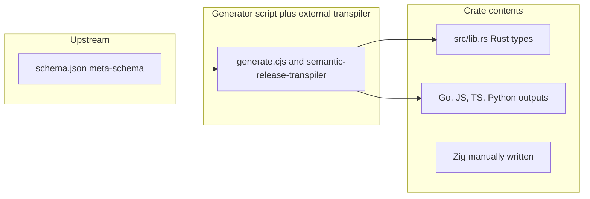
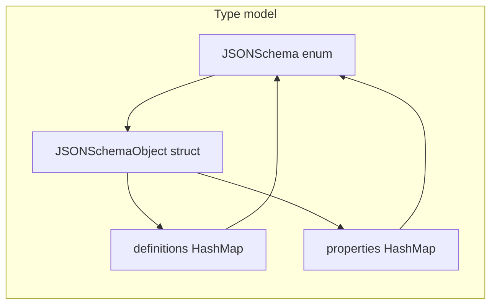

# json_schema — Research report

## Metadata

- **Library name**: json_schema
- **Repo URL**: https://crates.io/crates/json_schema (no public repository listed)
- **Clone path**: `research/repos/rust/BelfordZ-json-schema/`
- **Language**: Rust
- **License**: Apache-2.0
- **Analyzed version**: crates.io json_schema 1.8.3 (from `Cargo.toml`; package is a crates.io tarball, not a git clone; `.cargo_vcs_info.json` records upstream sha1 `3f340ae906f45278f62d16fc68741cd0c2d33eaf`)
- **Report date**: 2026-10-27

**Note**: The crate has no repository URL on crates.io. The clone path contains the published crate contents (crates.io tarball 1.8.3) extracted for analysis.

## Summary

The json_schema crate provides Rust types that model the JSON Schema meta-schema: it is the **generated artifact** of a schema-to-code pipeline rather than a codegen tool itself. The generator that produced this crate is not included in the package; the package contains the meta-schema (`schema.json`), the generated Rust library (`src/lib.rs`), and generated outputs for other languages (Go, JavaScript, TypeScript, Python, Zig) from the same upstream. Users consume the crate to parse, build, and serialize JSON Schema documents as Rust structs (e.g. `JSONSchemaObject`, `JSONSchema` enum) with serde and an optional builder (derive_builder). The crate does not accept an arbitrary user schema and generate types; it fixes a single meta-schema and exposes it as Rust types.

## JSON Schema support

- **Draft**: The bundled `schema.json` uses `$schema: "https://meta.json-schema.tools/"` and a draft-07–style structure: `definitions` (not `$defs`), and keywords such as `additionalItems`, `dependencies`, `patternProperties`, `propertyNames`, `if`/`then`/`else`, `contentMediaType`/`contentEncoding`. It does not target JSON Schema 2020-12 (no `$defs`, `prefixItems`, `unevaluatedProperties`/`unevaluatedItems`, etc.).
- **Scope**: Single meta-schema only. As of 1.8.3 this includes `readOnly` and `writeOnly`. The Rust types in `src/lib.rs` mirror that meta-schema’s object shape: every keyword present in the meta-schema is represented as an optional field on `JSONSchemaObject` or a related type. There is no support for validating JSON instance data against a schema; the crate only represents schema documents in memory.

## Keyword support table

Keyword list derived from the vendored draft-07 meta-schema (`specs/json-schema.org/draft-07/schema.json`, top-level `properties`, 46 keywords including `definitions`), which is the draft the crate targets. All are present as fields on `JSONSchemaObject` (verified in `src/lib.rs`); each is stored as data only, with no behavior. 2019-09/2020-12-only keywords (`$defs`, `$anchor`, `$dynamicRef`, `prefixItems`, `unevaluated*`, `dependentRequired`, `dependentSchemas`, `deprecated`, `minContains`/`maxContains`, `contentSchema`, `$vocabulary`) are not in the crate and are not listed.

| Keyword | Implemented | Notes |
|---------|-------------|-------|
| $comment | yes | `comment: Option<Comment>` (String). |
| $id | yes | `id: Option<Id>` (serde rename `$id`). |
| $ref | yes | `_ref: Option<Ref>` (String; not resolved). |
| $schema | yes | `schema: Option<Schema>` (serde rename `$schema`). |
| additionalItems | yes | `additional_items: Option<Box<JSONSchema>>`. |
| additionalProperties | yes | `additional_properties: Option<Box<JSONSchema>>`. |
| allOf | yes | `all_of: Option<SchemaArray>`. |
| anyOf | yes | `any_of: Option<SchemaArray>`. |
| const | yes | `_const: Option<AlwaysTrue>` (alias of `serde_json::Value`). |
| contains | yes | `contains: Option<Box<JSONSchema>>`. |
| contentEncoding | yes | `content_encoding: Option<ContentEncoding>` (String). |
| contentMediaType | yes | `content_media_type: Option<ContentMediaType>` (String). |
| default | yes | `_default: Option<AlwaysTrue>` (`serde_json::Value`). |
| definitions | yes | `definitions: Option<Definitions>` (`HashMap<String, JSONSchema>`). |
| dependencies | yes | `dependencies: Option<Dependencies>` (`HashMap<String, DependenciesSet>`; schema or string array). |
| description | yes | `description: Option<Description>`. |
| else | yes | `_else: Option<Box<JSONSchema>>`. |
| enum | yes | `_enum: Option<Enum>` (`Vec<serde_json::Value>`). |
| examples | yes | `examples: Option<Examples>` (`Vec<serde_json::Value>`). |
| exclusiveMaximum | yes | `exclusive_maximum: Option<ExclusiveMaximum>` (f64). |
| exclusiveMinimum | yes | `exclusive_minimum: Option<ExclusiveMinimum>` (f64). |
| format | yes | `format: Option<Format>` (String). |
| if | yes | `_if: Option<Box<JSONSchema>>`. |
| items | yes | `items: Option<Items>` (single schema or array). |
| maximum | yes | `maximum: Option<Maximum>` (f64). |
| maxItems | yes | `max_items: Option<NonNegativeInteger>` (i64). |
| maxLength | yes | `max_length: Option<NonNegativeInteger>` (i64). |
| maxProperties | yes | `max_properties: Option<NonNegativeInteger>` (i64). |
| minimum | yes | `minimum: Option<Minimum>` (f64). |
| minItems | yes | `min_items: Option<NonNegativeIntegerDefaultZero>` (i64). |
| minLength | yes | `min_length: Option<NonNegativeIntegerDefaultZero>` (i64). |
| minProperties | yes | `min_properties: Option<NonNegativeIntegerDefaultZero>` (i64). |
| multipleOf | yes | `multiple_of: Option<MultipleOf>` (f64). |
| not | yes | `not: Option<Box<JSONSchema>>`. |
| oneOf | yes | `one_of: Option<SchemaArray>`. |
| pattern | yes | `pattern: Option<Pattern>` (String). Stored only; no regex compilation or validation. |
| patternProperties | yes | `pattern_properties: Option<PatternProperties>`. |
| properties | yes | `properties: Option<Properties>` (`HashMap<String, JSONSchema>`). |
| propertyNames | yes | `property_names: Option<Box<JSONSchema>>`. |
| readOnly | yes | `read_only: Option<ReadOnly>` (bool). |
| required | yes | `required: Option<StringArray>`. |
| then | yes | `then: Option<Box<JSONSchema>>`. |
| title | yes | `title: Option<Title>`. |
| type | yes | `_type: Option<Type>` (single `SimpleTypes` or array). |
| uniqueItems | yes | `unique_items: Option<UniqueItems>` (bool). |
| writeOnly | yes | `write_only: Option<WriteOnly>` (bool). Added in 1.8.3 (CHANGELOG: "add writeOnly keyword"). |

## Constraints

The crate does not enforce any validation constraints. It only provides a data model for JSON Schema documents: users can deserialize a schema from JSON into `JSONSchemaObject` / `JSONSchema` or build one with `JSONSchemaObjectBuilder`. Keywords such as `minimum`, `maxLength`, or `pattern` are stored as optional fields; there is no runtime that checks a JSON instance against these constraints. Constraint semantics are not implemented.

## High-level architecture

The crate is a **consumable artifact** of an external codegen pipeline. The pipeline itself is not in this package.

- **Upstream**: A single JSON Schema meta-schema (draft-07 style) is maintained as `src/schema.json` and copied (trailing-newline trimmed) to root `schema.json`. Upstream repo is `json-schema-tools/meta-schema` (per CHANGELOG/package.json links); the crate itself still lists no repository on crates.io.
- **Generator**: `scripts/generate.cjs` (`npm run build`) is now present in the package. It calls `prepare` from the npm package `@json-schema-tools/semantic-release-transpiler` with `schemaLocation: 'src/schema.json'` and `languages: { ts, go, rs, py }`, writing outputs to the package root. The transpiler itself is an external npm dependency and is not included. CI (`.github/workflows/ci.yml`, delegating to the reusable `json-schema-tools/foundation` `node-ci.yml` workflow with `rust-tests: true`; the reusable workflow itself is not in the package and could not be inspected) rebuilds and runs `git diff --exit-code` on `index.js index.d.ts index.py json_schema.go schema.json src/index.ts src/lib.rs`, so committed generated files must match generator output. Releases use release-please and conventional commits. The generator takes that schema and emits typed code for multiple languages. The crate’s README references npm `@json-schema-tools/meta-schema` and Go `github.com/json-schema-tools/meta-schema`; the Rust crate is the Rust output of that same ecosystem.
- **Rust artifact**: Generated `src/lib.rs` defines types (`JSONSchema`, `JSONSchemaObject`, `JSONSchemaBoolean`, and supporting types) that mirror the meta-schema, with serde and derive_builder. No parsing of arbitrary user schemas or emission of new code happens inside the crate.

So within the crate there is no “parse schema → intermediate → emit code” pipeline; there is only the vendored generated code and the bundled schema.

## Medium-level architecture

- **Modules**: Single library crate; `src/lib.rs` holds all public types. No separate modules for ref resolution or expansion; the type system directly models the meta-schema.
- **Schema representation**: `JSONSchema` is an untagged enum: `JSONSchemaObject(JSONSchemaObject)` or `JSONSchemaBoolean(bool)`. `JSONSchemaObject` has optional fields for each keyword, with serde renames for `$id`, `$schema`, `$ref`, `$comment`, `default`, `readOnly`, and camelCase keywords. Nested schemas use `Box<JSONSchema>` or `Vec<JSONSchema>` (e.g. `SchemaArray` for `allOf`/`anyOf`/`oneOf`). `Definitions` and `Properties` are `HashMap<String, JSONSchema>`.
- **$ref / definitions**: Refs are not resolved by this crate. `$ref` is a string field (`_ref`); `definitions` is a map of name → schema. The crate does not resolve references or merge subschemas; it only stores and serializes them. No resolution diagram is needed—there is no resolution logic.

## Algorithms and data structures

The crate is about 200 lines of declarations: no functions, no `impl` blocks, no control flow of its own. All "algorithms" are the code that `serde_derive` and `derive_builder` expand from the declarations in `src/lib.rs`, plus serde_json's parser. This section describes what those declarations cause to happen.

### Schema representation

- `JSONSchema` (`src/lib.rs`) is `#[serde(untagged)] enum { JSONSchemaObject(JSONSchemaObject), JSONSchemaBoolean(bool) }`. Boolean schemas are a first-class variant; there is no arena, graph, or borrowed form. Everything is owned and `Clone`/`Debug`/`PartialEq`; trees are deep-cloned on `.clone()`.
- `JSONSchemaObject` is one flat struct with ~46 `Option<_>` fields, one per draft-07 keyword. Scalars are `String`, `bool`, `f64` (`multipleOf`, `minimum`, `maximum`, `exclusiveMinimum`, `exclusiveMaximum`) and `i64` (`maxLength`, `minLength`, `maxItems`, `minItems`, `maxProperties`, `minProperties`). The `NonNegativeInteger` alias is plain `i64`, so non-negativity is not enforced. `default`, `const`, `enum`, `examples` use `serde_json::Value` (the `AlwaysTrue` alias).
- Single-subschema keywords (`not`, `if`, `then`, `else`, `contains`, `propertyNames`, `additionalItems`, `additionalProperties`) are `Option<Box<JSONSchema>>`; the Box breaks the infinite-size recursion (`JSONSchema` -> `JSONSchemaObject` -> `JSONSchema`). Schema-list keywords use `Vec<JSONSchema>` (`SchemaArray`), map keywords use `HashMap<String, JSONSchema>`. Note `Items` and `DependenciesSet` hold a `Box<JSONSchema>` in their first variant.
- Unknown keywords: the struct does not use `deny_unknown_fields` and has no flatten/extras map, so any unrecognised key (including 2019-09/2020-12 keywords such as `$defs`, `prefixItems`, `$anchor`) is silently dropped during deserialization and is lost on re-serialization. Extensions such as `x-*` are not preserved.
- `#[serde(default)]` at struct level plus `skip_serializing_if = "Option::is_none"` on every field means absent keys are `None` and `None` fields are omitted on output; an explicit JSON `null` for an `Option` field also deserializes as `None` and is not re-emitted.
- Untagged-enum mechanism: serde buffers the input into an internal `Content` tree and tries each variant in declaration order, returning a generic "did not match any variant" error if all fail. For `JSONSchema`, any JSON object satisfies `JSONSchemaObject` (all fields default, unknown keys ignored) unless a known field has a wrong type; `true`/`false` fall through to the bool variant; other JSON types are errors. For `Items`, `Box<JSONSchema>` is tried before `SchemaArray`; for `DependenciesSet`, schema before string array; for `Type`, `SimpleTypes` before `ArrayOfSimpleTypes`. A consequence is that a failure deep in a nested schema is reported only as an untagged-enum mismatch at the outer level, not at the failing path. Inference from serde's derive behavior (not run): serde-generated struct visitors also accept sequences, so degenerate inputs such as `items: []` could be absorbed by the `Box<JSONSchema>` variant as an empty object schema rather than reaching `SchemaArray`; this could not be verified without executing code.
- Cost: each untagged enum level buffers into `Content` and may retry, so deserialization of nested `Items`/`DependenciesSet` is superlinear in nesting depth in the worst case (each level may re-parse its subtree from the buffered content for a failed variant). Evident from the serde untagged design, not measured.

### Reference resolution and registry

Not applicable. `$ref` is `_ref: Option<String>`, `$id` is `Option<String>`, `definitions` is `HashMap<String, JSONSchema>`. There is no registry, base-URI tracking, JSON Pointer evaluation, remote fetching, or cycle handling; a schema containing a `$ref` cycle is just data. Recursion in the type itself is finite per document because the Rust value is a finite tree.

### Compiled / intermediate form

Not applicable inside the crate: there is no compile step and no IR; the typed tree *is* the only representation. At the upstream level, `scripts/generate.cjs` passes `schema.json` (a draft-07-shaped meta-schema with `oneOf` [`JSONSchemaObject`, `JSONSchemaBoolean`] at the root and a `definitions` map) to the external `@json-schema-tools/semantic-release-transpiler`, which produced `lib.rs`. Its internal IR is not in the package and was not inspected. Evidence of its output style: type aliases for each named definition (`pub type Maximum = f64`), alias-of-alias chains, doc comments carrying the schema `default` (`# Default [] / {}` on `StringArray`, `Definitions`, `Properties`, `PatternProperties`), and a hash-suffixed name `StringDoaGddGA` for an anonymous string-items definition.

### Core algorithm

There is no validator or emitter here. Runtime behavior is:

1. Parse: `serde_json::from_str::<JSONSchema>` runs serde_json's parser; for untagged enums it buffers into `Content` and attempts variants in order (see above); object keys are matched to fields by the derive-generated field visitor (a `match` on the key string, linear in field count with string comparison, constant for a fixed struct).
2. Build: `JSONSchemaObjectBuilder` (from `#[derive(Builder)]` with `#[builder(setter(strip_option), default)]`) generates one setter per field taking the inner type (`strip_option` wraps in `Some`), and `build()` constructs the struct, filling unset fields via `Default`. Because of `default`, `build()` cannot fail for missing fields (it returns `Result` but there are no required fields).
3. Serialize: derive-generated `Serialize` writes fields in struct declaration order, skipping `None`; nested maps (`properties`, `definitions`, `patternProperties`, `dependencies`) are `HashMap`s and serialize in the map's iteration order.

### Error and output model

Errors are only `serde_json::Error` (syntax errors with line/column, or serde "data did not match any variant of untagged enum" messages) and `derive_builder`'s `JSONSchemaObjectBuilderError` (uninitialized-field / validation variants, effectively unreachable given `default`). There are no schema/instance paths, no error collection, and no output formats. Instance validation does not exist.

## Low-level details

- **Hash-map order**: map fields use `std::collections::HashMap` with its default randomized `RandomState`, so serializing a schema with more than one entry in `properties`/`definitions`/`patternProperties`/`dependencies` can produce different key order between runs and between equal values (equality via `PartialEq` is order-insensitive). Struct-field order is fixed.
- **Numbers**: bounds and `multipleOf` are `f64`; integers above 2^53 lose precision. Length/size keywords are `i64` and deserialization of a float-valued form such as `1.0` or `1e3` into them is expected to fail under serde_json's integer handling (not executed). Negative values are accepted.
- **No recursion limit handling in the crate**: parse depth is governed by serde_json's default recursion limit (128); the crate adds no hardening. Equality/clone/drop/Debug on the tree are recursive via derives.
- **Naming**: Rust fields use snake_case; serde renames map JSON keys (`$id` → `id`, `$ref` → `_ref`, `readOnly` → `read_only`, etc.). Reserved words use a leading underscore (`_type`, `_enum`, `_const`, `_default`, `_if`, `_else`).
- **Items**: Represented as `enum Items { JSONSchema(Box<JSONSchema>), SchemaArray(SchemaArray) }` for single-schema or array-of-schemas (draft-07 style).
- **Dependencies**: Draft-07 `dependencies` as `HashMap<String, DependenciesSet>` where `DependenciesSet` is either a schema or a string array (no 2020-12 `dependentRequired`/`dependentSchemas`).

## Output and integration

- **Vendored vs build-dir**: The Rust code is vendored in the crate (`src/lib.rs`). There is no build-time codegen in this crate (no `build.rs`). The generator that produced it runs elsewhere; this package is the published output.
- **API vs CLI**: Library only. Public API: `serde_json::from_str` / `from_slice` to deserialize a schema, `JSONSchemaObjectBuilder` to build one, `serde_json::to_string` to serialize. No CLI in this crate.
- **Writer model**: No custom writer. Serialization is via serde to string or bytes; the crate does not write files.

## Configuration

- **Cargo**: No optional features. Dependencies: `serde` (derive), `serde_json`, `derive_builder`.
- **Naming / map types**: Fixed. `Properties`, `Definitions`, `PatternProperties`, `Dependencies` are standard library `HashMap<String, …>`. No configuration for map type or naming conventions.
- **Optional deps**: None; the crate does not pull in uuid, chrono, or other format-specific crates.

## Pros/cons

- **Pros**: Simple, dependency-light way to work with JSON Schema documents in Rust; builder pattern for constructing schemas; serde round-trip; same meta-schema available in multiple languages from the same upstream.
- **Cons**: Not a general schema-to-code generator—only the one meta-schema is represented; no validation of instances; no ref resolution or expansion; draft-07 only (no 2020-12 `$defs`, `prefixItems`, unevaluated*, etc.); the transpiler source is not in the crate (only the driver script `scripts/generate.cjs`); all draft-07 keywords (including `readOnly`/`writeOnly`) are modeled, but 2019-09/2020-12 keywords are absent.

## Testability

- **Tests**: `tests/integration_test.rs` contains six integration tests: build and serialize, build and serialize array types, deserialize, deserialize with array type, deserialize boolean schema, deserialize nested schema. `tests/package.test.js` (jest) covers the JS package; Zig has `zig/schema_test.zig`. CI runs the generate-and-diff check, jest, and (via `rust-tests: true` in the external reusable workflow, not verifiable here) the Rust tests. No unit tests in `src/`.
- **Running tests**: From the clone path, `cargo test`.
- **Fixtures**: Tests use inline JSON strings; no separate fixture files. The crate does not ship test schemas for arbitrary codegen; it tests the fixed meta-schema types only.

## Performance

Analyzed from code only; nothing was built or run. The crate contains no performance-oriented code, so the subsections below are mostly "None found".

### Performance techniques

- **Compile vs interpret**: None found. No schema compilation; the library does no per-instance work.
- **Memory layout and allocation**: Plain owned pointer tree. `Box` is used only to make the recursive type sized. All string keywords allocate `String`; maps are `HashMap`. The flat struct of ~46 `Option` fields makes every `JSONSchemaObject` large (it is inline on the stack/in the enum variant regardless of how few keywords are set), so `Vec<JSONSchema>` and `HashMap<String, JSONSchema>` values carry that full size each. No interning, small-vector, or borrowing (`&str`/`Cow`) deserialization; everything is cloned/owned. `skip_serializing_if` avoids writing absent keys on output.
- **Caching and memoization**: None found.
- **Fast paths and short-circuiting**: None found. The one structural consideration is variant order in the untagged enums (see Algorithms): the common cases (schema object, single schema) are tried first, but a failed variant costs a re-attempt from buffered `Content`.
- **Regex handling**: None. `pattern` is a `String`; it is never compiled, so no engine or ReDoS considerations in this crate.
- **Concurrency**: No interior mutability, no global state, no `unsafe` in `src/lib.rs`; the types are composed of `String`, `Vec`, `HashMap`, `Box`, `f64`, `serde_json::Value`, so they are automatically `Send + Sync` and freely shareable across threads for reading.

### Benchmarks in repo

None. No `benches/` directory and no benchmark dependency in `Cargo.toml`. Useful entry points for an external harness: `serde_json::from_str::<json_schema::JSONSchema>(&text)` for parse, `serde_json::to_string(&schema)` for serialize, and `JSONSchemaObjectBuilder::default()` for construction. The crate does not perform code generation or validation.

## Determinism and idempotency

Not applicable to the crate at runtime. Upstream CI enforces reproducibility of the generated files (`npm run build` followed by `git diff --exit-code` on generated outputs, including `src/lib.rs`), which implies the pinned generator is deterministic for this schema. Odd generated names such as `StringDoaGddGA` appear in `lib.rs`, a hash-like suffix that is stable across the committed output. At runtime, serialization of the `HashMap` fields (`properties`, `definitions`, `patternProperties`, `dependencies`) uses the randomized default hasher, so output key order is not deterministic across runs for multi-entry maps; struct-field order is fixed by declaration order.

## Enum handling

The crate does not generate Rust enums from a schema’s `enum` keyword. It exposes the `enum` keyword as a data field: `_enum: Option<Enum>` where `Enum = Vec<serde_json::Value>`. So duplicate enum entries (e.g. `["a", "a"]`) or case collisions (e.g. `"a"` and `"A"`) are representable as-is in the type; there is no codegen step that would dedupe or produce variant names. Enum handling for “duplicate entries” and “namespace/case collisions” is therefore N/A for codegen; the library simply stores the JSON array. Unknown with respect to a codegen-style enum strategy.

## Reverse generation (Schema from types)

No. The crate only provides types to parse and build JSON Schema documents. There is no API to generate a JSON Schema from Rust structs or other types.

## Multi-language output

The **package** includes generated outputs for multiple languages (Rust in `src/lib.rs`, Go in `json_schema.go`, JavaScript in `index.js`, TypeScript in `index.d.ts`, Python in `index.py`). Zig under `zig/` (`schema.zig`, `schema_test.zig`) is manually written (per CHANGELOG 1.8.0), not generated. The others are generated from the same meta-schema by the same external tooling. The Rust crate itself is the Rust slice of that multi-language release; it does not emit non-Rust code. So multi-language output is provided at the **upstream project** level (one schema → many language artifacts), not by this crate at runtime.

## Model deduplication and $ref/$defs

The crate does not deduplicate types or resolve `$ref`/`$defs`. It stores `$ref` as a string and `definitions` as a map; each use of a definition is just a `JSONSchema` value in the map or in nested structures. There is no “model” deduplication—the type system is the single `JSONSchemaObject` plus nested `JSONSchema` values. Reusing the same definition in multiple places is represented by multiple `JSONSchema` values that may be structurally equal; the crate does not merge or dedupe them. Not applicable (no codegen or ref resolution).

## Validation (schema + JSON → errors)

No. The crate does not validate a JSON payload against a JSON Schema. It only parses and serializes schema documents. There is no API that takes a schema and an instance and returns validation errors. Users can combine this crate with a separate validator if they need instance validation.
