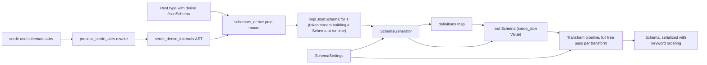
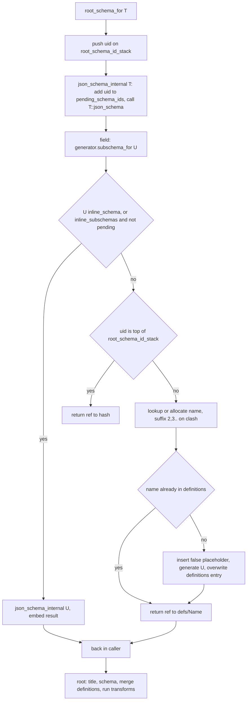

# schemars — Research report

## Metadata

- **Library name**: schemars (workspace crates `schemars` and `schemars_derive`)
- **Repo URL**: https://github.com/GREsau/schemars
- **Clone path**: `research/repos/rust/GREsau-schemars/`
- **Language**: Rust
- **License**: MIT
- **Analyzed version**: 4791bb7 2026-10-12 (crate version 1.2.3, released 2026-10-12; MSRV 1.74)
- **Report date**: 2026-10-26

## Summary

schemars is a **Rust types to JSON Schema generator**, the opposite direction of a schema-to-codegen tool. A
`#[derive(JsonSchema)]` macro (crate `schemars_derive`) implements the `JsonSchema` trait for a struct or enum.
At runtime a `SchemaGenerator` walks the type graph, collects named definitions into `$defs` (or another configured
path), and returns a `Schema`, a thin wrapper over `serde_json::Value`. The derive honours most `#[serde(...)]`
attributes so schemas match serde's wire format, and reads validator/garde-style attributes for validation keywords. Output drafts are 2020-12 (default),
2019-09, draft-07 and OpenAPI 3.0. The repo contains **no** JSON Schema to Rust code generation and **no**
instance validator (the `jsonschema` crate is only a dev-dependency used in tests).

## JSON Schema support

- **Direction**: it only emits schemas. It does not parse or consume arbitrary schemas; `Schema` accepts any JSON
  object or bool without validating it.
- **Drafts emitted** (`SchemaSettings` constructors in `schemars/src/generate.rs`): `draft2020_12()` (default, `definitions_path` `/$defs`), `draft2019_09()` (adds the `ReplacePrefixItems` transform), `draft07()` (`/definitions`; adds
  `ReplaceUnevaluatedProperties`, `RemoveRefSiblings`, `ReplacePrefixItems`) and `openapi3()` (`/components/schemas`;
  adds `ReplaceBoolSchemas`, `AddNullable`, `SetSingleExample`, `ReplaceConstValue`, etc.). Draft-04/06 are not provided.
- Meta-schema URIs live in `schemars/src/consts.rs` (`meta_schemas`); `meta_schema: None` omits `$schema`.
- **Scope**: the output is a subset of each draft: only the keywords the derive and built-in type impls need (see table).

## Keyword support table

Keyword list derived from the vendored 2020-12 meta-schemas (`specs/json-schema.org/draft/2020-12/meta/*.json`,
union of `properties` keys: 56 unique keywords; `format` appears in both format vocabularies). A second table below
covers keywords that exist only in the older drafts schemars can target (draft-07 `schema.json`, 2019-09 `meta/*.json`).
"Implemented" means **emitted by schemars** (by the derive, a built-in type impl, or a built-in transform); schemars
never evaluates keywords. Draft-04 and draft-06 are not targeted. Evidence: `schemars/src/**`, `schemars_derive/src/**`.

| Keyword | Implemented | Notes |
|---|---|---|
| $anchor | no | Not emitted. |
| $comment | no | Not emitted anywhere in `src` (`extend` can add arbitrary keys). |
| $defs | yes | Default `definitions_path`; `/definitions` for draft-07; `/components/schemas` for OpenAPI 3. |
| $dynamicAnchor | no | Not emitted. |
| $dynamicRef | no | Not emitted. |
| $id | no | Only listed in serialization key ordering (`schema.rs`); never generated (user can add via `extend`/`transform`). |
| $ref | yes | `Schema::new_ref`; refs like `#/$defs/Name`, root self-reference `#`. |
| $schema | yes | Inserted on root schemas from `SchemaSettings::meta_schema`. |
| $vocabulary | no | Not emitted. |
| additionalProperties | yes | Maps (`BTreeMap`/`HashMap` value schema), `deny_unknown_fields` (`false`). |
| allOf | yes | Used for `flatten` and `$ref` plus sibling metadata. |
| anyOf | yes | Untagged enums, `Option` of refs (with `null`), flatten of enums. |
| contains | no | The `contains = ".."` validation attr emits an escaped `pattern` on strings (`must_contain` in `_private/mod.rs`), not the keyword. `contains` is only walked by transforms. |
| dependentSchemas | no | Only recognised in key ordering (`schema.rs`); never emitted. |
| else | no | `if`/`then`/`else` only recognised by the transform subschema walker. |
| if | no | See `else`. |
| items | yes | Arrays, sets, tuples (pre-2020-12 style converted via transform). |
| not | partial | Used for `false` schema (`{"not": {}}`, OpenAPI) and in `NonZero*` impls. |
| oneOf | yes | Externally/internally/adjacently tagged enums with data variants. |
| patternProperties | yes | Emitted by `BTreeMap`/`HashMap` impls (`maps.rs`) when the key schema has a `pattern`, or an integer key type (`^\d+$` / `^-?\d+$`); `additionalProperties` becomes `false` when all key forms are covered. |
| prefixItems | yes | Tuples and tuple structs; `ReplacePrefixItems` rewrites for older drafts. |
| properties | yes | Struct fields; order is lexicographic, or declaration order with `preserve_order`. |
| propertyNames | no | Not emitted. The 1.2.0 "more specific" map schemas for enum keys use `properties` (one entry per enum string) plus `patternProperties`, not `propertyNames`. Only walked by transforms. |
| then | no | See `else`. |
| unevaluatedItems | no | Not emitted. |
| unevaluatedProperties | partial | Emitted by `flatten` merges when the merged schema contains subschema keywords (`_private::flatten`); `ReplaceUnevaluatedProperties` rewrites it to `additionalProperties` for draft-07/OpenAPI. |
| const | yes | Internal/adjacent tag values (`{"type":"string","const":name}`), unit variants forced out of the `enum` list (variant attrs, `untagged`, ref_variants), `Bound::Unbounded`; `AddNullable` and `allow_null` also touch it; `ReplaceConstValue` rewrites to one-element `enum` for OpenAPI. |
| dependentRequired | no | Not emitted. |
| enum | yes | All plain unit variants of an externally tagged enum collapse into ONE `{"type":"string","enum":[...]}` (the first `oneOf` entry when complex variants exist); `JsonSchema_repr` emits `{"type":"integer","enum":[discriminants]}`; `Option` of an enum appends `null` to `enum`. |
| exclusiveMaximum | partial | Only hardcoded in the chrono04 `TimeDelta` impl (nanoseconds tuple element, `chrono04.rs`); the `range` attr emits only `minimum`/`maximum`. |
| exclusiveMinimum | no | Not emitted. |
| maxContains | no | Not emitted. |
| maxItems | yes | `length(max=...)` / `length(equal=...)` on arrays; fixed-size arrays. |
| maxLength | yes | `length(max=...)` on strings; `char` type. |
| maxProperties | no | Not emitted. |
| maximum | yes | `range(max=...)`; integer type bounds in `primitives.rs`. |
| minContains | no | Not emitted. |
| minItems | yes | `length(min=...)`, fixed-size arrays, tuples. |
| minLength | yes | `length(min=...)`; `char`. |
| minProperties | no | Not emitted. |
| minimum | yes | `range(min=...)` (also `equal`); unsigned and `NonZero` types in `primitives.rs`/`nonzero.rs`. |
| multipleOf | no | Not emitted. |
| pattern | yes | `regex`/`pattern`/`contains` attributes (escaped for `contains`). |
| required | yes | Fields without `default` and non-`Option`; `required` attr unwraps `Option`. |
| type | yes | Primitives, `["T","null"]` arrays for `Option` (OpenAPI uses `nullable` via `AddNullable`). |
| uniqueItems | yes | `HashSet`/`BTreeSet` (`set_impl!` in `sequences.rs`); `Vec`, `VecDeque`, `BinaryHeap`, `LinkedList` do not set it. |
| default | yes | `serde(default)` / `schemars(default)`, serialized value. |
| deprecated | yes | From Rust `#[deprecated]`. |
| description | yes | From doc comments or `schemars(description)`. |
| examples | yes | `schemars(example = value)` and `extend`. |
| readOnly | yes | `skip_deserializing` on struct fields. |
| title | yes | Doc comments, `schemars(title)`, root type name from `rename`. |
| writeOnly | yes | `skip_serializing` on struct fields. |
| format | yes | Built-in per type (`uuid`, `date-time`, `uint32`, ...) and `email`/`url`/`ip` attrs; `RestrictFormats` transform strips non-standard ones. |
| contentEncoding | no | Not emitted. |
| contentMediaType | no | Not emitted. |
| contentSchema | no | Not emitted. |

Keywords not in 2020-12 but present in the older drafts schemars can emit (from `draft-07/schema.json` and `draft/2019-09/meta/*.json`):

| Keyword | Draft | Implemented | Notes |
|---|---|---|---|
| definitions | draft-07 | yes | `SchemaSettings::draft07()` sets `definitions_path` to `/definitions`; refs become `#/definitions/Name`. |
| additionalItems | draft-07, 2019-09 | partial | Produced by `ReplacePrefixItems` (draft-07, 2019-09, OpenAPI) when a schema has both `prefixItems` and `items`; not emitted for 2020-12. |
| dependencies | draft-07 | no | Not emitted. |
| $recursiveAnchor | 2019-09 | no | Not emitted. |
| $recursiveRef | 2019-09 | no | Not emitted. |

The 2019-09 `meta/hyper-schema` keys (`base`, `links`) and draft-07 hyper-schema are out of scope. `$defs`, `deprecated`, `dependentRequired`, `dependentSchemas`, `unevaluated*`, `$anchor` exist in 2019-09 with the same status as in the main table; `prefixItems` is replaced by array-form `items` on 2019-09 and draft-07. `deprecated` is absent from draft-07 but still emitted there (unknown keywords are tolerated).

## Constraints

Constraints are **emitted into the generated schema, not enforced in Rust**. `#[validate(...)]` (validator),
`#[garde(...)]` and `#[schemars(...)]` attributes (`length`, `range`, `regex`/`pattern`, `contains`, `email`, `url`,
`ip*`, `required`, `inner`) set `minLength`/`maxLength`, `minItems`/`maxItems`, `minimum`/`maximum`, `pattern`,
`format` (`schemars_derive/src/attr/validation.rs`). Nothing is checked at runtime by schemars itself.

## High-level architecture

Two crates: `schemars` (trait `JsonSchema`, `SchemaGenerator`, `SchemaSettings`, `Schema`, `transform`, `_private` runtime helpers
used by generated code, impls for std and optional third-party types) and `schemars_derive` (proc macro). The derive does not
compute the schema at compile time: it emits Rust code (a block of `serde_json::Map` inserts, `generator.subschema_for::<FieldTy>()`
calls and mutator statements) that builds the schema each time `json_schema()` runs. Entry points: `schema_for!(T)` (expands to
`SchemaGenerator::default().into_root_schema_for::<T>()`), `schema_for_value!(&v)`, `SchemaGenerator::root_schema_for::<T>()`.
The crate is `#![no_std]` + `alloc` and `#![forbid(unsafe_code)]`; the derive crate also forbids unsafe.

## Medium-level architecture

- **`JsonSchema` trait** (`schemars/src/lib.rs`): `schema_name()` (human name, used for the `$defs` key), `schema_id()` (identity key,
  defaults to `schema_name()`), `inline_schema()` (default `false`), `json_schema(&mut SchemaGenerator) -> Schema`, plus two hidden
  methods `_schemars_private_is_option()` and `_schemars_private_non_optional_json_schema()` that let the derive treat `Option<T>`
  fields as optional without specialization.
- **`SchemaGenerator`** (`generate.rs`): `settings`, `definitions: JsonMap<String, Value>`, `pending_schema_ids: BTreeSet<SchemaUid>`,
  `schema_id_to_name: BTreeMap<SchemaUid, CowStr>`, `used_schema_names: BTreeSet<CowStr>`, `root_schema_id_stack: Vec<SchemaUid>`.
  `SchemaUid` is `(schema_id, Contract)`, so the same type under the serialize and deserialize contracts is two identities.
- **Derive** (`schemars_derive/src`): `attr/schemars_to_serde.rs` rewrites attributes, `ast/` wraps `serde_derive_internals::ast`
  into a `Container`/`Variant`/`Field` tree with schemars attrs attached, `schema_exprs.rs` builds a `SchemaExpr` (token streams), `bound.rs` infers `T: JsonSchema` where-clauses, `name.rs` parses `{T}` placeholders in `rename`.
- **`Schema`** (`schema.rs`): `#[repr(transparent)] struct Schema(serde_json::Value)` constrained to object or bool.
- **`ser.rs`**: a `serde::Serializer` that infers a schema from a value (`schema_for_value`).

## Algorithms and data structures

### Schema representation

`Schema` is a newtype over `serde_json::Value` (`schema.rs`), `#[repr(transparent)]` and derived `RefCastCustom` (`ref_cast` crate)
so that a `&mut Value` that is already a schema can be reinterpreted as `&mut Schema` with zero copying
(`impl TryFrom<&mut Value> for &mut Schema`). The invariant (object or bool) is enforced only at the boundary:
`Schema::validate` is called from `Deserialize` and the `TryFrom` impls and rejects any other JSON type. Inside, no typed model
exists: keywords are plain map entries, unknown keywords and `x-` extensions are first-class, and there is no keyword enum, so any
keyword combination (including invalid ones) can be built. The reason, per the design visible in the code, is that `transform`
functions, `#[schemars(extend(...))]` and manual `json_schema!({...})` need to touch arbitrary draft-specific keys without a
per-draft struct hierarchy; the cost is no static checking and a `Value` allocation (a `BTreeMap<String, Value>` node tree,
or `IndexMap` with `preserve_order`) for every subschema.

Boolean schemas are `Value::Bool`. `ensure_object()` converts them lazily: `true` becomes `{}` and `false` becomes `{"not":{}}`
(this is why `not` appears for the `false` schema). `Schema` owns its data; there are no lifetimes or borrows between schemas, so
`.to_value()` and `Map::append` move subtrees around (definitions are moved into the root at the end). Subschemas are
shared by cloning (e.g. `Range<T>` uses the same `subschema` value for `start` and `end`; `BTreeMap::json_schema` clones the
value schema into `additionalProperties`, each `patternProperties` entry and each enum-key `properties` entry).

Serialization (`schema.rs`, private `ser::OrderedKeywordWrapper`) wraps the `Value` in a recursive `Serialize` that emits
`$id, $schema, title, description, type, format, properties` first, all remaining keys in map order, then `$defs`/`definitions`
last. A `no_reorder` flag marks maps that are not schemas but whose values are (`properties`, `patternProperties`,
`dependentSchemas`, `$defs`, `definitions`) so user property names are not reordered; `examples`, `default` and `x-*` values are
emitted untouched. This is cosmetic (readability) and happens only at serialization, not in the stored value.

### Reference resolution and registry

schemars never resolves references; it only creates them. The registry is the generator: `definitions` is the output map,
`schema_id_to_name: BTreeMap<SchemaUid, CowStr>` is the identity-to-name registry, `used_schema_names: BTreeSet<CowStr>` is the
set of taken names, and `pending_schema_ids: BTreeSet<SchemaUid>` is the "currently being generated" set used to detect cycles.

`SchemaGenerator::subschema_for::<T>()` (`generate.rs`) runs this algorithm:

1. Build `SchemaUid(T::schema_id(), contract)`.
2. A non-generic inner function `find_ref` decides whether to return a ref: `return_ref = !T::inline_schema() && (!settings.inline_subschemas || pending.contains(uid))`. So `inline_subschemas` inlines everything except types currently under construction, which is exactly the recursion case.
3. If `uid` equals `root_schema_id_stack.last()` the result is `{"$ref":"#"}` (a self reference to the document root, not a `$defs` entry).
4. Otherwise the name is looked up in `schema_id_to_name`, or allocated: take `schema_name()`; if it is in `used_schema_names`, try `Name2`, `Name3`... linearly until free; record in both maps. The ref string is `format!("#{definitions_path}/{encode_ref_name(name)}")`; `encoding::encode_ref_name` escapes `~`/`/` per RFC 6901 and percent-encodes bytes invalid in a URI fragment (this is how generic names like `Range_of_u32` stay safe).
5. If `definitions` does not yet contain the name, `insert_new_subschema_for` inserts the placeholder `false` first, then calls `json_schema_internal` (which inserts the uid into `pending_schema_ids` and removes it afterwards), then overwrites the entry with the real schema. The placeholder guarantees that a recursive type sees an existing definition and returns a ref instead of recursing without bound. With `inline_subschemas` the placeholder path is also how mutually recursive types terminate.
6. `Option<T>`, `Vec<T>`, maps, tuples, primitives, `Box`/`Arc` forwarders are `inline_schema() == true` (or forward to the inner type), so only derived structs/enums (and manual impls that opt in) ever get `$defs` entries.

Refs are always local JSON-pointer fragments; there is no `$id`, `$anchor` or `$dynamicRef` handling and no remote fetching.
A TODO in `insert_new_subschema_for` notes that a type generated under both contracts is not yet shared between them. Cycle detection cost is
one `BTreeSet` insert/remove per generated (non-ref) schema. `json_pointer_mut` (private) creates intermediate objects when
`definitions_path` is nested like `/components/schemas`, so definitions are merged into the root with `Map::append` at the end
(`add_definitions`).

`BTreeMap::json_schema` (`json_schema_impls/maps.rs`) is the one place that reads back from the registry: it calls `K::json_schema` for the key (not `subschema_for`), and if the key schema is a `$ref` into `definitions` it dereferences
it via `generator.definitions().get(name)` to inspect `pattern`/`enum`/`type`/`minimum` and derive `patternProperties`/`properties`.

### Compiled / intermediate form

There is no separate IR. The intermediate artifacts are:

1. At compile time, `schemars_derive` builds a `SchemaExpr { definitions, creator, mutators, post_mutators }` of token streams
   (`schema_exprs.rs`). `creator` yields the base `Schema`; `mutators` are `schema.insert(...)` / helper-call statements applied in
   order; `post_mutators` (user `extend` and `transform`) always run last. `ToTokens` assembles
   `{ defs; let mut schema = creator; mutators; post_mutators; schema }`. Nested types, such as the `_SchemarsSchemaWithFunction<T>`
   helper type generated for `schema_with`, are emitted into `definitions`.
2. At run time, the generated `json_schema()` body is straight-line Rust that mutates a `serde_json::Map`. There is no interpretation
   of a stored model; the "compiled form" is the monomorphized Rust code, and the live in-memory form is the `Schema`/`Value` tree plus
   the generator's `definitions`.

Contract-dependent behaviour (skip_serializing, `from`/`into`, serialize vs deserialize renames) is not resolved at macro time;
`with_contract_check` in `ast/mod.rs` wraps the action in `if generator.contract().is_serialize()` / `is_deserialize()` so the check
happens at run time against `SchemaSettings::contract`. `Name::to_tokens` emits an `if` choosing between serialize and deserialize names only when they differ.

### Core algorithm

**Derive pipeline** (`schemars_derive/src/lib.rs::derive_json_schema`):

1. `attr::process_serde_attrs` (`schemars_to_serde.rs`) mutates the `DeriveInput`: it drains all `#[serde(...)]` attributes, then for every container/variant/field builds an effective `#[serde(...)]` by taking `#[schemars(...)]` entries whose keyword is in `SCHEMARS_KEYWORDS_PARSED_BY_SERDE` (rename, rename_all, rename_all_fields, deny_unknown_fields, tag, content, untagged, default, skip*, flatten, remote, transparent, into, from, try_from, bound) and re-adding the original serde entries that are not overridden or unset by `!keyword`. `bound` is read only from the schemars attr; `with`/`serialize_with` are handled by schemars itself. Errors from unset-without-match or duplicates are collected in a `serde_derive_internals::Ctxt`. This is how "schemars overrides serde" is implemented without re-implementing serde's attribute grammar.
2. `Container::from_ast` calls `serde_derive_internals::ast::Container::from_ast(&ctxt, item, Derive::Deserialize, ..)`, which parses and validates the rewritten attributes (renames with both serialize and deserialize names, tag type, field styles `Struct/Newtype/Tuple/Unit`, defaults). `FromSerde` then attaches schemars-specific `ContainerAttrs/VariantAttrs/FieldAttrs` (doc comment, `title`, `description`, `example`, `extend`, `transform`, `schema_with`, validation attrs from `validate`/`garde`/`schemars`) and runs `bound::find_trait_bounds`, adapted from serde_derive, which adds `T: JsonSchema` only for type parameters that appear in non-skipped fields (so `PhantomData`-only params get no bound) and records `relevant_type_params` for `schema_id`.
3. `schema_id` is `module_path!()::Name` for non-generic types and `module_path!()::Name<{schema_id of each relevant param}...>` (a `format!`) for generics; `schema_name` is the serde deserialize name or a `format!` of the `rename = "..{T}.."` template. `#[serde(transparent)]` or container `with = "Type"` produce a pure forwarding impl (all five trait methods delegate to the inner type).
4. `schema_exprs::expr_for_container` dispatches: `with` > transparent > `from`+`into` (contract-selected) > unit/newtype/tuple/struct/enum, then wraps `from` or `into` conditionally on the contract, then `add_mutators` (title, description from doc comments via the `const fn get_title_and_description` which splits a leading `# heading` into title and the rest into description at compile time, `deprecated`, `examples`, `extend`, `transform`). Empty enums yield `Schema::from(false)`.

**Structs** (`expr_for_struct`): creator is `{"type":"object"}` (plus `additionalProperties:false` for `deny_unknown_fields`); for each field not skipped in both directions a mutator calls `insert_object_property(schema, name, is_optional, field_schema)`, which inserts into `properties` and pushes onto `required` unless optional. `is_optional` is a runtime-or-const expression: optional if (`skip_serializing_if` and a default) always; for deserialize when a default exists or the type's `_schemars_private_is_option()` is true (unless the `required` validation attr); for serialize it is true only if `skip_serializing_if` is present. Field defaults are evaluated at generation time by calling `Default::default()`/the `default` path and serialized with `serde_json::value::to_value` (via the autoref trick `_schemars_maybe_to_value!`, which silently skips if the type is not `Serialize`) into the `default` keyword. `skip_deserializing` fields get `readOnly`, `skip_serializing` get `writeOnly`.

**Flatten** (`_private::flatten`, `json_schema_for_flatten`): the flattened field's schema (taken with `_schemars_private_non_optional_json_schema` so `Option` does not add `null`) is merged into the parent object, not wrapped in `allOf`. `flatten_property` merges key-by-key: `required` and `allOf` concatenate, `properties`/`patternProperties` extend, `oneOf`/`anyOf` collisions are moved into an `allOf` of both, and any other key already present on the parent wins. If the flattened schema is `true` it adds `additionalProperties:true` (or `unevaluatedProperties:true` when the parent has `if/allOf/anyOf/oneOf/$ref`); when merging complex schemas, `additionalProperties` on either side is promoted to `unevaluatedProperties` (`normalise_additional_unevaluated_properties`) because additionalProperties would otherwise reject the other side's properties. For flattened enums, `AllowUnknownProperties` strips `additionalProperties:false`/`unevaluatedProperties:false` from immediate subschemas (the outer struct decides), externally tagged unit variants are rewritten from strings into `{"type":"object","properties":{V:{"type":"null"}},"required":[V]}` since a flattened unit variant is serialized as `{V: null}`, and a flattened `Option<enum>` gets an extra empty-schema branch (`anyOf: [{oneOf: ...}, {}]`).

**Enum representations** (`schema_exprs.rs`; `variant_subschemas` selects `oneOf` when variants are assumed mutually exclusive and `anyOf` if any variant or the enum is untagged):

- *Externally tagged* (default): variants where `is_unit() && attrs.is_default() && !untagged && !ref_variants` are partitioned out and merged into a single `{"type":"string","enum":[names]}` pushed first; each other variant becomes `{"type":"object","properties":{name: <variant schema>},"required":[name],"additionalProperties":false}` via `new_externally_tagged_enum_variant`. If only unit variants exist the result is the string enum alone (no `oneOf`).
- *Internally tagged* (`tag = "t"`): each variant's schema is built like an untagged one, then `apply_internal_enum_variant_tag` sets `type: object`, inserts `t: {"type":"string","const":name}` at the front of `properties` (rebuilding the map to put the tag first, a 1.2.3 change) and `required.insert(0, tag)`, and adds `additionalProperties:false` for a unit variant under `deny_unknown_fields`. Newtype variants go through `json_schema_for_internally_tagged_enum_newtype_variant`, which inlines the inner schema (instead of `$ref`) when the inner type is inline, `inline_subschemas` is set, it is a null/unit type, or the inner schema (or a nested immediate subschema) forbids additional/unevaluated properties (stripped, which would otherwise reject the tag); otherwise it refs the inner type.
- *Adjacently tagged* (`tag`+`content`): `{"type":"object","properties":{tag:{type:string,const},content:<schema>},"required":[tag,content]}` (content omitted for unit variants), `additionalProperties:false` with `deny_unknown_fields`.
- *Untagged*: each variant schema is placed in `anyOf`; with `untagged_enum_variant_titles` the variant name is added as `title`. A per-variant `#[serde(untagged)]` inside a tagged enum switches that variant to untagged form and downgrades the combiner to `anyOf`.
- *`_unstable_ref_variants`* (enum-level attribute): every variant is wrapped in a generated `_SchemarsRefVariant<T>` type with `schema_id` `_SchemarsRefVariant/<enum id>::<variant>`, so each variant becomes its own `$defs` entry.
- *`JsonSchema_repr`* (separate derive): `{"type":"integer","enum":[X as repr, ...]}`.

**Option** (`json_schema_impls/core.rs`, `_private::allow_null`): `Option<T>::json_schema` calls `generator.subschema_for::<T>()` and then `allow_null`: a schema with `$ref`/`allOf`/`anyOf`/`oneOf`/`if` is wrapped as `anyOf: [schema, {"type":"null"}]`; otherwise `type: "x"` becomes `["x","null"]` and `const`/`enum` gain `null`. `Option<Option<T>>` is idempotent (a unit test asserts it). `bool` true schema stays unchanged and `false` becomes the `null` schema.

**Maps and sets** (`json_schema_impls/maps.rs`, `sequences.rs`): `BTreeMap<K,V>` classifies each alternative of the key schema (pattern -> `patternProperties`; string `enum` -> `properties` entries; integer -> `^\d+$` or `^-?\d+$` patterns; anything else -> `additionalProperties: V`), and sets `additionalProperties:false` when all key forms are enumerated. `HashMap`/`IndexMap` forward to it. `HashSet`/`BTreeSet` add `uniqueItems:true`; other sequences do not.

**Value inference** (`ser.rs`): `schema_for_value` runs a custom `serde::Serializer` where scalar methods delegate to `generator.subschema_for::<ty>()` or return a `{"type":..}`; sequence and map element schemas are deduplicated by equality, and heterogeneous elements widen to `true`; a root `examples` entry with the serialized value is added.

**Transforms** (`transform.rs`): `Transform::transform(&mut self, &mut Schema)`, blanket-implemented for `FnMut(&mut Schema)`. `SchemaSettings::transforms: Vec<Box<dyn GenTransform>>`, where `GenTransform` is `Transform + DynClone + Any + Send` (so `SchemaSettings` stays `Clone` and downcastable). `SchemaGenerator::apply_transforms` runs each transform once on the *root* schema, in list order; because `definitions` were moved under the root first, they are visited as part of the tree. Each built-in transform recurses itself via `transform_subschemas`, which has an explicit keyword-to-shape table (single subschema: `not,if,then,else,contains,additionalProperties,propertyNames,additionalItems`; arrays: `allOf,anyOf,oneOf,prefixItems`, and `items` as array or single; maps: `properties,patternProperties,$defs,definitions`) deliberately covering several drafts so appended user transforms work on any preset. `RecursiveTransform<T>` wraps a non-recursive transform. How the presets reach older targets:

- `ReplacePrefixItems` (2019-09, draft-07, OpenAPI): renames `prefixItems` to `items` and moves a pre-existing `items` to `additionalItems`.
- `ReplaceUnevaluatedProperties` (draft-07, OpenAPI): turns `unevaluatedProperties` into `additionalProperties`, and first collects property names of immediate subschemas (`allOf/anyOf/oneOf/if/then/else` via `transform_immediate_subschemas` and a `BTreeSet`) and adds each as `true` to `properties` so those names are not rejected.
- `RemoveRefSiblings` (draft-07, OpenAPI): if `$ref` has sibling keys, moves it into `allOf: [{"$ref":..}]`.
- `ReplaceBoolSchemas` (OpenAPI): turns `true`/`false` subschemas into objects via `ensure_object`, optionally skipping `additionalProperties`.
- `AddNullable` (OpenAPI): `type` containing `null` becomes `nullable:true`, removes `null` from `type`, a null-only schema becomes `const: null` (later rewritten by `ReplaceConstValue`).
- `SetSingleExample` (OpenAPI): `examples` array to singular `example`; `ReplaceConstValue`: `const` to one-element `enum`.
- `RestrictFormats` (not in any preset): drops `format` values not in the draft's defined set (`DEFINED_FORMATS`, sliced for draft-07) or user-allowed set, tracking `$schema` per subschema with a stack-like `inferred_formats` field.

### Error and output model

Generation is infallible: `root_schema_for` returns `Schema`, not `Result`. Failure points are compile-time (proc-macro errors collected in `syn::Result`/`Ctxt` with spans; the `tests/ui` trybuild cases pin messages), panics in `json_schema!` (`unwrap` on `Schema::try_from`) and in `schema_for_value!` (`unwrap`), and `serde_json::Error` from `root_schema_for_value` and `Schema::try_from(Value)`. Output is the in-memory `Schema`; callers serialize it with `serde_json`. There are no instance paths, diagnostics or validation errors because nothing is validated.

## Low-level details

- **serde contract**: `Contract::Deserialize` (default) or `Serialize` (`SchemaSettings::for_serialize`). It is stored in `SchemaUid`, evaluated at run time in generated `if` blocks, and affects which fields/variants appear, `readOnly`/`writeOnly`, required-ness, `from`/`try_from` vs `into`, and rename (`Name` emits an `if` when serialize and deserialize names differ).
- **Required-ness trick**: `_schemars_private_is_option()` is a trait method that is `true` only for `Option<T>` (and forwarders), so no specialization is needed; `#[schemars(required)]` uses `_schemars_private_non_optional_json_schema` to unwrap the `null` alternative.
- **Autoref specialization** (`_private::MaybeSerializeWrapper`/`NoSerialize`, `MaybeJsonSchemaWrapper`/`NoJsonSchema`): used so the derive can call `Serialize` (for defaults) or `schema_id` (for generic arguments) only when the type implements them, falling back to `core::any::type_name` for `schema_id` of non-`JsonSchema` type arguments.
- **Numeric representation**: integers are `type: integer` with `format` (`int8`..`int128`, `uint8`..`uint128`, `int`/`uint`). `i8,i16,u8,u16` carry real `minimum`/`maximum`; `u32/u64/u128/usize` carry only `minimum: 0`; `i32/i64/i128/isize` carry no bounds. `f32/f64` are `number` with `format` `float`/`double`. `Schema::validate` handles `arbitrary_precision` numbers (1.2.3 fix). `range` attr emits `minimum`/`maximum` (also `equal`) and `length` emits `minLength/maxLength` for strings and `minItems/maxItems` for arrays, only when the schema already has that `type` (`insert_validation_property`, which also lets `integer` accept `number` attrs).
- **String length**: `char` is `minLength: 1, maxLength: 1` (code point semantics from JSON Schema); schemars itself counts nothing.
- **Regex**: `contains` attr is turned into an escaped `pattern` by a vendored copy of `regex_syntax::escape` (`_private/regex_syntax.rs`; meta characters include `# & - ~`), not a regex engine.
- **Recursion**: type recursion is finite and goes through `$ref`/pending ids, so the Rust call depth is bounded by type nesting. `transform_subschemas`, `OrderedKeywordWrapper::serialize` and `flatten` helpers are literally recursive over the `Value` tree (no explicit stack); depth equals schema nesting, which is bounded by the type definition, not by untrusted input.
- **`schema_with`**: a function taking `&mut SchemaGenerator` is wrapped in a generated inline `_SchemarsSchemaWithFunction<T>` type whose `schema_id` includes `module_path!` and the function path.
- **`alias`, `getter`** serde attributes are not in `SERDE_KEYWORDS` and are ignored by the rewrite (`alias` only matters for deserialization input names).
- **Remote derive**: `#[serde(remote = "...")]` makes the container name the last path segment of the remote type.

## Output and integration

- **Vendored vs build-dir**: no files are emitted by the library; callers serialize the `Schema` themselves (`serde_json::to_string_pretty`/`to_writer`). The repo's own examples and test snapshots commit `*.json` files beside the sources.
- **API vs CLI**: Rust API and derive macro only. No CLI.
- **Writer model**: in-memory `Schema` value; `Schema` implements `Serialize` (with keyword ordering), so any serde writer works.

## Configuration

`SchemaSettings` fields (`generate.rs`): `definitions_path` (JSON pointer; a leading `#` and trailing `/` are stripped), `meta_schema` (`None` omits `$schema`), `transforms`, `inline_subschemas`, `contract`, `untagged_enum_variant_titles`; builders `with`, `with_transform`, `for_serialize`, `for_deserialize`; presets `draft07`, `draft2019_09`, `draft2020_12` (default), `openapi3`. The struct is `#[non_exhaustive]`.
Built-in `Transform`s: `RecursiveTransform`, `ReplaceBoolSchemas`, `RemoveRefSiblings`, `SetSingleExample`, `ReplaceConstValue`, `ReplacePrefixItems`, `AddNullable`, `ReplaceUnevaluatedProperties`, `RestrictFormats`; any `FnMut(&mut Schema)` is a `Transform`. Cargo features: `derive`, `std` (defaults), `preserve_order`, `raw_value`, and integration features for `arrayvec07`, `bigdecimal04`, `bytes1`, `chrono04`, `either1`, `indexmap2`, `jiff02`, `rust_decimal1`, `semver1`, `smallvec1`, `smol_str02/03`, `url2`, `uuid1`.
Derive attributes: serde (`rename`, `rename_all`, `rename_all_fields`, `tag`/`content`/`untagged`, `default`, `skip*`, `flatten`, `with`, `from`/`try_from`/`into`, `deny_unknown_fields`, `transparent`, `remote`), `schemars(bound)`, validation attrs (see Constraints; `validate` and `garde` attributes are read too), and `schema_with`, `title`, `description`, `example`, `inline`, `crate`, `extend`, `transform`, `!attr` unset syntax, doc comments, `#[deprecated]`, the unstable `_unstable_ref_variants`, and the separate `JsonSchema_repr` derive.

## Pros/cons

- Pros: faithful serde compatibility by reusing `serde_derive_internals` for attribute semantics; trait-based so third-party types plug in; schema built by compiled straight-line Rust with no reflection; multiple drafts/OpenAPI via composable transforms; `no_std`; per-contract output; solid snapshot testing; docs and migration guide for v0 to v1.
- Cons: output only (no ingestion of existing schemas); small keyword subset (no `$anchor`, `$dynamicRef`, `dependent*`, `if/then/else`, `multipleOf`, `contentEncoding`...); no Draft 4/6; schema is an untyped `serde_json::Value`, so invalid schemas can be built without error and every subschema is a heap map; no structural dedup or memoization of repeated work; transforms are one full tree walk each.

## Testability

`schemars/tests/integration/` (about 50 modules, e.g. `enums.rs`, `flatten.rs`, `same_name.rs`, `contract.rs`, `transform.rs`) uses a `TestHelper` that generates schemas for both contracts, compares them to committed JSON snapshots under `tests/integration/snapshots` (snapbox), and validates sample values against the generated schema with the `jsonschema` crate (dev-dependency 0.30). UI (compile-fail) tests via `trybuild` (`tests/ui`, feature `_ui_test`). `no_std` test (`tests/no_std.rs`) and doc-tests; unit tests inside `transform.rs`, `_private/mod.rs`, `schemars_to_serde.rs`. Run `cargo test --all-features`; `update-tests.sh` / `update-examples.sh` refresh snapshots. The snapshots are schema outputs for Rust types, so they cannot be reused as inputs for a schema-to-Rust generator.

## Performance

Analysis from code only; nothing was built or run.

### Performance techniques

- **Compile vs interpret**: the derive does the type/attribute analysis at macro-expansion time (serde attribute parsing, enum-representation choice, validation attribute selection, doc-comment title/description splitting through `const fn`, stored in `const TITLE`/`const DESCRIPTION`). What remains at run time is straight-line `Map::insert` code, with a few run-time `if contract` branches and per-call evaluation of `Default::default()` for `default` keywords. There is no schema compilation or caching of the finished `Schema`: each `json_schema()` call rebuilds its subtree.
- **Memory layout and allocation**: the representation is pointer-heavy (`Value` trees of `BTreeMap<String, Value>` by default, so each node allocates, and each key is an owned `String`); `preserve_order` swaps in an `IndexMap`. Schema/ref names are `Cow<'static, str>` so non-generic derived types return borrowed `&'static str` for `schema_name`/`schema_id` (the `module_path!::Name` concat is a compile-time `concat!`), while generics allocate via `format!` on each call. `subschema_for` allocates a `SchemaUid` (clone of the `Cow`), builds the `$ref` string with `format!` and a possibly allocating `encode_ref_name` every time a field type is visited, even for an already-defined type. Reference types are thin: `Schema` is `repr(transparent)` and `ref_cast` avoids copies when transforms view a `&mut Value` as `&mut Schema`. `root_schema_for` clones the whole `definitions` map (`self.definitions.clone()`) so the generator remains reusable; `into_root_schema_for` (used by `schema_for!`) moves it with `take_definitions` instead. A TODO notes `new_externally_tagged_enum_variant` re-serializes its subschema through `json_schema!` and could insert the `Value` directly.
- **Caching and memoization**: the only cache is the generator's per-run `schema_id_to_name`/`definitions`, which ensures each non-inline type is generated once per generator (O(log n) `BTreeSet`/`BTreeMap` lookups keyed by string compare). Inline types (`Option`, `Vec`, maps, primitives) are regenerated at every use. There is no global or static cache, and no `lazy_static`/`OnceCell`; a fresh `SchemaGenerator` redoes all work. No structural hashing.
- **Fast paths and short-circuiting**: `find_ref` returns early for inline schemas before touching any map; an already-named, already-defined type costs a name lookup and a `contains_key` check. `allow_null` returns early for an existing nullable `anyOf`. `RestrictFormats`, `AddNullable` and similar transforms test `has_type`/key presence before doing work. Transforms always walk the entire tree (no skip of unchanged subtrees), and each preset transform is an independent full pass (draft-07 runs three, OpenAPI seven) so cost is O(#transforms x schema size). `transform_subschemas` uses `try_into` (a cheap type match) per child.
- **Regex handling**: no regex engine. Patterns are strings passed through; `contains` uses a vendored `escape` function that is linear in the input. No ReDoS surface because nothing is matched.
- **Concurrency**: `SchemaSettings` and `SchemaGenerator` are asserted `Send` (`_assert_send`); `GenTransform` requires `Send`. Generation takes `&mut SchemaGenerator`, so a generator is single-threaded and not shared; multiple generators on different threads are independent because no global state exists. No parallel generation. The 1.x design avoids generic-heavy code in `subschema_for` (a non-generic nested `find_ref(this, uid, inline, schema_name_fn_ptr)`) explicitly to cut monomorphization and compile time.

### Benchmarks in repo

None found (no `benches/` directory, no criterion dependency). Entry points for external measurement: `schemars::schema_for!(T)` / `SchemaGenerator::root_schema_for::<T>()` and `schema_for_value!`; the derive must be applied to a Rust type, so shared JSON Schema fixtures cannot be fed in directly.

## Determinism and idempotency

Deterministic. `serde_json::Map` is a `BTreeMap` by default (sorted keys), or insertion-ordered with the `preserve_order` feature (field declaration order, tag first for internal tags). `definitions` therefore come out in lexicographic name order by default. Name collisions between distinct `schema_id`s are suffixed in encounter order (`Name2`, `Name3`), which depends on traversal order of fields (declaration order), itself deterministic. Generator-internal sets/maps are `BTree*`; `HashMap`/`HashSet` impls forward to the `BTree` impls and use `BTreeSet`s of patterns, so no hash iteration order leaks into output. `OrderedKeywordWrapper` fixes the position of `$id/$schema/title/description/type/format/properties` and puts `$defs`/`definitions` last. Repeated runs for the same type produce identical output (snapshot tests rely on this). One caveat: an `HashSet`-valued `default` serialized via `serde_json::to_value` may have unspecified element order.

## Enum handling

This concerns Rust enums to schema. Unit-only external enums become one `{"type":"string","enum":[names]}`; mixed external enums put the same string-enum as the first `oneOf` item and use one object branch per complex variant (unit variants are not `const` entries on the default path; `const` is used for tags and for attributed or `ref_variants` unit variants via `new_unit_enum_variant`). Internally/adjacently tagged forms generate `type: object` branches with a tag `const` in `oneOf`; untagged uses `anyOf`.
Rust itself forbids duplicate variant identifiers, but serde `rename`/`rename_all` can map distinct variants to the same wire name (or case-fold, e.g. `rename_all = "lowercase"` on `A` and `a`). The derive does not catch this: unit variant names are pushed verbatim into a `Vec` of values (`expr_for_external_tagged_enum`), other representations emit one tag `const` per variant, and there is no dedupe or duplicate-name error in `schemars_derive/src` (its only error paths are attribute misuse such as duplicate or mutually exclusive attributes) nor a test or `tests/ui` case for it. Result: an `enum` array with repeated strings, or `oneOf` branches with identical `const`s that overlap. Whether `serde_derive_internals` (a dependency, not vendored in the clone) rejects such renames could not be checked locally. Distinct case-differing names (`"a"`/`"A"`) are emitted as distinct values. The reverse question (JSON Schema `enum` to Rust enum) is not applicable.

## Reverse generation (Schema from types)

**Yes, this is the primary function.** `#[derive(JsonSchema)]` implements the trait; `schema_for!`, `SchemaGenerator` and `SchemaSettings` produce a `Schema`; `schema_for_value!` infers a schema from a serializable value (custom `serde::Serializer` in `ser.rs`); manual `impl JsonSchema` or `schema_with` cover custom types. Implementations exist for std types (primitives, `Option`, `Result`, `Vec`, arrays, tuples, maps, sets, `Duration`, `Range`, `Bound`, `NonZero*`, `Cell`/`Arc`, paths and others) and optional third-party types via features. Serde compatibility is a design goal; `#[schemars(...)]` mirrors and overrides serde attributes; the serialize/deserialize contract picks which direction is described. Transforms adapt the output to older drafts or OpenAPI 3.0.

## Multi-language output

No. Output is JSON Schema (JSON) only, produced from Rust.

## Model deduplication and $ref/$defs

Dedupe is by **type identity** (`schema_id` plus contract), not structural equality. For derived types `schema_id` is `module_path!::Name` (plus relevant generic arguments' ids), so same-named structs in different modules are different identities (see `tests/integration/same_name.rs`: `a::Config`, `b::Config` and a `#[schemars(rename = "Config")]` type get distinct `$defs` keys through the `Name`, `Name2`, `Name3` suffixing). The trait default (`schema_id() == schema_name()`) applies to manual impls. Each non-inline type is generated once into `$defs` and referenced by `$ref`; identical shapes in different types remain separate definitions. Generic instantiations get distinct names built from type arguments (e.g. `Range_of_u32`) and distinct ids. `#[schemars(inline)]` or `inline_subschemas` inlines schemas (recursive types still use `$ref`; the root self-reference is `#`). A TODO in `insert_new_subschema_for` notes that serialize/deserialize variants of the same type are not yet merged.

**Colliding identities (researched for json-schema-rs #50).** The generator is infallible (`root_schema_for` returns `Schema`, `schemars/src/generate.rs:450`). Colliding `$defs` names get a number appended (`Foo`, `Foo2`, via `used_schema_names`, `generate.rs:336-353`). Two types with the same `schema_id` are treated as one, and the second's schema is never generated: the docs say ids "must" differ (`lib.rs:157-162`), but this is not enforced, so it is a silent drop. `$id` added via `extend` is opaque to the generator, so two types with one `$id` produce an invalid bundle with no signal.

## Validation (schema + JSON → errors)

No. schemars does not validate instances. The `jsonschema` crate is used only in dev-dependencies to check that generated schemas accept sample serialized values in tests.

## Could not verify

- Whether `serde_derive_internals` rejects colliding renames (dependency not vendored).
- The exact contents and ordering behaviour of third-party type impls under each feature flag (read only a sample: `core.rs`, `maps.rs`, `sequences.rs`, `primitives.rs`).
- Run-time costs are inferred from code reading, not measured.
