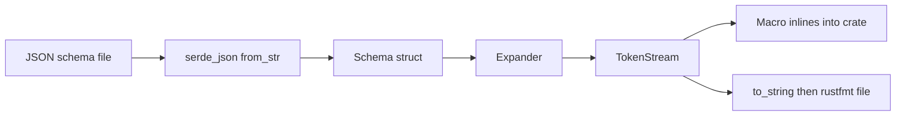
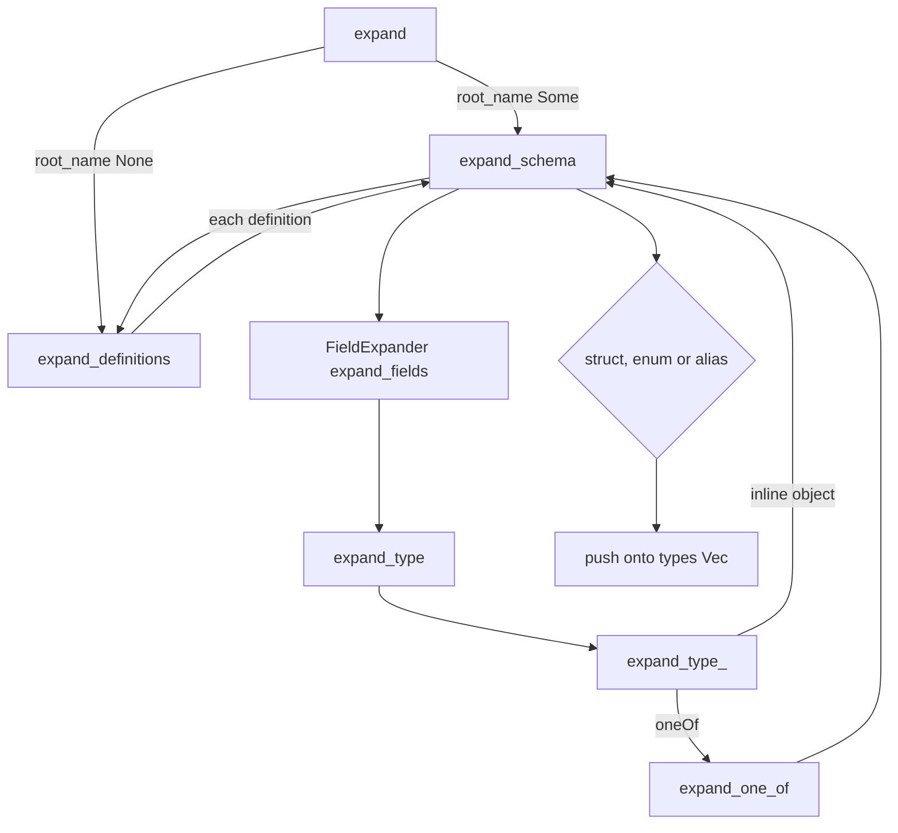

# schemafy — Research report

## Metadata

- **Library name**: schemafy
- **Repo URL**: https://github.com/Marwes/schemafy
- **Clone path**: `research/repos/rust/Marwes-schemafy/`
- **Language**: Rust
- **License**: MIT (LICENSE file added to the `schemafy` crates in Oct 2022)
- **Analyzed version**: d03858b 2022-10-28 (crate version 0.6.0; `git describe`: v0.6.0-14-gd03858b)
- **Report date**: 2026-10-27

## Summary

schemafy is a Rust crate that takes a JSON Schema (draft 4) and generates Rust types that are serializable with serde. Code generation is structure-only: it does not enforce validation keywords (e.g. minLength, minimum) in generated code or at runtime. The crate can be used at build time via a procedural macro or a builder API, and optionally via a CLI. Generated code is emitted as token streams and can be written to files or inlined by the macro. The library bootstraps itself by generating its own schema types from the JSON Schema meta-schema.

## JSON Schema support

- **Draft**: Draft 4 only (README and docs state "JSON schema (draft 4)").
- **Scope**: Structure-oriented subset. The schema is parsed into an internal `Schema` type (generated from the draft-04 meta-schema). References (`$ref`) and `definitions` are resolved; combinators (`allOf`, `anyOf`, `oneOf`) and structural keywords (`type`, `properties`, `items`, etc.) drive codegen. Validation keywords (e.g. `multipleOf`, `maxLength`, `minItems`) are not enforced in generated types. No support for draft 2019-09 or 2020-12.

## Keyword support table

Keyword list derived from the vendored draft-04 meta-schema `specs/json-schema.org/draft-04/schema.json` (all 33 `properties` keys; each row checked against `schemafy_lib/src/lib.rs`). Note: schemafy also resolves `$ref` and uses `definitions` for reference resolution; `$ref` is not a property in the vendored draft-04 core meta-schema, so it is not listed as a row below.

| Keyword | Implemented | Notes |
|---------|-------------|-------|
| $schema | no | Parsed into the model, never read by the expander. |
| additionalItems | no | Not used in expand/codegen. |
| additionalProperties | yes | Object with schema → `BTreeMap<String, T>`; `false` → struct with optional `#[serde(deny_unknown_fields)]`. |
| allOf | yes | Merged in `Expander::schema` via `merge_all_of`: properties merged recursively, `required` unioned, `description`/`$ref` overwritten by later members, `type` intersected. Other keywords (items, enum, additionalProperties) are not merged. |
| anyOf | partial | Special case: two branches with one array of same item type → `Vec<T>` with one-or-many serde; otherwise → `serde_json::Value`. |
| default | partial | Used only for `#[serde(default)]` and `Default` derive when applicable (e.g. optional fields, empty object default); **actual default value not emitted** (e.g. `default: 42` for optional int does not produce a literal 42 in generated code). |
| definitions | yes | Resolved via `schema_ref`; each definition expanded to a named type. |
| dependencies | no | Parsed but not used for codegen. |
| description | yes | Emitted as `///` doc comments on structs and fields. |
| enum | partial | Only honored when the schema is a definition or the root (via `expand_schema`); an inline property with `enum` becomes plain `String`. String variants always; integer variants only with the non-standard `enumNames` (then `Serialize_repr`/`Deserialize_repr`, `#[repr(i64)]`); integers without `enumNames`, booleans, objects panic. `null` makes the type `Option<Enum_>`. |
| exclusiveMaximum | no | Not used for codegen. |
| exclusiveMinimum | no | Not used for codegen. |
| format | no | Not used for codegen. |
| id | partial | Only used as the variant name of a `oneOf` branch (`schema.id`), otherwise `Variant{i}`; not used for URI resolution. |
| items | partial | Array type → `Vec<T>` using only `items[0]` (tuple form collapses to the first schema; none → `Vec<serde_json::Value>`). Deserialized via `one_or_many`, so a bare schema object is accepted. |
| maximum | no | Not used for codegen. |
| maxItems | no | Not used for codegen. |
| maxLength | no | Not used for codegen. |
| maxProperties | no | Not used for codegen. |
| minimum | no | Not used for codegen. |
| minItems | no | Not used for codegen. |
| minLength | no | Not used for codegen. |
| minProperties | no | Not used for codegen. |
| multipleOf | no | Not used for codegen. |
| not | no | Parsed but not used in expand. |
| oneOf | yes | Generates untagged enum of variant types; supports refs and inline schemas. |
| pattern | no | Not used for codegen. |
| patternProperties | partial | Only affects whether `#[serde(deny_unknown_fields)]` is emitted when combined with `additionalProperties: false`; no map-from-pattern codegen. |
| properties | yes | Drives struct fields; field names and optional/required handled. |
| required | yes | Non-required fields emitted as `Option<T>`; `skip_serializing_if="Option::is_none"` added. |
| title | no | Not used for codegen. |
| type | yes | Maps to Rust types (string, integer, boolean, number, object, array, null); multiple types and null handled. |
| uniqueItems | no | Not used for codegen. |

## Constraints

Validation keywords are not enforced. The README states: "No checking such as min_value are done but instead only the structure of the schema is followed as closely as possible." In the code, keywords such as `multipleOf`, `maximum`, `minimum`, `maxLength`, `minLength`, `maxItems`, `minItems`, `pattern`, `uniqueItems`, `dependencies`, etc. are not read when generating types. Generated Rust types rely on serde for (de)serialization only; there is no runtime validation layer.

## High-level architecture

schemafy is a single-pass, single-file generator: read one JSON file, deserialize it into a typed `Schema` struct, walk that struct once with an `Expander`, and emit a `proc_macro2::TokenStream` of Rust items. There is no intermediate representation between the parsed schema and the tokens, no registry, and no validation of the schema itself.

- **Input**: one JSON schema file path (macro literal, builder `with_input_file`, or CLI positional). Relative paths are joined to `CARGO_MANIFEST_DIR` (or the nearest ancestor directory containing `Cargo.toml`) in `generator.rs::get_crate_root`.
- **Parse**: `serde_json::from_str::<Schema>` into the draft-04 meta-schema model in `schemafy_lib/src/schema.rs` (itself generated by schemafy from `schemafy_lib/src/schema.json`).
- **Expand**: `Expander::expand` produces `Vec<(String, TokenStream)>` of types and concatenates them with `quote!`.
- **Emit**: the proc macro returns the tokens directly into the compiler; `Generator::generate_to_file` stringifies the tokens (`tokens.to_string()`), writes the file and shells out to `rustfmt` (the result of the command is ignored apart from spawn errors). The CLI additionally pipes the file through `rustfmt --edition 2018` again.

Crates: `schemafy_core` (the `one_or_many` serde helper module, imported by generated code), `schemafy_lib` (model, `Generator`, `Expander`), `schemafy` (the `schemafy!` proc macro in `src/lib.rs`, and the optional `schemafy` and `generate-tests` binaries). `build.rs` regenerates `schemafy_lib/src/schema.rs` only when feature `internal-regenerate` is on (bootstrapping).

## Medium-level architecture

- **Schema model**: `Schema` in `schemafy_lib/src/schema.rs` is a flat struct with one field per draft-04 keyword plus the non-standard `enumNames`. See "Schema representation" below.
- **`Expander<'r>`** (`schemafy_lib/src/lib.rs`) holds `root_name: Option<&str>`, `schemafy_path`, `root: &'r Schema`, mutable naming context `current_type: String` and `current_field: String`, and the output accumulator `types: Vec<(String, TokenStream)>`. All type-name decisions are driven by those two mutable strings.
- **`FieldExpander`**: a small helper (holding `&mut Expander` and a `default: bool` flag) that turns `properties` into struct field tokens.
- **Ref handling**: `$ref` is used in two different ways: as a *type name* (`type_ref`, pure string manipulation, no lookup) and as a *schema lookup* (`schema_ref`, walking `definitions`). See below.
- **Naming**: `Inflector` for PascalCase/snake_case; `str_to_ident` sanitizes identifiers; `#[serde(rename = ...)]` is added whenever the sanitized name differs from the original.

## Algorithms and data structures

### Schema representation

`Schema` (`schemafy_lib/src/schema.rs`) is a plain owned struct deserialized by serde. Subschema containers are `BTreeMap<String, Schema>` for `definitions`, `properties` and `patternProperties` (all `#[serde(default)]`, so absent means empty map), `Option<Vec<Schema>>` for `allOf`/`anyOf`/`oneOf`, `Option<Box<Schema>>` for `not`, and `Vec<Schema>` for `items` and `Vec<SimpleTypes>` for `type`, both annotated `#[serde(with = "::schemafy_core::one_or_many")]` so the JSON "single value or array" form collapses into a Vec (a single value becomes a one-element Vec; serialization emits a bare value when len is 1). `additionalItems`, `additionalProperties` and `dependencies` values are untyped `serde_json::Value` (they can be bool or schema), which means the expander re-deserializes them on demand (`serde_json::from_value(props.clone())` in `expand_type_`). `default`, `enum` entries are `serde_json::Value`. Numeric bounds are `f64`; `minItems`, `minLength`, `minProperties` are typed as `serde_json::Value` because the meta-schema's `positiveIntegerDefault0` is an `allOf` that schemafy collapses to a type alias of `Value`. There is no unknown-keyword storage (no `#[serde(flatten)]`), so unrecognised keywords are silently dropped; serde's default for unknown fields on a non-`deny_unknown_fields` struct. Boolean schemas do not exist in draft 4, and a boolean where a schema is expected fails deserialization of the whole file. Everything is owned and cloned freely (`Schema: Clone`); the `Expander` borrows the root with lifetime `'r` and uses `Cow<'r, Schema>` only for the allOf-merge path.

### Reference resolution and registry

There is no registry, no `$id`/`id` base-URI tracking, no remote fetching and no anchor support. Two independent mechanisms exist:

1. **`type_ref(&self, s)`** derives a *Rust type name* from a `$ref` string without looking anything up. It tries `uriparse::URI::try_from(s)` and takes the fragment; if that fails it strips a leading `#` and parses the rest as a `Fragment`; if everything fails it uses the raw string. An empty fragment means "the root", yielding `root_name` (and `expect`s a root name, so `$ref: "#"` without a root name panics). Otherwise it takes the last `/`-separated component, PascalCases it, replaces invalid identifier characters and prefixes `_` for a leading digit. The consequence is that the emitted type name for `#/definitions/Foo` is simply `Foo`, assumed to match what `expand_definitions` produced from the key `Foo`; a ref to anything that is not a `definitions` entry (e.g. `#/properties/a`) yields a name for a type that is never generated, which fails at rustc time rather than at generation time.
2. **`schema_ref(&self, s) -> &'r Schema`** resolves a ref to an actual `&Schema` by folding over `s.split('/')`: a component ending in `#` resets to the root, `definitions` leaves the current schema unchanged, and any other component is a `schema.definitions.get(comp)` lookup that `panic!`s when missing. Cost is O(path depth x log n) per lookup, with no caching. It is used only by `Expander::schema` (to look through a `$ref` for `allOf` merging, struct field enumeration, and the `anyOf` one-or-many comparison). Only a single hop is followed: if the resolved target is itself a pure `$ref`, it is not chased further. Cycle handling: there is no visited set; cycles are avoided structurally because lookups never recurse through `$ref`s (only through `allOf` members in `schema()`, so an `allOf` cycle through refs would recurse until stack overflow). Self-referential data types are handled by the `Box` heuristic described under Core algorithm, not by cycle detection.

Because definitions are keyed by flat name, nested definitions (`definitions` inside a definition or inline subschema) are also emitted into the same flat namespace by `expand_definitions`, so same-named nested definitions at different levels collide.

### Compiled / intermediate form

There is no IR. The "intermediate" artifacts are (a) the typed `Schema` tree and (b) strings: `expand_type_` returns a `FieldType { typ: String, attributes: Vec<String>, default: bool }` where `typ` is a Rust type *as text* (e.g. `"Vec<Option<Foo>>"`, `"::std::collections::BTreeMap<String, T>"`) built with `format!`, and the attributes are serde attribute fragments as strings. Those strings are only turned into tokens at the last step with `.parse::<TokenStream>().unwrap()` in `FieldExpander::expand_fields`. Wrapping is therefore done by string tests, e.g. `result.typ.starts_with("Option<")` decides whether to add `skip_serializing_if`, and whether a struct can derive `Default`. This keeps the code short but is brittle (type-name prefix matching). Whole items are `TokenStream`s built with `quote!` and stored in `types: Vec<(String, TokenStream)>`; the name half of the tuple is used only by the unit test and for diagnostics, not for deduplication.

### Core algorithm

**Driver** (`Expander::expand`): with a root name, `expand_schema(root_name, schema)` and push the result last; without one, only `expand_definitions(schema)` (a schema that is just a bag of definitions). Finally all `types` tokens are concatenated in vector order.

**`expand_schema(name, schema)`** always first calls `expand_definitions(schema)` (so *every* schema, including inline ones, flushes its own `definitions` into the global list first), sets `current_type` to the PascalCase name, and then runs `FieldExpander::expand_fields`, which calls `self.expander.schema(schema)` (resolving a top-level `$ref` and merging `allOf`) and iterates `properties` (BTreeMap, sorted). For each property it sets `current_field`, determines `required` by linear scan of the `required` Vec (O(props x required)), and calls `expand_type`. The result then selects one of three item kinds:

- **struct**: if there are any fields or `additionalProperties == false`. `#[derive(Clone, PartialEq, Debug, [Default,] Deserialize, Serialize)]`; `Default` is derived only if every field type starts with `Option<` (tracked by the `default` flag). `#[serde(deny_unknown_fields)]` is added only when `additionalProperties` is `false` *and* `patternProperties` is empty. `additionalProperties` that is a schema is ignored when `properties` is non-empty. A `rename` is added if the sanitized name differs from the original name.
- **enum**: if `enum` is non-empty (checked after struct). See Enum handling.
- **alias**: otherwise `pub type Name = <expand_type("", true, schema)>;`, skipping self-referential aliases (returns an empty stream when the alias would equal its own name).

**Type selection** (`expand_type_`) is a priority-ordered `if` chain: (1) `$ref` → `type_ref` name; (2) `anyOf` with at least two branches: if branch 1 is an array whose first item schema equals branch 0 (`Schema: PartialEq`, deep structural comparison) → `Vec<T>` with `#[serde(with = ".../one_or_many")]` and the `default` flag, else `serde_json::Value`; (3) `oneOf` with at least two branches → `expand_one_of`; (4) two-element `type` containing `null` → `Option<T>` of the remaining type (a clone of the schema with `null` removed); other two-type unions and 3+ types → `serde_json::Value`; (5) single `type`: `string`→`String`, `integer`→`i64`, `number`→`f64`, `boolean`→`bool`, `object` with properties or `additionalProperties:false` → a new named inline struct (name `current_type + current_field` PascalCased, recursion into `expand_schema`, pushed onto `types`), other `object` → `BTreeMap<String, T>` where `T` comes from an object-valued `additionalProperties` or `serde_json::Value`, `array` → `Vec<T>` from `items[0]` (sets `current_type` to `{current_type}Item` before recursing so nested inline names accumulate `Item`), anything else (`null`, no `type`) → `serde_json::Value`. `allOf` composition happens earlier, through `schema()`/`merge_all_of` at struct level only; a property whose own schema is an `allOf` is not merged by `expand_type_` (it falls to `Value` unless it carries a `type`).

**oneOf** (`expand_one_of`): builds an `#[serde(untagged)] enum` named `{current_type}{CurrentField}`. Variant *i* is named `schema.id` or `Variant{i}`; a `$ref` branch becomes `Variant(RefType)`, an inline branch is expanded as its own type named `{enumName}{variantName}` and pushed. Untagged means serde tries variants in order at deserialization time (first success wins), with no discriminator analysis.

**Optional/required and Box**: `expand_type` wraps in `Option<>` and adds `skip_serializing_if = "Option::is_none"` when the field is not in `required` (unless the type already carries `default`, e.g. the one-or-many Vec, which uses `#[serde(default)]` instead). Recursion is handled by a name comparison: if `type_name.to_pascal_case() == result.typ.to_pascal_case()` (the field's resulting type is textually the enclosing type) the type is wrapped in `Box<...>`. This only detects *direct* self-reference through the same field type; mutual recursion between two definitions (A contains B contains A) is not boxed and yields an infinitely sized type that rustc rejects, and `Vec<Self>` is fine without it.

**Emission order**: nested `expand_definitions` first, inline types pushed during field traversal (post-order: an inline struct is pushed after its own inline children), definitions in `BTreeMap` order, and the root last.

**Naming**: `str_to_ident` is a small pipeline: strip one leading `$`, replace non-alphanumerics (and non-`_`) with `_`, prefix `_` if the first character is numeric, collapse runs of `_` (note: the collapse drops duplicate underscores), special-case empty/all-underscore inputs (`empty_`, `underscore_`, `invalid_`), and append `_` for any of 49 hard-coded Rust keywords. Field names use `to_snake_case`, with `#[serde(rename)]` whenever the snake form or sanitized form differs. Doc comments are re-wrapped at 100 columns by `make_doc_comment`.

### Error and output model

Errors are `panic!`/`unwrap`/`expect`: missing definition (`schema_ref`), missing root name for `$ref: "#"`, `enumNames` length mismatch, unsupported enum value kinds, a `TokenStream` parse failure of a generated type string, unreadable or unparsable input file (`generator.rs`, with the path in the message). In the proc macro this surfaces as a compiler panic message. The only structured result is `io::Result<()>` from `generate_to_file`; rustfmt failure is not reported there (the CLI does `bail!("rustfmt failed")`). There are no source spans, no warnings for ignored keywords, and no diagnostics path tracking. The output is the `TokenStream` itself.

## Low-level details

- **`one_or_many`** (`schemafy_core/src/one_or_many.rs`): `deserialize` calls `deserialize_any` with a visitor that wraps `visit_i64`, `visit_u64`, `visit_str`, `visit_string` and `visit_map` results in a one-element `Vec`, and delegates `visit_seq` to the normal sequence deserializer. It does *not* handle bool, float or null scalars. `serialize` writes a bare value when the slice has exactly one element and a sequence otherwise, so a one-element array round-trips as a scalar.
- **Numeric types**: integer → `i64` always (no unsigned, `i32`, or big-int selection), number → `f64`, regardless of `minimum`/`maximum`/`format`.
- **Strings**: no length constraints; identifiers use Unicode `is_alphanumeric`.
- **Untrusted input**: none. The expander is recursive (`expand_schema` ↔ `expand_type_`, `merge_all_of`, `schema()`), with no depth limit; deep schemas can overflow the stack, and `unwrap`/`panic!` paths are reachable from malformed schemas. The proc macro reads a file path from the macro argument at compile time.
- **Doc comment wrapping**: `make_doc_comment` greedily wraps by whitespace-separated words and preserves newlines.
- **Fixed derives**: structs/enums always derive `Clone, PartialEq, Debug, Deserialize, Serialize`, with the generated code requiring `serde`/`serde_derive` (and `serde_repr` for repr enums) to be in scope at the call site; `schemafy_path` (default `::schemafy_core::`) prefixes the `one_or_many` module path.
- **Writer model**: `TokenStream`/file only; no generic `Write`.

## Output and integration

- **Vendored vs build-dir**: Generated code can be written to any path (builder `generate_to_file`, CLI `--output`). The bootstrap output `schemafy_lib/src/schema.rs` is checked in. User projects typically use the macro (no file) or a build script.
- **API vs CLI**: (1) Proc macro `schemafy!(root: Name "path.json")` or `schemafy!("path.json")` (parsed by a `syn` `Parse` impl `Def`); (2) `schemafy_lib::Generator::builder().with_root_name_str(..).with_input_file(..).build().generate()` returning a `TokenStream`, or `.generate_to_file(path)`; (3) CLI (feature `tool`): `schemafy [--root NAME (default Schema)] [--output PATH] schema.json`, which writes to a temp file, then pipes through `rustfmt --edition 2018` to stdout or an atomically persisted output file.
- **Writer model**: File path or token stream only.

## Configuration

- **Generator**: `root_name` (optional; CLI default `Schema`), `schemafy_path` (default `"::schemafy_core::"`), `input_file`. Nothing else is configurable.
- **Naming**: Inflector PascalCase/snake_case, fixed; the schema `title` is not used; type names come from definition keys or `parent + field`. Not configurable.
- **Map types**: `BTreeMap<String, T>` hard-coded; no `HashMap` option.
- **Dependencies**: `uriparse` (ref fragment parsing), `Inflector`, `syn` 1.0, `quote`, `proc-macro2`, `serde`, `serde_json`, `serde_repr` (root crate, for integer enums in generated code).
- **Optional deps/features**: `tool` (anyhow, structopt, tempfile), `internal-regenerate`, `generate-tests`. No uuid/chrono/decimal.

## Pros/cons

- **Pros**: Tiny (about 850 lines of core logic), simple build-time integration (macro or file), bootstraps from the draft-04 meta-schema, refs/definitions/allOf/oneOf and a useful `one_or_many` pattern, deterministic sorted output, no runtime beyond serde.
- **Cons**: Draft-04 only; strings-as-types internal form is brittle; no validation; many keywords ignored silently; `anyOf` mostly degrades to `serde_json::Value`; only `items[0]`; enums only for definitions/root and only strings (integers need non-standard `enumNames`); recursion detection is name-based and direct only; ref resolution is naive (flat definitions by name, single hop, panics); several panics on valid-but-unsupported input; inline structurally identical objects are duplicated; no generic writer. Last upstream commit is October 2022.

## Testability

- **Official JSON-Schema-Test-Suite (draft4)**: `tests/JSON-Schema-Test-Suite` is a git submodule. The `generate-tests` binary (`src/generate_tests.rs`, feature `generate-tests`) reads `tests/JSON-Schema-Test-Suite/tests/draft4/*.json`, writes each group's schema to `tests/test_suite/schemas/`, generates Rust types via `Generator`, and emits per-group test modules (skipping a blacklist of unsupported groups, counted and printed). `tests/json_schema_test_suite.rs` imports the generated module. This checks that generated types deserialize valid data, not that invalid data is rejected. It dogfoods the macro itself for the suite's `test-schema.json`.
- **CI**: GitHub Actions workflow (`.github/workflows/rulst.yml`) runs `./test.sh` with recursive submodule checkout.
- **Unit tests**: `schemafy_lib/src/lib.rs` has `test_expander_type_ref` (ref-to-name cases including query strings and invalid input) and `embedded_type_names`; `schemafy_core` has `one_or_many` (de)serialization tests.
- **Integration tests**: `tests/test.rs` uses `schemafy!` with fixtures (`schemafy_lib/src/schema.json`, `tests/debugserver-schema.json`, `tests/nested.json`, `tests/vega/vega.json`, `tests/option-type.json`, `tests/array-type.json`, `tests/one-of-types.json`, `tests/pattern-properties.json`, `tests/empty-struct.json`, `tests/enum-names-*.json`, `tests/any-properties.json`, `tests/recursive_types.json`, `tests/root-array.json`). Tests assert types exist and (de)serialize.
- **Running tests**: `cargo test --all`; `test.sh` runs `cargo build --features internal-regenerate`, `cargo run --bin generate-tests --features generate-tests`, `cargo fmt --all`, then `cargo test --all`.
- **Fixtures**: JSON schemas under `tests/` and `schemafy_lib/tests/` are reusable for comparison runs.

## Performance

Analysis is by code reading only; nothing was built or run.

### Performance techniques

- **Compile vs interpret**: Not applicable in the validator sense; schemafy is a one-shot code generator. All work happens at generation time (or macro-expansion time); the generated types rely on serde derives, so runtime deserialization cost is serde's. The costly steps are tree walk plus string building plus `String -> TokenStream` re-parsing per field (`expand_fields`).
- **Memory layout and allocation**: Allocation-heavy by design: owned `Schema` tree, `FieldType` strings, `clone_from` for naming context, `typ.clone()` of whole schemas in the null-union path, `serde_json::from_value(props.clone())` for object-valued `additionalProperties`, and `Cow::to_mut` clone-on-write in `merge_all_of`. No arenas, interning or small-vector storage. `Cow<'r, Schema>` avoids cloning when there is no `allOf`.
- **Caching and memoization**: None. `schema_ref` and `type_ref` are recomputed on each use; the `anyOf` check performs deep `Schema ==` comparisons each time; nothing is keyed by schema identity, so repeated expansions of the same definition do not occur only because definitions are expanded once from the map.
- **Fast paths and short-circuiting**: None beyond the `if` chain order in `expand_type_` and the early returns for empty `oneOf`/self-referential alias.
- **Regex handling**: None. `pattern` and `patternProperties` keys are never compiled or evaluated.
- **Concurrency**: None. `Expander` is `&mut self` single-threaded; there is no shared state and no parallel generation.

Complexity is roughly linear in schema size, with extra factors for `required` linear scans per property, deep-equality in the `anyOf` check, and clone cost in `allOf` merging (each `allOf` merge clones the first member and merges the rest; nested merges recurse through shared properties). Generation time is not a design focus.

### Benchmarks in repo

None (no `benches/`, no criterion). Entry points for external harnesses: CLI `schemafy --root NAME --output PATH schema.json` (feature `tool`, includes two rustfmt passes, so it measures process spawn more than generation); library `Generator::builder().with_root_name_str(..).with_input_file(..).build().generate()` returns the `TokenStream` without rustfmt, the cleanest generation-only entry point.

## Determinism and idempotency

Generated output is deterministic for a given schema. In `schemafy_lib/src/schema.rs`, `definitions` and `properties` are `BTreeMap<String, Schema>` (and `pattern_properties` is `BTreeMap`), so iteration order is sorted by key. The expander iterates definitions in BTreeMap order (`expand_definitions`) and struct fields from `schema.properties.iter()` (sorted). Type emission order is therefore stable: definition types in sorted order, with each schema's nested definitions flushed first, inline types pushed post-order as discovered during traversal (properties in sorted order), and the root type last. Enum variant order follows the schema’s `enum` array order (a `Vec`), so it is input-order dependent, not sorted. `generate_to_file` runs `rustfmt` on the output, which is deterministic. Repeated runs with the same input produce identical output; small schema changes (e.g. adding a definition or property) produce localized diffs because of the sorted maps.

## Enum handling

Enums are generated only by `expand_schema` (i.e. for entries in `definitions` and for the root); a property with an inline `enum` and `type: string` is emitted as plain `String` (and `type: string` with an *empty* `enum` as `serde_json::Value`). In `expand_schema`, the struct check runs first, so a schema with both properties and `enum` is a struct.

Without `enumNames`, `schema.enum_` (a `Vec<Value>`) is iterated in order: strings become variants named `v.to_pascal_case()` (sanitized via `rename_keyword`, with `#[serde(rename = "<original>")]` when the PascalCase form differs from the original), `null` sets an `optional` flag (the item becomes `pub type Name = Option<Name_>`; variants exclude null), and every other value kind panics ("Expected string for enum"), so integer or boolean enums without `enumNames` abort generation. With `enumNames` (non-standard; length must equal `enum`, otherwise panic), variant names come from the names array (PascalCased) and values from `enum`: strings use `serde(rename)`, numbers become explicit discriminants (`Name = 5`) and switch the derive to `Serialize_repr`/`Deserialize_repr` with `#[repr(i64)]`; null sets optional; other kinds panic.

No deduplication or disambiguation: duplicate values (`["a","a"]`) yield two variants with the same identifier `A`, and case collisions (`"a"`, `"A"`) both map to `A`, in both cases producing Rust that does not compile (duplicate variant). Same for duplicate/colliding `enumNames`. No fixture covers these cases.

## Reverse generation (Schema from types)

No. The library only generates Rust code from a JSON Schema. The public API (`schemafy_lib::Generator`, `Expander::expand`) and CLI accept a schema file or `Schema` and produce a `TokenStream` or file. There is no API to derive or generate a JSON Schema from Rust structs, and no dependency (e.g. schemars, serde_json_schema) that would support code-first schema generation. The README describes a single direction: "take a JSON schema ... and generate Rust types."

## Multi-language output

Rust only. The generator produces Rust code via `proc_macro2::TokenStream` and `quote!` in `schemafy_lib`; output is either inlined by the proc macro or written to a `.rs` file and formatted with rustfmt. There is no option for another target language (no `--lang`, `--target`, or equivalent in the CLI or `GeneratorBuilder`). Dependencies are Rust-centric (quote, syn, inflector, serde, etc.). The README and CLI describe generating "Rust structs" / "Rust types" from a JSON schema.

## Model deduplication and $ref/$defs

**$ref / definitions**: Each entry in `definitions` is expanded once to a named type; `$ref` to `#/definitions/Foo` resolves to that type, so one generated type is reused everywhere the ref appears. No duplicate types for the same definition.

**Inline object schemas**: Structurally identical object shapes defined inline in different locations are not deduped. Inline objects get their type name from `format!("{}{}", self.current_type.to_pascal_case(), self.current_field.to_pascal_case())` in `expand_type_` (e.g. `RootStreetAddress` vs `RootBillingAddress`). Each occurrence is expanded and pushed to `self.types` separately, so two identical inline object schemas in different properties or branches produce two distinct generated structs. The library does not hash or compare schema structure to reuse a single type for identical shapes. Using `$ref` and `definitions` is the supported way to get a single shared type.

## Validation (schema + JSON → errors)

No. The library is codegen-only: it produces Rust types from a JSON Schema and does not provide an API to validate a JSON payload against a schema. There is no function or CLI that takes (schema, JSON) and returns a list of validation errors. The README states that "no checking such as min_value are done" and only "the structure of the schema is followed"; generated types rely on serde for (de)serialization, with no runtime validation layer. The codebase does not depend on a JSON Schema validator crate. The word "validate" appears only in fixture descriptions (e.g. Vega schema text) and in `generate_tests.rs` in the sense of "data that should validate against the schema" for test data, not as a validation API.
