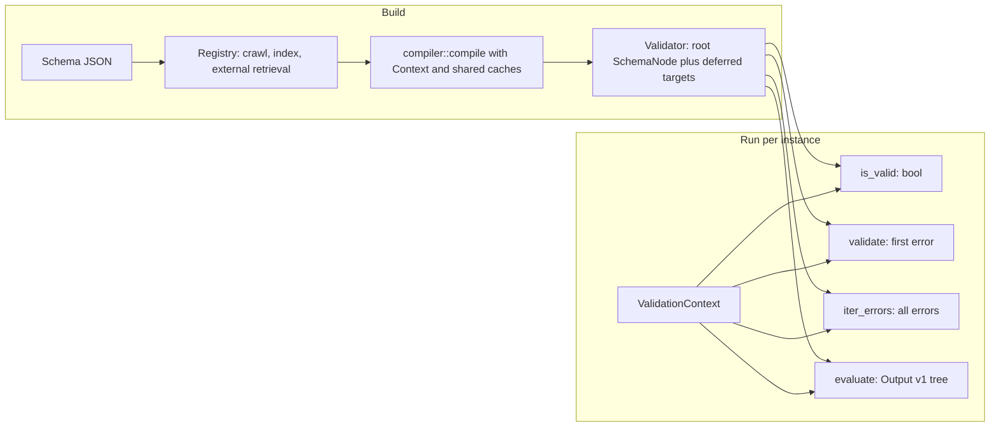
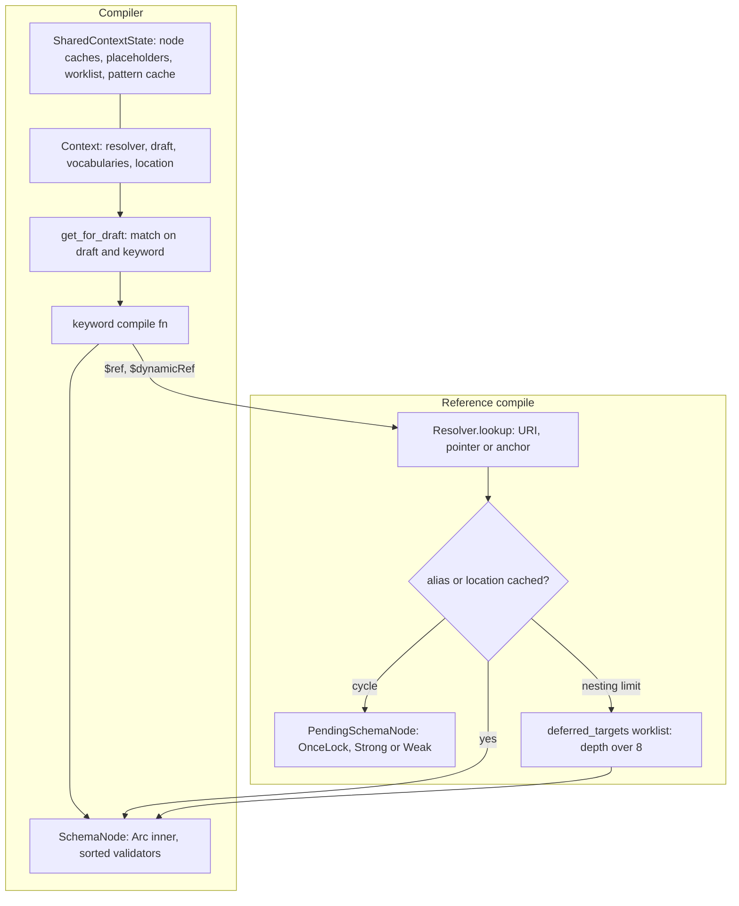

# jsonschema (Stranger6667) — Research report

## Metadata

- **Library name**: jsonschema
- **Repo URL**: https://github.com/Stranger6667/jsonschema
- **Clone path**: `research/repos/rust/Stranger6667-jsonschema-rs/`
- **Language**: Rust
- **License**: MIT
- **Analyzed version**: 0b657fa9 2026-10-26 (workspace and crate `jsonschema` version 0.60.2; MSRV 1.85, edition 2021)
- **Report date**: 2026-10-26

## Summary

jsonschema is a **JSON Schema validator** for Rust: it takes a schema and a JSON
instance and reports whether the instance is valid and, on failure, the validation
errors. It does not generate Rust data-model types from schemas. It compiles a
schema once into an immutable tree of `Arc`-shared `SchemaNode`s holding
`Box<dyn Validate<F>>` keyword validators, and then evaluates instances through
four entry paths (`is_valid`, `validate`, `iter_errors`, `evaluate`) that share the
tree but differ in how much bookkeeping they do. The tree is generic over a `Json`
representation trait, so the same validators run on `serde_json::Value`, Python
objects, Ruby objects or Postgres `jsonb`.

Beyond the runtime validator the repo has: a **compile-time validator generator**
(`#[jsonschema::validator]`, `macros` feature) that emits specialized Rust validation
functions from a schema (validator code, not data structs); schema `bundle` and
`dereference`; and an experimental **canonicalizer** (schema normal form with set
algebra and satisfiability). Drafts 4, 6, 7, 2019-09 and 2020-12 are supported. A CLI
(`jsonschema-cli`), Python/Ruby bindings and a WebAssembly build wrap the same core.
External references are resolved by the `jsonschema-referencing` crate with blocking
or async retrievers.

## JSON Schema support

- **Drafts**: README and docs list Draft 2020-12, 2019-09, 7, 6, and 4. Compliance is
  reported on the [Bowtie Report](https://bowtie.report/#/implementations/rust-jsonschema).
  The draft is taken from `$schema` unless set explicitly (`with_draft`); a `$schema`
  naming a custom meta-schema resolves through the registry to its `$vocabulary` set.
  Nested resources with their own `$schema` switch draft (and vocabularies) for that
  subtree (`Context::in_subresource`).
- **Scope**: Full validation. Applicator, validation, format (annotation or assertion by
  option/dialect), content (asserted in drafts 6/7; annotation-only in 2019-09/2020-12),
  and `unevaluated*` keywords are implemented per draft. Core structural keywords
  (`$id`, `$schema`, `$defs`, `$ref`, `$anchor`, `$dynamicRef`, `$recursiveRef`) drive
  resolution and compilation. Unknown keywords and meta-data keywords (`title`,
  `description`, `default`, ...) are not asserted but are retained and reported as
  annotations by `evaluate`.
- **Vocabularies**: `has_vocabulary` gates keyword compilation for 2019-09+ (below
  that it returns `true`). A meta-schema requiring an unimplemented vocabulary makes the
  build fail unless declared with `ValidationOptions::with_vocabulary`
  (`ensure_vocabularies_supported`).

## Keyword support table

Keyword list (one row per property) from the vendored draft 2020-12 meta-schemas
under `specs/json-schema.org/draft/2020-12/meta/` (applicator, content, core,
format-annotation/-assertion, meta-data, unevaluated, validation). Keywords are
gated by the active vocabulary (`ctx.has_vocabulary`) in `keywords::get_for_draft` (a `match` on `(draft, keyword)`; no registry). "Implemented" indicates whether the
validator compiles and enforces the keyword for instance validation. Evidence
from `crates/jsonschema/src/keywords/mod.rs`, keyword modules, and
`keywords/legacy/`.

| Keyword               | Implemented | Notes                                                                |
| --------------------- | ----------- | -------------------------------------------------------------------- |
| $anchor               | no          | Indexed by `jsonschema-referencing` for resolution (`compiler.rs` `ANCHOR_KEYWORDS`); no validator. |
| $comment              | no          | Not asserted. Not a known keyword (`Draft::is_known_keyword`), so `compile_without_cache` stores it in the node's `unmatched_keywords` and `evaluate` reports it as an annotation. |
| $defs                 | partial     | Not a validator; definitions resolved and used by `$ref`.            |
| $dynamicAnchor        | no          | Indexed for `$dynamicRef` resolution (`ANCHOR_KEYWORDS`); no keyword handler. |
| $dynamicRef           | yes         | Draft 2020-12; `ref_::compile_dynamic_ref`.                          |
| $id                   | no          | Used for base URI and resolution; no validation effect.              |
| $ref                  | yes         | All drafts; `ref_::compile_ref`.                                     |
| $schema               | no          | Draft detection only; no validation effect.                          |
| $vocabulary           | no          | Read from the meta-schema to gate keywords per vocabulary (`ctx.has_vocabulary`); no validator. |
| additionalProperties  | yes         | Applicator vocabulary; `additional_properties::compile`.             |
| allOf                 | yes         | `all_of::compile`.                                                   |
| anyOf                 | yes         | `any_of::compile`.                                                   |
| const                 | yes         | Draft 6+; `const_::compile`.                                         |
| contains              | yes         | Draft 6+; `contains::compile`; also handles minContains/maxContains. |
| contentEncoding       | partial     | Drafts 6/7: asserted (`content::compile_content_encoding`); 2019-09/2020-12: annotation only (`compile_content_encoding_annotation`). |
| contentMediaType      | partial     | Drafts 6/7: asserted (`content::compile_media_type`); 2019-09/2020-12: annotation only (`compile_media_type_annotation`). |
| contentSchema         | partial     | 2019-09/2020-12 annotation only (`content::compile_content_schema_annotation`, emitted for strings when `contentMediaType` is present); content is not decoded or validated. |
| default               | no          | Not asserted. Not a known keyword (`Draft::is_known_keyword`), so `compile_without_cache` stores it in the node's `unmatched_keywords` and `evaluate` reports it as an annotation. |
| dependentRequired     | yes         | Draft 2019-09+; `dependencies::compile_dependent_required`.          |
| dependentSchemas      | yes         | Draft 2019-09+; `dependencies::compile_dependent_schemas`.           |
| deprecated            | no          | Not asserted. Not a known keyword (`Draft::is_known_keyword`), so `compile_without_cache` stores it in the node's `unmatched_keywords` and `evaluate` reports it as an annotation. |
| description           | no          | Not asserted. Not a known keyword (`Draft::is_known_keyword`), so `compile_without_cache` stores it in the node's `unmatched_keywords` and `evaluate` reports it as an annotation. |
| else                  | yes         | Via `if_::compile` (if/then/else).                                   |
| enum                  | yes         | `enum_::compile`; instance matched against allowed values.           |
| examples              | no          | Not asserted. Not a known keyword (`Draft::is_known_keyword`), so `compile_without_cache` stores it in the node's `unmatched_keywords` and `evaluate` reports it as an annotation. |
| exclusiveMaximum      | yes         | Draft 6+; `minmax::compile_exclusive_maximum`.                       |
| exclusiveMinimum      | yes         | Draft 6+; `minmax::compile_exclusive_minimum`.                       |
| format                | yes         | Configurable annotation vs assertion; `format::compile`.             |
| if                    | yes         | Draft 7+; `if_::compile` with then/else.                             |
| items                 | yes         | `items::compile`; draft 4 uses legacy.                               |
| maxContains           | yes         | In `contains.rs` with contains/minContains.                          |
| maximum               | yes         | Draft 4 legacy + draft 6+ `minmax::compile_maximum`.                 |
| maxItems              | yes         | `max_items::compile`.                                                |
| maxLength             | yes         | `max_length::compile`.                                               |
| maxProperties         | yes         | `max_properties::compile`.                                           |
| minContains           | yes         | In `contains.rs` with contains/maxContains.                          |
| minimum               | yes         | Draft 4 legacy + draft 6+ `minmax::compile_minimum`.                 |
| minItems              | yes         | `min_items::compile`.                                                |
| minLength             | yes         | `min_length::compile`.                                               |
| minProperties         | yes         | `min_properties::compile`.                                           |
| multipleOf            | yes         | `multiple_of::compile`.                                              |
| not                   | yes         | `not::compile`.                                                      |
| oneOf                 | yes         | `one_of::compile`.                                                   |
| pattern               | yes         | `pattern::compile`.                                                  |
| patternProperties     | yes         | `pattern_properties::compile`.                                       |
| prefixItems           | yes         | Draft 2020-12; `prefix_items::compile`.                              |
| properties            | yes         | `properties::compile`.                                               |
| propertyNames         | yes         | Draft 6+; `property_names::compile`.                                 |
| readOnly              | no          | Not asserted. Not a known keyword (`Draft::is_known_keyword`), so `compile_without_cache` stores it in the node's `unmatched_keywords` and `evaluate` reports it as an annotation. |
| required              | yes         | `required::compile`.                                                 |
| then                  | yes         | Via `if_::compile` (if/then/else).                                   |
| title                 | no          | Not asserted. Not a known keyword (`Draft::is_known_keyword`), so `compile_without_cache` stores it in the node's `unmatched_keywords` and `evaluate` reports it as an annotation. |
| type                  | yes         | Draft 4 legacy + draft 6+ `type_::compile`.                          |
| unevaluatedItems      | yes         | Draft 2019-09 (applicator vocab) / 2020-12 (unevaluated vocab); `unevaluated_items::compile`. |
| unevaluatedProperties | yes         | Draft 2019-09 (applicator vocab) / 2020-12 (unevaluated vocab); `unevaluated_properties::compile`. |
| uniqueItems           | yes         | `unique_items::compile`.                                             |
| writeOnly             | no          | Not asserted. Not a known keyword (`Draft::is_known_keyword`), so `compile_without_cache` stores it in the node's `unmatched_keywords` and `evaluate` reports it as an annotation. |

Keywords outside the 2020-12 list: `$recursiveRef` (2019-09, `ref_::compile_recursive_ref`);
`additionalItems` and `dependencies` (earlier drafts, `additional_items.rs`,
`dependencies.rs`). Draft 4 `maximum`/`minimum`/`type` use modules under
`keywords/legacy/`.

Additional (non-keyword) capabilities introduced since the previous report:
`#[jsonschema::validator]` macro (backends `SerdeJson`, `Pyo3`, `Magnus`;
`methods = {...}` selects generated fns; `evaluate` not generated yet);
`jsonschema::bundle` / `dereference` (Compound Schema Documents, `$ref` inlining);
`canonicalize` (experimental normal form with `union`/`intersect`/`subtract`/
`negate`/`is_subset_of`/satisfiability; unsupported constructs stay `Raw`; handles
`unevaluated*`, `not`, `oneOf`, `$dynamicRef` symbolically); `ValidationOptions::
with_vocabulary` (declare unsupported vocabularies; `FormatAssertion` variant);
`offline` mode; a `oneOf`/`anyOf` discriminator fast path
(`keywords/discriminator.rs`, >=3 branches each fixing a property to a string
`const`); validation of custom in-memory representations via `json::Json`/`Node`
traits (serde_json, Python objects, Ruby objects, Postgres `jsonb`). Canonicalizer
reads `contentSchema` only as an annotation (dropped); at runtime `contentSchema`
is annotation-only and is never enforced.

## Constraints

The validator enforces every implemented validation keyword at runtime. Type, numeric
(`minimum`, `maximum`, `exclusive*`, `multipleOf`), string (`minLength`, `maxLength`,
`pattern`, `format`), array (`minItems`, `maxItems`, `uniqueItems`, `contains` with
`minContains`/`maxContains`, `items`/`prefixItems`), object (`properties`,
`additionalProperties`, `patternProperties`, `propertyNames`, `required`,
`minProperties`, `maxProperties`, `dependentRequired`, `dependentSchemas`,
`unevaluatedProperties`) and composition (`allOf`, `anyOf`, `oneOf`, `not`,
`if`/`then`/`else`) keywords produce errors when the instance does not satisfy them.
`format` is annotation-only or an assertion depending on draft (assertion by default
for drafts 4/6/7), dialect (`format-assertion` vocabulary) and
`should_validate_formats`. `contentEncoding`/`contentMediaType` are asserted only under
drafts 6/7; in 2019-09/2020-12 they and `contentSchema` are annotations.

## High-level architecture

Pipeline: **schema (`serde_json::Value`) -> registry build (crawl, index) -> compile
(`compiler::compile`) -> `Validator` (tree of `SchemaNode`s) -> validate an instance via
one of four traversals**.

- **Registry build** (`jsonschema-referencing`): the root schema, any preloaded
  resources and every transitively referenced external document are crawled
  breadth-first; every `$id`-bearing subschema and every anchor is indexed under its
  canonical URI. This happens before any validator exists and is where external
  retrieval happens.
- **Compile**: `build_validator` creates a `Context` (resolver, draft, vocabularies,
  location, shared caches) and recursively compiles each subschema object: every key is
  dispatched through `keywords::get_for_draft` to a `compile` function returning a
  `Box<dyn Validate<F>>`; the validators are sorted by `keyword_priority` and wrapped in
  a `SchemaNode`. `$ref`s compile their targets in place, with an `Arc`/`Weak`
  placeholder mechanism for cycles and a worklist for deep reference chains.
- **Validate**: four traversals over the same tree: `is_valid` (bool only),
  `validate` (first error), `collect_errors`/`iter_errors` (all errors) and `evaluate`
  (annotations and Output v1 tree).

## Medium-level architecture

- **Crates** (workspace `crates/*`): `jsonschema` (compiler, validators, error and
  evaluation model, `bundler.rs`, `dereferencer.rs`, `canonical/`),
  `jsonschema-referencing` (registry, resolver, drafts, vocabularies, retrievers,
  JSON-pointer and URI helpers), `jsonschema-value` (the `Json`/`Node`/`Object`/`Array`
  representation traits and their `serde_json`, `pyo3`, `magnus`, `jsonb` impls; numeric
  comparison; `uniqueItems`), `jsonschema-regex` (ECMA-262 syntax checker, ECMA to Rust
  regex translator, literal-pattern analysis; shared by runtime and macro),
  `jsonschema-macros` (thin proc-macro entry) and `jsonschema-macros-core` (the
  `quote!`-based generator, about 7k lines), `jsonschema-macros-standalone`,
  `jsonschema-cli`, `jsonschema-py`, `jsonschema-rb`, `jsonschema-wasm`, plus
  benchmark/test-suite helper crates.
- **Context**: `compiler::Context` is a cheap-to-clone view (config reference, `Resolver`,
  `VocabularySet`, current `Location`, `resource_base`, `resource_start`, draft) over an
  `Rc<SharedContextState>` holding all the per-compilation caches (see
  Algorithms). `new_at_location(segment)` derives a child context for each nested keyword.
- **Keyword modules** (`keywords/*.rs`, about 40): each has a `compile(ctx, parent, value)
  -> Option<CompilationResult>` function and one or more validator structs implementing
  `Validate<F>`. Several keywords have multiple specialized validator structs chosen at
  compile time (e.g. `type_.rs` has one per type, `required.rs` has 1/2/3-item and
  generic variants, `enum_.rs` has five).
- **Evaluation order** is the per-node validator list sorted by `keyword_priority`
  (`type` 1, `const` 5, `enum` 6, numeric 10-14, sizes 20-25, `required` 26, `pattern`
  30, `format` 31, `uniqueItems` 35, `properties` 40..`dependentSchemas` 49, `allOf` 50,
  `anyOf` 51, `oneOf` 52, `not` 53, `if` 54, `unevaluated*` 60-61, `$ref` 70,
  `$recursiveRef` 71, `$dynamicRef` 72, custom 80).

## Algorithms and data structures

### Schema representation

The schema is never converted to a typed struct. The compiler walks the caller's
`serde_json::Value` (`&'a Value` / `&'a Map<String, Value>`) directly, and keyword
`compile` functions borrow from it (`CompileFunc<'a, F>` takes `&'a Value`). Only
what a validator needs at run time is copied out (for example `enum` clones its item
`Vec<Value>`, `required` copies names into `PropertyName`s). `ResourceRef<'a>` in
`jsonschema-referencing` pairs a borrowed `&Value` with its `Draft`.

Boolean schemas compile to `NodeValidators::Boolean { validator: Option<..> }`
(`Some(FalseValidator)` for `false`, `None` for `true`). Object schemas compile to
`NodeValidators::Keyword(KeywordValidators)`. A third shape,
`NodeValidators::Array`, backs array-valued "schemas" such as draft 7 `dependencies`.
Keywords that are not known to the draft (`Draft::is_known_keyword`) are copied into a
single `Map` and stored as `unmatched_keywords: Option<Arc<Value>>`; `evaluate` emits
that object as the node's annotations. Known-but-unimplemented structural keywords
(`$defs`, `$anchor`, `$id`, ...) are dropped.

The registry stores documents as `StoredResource { value: StoredValue::{Borrowed(&'a Value),
Owned(Value), Shared(Arc<Value>)}, draft }`. The caller's schema stays borrowed (no
copy); retrieved external documents and the bundled meta-schemas are owned/shared.
The lifetime `'a` of the registry therefore ties it to the input schema, and the
compile step reuses the same lifetime so `Resolved<'r>` contents are plain references.

### Reference resolution and registry

`jsonschema_referencing::Registry<'a>` has four fields: an optional `baseline:
Option<&'a Registry>` (an immutable parent whose resources are shared, used to layer a
user registry over the pre-built `SPECIFICATIONS` meta-schema registry), a
`resolution_cache: SharedUriCache`, `known_resources: KnownResources` (`AHashSet<Uri>`,
so the retriever never refetches a URI) and an `Index` with two `SmallMap`s:
`resources: SmallMap<Arc<Uri>, IndexedResource>` and `anchors: SmallMap<Arc<Uri>,
SmallMap<Box<str>, IndexedAnchor>>`. `SmallMap<K,V,N=2>` (`small_map.rs`) is an enum
over a `micromap::Map` (inline linear scan, at most N entries) that promotes itself to an
`AHashMap` on the third insert, since most documents have one or two resources.
`IndexedResource` is either `Borrowed(ResourceRef)` or `Owned{document: Arc<StoredResource>,
pointer: ParsedPointer, draft}`; an owned subresource is stored as a pointer into its
document and re-resolved on each lookup rather than as a self-referential borrow.

**Building** (`registry/build.rs`, `RegistryBuilder::prepare`): resources are added
under a URI, then `index_resources` runs `fetch_and_index`: a loop that (1) drains a
`VecDeque<CrawlTask>` crawling each queued document, (2) processes deferred local refs,
(3) fetches newly discovered external URIs via the `Retrieve` impl, and repeats until the
queue and external set are empty, finishing by injecting any referenced meta-schemas
(`finalize_index`). `crawl_schema` visits an object, calls `draft.analyze_object` for
`$id`/`$anchor`/`$ref`/`$schema`, and resolves a new base URI for an `$id`
(`resolve_subresource_id`, registering a subresource entry when the URI changes), then
`draft.walk_children` recurses into subschema positions. Recursion is plain
recursion up to `RECURSION_DEPTH_CAP = 128` and then pushes onto a heap `deferred`
list, so a 100k-deep document does not overflow the stack. A `visited_schemas` set
keyed by `(schema_ptr, base_ptr, draft)` prevents re-crawling a node reached by two
routes; `record_refs` queues each `$ref` target (local ones through `PendingLocalRef`
with the target address captured at push time so the main BFS can skip them in O(1)).
The async path (`async_prepare`) batches external fetches with `join_all`.

URI resolution is memoized in `SharedUriCache`: a `hashbrown::HashMap<(String,String),
Arc<Uri>>` behind a `parking_lot::RwLock`, looked up allocation-free via a
`StrPair: Equivalent` key and using an upgradable read lock for the miss path.

**Resolving** (`Resolver`, `resolver.rs`): a `Resolver<'r>` is `{registry: &Registry,
base_uri: Arc<Uri>, scopes: List<Uri>}`. `scopes` is a persistent, `Arc`-linked
immutable singly-linked list (`list.rs`, `push_front` shares the tail, with an iterative
`Drop`) recording the dynamic scope: `evolve(uri)` pushes the previous base when
crossing into another resource. `lookup(reference)` splits the fragment, resolves the
URI part against `base_uri` (cache above), fetches the resource from the index, and then
(a) fragment starting with `/` -> JSON-pointer walk (`retrieved.pointer`), (b) other
non-empty fragment -> `registry.anchor(uri, name)` then `Anchor::resolve`, (c) empty ->
the resource root. `Anchor::Dynamic::resolve` iterates the scope list (newest first)
and keeps overwriting `last` with every scope that declares the same `$dynamicAnchor`,
so the **outermost** dynamic anchor wins, as the spec requires.
`lookup_recursive_ref` (2019-09 `$recursiveRef`) resolves `#` and, when
`$recursiveAnchor: true`, walks the scope the same way, stopping at the first scope
that lacks `$recursiveAnchor: true`. Once a registry is `prepare`d it never fetches:
lookups of un-indexed URIs fail with "Retrieving external resources is not supported
once the registry is populated".

**Retrieval**: `Retrieve`/`AsyncRetrieve` traits take `&Uri<String>` and return
`Result<Value, Box<dyn Error + Send + Sync>>`. The `jsonschema` crate adds
`DefaultRetriever` (file via `resolve-file`, HTTP via `reqwest` with `resolve-http`),
`OfflineRetriever`, `HttpRetriever`/`AsyncHttpRetriever`.

**Compile-time cycle handling** is the most intricate part (see next section): the
compiler turns `$ref`/`$dynamicRef` into direct pointers to compiled nodes, with
placeholders for cycles. `$dynamicRef` is not resolved at validation time in the runtime
validator: because the dynamic scope is part of the `Resolver` state while compiling
down a reference chain, each `$dynamicRef` is resolved against its compile-time
scope and the compiled result is cached under `AliasCacheKey { uri, dynamic_scope }`.
The same target reached under two different dynamic scopes compiles to two distinct
nodes. (The macro backend, by contrast, resolves dynamic scope at run time with
thread-local stacks; see Compiled form.)

### Compiled / intermediate form

**Node tree.** `SchemaNode<F: Json>` (`node.rs`) is `{inner: Arc<SchemaNodeInner>,
location: Location, absolute_path: Option<Arc<Uri>>}`; cloning bumps an `Arc`. The
inner `NodeValidators` enum is `Boolean | Keyword(KeywordValidators) | Array`.
`KeywordValidators` holds:

- `validators: KeywordList<F>` = `One(KeywordValidator)` (a lone validator stored inline,
  saving a `Box<[..]>` hop in `is_valid`) or `Many(Box<[KeywordValidator]>)`;
  `KeywordValidator { validator: Box<dyn Validate<F>>, is_leaf: bool }`;
- `metadata: Vec<KeywordMetadata>`, a parallel vector (same index) with each keyword's
  `Location`, absolute-URI location and a `OnceLock<Arc<str>>` for its formatted
  `schemaLocation`. It is kept apart so `is_valid` walks only densely packed
  validators ("separating error locations from validators for cache locality");
- `unmatched_keywords` (annotations) and `absorbed: Option<AbsorbedUnits>` (keywords
  consumed by a fused validator).

`from_keywords` stable-sorts the `(Keyword, validator)` pairs by `keyword_priority`
(`Keyword` is `Builtin(BuiltinKeyword)` or `Custom(Box<str>)`), which is the entire
"scheduler": cheap assertions (`type`, `const`, `enum`, numeric, size, `required`) run
before subschema-applying keywords, and `$ref`/`$dynamicRef` (priority 70-72) run last.
`keyword_is_leaf` marks keywords with priority below 40 (except `contentSchema` and
custom keywords) as leaves that assert on the instance itself.

**Dispatch.** There is no table; `keywords::get_for_draft(ctx, keyword)` is one large
`match (ctx.draft(), keyword)` with guards on `ctx.has_vocabulary(..)`, returning
`(Keyword, CompileFunc)`. `compile_without_cache` loops the schema's own keys, first
offering each to a user `KeywordFactory` (custom keyword overrides take precedence),
then to `get_for_draft`, and finally recording unknown keys as annotations. Each
`compile` fn returns `Option<Result<..>>` where `None` means "contributes no validator"
(e.g. `properties` returns `None` when `additionalProperties` is `false`/an object,
because the `AdditionalProperties*` validators absorb `properties` in that case). Two
kinds of fusion happen here:

- `array_shape_fusion` replaces `type: array` + `minItems` + `maxItems` + schema-form
  `items` with one `ArrayShapeValidator` (one `as_array`, one length check, one element
  pass). The fused keywords are removed from the node and recorded as
  `AbsorbedKeywords` so `evaluate` can still report them as separate output units.
- `properties` + `required` of 2 items (`SmallPropertiesWithRequired2Validator`) and
  `properties` + `additionalProperties:false` + one `required`
  (`AdditionalPropertiesNotEmptyFalseWithRequired1Validator`) are fused.

**Specialization per shape** (all chosen at compile time): `type` has
`NullTypeValidator`, `BooleanTypeValidator`, ..., `IntegerTypeValidator` and
`MultipleTypesValidator` (a `JsonTypeSet(u8)` bitmask); `enum` picks
`SingleValueEnumValidator`, `SmallStringEnumValidator<N>` (<=10 strings, linear scan with
`KeyHead` pre-filter), `BigStringEnumValidator<N>` (`AHashSet<Box<str>>`),
`IntegerEnumValidator<N>` (sorted `Vec<i64>` + binary search) or generic
`EnumValidator` (with a type-set pre-check); `N: Nullability` is a zero-sized
marker that bakes "also accepts null" into the monomorphized code; `required` has
`SingleItemRequired`, `Required2`, `Required3` (unrolled fixed fields) and `Required`;
`properties` is `SmallPropertiesValidator` (a `Vec`) under 15 entries
(`HASHMAP_THRESHOLD`), else `BigPropertiesValidator` (`AHashMap`); `items` with a
simple `{"type": T}` schema becomes `ItemsTypeValidator<T: ItemType>` with the check
inlined; `pattern` becomes a literal matcher when `analyze_pattern` can prove it
(`^prefix`, `^exact$`, `^(a|b|c)$`, `^\S*$`).

**`$ref` forms.** A `$ref` compiles to one of three things: `DirectRefValidator<T>`
(holds the target `SchemaNode` or a placeholder directly, avoiding a vtable hop),
`RefValidator` (holds `BoxedValidator`; used when the target is shared/cyclic), or
nothing (an empty reference, or a direct self-reference found by pointer identity
`ptr::eq(resolved.contents(), parent)`). Both carry `ref_suffix` and `ref_target_base`
`Location`s (compile-time) used to build evaluation paths, and a `canonical_location`
override.

**Cycle breaking.** `PendingSchemaNode<F>` is `Arc<OnceLock<PendingTarget<F>>>` where
`PendingTarget` is `Strong(SchemaNode)` (target no cycle passes through) or
`Weak(WeakTarget{ Weak<SchemaNodeInner>, location, absolute_path })`. When compiling
a `$ref` target via `compile_with_alias`, `start_compiling` registers a placeholder
under the alias URI in `alias_placeholders`; a cyclic `$ref` that re-enters
(`lookup_maybe_recursive`, gated by the `seen` set) gets that placeholder; after the
target compiles, `finish_compiling` initializes the placeholder with a `Weak` pointer
and records the node in `alias_nodes` (keyed `AliasCacheKey{uri, dynamic_scope}`) and
`location_nodes` (keyed `NodeCacheKey{base_uri, location, dynamic_scope, schema_ptr}`).
A "settled" flag (`start_node`/`finish_node`/`reach_unsettled`) tracks whether a
node's subtree reaches a not-yet-compiled node; settled nodes can be freely owned by
any round, while unsettled nodes are owned only by their own compile round and shared
via `Weak` elsewhere, so the `Arc` graph never forms a strong cycle (otherwise
`Validator` would leak). Compilation depth for `$ref` targets is bounded by
`MAX_NESTED_REF_COMPILATIONS = 8`: beyond that, the target goes onto
`deferred_targets: VecDeque<DeferredTarget>` and a `PendingSchemaNode` is returned;
`compile_deferred_targets` then drains the queue iteratively ("rounds"), restoring the
`in_progress` placeholders for each, so a very long `$ref` chain keeps the native stack
flat. Owned deferred nodes are stored in `Validator::targets: Vec<SchemaNode>`, whose
drop order releases a long chain one target at a time.

**Fused `unevaluated*` helper trees.** `unevaluatedProperties`/`unevaluatedItems`
compile, in addition to their own subschema node, a mirror structure
`PropertyValidators`/`ItemsValidators` (properties set, `additional`,
`pattern_properties`, `all_of`/`any_of`/`one_of` as `Vec<(SchemaNode,
PropertyValidators)>`, `conditional`, `ref_`/`dynamic_ref`/`recursive_ref` as
`Arc<OnceLock<..>>` pending cells, `dependent`). Cycle handling reuses the same
pending-cell idea, keyed per schema map by address
(`pending_property_validators_by_schema`).

**Macro-generated form (`#[jsonschema::validator]`).** `jsonschema-macros-core` is a
second backend producing *source*, not a tree. `compile_schema` returns a
`CompiledExpr { is_valid: IsValidExpr, validate: ValidateBlock, collect: CollectBlock }`:
three `proc_macro2::TokenStream` shapes of the same check (a boolean expression, a
statement sequence that early-returns the first error, and a statement sequence that
pushes into `__errors`). `ValidateBlock::and` and `CollectBlock::and` concatenate by
extending the token stream. `compile_object_schema` partitions keywords into a "typed"
group (string/number/array/object-only keywords, built by `dispatch::compile_typed` into a
single `match instance { String(..) => .., Number(..) => .., ..}` so an instance of another
type skips the group) and an "untyped" group (`const`, `enum`, `$ref`, `allOf`,
`anyOf`, `oneOf`, `not`, `if`, custom). A redundant `type` is elided
(`type_check_is_redundant` when `const`/`enum` already imply it). Each `$ref` target and
each applicator branch is emitted once as its own Rust `fn` (`get_or_create_is_valid_fn`
with `FnTable` name allocation keyed by location, `register_branch_helper` for branches),
so references are plain function calls and recursion is native Rust recursion. A
`ValueEmitter` trait (`emit_serde`, `emit_pyo3`, `emit_magnus`) parameterizes the
instance access patterns for the three backends. Regexes are emitted as per-pattern
helper fns with a `static REGEX: LazyLock<Option<Regex>>` (compiled at first use at
run time, deduplicated by pattern text in `regex_to_helper`; the pattern is still
validated and translated at expansion time via `translate_and_validate_regex`).
`$recursiveRef` and `$dynamicRef` cannot be resolved statically per call site in this
model, so `stack_emit.rs` generates `thread_local!` stacks (`__JSONSCHEMA_RECURSIVE_STACK`,
`__JSONSCHEMA_DYNAMIC_STACK`, parallel stacks for `validate`, `collect`, key-eval and
item-eval) of `(anchor name, fn pointer)` pushed and popped around every function that
participates in the dynamic scope.

**Canonicalizer IR.** `canonical/` parses a schema into `Schema(Arc<SchemaData>)` where
`SchemaData` caches a structural hash, and `SchemaKind` has 17 variants: `MultiType(JsonTypeSet)`,
`TypedGroup{ty, body}` (draft 4 integer), `String`/`Integer`/`Number`/`Array`/`Object`
(each `NonEmpty<Leaf>`, a union of leaves), `Const`, `Enum(AtLeastTwo<CanonicalJson>)`,
`Not`, `AllOf`, `AnyOf`, `OneOf`, `Reference(Arc<str>)`, `True`, `False`,
`Raw(RawJson)` (opaque pass-through for unmodeled schemas). Leaves are algebraic: an
`IntegerLeaf` has `BoundInteger` bounds plus `Divisors` (`multipleOf`) and
`ExcludedDivisors` (negated divisors); `NumberLeaf` uses `BoundNumber`/`BoundRational`
and a real interval; `StringLeaf`, `ArrayLeaf`, `ObjectLeaf` carry cardinality windows.
`IntegerLeaves` is a batched `Vec` that restores canonical form lazily before a read
(`canonicalize`: `merge` by divisor group, then `drop_subsumed`). `PropertyMap` is a
sorted `Empty | One([Entry;1]) | Many(Vec<Entry>)` enum searched by binary search.
References stay symbolic (`Reference`) with bodies in a `DefinitionMap =
BTreeMap<Arc<str>, Schema>`; `CanonicalSchema` carries `Document{root, definitions, local}`.
Operations in `algebra.rs` (about 5.9k lines), `negate.rs`, `emptiness.rs`,
`containment.rs`, `rename.rs`, `refold.rs` implement `intersect`, `union`, `subtract`,
`negate`, `covers` and three-valued `satisfiability` (`Yes | No | Unknown`).
`covers` falls back to a difference check bounded by `COVERS_DIFFERENCE_BUDGET = 20_000`
intersections. It is experimental and independent of the validator tree.

### Core algorithm

**Four traversals of one tree.** `Validate<F>` (`validator.rs`) has required
`is_valid`, `validate`, and defaulted `collect_errors` (calls `validate` and pushes
the one error) and `evaluate`. Every keyword implements the first two; composite
validators override `collect_errors` and `evaluate`.

- `is_valid(instance, ctx) -> bool`: no error objects, no location tracking, no
  `RefTracker`. `NodeValidators::is_valid` is a straight loop over the sorted list,
  returning at the first `false` (a `KeywordList::One` case skips the loop). This is the
  hot path and also what `anyOf`/`oneOf`/`not`/`contains`/`if` call on branches.
- `validate(instance, location, tracker, ctx) -> Result<(), ValidationError<'i>>`:
  first error. `SchemaNode::validate` loops keywords and, for a leaf keyword
  (`is_leaf`), first calls the cheap `is_valid` and only calls the error-building
  `validate` if it failed ("a passing keyword costs its `is_valid`; only a failing one
  builds an error").
- `collect_errors(.., errors: &mut Vec<..>)`: all errors, same leaf trick, stamps each
  new error with the keyword's absolute location (`stamp_absolute_location`).
  `Validator::iter_errors` returns `ErrorIterator::from_iterator(errors.into_iter())`:
  errors are collected eagerly into a `Vec`, then iterated (the iterator is boxed
  `dyn`, not a lazy generator).
- `evaluate(..) -> EvaluationResult`: builds the Output v1 evaluation tree with
  annotations (see Error and output model). Default implementation derives it from
  `collect_errors`.

The doc comment on `Validate` mentions a `LightweightContext` for `is_valid`; the code
now passes the same `&mut ValidationContext` to all four (the comment is stale).

**Keyword examples.**

- *`properties`* (`SmallPropertiesValidator::is_valid`): "walk the smaller side". If
  the instance object has no more members than the schema has properties
  (`object.len() <= self.properties.len()`), iterate the instance members and match each
  against the property list using `KeyHead`; otherwise iterate the schema properties and
  call `object.get(prepared_key)`. `KeyHead{len, first8, last8}` compares a name with a
  few `u64` loads (<=16-byte names are decided by the head alone), because serde_json's
  `Map` is a `BTreeMap` whose `get` costs `memcmp`s (the `Json::KEYS_PER_LOOKUP`
  constant encodes that cost ratio per representation and is also used by `required`).
- *`oneOf`* (`OneOfValidator`): `get_first_valid` finds the first valid branch with
  `is_valid`, then `are_others_valid` scans the remaining branches with `any`. If a
  `Discriminator` exists it provides `Candidates::{All, One(idx), None}` and the loop
  collapses to a single branch (see Fast paths). Failure builds
  `OneOfNotValid{context}` / `OneOfMultipleValid` from `collect_errors` per branch.
- *`unevaluatedProperties`*: when called, it first tries the static path
  (`PropertyValidators::collect_static`) which, if the schema has no `anyOf`, `oneOf`,
  `if`, `dependentSchemas` or dynamic refs, folds `properties`, `patternProperties`,
  `additionalProperties` and `allOf`/`$ref` branches into a precomputed
  `StaticEvaluated{names: AHashSet, patterns, saturated, verdict_only}` held in a
  `OnceLock<Option<StaticEvaluated>>`; validation is then a set lookup per
  property. Otherwise it runs `mark_evaluated_properties_impl` at validation time,
  which for each applicator re-runs `node.is_valid(instance)` to decide whether that
  branch's evaluated set counts (all `allOf`, any `anyOf` that passes, a `oneOf` only
  if exactly one passes, `if`/`then`/`else`, `dependentSchemas` for present keys) and
  accumulates names into an `AHashSet<Cow<str>>`. A `marking` stack of
  `(validators_id, NodeIdentity)` breaks `$dynamicRef`/`$recursiveRef` loops.
- *`$ref` cycle at validation time*: the `Weak` branch of `PendingSchemaNode::is_valid`
  consults `ValidationContext::enter(node_id, instance.identity())`, which
  linear-scans `validating: Vec<(usize, NodeIdentity)>`; if `(this node, this exact
  instance node)` is already on the stack, validation returns `true` (a cycle on the same
  data adds no new constraint). Otherwise it checks the memo, evaluates, caches, and
  `exit`s. `identity()` returning `None` (a representation without stable node
  addresses) disables the guard, leaving recursion bounded by the stack.

**Numeric comparison** (`jsonschema-value/numeric.rs`): `minimum` etc. dispatch on how
the instance number is stored (`as_u64`, `as_i64`, `as_f64`) via `num_cmp::NumCmp`
against the limit stored as `u64`/`i64`/`f64`, falling to exact `BigFraction` or (with
`arbitrary-precision`) decimal comparison only when `f64` rounding could change the
answer (`exact_ordering`).

### Error and output model

`ValidationError<'a>` is a `Box<ValidationErrorRepr<'a>>` (one pointer wide) holding
`instance: LazyInstance<'a>`, `kind: ValidationErrorKind` (about 40 variants such as
`Required{property}`, `Type{kind}`, `AnyOf{context: Vec<Vec<ValidationError<'static>>>}`,
`OneOfNotValid`, `BacktrackLimitExceeded`, `Custom`), `instance_path: Location`,
`schema_path: Location` (canonical keyword location, no `$ref` traversal), `tracker:
LazyEvaluationPath` and `absolute_keyword_location: Option<Arc<Uri>>`. `Location` is
`Arc<str>`: clones are an atomic increment.

**Lazy locations.** Instance paths are built as a stack-allocated linked list
(`LazyLocation = JsonPointerNode<'a,'b>{segment, parent: Option<&JsonPointerNode>}`)
that is pushed by `location.push(name)` on the call stack and costs nothing until an
error is created; `impl From<&LazyLocation> for Location` renders it, with a fast path
for the empty path and for a single index (a static `[Location;16]` cache of `/0../15`)
and a two-pass render (count capacity, then fill from a `[Option<&Segment>;16]` stack
array, falling to a `Vec` past 16 segments) into one `Arc<str>` allocation through a
thread-local reusable `String` buffer (`build_arc_str`). Schema paths are not computed
at all at run time: each keyword stores its `Location` precomputed at compile time.
The *evaluation path* (schema path including `$ref` hops) uses `RefTracker<'a>`, a
stack-allocated linked list pushed only when crossing a `$ref`, which stores the
compile-time `ref_suffix` and `ref_target_base`; `LazyEvaluationPath` is
`SameAsSchemaPath | Computed(Location) | Deferred{prefix, suffix, cached: OnceLock}`, so
the string join `prefix + (location - target_base)` happens only if the error's
evaluation path is read.

**Lazy instance.** `LazyInstance::Ready(Cow<'a, Value>)` or `Deferred{bytes, tag, make,
cell}` (build the `serde_json::Value` of a Python/`jsonb` node on first read).

**Evaluation output.** `Validator::evaluate` returns `Evaluation { arena:
EvaluationArena, root: u32 }`. `EvaluationArena` is `Vec<Vec<EvaluationNode>>` in chunks
that are never resized; children are linked as sibling chains (`first_child`,
`next_sibling` as `u32` indices) because a parent cannot know its children's positions
until they finish. `ChildList{first,last,len,valid}` is the builder. `EvaluationNode`
carries evaluation path, absolute keyword location, formatted `schemaLocation`
(`OnceLock<Arc<str>>` per node, cached across instances), instance location,
annotations and errors. `Evaluation` serializes to the three JSON Schema Output v1
formats (`flag()`, `list()`, `hierarchical()`) and offers `iter_annotations()` /
`iter_errors()`. `evaluate` instance-location strings are rendered once per instance
position and passed down (`evaluate_with_location`) instead of re-rendered per keyword;
`ValidationContext.instance_location` carries the parent location so a child renders
by `join_pointer_segment`. An `EvaluationPathCache` (see Caching) interns evaluation paths
once 4096 have been built.

`masked()` / `masked_with()` replace instance values in messages for sensitive data.

## Low-level details

- **Numbers**: `Node::json_type` reports `Number` for all numbers; integer-ness is a
  numeric property (`JsonNumber::is_integer`). Draft 4 decides `type: integer` by how the
  number is *written* (`is_written_as_integer`, so `1.0` is not an integer there).
  `multipleOf` (`numeric::is_multiple_of_float`): zero handling, `|value| < multiple`
  early false, `divides_exactly` fast check, then exact `BigFraction` division and a check
  that the denominator is 1; big-decimal path under `arbitrary-precision`. Integer
  `multipleOf` has a long-division path over decimal digits for numbers beyond `f64`.
  `const`/`enum`/`uniqueItems` equality is numeric-mathematical (`1 == 1.0`) and key-order
  independent (`cmp::equal`, `HashedValue` XOR-combines per-key hashes; `-0.0` and `0`
  hash alike via `number_bits`).
- **String length** counts Unicode code points: `bytecount::num_chars` (SIMD) for
  `serde_json`, not UTF-16 or bytes. `minLength` + `maxLength` fuse into
  `LengthRangeValidator` so the string is walked once.
- **`uniqueItems`** (`jsonschema-value/unique.rs`): 0-1 items true; 2 and 3 items by direct
  comparisons; up to `ITEMS_SIZE_THRESHOLD = 15` items pairwise (O(n^2)); above that
  an `AHashSet<HashedValue>` insertion test.
- **`propertyNames`** validates each key by wrapping it in a representation node
  (`Json::with_string_node` reusing one `StringBuffer` to avoid a `String` per name).
- **Untrusted-input hardening**: regex backtracking bounded by `backtrack_limit` and
  engine size limits; engine panics (regex issue 1344) are caught with `catch_unwind` and
  surfaced as `RegexEngineFailure`; registry crawling and compile use explicit
  worklists/depth caps (128, 8) so deep schemas do not overflow; the tree drop is
  ordered to avoid recursive `Arc` drops. Instance recursion depth is not capped
  (bounded by the native stack, and by the cycle guard for `$ref` loops); a
  representation can opt out of the guard.
- **Unfinished regex matches**: when `fancy-regex` fails with a backtrack error,
  `ValidationContext::is_match` records the `(pattern, subject)` in a lazily boxed
  `MatchAssumptions` and returns `false` for that run. `Validator::{is_valid,validate,
  iter_errors,evaluate}` see `ctx.matches.is_some()` and re-run validation under every
  combination of `true`/`false` outcomes for the unfinished matches
  (`unfinished_matches::assume_each_outcome`, a stack of assumption vectors capped at
  `MAX_ASSUMED_RUNS = 64` runs). `is_valid` is true only if all outcomes are valid;
  `validate`/`iter_errors` report the errors common to all outcomes
  (`shared_errors`), else a `BacktrackLimitExceeded` error. Known-unfinished
  `(pattern, subject)` pairs are remembered across runs so the engine is not re-run.
- **Format registry**: `Format` trait objects (`Arc<dyn Format>`); built-in checkers
  include hand-written date/time, hostname (RFC 1034 and IDN with `idna`), IPv4/IPv6
  (`std::net`), URI/IRI (`rfc3986::check` fast path with `referencing::Uri::parse`
  fallback), `uuid-simd` for uuid, `email_address`, JSON-pointer, `regex`. Custom formats
  and unknown-format policy are per-options.
- **Custom keywords**: `KeywordFactory` -> `Box<dyn Keyword>`, wrapped in
  `CustomKeyword` and given priority 80 (after everything), not marked leaf.

## Output and integration

- **Vendored vs build-dir**: No emitted files. Runtime validators are in-memory trees. The
  macro path expands inside the user's compilation (`recompile_trigger` makes cargo track
  the schema file). `bundle`/`dereference`/`canonicalize` return JSON Schema values.
- **API vs CLI**: Both. **API**: `jsonschema::is_valid(schema, instance)`, `validate`,
  `evaluate`, `validator_for(schema)`, `options().with_*().build(schema)` returning a
  reusable `Validator` (`is_valid`, `validate`, `iter_errors`, `evaluate`); `async_validator_for`
  for async retrieval; `meta::is_valid/validate` for checking a schema against its
  meta-schema; `bundle`, `dereference`, `canonicalize`. The one-shot free functions
  rebuild the validator on every call. **CLI** (`jsonschema-cli`): `validate` (schema +
  `-i` instances, `--draft`, `--assert-format`, `--output text|flag|list|hierarchical`,
  `--errors-only`, `--offline`, `--vocabulary`, network timeouts, stdin `-`), plus
  `bundle`, `dereference`, `canonicalize` (`--at POINTER`, YAML input). Exit status 1 =
  invalid, 2 = usage error, 3 = error preventing a verdict.
- **Writer model**: The macro emits a `TokenStream`. Otherwise not applicable (errors
  and evaluation are in-memory values; the CLI writes to stdout/stderr).
- **Representations**: `Validator<F: Json = SerdeJson>`; `json::{Pyo3, Magnus, Jsonb}`
  allow validating Python objects, Ruby objects and Postgres `jsonb` in place.

## Configuration

- **`ValidationOptions`** (`options.rs`, about 1.5k lines): draft, `base_uri`, retriever
  (sync or async), `registry`, `resources`, format assertion on/off, ignore unknown
  formats, custom formats, custom keywords, `PatternOptions` (`fancy_regex()` with
  `backtrack_limit`, `size_limit`, `dfa_size_limit`; or `regex()`), `EmailOptions`,
  content media-type/encoding checkers, `with_vocabulary`, schema (meta) validation on/off,
  `offline`. Cargo features: defaults `resolve-http`, `resolve-file`, `tls-aws-lc-rs`,
  `idna`; optional `tls-ring`, `resolve-async`, `arbitrary-precision`, `macros`, `pyo3`,
  `magnus`, `jsonb`, `conformance`.
- **Macro attributes**: `schema`/`path`, `backend` (`SerdeJson|Pyo3|Magnus`), `draft`,
  `base_uri`, `resources`, `validate_formats`, `ignore_unknown_formats`, `formats`,
  `keywords`, `content_media_types`, `content_encodings`, `email_options`,
  `pattern_options`, `methods = {is_valid, validate, iter_errors}`. `evaluate` is not
  generated.
- **Draft**: from `$schema` or `with_draft`.

## Pros/cons

- **Pros**: Heavily engineered hot paths (priority-ordered keywords, boolean-only
  traversal, type-specialized and fused validators, literal regex shortcuts, discriminator
  dispatch, lazy errors and paths); a compile-time macro that removes the tree and
  indirect dispatch; generic over the instance representation; all five drafts with
  dynamic references and `unevaluated*`; precise Output v1 with annotations; custom
  keywords/formats; blocking and async retrieval; bounded-resource regex handling;
  Bowtie-reported compliance; bindings (Python, Ruby, wasm) and CLI. README claims
  (unverified here): 75-692x faster than `valico`, 10-78x than `jsonschema_valid`,
  2.8-40x than `boon`, generated validators 2.3-10x faster than the runtime one.
- **Cons**: Large surface and heavy specialization (about 53k lines in `jsonschema` +
  macro core; duplicate logic between runtime keyword modules and macro emitters);
  `contentSchema` never enforced and content keywords annotation-only in 2019-09/2020-12;
  `iter_errors` collects eagerly; the `Arc`/`Weak`/round compile scheme for cycles is
  intricate; `$dynamicRef` compiles one node per distinct dynamic scope; the macro
  does not generate `evaluate`; canonicalizer is experimental; TLS/HTTP dependencies by
  default.

## Testability

- **Tests**: `cargo test --all-features` (CONTRIBUTING). The JSON Schema Test Suite is a
  git submodule at `crates/jsonschema/tests/suite/` (empty in this clone, so not
  verified here). `#[suite(path, drafts, xfail)]` from `jsonschema-testsuite-codegen`
  generates one test per case in `tests/suite.rs`; each case is run against the runtime
  validator under both regex engines and also against `CodegenValidator` (the macro
  backend), with `xfail` lists for known gaps. `output_suite.rs` / `annotation_suite.rs`
  cover Output v1 and annotations; `canonical_suite.rs`, `canonical_proptest.rs` and
  `hegeltest` property tests cover the canonicalizer; `ref_chain.rs`, `leak.rs`
  (cycle/leak checks), `custom_representation.rs`, `jsonb.rs`, `wasm*.rs`. The macro crate
  has about 220 `insta` snapshot files (`crates/jsonschema-macros-core/src/snapshots/`)
  of generated token streams. `fuzz/` has cargo-fuzz targets with a dictionary and
  seeds.
- **Fixtures for our harness**: `crates/benchmark/data/` ships real schemas and instances
  (OpenAPI/Swagger, GeoJSON, CITM, FHIR, Kubernetes, recursive `$dynamicRef`,
  `keywords.json`, `small_schemas.json`).

## Performance

### Performance techniques

- **Compile vs interpret**: Two tiers. (1) Runtime: the schema is compiled once into a
  tree where all keyword parsing, vocabulary/draft branching, regex compilation,
  `$ref` resolution, location strings and specialization choices happen at build time;
  validation only executes the tree. Specialization is by monomorphization and enum
  choice: per-type `type` validators, per-size `required`/`enum`/`properties`, fused
  `array_shape`, `Nullability` marker types, `Json` generic over the representation.
  (2) `#[jsonschema::validator]` goes further and removes the tree entirely, emitting
  straight-line Rust per schema: one `match` over instance type, shared subschemas as
  functions, constant-folded `type` checks, regexes as `LazyLock` statics. The crate
  uses this itself: with `macros` on, the five bundled meta-schemas are validated by
  macro-generated validators (`meta_codegen.rs`). Per call-site work that is computed once
  at compile time: node `Location`s and absolute URIs, `PreparedKey`s, formatted
  `schemaLocation` (lazily, `OnceLock`), `KeyHead`s, discriminator tables, the
  `property_pattern_indices` map in `additionalProperties`+`patternProperties` (which
  pattern each declared property name matches, precomputed so no regex runs for them).
- **Memory layout and allocation**: `is_valid` touches only the `KeywordList`; metadata
  is a separate parallel vector; a node with one keyword stores it inline; `Location`
  is `Arc<str>` (clone is atomic increment, a static `Arc` for the empty path and for
  `/0../15`); `ValidationError` is boxed so `Result<(), ValidationError>` is one word;
  instance paths and `$ref` trackers are stack linked lists with no allocation unless an
  error forms; `ValidationContext` lazily allocates its caches (`Option<AHashMap>`,
  `Option<Box<..>>`) so a context with no `$ref` memoization costs a few words;
  `EvaluationArena` is chunked (`Vec<Vec<_>>`, no moves) with `u32` sibling indices;
  thread-local `String` buffer builds `Arc<str>` locations without a second
  allocation; `HashedValue` and `KeyHead` avoid hashing/`memcmp`; `SmallMap` keeps tiny
  registries inline; `bytecount` SIMD for string length. Borrowing: errors hold
  `LazyInstance<'a>` borrowing the instance (no clone on the error path), enum/const
  values are `Arc<Value>` shared between validator and errors.
- **Caching and memoization**:
  - Compile: `location_nodes` and `alias_nodes` (compiled nodes by
    `{base_uri, location, dynamic_scope}`/`{uri, dynamic_scope}`), `ref_targets`
    (resolved URI and target location per `(base URI, reference string)`, base URIs
    compared by `Arc` pointer), `pattern_cache` (translated + compiled regex per pattern,
    separate `fancy`/`standard` slots), `anchor_locations` (anchor index per resource
    root address), pre-sized with `estimate_subschema_count` to avoid rehashing; the
    registry's `SharedUriCache`.
  - Validation: `ValidationContext.is_valid_cache: Option<AHashMap<(node_id,
    NodeIdentity), bool>>` memoizes `$ref`-cycle target results for containers only
    (object/array identity cannot be reused), and only when evaluating the target
    visited at least `MEMO_MIN_VISITS = 16` ref targets (`start_ref_visit` counter),
    because cheap results cost more to store than to recompute;
    `EvaluationPathCache` interns evaluation paths once 4096 have been built
    (`EVALUATION_PATH_CACHE_THRESHOLD`); `ecma_regex_cache` for format `regex`; the
    format `regex` checker also has a 16-entry thread-local FIFO cache
    (`keywords::format::is_valid_regex`); URI-format caches in the macro output.
  - Context is per call (`ValidationContext::new()` per `validate`), so caches do not leak
    across validations.
- **Fast paths and short-circuiting**:
  - `is_valid` never builds errors or paths; `validate` uses `is_valid` as a precheck for
    leaf keywords; `Validator::is_valid` doc calls it "much faster than `validate`".
  - Keyword order by `keyword_priority`: `type`/`const`/`enum` first, `$ref` last.
  - Type-gated skips: each type-specific keyword returns `true` for an instance of another
    type; the macro hoists that into one `match`; `enum` pre-checks the type set;
    `items` with `{"type":T}` is inlined.
  - Fused validators avoid re-reading the same node (`ArrayShapeValidator`,
    `LengthRangeValidator`, properties+required, properties+additionalProperties).
  - `required` counts: the scan strategy is chosen by `object.len() <= KEYS_PER_LOOKUP *
    count` and `count <= MAX_SCANNED_REQUIRED = 16`.
  - **Discriminator fast path** (`keywords/discriminator.rs`): at compile time for
    `oneOf`/`anyOf` with at least `MIN_BRANCHES = 3` branches (and no overridden
    `required`/`properties`/`const`/`enum`/`allOf`/`$ref`), `Pins::collect` walks each
    branch (following `$ref` and `allOf`, depth <= `MAX_DEPTH = 16`, same-draft targets
    only; for drafts 4-7 it ignores siblings of `$ref`) gathering `required` names and
    `properties` subschemas; `pinned_value` extracts a single string from `const` or a
    one-item `enum` (not in draft 4 for `const`). A key that is `required` and pinned to a
    distinct string in **every** branch yields `Discriminator{key: PreparedKey,
    branches: AHashMap<String, usize>}`; keys are tried in sorted order for determinism
    and the first that pins every branch with unique values is used. At run time
    `candidates()` returns `All` for a non-object, `One(idx)` for a matching string value,
    otherwise `None`; `OneOfValidator<F, D: Dispatch>` is generic over `NoDispatch` or
    `Discriminator` so non-discriminated schemas compile to the plain loop. For `oneOf`,
    `are_others_valid` returns `false` immediately when a single candidate was chosen.
    On failure the error still lists every branch's errors. The macro backend has a richer
    version (`codegen/keywords/one_of.rs`: typed `Str | Bool | Int` literals, `enum`-valued
    discriminators, a `DiscriminatorPlan` choosing the key with best coverage, and
    "assumption" reduction of the discriminator property inside each branch).
  - **Pattern literal shortcuts** (`jsonschema_regex::analyze_pattern`): `^prefix`,
    `^exact$`, `^(a|b|c)$` (sorted `Vec<String>`), `^\S*$` (ASCII byte scan, vectorizes)
    become `starts_with`/`==`/linear scan, with no regex. `patternProperties` and
    `propertyNames` reuse them via `CompiledPattern<R>`.
  - `unevaluated*` static folding into a name set (see Core algorithm).
  - `$ref` cycle guard returns `true` immediately on re-entry.
- **Regex handling**: Two engines selectable via `PatternOptions`: `fancy-regex`
  (default; supports lookaround and backreferences; `backtrack_limit`, `size_limit`,
  `dfa_size_limit`) and `regex` (linear-time, no lookaround). ECMA-262 compatibility
  comes from `jsonschema_regex::to_rust_regex`: parse with `regex_syntax`'s AST,
  rewrite `\d` to `[0-9]`, `\w` to `[A-Za-z0-9_]`, `\s` to the ECMA whitespace range
  union (`ECMA_WHITESPACE_RANGES`), `\cX` control escapes, escape `--` in classes, reject
  `\a`; patterns containing lookarounds/backreferences are returned untranslated (only
  `fancy-regex` can compile them). Patterns are compiled once at schema compile time and
  shared as `Arc<Regex>` (`pattern_cache`); the macro compiles lazily in a `static`. A
  separate hand-written ECMA-262 *syntax* checker (`jsonschema-regex/src/syntax.rs`)
  validates the `regex` format and whether a schema `pattern` is syntactically valid. ReDoS
  protection is the configurable backtrack limit plus the unfinished-match assumption
  protocol above; `catch_unwind` around `is_match` handles engine panics.
- **Concurrency**: Compiled schemas are immutable and shared: `Validate: Send + Sync`,
  nodes are `Arc`s, no interior mutability in the tree except `OnceLock`s (formatted
  locations, `unevaluated` static sets, pending cells). All mutable validation state
  (`ValidationContext`) is created per call on the stack, so one `Validator` can be used
  by many threads without locks. Compile-time state is `Rc<RefCell<..>>` (single-threaded).
  The registry's URI cache uses `parking_lot::RwLock`. Async is limited to retrieval at
  build time (`async_prepare` batches fetches with `join_all`); validation is
  synchronous and there is no built-in parallel traversal. WASM builds drop the
  `Send + Sync` retriever bound.

### Benchmarks in repo

- `crates/jsonschema/benches/`: `jsonschema.rs` (real-world schemas via the shared
  `benchmark` crate: build, `is_valid`, `validate`, `iter_errors`, `evaluate`),
  `keywords.rs` (per-keyword micro-benchmarks, build + `is_valid` + `validate`, schemas
  from `benchmark/data/keywords.json`), `metaschema.rs`, `unevaluated_properties.rs`,
  `unevaluated_items.rs`, `location.rs`, `errors.rs`, `codegen.rs` (dynamic vs macro),
  `jsonb.rs`, `canonicalize*.rs`; criterion / CodSpeed compat.
- `crates/benchmark-suite/`: cross-library comparison with `valico`, `jsonschema-valid`
  and `boon` on OpenAPI (Zuora), Swagger (Kubernetes), GeoJSON (Canada), CITM, Fast
  (valid/invalid), FHIR and a recursive `$dynamicRef` schema; run with `cargo bench`.
  Its README tables list dynamic vs codegen `is_valid` speedups of 2.3-10x.
- `crates/benchmark/` holds the data files and a `Benchmark::iter()` runner;
  `profiler/` (Justfile: flamegraph, dhat) for profiling.
- **Entry points for our harness**: `jsonschema::validator_for(&schema)` then
  `Validator::is_valid(&instance)` (or `validate`); one-off `jsonschema::is_valid`;
  CLI `jsonschema-cli schema.json -i instance.json`; the data files above can be
  reused as shared fixtures. Not run for this report.

## Determinism and idempotency

- **Validation output**: Deterministic for a given schema and instance. Keyword order is
  schema-map order (serde_json `Map`, a `BTreeMap` unless `preserve_order`), stably
  sorted by priority, so ties keep map order; `properties` iterate the schema's property
  list or the instance's members (both in `Map` order). Hash maps (`AHashMap`) are used
  for lookups (`BigPropertiesValidator`, discriminator branches) and not iterated for
  output in the code read; a few `AHashSet`s (e.g. unevaluated name sets) were not
  audited for the order of names in error messages. There is no documented guarantee of
  error ordering. A discriminator key choice is deterministic (sorted candidates).
- **Canonicalizer**: designed so equivalent schemas reduce to one form (sorted leaves,
  `BTreeMap` definitions, structural hash, integer-valued numbers normalized);
  changelog fixes target order-independence and idempotence of re-canonicalization.
- **Macro output**: function names come from a per-location name table
  (`FnTable::alloc_name`); output is snapshot-tested, which implies stable generation.
- Idempotent for validation (no mutation of schema or instance).

## Enum handling

- **Duplicates**: A schema `enum` with duplicates is accepted without error; the compiler
  picks a specialization from the item set. `["a","a"]` is a 2-element all-string enum,
  so it becomes `SmallStringEnumValidator` and stores both entries (a harmless duplicate
  in the linear scan; `BigStringEnumValidator` is an `AHashSet<Box<str>>` and so
  dedups; `IntegerEnumValidator` sorts and `dedup`s its `integers` vector). A single-item
  `enum` becomes `SingleValueEnumValidator`.
- **Case/namespace collisions**: Matching is exact JSON equality. `"a"` and `"A"` are
  distinct strings in every specialization (`KeyHead` plus byte comparison, or hash
  membership), so both are accepted independently. Integers compare numerically across
  written forms (`2.0` matches `2`). Since the library only validates, there are no
  generated variants to collide.

## Reverse generation (Schema from types)

No. jsonschema does not derive JSON Schema from Rust types. (`canonicalize`, `bundle`
and `dereference` transform existing schemas.)

## Multi-language output

No data-model generation in other languages. Bindings `jsonschema-py`, `jsonschema-rb`
and `jsonschema-wasm` expose the validator to Python, Ruby and WebAssembly. The macro's
`Pyo3` and `Magnus` backends generate Rust validator code that reads Python/Ruby
objects in place; output is still Rust.

## Model deduplication and $ref/$defs

Not applicable for models (no generated structs). For the validator: `$ref` targets are
compiled once per `(alias URI, dynamic scope)` and reused (`alias_nodes`,
`location_nodes`), so many `$ref` sites to one `$defs` entry share one `SchemaNode`
(`Arc`); the macro emits one `fn` per `$ref` target. Because the cache key includes the
dynamic scope, a `$dynamicRef` target reached under different scopes is compiled
separately. `bundle` embeds each external `$ref` target into `$defs` once (a `visited`
set keyed by URI), `dereference` inlines `$ref`s, and `canonicalize` keeps shared
definitions in a `DefinitionMap` and merges equivalent subschemas into one canonical
form.

## Validation (schema + JSON -> errors)

This is the library's primary function.

- **Inputs**: a schema (`serde_json::Value`, or a custom representation for the instance
  side) and an instance; optional base URI, resources/registry, retriever, draft,
  format/keyword/pattern options.
- **Outputs**: `is_valid` -> `bool`; `validate` -> `Result<(), ValidationError>` (first
  error); `iter_errors` -> `ErrorIterator` of all errors; `evaluate` -> `Evaluation` with
  `flag()`, `list()`, `hierarchical()` (Output v1) plus annotations. Each error has
  `kind()`, `instance_path()`, `schema_path()`, `evaluation_path()`, optional
  absolute keyword location, and a message; `masked()` hides instance values.
- **APIs**: one-off `jsonschema::is_valid`/`validate`/`evaluate`; reusable
  `validator_for(schema)?` / `options()....build(schema)?`; async build
  `async_validator_for(schema).await?` (validation itself is synchronous); compile-time
  `#[jsonschema::validator]` generating `is_valid`/`validate`/`iter_errors` (not
  `evaluate`); `ValidatorMap` compiles a validator for every reachable subschema by
  JSON-pointer; `meta::validate` checks a schema against its meta-schema.
- **CLI**: `jsonschema-cli <schema> -i <instance>...` with output-format and offline
  options.

## Unverified in this report

- Benchmark numbers (all quoted from README text, not measured).
- Test-suite results (the `tests/suite` submodule is empty in the clone).
- The ordering of names in `unevaluated*` error messages derived from `AHashSet`.
- Behavior of `jsonschema-cli`, bindings and `ecosystem/` beyond what source headers show.
