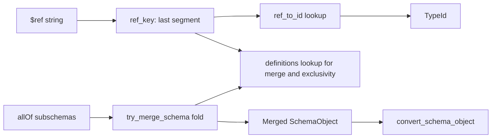

# Typify — Research report

## Metadata

- **Library name**: Typify
- **Repo URL**: https://github.com/oxidecomputer/typify
- **Clone path**: `research/repos/rust/oxidecomputer-typify/`
- **Language**: Rust
- **License**: Apache-2.0
- **Analyzed version**: e934abc 2026-10-19 (workspace release 0.8.0; unreleased commits on top, mostly dependency bumps)
- **Report date**: 2026-10-26

## Summary

Typify compiles JSON Schema documents into idiomatic Rust types. It uses the schemars crate for schema representation and supports draft-07–style schemas (tests also use draft-04); it does not target JSON Schema 2020-12 explicitly. Code generation is structure-oriented: types are generated from `type`, `properties`, `items`, `oneOf`, `allOf`, `anyOf`, `$ref`, `definitions`, `format`, `enum`, `additionalProperties`, `required`, `default`, and related keywords. Validation keywords are used only for type selection (e.g. integer bounds for choosing `i8`/`u64`) or stored for optional runtime validation (e.g. string pattern); they are not enforced in the type system. Typify can be used via the `cargo typify` CLI, the `import_types!` macro, or a builder API in `build.rs` or xtask. Generated code is serde-serializable and can emit custom map types, format-based types (e.g. `uuid::Uuid`, `chrono::NaiveDate`), and an optional builder interface. The library supports the `x-rust-type` schema extension to reuse types from other crates. Still on schemars 0.8.22 (draft-07 model) as of 0.8.0.

**Recent changes (0.6.0 to 0.8.0, from CHANGELOG.adoc)**: generated type docs no longer embed the original JSON Schema (#1066); `Option` fields marked `required` must now be present on deserialize (#1071); structs derive `Default` when all field defaults are the type's intrinsic default (#1035); malformed schema JSON and invalid map types now produce errors instead of panics (#1030, #1031; `MapType` re-exported from `typify`); string length validation counts code points (#1038); non-idiomatic `TryFrom<&String>` / `From<&T>` impls removed (#946, #945, #1040); custom `attrs` setting applies attributes to all generated types (#949); inline format args in generated code (#934); JSON pointer escape handling (#940); merging of multiple pattern strings (#1008) and of strings/numbers (#998); unused default functions no longer emitted (#990); public `accept_as_ident` (#973).

## JSON Schema support

- **Draft**: No explicit draft stated in the README. The implementation uses **schemars** (0.8.22), which follows draft-07–style schemas (e.g. `definitions` rather than `$defs`). Test fixtures use both draft-04 and draft-07 `$schema` URLs.
- **Scope**: Structure-oriented subset. The schema is parsed via serde into schemars’ `RootSchema` / `Schema`. Fragment-only `$ref` and `definitions` are resolved. Combinators (`allOf`, `oneOf`, `anyOf`) and structural keywords (`type`, `properties`, `items`, `additionalProperties`, `required`, `enum`, `format`) drive codegen. Many validation keywords are read for type selection or metadata (e.g. `minimum`/`maximum` for integer type, `minLength`/`maxLength`/`pattern` for string newtypes) but are not enforced as value constraints in generated types. No support for `$id`/external refs, `if`/`then`/`else`, `dependentRequired`/`dependentSchemas`, `unevaluatedProperties`/`unevaluatedItems`, or `contentEncoding`/`contentMediaType`/`contentSchema`.

## Keyword support table

Keyword list derived from vendored draft 2020-12 meta-schemas under `specs/json-schema.org/draft/2020-12/meta/` (core, applicator, validation, meta-data, unevaluated, format-annotation, format-assertion, content). Typify consumes schemas via schemars (draft-07 style); `definitions` in schemars corresponds to `$defs` for reference resolution.

| Keyword | Implemented | Notes |
|---------|-------------|-------|
| $anchor | no | Not used. |
| $comment | no | Not used. |
| $defs | partial | Everything is keyed by `RootSchema.definitions` + `RefKey::Def(last segment)`. The `x-rust-type.json` fixture uses `$defs`/`#/$defs/...` and passes, so schemars' deserializer must accept it (schemars source not vendored in the clone; not verified). |
| $dynamicAnchor | no | Not used. |
| $dynamicRef | no | Not used. |
| $id | no | Not used for resolution; external refs not supported. |
| $ref | yes | Fragment-only (`#`/`#/.../Name`); `ref_key` keeps only the last `/` segment (JSON-pointer-unescaped), so any `#/a/b/Name` is treated as definition `Name`. Non-`#` refs and unknown names panic. |
| $schema | no | Parsed by schemars but not used for codegen. |
| $vocabulary | no | Not used. |
| additionalProperties | yes | `false` → `#[serde(deny_unknown_fields)]`; schema → flattened map or map type; absent/true → ignore. |
| allOf | yes | Merged via `merge_all`; merged schema then converted to a single type. |
| anyOf | partial | Modeled as struct with optional, flattened members; README notes this is a weak area. |
| const | partial | `convert_schema_object` strips `const_value` and converts the rest (TODO: not worth a newtype), so no single-value type is generated. It is read as a signal in `oneOf` shape detection (`maybe_externally_tagged_enum` accepts string `const` as a simple variant; `constant_string_value` uses `const` or single-value `enum` to find internal/adjacent tags), in `is_null_schema`, in merge and in `schema_value_validate`. |
| contains | no | Not used; an array schema with `contains` set matches no `convert_array` arm and returns `Error::InvalidSchema("unhandled array validation")`. |
| contentEncoding | no | Not used. |
| contentMediaType | no | Not used. |
| contentSchema | no | Not used. |
| default | yes | Emitted as `#[serde(default)]` and default functions in `defaults` module; default value used for validation. |
| dependentRequired | no | Not used. |
| dependentSchemas | no | Not used. |
| deprecated | no | Not used in codegen. |
| description | yes | Emitted as `///` doc comments. |
| else | no | Same as `if`: a schema carrying it falls into the multi-subschema arm and `try_merge_with_subschemas` hits `unimplemented!` (panic). |
| enum | yes | String enums become Rust enums (External tag); other typed enums become validated newtypes (`TypeEntryNewtypeConstraints::EnumValue`); untyped enums are inferred from value kinds. Tagged/untagged enums come from `oneOf`, not `enum`. |
| examples | no | Not used. |
| exclusiveMaximum | partial | Used in integer type selection only; not enforced in generated code. |
| exclusiveMinimum | partial | Used in integer type selection only; not enforced in generated code. |
| format | yes | String: uuid, date, date-time, ip, ipv4, ipv6 → native Rust types; integer format → int8/uint8/… for type selection. |
| if | no | Not converted; any schema with `if`/`then`/`else` is routed to `try_merge_with_subschemas`, which `unimplemented!`-panics. |
| items | yes | Single schema → `Vec<T>` (also for `uniqueItems`, see below); array of schemas with `minItems == maxItems > 0` → tuple; single schema with equal min/max → `[T; N]`. Array-form `items` without equal bounds is rejected with `InvalidSchema`. |
| maxContains | no | Not used. |
| maximum | partial | Used for integer type selection (e.g. i8..u64); not enforced in generated code. |
| maxItems | partial | Only when `minItems == maxItems` > 0 does it drive a fixed tuple or `[T; N]` array; otherwise ignored (`// TODO enforce size limitations`). |
| maxLength | partial | Stored in newtype string constraints; can drive validation. |
| maxProperties | no | Merged in merge.rs; ignored by conversion. |
| minContains | no | Not used. |
| minimum | partial | Used for integer type selection and NonZero choice; not enforced in generated code. |
| minItems | partial | Same as `maxItems`: only used when equal to `maxItems`; otherwise ignored (TODO). |
| minLength | partial | Stored in newtype string constraints. |
| minProperties | no | Merged in merge.rs; ignored by conversion. |
| multipleOf | partial | In `convert_integer` its presence only suppresses NonZero/narrow type selection; `// TODO we should do something with multiple`; merged in merge.rs. Not enforced. |
| not | partial | Special cases: bool invert, empty object → false, enum deny list via `convert_not`. |
| oneOf | yes | Mapped to Rust enum (various serde representations). |
| pattern | partial | Stored in `StringValidation`; regress crate used for validation in generated code where applicable. |
| patternProperties | partial | Only when there are no `properties`/`required`, every pattern maps to the same value schema and `additionalProperties` is absent/false: patterns are joined with `|` into a key-pattern newtype and a map is produced. Otherwise ignored by conversion; merge drops them (`// TODO`) and `filter_prop` asserts them empty (panic). |
| prefixItems | no | Not a schemars 0.8 field. The draft-07 array-form `items` (+ `additionalItems`) is what drives tuples. |
| properties | yes | Drives struct fields; optional/required and naming. |
| propertyNames | partial | Passed to `make_map` and converted through `id_for_schema_string` into the map key type (e.g. a validated string newtype); its presence also disables the patternProperties-to-map path. `propertyNames: false` hits `todo!()`. |
| readOnly | no | Not used. |
| required | yes | Non-required → `Option<T>` or `#[serde(default)]`. |
| then | no | Same as `if` (panic). |
| title | yes | Used for type and variant naming. |
| type | yes | instance_type → Rust types; multiple types + null → Option or untagged enum. |
| unevaluatedItems | no | Not used. |
| unevaluatedProperties | no | Not used. |
| uniqueItems | partial | `true` produces `TypeEntryDetails::Set`, but `type_ident` renders it as `::std::vec::Vec<T>` (TODO in code: needs derives right first), so uniqueness is not enforced or represented. |
| writeOnly | no | Not used. |

## Default keyword

Typify emits `#[serde(default)]` when the schema default equals the Rust type default, and a generated default function in a `defaults` module with `#[serde(default = "…")]` otherwise; it also validates the default value against the schema.

## Constraints

Validation keywords are used only for structure and type selection, not enforced as value constraints in the generated Rust types. The README states that bounded numbers (e.g. `minimum`/`maximum`) “won’t enforce those value constraints.” In the code: `minimum`/`maximum`/`exclusiveMinimum`/`exclusiveMaximum` are used to choose integer Rust types (e.g. i8, u64, NonZeroU64) and to validate default values; they are not emitted as runtime checks. For strings, `minLength`/`maxLength`/`pattern` are stored in newtype constraints and can be used for validation (e.g. via regress). Array `minItems`/`maxItems` are used only for tuple/fixed-array length (when equal) and are otherwise ignored (TODO). The `validate` module and `schema_value_validate` are used internally for merge/compatibility checks, not for user-facing validation of generated types.

## High-level architecture

Typify is a single-pass-per-batch compiler from schemars `Schema` values to an arena of `TypeEntry` values, followed by token emission:

1. **Parse**: the caller deserializes JSON into schemars' `RootSchema` (draft-07 model); Typify has no parser of its own (`typify/tests/schemas.rs`, `typify-macro`, `cargo-typify` all call `serde_json::from_*`).
2. **Register**: `TypeSpace::add_root_schema` (typify-impl/src/lib.rs) collects `definitions` (plus the root, only if it has a `title`) and calls `add_ref_types_impl`, which pre-allocates a contiguous block of `TypeId`s for every definition so forward and circular `$ref`s can be resolved by id before the target is converted.
3. **Convert**: each definition is converted by `convert_ref_type` -> `convert_schema` -> `convert_schema_object` (convert.rs), a large pattern-match over the shape of the `SchemaObject`. Sub-schemas (properties, items, variants) are converted recursively and interned with `assign_type`, producing more `TypeId`s.
4. **Break cycles**: `break_cycles` (cycles.rs) runs an iterative DFS from the definition ids and replaces back-edges with `Box<T>` entries.
5. **Finalize**: every entry created in this batch is cloned, `finalize`d (computes enum `bespoke_impls`, validates defaults) and written back.
6. **Emit**: `TypeSpace::to_stream` walks `id_to_entry`, each named entry adds token streams to an `OutputSpace` (a sorted map), shared default fns and the `ConversionError` type are appended on demand, and `into_stream` wraps items into `builder`, `defaults`, `error` modules.

```mermaid
flowchart LR
  JSON[JSON schema file] --> Serde[serde_json to schemars RootSchema]
  Serde --> AddRoot[add_root_schema]
  AddRoot --> Prealloc[preallocate TypeIds for definitions]
  Prealloc --> Convert[convert_schema recursion]
  Convert --> Assign[assign_type interning]
  Assign --> Cycles[break_cycles inserts Box]
  Cycles --> Finalize[finalize and check_defaults]
  Finalize --> Output[output into OutputSpace]
  Output --> Stream[into_stream TokenStream]
  Stream --> Sink[rustfmt file or macro expansion]
```

Crates: **typify-impl** (everything above; `TypeSpace`, `TypeSpaceSettings`), **typify** (re-export plus docs), **typify-macro** (`import_types!`), **cargo-typify** (CLI; formats with `rustfmt_wrapper`), **typify-test** and **example-*** crates.

## Medium-level architecture

Modules in `typify-impl/src/`:

- `lib.rs`: `TypeSpace`, `TypeId`, `Name`, `RefKey`, settings, `assign_type`, `to_stream`.
- `convert.rs`: shape dispatch, scalar conversion, `oneOf`/`anyOf`/`allOf`/`not` entry points.
- `enums.rs`: tagged/untagged `oneOf` detection and enum variant output.
- `structs.rs`: struct members, maps, flattened unions, serde attribute generation.
- `merge.rs`: schema-to-schema intersection used for `allOf`.
- `util.rs`: `ref_key`, `all_mutually_exclusive`, `sanitize`, `get_type_name`, `StringValidator`.
- `type_entry.rs`: IR types and per-type token emission (`output_enum/struct/newtype`).
- `cycles.rs`, `defaults.rs`/`value.rs` (default validation and value-to-tokens), `validate.rs` (tiny value-vs-schema check), `rust_extension.rs` (`x-rust-type`), `conversions.rs` (user conversion cache), `output.rs`.

`$ref` resolution is two-phase. `convert_reference` only looks up `ref_to_id[ref_key(name)]` and returns a transient `TypeEntryDetails::Reference(id)`; `assign_type` unwraps that to the bare `TypeId` so no Reference node is ever stored (the `unreachable!()` arms in output confirm this). The raw `Schema` of every definition is also kept in `TypeSpace.definitions` because `merge`, `all_mutually_exclusive` and `resolve` need to inspect referents.

Conversion dispatch in `convert_schema_object`, in order: user `convert` cache hit (`SchemaCache`, in `convert_schema`); `x-rust-type` native type; `["T","null"]` -> `Option<T>`; string (+format) / string with validation; string enum; integer; number; boolean; object; array; permissive (`{}` -> `serde_json::Value`); null; `$ref` (with up to three variants: bare, with matching `type`, or with sibling keywords merged via `merge_all` along the chain of refs); typed/untyped enum; subschemas (`allOf`/`anyOf`/`oneOf`/`not` singly, otherwise merged via `try_merge_with_subschemas`); `const` (stripped); the "type lists every type" case (stripped); multi-type arrays (rewritten as an untagged enum of per-type subschemas, integers ordered before numbers by `ReorderedInstanceType`).

## Algorithms and data structures

### Schema representation

Typify never builds its own schema model. It consumes `schemars::schema::{RootSchema, Schema, SchemaObject}` (schemars 0.8.22; `Cargo.toml` workspace dependency): `Schema` is `Bool(bool) | Object(SchemaObject)`, and `SchemaObject` is a struct of optional sub-structs (`metadata`, `instance_type: Option<SingleOrVec<InstanceType>>`, `format`, `enum_values`, `const_value`, `subschemas`, `number`, `string`, `array`, `object`, `reference`, `extensions`). Because all keywords live in a fixed struct, unrecognized keywords fall into `extensions` (a map) and are ignored except `x-rust-type`. Numeric bounds in `NumberValidation` are `f64`, which constrains integer-type selection (see Low-level details). Boolean schemas are first-class: `true` becomes `serde_json::Value`, `false` becomes an uninhabited empty enum (`convert_never`). The schema is owned and cloned liberally; there are no lifetimes tying the IR to the input except that `convert_schema` returns a borrowed `&Option<Box<Metadata>>` so callers can read `default`/`title`.

The generator IR is `TypeEntry { details: TypeEntryDetails, extra_derives, extra_attrs }` (type_entry.rs). `TypeEntryDetails` is an enum with named user types (`Enum(TypeEntryEnum)`, `Struct(TypeEntryStruct)`, `Newtype(TypeEntryNewtype)`), `Native(TypeEntryNative)` (an external Rust type path plus implemented-trait list and generic `parameters: Vec<TypeId>`), and structural std types (`Option`, `Box`, `Vec`, `Map(key, value)`, `Set`, `Array(id, len)`, `Tuple(Vec<TypeId>)`, `Unit`, `Boolean`, `Integer(String)`, `Float(String)`, `String`, `JsonValue`) plus the transient `Reference(TypeId)`. Children are always referenced by `TypeId` (a `u64` newtype), never by pointer, so the IR is a flat id-indexed graph that may contain cycles. Named entries carry a clone of their original `Schema` in a `SchemaWrapper` whose `Ord` is constant `Equal` and a `WrappedValue` (default value) with the same trick; this keeps `#[derive(Ord)]` on `TypeEntryDetails` usable as a `BTreeMap` key while ignoring those fields.

### Reference resolution and registry

State lives in `TypeSpace` (lib.rs): `next_id: u64`, `definitions: BTreeMap<RefKey, Schema>`, `id_to_entry: BTreeMap<TypeId, TypeEntry>`, `type_to_id: BTreeMap<TypeEntryDetails, TypeId>`, `name_to_id: BTreeMap<String, TypeId>`, `ref_to_id: BTreeMap<RefKey, TypeId>`, `uses_*` flags, `SchemaCache`, and `defaults: BTreeSet<DefaultImpl>`. `RefKey` is `Root | Def(String)`.

`add_ref_types_impl` is the registry builder: it advances `next_id` by `definitions.len()` and inserts `ref_to_id[name] = TypeId(base+i)` for all definitions *before* converting any of them, then converts each and stores the result at the reserved id (`convert_ref_type`; entries whose conversion yields an unnamed type are wrapped in a newtype named after the definition, a `Reference` becomes a newtype alias). Settings `replace` are checked here: a definition whose Pascal-cased name is in `settings.replace` is stored as a `Native` type instead of being converted. `ref_key` (util.rs) is purely syntactic: `#` -> `Root`, otherwise the text after the last `/` with `~1`/`~0` decoded -> `Def`; there is no base-URI tracking, `$id`, anchors, or remote fetching, and a ref without `/` or an unknown name panics (`convert_reference`: `"external references are not supported"` / `"$ref ... is missing"`). Because only the last segment is used, `#/definitions/Foo` and `#/$defs/Foo` and even `#/properties/Foo` all alias to definition `Foo`. Circular refs are therefore trivial for the registry (ids exist before conversion); termination of *containment* cycles is handled afterwards by `break_cycles`. A separate recursion hazard is in `merge`: the code has a TODO that circular `allOf` chains would spin ("need to mitigate circular references"); no memo/visited set exists.

### Compiled / intermediate form

The IR is the `id_to_entry` arena described above. Entry construction is staged: conversion functions return a `TypeEntry` *by value* plus metadata; `id_for_schema` then copies a metadata `default` into named entries and calls `assign_type` to intern it and obtain a `TypeId`. `Option`/`Box`/`Vec` etc. are themselves entries that are interned (`id_to_option`, `id_to_box`), so a given `Option<Foo>` exists once. After conversion, three post-passes mutate the arena: `break_cycles` (rewrites child ids to `Box` ids), `finalize` (clone-modify-reinsert per entry: `TypeEntryEnum::finalize` computes `bespoke_impls` such as `AllSimpleVariants`, `UntaggedFromStr`, `UntaggedDisplay`; `check_defaults` validates every struct/variant/property default against the converted type and registers shared default fns), and output.

Variants and properties are small structs: `Variant { raw_name, ident_name, description, details: VariantDetails::{Simple, Item(TypeId), Tuple(Vec<TypeId>), Struct(Vec<StructProperty>)} }` and `StructProperty { name, rename: None|Rename|Flatten, state: Required|Optional|Default(value), description, type_id }`. Enum tagging is `EnumTagType::{External, Internal{tag}, Adjacent{tag,content}, Untagged}`.

### Core algorithm

**Type inference.** `convert_schema_object` is a first-match `match` on a destructured `SchemaObject`, where each arm lists every field (using `None` for fields that must be absent) to make the dispatch exhaustive and explicit. Scalars: strings map by `format` (`uuid`, `date`, `date-time`, `ip`, `ipv4`, `ipv6` to native types; others stay `String`); string validation (`minLength/maxLength/pattern`) wraps `String` in a constrained newtype after compiling the pattern with `regress` at generation time to reject bad regexes. Integers go through `convert_integer`, which converts `minimum`/`exclusiveMinimum`/`maximum`/`exclusiveMaximum` into inclusive `f64` bounds (exclusive: +/-1.0), looks for a matching entry in a table of `(format, rust type, NonZero type, min, max)` rows, and chooses the narrowest type whose limits equal the bounds within `f64::EPSILON`; `minimum == 1` selects a `NonZero*` type; `multipleOf` disables the exact-format shortcut; anything else falls back to `i64` (the `TODO: all these are wrong as casting to an f64 loses precision` comment applies). Numbers become `f64` (or `f32` for `format: float`) and ignore bounds. Objects: no properties and non-`false` additionalProperties -> `Map(key, value)` via `make_map`; the pattern-only form (see keyword table); otherwise a struct via `struct_members`: for each property it builds a suggested name `<Parent>_<prop>` (`Name::Suggested`), converts the property, wraps non-required properties in `Option` unless they have an intrinsic default (Option/Vec/Map) or an explicit `default`, and sorts by property name. `additionalProperties` schema adds a `#[serde(flatten)] extra` map member; `false` sets `deny_unknown_fields` (skipped when a flattened extra exists because serde forbids combining them). Required-but-unspecified properties become `serde_json::Value` fields; `false`-schema properties are dropped (a documented TODO).

**`allOf`.** `convert_all_of` first tries `maybe_singleton_subschema` (one element: just convert it, so titles/descriptions pass through). Otherwise `merge_all` (merge.rs) folds the subschemas left-to-right with `try_merge_schema`, producing a single `SchemaObject`, and conversion restarts on the merged result (`Bool(false)` -> uninhabited enum). `try_merge_schema` cases: `false` absorbs to Err; `true` is identity; two identical `$ref` names stay a ref; a `$ref` against anything resolves the ref through `definitions` (the `defs.get(...).unwrap_or_else(panic)`), merges the target with the other side, and returns the *reference* again if the result is `roughly` equal to the target (so `allOf: [{$ref: A}, {description: ..}]` keeps the named type `A`); otherwise the merged contents are inlined. `merge_schema_object` merges field by field: instance types are intersected (`merge_so_instance_type`), formats must agree except integer width (narrowest wins) and `ip` vs `ipv4/ipv6` (more specific wins) (`merge_so_format`), number bounds take the tighter value, strings take the longer minLength / shorter maxLength and combine distinct patterns as `(?=x)(?=y)` lookaheads (since #1008), `multipleOf` merges by least common multiple, arrays merge `items`/`additionalItems`/bounds, enums intersect (empty intersection -> Err), and finally enum values are filtered by `schema_value_validate` against the merged schema. `merge_so_object` takes the union of `required`; for each property present in both it merges recursively, for a property present on one side it checks it against the other side's `additionalProperties` via `filter_prop`/`merge_additional` (so a `false` there removes it or, for required properties, makes the whole merge unsatisfiable); min/maxProperties tighten and conflict returns Err; `patternProperties`/`propertyNames` are dropped (`// TODO`). Nested `allOf/anyOf/oneOf/not` on the operands are handled by `try_merge_with_subschemas`: `allOf` folds in, `not` is merged by `try_merge_schema_not` (several shapes `todo!()`), and `anyOf`/`oneOf` distribute: `try_merge_with_each_subschema` merges the base with every alternative, discards unsatisfiable ones, and keeps the alternative itself if the merge is `roughly` equal to it, else builds `allOf[base, alt, not(other alts)...]` so exclusivity can be recognized later. The consequence is that `allOf` produces a *flattened* struct with the union of properties, not a Rust composition; the code comments list a future `Into<SuperClass>` as a TODO.

**`oneOf`/`anyOf` -> enum.** `convert_one_of` tries recognizers in a fixed, documented order, each returning `Option<TypeEntry>` (None means "does not match this shape" and the next recognizer runs): `maybe_option` (exactly one non-null branch), `maybe_externally_tagged_enum`, `maybe_adjacently_tagged_enum`, `maybe_internally_tagged_enum`, `maybe_singleton_subschema`, and finally `untagged_enum` as the catch-all. The recognizers (enums.rs):
- *External*: every branch must be either a string `enum`/`const` (each value a simple variant) or an object with exactly one property that is also its only required property (`required.len() == 1 && properties.len() == 1`, no pattern properties/property names). The property name becomes the variant name; its schema is converted by `external_variant` and mapped to `Tuple`, `Simple` (unit), `Struct` (flattened from an inline struct, carrying `deny_unknown_fields`) or `Item(TypeId)`. A duplicate proto-variant name (tracked in a `HashSet`) rejects the shape.
- *Adjacent*: every object's properties must all be required; per subschema it computes `(constant_string_properties, all_properties)`, intersects the former and unions the latter across branches; the shape matches iff exactly one common constant property (tag) and exactly two total property names (tag + content). It is checked *before* internal because it is a subset of the internal shape.
- *Internal*: every branch must be an object with a required property whose schema is a single constant string (`constant_string_value`: `const` or one-element `enum` with `type: string`); `reduce` intersects property names across branches while requiring disjoint values (`is_disjoint`) so values are unique; candidate tags are sorted and the first is chosen deterministically. Each variant's remaining properties become a `VariantDetails::Struct` via `struct_members`.
- *Untagged*: names come from `schema_is_named` for each branch (title or `$ref` name), kept only if all branches have unique names, stripped of the common kebab-case word prefix (`get_common_prefix`, via heck), and fall back to `Variant0..VariantN`; each branch is converted through `external_variant`. Serde tries variants in order, so exclusivity matters.

`convert_any_of` first tries `maybe_option`, then `all_mutually_exclusive`: all O(n^2) pairs are checked with `schemas_mutually_exclusive`, a conservative structural test (distinct instance types, disjoint enums/consts validated by `schema_value_validate`, object property conflicts, distinct required constant properties, array shape conflicts, recursing through `allOf` with *any*, `oneOf/anyOf` with *all*, `not` inverted; unknown shapes count as "not exclusive"). If exclusive, the `anyOf` is treated as `oneOf`; else `flattened_union_struct` builds a struct with one `#[serde(flatten)] Option<T>` member per branch named `subtype_N`. This is the only caller of that function (the `optional: false` form is unused).

**Naming.** `Name` is `Required(String) | Suggested(String) | Unknown`. `get_type_name` (util.rs) resolves precedence: a `Required` name (definition key) always wins; otherwise a schema `title` beats a `Suggested` name; `Unknown` without a title means "anonymous" (returns None), which is how the match arms decide whether to produce a named struct/enum/newtype or an inline type. `Name::append` builds hierarchical suggestions (`Parent_field`, `ParentItem`, `ParentValue`, `ParentKey`, `Parent_extra`, `ParentSubtypeN`, `ParentInner`), always demoted to `Suggested`. `sanitize` Pascal- or snake-cases (via heck), maps non-XID characters to `-` before casing, special-cases `+1`/`-1`, prefixes `X` if the first char is not an XID start, and appends `_` to Rust keywords (`accept_as_ident`). `TypePatch::new` applies `settings.patch` renames/derives at entry creation.

**Cycle breaking.** `break_cycles(range)` (cycles.rs) is an explicit-stack DFS over the ids of the current batch (`Vec<Node>` where `Node::Start{type_id}` / `Node::Processing{type_id, children_ids}`), with `visited: BTreeSet` (global) and `active: BTreeSet` (current DFS path). On first visit of a node it asks `get_child_ids` for mutable references to the type ids that represent *inline containment*: enum variant payloads (Item/Tuple/Struct properties), struct properties, newtype inner, and `Option`, `Array` and `Tuple` children. `Vec`, `Set`, `Map` and `Box` are intentionally not traversed since they already provide indirection. Children that are in `active` are back-edges: each is replaced with `id_to_box(child)`, which interns a `Box(child)` entry (idempotent through `type_to_id`) and the parent's slot is rewritten in place; the remaining children are pushed for descent. Complexity is O((V+E) log V) from the `BTreeSet`s and the per-visit `Vec` allocation. The choice of where to put the box is "arbitrary rather than optimal" per the doc comment (the edge that closes the cycle in DFS order, which follows ascending `TypeId`, i.e. definition order). It is iterative, so deep type graphs cannot overflow the stack here (unlike most of the rest of the pipeline, see Low-level details).

**Impl derivation.** Derives are decided in `TypeEntry::output`: base set `Serialize, Deserialize, Debug, Clone` (as a `BTreeSet` for stable order) plus `Copy, PartialOrd, Ord, PartialEq, Eq, Hash` for enums whose variants are all `Simple`; user extra derives/attrs from settings and patches are merged in `strings_to_derives`. `Default`: structs get `#[derive(Default)]` when there is no whole-type default and every property's default is the intrinsic `Default::default()` (every property Option/Vec/Map/`Optional`), else a hand-written `impl Default` from the schema default value (`output_value` renders a `serde_json::Value` as a Rust expression) or per-property defaults when all properties have one. The planning is in `has_impl(TypeSpaceImpl::Default)`, a recursive query over the entry graph (Tuple up to 12, Array up to 32, Box/Newtype delegate; the code comment admits it would loop on `struct A(Box<A>)`). Property defaults generate `#[serde(default = "...")]`: `generate_serde_attr` calls `default_fn`, which either reuses one of four shared generic helpers (`default_bool<const V: bool>`, `default_i64`, `default_u64`, `default_nzu64` in the `defaults` module, emitted only if some output references the name) or emits a bespoke function keyed `(Defaults, type_name)`. `FromStr`/`Display` for all-simple enums, for untagged enums whose variants all implement them, and for constrained string newtypes are chosen by `bespoke_impls` computed in `finalize`. Newtypes with `enum`/deny values implement `TryFrom<Inner>` and a validating `Deserialize`; constrained strings implement `TryFrom<&str>` (length via `chars().count()`, pattern via a `static LazyLock<regress::Regex>`), `FromStr`, `TryFrom<String>` and `Deserialize`.

**Builders.** With `struct_builder`, `output_struct` adds `impl T { fn builder() -> builder::T }` and, in the `Builder` module, a struct whose fields are `Result<FieldType, String>`, setters `fn field<V: TryInto<FieldType>>(self, V)` (storing the error text), a `Default` that seeds each field with its default or an `Err("no value supplied for ...")`, `TryFrom<Builder> for T`, and `From<T> for Builder`. Builder logic only handles structs.

**Emission order.** See Error and output model.

### Error and output model

Errors are `typify_impl::Error` (`thiserror`): `BadValue`, `InvalidTypeId`, `InvalidValue`, `InvalidSchema { type_name, reason }`. They are returned for malformed string patterns, unusable defaults or enum values, unhandled array validation, bad map types. Many unsupported shapes still `panic!`/`todo!()`/`unimplemented!()`/`unreachable!()` instead (missing/external `$ref`, `if/then/else`, `propertyNames: false`, `Schema::Bool(false)` as a oneOf branch, duplicate enum idents, multiple implied types in an untyped enum, several `not` shapes). Errors carry only a type name and message, no schema path. The `TypeSpace` is left in a partially updated state on error (code TODO).

Output is a `proc_macro2::TokenStream`. `OutputSpace` (output.rs) is `BTreeMap<(OutputSpaceMod, String), TokenStream>`; `add_item(location, order_hint, stream)` does `entry(key).or_default().extend(stream)`, so every item emitted with the same type name in the same module is concatenated in insertion order (a type's definition then its `impl`s then its default fns, as the `test_order` test shows). `OutputSpaceMod` orders `Crate < Builder < Defaults < Error`; `into_stream` folds items by module, wraps `Builder`, `Defaults` and `Error` in `pub mod builder/defaults/error { ... }`, and emits `Crate` items at the top level. `to_stream` iterates `id_to_entry` (ascending `TypeId`), appends used shared default fns by testing `output.contains(fn_name)` (stringifying each accumulated `TokenStream` and substring-searching), and appends `ConversionError` only if the text `"ConversionError"` appears somewhere. This text-grep approach is flagged in the code as "gross" and may have benign false positives.

## Low-level details

- **Integer types**: bounds are `f64`; `i64::MAX as f64` loses precision; selection compares within `f64::EPSILON`. Default values for integers are range-checked as `f64`. `format: int8..uint64`, `int`, `uint` choose widths; `multipleOf` is not enforced.
- **String length**: `StringValidator::is_valid` (used when filtering string enum values at generation time) and generated `TryFrom<&str>` both count code points (`chars().count()`), not bytes (since 0.8.0, #1038).
- **Patterns**: validated at generation time with `regress::Regex::new`; invalid pattern -> `Error::InvalidSchema`. Generated code uses `PATTERN.find(value).is_none()` (unanchored search, per JSON Schema semantics).
- **String enum value filtering**: enum strings that violate the sibling `minLength/maxLength/pattern` are silently dropped from the enum.
- **Optional required fields**: a `required` property of Option type gets `#[serde(deserialize_with = "::std::option::Option::deserialize")]` so presence is mandatory (0.8.0, #1071).
- **Format strings**: `date-time`/`date` need `chrono`, `uuid` needs `uuid`; flags `uses_chrono/uses_uuid/uses_regress/uses_serde_json` let callers add dependencies; `time`, `url`, `email` etc. are not recognized.
- **Nulls**: `type: ["T","null"]` -> `Option<T>` (with `*Inner` naming if a name is required); `enum` with `null` -> `Option<enum>`; `type: null` -> `()`.
- **Untyped enums**: infer one JSON kind from the values; mixed kinds panic. Enum-of-booleans is ignored (plain `bool`).
- **Deep inputs**: `convert_schema_object`, `merge`, `type_ident`, `has_impl`, `validate_value` and `all_mutually_exclusive` recurse with the call stack; only `break_cycles` is iterative. No recursion depth limit exists. External refs, URL fetching and `$id` are absent, so there is no network attack surface.
- **Logging cost**: `info!`/`debug!` calls embed `serde_json::to_string_pretty(schema)`, evaluated only when that log level is enabled (the `log` macros are lazy).
- **Tuple/array size**: `minItems == maxItems > 0` yields tuples/`[T; N]`, other bounds are ignored with TODOs.

## Output and integration

- **Vendored vs build-dir**: Output path is configurable. CLI defaults to input path with `.rs` extension or stdout; macro inlines; builder writes to caller-chosen path. No fixed vendored output; examples generate at build time.
- **API vs CLI**: (1) **CLI** `cargo typify` (cargo-typify): `--input`, `--output`, `--builder`/`--no_builder`, `--additional-derive`, `--map-type`, `--crate`, `--unknown-crates`. (2) **Macro** `import_types!(schema = "…", derives = […], patch = {…}, replace = {…}, convert = {…}, struct_builder = true)`. (3) **Builder** `TypeSpace::new(settings)`, `add_root_schema(schema)` or `add_ref_types(definitions)`, `to_stream()`; used in build.rs or xtask.
- **Writer model**: No generic writer. CLI and builder produce a String (or write to file); macro expands to token stream. Formatting via rustfmt-wrapper or prettyplease (caller’s choice).

## Configuration

- **TypeSpaceSettings**: `with_map_type` (HashMap, BTreeMap, IndexMap, etc.), `with_unknown_crates` (Allow/Generate/Deny), `with_crate`/crates for x-rust-type; optional derives and attrs; struct_builder.
- **Naming**: heck for case conversion; sanitize for Rust identifiers; title and ref fragment used for type names.
- **Model name source**: Title and ref fragment used for type names; inline objects use parent + field name. Not configurable.
- **Optional dependencies**: Generated code may require `uuid`, `chrono`, `regress`, `serde_json`; TypeSpace reports `uses_uuid()`, `uses_chrono()`, etc. Conversion overrides (macro `convert`) allow substituting types for schema shapes (e.g. custom UUID type).
- **Patch/replace**: Macro `patch` for rename and extra derives per type; `replace` to use an existing type instead of generating one.

## Pros/cons

- **Pros**: Multiple entry points (CLI, macro, builder); rich schema support (allOf merge, oneOf enums, anyOf heuristic, not for special cases); format → native types (uuid, chrono, std net); configurable map type; x-rust-type for reusing types from other crates; optional builder interface and validation (string constraints); Apache-2.0.
- **Cons**: Fragment-only refs (no external $ref); validation keywords not enforced in types (bounded numbers, multipleOf, etc.); anyOf modeled as struct with optional flattened members (imprecise); patternProperties and propertyNames only partially supported; no if/then/else, unevaluated*, or content*; integer bounds use f64 in schemars (precision note in code).

## Testability

- **Unit tests**: typify-impl has tests in convert.rs (integer type output), structs.rs (validate_output for generated structs), enums.rs (oneOf/refs), value.rs (validation), merge.rs (merge and oneOf/allOf identity), util.rs (sanitize, ref_key). type_entry and defaults have tests.
- **Integration tests**: typify/tests/schemas.rs uses multiple JSON fixtures (e.g. simple-types, arrays-and-tuples, maps, merged-schemas, various-enums, id-or-name, x-rust-type) and compares generated .rs to expected. typify-impl/tests test_generation.rs and test_github.rs use large schemas (ega, github) and validate output. cargo-typify/tests/integration.rs runs CLI and compares output (builder, derive, custom_btree_map, etc.).
- **Running tests**: From repo root, `cargo test --all`. Fixtures under typify/tests/schemas/*.json and typify-impl/tests/*.json.
- **Fixtures**: Good candidates for cross-generator comparison: typify/tests/schemas/*.json, typify-impl/tests/vega.json, github.json.

## Performance

Analysis is from code only; nothing was built or run.

### Performance techniques

Typify is a build-time tool, and its code favors simplicity over speed; the code itself says so in places (`conversions.rs`: "TODO Everything about this is inefficient").

- **Compile vs interpret**: Not applicable at the validator level (Typify does not validate instances). In the generator, the work that is moved ahead of time is the important one: all validation logic for constrained strings/enum newtypes is emitted as straight-line Rust in the generated crate; the pattern regex is checked with `regress::Regex::new` at generation time only to reject invalid patterns, then compiled again at runtime in the generated code via a `static LazyLock<regress::Regex>` (once per constrained type, not per call). Default values are validated against the converted types once in `finalize`/`check_defaults`, and generated as `fn` items or four shared generic helper functions using const generics (`default_bool<const V: bool>`, `default_i64`, `default_u64`, `default_nzu64`) to cut code size.
- **Memory layout and allocation**: the IR is an id-indexed arena in `BTreeMap<TypeId, TypeEntry>` (not a `Vec`), and children are `u64` newtype ids rather than boxes. Allocation is otherwise liberal: schemas are `clone()`d on nearly every path (`add_ref_types_impl` clones each definition into `definitions`; each named entry stores a clone of its `Schema` in `SchemaWrapper`; `convert_schema_object` re-clones `schema` with a field changed for the `const`, multi-type and `$ref` paths; `finalize` clones the whole `TypeEntry`, finalizes and reinserts it); `get_child_ids` allocates a `Vec` per node in `break_cycles`; `Name::append` builds `String`s. Names and variant/property strings are owned `String`s, no interning.
- **Caching and memoization**: `type_to_id: BTreeMap<TypeEntryDetails, TypeId>` is a structural hash-consing table for unnamed types (`Option<T>`, `Vec<T>`, `Map`, `Box`, tuples, builtins), so each distinct unnamed type is stored once (comparison relies on the derived `Ord`; `SchemaWrapper` and `WrappedValue` compare equal so schema text does not affect it). `name_to_id` caches named types: the first type with a given generated name wins, later ones with the same name reuse its id without structural comparison. `ref_to_id` makes each `$ref` target convert exactly once. `SchemaCache` (conversions.rs) is a `Vec<(SchemaObject, TypeEntry)>` for the user `convert` setting, looked up by linear scan with full `SchemaObject` equality after cloning the probe schema and clearing metadata, executed for every `Schema::Object` passed to `convert_schema`. `merge` has no memoization (a comment in `try_merge_with_each_subschema` says so), and `all_mutually_exclusive` re-evaluates pairs each time.
- **Fast paths and short-circuiting**: `break_cycles` skips already-visited ids; `maybe_singleton_subschema` bypasses merging for one-element `allOf`/`oneOf`; `try_merge_schema` returns the original `$ref` when the merge equals the referent, avoiding inlined copies; `all_mutually_exclusive` returns early for fewer than two branches and uses `.all()` short-circuiting; enum recognizers return `None` at the first shape mismatch before any type conversion (the external recognizer checks shapes before calling `external_variant`).
- **Regex handling**: `regress` (a Rust ECMAScript-syntax regex engine, backtracking) at generation and in generated code. No ReDoS mitigation is implemented in Typify; combined patterns from `allOf` are built by concatenating `(?=x)(?=y)` lookaheads, which can increase matching cost. `OutputSpace::contains` is not a regex but a repeated `TokenStream::to_string()` plus `contains` over every accumulated item: `to_stream` calls it once per used default-fn candidate plus once for `ConversionError`, so cost is roughly O((defaults + 1) x total output size).
- **Concurrency**: none. `TypeSpace` methods take `&mut self` for conversion and `&self` for `to_stream`/inspection; there is no internal threading or shared mutable state, and `Type<'a>` borrows the `TypeSpace`. One `TypeSpace` per thread is the only way to parallelize.

Complexity notes: conversion is roughly linear in schema size plus `BTreeMap` log factors; `all_mutually_exclusive` is quadratic in the number of `anyOf` branches; `try_merge_with_each_subschema` is O(n^2) in alternatives because each alternative builds `not` terms for all others; `break_cycles` is O((V+E) log V).

### Benchmarks in repo

None. There are no criterion/`#[bench]` targets or a `benches/` directory (verified by a search of every `Cargo.toml` and the tree). For shared-fixture runs the entry points are the CLI (`cargo typify <schema.json> --output out.rs`, flags `--builder/--no-builder`, `--map-type`, `--additional-derive`) or the library calls `TypeSpace::new(&settings)` -> `add_root_schema(root)` -> `to_stream()`. Realistic big fixtures already in the repo: `typify-impl/tests/github.json`, `typify-impl/tests/vega.json`, and `typify/tests/schemas/*.json`.

## Determinism and idempotency

Output is deterministic for a given input and settings. Ordering is controlled in several layers:

- `OutputSpace` is a `BTreeMap<(OutputSpaceMod, String), TokenStream>` keyed by module and the type name, so top-level types appear in lexicographic order of generated name, with each type's struct/enum, impls, and default fns concatenated in insertion order; modules are ordered `Crate`, `Builder`, `Defaults`, `Error`.
- `TypeSpace` uses `BTreeMap`/`BTreeSet` throughout (`definitions`, `id_to_entry`, `type_to_id`, `name_to_id`, `ref_to_id`, `defaults`); `HashSet`/`HashMap` appear only for uniqueness checks (not iterated into output).
- Struct properties are sorted by generated field name (`structs.rs`: `properties.sort_by(|a, b| a.name.cmp(&b.name))`, "to ensure a deterministic result"); the `extra` flattened map is appended after sorting. Builder fields follow the same order.
- Enum variants keep schema array order (string enums, `oneOf` branches); internal-tag selection sorts candidate tags.
- Residual order dependence: `TypeId`s are assigned in the iteration order of `RootSchema.definitions` (schemars `Map`; sorted `BTreeMap` unless the `preserve_order` feature is enabled — whichever the build picked, it is stable per input). Since `assign_type` makes the first type with a given generated name win and later colliding names silently alias to it, and `break_cycles` visits ids in ascending order (choosing which edge becomes a `Box`), these choices depend on definition order, but are still reproducible. Because sorting is by name, adding a definition produces a localized diff plus any `Box` placement changes it causes.

## Enum handling

- **Duplicate entries** (`["a","a"]`): `convert_enum_string` (convert.rs) builds one `Variant` per string value with no deduplication. `TypeEntryEnum::from_metadata` (type_entry.rs) then sanitizes each `raw_name` to a Pascal-case identifier, and if the idents are not unique retries with every `_`/non-XID char replaced by `X`; if still not unique it `panic!`s with "Failed to make unique variant names for [...]". Duplicate values therefore panic rather than being deduped. (For `oneOf` string enums, `maybe_externally_tagged_enum` instead rejects duplicate names by returning `None`, and the shape falls through to untagged.)
- **Case collisions** (`"a"` vs `"A"`): both sanitize to `A`; the `X` retry does not change them, so this also panics. Only collisions caused by punctuation (e.g. `"a-b"` vs `"a_b"`) are resolved by the `X` retry. Each variant gets `#[serde(rename = "<raw>")]` when the ident differs from the raw string, so de/serialization round-trips the original values.
- `enum` with `null` becomes `Option<Enum>`; non-string typed enums become validated newtypes; enum values that violate sibling string constraints are dropped.

## Reverse generation (Schema from types)

No. Typify only goes schema -> Rust. Generated types can derive `schemars::JsonSchema` through the `derives` setting (and newtypes carry hand-written `JsonSchema` impls that include enum values when that derive is requested), but Typify does not generate schemas from arbitrary Rust types. Schemars itself is used in the repo's tests to produce input schemas.

## Multi-language output

Rust only (`proc_macro2::TokenStream` via `quote`). There is no other target language.

## Model deduplication and $ref/$defs

- **`$ref`/definitions**: each definition gets one `TypeId` at registration and is converted once; every `$ref` yields that id (via transient `Reference` unwrapped in `assign_type`). A definition that is a pure alias of another becomes a newtype wrapping it.
- **Named types (struct/enum/newtype)**: `assign_type` keys them by generated name in `name_to_id`. If the name exists, the existing id is returned and the new entry is discarded without a structural comparison (the TODO says this cannot be verified because types are finalized per addition). So two inline objects that get the same generated name (e.g. the same parent/field path, or the same `title`) silently collapse into whichever was converted first, even if they differ. Conversely identical shapes with different names are *not* deduped: inline objects get names such as `Parent_field` (so `RootStreetAddress` vs `RootBillingAddress` stay separate), or their `title`.
- **Unnamed types** (`Option<T>`, `Vec<T>`, maps, tuples, builtins, `Box<T>`) are structurally hash-consed through `type_to_id`.
- **`allOf` with `$ref`**: merged objects are inlined (flattened) unless the merge equals the referenced schema, in which case the `$ref` is preserved; no subtype relationship is generated.
- Using `$ref`/definitions is the supported way to share one type across locations.

## Validation (schema + JSON -> errors)

No. Typify is codegen-only. `validate.rs::schema_value_validate` checks only `const`, `enum` membership and instance type of a single JSON value, and is used internally by `merge`, `all_mutually_exclusive` and default checking (`value.rs`/`defaults.rs` do the deeper default-value validation against converted `TypeEntry`s). Generated types validate at deserialization only for the constrained string and enum/deny-value newtypes (and required-`Option` presence); `minimum`/`maximum`/`multipleOf`/array bounds are not checked.

## Not verified

- Whether schemars 0.8.22's `RootSchema` deserializer accepts `$defs` (the clone has no schemars source; evidence is the `x-rust-type.json` fixture only).
- Behavior of generated code (nothing was compiled or run); `try_merge_schema_not`, `schema_is_named` and `value.rs` were only skimmed.
