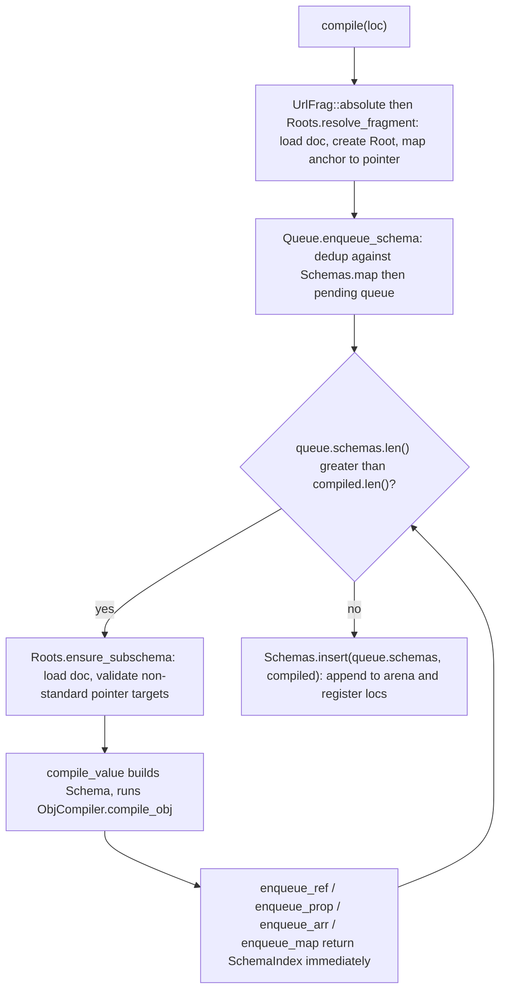

# boon (santhosh-tekuri/boon) — Research report

## Metadata

- **Library name**: boon (crate `boon` 0.6.1; companion CLI crate `boon-cli` 0.6.2)
- **Repo URL**: https://github.com/santhosh-tekuri/boon
- **Clone path**: `research/repos/rust/santhosh-tekuri-boon/`
- **Language**: Rust (edition 2021)
- **License**: MIT OR Apache-2.0
- **Analyzed version**: b487e6a 2026-02-23 (8 commits after tag v0.6.1; `Cargo.toml` crate version 0.6.1, CLI 0.6.2)
- **Report date**: 2026-10-26

## Summary

boon is a **JSON Schema validator only**; it has no code generation. It compiles one or more schema documents (draft-04, 06, 07, 2019-09, 2020-12) into a flat arena (`Vec<Schema>`) addressed by `SchemaIndex(usize)`, resolving every static `$ref` to an index at compile time (dynamic references are resolved at validation time from a scope chain). It then validates `serde_json::Value` instances against a compiled schema and returns a tree of `ValidationError`s borrowing from the schema arena and the instance, convertible to the spec's flag/basic/detailed output formats. It is by the same author as the Go `santhosh-tekuri/jsonschema`. It has no Rust (or other language) type emission, no reverse generation and no model deduplication; the relevant sections are validation, compile-step architecture, `$ref`/`$defs` resolution, draft/vocabulary handling, output formats and error structure.

## JSON Schema support

- **Drafts**: 4, 6, 7, 2019-09 and 2020-12 (`Draft` enum in `src/compiler.rs`; each has a static `Draft` descriptor in `src/draft.rs` listing subschema positions, the id keyword name (`id` for draft-04, `$id` otherwise) and, for 2019-09/2020-12, the vocabulary names). Default draft when `$schema` is absent is the latest (2020-12); `Compiler::set_default_draft` overrides it, and the docs "HIGHLY encourage" using it because the default will change over time.
- **Compliance**: README claims passing the JSON-Schema-Test-Suite excluding `optional` (with Bowtie badges for all five drafts). The test harness additionally runs `optional/` tests with format and content assertions enabled, plus its own `Extra-Test-Suite`. `tests/suite.rs` skips two files (`zeroTerminatedFloats.json`, `float-overflow.json`).
- **Vocabularies**: custom `$schema` URLs are followed; the metaschema's `$vocabulary` is read and only keywords of vocabularies marked `true` are compiled (`Root::has_vocab`). Unknown required vocabularies produce `CompileError::UnsupportedVocabulary`. Custom user-defined keywords/vocabularies are not supported.
- **Metaschema validation**: every document whose URL host is not `json-schema.org` is validated against its draft metaschema in `Roots::create_root` (`Draft::validate`); the standard metaschemas are embedded with `include_str!` (`src/metaschemas/`) and compiled lazily once into a process-global `STD_METASCHEMAS` (`once_cell::sync::Lazy<Schemas>`).
- **Cycle detection**: `$schema` cycles (`MetaSchemaCycle`) at compile time and non-productive reference cycles (`ErrorKind::RefCycle`, via `Scope::check_cycle`) at validation time.
- **Formats**: assertion by default for draft <= 7; for 2019-09 only if the metaschema's `format` vocabulary is declared required; for 2020-12 only if `format-assertion` is declared required; otherwise opt-in via `Compiler::enable_format_assertions`. 20 built-ins (`FORMATS` in `src/formats.rs`): regex, ipv4, ipv6, hostname, idn-hostname, email, idn-email, date, time, date-time, duration, period, json-pointer, relative-json-pointer, uuid, uri, iri, uri-reference, iri-reference, uri-template. Format names not registered are silently ignored (no assertion).
- **Content**: `contentEncoding` (base64 built in), `contentMediaType` (application/json built in), `contentSchema`; all opt-in via `enable_content_assertions`; custom decoders/media types can be registered.
- **Regex**: ECMA-262 patterns are rewritten to Rust `regex` syntax by `src/ecma.rs` (AST rewrite via `regex-syntax`); untranslatable patterns fail compilation (`InvalidRegex`).

## Keyword support table

Keyword list source: the vendored meta-schemas under `specs/json-schema.org/`: `draft-04/schema.json`, `draft-06/schema.json`, `draft-07/schema.json`, and the vocabulary files in `draft/2019-09/meta/` (core, applicator, validation, meta-data, format, content) and `draft/2020-12/meta/` (core, applicator, unevaluated, validation, meta-data, format-annotation, format-assertion, content); the `hyper-schema` files are excluded since boon does not implement hyper-schema. The table is the union of the `properties` of those files (one row per keyword; drafts that define it are noted), with 63 distinct keyword names in total (including draft-04 `id`). "Implemented" means compiled and enforced (or, for annotations, recognized) by `src/compiler.rs` / `src/validator.rs`; each row was checked against the `compile_draft*` functions and the validator walk.

| Keyword | Implemented | Notes |
|---------|-------------|-------|
| $anchor | yes | 2019+. Collected per resource in `Draft::collect_anchors`; used by ref resolution. |
| $comment | no | Draft 7+. Not read anywhere in `src/`; ignored. |
| $defs | yes | 2019+. Registered as a subschema location (`POS_PROP`) for resource/anchor collection; entries are compiled only when referenced. |
| $dynamicAnchor | yes | Recorded per resource; dynamic anchors of a resource are enqueued for compilation (2020+). |
| $dynamicRef | yes | `DynamicRef { sch, anchor }`; resolved at validation time by walking the scope chain (`resolve_dynamic_anchor`). |
| $id | yes | Draft 6+. Defines resources/base URLs; fragments stripped; duplicate ids error (`DuplicateId`). Ignored beside `$ref` in drafts < 2019. |
| $ref | yes | Draft 6+ meta-schemas (draft-04 `$ref` is handled by the same code). Resolved at compile time to a `SchemaIndex`; siblings ignored in drafts < 2019; coexists with siblings in 2019+. |
| $schema | yes | Selects draft / custom metaschema; cycles detected. |
| $vocabulary | yes | 2019+. Read from the metaschema (not from instance schemas) to gate which keyword groups compile. |
| additionalProperties | yes | `Additional::Bool` or `SchemaRef`; failing extra props reported as one `AdditionalProperties` error. |
| allOf | yes | Compiled as `Vec<SchemaIndex>`. |
| anyOf | yes | Same. |
| contains | yes | Draft 6+. With `minContains`/`maxContains` (2019+); errors list matching indices. |
| dependentSchemas | yes | 2019+; `(String, SchemaIndex)` list; `applicator` vocabulary. |
| else | yes | Draft 7+. Only compiled when `if` is present and is not the literal `true` schema. |
| if | yes | Draft 7+; gated on the `applicator` vocabulary. |
| items | yes | Draft <=2019: schema or array form (`Items`); 2020: schema applying after `prefixItems` (`items2020`). |
| not | yes | |
| oneOf | yes | |
| patternProperties | yes | Regexes compiled at compile time via ECMA translation. |
| prefixItems | yes | 2020-12 only (`compile_draft2020`). |
| properties | yes | `AHashMap<String, SchemaIndex>`. |
| propertyNames | yes | Draft 6+ (`compile_draft6`); failures wrapped in `PropertyName` error. |
| then | yes | Draft 7+. Only compiled when `if` is present and is not the literal `false` schema. |
| unevaluatedItems | yes | 2019+ (2019: `applicator` vocab, 2020: `unevaluated` vocab); evaluated-index tracking via `Uneval`. |
| unevaluatedProperties | yes | 2019+; same mechanism. |
| const | yes | Draft 6+ (`compile_draft6`); deep equality with JSON number normalization. |
| dependentRequired | yes | 2019+; `validation` vocabulary. |
| enum | yes | Cloned into `Enum { types: Types, values: Vec<Value> }`; type bitset rejects early, then linear `equals` scan; no dedup. |
| exclusiveMaximum | yes | Numeric (draft 6+) and boolean draft-04 form (converted at compile time). |
| exclusiveMinimum | yes | Same. |
| maxContains | yes | 2019+. Only compiled when `contains` present. |
| maxItems | yes | |
| maxLength | yes | Counts Unicode characters. |
| maxProperties | yes | |
| maximum | yes | Stored as `serde_json::Number` but compared via `as_f64()` (`num_validate`), so integers beyond 2^53 lose precision; if either side has no f64 form the check is silently skipped. |
| minContains | yes | 2019+. Only compiled when `contains` present. |
| minItems | yes | |
| minLength | yes | |
| minProperties | yes | |
| minimum | yes | Same f64 comparison as `maximum`. |
| multipleOf | yes | f64 test `(num / mul).fract() != 0.0`; subject to floating-point error for non-binary-exact divisors. |
| pattern | yes | ECMA-262 translated to Rust regex. |
| required | yes | Single `Required` error listing all missing names. |
| type | yes | Bitset `Types`; `integer` accepts floats with zero fraction. |
| uniqueItems | yes | Reports the first duplicate index pair. |
| contentEncoding | partial | Draft 7+. Only enforced when content assertions enabled; base64 built in, custom decoders registrable. |
| contentMediaType | partial | Draft 7+. Only when content assertions enabled; application/json built in. |
| contentSchema | partial | 2019+. Only when content assertions enabled and media type is JSON-compatible. |
| default | no | All drafts. Annotation; not read or collected. |
| deprecated | no | 2019+. Annotation; not read. |
| description | no | Annotation; not read. |
| examples | no | Draft 6+. Annotation; not read. |
| readOnly | no | Draft 7+. Annotation; not read. |
| title | no | Annotation; not read. |
| writeOnly | no | Draft 7+. Annotation; not read. |
| format | partial | All drafts. Assertion only under the draft/vocabulary rules above or when enabled; unknown format names ignored; 20 built-ins plus custom registration. |
| additionalItems (legacy, draft <= 2019) | yes | Only compiled when `items` is the array form and draft < 2020. |
| definitions (legacy; drafts 4-7 meta-schemas) | yes | Registered as subschema location (`POS_PROP`; inherited by the 2019+ tables since they clone the draft-07 table); not compiled eagerly. |
| dependencies (legacy; drafts 4-7) | yes | Property list or schema form. Compiled in every draft including 2019/2020 (inside the `applicator` block of `compile_draft4`), not just where the spec defines it. |
| id (draft-04 only) | yes | Draft-04 resource id keyword (`Draft::id = "id"`); `$id` for later drafts. |
| $recursiveRef (2019-09 only) | yes | `compile_draft2019`; `resolve_recursive_anchor` at validation time. |
| $recursiveAnchor (2019-09 only) | yes | Boolean read in `compile_draft2019`. |

## Constraints

All validation keywords are **enforced at runtime** by the validator; there is no codegen, so nothing is used "structurally only". Annotations (`title`, `description`, `default`, `examples`, `deprecated`, `readOnly`, `writeOnly`, `$comment`) are never read by the compiler and are not exposed through the API. Errors do not short-circuit by default: all failures at a schema node are collected and returned as a tree. A `bool_result` mode (used for `not`, `if`, non-first `oneOf` branches and when an ancestor is already in that mode) makes the validator stop collecting and avoid building error payloads.

## High-level architecture

Two phases: a **compile** phase (load, draft detection, metaschema validation, resource/anchor indexing, worklist lowering of reachable subschemas into the arena) and a **validate** phase (recursive walk of the arena against an instance).

```mermaid
flowchart LR
    Loc["schema location or add_resource"] --> Loader["DefaultUrlLoader: doc cache, scheme loaders, embedded metaschemas"]
    Loader --> Roots["Roots: Url to Root (draft, resources, anchors, vocabs)"]
    Roots --> MetaCheck["Validate document against draft metaschema"]
    MetaCheck --> Queue["Queue of UrlPtr (worklist)"]
    Queue --> ObjCompiler["ObjCompiler: compile_draft4 to compile_draft2020"]
    ObjCompiler --> Schemas["Schemas: Vec of Schema plus HashMap UrlPtr to index"]
    Instance["serde_json Value"] --> Validator
    Schemas --> Validator["Validator struct per schema and value, recursive"]
    Validator --> Result["Ok or ValidationError tree"]
    Result --> Output["Display, flag, basic, detailed"]
```

Public API (`src/lib.rs`): `Compiler::new`, `add_resource`, `compile(loc, &mut Schemas) -> SchemaIndex`, `Schemas::validate(&Value, SchemaIndex) -> Result<(), ValidationError>`, plus `use_loader`, `register_format`, `register_content_encoding`, `register_content_media_type`, `enable_format_assertions`, `enable_content_assertions`, `set_default_draft`. The `Schemas` container is owned by the caller and can receive several `compile` calls from one `Compiler`; the `boon-cli` crate wraps this (JSON or YAML schemas and instances, http(s) loading via `ureq`).

## Medium-level architecture

Modules (`src/`): `compiler.rs` (`Compiler`, `Draft`, `ObjCompiler`, `CompileError`, `Queue`), `roots.rs` / `root.rs` (per-document state: draft, resources, anchors, vocabularies), `draft.rs` (per-draft static descriptors, resource/anchor collection, metaschema validation), `loader.rs` (`UrlLoader` trait, `SchemeUrlLoader`, `FileLoader`, `DefaultUrlLoader`, embedded std metaschemas), `validator.rs` (instance walk), `output.rs` (flag/basic/detailed + Display), `formats.rs`, `content.rs`, `ecma.rs`, `util.rs` (`JsonPointer`, `Fragment`, `UrlFrag`, `UrlPtr`, JSON equality, hashing for `uniqueItems`).

**Compile loop** (`Compiler::do_compile`): a worklist `Queue { schemas: Vec<UrlPtr>, roots: HashMap<Url, Root> }`. Enqueueing a location returns its future `SchemaIndex` at once, so `$ref` cycles and forward references need no recursion in the compiler. The loop walks the queue by position (`while queue.schemas.len() > compiled.len()`), compiles each entry, and appends to the arena only after the loop ends, so a compile error leaves `Schemas` unchanged. Only schemas reachable from the requested root are compiled (not every `$defs` entry).

**Validator**: a `Validator` struct per (schema, instance value) pair, invoked recursively (`validate_val` for child instances, `_validate_self` for same-instance applicators and refs). Details in Algorithms and data structures below.

## Algorithms and data structures

### Schema representation

Two layers exist. The **source** layer is the raw `serde_json::Value` of each document, owned for the life of the `Compiler` in `DefaultUrlLoader.doc_list: appendlist::AppendList<Value>` (indexed by `doc_map: RefCell<HashMap<Url, usize>>`). `AppendList` lets the loader hand out `&Value` references while still accepting new documents through `&self`, so compile-time lookups can hold document references across further loads. Unknown keywords are never inspected, and annotation keywords are ignored; the raw JSON is only consulted at compile time.

The **compiled** layer is `Schemas { list: Vec<Schema>, map: HashMap<UrlPtr, usize> }` (`src/lib.rs`). `SchemaIndex(usize)` is a newtype over the position in `list`. One `Schema` exists per compiled subschema location (a `UrlPtr` = absolute document URL + JSON-pointer string). `Schema` is one wide struct with a field per keyword, grouped by instance type:

- Bookkeeping: `draft_version: usize`, `idx`, `loc: String` (the full `url#pointer` text, used for error reporting), `resource: SchemaIndex` (the enclosing `$id` resource's root schema), `dynamic_anchors: HashMap<String, SchemaIndex>` (populated only on resource roots, 2020+), and three precomputed unevaluated-tracking hints `all_props_evaluated: bool`, `all_items_evaluated: bool`, `num_items_evaluated: usize`.
- Type-agnostic: `boolean: Option<bool>`, `ref_`, `recursive_ref`, `recursive_anchor`, `dynamic_ref: Option<DynamicRef { sch, anchor }>`, `dynamic_anchor`, `types: Types(u8)` (bitset), `enum_: Option<Enum { types, values }>`, `constant: Option<Value>`, `not`, `all_of`/`any_of`/`one_of: Vec<SchemaIndex>`, `if_`/`then`/`else_`, `format: Option<Format>` (a `Copy` struct holding a fn pointer).
- Object: counts as `Option<usize>`, `required: Vec<String>`, `properties: AHashMap<String, SchemaIndex>`, `pattern_properties: Vec<(Regex, SchemaIndex)>`, `property_names`, `additional_properties: Option<Additional>` (`Bool` or `SchemaRef`), `dependent_required`, `dependent_schemas`, legacy `dependencies: Vec<(String, Dependency)>`, `unevaluated_properties`.
- Array: counts, `unique_items: bool`, `contains` with `min/max_contains`, `items: Option<Items>` (`SchemaRef` or `SchemaRefs`, legacy), `additional_items`, `prefix_items: Vec<SchemaIndex>`, `items2020`, `unevaluated_items`.
- String/number: lengths, `pattern: Option<Regex>`, `content_encoding`, `content_media_type`, `content_schema`, and `serde_json::Number` for `minimum`/`maximum`/`exclusive*`/`multiple_of`.

Boolean schemas and the empty object `{}` both become `boolean: Some(true/false)` (`compile_value`: `obj.is_empty()` yields `Some(true)`). The struct is deliberately not an enum of keyword nodes: every `Schema` carries slots for all keywords of all drafts, trading memory per node for a branch-free "is this keyword set" check (`Option::is_some` / `Vec::is_empty`). Draft differences are not stored as different node kinds; `draft_version` is consulted at validation time in a few places (for example `$ref` siblings and `items`). No `Rc`/`Box` pointers exist between schemas: all links are `SchemaIndex`, so recursive and mutually recursive schemas are plain cycles in index space and the arena is `Send + Sync` (it is stored in a global `Lazy` for the metaschemas).

Lifetimes: `Schemas::validate<'s,'v>` returns `ValidationError<'s,'v>` borrowing schema strings from the arena (`'s`) and property names/values from the instance (`'v`); `clone_static` produces an owned form (used for `CompileError::ValidationError` and `propertyNames`/`contentSchema` sub-validations).

### Reference resolution and registry

The registry is `Roots { default_draft, map: HashMap<Url, Root>, loader: DefaultUrlLoader }` (`src/roots.rs`). A `Root` (`src/root.rs`) holds the document's `draft: &'static Draft`, the document URL, the metaschema's required vocabularies `meta_vocabs: Option<Vec<String>>`, and `resources: HashMap<JsonPointer, Resource>` keyed by the pointer of each resource root. A `Resource { ptr, id: Url, anchors: HashMap<Anchor, JsonPointer>, dynamic_anchors: HashSet<Anchor> }` is created for the document root and for every subschema carrying an id (`$id`, or `id` in draft-04).

*Discovery* (`Draft::collect_resources`, `src/draft.rs`): a recursive walk of the document guided by the draft's `subschemas: HashMap<&str, u8>` table, where each entry is a bitmask of `POS_SELF` (keyword value is a schema), `POS_ITEM` (array of schemas) and `POS_PROP` (map of schemas). The tables inherit from older drafts by cloning (`DRAFT7.subschemas.clone()` plus extras). For each node it resolves its id against the current base URL (`UrlFrag::join`), creates a `Resource` if there is an id (rejecting duplicates with `DuplicateId`), then calls `collect_anchors` to register `$anchor`/`$dynamicAnchor` (2019+; in drafts < 2019 a plain-name fragment in `id`/`$id` such as `#foo` is treated as an anchor; `$ref` siblings are skipped in drafts < 2019). Each anchor goes into the `anchors` map of the *enclosing* resource, found by a linear `resources.values_mut().find(|r| r.id == *base)`. Anchors, subschemas and `$defs` are therefore indexed by URL and JSON pointer, never by keyword path. This whole-document walk runs once per document at `create_root`. Locations that the subschema table cannot reach (a `$ref` that points into an arbitrary pointer such as `#/foo/bar`) are handled lazily: `Roots::ensure_subschema` checks `Draft::is_subschema(ptr)` (a recursive prefix match over the same table), and if the pointer is not a known schema position it metaschema-validates that value and calls `Root::add_subschema` to collect resources and anchors from it.

*Resolution at compile time*: `ObjCompiler::enqueue_ref` joins the `$ref` string onto `Root::base_url(ptr)`, which is `Root::resource(ptr).id`; `resource()` walks the pointer upward (`rsplit_once('/')`) with a hash lookup per prefix until it finds the nearest enclosing resource. `Root::resolve` then handles two cases: if the joined URL equals the document URL it uses the root resource; otherwise it linearly searches `resources.values()` for a resource whose `id` equals the URL (embedded `$id` resources). A hit yields a `UrlPtr`: an anchor fragment maps through `Resource.anchors` (`AnchorNotFound` on a miss), a JSON-pointer fragment is concatenated onto the resource's pointer. A miss means the URL is external: `Queue::resolve_anchor` loads (or reuses) the remote document, creates its `Root` (new roots are staged in `Queue.roots` and merged into `Roots` after each compiled item via `Roots::insert`), and resolves the fragment. Remote documents are fetched through `DefaultUrlLoader::load`: cache hit in `doc_map`, else embedded metaschemas (`STD_METAFILES`, keyed by path under `json-schema.org`), else the configured `UrlLoader`. The default loader is `SchemeUrlLoader` with only `file` registered (no `file` on wasm32); http(s) needs a custom loader (the CLI provides one using `ureq`; the integration tests use one serving the suite's `remotes/`).

*Static vs dynamic*: `$ref`, `$recursiveRef` and `$dynamicRef` all resolve their initial target to a `SchemaIndex` at compile time; the latter two additionally record what is needed to re-target at run time. `$dynamicRef` stores `DynamicRef { sch, anchor }` (anchor name parsed from the `$dynamicRef` fragment, `None` when the fragment is a JSON pointer); `$dynamicAnchor` is stored on the target schema, and each resource root's `dynamic_anchors: HashMap<String, SchemaIndex>` is filled in `compile_value` by enqueueing every dynamic anchor of that resource, so dynamic scope lookups need only the resource root. `$recursiveAnchor` is a boolean on the schema; run-time resolution is described under Core algorithm.

*Cycles*: compile time needs no detection, since `enqueue_schema` returns the same index for a repeated `UrlPtr` and the worklist terminates. `$schema` chains are tracked with a `HashSet<Url>` in `get_draft` (`MetaSchemaCycle`). Validation-time cycles (for example `{"$ref": "#"}` evaluated at the same instance) are caught by `Scope::check_cycle`.

*Costs*: `Queue::enqueue_schema` first probes `Schemas.map` (hash), then `self.schemas.iter().position(|e| *e == up)` — a linear scan of the pending queue comparing `Url` and pointer strings — so a single `compile` call that enqueues N new subschemas performs O(N²) comparisons in total. `collect_resources` repeats a linear `resources.values_mut().find` per node. These costs are compile-time only and paid once per `Compiler::compile` call.

### Compiled / intermediate form

The IR is the `Schemas` arena described above; there is no bytecode, no closures, and no generated source. `ObjCompiler::compile_obj` fills one `Schema` per queue entry by layered passes: `compile_draft4` (always; handles `$ref`, applicators, validation keywords and `format`), then `compile_draft6` (`contains`, `propertyNames`, `const`), `compile_draft7` (`if`/`then`/`else`, content encoding and media type), `compile_draft2019` (`$recursiveRef`, `minContains`/`maxContains`, `dependentRequired`, `dependentSchemas`, `unevaluated*`, `contentSchema`) and `compile_draft2020` (`$dynamicRef`, `$dynamicAnchor`, `prefixItems`, schema-only `items`), each gated by `draft_version` and, for 2019+, `Root::has_vocab(name)`. For drafts below 2019, `has_vocab` is always true; otherwise it consults the metaschema's `$vocabulary` list, falling back to `Draft.default_vocabs` when the schema has no custom metaschema. Compile-time normalizations: draft-04 boolean `exclusiveMaximum`/`exclusiveMinimum` is folded into the numeric exclusive fields (moving the number out of `maximum`/`minimum`); `type` strings become the `Types` bitset; `enum` values are cloned with a bitset of their JSON types; `then`/`else` are dropped if `if` is the literal `false`/`true`; `minContains`/`maxContains` are read only if `contains` exists; `$ref` with siblings in drafts < 2019 short-circuits the rest of `compile_draft4`. Patterns (`pattern`, `patternProperties` keys) are translated by `ecma::convert` then compiled by `Regex::new` once per schema node (identical patterns at different nodes are compiled separately).

After `compile_obj`, `compile_value` computes the unevaluated hints: `all_props_evaluated = additional_properties.is_some()`; `all_items_evaluated` is true when `additionalItems` exists or `items` is single-schema (< 2020) or `items2020` exists; `num_items_evaluated` is the length of the tuple-form `items` or of `prefixItems`. These let the validator skip building uneval sets.

### Core algorithm

`validator::validate` builds a root `Validator { v, vloc, schema, schemas, scope, uneval, errors, bool_result }` and calls `Validator::validate(self) -> Result<Uneval, ValidationError>`. The returned `Uneval` (on success) is the annotation channel; the error (on failure) is the tree. Evaluation order inside one `validate` call:

1. Boolean schema (`FalseSchema` error or return).
2. `Scope::check_cycle`.
3. `type` (bitset test, with `integer` matching any number with zero fractional part), `const` (`equals`), `enum` (type-bitset precheck, then linear `equals` scan), `format` (call the fn pointer; failures are *added* to `errors` and evaluation continues).
4. `$ref`: validated through `validate_ref` (`_validate_self`). For drafts < 2019 the result is returned immediately (siblings ignored); for 2019+ the error is appended and evaluation continues.
5. Type dispatch on the instance: `obj_validate`, `arr_validate`, `str_validate` or `num_validate`.
6. If no errors so far or not in `bool_result` mode: `refs_validate` (`$recursiveRef`, `$dynamicRef`; 2019+), `cond_validate` (`not`, `allOf`, `anyOf`, `oneOf`, `if`/`then`/`else`), `uneval_validate` (2019+).
7. Result assembly: zero errors yields `Ok(uneval)`; one error is returned bare (no wrapper); several are wrapped in `ErrorKind::Group` with the errors as `causes`.

*Object keywords* (`obj_validate`): `minProperties`/`maxProperties`/`required` first (the `required` check collects all missing names into one `Required` error through `find_missing`), then legacy `dependencies`. The main loop iterates **instance properties** (`for (pname, pvalue) in obj`), not schema properties: for each name it does an `AHashMap` lookup in `properties`, a linear scan of `pattern_properties` regexes, and — if neither matched — `additionalProperties` (a `false` collects the name into one `AdditionalProperties` error; a schema validates the value). Every matched/evaluated property is removed from `uneval.props`. `propertyNames` builds a `Value::String` per key and invokes a fresh top-level `Schemas::validate` (new `vloc`, new root scope), re-labelling the error and `clone_static`ing it. `dependentSchemas` uses `validate_self` (same instance), `dependentRequired` uses `find_missing`.

*Array keywords* (`arr_validate`): size checks, then `uniqueItems` via `util::duplicates`, which is size-adaptive: pairwise compare for 2 or 3 items, quadratic loop up to 20 items, and above 20 a `AHashMap<HashedValue, usize>` where `HashedValue` implements an order-independent hash for objects (XOR of per-entry hashes) and hashes all numbers through their f64 bit pattern so `2` and `2.0` collide and compare equal via `equals`. Then, for drafts < 2020, `items` (schema form: every element; tuple form: zip with the list) and `additionalItems`; for 2020, `prefixItems` then `items`; then `contains` with `minContains`/`maxContains`. Indices evaluated by `contains` are removed from `uneval.items` (2020 only). `str_validate` counts `chars().count()` lazily (once for both bounds), applies the regex, and runs content decoding then media type then `contentSchema`. `num_validate` compares via `as_f64()`.

*Combinators* (`cond_validate`): `not` runs `_validate_self(not, None, bool_result = true)` and fails if it passes. `allOf` runs all subschemas via `validate_self` (breaking at the first failure only in `bool_result` mode) and uses `add_errors`, which flattens when exactly one cause exists. `anyOf` stops at the first success only if `uneval` is already empty (otherwise all branches are evaluated so their annotations are all merged). `oneOf` keeps validating after the first match with `bool_result = true`, and reports `OneOf(Some((i, j)))` when a second branch matches. `if` is probed in `bool_result` mode; then `then` or `else` is run with full errors. Only successful subschemas contribute annotations.

*Unevaluated tracking*: `Uneval<'v> { props: HashSet<&'v String>, items: HashSet<usize> }` represents what is still unevaluated at the current node. `Uneval::from(v, schema, caller_needs)` allocates it only when the node's schema has `unevaluatedProperties/Items` or the caller already holds a non-empty set (`!self.uneval.is_empty()` is passed from `_validate_self`), and not when `all_props_evaluated` / `all_items_evaluated` say it is pointless; for arrays it seeds `num_items_evaluated..len`. After a same-instance child (`$ref`, `allOf`, `anyOf` branches, `if`, `dependentSchemas`, etc.) succeeds, `Uneval::merge` intersects (`retain`) the parent's set with the child's remainder, so the parent keeps only what *no* successful branch evaluated. `uneval_validate` then `mem::take`s the set and validates each remaining property/item against the `unevaluated*` schema. Children over different instances (`validate_val`) create their own `Uneval` and are not merged.

*Dynamic references*: `Scope<'a> { sch, ref_kw: Option<&'static str>, vid: usize, parent: Option<&'a Scope<'a>> }` is a linked list living on the Rust call stack (each `child` borrows its parent, no heap). `resolve_dynamic_anchor(name, fallback)` walks from the current scope up to the root, and for each scope looks at `schemas.get(scope.sch).resource` (the enclosing resource root) and its `dynamic_anchors.get(name)`; the **outermost** match wins (the loop overwrites `sch` on each hit), implementing the dynamic-scope "first in the dynamic scope" rule. The `$dynamicRef` path only does this if the initial static target itself carries a matching `$dynamicAnchor`. `resolve_recursive_anchor` is analogous for `$recursiveAnchor: true` in 2019-09.

*Cycle check* (`Scope::check_cycle`): walks `parent` links while `vid` equals the current scope's `vid` (same instance location) and reports a cycle if the same `sch` reappears. It therefore only flags reference loops that make no progress through the instance; a legitimately recursive schema over a deeper instance has different `vid`s.

### Error and output model

`ValidationError<'s,'v> { schema_url: &'s str, instance_location: InstanceLocation<'v>, kind: ErrorKind<'s,'v>, causes: Vec<ValidationError> }` forms an owned tree. `ErrorKind` (about 40 variants) carries `got`/`want` payloads; strings and numbers from the instance are `Cow<'v, _>` borrows, schema values are `&'s` references. Structural variants: `Group` (several co-located failures), `Schema { url }` (the root wrapper `validate` always adds), `Reference { kw, url }` (a `$ref`/`$dynamicRef`/`$recursiveRef` hop, with the target as cause), `AllOf`/`AnyOf`/`OneOf`/`Not`, `PropertyName`, `ContentSchema`.

Instance paths are not stored per node during the walk. The validator keeps one shared `vloc: &mut Vec<InstanceToken<'v>>` (with `InstanceToken::{Prop(Cow<str>), Item(usize)}`); `Scope.vid` is the depth into that vector for the value being validated. `validate_val` overwrites or pushes `vloc[scope.vid]` then creates the child with `vid + 1`; same-instance hops (`_validate_self`) keep `vid`. A `ValidationError`'s `instance_location` is cloned from `vloc[..vid]` only when an error is built (`instance_location()`), and in `bool_result` mode `error()` returns an empty `Group` sentinel without any location allocation. Schema locations are likewise not accumulated: each error stores the target `Schema.loc` string slice, and output code reconstructs keyword paths later from the `kind` (`ErrorKind::keyword_path`).

Error shaping: `add_errors` omits a combinator wrapper when only one cause exists; `validate_ref` wraps the target's errors in a `Reference` error (re-parenting a `Group`'s causes directly); `validate` returns a lone error unwrapped. The top-level `validate` function wraps everything in `ErrorKind::Schema { url }` (adopting a `Group`'s causes).

Outputs (`src/output.rs`): all are produced by an explicit-stack depth-first iterator `DfsIterator` yielding `Pre`/`Post` events, so rendering is not recursive. `Display` prints an indented `at '<ptr>': message` tree (`{:#}` adds `[S#...]` schema locations computed by `SchemaLocation`, which prints a path relative to the previous frame when the document URL is unchanged). `flag_output()` returns `FlagOutput { valid: false }` (constant, since a `ValidationError` only exists on failure). `basic_output()` flattens the leaf errors into a list of `OutputUnit`s, skipping `Schema` and single-cause `Reference` nodes. `detailed_output()` rebuilds the hierarchy with a `Vec<OutputUnit>` stack using the Pre/Post events. `KeywordLocation` maintains a running string (truncated on `Post`) for `keywordLocation`, and `InRef` tracks whether a node is below a reference to decide whether to emit `absoluteKeywordLocation`. `OutputUnit` and `FlagOutput` implement `serde::Serialize` and `Display` (`{}` compact, `{:#}` pretty JSON).

## Low-level details

- **Exclusive bounds in draft-04**: boolean `exclusiveMaximum`/`exclusiveMinimum: true` moves the `maximum`/`minimum` number into the exclusive field at compile time (`compile_draft4`).
- **Numbers**: `Schema` keeps `serde_json::Number`, but `num_validate` compares by converting both sides to `f64` with `as_f64()` (silently skipping if either conversion fails), so integers above 2^53 compare imprecisely; there is no big-integer or decimal path. `multipleOf` is `(instance / divisor).fract() != 0.0` in f64. `equals` (used for `const`, `enum`, `uniqueItems`) first compares as `u64`, then `i64`, then `f64`, so `1` equals `1.0` and equal-valued large integers of the same sign compare exactly. Size keywords (`usize()` helper) accept floats with zero fraction and positive sign.
- **String length** counts Unicode scalar values (`str.chars().count()`), not UTF-16 or bytes.
- **Type `integer`**: any `Number` with `fract() == 0.0` (or an i64/u64) matches in every draft.
- **ECMA-262 regex translation** (`src/ecma.rs::convert`): parses the pattern with `regex_syntax::ast::parse::Parser`. If parsing fails with `EscapeUnrecognized` on `\c`, `fix_error` replaces `\cX` (ASCII letter X) with the control character `X % 32`; otherwise the error is returned. Then a `Translator` AST `Visitor` rewrites one construct per pass: `\d`/`\D` to `[0-9]`/`[^0-9]`, `\w`/`\W` to `[A-Za-z0-9_]` variants (ASCII only, since Rust's classes are Unicode-aware), `\s`/`\S` to an explicit class of ECMA whitespace characters, including inside bracketed classes (producing nested classes like `[a-z[0-9]]`, valid in Rust regex); `\a` is rejected as not an ECMA control escape. After each rewrite the new pattern is re-parsed and the visitor re-run until no change, so a pattern with k such escapes costs k+1 parses. The result is then handed to `Regex::new`. Not translated: lookaround, backreferences (Rust regex lacks them, so such patterns fail with `InvalidRegex`), Unicode property escapes semantics beyond what `regex` accepts, and `.`/`$`/`^` semantic differences. The `regex` format check uses `ecma::convert` only (no `Regex::new`).
- **JSON pointer / URL handling**: `JsonPointer` is a `String` newtype, so `append`/`append2` allocate with `format!` and escape `~` and `/`; `Fragment::split` percent-decodes and classifies a fragment as pointer (empty or starts with `/`) or anchor; `UrlFrag::absolute` turns relative file paths into `file://` URLs (with Windows drive handling).
- **bool_result mode**: `Validator::error` returns a payload-free `Group`; `find_missing` returns an empty `Vec` after the first miss instead of collecting names; `obj_validate` returns early once an error exists; `allOf` stops after the first failing branch.
- **Recursion**: both compile (none; worklist) and validation (Rust call stack, one `Validator` plus `Scope` frame per nested schema/instance level) — the validator has no depth limit, so deeply nested instances or very deep ref chains consume native stack. Output rendering is iterative (`DfsIterator`).
- **Hardening**: documents are validated against metaschemas, duplicate ids/anchors and malformed pointers are typed errors; `Schemas::validate` panics for a foreign `SchemaIndex`; `CompileError::Bug` marks internal invariants (and `debug_assert!(false)` fires in debug builds). The `pattern` keyword's translation failure is reported as `Bug` because metaschema validation of the `regex` format is expected to have rejected bad patterns first, while `patternProperties` keys report `InvalidRegex`.
- **WASM**: `FileLoader` and filesystem-relative path handling are gated off for `wasm32`.
- **Formats**: implemented by hand in `src/formats.rs` (date/time via RFC 3339 field checks and leap-year logic, hostname, IDN hostname with disallowed/virama tables, email, uuid by hex-group lengths, `uri`/`uri-reference` via `fluent-uri`, `iri*`/`uri-template` via `url::Url` joined onto a fixed base). Format functions are plain `fn(&Value) -> Result<(), Box<dyn Error>>` and ignore non-strings.

## Output and integration

- **Vendored vs build-dir**: Not applicable (no generated code). Standard metaschemas are embedded in the binary via `include_str!` (`src/metaschemas/`).
- **API vs CLI**: Both. Library API (`Compiler`/`Schemas`) and a `boon` CLI (`cli/`, crate `boon-cli`) with options `-d/--draft`, `-o/--output` (simple, alt, flag, basic, detailed), `-f/--assert-format`, `-c/--assert-content`, `--cacert`, `-k/--insecure`, version flag; exit code 2 on validation errors. No macros.
- **Writer model**: Not applicable for codegen. Output objects implement `serde::Serialize` and `Display` (`{}` compact JSON, `{:#}` pretty JSON).

## Configuration

Compiler-level only: default draft, enable format assertions, enable content assertions, custom `UrlLoader` (replaces the default entirely; `SchemeUrlLoader` multiplexes by scheme; the default is file-only on non-wasm), `register_format(Format { name, func })` (cannot override `regex`), custom `Decoder` and `MediaType`. `add_resource(loc, Value)` pre-seeds documents (in-memory schemas and test remotes). No codegen, naming, or type-mapping settings. No Cargo features; always-on dependencies: serde, serde_json (no `preserve_order`), regex, regex-syntax, url, fluent-uri, idna, percent-encoding, once_cell, base64, ahash, appendlist.

## Pros/cons

Pros:
- Broad, test-suite-verified draft coverage (4 through 2020-12) including `$dynamicRef`, `$recursiveRef`, `unevaluated*`, vocabularies, and custom metaschemas.
- Compile-once flat arena with integer indices; static refs resolved at compile time; only reachable schemas compiled; compile is all-or-nothing against the caller's `Schemas`.
- Rich, introspectable error tree with absolute keyword locations and the standard flag/basic/detailed output formats, built lazily with a cheap `bool_result` probe mode.
- Schema documents are validated against their metaschema, and invalid regexes/anchors/ids surface as typed `CompileError`s.
- ECMA-262 regex translation; pluggable loaders, formats, encodings, media types; WASM-friendly; arena is immutable and shareable across threads.

Cons:
- No codegen, no reverse generation, no annotation output (`default`/`title` are discarded).
- Custom vocabularies/keywords unsupported.
- Recursive validator with no depth limit; `Schemas::validate` panics on a foreign `SchemaIndex`.
- Numeric comparisons through f64; no big-number support.
- Unknown `format` names silently pass; format/content assertions off by default for 2019+.
- Compile-time linear scans in `enqueue_schema` and resource lookup; each schema node owns a full `url#pointer` string and a wide struct.
- Instance must be a fully parsed `serde_json::Value`; no streaming validation.

## Testability

- `tests/suite.rs` runs the official JSON-Schema-Test-Suite (git submodule at `tests/JSON-Schema-Test-Suite`, empty in this clone) and `tests/Extra-Test-Suite` for drafts 4/6/7/2019-09/2020-12; `optional/` groups run with format and content assertions on; remotes are served from the suite's `remotes/` folder by a custom `UrlLoader`. It also checks expected error substrings (`errors` field) against `{e:#}` output.
- `tests/output.rs` validates flag/basic/detailed output against the spec's output-tests and output schemas.
- `tests/invalid-schemas.rs` + `.json` (expected compile errors), `tests/compiler.rs`, `tests/filepaths.rs`, `tests/examples.rs` (API usage examples), `tests/debug.rs` (ad-hoc via `tests/debug.json`). Unit tests exist inline for `ecma.rs`, `util.rs` and `draft.rs`.
- Run: `cargo test` (needs submodules: `git submodule update --init`); `TEST_SUITE=<dir>` overrides the suite path.
- Reuse for our tooling: the suite JSON files and `tests/invalid-schemas.json` are directly reusable as shared fixtures. Not run as part of this analysis.

## Performance

Analysis is from code only; no benchmarks were run.

### Performance techniques

- **Compile vs interpret**: Everything schema-dependent is front-loaded: JSON is lowered once into the `Schema` arena; `$ref` targets, `$id` base resolution and `$anchor` lookups become integer indices; `type` becomes a `u8` bitset; regexes are translated and compiled (`Regex::new`) once; draft-04 exclusive bounds are normalized; `then`/`else` are elided when `if` is a boolean; `all_props_evaluated`/`all_items_evaluated`/`num_items_evaluated` are precomputed for annotation tracking. Validation is still an interpreter: a single `Validator::validate` function that tests `Option` fields in a fixed order for each (schema, value) pair (no per-keyword closures or specialization). Only dynamic references are resolved at validation time (scope-chain walk).
- **Memory layout and allocation**: Flat `Vec<Schema>` with `SchemaIndex` links, no pointer chasing through `Rc`/`Box`. `Schema` is a large fixed-shape struct (all keywords for all drafts), so per-node memory is high but field access is a direct offset. `properties` is `AHashMap` (fast non-cryptographic hasher). Instance paths are one shared `vloc` Vec indexed by `vid`, with property names as `Cow::Borrowed` from the instance, cloned only if an error is built. `Scope` frames are stack-allocated and linked by reference. Error payloads borrow (`&'s`, `Cow<'v>`). `Validator::errors` is an empty `Vec` (no allocation) until an error occurs. Costs: each nested validate constructs a `Validator` including two empty `std::collections::HashSet`s (RandomState keys) in `Uneval`, but these allocate no buckets until populated; `propertyNames` allocates a `Value::String` and a new `vloc` per key; `required` failure allocates the missing list; the `enum` values are cloned into the schema.
- **Caching and memoization**: Compiled schemas are cached by `UrlPtr` in `Schemas.map` (repeat `compile` of a known location returns the same index; two locations that are textually different but equal are not merged). Loaded documents are cached by URL in `DefaultUrlLoader`, and `Roots` caches per-document `Root` (resources, anchors, vocabs). Standard metaschemas and the format/decoder/media-type registries are `Lazy` statics built once per process. No per-instance memoization of validation results.
- **Fast paths and short-circuiting**: Boolean schemas return first; `type` is checked before type-specific keywords; `enum` rejects by type bitset before comparing values; `uniqueItems` skips arrays of length < 2 and uses a hash set only above 20 items; string length is counted once and only if a length keyword is present; `Uneval` sets are allocated only when needed and seeded only with the not-yet-evaluated range; `anyOf` stops at the first success unless unevaluated tracking needs all branches; `bool_result` mode skips message/location construction, collects fewer errors and breaks out of loops (`obj_validate` per-property loop, `allOf`, `required`); `oneOf` validates later branches in `bool_result` mode once a match exists; for draft < 2019 `$ref` skips all siblings.
- **Regex handling**: Rust `regex` crate (finite automata; no backtracking, so no catastrophic backtracking, but also no lookaround/backreferences). ECMA patterns are rewritten to Rust syntax once at compile time (`ecma::convert`); compiled `Regex` values live in `Schema.pattern` and `Schema.pattern_properties: Vec<(Regex, SchemaIndex)>` and are reused for every validation. `patternProperties` is a linear scan over all regexes for every instance property. Format `regex` validation re-runs `ecma::convert` per instance (parse only, no compile).
- **Concurrency**: No internal parallelism. `Schemas::validate(&self, ...)` takes a shared reference and the arena has no interior mutability, so one compiled `Schemas` can be shared across threads (the crate itself places `Schemas` in a `Lazy` static). Compilation needs `&mut Compiler` and uses a `RefCell`/`AppendList` in the loader, so the `Compiler` is a single-threaded object.

### Benchmarks in repo

Criterion benchmark `benches/bench.rs` (`cargo bench`): reads `SCHEMA` and `INSTANCE` environment variables (instance JSON or YAML), compiles once with format assertions enabled, then times `schemas.validate(&inst, sch).unwrap()` as `"boon"` (compile excluded; the instance must be valid because of `unwrap`). No fixtures or published numbers in the repo (none found). Entry points for external harnesses: `Compiler::compile` then `Schemas::validate`; CLI `boon SCHEMA INSTANCE...`.

## Determinism and idempotency

Not applicable to code generation. Compilation is deterministic: arena indices follow queue order, and the queue is fed by iterating `serde_json::Map` (a sorted `BTreeMap` because `preserve_order` is not enabled by this crate, though another crate in the dependency graph could enable it and change order), so `SchemaIndex` assignments are stable for the same input. Validation verdicts are deterministic. Error *ordering* is not fully fixed: `unevaluated_properties` validation iterates `Uneval.props`, a `std::collections::HashSet` with per-process random `RandomState`, so the order of errors from that step may vary between runs; `properties` (`AHashMap`) is only used for lookups, and `additionalProperties`/`patternProperties` errors follow instance and schema iteration order.

## Enum handling

Validation-only: `enum` values are cloned verbatim into `Enum { types, values }` and matched by JSON-equality (`equals`) against any element after a type-bitset precheck. Duplicate entries (`["a","a"]`) are not detected or deduplicated by the compiler; the vendored metaschema check at load time decides whether duplicates are rejected: the draft-04 and draft-07 metaschemas require `uniqueItems` and `minItems: 1` on `enum`, so duplicates fail schema load there, while the 2020-12 `validation` vocabulary only requires an array, so duplicates pass. `"a"` and `"A"` are distinct values and both match. No variant/type generation.

## Reverse generation (Schema from types)

No. boon only consumes schemas.

## Multi-language output

No codegen of any kind; Rust library and CLI only (WASM-compatible build supported).

## Model deduplication and $ref/$defs

No models are generated, so there is no type dedup. At the arena level, schemas are deduplicated **by location** (`UrlPtr` = document URL + JSON pointer): a `$ref` to the same location always yields the same `SchemaIndex`, and one `$ref` target is compiled once however many places reference it. Structurally identical inline subschemas at different locations are compiled as separate `Schema` entries (no structural dedup), and the same holds for identical regexes. `$defs`/`definitions` entries are not compiled eagerly: they are compiled only if reachable via a `$ref`/`$dynamicRef`/`$recursiveRef`, or if requested directly with a fragment (for example `compile("schema.json#/$defs/address")`). External `$ref`s are loaded and compiled in the same worklist; embedded `$id` resources are referencable by absolute URL; draft-dependent `$ref` sibling handling is described above.

## Validation (schema + JSON → errors)

Yes; this is the library's sole purpose.

- **Inputs**: schema (file path, URL, or `add_resource` JSON `Value`; optional fragment to validate against a subschema) and a `serde_json::Value` instance. The CLI also accepts YAML.
- **Output**: `Result<(), ValidationError>`. `ValidationError { schema_url, instance_location, kind: ErrorKind, causes }` forms a tree; the top-level error is always `ErrorKind::Schema { url }` wrapping causes; multiple failures at one node are grouped under `Group`.
- **Display**: `{}` prints concise `at '<ptr>': message` lines; `{:#}` prints `[I#ptr] [S#kwloc] message` with schema/instance locations and dereference hops.
- **Standard output formats**: `flag_output()`, `basic_output()`, `detailed_output()` return serializable structures with `keywordLocation`, `absoluteKeywordLocation`, `instanceLocation` and `error`/`errors`; checked against the official output-tests for 2019-09 and 2020-12 by `tests/output.rs`.
- **Compile errors**: typed `CompileError` (load/parse URL, unsupported draft/scheme/vocabulary, duplicate id/anchor, bad pointer, anchor not found, invalid regex, metaschema validation failure with nested error, internal `Bug`).
- **Not verified**: the JSON-Schema-Test-Suite submodule is empty in this clone, so test-suite pass rates are taken from the README claim, not checked.
