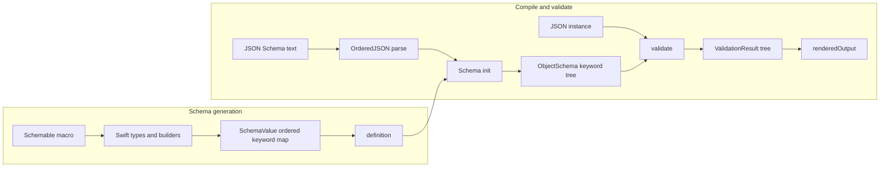
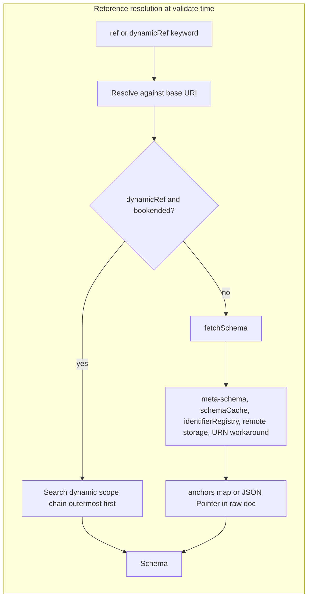

# Swift JSON Schema — Research report

## Metadata

- **Library name**: Swift JSON Schema
- **Repo URL**: https://github.com/ajevans99/swift-json-schema
- **Clone path**: `research/repos/swift/ajevans99-swift-json-schema/`
- **Language**: Swift
- **License**: MIT
- **Analyzed version**: 1edb0c4 2026-10-24 (69 commits after tag v0.9.1; Swift tools 6.1, swift-syntax 600..<700)
- **Report date**: 2026-10-27

## Summary

The Swift JSON Schema library provides type-safe schema generation (Swift → JSON Schema) and validation (JSON instance against a schema). Schema generation is done via a result-builder API (JSONSchemaBuilder) and the `@Schemable` macro: Swift types and builder expressions produce a `SchemaValue` that can be encoded to a JSON Schema document (Draft 2020-12). The same library parses JSON Schema documents into an internal representation and validates JSON instances against them, returning structured validation results with keyword and instance locations. Parsing of JSON instances into Swift types (with optional validation) is supported via the builder/macro `parse` and `parseAndValidate` APIs. The library does not generate Swift (or other) code from a JSON Schema; its codegen direction is reverse (types to schema).

## JSON Schema support

- **Draft**: Draft 2020-12 only. `Dialect` has a single case, `draft2020_12`; other drafts are commented out. The README and Bowtie badges indicate Draft 2020-12 support. The JSONSchema target ships vendored meta-schemas under `Sources/JSONSchema/Resources/draft2020-12/` (schema.json and meta/*.json). `Dialect.draft2020_12` is used for validation and schema construction; `Context(dialect:)` and `definition(context:)` default to draft 2020-12.
- **Scope**: Full dialect for validation (parsed schemas). Schema generation (builder/macro) supports the keywords listed in the keyword table; builder APIs and macro expansion emit the corresponding JSON Schema keywords. Cross-document `$ref`s resolve only against documents registered in the `Context` (`$id`s found while compiling) or supplied by the caller in `remoteSchemas`/`remoteSchemaStorage`; there is no network or file fetching; the builder emits `$ref`/`$dynamicRef` URIs and supports `$id`, `$anchor`, `$defs`, `$dynamicAnchor`.

## Keyword support table

Keyword list derived from vendored draft 2020-12 meta-schemas under `specs/json-schema.org/draft/2020-12/meta/` (core, applicator, validation, meta-data, unevaluated, format-annotation, format-assertion, content). `Dialect.keywords` registers every keyword below as a `Keyword` type. It also registers legacy `definitions`, `dependencies`, `$recursiveAnchor`, `$recursiveRef` as inert `ReservedKeyword`s (not 2020-12; no validation behavior). The `format-assertion` vocabulary is not in `supportedVocabularies`. The library implements both schema generation (builder/macro) and validation (JSONSchema core); the table reflects support in either or both.

| Keyword | Implemented | Notes |
|---------|-------------|-------|
| $anchor | yes | Builder: `anchor(_ name: String)` in JSONSchemaComponent+Identifiers. Validation: core supports anchors in ref resolution. |
| $comment | yes | Builder: `comment(_ value: String)` in JSONSchemaComponent+Annotations. |
| $defs | yes | Builder: SchemaReferenceURI.definition(named:location:) with .defs; JSONReference.definition(named:location:). Validation: Keywords+Identifier, ref resolution. |
| $dynamicAnchor | yes | Builder: `dynamicAnchor(_ name: String)`. Macro emits for recursive types. Validation: supported in ref resolution. |
| $dynamicRef | yes | Builder: JSONDynamicReference, `dynamicRef(_ uri: String)`. Validation: ReferenceResolver resolves $dynamicRef. |
| $id | yes | Builder: `id(_ value: String)`. Validation: Context, identifier registry, ref resolution. |
| $ref | yes | Builder: JSONReference(uri:), ref(uri:). Validation: Keywords+Reference, ReferenceResolver. |
| $schema | yes | Builder: `schema(_ uri: String)`. Validation: Keywords.SchemaKeyword, dialect selection. |
| $vocabulary | yes | Builder: `vocabulary(_ mapping: [String: Bool])`. Validation: Keywords.Vocabulary, validateVocabularies. |
| additionalProperties | yes | Builder: JSONObject.additionalProperties (closure or bool), JSONComponents.AdditionalProperties. Validation: applicator. |
| allOf | yes | Builder: JSONComposition.AllOf. Validation: applicator. |
| anyOf | yes | Builder: JSONComposition.AnyOf, OrNullModifier .unionAnyOf. Validation: applicator. |
| const | yes | Builder: `constant(_ value: JSONValue)`. Validation: Keywords+Assertion (Constant). |
| contains | yes | Builder: JSONArray.contains, minContains, maxContains. Validation: applicator. |
| contentEncoding | partial | Builder: `contentEncoding(_ value: String)`. Validation: parsed into a `ContentKeyword` that is inert: `ObjectSchema.validateKeywords` has no case for it (falls to `default: continue`), so no decoding, assertion, or annotation is produced. |
| contentMediaType | partial | Builder: `contentMediaType(_ value: String)`. Validation: parsed but inert, same as contentEncoding. |
| contentSchema | partial | Validation: `Keywords.ContentSchema` is parsed but inert (no validation, no annotation). Builder: no API to set it. |
| default | yes | Builder: `default(_ value: JSONValue)` and closure overload in Annotations; macro supports default values. Validation: meta-data (annotation). |
| dependentRequired | yes | Builder: `dependentRequired(_ mapping: [String: [String]])` in JSONSchemaComponent+Conditionals. Validation: applicator. |
| dependentSchemas | yes | Builder: `dependentSchemas(_ mapping: [String: any JSONSchemaComponent])`. Validation: applicator. |
| deprecated | yes | Builder: `deprecated(_ value: Bool)` in Annotations. Validation: meta-data. |
| description | yes | Builder: `.description(_ value: String)`, macro uses docstrings. Validation: meta-data. |
| else | yes | Builder: ConditionalSchema with optional else; If(ifSchema, then:thenSchema, else:elseSchema). Validation: applicator. |
| enum | yes | Builder: `.enumValues(with: builder)` (JSONComponents.Enum). Validation: assertion. |
| examples | yes | Builder: `examples(_ values: JSONValue)` and closure overload. Validation: meta-data. |
| exclusiveMaximum | yes | Builder: JSONNumber.exclusiveMaximum; macro NumberOptions. Validation: validation vocabulary. |
| exclusiveMinimum | yes | Builder: JSONNumber.exclusiveMinimum; macro NumberOptions. Validation: validation vocabulary. |
| format | partial | Builder: JSONString.format; JSONSchemaConversion (UUID, Date, URL). Validation: `Keywords.Format` looks up `context.formatValidators[name]` and asserts only when a validator is registered. The default `Context` registers none; the ten built-ins (date-time, date, time, email, hostname, ipv4, ipv6, uuid, uri, uri-reference) are opt-in via `DefaultFormatValidators.all` or custom `FormatValidator`s. Unknown formats and non-string instances pass. |
| if | yes | Builder: ConditionalSchema, If(ifSchema, then:thenSchema, else:?). Validation: applicator. |
| items | yes | Builder: JSONArray(items:). Validation: applicator. |
| maxContains | yes | Builder: JSONArray.maxContains; ArrayOptions. Validation: applicator. |
| maximum | yes | Builder: JSONNumber.maximum; macro NumberOptions. Validation: validation vocabulary. |
| maxItems | yes | Builder: JSONArray.maxItems; ArrayOptions. Validation: validation vocabulary. |
| maxLength | yes | Builder: JSONString.maxLength; StringOptions. Validation: counts Unicode scalars (`unicodeScalars.count`), per spec. |
| maxProperties | yes | Builder: JSONObject.maxProperties; ObjectOptions. Validation: validation vocabulary. |
| minContains | yes | Builder: JSONArray.minContains; ArrayOptions. Validation: applicator. |
| minimum | yes | Builder: JSONNumber.minimum; macro NumberOptions. Validation: validation vocabulary. |
| minItems | yes | Builder: JSONArray.minItems; ArrayOptions. Validation: validation vocabulary. |
| minLength | yes | Builder: JSONString.minLength; StringOptions. Validation: counts Unicode scalars (`unicodeScalars.count`), per spec. |
| minProperties | yes | Builder: JSONObject.minProperties; ObjectOptions. Validation: validation vocabulary. |
| multipleOf | yes | Builder: JSONNumber.multipleOf; NumberOptions. Validation: validation vocabulary. |
| not | yes | Builder: JSONComposition.Not. Validation: applicator. |
| oneOf | yes | Builder: JSONComposition.OneOf, OrNullModifier .oneOf. Validation: applicator. |
| pattern | yes | Builder: JSONString.pattern; StringOptions. Validation: Swift `Regex<AnyRegexOutput>` compiled once at keyword init; unanchored `firstMatch`; fails closed (`invalidPattern`) when the pattern cannot compile. |
| patternProperties | yes | Builder: JSONComponents.PatternProperties; macro SchemaOptions. Validation: applicator. |
| prefixItems | yes | Builder: JSONArray.prefixItems. Validation: applicator. |
| properties | yes | Builder: JSONObject with JSONProperty; macro generates properties from struct/enum. Validation: applicator. |
| propertyNames | yes | Builder: `.propertyNames(_ content:)` (PropertyNames modifier); ObjectOptions. Validation: applicator. |
| readOnly | yes | Builder: `readOnly(_ value: Bool)` in Annotations; macro SchemaOptions (diagnostics disallow readOnly+writeOnly). Validation: meta-data. |
| required | yes | Builder: JSONProperty.required(); macro marks non-optional as required. Validation: applicator. |
| then | yes | Builder: ConditionalSchema (then schema). Validation: applicator. |
| title | yes | Builder: `title(_ value: String)`; macro uses type names. Validation: meta-data. |
| type | yes | Builder: type implied by JSONString, JSONNumber, JSONInteger, JSONObject, JSONArray, JSONBoolean, JSONNull; JSONAnyValue. Validation: core. |
| unevaluatedItems | yes | Builder: JSONArray.unevaluatedItems; ArrayOptions. Validation: Keywords+Applicator. |
| unevaluatedProperties | yes | Builder: JSONObject.unevaluatedProperties; ObjectOptions. Validation: Keywords+Applicator. |
| uniqueItems | yes | Builder: JSONArray.uniqueItems(_ value: Bool). Validation: validation vocabulary. |
| writeOnly | yes | Builder: `writeOnly(_ value: Bool)` in Annotations. Validation: meta-data. |

## Constraints

Validation keywords are both emitted in generated schemas and enforced at runtime. When building a schema with the builder or macro, keywords such as `minimum`, `maxLength`, `pattern`, `minItems`, etc. are stored in `SchemaValue` and emitted in the JSON Schema output. The same schema is then used to validate instances: `Schema.validate(instance:)` (and the builder’s `definition().validate(value)`) run the full validation logic, so constraints are enforced. The Validation doc and README show validation failing when e.g. `minLength` is not satisfied, with errors that include keyword and instance locations. Format assertion happens only for validators registered on the `Context` (none by default). Parsing via builder/macro (`parse`) also applies the same constraints and returns `Parsed<Output, ParseIssue>` with errors when validation fails.

## High-level architecture

Five SwiftPM library targets plus a compiler-plugin target: `OrderedJSON` (insertion-ordered RFC 8259 `JSONValue`, parser, serializer), `JSONSchema` (schema loading, reference resolution, validation, output formats; re-exports OrderedJSON), `JSONSchemaBuilder` (result-builder DSL, parsing into Swift types), `JSONSchemaMacro` (SwiftSyntax macro plugin), `JSONSchemaConversion` (UUID/Date/URL conversions). A separate repository (`swift-json-schema-codegen`, referenced from README) provides schema → Swift components; it is not in this clone and was not analyzed.

- **Schema generation (types → schema)**: Builder components and the `@Schemable` macro build a `SchemaValue` (an ordered keyword to `JSONValue` map) purely by value composition. There is no separate IR. `definition()` feeds `schemaValue.value` into `Schema(rawSchema:…)`, which compiles it into a keyword-object tree for validation.
- **Parsing a schema document**: JSON text goes through `JSONValue.parse` (explicit-stack parser) and then `Schema.init(rawSchema:)`.
- **Validation**: `Schema.validate(_:at:)` walks the compiled keyword tree against a `JSONValue` instance and returns a `ValidationResult` tree; `renderedOutput(level:)` projects it into flag/basic/detailed/verbose.
- **Typed parsing**: `JSONSchemaComponent.parse` / `parseAndValidate` walks the same component tree a second time to build Swift values, optionally reusing a recorded `SchemaEvaluation` tree from validation.

## Medium-level architecture

- **JSONSchema target**: `Schema` (public wrapper holding `any ValidatableSchema`, the raw `JSONValue`, a `JSONPointer` location, the shared `Context` and a document URL), `ObjectSchema`/`BooleanSchema` (the two `ValidatableSchema` implementations), `Keywords/*.swift` (one struct per keyword conforming to `Keyword`, subdivided into `CoreKeyword`, `ReferenceKeyword`, `ApplicatorKeyword`, `AssertionKeyword`/`ValidationKeyword`, `MetadataKeyword`, `ContentKeyword`, `ReservedKeyword`), `Dialect` (ordered keyword list per dialect), `Context` (registries and scope state), `ValidationResult`/`ValidationIssue`/`ValidationOutput`, `AnnotationContainer`, `JSONPointer`, and `FormatValidators/`.
- **JSONSchemaBuilder**: `JSONSchemaComponent` protocol with `schemaValue: SchemaValue` and `parse(_:)`; type components (`JSONObject`, `JSONArray`, `JSONString`, `JSONNumber`, `JSONInteger`, `JSONBoolean`, `JSONNull`), modifier wrappers in `JSONComponents` (Enum, AdditionalProperties, PatternProperties, PropertyNames, OrNull, Map/CompactMap/FlatMap/Projection), `JSONComposition` (AnyOf/AllOf/OneOf/Not), `ConditionalSchema`, `JSONReference`/`JSONDynamicReference`, and `ParsingScope`.
- **JSONSchemaMacro**: Parsing (`SchemableDeclaration`, `SchemaType`), Planning (`SchemaPlan`, `FieldPlan`), Emission (`SchemaEmitter`, `FieldEmitter`, `TypeSchemaEmitter`, `SchemaOptionsGenerator`) plus a `DiagnosticCollector`.
- **Ref resolution**: `Keywords.Reference`/`DynamicReference` own a `ReferenceResolver` struct created at keyword init time but only invoked at validate time. It resolves the URI against the keyword's base URI and consults a chain of sources: dialect meta-schema, `Context.schemaCache`, `identifierRegistry`, `remoteSchemaStorage`, then a URN workaround. The result of `$ref` resolution is memoized on the keyword (`LockIsolated<Schema?>`); `$dynamicRef` is never memoized because it depends on dynamic scope.

## Algorithms and data structures

### Schema representation

There are three distinct representations:

1. **`JSONValue`** (`Sources/OrderedJSON/JSONValue.swift`): an enum `string(String) | numberLiteral(JSONNumberLiteral) | object(OrderedDictionary<String, JSONValue>) | array([JSONValue]) | boolean | null`. Objects keep insertion order via swift-collections `OrderedDictionary` (hash map plus key array), but `==` and `hash(into:)` are order-insensitive (object hash is the XOR of per-pair hashes). Strings are compared and hashed by Unicode scalars, not Swift canonical equivalence, to match JSON semantics. Numbers are not stored as `Double`; `JSONNumberLiteral` stores the validated source token (`rawValue: String`) and normalizes lazily on demand.
2. **Raw schema document**: a parsed schema is just a `JSONValue` (`Schema.rawSchema`). It is retained alongside the compiled tree and also registered in `Context.documents` (as `SchemaDocument`) so JSON-pointer fragments can be re-extracted later. Unknown keywords never appear in the compiled tree, but remain in the raw value (and in `ObjectSchema.schemaValue`).
3. **Compiled tree**: `ObjectSchema` stores `schemaValue: [String: JSONValue]` (a plain, unordered Dictionary copy), `keywords: [any Keyword]` (existential array), the base `uri`, `documentURL`, and optional `dynamicAnchorInfo`. `BooleanSchema` stores a `Bool`. `Schema` is a struct wrapping `any ValidatableSchema`.

Builder side: `SchemaValue` (`JSONSchemaBuilder/JSONComponent/SchemaValue.swift`) is `enum { boolean(Bool), object(OrderedDictionary<KeywordIdentifier, JSONValue>) }`. Components are value types; each modifier (`.minLength(3)`) copies the component and sets a key in `schemaValue`. `SchemaValue.merge` deep-merges keyword maps, concatenating arrays. All types are `Sendable` structs/enums; keyword structs are immutable after init except the `$ref` memo cell.

### Reference resolution and registry

`Context` (`JSONSchema/Validation/Context.swift`) is a `final class Sendable` holding one `Registry` struct behind a `LockIsolated` (a `final class ... @unchecked Sendable` lock box, `Utilities/LockIsolated.swift`; the lock primitive itself was not inspected):

- `identifiers: [URL: IdentifierLocation]` maps each `$id` URL (and the root base URI when no `$id`) to `(document URL, JSONPointer)`.
- `documents: [URL: SchemaDocument]` stores raw documents by canonical URL (first registration wins).
- `anchors: [URL: JSONPointer]` maps `base#anchorName` URLs to pointers; `$anchor` and `$dynamicAnchor` both register here.
- `dynamicAnchors: [URL: [String: (pointer, baseURI)]]` is a per-resource table of `$dynamicAnchor` names.
- `schemas: [String: Schema]` caches compiled schemas by absolute URL string.
- `rootRawSchema`, plus separate locked `remoteSchemaStorage: [String: JSONValue]` (caller-supplied remotes; there is no network fetching), `formatValidators`, `dialect`.

Registration is a side effect of compiling: while `ObjectSchema.collectKeywords` instantiates keyword structs, `Keywords.Identifier.processSubschema` computes `URL(string:relativeTo:)` and registers the `$id`; `Anchor`/`DynamicAnchor.processIdentifier` register anchors at `context.location.dropLast()`; `Defs.processIdentifier` eagerly builds a throwaway `Schema` for each `$defs` entry (errors swallowed via `try?`) so that identifiers and anchors nested inside definitions get registered. A root schema with no `$id` registers its base URI. Registration is therefore eager for everything reachable via compiled keywords, but resolution is lazy.

Resolution (`ReferenceResolver.resolveSchema`, `Keywords+Reference.swift`): resolve `refURI` against `baseURI` to an absolute URL. For `$dynamicRef` with a fragment, it first checks "bookending" (the initially targeted resource must itself have registered a `$dynamicAnchor` of that name in `documentDynamicAnchors`); if so it scans `context.dynamicScopes` outermost-first for the first scope that defines the name and constructs a fresh `Schema` from the raw document at that pointer. Otherwise it falls back to `schema(for:)`: `fetchSchema` tries (1) dialect meta-schema match, (2) `schemaCache`, (3) `identifierRegistry` (rebuilds a `Schema` from the stored raw document at the stored pointer and caches it), (4) `remoteSchemaStorage`, (5) a URN workaround for `urn:` base URIs. Then `resolveFragmentOrAnchor` looks up `anchors[url]` or, for a `/`-prefixed fragment, builds a `JSONPointer` and re-extracts the subschema from the base schema's `schemaValue` (it re-wraps `schemaValue` into a new `OrderedDictionary` each time) and compiles a new `Schema`. Note that pointer-fragment resolution builds a new `Schema` per call; the `Schema` is not cached in `schemaCache` (only identifier and remote hits are), so repeated `$dynamicRef`s and any `$ref` not memoized by its keyword instance recompile.

Cycles: there is no cycle detection or recursion depth limit in the `JSONSchema` target (a text search for depth/cycle/infinite finds nothing). Recursion terminates because `$ref` is resolved lazily at validate time and instance descent shrinks the instance; a `$ref` chain that never consumes the instance (for example a schema referencing itself directly) is not guarded. Whether it hangs or overflows the stack was not verified by execution.

Dynamic scope is tracked using Swift `@TaskLocal` state (`Context.evaluationScope: DynamicScopeFrame?`), an immutable parent-linked list of frames. `ObjectSchema.validate` pushes a frame carrying the resource's anchors (plus its own `$dynamicAnchor`) with `context.withDynamicScopes`. The `dynamicScopes` getter walks the parent chain and materializes outermost-first order only when a `$dynamicRef` is actually evaluated. `Context.withFreshEvaluation` resets the scope at each public `validate` call.

### Compiled / intermediate form

Schema compilation is the `ObjectSchema.init` / `collectKeywords` pass. A subschema compilation is recursive Swift code (keyword inits call `Schema(rawSchema:…)` for each child). The steps:

1. Handle `$schema` first (gives vocabulary set from the meta-schema in `remoteSchemaStorage` if present), then `$vocabulary` (validated against `Dialect.supportedVocabularies`; an unsupported required vocabulary throws `SchemaIssue.unsupportedRequiredVocabulary`).
2. Filter `Dialect.keywords` (a hand-ordered array of `Keyword.Type`s) by active vocabulary, and iterate it in dialect order, instantiating `keywordType.init(value:context:)` for each key present in the schema. This is a loop over the dialect list testing `schemaValue.keys.contains(name)`, roughly 60 hash lookups per schema object, not over the schema's own keys. Execution order is therefore the dialect array order, with a comment noting the order matters because some keywords read annotations of earlier ones (`prefixItems` before `items`, `contains` before `minContains`/`maxContains`, `properties`/`patternProperties`/`additionalProperties` before `unevaluated*`, and `if` before `then`/`else`).
3. Applicator keywords eagerly compile their subschemas into stored `Schema`/`[Schema]`/`[String: Schema]`/`[(Regex, Schema)]` fields (`Properties.schemaMap`, `AllOf.subschemas`, `DependentSchemas` as an `OrderedDictionary`). A subschema that fails to compile is silently dropped (`try?` in `Properties`, `PatternProperties`, `extractSubschemas`) or replaced with a true schema (`extractSubschema` falls back to `BooleanSchema(true)`), so malformed subschemas do not surface errors at compile time.
4. Assertion keywords precompute what they can at init: `Pattern` compiles `Regex<AnyRegexOutput>` once; `TypeKeyword` decodes allowed `JSONType`s; `Enum` copies its case array; `MultipleOf` keeps the divisor literal; `Required` stores key list.
5. `$ref` and `$dynamicRef` keywords construct their `ReferenceResolver` but do not resolve.

So the IR is a tree of keyword structs with child `Schema` values, linked through existential `any Keyword` arrays. There is no arena, bytecode, or closure compilation. Meta-schema loading (`Dialect.loadMetaSchema`) caches only the parsed `JSONValue` resources in a `static let Result`; each call builds a fresh `Context` and `Schema`.

Builder components are a second, type-level tree (nested generic structs), and the macro generates source for that tree (see Core algorithm).

### Core algorithm

**Validation** (`ObjectSchema.validateKeywords`, `Schema.swift`): for the given instance, iterate `keywords` in compile order, and dispatch with a `switch keyword` using runtime casts (`as Keywords.If`, `as any ReferenceKeyword`, `as any ApplicatorKeyword`, `as any AssertionKeyword`, `as any MetadataKeyword`). Each keyword's `validate` throws a typed `ValidationIssue` (Swift typed throws, `throws(ValidationIssue)`). The loop catches the issue, converts it into a `ValidationError` carrying keyword location, absolute keyword location and instance location, and appends it to `errors`. It continues to the next keyword, so ordinary failures are not short-circuited: every failing keyword in the object is reported. The exception is `isEvaluationFailure` issues (`numericValidationFailure`, `evaluationFailed`: operational problems such as an invalid `multipleOf` or arithmetic budget exhaustion), which `break` the loop and are tracked separately in `evaluationErrors` so they cannot be negated by `not`/`oneOf`.

Annotations drive the 2020-12 dependencies. An `AnnotationContainer` (an `OrderedDictionary<AnnotationKey(keywordType ObjectIdentifier, instanceLocation JSONPointer), AnyAnnotation>`) is passed `inout` down through applicators. Keywords write typed annotation values (`PrefixItems` writes `largestIndex(n)` or `everyIndex`; `Items` writes `true`; `Contains` writes an index list or `everyIndex`; `Properties`/`PatternProperties`/`AdditionalProperties`/`UnevaluatedProperties` write `OrderedSet<String>`). Each value type implements `merged(with:)` (union for sets, max for prefix index, concatenation for contains indices). `Items` reads `PrefixItems`'s annotation to decide which slice to validate; `AdditionalProperties` reads `Properties` and `PatternProperties`; `UnevaluatedItems`/`UnevaluatedProperties` read all of them. Branching applicators use a fresh sub-container per branch and merge it into the parent only if the branch is valid (`allOf`, `anyOf`, `oneOf`, `if`, `then`/`else`, `dependentSchemas`; `not` merges only when the inner schema passes), which is what keeps failed branches from leaking evaluated-property state. `Properties`, `PatternProperties` and `AdditionalProperties` record their annotation before throwing so `unevaluatedProperties` does not cascade errors. Costs: annotation storage is keyed by `(ObjectIdentifier, JSONPointer)`, and `JSONPointer` is an array of enum components that hashes the full path, so every insert/lookup is O(path length). `appending` copies the component array, so building an instance location for each child is O(depth) per visit and O(n * depth) overall. `UnevaluatedItems` builds `Set(instances.indices)` and subtracts evaluated indices (so error order for unevaluated items follows Set iteration, not array order, while `unevaluatedProperties` explicitly keeps instance key order).

Per-keyword algorithms of note:

- `anyOf` and `oneOf` evaluate every branch (no early exit on first success), because each branch's annotations are needed. `oneOf` counts passes and fails if not exactly one.
- `contains` validates every item, collecting matching indices; `minContains`/`maxContains` later read that annotation (hence dialect order), and `minContains: 0` is looked up once per object in `validateKeywords`.
- `uniqueItems` builds a `Set<JSONValue>` and compares sizes: O(n) hashing with the custom order-insensitive object hash.
- `enum` is a linear `contains` over `[JSONValue]` with deep `==`; `const` is one `==`.
- `required` is `object.keys.contains(key)` per key (O(1) each on OrderedDictionary).
- `patternProperties` loops over all (regex, schema) pairs for every instance key, using `key.firstMatch(of: regex)`: O(keys x patterns).
- Strings: `minLength`/`maxLength` use `string.unicodeScalars.count`, an O(n) walk per check.
- `type` allows `integer` for any number whose normalized exponent makes it integral (`isMathematicalInteger`), so `1.0` is an integer.

**Output projection**: `ValidationOutputUnit` converts the `ValidationResult`/`ValidationError` tree into the spec output formats. `flag` returns a boolean. `basic` flattens nested errors into leaf units (`flatten`). `verbose` preserves the tree (`makeTree`). `detailed` builds the verbose tree and runs `condense`, which collapses nodes without local info and a single child. Note that these are computed from an already fully built result tree; validation itself always builds the full error tree, with no output-level-dependent fast path.

**Typed parsing** (builder side): `parse(_:)` on each component checks the `JSONValue` shape and produces `Parsed<Output, ParseIssue>`. `parseAndValidate` first runs `definition(context:).evaluate(value)`, which uses `SchemaEvaluation.capture` to validate while a `@TaskLocal Recorder` (lock-protected array) records every `Schema.validateSubschema` call into a `SchemaEvaluation` tree (`schema`, `instance`, `result`, `children`, `reference`). Then `parse` runs under `ParsingScope.$current` and, for composition branches, finds the recorded child by matching schema location, instance location, instance equality and schema value (`SchemaEvaluation.child` is a linear `children.first { ... }` scan comparing `JSONValue`s with `==`). If no recording matches and the branch has no `$ref` or custom vocabulary, the branch is re-validated independently with `component.definition(context: current.context.independentContext()).evaluate(value)`. `anyOf` parse returns the first branch that validates; `oneOf` collects all valid branches.

**Macro codegen (type to schema)**: `SchemableMacro` runs a three-phase pipeline. Parsing: `SchemableDeclaration` collects stored properties (with `@ExcludeFromSchema`, option macros, docstrings, `CodingKeys`) from a struct/class/enum via SwiftSyntax, and `SchemaType.parse` classifies each property type into `scalar | optional | array | dictionary | named | selfReference` (rejecting tuples, functions, etc. with diagnostics). Planning: `SchemaPlanner.plan` builds `SchemaPlan` with `MemberPlan`/`EnumCasePlan`, resolves keys (custom `@SchemaOptions(key:)`, then `CodingKeys`, then the key-encoding strategy, then the identifier) and runs option diagnostics (conflicting min/max, readOnly+writeOnly). Emission: `SchemaEmitter` generates `static var schema: some JSONSchemaComponent<T> { JSONSchema(T.init) { JSONObject { JSONProperty(key:) { ... }.required() ... } } }`. Named nested types are emitted by name (`Other.schema`), i.e. inlined as builder expressions, not as `$ref`; only self-references (`SchemaType.selfReference`) are emitted as `JSONDynamicReference<Self>()` with `.dynamicAnchor(Self.defaultAnchor)` added to the object. Simple enums become `JSONString().enumValues { "a" "b" }.compactMap { switch ... }`; enums with associated values become an `anyOf`/`oneOf`/etc. composition (configurable) of `JSONObject`s each with one required property named after the case. Dictionaries with string keys become `JSONObject().additionalProperties { V }`; other key types add `propertyNames`. Optional properties are omitted from `required`; with `optionalNulls` they get `.orNull(style:)`. Because `schema` is a computed `static var`, the builder tree and the resulting `SchemaValue` are rebuilt on every access, and `definition()` recompiles a `Schema` each call.

### Error and output model

- `ValidationIssue` (`Validation/Errors/ValidationIssue.swift`): a Codable enum with about 40 cases carrying payloads (e.g. `typeMismatch(expected:[JSONType], actual:)`, `belowMinLength(string:minLength:)`, `referenceValidationFailure(ref:errors:)`, `keywordFailure`). Keywords throw it with Swift typed throws, avoiding an `any Error` box.
- `ValidationError`: a recursive struct (`keyword`, `message`, `keywordLocation`, `absoluteKeywordLocation: URL?`, `instanceLocation`, nested `errors`). `ValidationIssue.makeValidationError` builds it; composite issues carry child error arrays.
- `ValidationResult`: `isValid`, locations, `errors`, separate `evaluationErrors`, `annotations: [AnyAnnotation]`. `isValid` is forced to false when evaluation errors exist. Equality ignores annotations.
- Locations: `keywordLocation` is a `JSONPointer` built as `location.appending(.key(name))` during compile (stored on each keyword's `KeywordContext`), `absoluteKeywordLocation` is computed from the resource `$id`; instance locations are built per visit. Reference errors are re-prefixed with `prefixedKeywordLocation(with:removingBase:)`.
- `ValidationResultBuilder` aggregates child results: merges errors, and `throwIfErrors` throws a single `keywordFailure` that wraps them.
- Annotations are returned on valid and invalid results alike by the object schema (`annotations.allAnnotations()`); the output renderers include annotations only when the result is valid.

## Low-level details

- **Numbers** (`OrderedJSON/JSONNumberLiteral.swift`): a number is its validated source token. `JSONNumberNormalized` is an enum of `JSONNumberCompact` (UInt64 coefficient + Int exponent + digit count) used when it fits, otherwise `JSONNumberArbitrary` (big-endian decimal digit arrays and a `JSONNumberExponent` that is itself arbitrary precision). Comparison, equality, hashing, `isInteger` and `isMultiple(of:)` operate on normalized decimal form, with no `Double` conversion. `1.0`, `1e0` and `1` are equal and hash alike. `multipleOf` is exact: it checks the exponent shift and then supplies factors of 2 and 5 from the divisor into the numerator (since a decimal divisor `d` divides `n` iff the 2/5 parts line up and the remaining quotient is integral), falling back to digit-array division/remainder. The arbitrary path rejects coefficients over 4096 digits and has a 1,000,000-unit arithmetic budget (`JSONNumberArithmeticBudget`), throwing `arithmeticResourceLimit`, which surfaces as a non-negatable evaluation error.
- **Strings**: lengths count Unicode scalars (`unicodeScalars.count`); string equality for `const`/`enum`/`uniqueItems` is by scalar sequence, not Swift canonical equivalence.
- **Parser hardening**: `JSONParser` (`JSONValue+Parse.swift`) is a single-pass parser over `UnsafeBufferPointer<UInt8>` using an explicit container stack (no recursion) with `maxDepth = 256`, raising an error beyond that. Duplicate object keys: last wins. Numbers are validated to RFC 8259 grammar but kept as text.
- **Compile-time recursion is unbounded**: schema compilation and validation are literal recursion over the schema/instance trees (no explicit stack, no depth limit), so a very deeply nested schema or instance can exhaust the call stack. Only JSON text parsing is depth-limited.
- **Regex**: patterns use Swift's `Regex` (Swift regex literal syntax, not ECMA-262); no translation is applied, so ECMA-specific syntax may fail to compile or behave differently. An uncompilable `pattern` or `patternProperties` key makes validation fail closed.
- **Lenient compile**: unknown keywords are ignored; malformed subschemas are dropped or replaced with `true`; a `$defs` entry that fails to compile is ignored. `JSONSchemaComponent.definition()` falls back to a `false` schema if compilation throws.
- **Legacy keywords**: `definitions`, `dependencies`, `$recursiveAnchor`, `$recursiveRef` are `ReservedKeyword`s: recognized so they are not mistaken for unknown keys, with no behavior.
- **Formats**: built-ins in `FormatValidators/BuiltinValidators.swift` use precompiled Swift regexes (`date-time` is an RFC 3339 regex plus calendar and leap-second checks; `date` uses a `DateFormatter`; `uri` is a hand-written ~150 line parser; `uri-reference` is `URL(string:) != nil`; `email` is `^[^@\s]+@[^@\s]+\.[^@\s]+$`). They are not registered unless the caller passes them.
- **Concurrency primitives**: `LockIsolated` boxes and `@TaskLocal` values; `nonisolated(unsafe)` is used for stored `Regex` values.

## Output and integration

- **Vendored vs build-dir**: Generated schema is not written to a fixed path by the library. Callers encode the result of `component.definition()` or `component.schemaValue.value` (or the Codable `Schema`) to Data/String and write or send it as needed. Example projects and tests encode and optionally snapshot the output.
- **API vs CLI**: Library API only. There is no CLI or example executable. Entry points: (1) Builder: `@JSONSchemaBuilder` properties and `component.definition()` to get a `Schema`; encode to JSON. (2) Macro: `Type.schema.definition()` and encode. (3) Validation: `Schema(instance: schemaString)` then `schema.validate(instance: instanceString)` or use builder’s `definition().validate(value)`.
- **Writer model**: No generic writer abstraction. Schema output is produced as `SchemaValue.value` (JSONValue) or by encoding a `Schema` (Codable); callers use `JSONEncoder` and write the resulting Data or String.

## Configuration

- **Dialect**: `Context(dialect:)` and `definition(context:)` default to `.draft2020_12`. Schema can be built with a custom context.
- **Key encoding**: KeyEncodingStrategy (e.g. convertToSnakeCase, custom type) can be set per type; macro supports `keyEncodingStrategy:` and CodingKeys for property names.
- **Type-specific options**: StringOptions (minLength, maxLength, pattern, format, etc.), NumberOptions (minimum, maximum, multipleOf, etc.), ArrayOptions (minItems, maxItems, contains, minContains, maxContains, unevaluatedItems), ObjectOptions (additionalProperties, minProperties, maxProperties, propertyNames, unevaluatedProperties). SchemaOptions covers title, description, default, examples, readOnly, writeOnly, deprecated, comment; macro validates option combinations (e.g. conflicting min/max, readOnly+writeOnly).
- **Conversions**: JSONSchemaConversion adds UUID, Date, URL conversions; documentation describes schema-driven conversion for parsing and validation.

## Pros/cons

- **Pros**: Single library for both generating and validating JSON Schema (Draft 2020-12); type-safe builder and macro reduce boilerplate; validation returns structured errors with locations; supports refs and dynamic refs for reuse and recursion; conditional and composition keywords supported; optional parsing into Swift types with validation; DocC documentation; MIT license; Bowtie compliance badges.
- **Cons**: Schema generation is Swift-only in this repository (no schema→code here; a separate `swift-json-schema-codegen` repository is referenced by the README and was not analyzed). Validator has no recursion/cycle guard, no boolean-only fast path, and rebuilds instance pointers and annotation containers per visit. Format validation is opt-in, and `contentEncoding`/`contentMediaType`/`contentSchema` are inert. Malformed subschemas are silently dropped or treated as `true`. Regexes use Swift `Regex` syntax rather than ECMA-262. Builder does not expose `contentSchema`. Only Draft 2020-12 (no older drafts). Limited built-in `format` validator set (ten, opt-in). Assembling a root document with `$defs` from multiple components is the caller’s responsibility when using refs. `ReferenceResolver.md` lists cache management, async loading, and error reporting as future work.

## Testability

- **Test targets**: OrderedJSONTests (JSONTestSuite conformance), JSONSchemaTests (core, uses JSON-Schema-Test-Suite), JSONSchemaBuilderTests, JSONSchemaMacroTests (macro expansion, diagnostics), JSONSchemaIntegrationTests (snapshots, Codable, parsing, conditionals, enums, etc.), JSONSchemaConversionTests.
- **Resources**: JSONSchemaTests copies `JSON-Schema-Test-Suite`. Integration tests use Swift Testing and snapshot testing (swift-snapshot-testing, InlineSnapshotTesting).
- **Note**: In this clone the JSON-Schema-Test-Suite and JSONTestSuite submodules are uninitialized (empty), so suite contents were not inspected. JSONSchemaTests also has OutputTestSuite, concurrency, annotation-leakage, dynamic-ref scope and reference-failure tests. CI runs macOS, Linux (swift 6.4.1 container) and per-Apple-platform builds, plus API-breaking-change checks.
- **Running tests**: From repo root, `swift test --enable-code-coverage` (per .github/workflows/ci.yml).
- **Fixtures**: JSON-Schema-Test-Suite in Tests/JSONSchemaTests; integration tests use inline schemas and snapshot comparisons; good candidates for cross-tool comparison are the same test-suite cases.

## Performance

Analyzed from code only; nothing was built or run.

### Performance techniques

- **Compile vs interpret**: Partially compiled. `Schema.init` is a one-time compile into a tree of keyword structs (see Compiled / intermediate form): regexes are compiled once (`Pattern`, `PatternProperties`), subschemas are built once, `type`/`enum`/`required` data is pre-extracted, and absolute keyword locations are precomputed per object (`selfAbsoluteLocation`, `resourceURL`). Validation is then a tree-walking interpreter dispatching by runtime type cast over `[any Keyword]`, not specialized closures or bytecode. Per validation it still rebuilds `JSONPointer` instance locations, builds a dynamic-scope array/frame per `ObjectSchema.validate`, looks up `context.documentDynamicAnchors[resourceURL]` (a lock-guarded copy of the registry dictionary through the `documentDynamicAnchors` accessor), and constructs `ValidationResult`/error structs.
- **Memory layout and allocation**: Pointer-rich: existential arrays (`[any Keyword]`), `Schema` wrapping `any ValidatableSchema`, copy-on-write `OrderedDictionary`/Array in `JSONValue`, and `String`-backed numbers. `ObjectSchema` stores `schemaValue` as a Swift `Dictionary` copy of the raw object. Instance data is borrowed as `JSONValue` values (COW, so mostly retain/release, not copies). Per-visit allocation is high: each `appending(.key)` copies a `[Component]` array, a fresh `AnnotationContainer` (OrderedDictionary) is created for every branch of `allOf`/`anyOf`/`oneOf`/`properties`, and error arrays are built even when only validity matters. Explicit savings: `DynamicScopeFrame` shares its parent instead of copying the accumulated scope prefix (commit-level comment in `Context.swift`), dynamic-scope order is materialized only for `$dynamicRef`, `extractSubschemas` reserves capacity, and the OrderedJSON parser reads from `UnsafeBufferPointer<UInt8>` without copying the document and uses a compact UInt64-coefficient number form on the hot path.
- **Caching and memoization**: (1) `Keywords.Reference.resolved` memoizes the resolved `Schema` per keyword instance behind a `LockIsolated<Schema?>`, so a `$ref` is resolved once per keyword object; `$dynamicRef` has no memo. (2) `Context.schemaCache` (keyed by absolute URL string) caches schemas found via identifier registry or remote storage; JSON-pointer fragment targets are not cached there. (3) `Context.documents`/`identifiers`/`anchors` are the registry (precomputed at compile). (4) Dialect meta-schema JSON is parsed once into a static `Result`, but each `loadMetaSchema()` call recompiles a new `Schema`. (5) Date-time and similar format regexes are `static let`. No format-result cache, no instance-level memoization (`(schema, instance)` pairs may be revalidated, for example in `oneOf` and in `SchemaEvaluation` re-evaluation).
- **Fast paths and short-circuiting**: Few. `ObjectSchema` does not stop at the first failing keyword (it collects all errors, only breaking on evaluation failures), `anyOf`/`oneOf` evaluate all branches (needed for annotations), `contains` visits every item, and there is no boolean-only validation path: `flag` output is derived from a fully built result tree. Cheap guards exist: each keyword returns immediately when the instance type does not apply (`guard let array = input.array else { return }`), `then`/`else` skip unless the `if` condition matches, `items` slices past the `prefixItems` annotation, `additionalProperties` skips already-evaluated keys, `unevaluatedItems` returns early on `everyIndex`, `multipleOf` has a compact-integer fast path before arbitrary-precision, and `Items`/`Properties` iterate only the relevant keys. Because `unevaluated*` look up annotations, nested-unevaluated precedence is handled by an early `guard annotations.annotation(for: Self.self...) == nil`.
- **Regex handling**: Swift standard-library `Regex<AnyRegexOutput>` built from the pattern string at keyword init (`try? Regex(pattern)`), reused for each validation with unanchored `firstMatch`. No ECMA-262 translation and no ReDoS protection or timeouts; an uncompilable pattern fails closed. `patternProperties` runs every compiled regex against every instance key without caching per-key match results.
- **Concurrency**: Designed to be Sendable under Swift 6 mode (`swiftLanguageModes: [.v6]` in the benchmark package). `Context` is a `Sendable` class whose mutable pieces sit behind `LockIsolated`; dynamic scope, vocabulary scope and the evaluation recorder are `@TaskLocal`, so concurrent validations do not share scope state. Registry reads copy whole dictionaries under the lock via computed properties (`documentCache`, `identifierRegistry`, `schemaCache`, `anchors`, `documentDynamicAnchors`), which makes lazy resolution lock-correct but potentially O(registry size) per access. No parallel validation inside a single call.

### Benchmarks in repo

`Benchmarks/` is a separate SwiftPM package using `ordo-one/package-benchmark` (jemalloc required). Two executables: `OrderedJSONBenchmarks` (parse/serialize/roundtrip over `Resources/` files such as canada, citm_catalog, twitter, deep arrays and wide objects, compared with `JSONDecoder`, `JSONSerialization`, and `JSONEncoder.sortedKeys`) and `JSONSchemaBenchmarks` (`JSONSchemaBenchmarks.swift`, `RealWorldCorpus.swift`, `RealWorldInstances.swift`). For each corpus sample it registers `construct.<sample>.Schema.init`, `validate.<sample>.<instance>.Schema.validate`, and `output.<sample>.<instance>.<flag|basic|detailed|verbose>` benchmarks. Metrics are wall clock, total CPU and malloc count (warmup 2, up to 500 iterations or 1 s; real-world samples 20 iterations). A `preflight` setup hook verifies expected validity before timing. Corpora include committed fixtures (reference-heavy, regex-heavy, combinator-heavy, 2020-12 meta-schema, poll) and downloaded checksum-verified schemas (openapi 3.1, overlay 1.0) fetched by `Scripts/fetch-reference-corpus.sh` and `Scripts/fetch_schema_corpus.py`. Many committed p90 baselines in `Benchmarks/Baselines/*.p90.json` are compared by `Scripts/check-thresholds.sh` in CI. Entry points for a shared harness: `Schema(instance: schemaString)` or `Schema(rawSchema:context:)`, then `schema.validate(instanceValue)` (and `validate(_:output:)` for output levels); instances parsed with `JSONValue.parse`. There is no CLI in this repository.

## Determinism and idempotency

- **Yes, by design.** OrderedJSON preserves insertion order, and `Schema.jsonValue` / `ValidationResult.jsonValue` emit dialect-driven key order; `JSONValue.serialized(options:)` yields byte-stable output without `JSONEncoder.sortedKeys` (docs: `Deterministic-schema-output.md`). `ValidationOutputDeterminismTests` covers validation output. Validation itself iterates ordered structures (`OrderedDictionary`, `OrderedSet`, dialect-ordered keywords); the one exception is `UnevaluatedItems`, which iterates a `Set<Int>` of indices so the order of its child errors is unspecified. Determinism relies on ordered input paths (`JSONValue.parse`); Foundation or dictionary round trips lose order, and deprecated `decoder:` overloads cannot guarantee it.

## Enum handling

- **Validation of `enum`**: `Keywords.Enum` stores `[JSONValue]` and checks `enumCases.contains(input)` (linear scan, deep equality: numbers compare by normalized decimal value so `1` equals `1.0`, strings by Unicode scalars, objects order-insensitively). Duplicate entries in a schema `enum` are neither rejected nor deduplicated; they are harmless. `"a"` and `"A"` are distinct values.
- **Generation**: The builder’s `.enumValues(with: builder)` takes a `@JSONValueBuilder` closure and stores `Array(builder().value)` in the enum keyword; there is no explicit deduplication of enum values in the modifier. Duplicate entries (e.g. `["a", "a"]`) would both appear in the emitted schema.
- **Case/collisions**: BacktickEnumIntegrationTests show that Swift keywords and raw values are handled so that schema enum values use the intended strings (e.g. "default_value", "public", "normal") and backticked names are not emitted as literal backticks. The macro uses case names and raw values for enum values. No explicit handling documented for duplicate enum values or distinct schema names for colliding case names (e.g. "a" vs "A"); use "Unknown" for that behavior if not covered by tests.

## Reverse generation (Schema from types)

- **Yes**. This is the library’s primary codegen direction. (1) **Builder**: Result builders (e.g. `JSONObject { JSONProperty(key: "name") { JSONString().minLength(1) } }`) produce a `JSONSchemaComponent`; `definition()` returns a `Schema` and the schema can be encoded to JSON. (2) **Macro**: `@Schemable` on struct/class/enum generates a static `schema` property (result builder) and `Schemable` conformance; `Type.schema.definition()` yields the schema. The macro infers types (String, Int, Bool, optional, array, dictionary, nested Schemable types), applies options from `@SchemaOptions` and type-specific macros, and supports recursive types via `$dynamicRef`/`$dynamicAnchor`. Enums with associated values use oneOf/anyOf composition (configurable via `enumComposition:`).

## Multi-language output

- **No**. Schema generation produces JSON Schema documents (JSON); the implementation language is Swift only. There is no option to emit code (Swift or other languages) from a schema. Validation and parsing work on JSON and Swift types only.

## Model deduplication and $ref/$defs

- **Builder**: Reuse is achieved by emitting `$ref` (JSONReference) or `$dynamicRef` (JSONDynamicReference) to a definition name or anchor. The builder does not automatically collect inline schemas into `$defs`; the caller (or macro) must structure the schema so that shared definitions are referenced. SchemaReferenceURI.definition(named:location:) produces `#/$defs/Name` (or `#/definitions/Name`); the root schema’s `$defs` must be populated separately if refs point into it.
- **Macro**: Nested named types are emitted by inlining `Other.schema` (no `$defs`/`$ref`); only self-recursive properties use `JSONDynamicReference<Self>()` with `.dynamicAnchor(Self.defaultAnchor)`. A type used in several places is therefore duplicated in the output schema. Deduplication of structurally identical but distinct Swift types is not described; each Schemable type gets its own schema entry where referenced.
- **Validation**: Parsed schemas resolve `$ref`/`$dynamicRef` via ReferenceResolver; a `$ref` keyword memoizes its target, so a definition referenced from N keywords is compiled per keyword (or shared via `schemaCache` when found by identifier), not necessarily once globally. Inline subschemas are not deduped by the validator; they are just part of the schema graph.

## Validation (schema + JSON → errors)

- **Yes**. Output follows the spec's flag, basic, detailed and verbose levels (`ValidationOutputConfiguration`; `Validation-output-formats.md`). Context is lock-isolated and Sendable; dynamic scope is task-local so concurrent validations do not interfere. Format assertions need registered validators (`DefaultFormatValidators.all`). The library validates a JSON instance against a JSON Schema and returns a structured result. (1) **From parsed schema**: `Schema(instance: schemaString)` (or rawSchema/context init) builds a Schema; `schema.validate(instance: instanceString)` (or validate with JSONValue) returns `ValidationResult` with `isValid`, `keywordLocation`, `instanceLocation`, `errors` (nested ValidationError with keyword, message, locations), and `annotations`. (2) **From builder/macro**: `component.definition()` returns a Schema; `definition().validate(value)` returns the same ValidationResult shape. README and Validation doc show examples where validation fails (e.g. minLength) and the result contains the failing keyword path and instance path. Errors are nested (e.g. properties → name → minLength).
