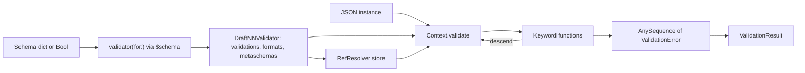
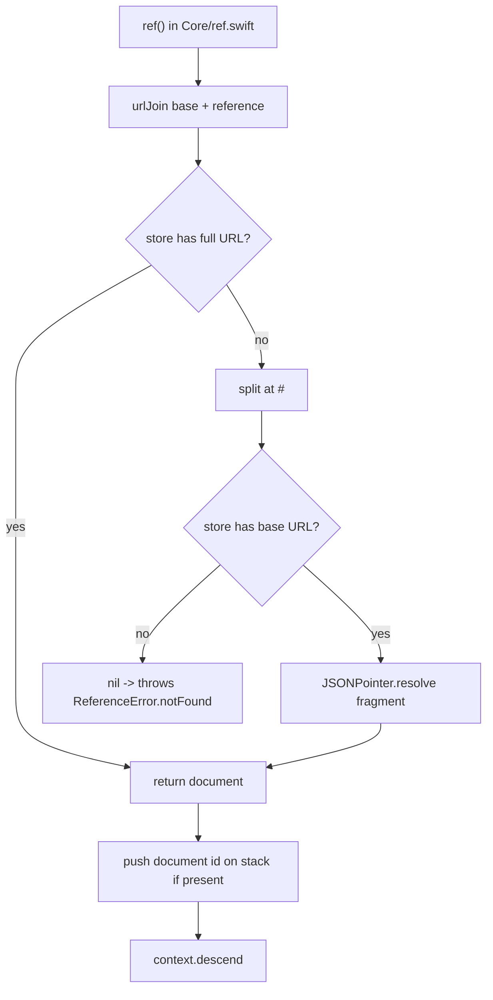

# JSONSchema.swift — Research report

## Metadata

- **Library name**: JSONSchema.swift
- **Repo URL**: https://github.com/kylef/JSONSchema.swift
- **Clone path**: `research/repos/swift/kylef-JSONSchema.swift/`
- **Language**: Swift (swift-tools-version 5.0; macOS 10.13+, also builds on Linux per `#if os(Linux)` branches)
- **License**: BSD (see `LICENSE`)
- **Analyzed version**: 8c7ec15 (2022-05-21, "feat: Add support for date-time format"); latest tag 0.6.0; CHANGELOG top section is an unreleased `TBD` after 0.6.0 (no tag at HEAD). No commits since May 2022.
- **Report date**: 2026-10-27

## Summary

JSONSchema.swift is a JSON Schema **validator** for Swift (about 3,400 lines in `Sources/`, no dependencies beyond Foundation). Given a schema as a `[String: Any]` dictionary (or Bool) and a JSON-like instance (`Any`, typically from `JSONSerialization`), it returns `.valid` or `.invalid([ValidationError])` with all errors collected. It does not generate code. It supports Draft 4, 6, 7, 2019-09 and 2020-12 (the last two incompletely). The draft is picked from `$schema` (default 2020-12; unknown `$schema` throws `ReferenceError.notFound`). Validation is a direct tree-walking interpreter over the untyped dictionary: each draft is a class holding a `[String: Validation]` table mapping keyword names to free functions, and `Context.validate` loops over that table for every subschema. Reference resolution is local-only through a string-keyed store.

## JSON Schema support

- **Drafts**: Draft 4, 6, 7, 2019-09, 2020-12. Draft 6 has no class of its own: `public typealias Draft6Validator = Draft7Validator` (`Sources/Draft6Validator.swift`), so Draft 6 and 7 share keywords, formats and meta-schema lookup. `validator(for:)` in `Sources/JSONSchema.swift` compares `$schema` (via `urlEqual`, which strips one trailing `#`) against each bundled meta-schema's `$id` (`id` for Draft 4), checking 2020-12, 2019-09, 07, 06, 04 in that order. Absent `$schema` means Draft 2020-12.
- **Scope**: Validation only. No code generation.
- **Subset**: `unevaluatedItems` and `unevaluatedProperties` are registered with the `unsupported()` helper, which emits the validation error `'X' is not supported.` whenever the keyword appears (Draft201909Validator, Draft202012Validator). Content vocabulary, meta-data keywords, `$dynamicRef`/`$dynamicAnchor`, `$recursiveRef`, `$vocabulary` are not implemented (silently ignored). Remote `$ref` is not supported (README, issue #9). The 2019-09 and 2020-12 meta-schemas (all vocabularies, but not 2020-12 `format-assertion`) are embedded as Swift string literals and pre-registered in the resolver store so `$ref` to the official meta-schema URLs resolves offline (though meta-schemas use `$dynamicRef`, which is ignored, so validating a schema against the meta-schema is only partly effective). The `validate(_:schema: Bool)` overload always builds a `Draft4Validator`.

## Keyword support table

Keyword list derived from the vendored draft 2020-12 meta-schemas (`specs/json-schema.org/draft/2020-12/meta/`: core, applicator, unevaluated, validation, meta-data, format-annotation, format-assertion, content); legacy keywords of the other targeted drafts are listed in a second table. Handlers are registered in per-draft `validations` dictionaries (each a `[String: Validation]` literal on the validator class) (`Sources/Draft*Validator.swift`). Implementation evidence from `Sources/Draft*Validator.swift`, `Sources/Applicators/`, `Sources/Validation/`, `Sources/Core/ref.swift`, `Sources/format.swift`, and `Sources/RefResolver.swift`.

| Keyword | Implemented | Notes |
|---------|-------------|-------|
| $anchor | partial | Only honoured for entries directly under `$defs` (RefResolver.storeDefinitions, recursive into nested `$defs`); anchors elsewhere are not indexed. |
| $comment | no | Accepted in schema; not validated. |
| $defs | partial | Not a validator; RefResolver indexes only `$defs` entries that have `$id`/`$anchor`; others reachable via JSON Pointer fragment. |
| $dynamicAnchor | no | Only appears inside embedded meta-schema text; no handler. |
| $dynamicRef | no | No handler (silently ignored); upstream tests dynamicRef.json excluded for 2020-12. |
| $id | partial | Used by RefResolver (idField) for store key and base-URI stack (pushed in `ref` when the resolved document has an id); not validated. |
| $ref | yes | Core/ref.swift; resolve then descend. In 2019-09/2020-12 applied alongside siblings; in Draft 4/6/7 (Draft6Validator alias covers Draft 7 too) siblings are ignored (Validator.swift). Unresolvable ref throws `ReferenceError.notFound`. |
| $schema | partial | Used by validator(for:) to select draft; not validated. |
| $vocabulary | no | Not implemented (all vocabularies treated as always on). |
| additionalProperties | yes | All drafts; Applicators/additionalProperties.swift. |
| allOf | yes | Applicators/allOf.swift. |
| anyOf | yes | Applicators/anyOf.swift. |
| const | yes | Validation/const.swift. |
| contains | yes | Applicators/contains.swift; registered in all drafts (including Draft 4); minContains/maxContains read in the same handler (also in Draft 7 where they are not keywords). Counts every match (no early exit). |
| contentEncoding | no | Not implemented. |
| contentMediaType | no | Not implemented. |
| contentSchema | no | Not implemented. |
| default | no | Meta-data; not validated. |
| dependentRequired | yes | 2019-09 and 2020-12 only; Validation/dependentRequired.swift. |
| dependentSchemas | yes | Draft 2019-09 and 2020-12; Applicators/dependentSchemas.swift. |
| deprecated | no | Not implemented. |
| description | no | Meta-data; not validated. |
| else | yes | Handled inside Applicators/if.swift when "else" present in schema. |
| enum | yes | Validation/enum.swift; instance must match one value via isEqual. |
| examples | no | Not implemented. |
| exclusiveMaximum | yes | Draft 4: boolean consumed by `maximumDraft4`; Draft 6+: separate numeric keyword in Validation/minMaxNumber.swift. |
| exclusiveMinimum | yes | Draft 4: boolean alongside minimum; Draft 7+: separate keyword. |
| format | yes | Always asserted (not annotation-only). Per-draft `formats` map; unknown format name yields a validation error. Non-string instances skipped. |
| if | yes | Applicators/if.swift; then/else applied when present. |
| items | yes | Applicators/items.swift; handles schema, bool, and legacy array form (tuple); skips first `prefixItems.count` elements when `prefixItems` is present. |
| maxContains | yes | Used in Applicators/contains.swift. |
| maximum | yes | Validation/minMaxNumber.swift (Draft4 variant for boolean exclusive). |
| maxItems | yes | Validation/minMaxItems.swift. |
| maxLength | yes | Validation/minMaxLength.swift. |
| maxProperties | yes | Validation/minMaxProperties.swift. |
| minContains | yes | Used in Applicators/contains.swift (default 1). |
| minimum | yes | Validation/minMaxNumber.swift. |
| minItems | yes | Validation/minMaxItems.swift. |
| minLength | yes | Validation/minMaxLength.swift. |
| minProperties | yes | Validation/minMaxProperties.swift. |
| multipleOf | yes | Validation/multipleOf.swift; uses Double division and `floor`; instances `<= 0` are skipped (never fail). |
| not | yes | Applicators/not.swift. |
| oneOf | yes | Applicators/oneOf.swift. |
| pattern | yes | Validation/pattern.swift; NSRegularExpression (ICU, unanchored search); invalid pattern reported as a validation error. |
| patternProperties | yes | Applicators/patternProperties.swift. |
| prefixItems | yes | Draft 2020-12; Applicators/prefixItems.swift; items applies to additional items. |
| properties | yes | Applicators/properties.swift. |
| propertyNames | yes | Applicators/propertyNames.swift. |
| readOnly | no | Not implemented. |
| required | yes | Validation/required.swift. |
| then | yes | Handled inside Applicators/if.swift when "then" in schema. |
| title | no | Meta-data; not validated. |
| type | yes | Validators.swift type(); isType over Foundation types (NSNumber/CFBoolean, NSDictionary, NSArray, String, NSNull). |
| unevaluatedItems | no | Explicitly unsupported in Draft201909Validator and Draft202012Validator (unsupported()). |
| unevaluatedProperties | no | Explicitly unsupported in Draft 2019-09 and 2020-12. |
| uniqueItems | yes | Validation/uniqueItems.swift. |
| writeOnly | no | Not implemented. |

Legacy keywords from other targeted drafts (vendored `draft-04`, `draft-06`, `draft-07`, `draft/2019-09`):

| Keyword | Implemented | Notes |
|---------|-------------|-------|
| additionalItems | yes | Draft 4-7 and 2019-09 only (Applicators/additionalItems.swift); not registered for 2020-12. |
| definitions | partial | Draft 4/6/7 defsField; same store-indexing behaviour as `$defs`. |
| dependencies | yes | Registered for all drafts including 2019-09 and 2020-12 (Applicators/dependencies.swift). |
| id (Draft 4) | partial | idField for Draft 4 resolver. |
| const / contains / propertyNames | yes | Also registered in Draft 4 although not Draft 4 keywords. |

## Constraints

All implemented validation keywords are enforced at runtime; there is no code generation. `format` is always asserted (never annotation-only), but only for string instances, and a format name missing from the active draft's `formats` map produces a validation error (`'format' validation of 'X' is not yet supported.`) rather than being ignored. Per-draft format tables: Draft 4 has only `ipv4`, `ipv6`, `uri`, `date-time` (so `email`/`hostname` fail as unsupported); Draft 6/7 add `json-pointer`, `regex`, `time`, `date`; 2019-09 and 2020-12 add `uuid` and `duration`. Numbers are compared as `Double`, so large integers lose precision. Draft 4 uses boolean `exclusiveMinimum`/`exclusiveMaximum` read inside `minimumDraft4`/`maximumDraft4`; later drafts use numeric keywords.

## High-level architecture

Pipeline: schema dictionary -> `validator(for:)` selects a draft class -> the class's `init` builds a `RefResolver` (store of meta-schemas plus root and `$defs` ids) -> `validate(instance:)` creates a fresh `Context` (resolver copy, JSON-pointer stacks) -> `Context.validate(instance:schema:)` interprets the schema, recursing through `descend` -> a lazily concatenated `AnySequence<ValidationError>` is collected into `ValidationResult`. No code emission.

## Medium-level architecture

- `Sources/JSONSchema.swift`: public `Schema` struct (wraps the dictionary, extracts `title`, `description`, `type`), `validator(for:)`, free `validate` functions.
- `Sources/Validator.swift`: `Context` class (the interpreter) and the internal `Validator` protocol (`resolver`, `schema`, `metaschmas`, `validations`, `formats`).
- `Sources/Draft{4,7,201909,202012}Validator.swift`: per-draft tables plus the embedded meta-schema JSON as string literals parsed lazily into global `let`s with `JSONSerialization`.
- `Sources/Applicators/*`, `Sources/Validation/*`, `Sources/Core/ref.swift`: one free function per keyword (some files host two, e.g. `if.swift` handles `then`/`else`; `contains.swift` handles `minContains`/`maxContains`).
- `Sources/Validators.swift`: shared helpers (`type`, `isType`, `isEqual`, `unsupported`, `isValid`).
- `Sources/RefResolver.swift`, `Sources/JSONPointer.swift`, `Sources/format.swift` and `Sources/Format/*`.

## Algorithms and data structures

### Schema representation

There is no parsed schema model. The schema is the caller's `[String: Any]` (`Validator.schema`), held by reference-counted copy-on-write Foundation containers. Keywords are never pre-extracted: every handler receives the raw keyword value as `Any` plus the enclosing dictionary and does a dynamic cast (`as? [Any]`, `as? Double`, `as? Bool`) at each call, silently returning no errors when the cast fails (so malformed keyword values are ignored, not reported). Unknown keywords are simply never looked up. Boolean schemas are handled inside `Context.validate` (`true` -> empty sequence, `false` -> a `"Falsy schema"` error); a root Bool is turned into `[:]` or `["not": [:]]` by the validator initialisers. The only typed view is the public `Schema` struct, which extracts `title`, `description` and `type` but validates through the raw dictionary again (and builds a new validator on every `validate` call).

Instances are likewise untyped: type tests use Foundation bridging (`Validators.swift`): `NSNumber` with `CFGetTypeID == CFBooleanGetTypeID()` distinguishes booleans from numbers; `isInteger` accepts float-typed NSNumbers whose `intValue` round-trips (so `1.0` is an integer); `string` is `instance is String`; objects are `NSDictionary`, arrays `NSArray`, null `NSNull`. This makes the library dependent on instances produced by `JSONSerialization` (or equivalent bridging).

### Reference resolution and registry

`RefResolver` (`Sources/RefResolver.swift`) is a class with `store: [String: Any]` (URL string -> document), `stack: [String]` (base-URI stack), `referrer`, and the `idField` (`$id` or Draft 4 `id`) / `defsField` (`$defs` or `definitions`). Construction: start from the draft's meta-schema dictionary, insert the root schema under its own id (or under `""` if none) and push that id; then `storeDefinitions` walks `$defs`/`definitions` entries, and for each entry with `$id` or `$anchor` registers it under `urlJoin(stack.last, id)` (or `...#anchor`), recursing into that entry's own `$defs` with the new URL pushed. Consequences: ids and anchors are indexed only at `$defs` positions (not under `properties`, `items`, etc.), plain-name fragments work only through those exact store keys, and nothing is indexed for entries without an id/anchor.

`resolve(reference:)` joins the reference to `stack.last` using `URL(string:relativeTo:)` (force-unwrapped, so a malformed base would crash) and calls `resolve(url:)`: try the full string as a store key; else split at the first `#`, look up the base document, and apply the fragment as a percent-decoded `JSONPointer` over the dictionary/array tree. A failed lookup returns nil and `ref()` throws `ReferenceError.notFound`, aborting the whole validation (not a validation error). Resolution is lazy and repeated: every `$ref` encounter performs the string join and dictionary lookups again; nothing is memoised. The base URI is the stack top, which `ref()` (`Core/ref.swift`) pushes only when the resolved target dictionary itself has an id, and pops via `defer`; a `$ref` into a fragment of a sub-document does not change the base. There is no cycle detection: a schema such as `{"$ref": "#"}` or mutually recursive refs that never consume instance structure recurse until stack overflow; recursion that descends the instance terminates naturally. `$dynamicRef`/`$recursiveRef` are absent; there is no network or file fetching.

### Compiled / intermediate form

None. The "intermediate form" is the per-draft `validations: [String: Validation]` table, where `Validation = (Context, Any, Any, [String: Any]) throws -> AnySequence<ValidationError>` (keyword value, instance, enclosing schema). Each draft class declares this table as an instance `let` with a dictionary literal, so the table, the `formats` table and the `metaschmas` dictionary are rebuilt on every validator construction (the embedded meta-schema JSON itself is parsed once per process because the `DRAFT_*` constants are lazy globals). Nothing is lowered, ordered or specialised per schema. The embedded meta-schemas are the only precomputed data.

### Core algorithm

`Context.validate(instance:schema:)` (`Sources/Validator.swift`):
1. Bool schema: return empty or a `Falsy schema` error.
2. Non-dictionary schema: no errors.
3. If the validator `is Draft4Validator || is Draft6Validator` (the latter alias also matches Draft 7), and the schema has a string `$ref`, evaluate only the `$ref` handler and return (siblings ignored). Later drafts treat `$ref` as an ordinary keyword.
4. Otherwise `validator.validations.compactMap { (key, validation) in schema[key].map { push key onto keywordLocation; call validation; pop } }.joined()`. So the loop is over the draft's registered keywords (about 35), looking each up in the schema dictionary, i.e. O(K) per subschema with K the table size, not O(keys in schema). The iteration order is Swift `Dictionary` order, which is hash-seeded per process; keyword order carries no meaning (no `type`-first, no dependency ordering).

Important evaluation detail: `compactMap` and the `map`s inside handlers are eager, so every keyword handler runs to completion, recursing into subschemas, before the result is returned; only the final `.joined()` concatenation of the already-computed per-keyword sequences is lazy. `isValid` (`first(where:)` on the sequence) therefore stops iterating the concatenation early but does not avoid the work. Consequently there is no true short-circuit inside one subschema; short-circuiting exists only across alternatives: `anyOf` uses `contains(where:)` (stops at first valid branch), `oneOf` evaluates every branch and counts valid ones (`!= 1` fails), `not` calls `.isValid`, `if` evaluates the `if` schema once then `then`/`else`. `allOf` descends into each and joins errors. `properties` iterates the instance's keys and looks each up in the schema's `properties`; `additionalProperties` computes the extra-key `Set<String>` by subtracting `properties` keys and then removing keys matching any `patternProperties` regex (compiled per call, `try?` swallowing invalid patterns there). `patternProperties` compiles each pattern per call and filters instance keys. `items` handles schema/bool/array forms, slices out `prefixItems.count` leading elements when `prefixItems` exists (via two `Array(...enumerated())` copies); `prefixItems` zips schemas with elements; `additionalItems` applies when `items` is an array. `contains` filters all elements counting valid ones against `minContains` (default 1) and `maxContains`. `uniqueItems` is a quadratic scan with `isEqual`. `enum`/`const` use `isEqual` (`Validators.swift`): numbers of different CF type IDs are unequal (so `true != 1`), arrays compare pairwise, dictionaries compare by key/value recursively, else `NSObject ==`. `type` accepts a string or string array via `isType`. `required` emits one error per missing key. `dependencies` handles both array and schema forms; `dependentRequired`/`dependentSchemas` are separate for 2019-09+. `multipleOf` computes `instance / multipleOf` as Double and checks `result != floor(result)`; instances `<= 0` are skipped (negative values never fail). `minLength`/`maxLength` compare `String.count` (grapheme clusters). There is no annotation tracking, which is why `unevaluated*` are unsupported.

`ref()` resolves, optionally pushes the target's id, and calls `context.descend` (which is just `validate`).

### Error and output model

`ValidationError` (`Sources/ValidationResult.swift`) is a class with `description: String`, `instanceLocation: JSONPointer` and `keywordLocation: JSONPointer`; it is `Encodable` with keys `error`, `instanceLocation`, `keywordLocation`. `JSONPointer` is a struct over `components: [String]` (root is `[""]`; `keywordLocation` starts at `["#"]`), with `push`/`pop`, `path` (escapes `~`/`/`), and `resolve(document:)` used by the resolver. `Context` owns two mutable pointers; handlers push/pop around `descend` with `defer`. The `instanceLocation` is precise (`/0`, `/name`). `keywordLocation` is the dynamic path of keyword names only: `Context.validate` pushes the keyword, but handlers like `properties`/`items` do not push the property name or index to it, and `ref` does not push the reference target, so locations look like `#/items/$ref/type` (confirmed by `Tests/JSONSchemaTests/Validation/TestRef.swift`). `ValidationResult` is `.valid` / `.invalid([ValidationError])` (also `Encodable` as `{valid, errors}`), built from the sequence by `Array(self)`. Errors are collected exhaustively (no fail-fast mode, no output levels like flag/basic/detailed). Messages are interpolated strings (`"'\(instance)' is not of type ..."`) built only when a failure occurs. Schema-side problems (bad regex) are reported as validation errors with a `[Schema]` prefix; unresolved refs and unknown `$schema` throw instead.

## Low-level details

- **String length**: `String.count` counts extended grapheme clusters, not code points or UTF-16 units (`Validation/minMaxLength.swift`).
- **Regex ranges**: `pattern`, `patternProperties` and `additionalProperties` build `NSMakeRange(0, string.count)` using the grapheme-cluster count, while `NSRegularExpression` ranges are UTF-16 based. For strings containing non-BMP characters (emoji) or combining sequences the searched range is shorter than the string, so matches can be missed or truncated (the format validators correctly use `utf16.count`).
- **Regex semantics**: ICU via `NSRegularExpression`, unanchored search; not ECMA-262 (the ecmascript-regex test file is excluded).
- **Numbers**: all numeric keywords cast to `Double`; `multipleOf` uses floating division, no decimal arithmetic; bignum/float-overflow tests are excluded. In `validateNumericLength`, exclusive and inclusive comparators are both applied for Draft 4 exclusive bounds.
- **Crash risks**: `enum`, `const`, `uniqueItems` use `as!` casts to `NSObject`; `urlJoin` force-unwraps `URL(string:)`; `Time.init` uses force-unwraps of regex capture ranges (guarded by the regex). `isObject(_:)` in `Validators.swift` is actually the string check (misnamed). `validateIPv6` allocates a buffer with `UnsafeMutablePointer.allocate` that is never deallocated (leak per call) and passes the pointer variable's address to `inet_pton`.
- **Formats**: `date` = `^\d{4}-\d{2}-\d{2}$` regex (compiled per call) plus a `DateFormatter` (created per call) with `yyyy-MM-dd`; `time` = a named-group verbose regex compiled once (`timeExpression`) with leap-second check after converting to UTC; `date-time` splits on `T`/`t`/space and checks date and time parts; `duration` = a global regex built from RFC 3339 Appendix A ABNF; `uri` = a large regex requiring a full-range single match; `ipv4` = octet regex compiled per call; `ipv6` = `inet_pton` and rejects `%` zones; `uuid` = `UUID(uuidString:)`; `regex` = tries `NSRegularExpression(pattern:)`; `json-pointer` = prefix and `~` escape checks.
- **Recursion limits**: none; deep schemas, deep instances and cyclic refs rely on the native stack.
- **Untrusted input**: not hardened; the library trusts schema well-formedness, has no ref-depth or regex time limits, and can crash on malformed input as above.
- **Draft quirks**: `contains`, `const`, `propertyNames`, `if` are registered even for Draft 4; `dependencies` remains registered in 2019-09/2020-12; `additionalItems` is registered for 2019-09 but not 2020-12.

## Output and integration

- **Vendored vs build-dir**: Not applicable (no generated output).
- **API vs CLI**: Library only (CocoaPods podspec and SwiftPM product `JSONSchema`); no CLI, no macros.
- **Writer model**: Not applicable. Results are in-memory values.

## Configuration

None. No settings object; behaviour is determined by the schema's `$schema`. Dependencies: none at runtime (Foundation, CoreFoundation); tests use Spectre and PathKit.

## Pros/cons

- **Pros**: Small, readable (one function per keyword); supports five drafts including 2020-12 core keywords; all errors collected with instance and keyword locations and JSON-encodable results; embedded meta-schemas so no network; precise equality semantics for `enum`/`const`/`uniqueItems` (`true != 1`); RFC 3339 `time`/`duration` handling.
- **Cons**: Interprets raw `[String: Any]` on every call (no compilation, caching or typed model); eager evaluation without real short-circuiting; regexes recompiled on each use; `unevaluated*`, `$dynamicRef`, content vocabulary and remote refs missing; `$anchor`/`$id` indexing only at `$defs` positions; Double-only numerics; grapheme-count/UTF-16 range mismatch; undefined error order; no cycle protection; last commit 2022, CI is only Travis (xcode12); Apple/Foundation-bridging dependent.

## Testability

- **How to run tests**: `swift test` from the repo root (`.travis.yml`: macOS, xcode12, `swift test`). Tests depend on Spectre and PathKit (`Package.swift`; Spectre pinned by revision).
- **Suite**: `Tests/Cases` is a git submodule of JSON-Schema-Test-Suite (`.gitmodules`); it is empty in this clone, so the suite-driven cases in `Tests/JSONSchemaTests/JSONSchemaCases.swift` run only after `git submodule update --init`. `buildTests` loads fixtures with `JSONSerialization` and has per-draft exclusions (e.g. `refRemote.json`, bignum, ecmascript-regex, optional formats such as email/hostname; 2019-09/2020-12 also exclude `unevaluated*`, `defs`, `id`; 2020-12 excludes `ref.json` and `dynamicRef.json`).
- **Unit tests**: `JSONSchemaTests.swift` (validator selection), `ValidationErrorTests`, `ValidationResultTests`, `JSONPointerTests`, `Validation/{TestEnum,TestRef,TestRequired}.swift`, `Format/TestDuration.swift`.
- **Reuse for our generator**: not applicable as code generation; the suite fixtures are generic JSON Schema Test Suite files.

## Performance

Analysis is from code only; nothing was built or run.

### Performance techniques

- **Compile vs interpret**: Pure interpretation. Nothing is compiled; each `validate` walks the raw dictionary and tests every registered keyword name against each subschema (O(K) lookups per subschema). The only ahead-of-time work is the one-time-per-process JSON parse of embedded meta-schemas (lazy globals) and per-validator construction (store seeding, `storeDefinitions` scan, building the keyword and format dictionaries). `JSONSchema.validate(_:schema:)` and `Schema.validate(_:)` call `validator(for:)` every time, so a new validator and resolver are built per call; holding a `DraftNNValidator` instance avoids that (the classes are internal, though; `Validator` is a non-public protocol, so external reuse is limited to `Schema` which rebuilds anyway).
- **Memory layout and allocation**: Pointer-heavy: `[String: Any]` boxes, `AnySequence` wrappers (type-erased, heap allocated) for every handler result, even for the empty case (`AnySequence(EmptyCollection())`), and `.joined()` chains per level. `Context.init` copies the resolver (class copy with COW dictionary/array shared until mutated); `ref()` mutates the stack, triggering an array copy-on-write on first push per Context. Handlers materialise arrays (`Array(instance.enumerated())`, double array copy in `items` with `prefixItems`, `filter` in `oneOf`/`contains`). Error strings and JSONPointer copies are created only when an error occurs (`ValidationError` stores copies of the two pointers, each an array copy). `JSONPointer.push` performs two `replacingOccurrences` calls per push, on every keyword visited, even when validation succeeds.
- **Caching and memoization**: None for refs, compiled regexes or format results. Only the global lazies `timeExpression`, `durationExpression` and the meta-schema constants are computed once.
- **Fast paths and short-circuiting**: Limited. `anyOf` stops at the first valid branch; `contains` returns early only when `min == 0` and no `maxContains`; `pattern`/numeric/length handlers return immediately on type mismatch (instance not a string/number etc.); Draft 4/6/7 skip sibling keywords when `$ref` exists. There is no boolean-only path, no type-first ordering and no fail-fast option (see Core algorithm: evaluation is eager).
- **Regex handling**: `NSRegularExpression` (ICU backtracking engine), built from scratch on every use for `pattern`, `patternProperties`, `additionalProperties` (via `findAdditionalProperties`), `format: regex/ipv4/uri/date`. Compile cost is therefore paid per instance value (and for `patternProperties` per pattern per object). No ECMA-262 translation and no ReDoS protection or timeout.
- **Concurrency**: No locks, queues or async code. A validator's own state (`schema`, `resolver`, tables) is immutable `let`; each `validate(instance:)` builds its own `Context` with a copied resolver and pointers, so concurrent calls on one validator do not mutate shared state in practice, but nothing is annotated `Sendable` and thread-safety is undocumented (not verified). No parallel validation.

### Benchmarks in repo

None found (no benchmark target, no `measure` blocks). Entry point for shared fixtures: `try JSONSchema.validate(instance, schema: schemaDictionary)` returning `ValidationResult`, with fixtures decoded by `JSONSerialization`; there is no CLI.

## Determinism and idempotency

Validity and the set of reported errors are deterministic for a given schema and instance, but error order is not: `Context.validate` iterates the `validations` Swift `Dictionary` (hash-seeded per process), `additionalProperties`/`findAdditionalProperties` work on a `Set<String>`, and `properties`/`patternProperties`/`propertyNames` iterate instance dictionaries, so error sequence may differ between runs. Idempotency: not applicable (no generated output).

## Enum handling

`Validation/enum.swift`: the `enum` value must be an array; the instance is compared to each element with `isEqual` (CF type-ID check for NSNumber so `true != 1`, deep compare for arrays/dictionaries) using a linear `contains(where:)`. No deduplication or normalisation of the enum array; duplicates have no effect. Values `"a"` and `"A"` are distinct (value comparison). There is no name generation (validation only). Casting uses `as!`, so a non-NSObject-bridgeable element would crash.

## Reverse generation (Schema from types)

No. The library only validates; there is no facility to produce JSON Schema from Swift types.

## Multi-language output

Not applicable. It does not generate code.

## Model deduplication and $ref/$defs

Not applicable to code generation. For validation, `$ref` resolution uses the string-keyed `RefResolver` store described above: `$defs`/`definitions` entries with `$id`/`$anchor` are indexed, other targets are reachable through JSON Pointer fragments, and each `$ref` is re-resolved at every encounter. There is no model to deduplicate.

## Validation (schema + JSON → errors)

Yes; it is the primary function.

- **Inputs**: schema (`[String: Any]` or Bool) and instance (`Any`).
- **API**: `JSONSchema.validate(_ value: Any, schema: [String: Any]) throws -> ValidationResult`; `Schema(dict).validate(_:)` returning either `ValidationResult` or `AnySequence<ValidationError>`.
- **Output**: `.valid` or `.invalid([ValidationError])`; each error has `description`, `instanceLocation`, `keywordLocation`, JSON-encodable.
- **Gaps**: no `unevaluated*`, `$dynamicRef`, content vocabulary, remote refs; no schema validity check against the meta-schema (the API may throw only for unresolved refs or unknown `$schema`).
- **CLI**: none.
