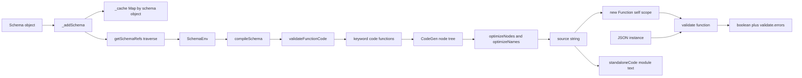
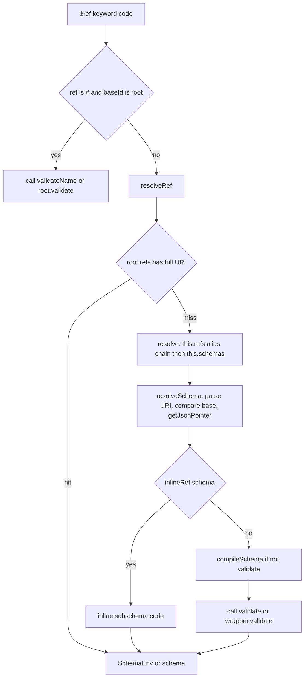

# Ajv — Research report

## Metadata

- **Library name**: Ajv
- **Repo URL**: https://github.com/ajv-validator/ajv
- **Clone path**: `research/repos/typescript/ajv-validator-ajv/`
- **Language**: TypeScript / JavaScript
- **License**: MIT (see package.json)
- **Analyzed version**: f177fe32 2026-04-24 (package.json version 8.20.0)
- **Report date**: 2026-10-26

## Summary

Ajv is a fast JSON Schema validator for Node.js and the browser. It is **validator only**: given a schema and a JSON instance, it reports whether the instance is valid and can yield one or all validation errors. It does not generate application types or data models from schemas. The library compiles schemas into validation functions (code generation for the validator itself, not for user types). It supports JSON Schema draft-06, draft-07, draft 2019-09, and draft 2020-12 (draft-04 only via the separate ajv-draft-04 package), plus JSON Type Definition (JTD, RFC 8927) and an OpenAPI-style `discriminator` keyword. Separate entry points (default Ajv, Ajv2019, Ajv2020) and bundles (ajv, ajv2019, ajv2020, ajvJTD) target different drafts. Reference resolution uses `$id` and URI resolution (configurable `uriResolver`); compilation resolves `$ref`, `$dynamicRef`, and supports remote schemas via `addSchema` or `compileAsync` with `loadSchema`.

## JSON Schema support

- **Drafts**: Draft 06, Draft 07, Draft 2019-09, Draft 2020-12. Draft-04 is documented as requiring the ajv-draft-04 package. Declared in README and in lib entry points: `lib/ajv.ts` (Draft 07), `lib/2019.ts` (2019-09), `lib/2020.ts` (2020-12). Meta-schemas and refs live under `lib/refs/` (e.g. json-schema-draft-06.json, json-schema-draft-07.json, json-schema-2019-09/, json-schema-2020-12/). JTD supported via `lib/jtd.ts` and refs/jtd-schema.ts.
- **Scope**: Validation only. No generation of types or models for application code.
- **Recent history (v8.17 to v8.20; taken from the existing report and not re-verified against a changelog in this pass, though the `$data` pattern/regExp behavior is confirmed in `vocabularies/validation/pattern.ts`)**: `sideEffects: false` for tree-shaking; Infinity/NaN serialisation fix; ReDoS mitigation (CVE-2025-69873) so `pattern` with `$data` uses the configured `code.regExp` engine (e.g. re2) instead of bare `new RegExp`; prototype-pollution fix for `$data` refs combined with `format`; Node 22/24 support added and Node 16/21 dropped; `ES2022.RegExp` typing lib added for RegExpIndicesArray.
- **Subset**: For Draft 2020-12, Ajv implements core, applicator, validation, dynamic refs, unevaluated, and format keywords. Meta-data keywords (`$comment`, `description`, `title`, `default`, `examples`, `deprecated`, `readOnly`, `writeOnly`) are in the vocabulary but accepted only (no validation of instance data). Content vocabulary (`contentEncoding`, `contentMediaType`, `contentSchema`) is registered in `vocabularies/metadata.ts` but has no validation implementation. `$schema` and `$id` drive meta-schema selection and reference resolution. `$anchor` and `$dynamicAnchor` are collected during reference collection in `compile/resolve.ts` (`getSchemaRefs`); `$anchor` is not registered as a keyword, so it needs `strict: false`. `$vocabulary` is a name-only keyword: vocabularies are fixed per Ajv class, not selected from the meta-schema.

## Keyword support table

Keyword list is the union of the `properties` of the vendored meta-schemas for every draft Ajv targets: draft 2020-12 (`specs/json-schema.org/draft/2020-12/meta/*.json`: applicator, content, core, format-annotation, format-assertion, meta-data, unevaluated, validation), draft 2019-09 (`draft/2019-09/meta/*.json`), draft-07, draft-06 and draft-04 (`draft-0x/schema.json`). Hyper-schema keywords (`base`, `links`) are excluded (not implemented). Implementation evidence from `lib/vocabularies/` (core, applicator, validation, unevaluated, dynamic, next, format, metadata; draft7.ts / draft2020.ts compose them per class), `lib/compile/`, and `lib/refs/`. Notes say which drafts introduce a keyword. Draft-04 is only supported by the separate ajv-draft-04 package, so draft-04-only forms (boolean `exclusiveMaximum`/`exclusiveMinimum`) are not handled here: `limitNumber.ts` requires a numeric schema value.

| Keyword | Implemented | Notes |
|---------|-------------|-------|
| $anchor | partial | 2019-09+. Handled only in ref collection (`addAnchor` in compile/resolve.ts, which checks the `^[a-z_][-a-z0-9._]*$` pattern and registers `#name` in `localRefs`); a grep of `lib/` shows no vocabulary registers `$anchor`, so `checkUnknownRules` (`RULES.keywords` lookup) reports it as an unknown keyword under the default `strictSchema: true` and it is accepted only with `strict: false`. |
| $comment | no | Draft-07+. Registered in core vocabulary; never validates. The `$comment` option can be a function invoked with the comment text at compile time (lib/core.ts). |
| $defs | no | 2019-09+. Registered by name only (core vocabulary); no validator; $ref can target it by JSON pointer. |
| $recursiveAnchor | yes | 2019-09 only. vocabularies/dynamic/recursiveAnchor.ts (delegates to dynamicAnchor with empty name; `false` ignored with strict warning). |
| $recursiveRef | yes | 2019-09 only. vocabularies/dynamic/recursiveRef.ts (delegates to dynamicRef). |
| $dynamicAnchor | yes | 2020-12. vocabularies/dynamic/dynamicAnchor; registered by the dynamic vocabulary on Ajv2019/Ajv2020 only. Emits runtime code that stores the schema's validate function in the per-call `dynamicAnchors` map (see Reference resolution). |
| $dynamicRef | yes | 2020-12. vocabularies/dynamic/dynamicRef; only `#fragment` refs are supported (throws otherwise). Resolution is a runtime lookup in `dynamicAnchors`, not a full dynamic-scope walk; a source comment documents known deviations. |
| $id | partial | All drafts except 04. Registered in core vocabulary; used for baseId and resolution scope (SchemaEnv, getSchemaRefs); not an assertion. |
| $ref | yes | vocabularies/core/ref.ts; resolveRef, compile/resolve.ts. |
| $schema | partial | Used for meta-schema selection and validation; not validated as data. |
| $vocabulary | no | 2019-09+. In core vocabulary as keyword name only; no validator, vocabularies are not dynamically selected from it. |
| additionalItems | yes | Draft-04/06/07/2019-09 (not 2020-12). vocabularies/applicator/additionalItems; registered only for non-2020 classes (`getApplicatorVocabulary(false)`). |
| additionalProperties | yes | vocabularies/applicator/additionalProperties. |
| allOf | yes | vocabularies/applicator/allOf. |
| anyOf | yes | vocabularies/applicator/anyOf. |
| const | yes | vocabularies/validation/const. |
| contains | yes | Draft-06+. vocabularies/applicator/contains; minContains/maxContains handled in the same file when `next` is set. |
| contentEncoding | no | Draft-07+. In contentVocabulary (lib/vocabularies/metadata.ts); registered as a name only, no validator. |
| contentMediaType | no | Draft-07+. In contentVocabulary (lib/vocabularies/metadata.ts); registered as a name only, no validator. |
| contentSchema | no | 2019-09+. In contentVocabulary (lib/vocabularies/metadata.ts); registered as a name only, no validator. |
| default | partial | Meta-data; accepted. Applied to data only if the `useDefaults` option is set. |
| definitions | no | Draft-04/06/07. Registered by name only (core vocabulary); no validator; $ref can target it. |
| dependencies | yes | Draft-04/06/07 (also registered on 2019-09/2020 instances, which reuse the applicator list). vocabularies/applicator/dependencies; handles array and schema forms. |
| dependentRequired | yes | 2019-09+. vocabularies/validation/dependentRequired (`next` vocabulary, registered by Ajv2019/Ajv2020 only). |
| dependentSchemas | yes | 2019-09+. vocabularies/applicator/dependentSchemas (`next` vocabulary). |
| deprecated | no | Meta-data; accepted, not validated. |
| description | no | Meta-data; accepted, not validated. |
| else | yes | vocabularies/applicator/thenElse (then/else with if). |
| enum | yes | vocabularies/validation/enum; instance must equal one of the values. |
| examples | no | Meta-data; accepted, not validated. |
| exclusiveMaximum | yes | vocabularies/validation/limitNumber. |
| exclusiveMinimum | yes | vocabularies/validation/limitNumber. |
| format | yes | vocabularies/format/format; treated as an assertion by default (`validateFormats: true`) in all drafts including 2020-12, where the spec default is annotation-only; unknown formats error in strict mode; configurable via addFormat/formats option. |
| id | no | Draft-04 only. vocabularies/core/id.ts throws "NOT SUPPORTED: keyword id, use $id"; the `schemaId: "id"` option exists for legacy use. |
| if | yes | vocabularies/applicator/if. |
| items | yes | vocabularies/applicator/items (schema or array form; draft-04 to 2019-09) or items2020 (2020-12 schema form, used with prefixItems). |
| maxContains | yes | 2019-09+. Used in contains; limitContains.ts only emits a strict-mode warning when `contains` is absent. |
| maximum | yes | vocabularies/validation/limitNumber. |
| maxItems | yes | vocabularies/validation/limitItems. |
| maxLength | yes | vocabularies/validation/limitLength; unicode-aware via ucs2length by default. |
| maxProperties | yes | vocabularies/validation/limitProperties. |
| minContains | yes | 2019-09+. Same as maxContains. |
| minimum | yes | vocabularies/validation/limitNumber. |
| minItems | yes | vocabularies/validation/limitItems. |
| minLength | yes | vocabularies/validation/limitLength. |
| minProperties | yes | vocabularies/validation/limitProperties. |
| multipleOf | yes | vocabularies/validation/multipleOf. |
| not | yes | vocabularies/applicator/not. |
| oneOf | yes | vocabularies/applicator/oneOf. |
| pattern | yes | vocabularies/validation/pattern. |
| patternProperties | yes | vocabularies/applicator/patternProperties. |
| prefixItems | yes | 2020-12. vocabularies/applicator/prefixItems. |
| properties | yes | vocabularies/applicator/properties. |
| propertyNames | yes | vocabularies/applicator/propertyNames. |
| readOnly | no | Meta-data; accepted, not validated. |
| required | yes | vocabularies/validation/required. |
| then | yes | vocabularies/applicator/thenElse. |
| title | no | Meta-data; accepted, not validated. |
| type | yes | vocabularies/validation (type + OpenAPI `nullable` extension); compile/validate/dataType. Accepts string or array. |
| unevaluatedItems | yes | 2019-09+. vocabularies/unevaluated/unevaluatedItems (`unevaluated` option; set by Ajv2019/Ajv2020). |
| unevaluatedProperties | yes | 2019-09+. vocabularies/unevaluated/unevaluatedProperties. |
| uniqueItems | yes | vocabularies/validation/uniqueItems. |
| writeOnly | no | Meta-data; accepted, not validated. |

## Constraints

All validation keywords listed as implemented are enforced at runtime, by code emitted per schema (`lib/compile/validate/`, `lib/vocabularies/`). Constraints are not structural hints; they become `if` conditions in the generated validator (e.g. `maxLength` becomes `ucs2length(data) > N`, `minimum` becomes `data < N || isNaN(data)`, `required` becomes `data.prop === undefined` tests). `format` is asserted by default (`validateFormats: true`); format checkers come from the `formats` option or `addFormat` (the optional `ajv-formats` package supplies the standard set; the core ships none, so an unknown format throws at compile time under `strictSchema` and is only warned about with `strictSchema: false`). Meta-data and content keywords never affect validity. No user-facing types or serialization code are generated, except the separate JTD serializer/parser compilers.

## High-level architecture

Pipeline: **Schema** (object or boolean) → `Ajv.compile` / `addSchema` → `_addSchema` (cache lookup by object identity, `$id`/anchor collection into a `SchemaEnv`, optional meta-schema validation of the schema) → `compileSchema` (`lib/compile/index.ts`: builds a `CodeGen` and a root `SchemaCxt`, runs `validateFunctionCode`) → optimized JavaScript source string → `new Function("self","scope", source)` → a `validate(data, valCxt?)` closure. Errors are left on `validate.errors` (and `ajv.errors` for `ajv.validate`). With `code.source: true` the source and the scope values are retained so that `lib/standalone` can print a self-contained module.

## Medium-level architecture

- **Ajv instance (`lib/core.ts`)**: holds `schemas` (keyed by `addSchema` key, `SchemaEnv`), `refs` (id/URI to `SchemaEnv` or to another string alias), `formats`, `RULES` (keyword registry), `scope` (a `ValueScope`, the shared external value store for all compiled functions), `_cache` (`Map<AnySchema, SchemaEnv>`), `_compilations` (a `Set<SchemaEnv>` of schemas currently being compiled) and `_loading` (in-flight `loadSchema` promises). Draft classes (`Ajv`, `Ajv2019`, `Ajv2020`, `Ajv` JTD) differ only in which vocabularies they register and which flags (`dynamicRef`, `next`, `unevaluated`) they force on.
- **Vocabularies and rules**: `addVocabulary` calls `addKeyword` for each definition. `addRule` places the definition in a `RuleGroup` of `RULES.rules`, which is an ordered array `[untyped, number, string, array, object]` plus a `post` group. A definition with `type: "string"` goes into the string group; `before: "uniqueItems"` splices it earlier in a group; `post: true` places it in the final group (used for keywords that must run after the others). `RULES.all` maps keyword to `Rule {keyword, definition}`; `RULES.keywords` is the superset used for unknown-keyword detection.
- **Compile context**: `SchemaCxt` (compile/index.ts) is the immutable-by-convention state threaded through code generation: `gen`, `data` Name, `dataLevel`, `dataNames`, `dataPathArr`, `schemaPath` (a Code expression to reach the current subschema from `topSchemaRef`), `errSchemaPath` (a string), `errorPath` (Code), `baseId`, `compositeRule`, `props`/`items` (evaluated tracking) and `definedProperties`. Subschemas are compiled by spreading a parent context and overriding fields (`KeywordCxt.subschema`).
- **KeywordCxt (`compile/validate/index.ts`)**: per-keyword facade over `SchemaCxt` that exposes `gen`, `schema`, `schemaCode`, `data`, `parentSchema`, helpers `fail`, `pass`, `result`, `failResult`, `error`, `reset`, `ok`, `setParams`, `subschema`, `mergeEvaluated`, `block$data` and `check$data`. Keyword authors write against this class only.
- **Reference resolution** is described below. A `$ref` becomes either a call to another compiled function or an inlined copy of the target's code.

## Algorithms and data structures

### Schema representation

Ajv does not parse schemas into its own model. The "schema" is the plain JavaScript value the user supplies (`AnySchema = SchemaObject | boolean`, `lib/types/index.ts`): keywords are properties read directly with `schema[keyword]`, unknown keywords are just extra properties (flagged by `checkUnknownRules` in strict mode, otherwise ignored), and boolean schemas are handled by `boolOrEmptySchema`/`topBoolOrEmptySchema` (`false` emits a "boolean schema is false" error, `true` and `{}` emit `valid = true`). Ajv never copies or freezes the schema; the compiled function keeps a live reference to it through `topSchemaRef = gen.scopeValue("schema", {ref: sch.schema})`, and generated code reads some keyword values (e.g. `enum` arrays, `required` lists for looped checks, `properties` for `isOwnProperty` lookups) from that reference at run time rather than inlining them. Mutating a schema after compile therefore can change behavior for those reads; compile-time-constant keywords (`minimum`, `type`, short `required`) are baked into the source as literals.

The only wrapper around a schema is `SchemaEnv` (`compile/index.ts`): `{schema, schemaId, root, baseId, schemaPath, localRefs, meta, $async, refs, dynamicAnchors, validate, validateName, serialize/parse...}`. `root` is the top `SchemaEnv` of the document the schema belongs to (itself for a root); `refs` caches resolved `$ref` targets per root; `localRefs` maps `#anchor`/embedded-`$id` fragments to subschema objects (`LocalRefs`); `dynamicAnchors` records anchor names for `$dynamicRef`; `validate` is the compiled function once available. Ownership is JS-reference based (no lifetimes); `_cache` keys on object identity, so two structurally equal but distinct schema objects compile twice.

### Reference resolution and registry

Registry. Three maps cooperate: `ajv.schemas` (key given to `addSchema`/`compile` to `SchemaEnv`), `ajv.refs` (normalized `$id`/URI to `SchemaEnv`, or to a *string* alias pointing at another ref key), and per-root `SchemaEnv.refs` (resolved targets for this root's `$ref` strings, written by `resolveRef`). `resolve()` follows string aliases in a `while` loop, then checks `this.schemas[ref]`, then falls back to `resolveSchema`.

Id collection (eager, at `_addSchema`). `getSchemaRefs` (`compile/resolve.ts`) walks the whole schema with `json-schema-traverse` (`allKeys: true`, callback per subschema with its JSON pointer). It maintains `baseIds[jsonPtr]`, the effective base URI of each subschema, computed by resolving each `$id` against its parent's base with `uriResolver.resolve`. For each `$id` it calls `addRef`, which normalizes (`normalizeId` strips a trailing `#`/`#/`), throws "resolves to more than one schema" if the same URI is declared twice (`schemaRefs` set) or maps to a deeply-unequal schema (`fast-deep-equal`), and records either `localRefs["#frag"] = sch` for fragment ids or `ajv.refs[absoluteUri] = fullPath` (a string pointer such as `"https://x/root.json#/properties/a"`) for absolute embedded ids. `$anchor` and `$dynamicAnchor` values are validated against `^[a-z_][-a-z0-9._]*$` and registered as `#name` via the same path. Cost: one traversal per `addSchema`, O(size of schema).

Lookup (lazy, at compile time of the referencing keyword). `resolveRef(root, baseId, ref)` (1) resolves `ref` against the current `baseId` (`resolveUrl`), (2) returns `root.refs[ref]` if present, (3) calls `resolve`, which ends in `resolveSchema`: parse the URI, compare its path part to the root's base; if equal, descend the fragment with `getJsonPointer`; otherwise look the id up in `refs`/`schemas`, compile that environment if it has no `validate`, and either return it (whole-document ref) or descend with `getJsonPointer`. `getJsonPointer` splits the fragment on `/`, unescapes each part, walks the object, and updates `baseId` whenever it passes through a subschema with an `$id` — except when the path segment is one of `properties`, `patternProperties`, `enum`, `dependencies`, `definitions` (`PREVENT_SCOPE_CHANGE`), where an `$id`-named property must not be treated as a scope change. If the final node is itself `{ $ref }` with no other rules it follows the chain (`schemaHasRulesButRef`). Failed lookups fall back to `root.localRefs[ref]` (anchors) and finally return `undefined`, which `$ref` turns into `MissingRefError` (carrying `missingRef` and `missingSchema`). `compileAsync` catches that error, awaits `opts.loadSchema(missingSchema)` (deduped through `_loading`), `addSchema`s the result, and retries the whole compile; there is no built-in network fetch. Remote resolution is therefore pluggable only through `addSchema` or `loadSchema`.

Inline vs call. After a successful resolution `inlineOrCompile` decides: `inlineRef(schema, opts.inlineRefs)`. With the default `true`, a target is inlined iff `hasRef` finds none of `$ref`, `$recursiveRef`, `$recursiveAnchor`, `$dynamicRef`, `$dynamicAnchor` anywhere in its subtree (this helper is itself literally recursive over the schema). With a number, `countKeys(schema) <= limit` (counting keywords, with `SIMPLE_INLINED` leaf keywords not descended). With `false`, nothing is inlined. Inlined targets are compiled in place as a subschema (`inlineRefSchema` → `cxt.subschema` with `topSchemaRef` set to a scope value for the target), so cheap `$ref`s cost no function call; other targets become a `SchemaEnv` compiled to their own function.

Cycles. Recursive schemas are handled by identity of in-progress compilations: `compileSchema` begins with `getCompilingSchema` which scans the `_compilations` set (`sameSchemaEnv`: same schema object, same root, same baseId) and returns the in-flight env instead of recompiling; `_compilations.add(sch)` is paired with `delete` in a `finally`. Because the in-flight env has no `validate` yet, `getValidate` emits `wrapper.validate` where `wrapper` is a scope value holding the `SchemaEnv`; the property is read at call time, after compilation finished. A reference back to the document root (`"#"` with root baseId) bypasses all this and emits a direct recursive call to `validateName`. `inlineRef` refusing to inline anything containing refs is what prevents infinite inlining.

Dynamic references. `$dynamicAnchor`/`$recursiveAnchor` (`vocabularies/dynamic/dynamicAnchor.ts`) set `root.dynamicAnchors[name] = true` at compile time and emit `if (!dynamicAnchors[name]) dynamicAnchors[name] = <this schema's validate>`; `dynamicAnchors` is an object passed as part of every call's `valCxt` (`callValidateCode` includes it when `opts.dynamicRef`). Since the outermost schema in the dynamic scope reaches an anchor first, it is not overwritten by inner ones, which implements "outermost wins". `$dynamicRef: "#name"` (`dynamicRef.ts`) emits, if the root has such an anchor, `const _v = dynamicAnchors[name]; if (_v) call(_v) else call(thisValidate)`, otherwise a plain recursive call. Non-root anchor schemas are compiled into their own function via `_getValidate` (a fresh `SchemaEnv` + `compileSchema`). A TODO in the source states the assumption that `#` always means the document root and that two `recursiveRef.json` suite tests fail because of it; this is a documented deviation.

### Compiled / intermediate form

Ajv's intermediate form is a small JavaScript AST built with the `CodeGen` class (`lib/compile/codegen/index.ts`) and then rendered to a string. Node classes: leaf nodes `Def` (const/let/var), `Assign`, `AssignOp`, `Label`, `Break`, `Throw`, `AnyCode`; block nodes `If` (with an `else` pointing at `Else`/`If`), `ForLoop`, `ForRange`, `ForIter`, `Func`, `Return`, `Try`/`Catch`/`Finally`, and `Root`. `CodeGen` keeps a stack `_nodes` of open `ParentNode`s; `gen.if(cond, thenFn)`/`gen.else()`/`gen.endIf()` push and pop block nodes, and leaf methods append to the current node's `nodes` array. Expressions are not strings: `Code = _Code | Name` where `_Code` holds `_items: (Name | string | number | boolean | null)[]` and is created with the tagged template ``_`...` `` (`code.ts`), which splices nested `Code` arguments and safely stringifies primitives. `Name` validates itself against an identifier regex, so a name can never carry injected syntax; every user-controlled string reaches output through `stringify`/`getProperty`/`safeStringify`. `str\`...\`` builds string-concatenation expressions and constant-folds adjacent literals (`optimize`/`mergeExprItems`). `_Code.names` lazily computes and memoizes a `{name: useCount}` histogram that the optimizer reads.

Naming and scoping are two-layer (`codegen/scope.ts`). `Scope` hands out unique identifiers per prefix with a counter (`valid0`, `valid1`, `data3` ...) so nested subschemas never collide. Internal names live in a child `Scope` of the instance-wide `ValueScope`. `ValueScope` is the external value store: `gen.scopeValue(prefix, {ref, key?, code?})` registers a runtime object (a regex, a schema object, another validate function, a helper such as `equal`) and returns a `ValueScopeName`. `_values[prefix]` is a `Map<key, ValueScopeName>` where `key = value.key ?? value.ref`, so **identical references (or identical explicit keys, e.g. a pattern's `RegExp.toString()`) are deduplicated into one name** across the whole Ajv instance; the actual objects sit in `ScopeStore = Record<prefix, ref[]>` and the name records `scopePath = .prefix[index]`. Only an allow-list of prefixes (`EXT_SCOPE_NAMES`: validate, serialize, parse, wrapper, root, schema, keyword, pattern, formats, validate$data, func, obj, Error) is legal. At the end `scopeRefs(N.scope)` emits `const pattern0 = scope.pattern[0]; const schema11 = scope.schema[3]; ...` as a prelude, and `return function validate10(data, {instancePath="", parentData, parentDataProperty, rootData=data, dynamicAnchors={}}={}) {...}` as the body. The generated code therefore closes over live JS objects; it does not need to serialize them (a regex is passed by reference, not rebuilt).

Output shape. Each compiled schema is one function with the signature `(data, valCxt)`; `valCxt` is destructured in the parameter list (or via a manual `if (valCxt)` block under `code.es5`). Locals `vErrors` (null or array of error objects) and `errors` (counter) are declared at the top; subschema code declares `_errs<n> = errors` snapshots and `valid<n>` booleans. Keywords on the same schema are emitted in group order: untyped rules, then for each of number/string/array/object an `if (typeof/Array.isArray check) { rules }` block, then `post` rules. Property access emits real JS member access (`data.foo`, `data["a-b"]`) through `getProperty`, with `data` aliases per nesting level (`data0 = data.foo`, created with `gen.let("data", ..., true)` so a use-once alias can be substituted by the optimizer).

Optimizer. `gen.optimize(n)` (`code.optimize` option, default 1 pass) runs `optimizeNodes` (constant `if(true)`/`if(false)` pruning, merging `if (!cond) {} else {x}` into `if (cond) {x}`, dropping empty blocks, removing empty `AnyCode`) and then `optimizeNames` (a backward pass over the node list using the `names` use-count histogram: any `Def`/`Assign` whose name is never read is deleted, and constants used exactly once, `names[n] === 1`, are substituted into their single use site). This is a classic dead-store and single-use-inline pass; it is why `keyword.fail()` can emit a speculative `gen.if(false)` that is later removed.

### Core algorithm

Entry. `validateFunctionCode(it)` (`compile/validate/index.ts`) checks keywords and, if the root schema has any known rule (`schemaCxtHasRules`), runs `topSchemaObjCode`, which wraps `typeAndKeywords` in a `gen.func` and appends `returnResults`. Subschemas use `subschemaCode` → `subSchemaObjCode` (`const _errs = errors; ...; var valid = _errs === errors`).

Per-schema emission (`typeAndKeywords`/`schemaKeywords`). (1) `getSchemaTypes` normalizes `type` (including `nullable: true`, an OpenAPI extension that appends `"null"`). (2) `coerceAndCheckDataType` emits the type test; the test is *skipped* when exactly one type is declared, no coercion applies, and the schema has rules for that type, because the per-type rule group (step 3) already guards with the same predicate and reports the type error in its `else`. (3) If `$ref` is present and either `ignoreKeywordsWithRef` is set or no sibling has rules, only the `$ref` keyword runs (and sibling keywords trigger a warning). Otherwise, for each rule group `shouldUseGroup` (any keyword of the group, or one of its `implements`, present in the schema) gates a generated `if (<type check>) { ... }`, and inside it each rule with `shouldUseRule` calls `keywordCode`. (4) After each group, when not `allErrors`, the generator opens `if (errors === _errs)` so later groups are only reached when nothing has failed yet; the nesting is closed at the end of the function body (this is the fail-fast "staircase" structure).

Keyword dispatch. `keywordCode` builds a `KeywordCxt` (which first calls `validateKeywordUsage`: dependencies, and validating the keyword value against the keyword's `metaSchema`) and then: if the definition has `code`, call `def.code(cxt, ruleType)`; else if `$data` and `validate`, `funcKeywordCode`; else `macro` (the macro's returned schema is compiled as a composite subschema, `macroKeywordCode`); else `compile`/`validate` via `funcKeywordCode` (the user function is registered as a `keyword` scope value and invoked from generated code; with `modifying`, `data` is re-read from `parentData[parentDataProperty]` afterwards). Built-in keywords are all `code` definitions; e.g. `uniqueItems` emits either an O(n) object-index loop (`loopN`, used when every declared item type is a scalar) or an O(n^2) nested loop with `fast-deep-equal` (`loopN2`).

`allErrors` vs fail-fast. The mode is one boolean, `it.allErrors`, that changes the *shape* of generated code, not a runtime flag:
- `reportError` (`compile/errors.ts`) chooses between `addError` (push an error object onto `vErrors`, `errors++`, continue) when `compositeRule || allErrors`, and `returnErrors` (assign `validate.errors = [errObj]; return false`, or `throw new ValidationError([...])` for async) otherwise. In fail-fast mode a failing top-level check therefore returns from the function immediately.
- Inside `anyOf`/`oneOf`/`not`/`if`, `compositeRule: true` forces the accumulate-and-continue form, since a failure of a branch is not a failure of the whole.
- `KeywordCxt.fail`, `result`, `pass` produce `if (bad) { error } else { ...continue }` in fail-fast mode (`else` left open so subsequent code nests) and `if (bad) { error }` followed by straight-line code in `allErrors` mode.
- `cxt.ok(valid)` emits `if (valid) {` only in fail-fast mode; loops over properties/items use `break` after the first failure in fail-fast mode and an accumulating `valid = false` otherwise (`validateArray`).
- `createErrors: false` (used for `not`, the `if` condition and `removeAdditional: "failing"`) makes `errorObjectCode` emit `{}` and avoid building error objects whose content will be discarded.
Error counts are snapshot-and-reset: `cxt.reset()` (`resetErrorsCount`) restores `errors` and truncates `vErrors` to the snapshot, which is how `anyOf`/`oneOf`/`not`/`if` discard errors from branches that turned out not to matter.

Composition. `allOf` compiles each non-trivial branch as a sibling subschema in the same function and merges evaluated tracking. `anyOf` is `validateUnion` (`vocabularies/code.ts`): each branch sets `schValid`, `valid = valid || schValid`, and, unless `unevaluated` tracking needs every branch, the next branch is guarded by `if (!valid)` to short-circuit. `oneOf` evaluates *every* branch (no short-circuit, since a second match must be detected), tracking `passing` as an index or nested pair (`[passing, i]`) for error params; it returns early when the OpenAPI `discriminator` option is on and the parent has `discriminator`. `if/then/else` compiles `if` as a no-error composite subschema, then emits the clause; `not` compiles the subschema with `createErrors: false`. The `discriminator` keyword (`vocabularies/discriminator/index.ts`) pre-computes at compile time a tag-value → `oneOf` index map from `const`/`enum` of the tag property (resolving `$ref`s to find it, requiring the tag be `required`), and emits an `if/else if` chain on the tag so only the matching branch is validated (no `mapping` support; compile errors for violations).

Data-modifying features, all implemented as extra code in the same generation pass:
- **Type coercion** (`coerceTypes`): when the type check fails, `coerceData` emits a `typeof` switch assigning a `coerced` value per target type (string from number/boolean/null, number/integer from boolean/null/numeric string, boolean from `"true"/"false"/0/1/null`, null from `""/0/false`, and with `"array"` mode wraps scalars or unwraps single-element arrays). If `coerced !== undefined` it overwrites `data` and also writes back into `parentData[parentDataProperty]`, which is why every validate function receives `parentData`/`parentDataProperty`. It mutates the caller's object in place.
- **`useDefaults`**: `assignDefaults` runs per rule group (object: for each `properties[key].default`; array: tuple `items[i].default`) and emits `if (data.key === undefined) data.key = <stringified default>` (`"empty"` mode also fills `null`/`""`). Defaults are skipped (strict-mode error) inside composite rules, because an `anyOf` branch's default would be unconditional.
- **`removeAdditional`**: part of `additionalProperties` code: `"all"` deletes every key not in `properties`/`patternProperties` (also triggered from `properties` when `additionalProperties` is absent), `true` deletes only for `additionalProperties: false`, `"failing"` validates the key against the additional-properties schema in a no-error composite subschema and deletes it if it fails (calling `cxt.reset()` to discard that error). Matching of "known" keys is an `||` chain of `key === "p"` for up to 8 properties, and a `hasOwnProperty.call(schema.properties, key)` lookup beyond 8 (hard-coded threshold, TODO in source), plus `pattern.test(key)` per `patternProperties` regex.
- **`$data`**: keyword values may be `{ "$data": "<json pointer>" }` resolved from the instance at run time (`getData` compiles absolute and relative JSON pointers into guarded `a && a.b && a.b.c` chains); `check$data` emits type checks of the resolved value, and `schemaCode` is a runtime Name instead of a literal.

Evaluated properties/items (for `unevaluatedProperties`/`unevaluatedItems`, only when `opts.unevaluated`). `SchemaCxt.props` is `undefined` (nothing evaluated), `true` (everything evaluated), a static `{name: true}` object (known at compile time) or a generated `Name` (a runtime object `{prop: true}`); `items` is `undefined`, `true`, a number (highest evaluated index + 1) or a `Name`. Keywords contribute: `properties` merges its keys into `props` statically; `additionalProperties` sets `props = true`; `patternProperties` converts to a runtime `Name` and sets `props[key] = true` in its loop; `items` sets `items = true`, tuple forms set a number; `contains` sets `items = true`. `mergeEvaluated.props/items` (`compile/util.ts`) combine two values in the cheapest representation: static+static is merged at compile time (`{...from, ...to}` / `Math.max`), anything involving a `Name` emits code (`Object.assign(to, from)`, `to = from === true ? true : max`). Conditional applicators (`anyOf`, `oneOf`, `if`, `discriminator`, `dependentSchemas`) merge *only when the branch is valid* (`mergeValidEvaluated` emits `if (valid) { merge }`) and force the result into a `Name` because it is data dependent. A `$ref` to another compiled function pulls evaluated info either statically from `sch.validate.evaluated` (when the callee's tracking is static: `compileSchema` records `validate.evaluated = {props, items, dynamicProps, dynamicItems}`) or dynamically from `callee.evaluated.props` after the call; the `evaluated` property is reset at function entry (`resetEvaluated`) when dynamic. `unevaluatedProperties` itself emits a `for (key in data)` that checks the key against the static list (`key !== "a" && key !== "b"`) or against the runtime `props` object, and then either errors (`false`) or validates the property with the keyword's schema; it sets `props = true` afterwards. `unevaluatedItems` uses a `for (i = items; i < len; i++)` loop from the evaluated count. Async schemas do not propagate evaluated info (TODO in `returnResults`).

### Error and output model

Error objects (`ErrorObject`, `lib/types/index.ts`): `{keyword, instancePath, schemaPath, params, message?, propertyName?, schema?, parentSchema?, data?}`. `instancePath` is a JSON-Pointer string built at run time: the validate function receives the caller's `instancePath` in `valCxt` and every error concatenates it with a compile-time `errorPath` expression (`it.errorPath`, extended per property/index in `extendSubschemaData`, with `~`/`/` escaping emitted only where the property name is a runtime variable, `jsPropertySyntax` optionally switching to `['a']` style). `schemaPath` is a compile-time constant string (`errSchemaPath/keyword`), because the structure of the schema is known when the code is generated; refs reset it to the `$ref` string. `params` is a keyword-specific object literal built by the keyword's `error.params` function; `message` is built only if `opts.messages` (default true); `verbose` adds `schema`, `parentSchema` and `data` references. Because all of these are emitted as object literals in the generated source, the cost of an error is one allocation plus string concatenations for the path, and nothing is built for passing data.

Propagation: errors accumulate in the local `vErrors` array and counter `errors`; a called subschema validate function returns false with `.errors` set, and `addErrorsFrom` in `callRef` concatenates them to the caller's `vErrors` (`vErrors === null ? errs : vErrors.concat(errs)`). The top function assigns `validate.errors = vErrors`. Custom keywords with `validate`/`compile` set `validateFn.errors` and `extendErrors` fills missing `instancePath`/`schemaPath`. Async schemas (`$async: true`) return/await promises: on failure they `throw new ValidationError(vErrors)` (`runtime/validation_error.ts`) and `ref` calls wrap `await` in try/catch. `ajv.errorsText(errors, {separator, dataVar})` renders a one-line summary. The `errors` array is overwritten on each validate call (shared mutable state on the function object), so errors must be read before the next call.

## Low-level details

- **Numbers**: all JSON numbers are JS doubles. `multipleOf` (`vocabularies/validation/multipleOf.ts`) computes `res = data / multipleOf` and fails if `res !== parseInt(res)`; with `multipleOfPrecision` it instead checks `Math.abs(Math.round(res) - res) > 1e-precision`. Float representation errors are therefore not corrected by default (e.g. `0.0075 / 0.0001` style cases need the precision option). `strictNumbers` (default true) makes `number`/`integer` type checks reject `NaN` and `Infinity` (`isFinite`); `integer` is `!(data % 1) && !isNaN(data)`, so `1.0` counts as integer. Number-keyword comparisons add `|| isNaN(data)`. Big integers beyond 2^53 lose precision at JSON.parse time, outside Ajv.
- **String length**: `minLength`/`maxLength` count Unicode code points using `runtime/ucs2length.ts` (a loop over UTF-16 code units that treats a surrogate pair as one), unless `unicode: false` (deprecated option) which uses `.length`.
- **Equality**: `enum`, `const`, `uniqueItems` (object/array case) use `fast-deep-equal` via `runtime/equal`, registered as a scope value (`useFunc`). `enum` with fewer than `loopEnum` (default 200) values is unrolled into `data === "a" || data === "b" || equal(data, schema.enum[2])` (scalars by `===`, objects via `equal`); at or above the threshold, or with `$data`, it loops over the array. `required` behaves the same with `loopRequired` (200): unrolled `data.a === undefined || data.b === undefined` chains versus a `for...of` loop. Both unrolling and looping are visible, but the 200 constant means large enums are scanned linearly.
- **Own properties**: by default property presence is `data.prop !== undefined`, which sees inherited properties; `ownProperties: true` adds `hasOwnProperty.call` checks (`propertyInData`). `allSchemaProperties` drops the key `__proto__` from `properties`/`patternProperties` lists (prototype-pollution guard).
- **`properties` ordering and defaults**: for each property whose subschema is not always-valid, code is `if (data.prop !== undefined) { ... } else valid = true` (default-assigned props skip the presence guard since the default was just filled).
- **Formats**: `format` validators may be a RegExp, a function, or `{type, validate, async, compare}`; `type` restricts the format to `string` or `number` instances (`format` keyword is registered for both). The format function is referenced via a `formats` scope value (or `opts.code.formats` code for standalone). Unknown format: throws, or (with `strictSchema: false`) logs a warning and ignores. `$data` formats resolve at run time.
- **Unicode regex**: patterns are compiled with the `u` flag by default (`unicodeRegExp: true`), so ECMA-262 Unicode semantics apply.
- **`propertyNames`, `dependencies`, `contains`**: `contains` specializes by `(min,max)`: `min=1,max=undefined` breaks on the first match, others keep a `count`; `minContains: 0` with no `maxContains` is ignored (strict warning). `dependencies` handles array and schema forms; `dependentRequired`/`dependentSchemas` are the 2019+ split.
- **Hardening**: `$data`-driven `pattern` is compiled inside a `try/catch` at run time using `opts.code.regExp` (so an invalid or hostile regex yields `false` rather than an exception, and a safe engine such as re2 can be injected); `__proto__` is excluded from property lists; names are identifier-validated; `getProperty` quotes non-identifiers via `JSON.stringify`-style escaping. There is no recursion-depth limit on the generated validators or on the compiler's own recursive helpers (`hasRef`, `countKeys`, subschema compilation), so deeply nested schemas or instances can exhaust the JS stack.
- **Secure schema**: `lib/refs/json-schema-secure.json` is a meta-schema users can validate untrusted schemas against; `lib/refs/data.json` is the `$data` reference schema.
- **Strict mode**: `strictSchema` (unknown keywords are errors), `strictTypes` (type/keyword applicability, via `checkStrictTypes`, tracks `dataTypes` narrowing through `checkContextTypes`/`narrowSchemaTypes`; default `"log"`), `strictTuples` (default `"log"`), `strictRequired` (default false), `strictNumbers`. All diagnostics funnel through `checkStrictMode` (throw for `true`, `logger.warn` for `"log"`).
- **JTD**: `lib/compile/jtd/serialize.ts` and `parse.ts` also use `CodeGen` to emit specialized JSON serializers and parsers (`ajv.compileSerializer`, `ajv.compileParser`); `lib/vocabularies/jtd/*` add the JTD keywords through the same `KeywordCxt` machinery with `opts.jtd`.
- **Standalone** (`lib/standalone/index.ts`): requires `code: {source: true}`. Each compiled function keeps `validate.source = {validateName, validateCode, scopeValues, evaluated}`. `standaloneCode` iterates the Ajv instance's schemas (or the requested ids/function), and for each function calls `ajv.scope.scopeCode(scopeValues, usedValues, refValidateCode)`, which prints `const <name> = <value.code>;` for every scope value. Values must carry a `code` string: schemas are printed with `stringify`, regexes through `regexpCode`/`new RegExp(...)`, helpers as `require("ajv/dist/runtime/...")` (or ESM imports with `code.esm`), formats via `opts.code.formats`. For scope values that are other validate functions (`prefix` `validate`/`root`/`wrapper`) it recursively inlines *their* source first, using a `UsedScopeValues` map with `Started`/`Completed` states so recursive schemas emit a `{validate: name}` wrapper instead of looping forever. Output is `module.exports = validate` (CJS) or `export const`/`export default` (ESM). The result still depends on the small runtime helpers (equal, ucs2length, uri, validation_error), which it `require`s.

## Output and integration

- **Vendored vs build-dir**: No generated user files. Compiled validators are in-memory; standalone mode returns source text for the caller to write (the caller, or the separate ajv-cli, writes the file).
- **API vs CLI**: Library API: `new Ajv(opts)`, `ajv.validate(schema|key, data)`, `ajv.compile(schema)`, `ajv.compileAsync`, `ajv.addSchema`, `ajv.addMetaSchema`, `ajv.getSchema`, `ajv.removeSchema`, `ajv.addFormat`, `ajv.addKeyword`/`addVocabulary`, `ajv.errorsText`, `compileSerializer/compileParser` (JTD), and `standaloneCode(ajv, ...)` from `ajv/dist/standalone`. The CLI is the separate ajv-cli package.
- **Writer model**: Not applicable; `standaloneCode` returns a string.

## Configuration

- **Draft / entry point**: default `Ajv` (draft-07 vocabularies and meta-schema; the repo ships a draft-06 meta-schema under lib/refs but `lib/ajv.ts` registers only draft-07), `Ajv2019`, `Ajv2020`, `ajv/dist/jtd`, plus UMD bundles. Draft-04 requires `ajv-draft-04`.
- **Options (`lib/core.ts`, `requiredOptions`)**: `strict` umbrella plus `strictSchema` (true), `strictNumbers` (true), `strictTypes` ("log"), `strictTuples` ("log"), `strictRequired` (false); `allErrors`, `verbose`, `messages` (true), `$data`, `allowUnionTypes`, `allowMatchingProperties`, `discriminator`, `unevaluated`/`dynamicRef`/`next` (set by draft class), `removeAdditional`, `useDefaults`, `coerceTypes`, `ownProperties`, `multipleOfPrecision`, `unicodeRegExp` (true), `validateFormats` (true), `formats`, `keywords`, `schemas`, `meta`, `validateSchema` (true), `addUsedSchema` (true), `inlineRefs` (true), `loopRequired`/`loopEnum` (200), `schemaId`, `uriResolver` (fast-uri), `loadSchema`, `passContext`, `jsPropertySyntax`, `logger`, `code: {es5, esm, lines, source, process, optimize, regExp, formats}`. `useDefaults`, `removeAdditional` and `coerceTypes` are stripped for meta-schema compilation (`META_IGNORE_OPTIONS`).
- **Reference resolution**: `uriResolver`, `addSchema`, `loadSchema` (async).
- **Format checking**: `addFormat`, `formats`, `validateFormats`.

## Pros/cons

- **Pros**: Compile-once, validate-many; schema-specialized generated JS with dead-code elimination; high ratio of work done at compile time (type guards, enum/required unrolling, tuple handling, discriminator maps); multiple drafts and JTD; `allErrors`/fail-fast code shapes chosen at generation; first-class extension points (keywords with `code`, `macro`, `compile`, `validate`, `$data`, custom formats, custom `regExp` engine); standalone module emission; tracked `unevaluated*` with static folding where possible; strict mode catches schema mistakes early.
- **Cons**: Uses `new Function`, so it is unusable under strict CSP without standalone precompilation; compile cost is real and cached by object identity only; mutation features (coercion, defaults, removeAdditional) change user data in place; `format` assertion default differs from the 2019/2020 annotation default; content vocabulary and `$vocabulary` unsupported; `$anchor` needs `strict: false`; `$dynamicRef` is a documented approximation; no remote fetching built in; no recursion-depth protection; validator-only (no type or model generation). Shared mutable `.errors` on the function is not reentrant-safe across async interleaving.

## Testability

- **How to run tests**: `npm test` runs `json-tests`, prettier, eslint, then coverage; `npm run test-spec` runs Mocha with ts-node over `spec/**/*.spec.{ts,js}`; `npm run test-codegen` focuses on `spec/codegen.spec.ts` (unit tests of the `CodeGen` class and optimizer); `test-karma`/`test-browser` for browser.
- **Suites**: `spec/schema-tests.spec.ts` + `spec/json-schema.spec.ts` drive the vendored JSON-Schema-Test-Suite (`spec/JSON-Schema-Test-Suite`) against all Ajv classes and option permutations (`spec/ajv_instances.ts`, `ajv_all_instances.ts`, `ajv_options.ts`); `spec/tests/*` hold Ajv's own rule and issue regression fixtures; plus resolve, dynamic-ref, coercion, discriminator, standalone, security, async, errors, keyword, extras, JTD (with `spec/json-typedef-spec`) specs.
- **External use**: `ajv.compile(schema)(instance)` or `ajv.validate`. Ajv's `spec/tests` and the Test Suite are portable JSON fixtures usable against another implementation; `spec/_json` is regenerated by `scripts/jsontests`.

## Performance

Analysis is by code reading only; no benchmark was run.

### Performance techniques

- **Compile vs interpret**: Schema walking, keyword dispatch, type narrowing, `$ref` target resolution, inline-vs-call choice, error `schemaPath` strings, property-name escaping, enum/required unrolling, tuple index checks, discriminator tag maps, regex compilation and `uniqueItems` strategy are all decided at compile time (`compileSchema`). The validate function is straight-line JS with literal constants and direct member access; it never looks up a keyword by name or interprets a schema tree at run time, except for the reads listed in Schema representation (arrays referenced from `scope`) and `$data` keywords. V8 then JITs the generated function like any other code. The price is `new Function` per schema (plus one optimizer pass over the AST, linear in node count).
- **Memory layout and allocation**: The validator allocates nothing on the hot success path except what is needed: errors are `null` until the first failure; error objects, the `vErrors` array and path strings are built only on failure (and not at all under `createErrors: false` in `not`/`if`). `valCxt` is an object literal created per `$ref` call (4 to 5 fields, `callValidateCode`), the main per-call allocation; `$ref`s that are inlined avoid it. Per-level `data` aliases are plain locals. Generated names are short unique strings; the compiler's `_Code` caches its rendered string and name histogram so repeated rendering is cheap. Scope values are shared instance-wide so common helpers and regexes exist once.
- **Caching and memoization**: (1) `Ajv._cache: Map<schemaObject, SchemaEnv>` returns the already-compiled function for the same object; (2) per-root `SchemaEnv.refs` memoizes resolved `$ref`s; (3) `ValueScope._values` dedupes scope values by reference or key (regexes by source+flags string, so equal patterns used in many places share one `RegExp`); (4) `snippets` in `util.ts` memoizes `_Code` for helper functions; (5) `_compilations` prevents re-entrant recompilation of recursive schemas; (6) `addSchema` stores by id/key so `getSchema(id)` returns `sch.validate` without recompiling. Invalidation: `removeSchema` deletes the `_cache` entry (and `schemas`/`refs`); there is no content hashing, so an edited schema object is not recompiled automatically.
- **Fast paths and short-circuiting**: fail-fast mode returns from the function on the first error; `allErrors: false` also `break`s property/item loops. Type guards are emitted once per type group, and a redundant outer type test is omitted when the group test already covers it. Always-valid subschemas (`true`, `{}`, only unknown/annotation keywords: `alwaysValidSchema`) generate no code at all, in `properties`, `allOf`, `items`, `anyOf` etc. (`anyOf` with an always-valid branch returns without code when `unevaluated` is off). `anyOf` guards later branches with `if (!valid)`. `contains` with `min=1` breaks at first match. `uniqueItems` uses a hash-index O(n) loop for scalar-only item types. `additionalProperties` avoids `for...in` entirely when the schema is always valid and `removeAdditional` is not `"all"`; `required` unrolled for fewer than 200 keys. `discriminator` replaces `oneOf` trial-evaluation of every branch with a single tag switch. The optimizer removes dead stores and constant branches. Errors in `not`/`if`-condition/`removeAdditional: "failing"` paths skip building error objects.
- **Regex handling**: Engine is injectable: `code.regExp(pattern, flags)` defaults to `new RegExp` with the `u` flag (V8 backtracking engine, ECMA-262 semantics, no ReDoS protection by default); users can pass re2 or similar. Static patterns are built once at compile time and shared via `usePattern` (key = `rx.toString()`), then used as `scope.pattern[n].test(data)`. `$data` patterns are built at validation time on every call inside `try/catch`, with the configured engine. `patternProperties` tests each object key against every pattern regex in loops. The compile-time `checkMatchingProperties` builds additional `new RegExp` objects with the default engine, not the configured one, when `allowMatchingProperties` is false and `properties` are present (strict-mode check only).
- **Concurrency**: JS is single-threaded; compiled functions are plain closures that share only read-only scope values plus the mutable `validate.errors` property, so they are safe across calls on a thread but results must be read before the next call (and across `await` in async validators). There is no worker/parallel machinery. Instances should not be shared across workers; each would compile its own, or load standalone code.

### Benchmarks in repo

`benchmark/jtd.js` (with `benchmark/package.json`) runs `benchmark.js` suites over the JTD validation test cases (compiled validators, serializers and parsers versus `JSON.stringify`/`JSON.parse`), invoked by `npm run benchmark` after build and `npm link`. There is no in-repo JSON Schema draft benchmark; the README points to external projects (json-schema-benchmark and others). For our harness, entry points are `const validate = new Ajv({...}).compile(schema); validate(instance)`; use `Ajv2020` for 2020-12 schemas with `strict: false` for permissive suites, and `addFormats` from `ajv-formats` for format coverage. Standalone output (`standaloneCode`) provides the same function without the compile step.

## Determinism and idempotency

- **Validation result**: deterministic for a given schema, options and instance. Error order follows code order: keyword groups in the fixed `RULES.rules` order (untyped, number, string, array, object, post), and within a group the registration order of keywords (with `before` adjustments); properties follow `Object.keys` order of the *schema's* `properties`; `additionalProperties`/`unevaluatedProperties` follow `for...in` order of the instance; `patternProperties` follow schema order. In fail-fast mode only the first-detected error is reported, and that is determined by this fixed order.
- **Generated code**: name counters are per Ajv instance and per prefix, so the textual source for a schema depends on prior compilations on the same instance (scope index numbers shift); structure is otherwise deterministic. The optimizer is deterministic. Caching returns the same function for the same schema object. No sorting of keys is performed; output order follows the schema's property order.
- **Idempotency**: Not applicable in the sense of file generation. Re-running `compile` on the same object is a no-op returning the cached function. Standalone output for the same ajv state and schema is reproducible.

## Enum handling

- **Implementation**: `lib/vocabularies/validation/enum.ts` (code keyword, `$data` capable). For fewer than `loopEnum` (default 200) values and no `$data`, it emits an `||` chain: scalars as `data === literal`, object/array entries as `equal(data, vSchema[i])` where `vSchema` is the schema's enum array held in scope. Otherwise it emits a `for...of` over the array with `equal(data, v)`. An empty enum throws at compile time ("enum must have non-empty array").
- **Duplicate entries**: not deduplicated or rejected by the validator (whether the schema is rejected depends on the meta-schema check run by `validateSchema`, which is on by default; not traced further). Duplicates in the unrolled chain just add redundant comparisons.
- **Namespace/case collisions**: values compare by strict equality or deep equality; `"a"` and `"A"` are distinct and both accepted.

## Reverse generation (Schema from types)

No. Ajv has TypeScript types for schema objects (`JSONSchemaType<T>`, `JTDSchemaType<T>`) that check a schema literal against a TS type at compile time, but it does not generate schemas from types.

## Multi-language output

No. Generated artifacts are JavaScript only (validators; JTD serializers/parsers). Standalone output is CJS or ESM, with ES5 option.

## Model deduplication and $ref/$defs

Not applicable to model generation. For validators: deduplication happens at three levels, all by identity rather than structure. (1) `_cache` and `SchemaEnv.validate` ensure a schema object compiles once. (2) `root.refs[ref]` ensures a given `$ref` string in a root resolves and compiles its target once, so many `$ref`s to the same `$defs` entry call one function (unless the target is small and ref-free and is inlined, in which case its code is duplicated at each use site). (3) `ValueScope` dedupes runtime values (regexes, helper functions, schema objects) by reference or key. Two *structurally identical* inline subschemas in different places are not merged; each gets its own generated block. `$defs`/`definitions` are registered as keyword names with no code; they matter only as `$ref` targets.

## Validation (schema + JSON → errors)

Yes; this is the product.

- **Inputs**: schema (object, boolean, or a key/`$id` of a previously added schema) and any JSON-like instance. Options as above.
- **API**: `ajv.validate(schemaOrKey, data)` (returns boolean, sets `ajv.errors`); `const validate = ajv.compile(schema); validate(data)` (sets `validate.errors`); async schemas return a promise that resolves to the (possibly coerced) data or rejects with `Ajv.ValidationError`. `ajv.validateSchema(schema)` validates a schema against its meta-schema.
- **Output**: `ErrorObject[]`; `allErrors: true` collects all failures, otherwise validation stops at the first one. `ajv.errorsText()` renders them.
- **Type guards**: with TypeScript, `validate` is typed as a type predicate when the schema is a `JSONSchemaType<T>`.
- **CLI**: separate package (ajv-cli).
- **Not verified**: network behavior of `loadSchema` (user supplied), ajv-formats contents (not in this repo), performance claims in the README (no in-repo draft benchmark), and the CVE/regression history listed under JSON Schema support (taken from the earlier report).
