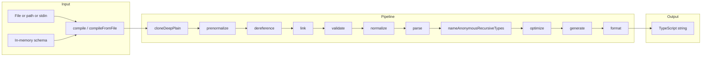
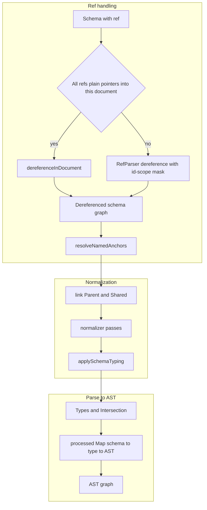

# json-schema-to-typescript — Research report

## Metadata

- **Library name**: json-schema-to-typescript
- **Repo URL**: https://github.com/bcherny/json-schema-to-typescript
- **Clone path**: `research/repos/typescript/bcherny-json-schema-to-typescript/`
- **Language**: TypeScript (runs on Node >=22.19; tests/scripts run with bun)
- **License**: MIT (package.json)
- **Analyzed version**: 5caacfc 2026-09-06 (package.json 16.0.0; CHANGELOG "Next" section adds `formatTypes` and `declarationStyle`)
- **Report date**: 2026-10-27

## Summary

json-schema-to-typescript compiles JSON Schema to TypeScript typings. It reads JSON or YAML schema files (or in-memory schema objects), rewrites `$ref` siblings on the raw document (prenormalizer), dereferences `$ref` (an in-process fast path for self-contained documents, otherwise @apidevtools/json-schema-ref-parser), links parent pointers, runs a small internal consistency check, normalizes the schema with a pass-grouped rule list, parses it into an internal AST, optimizes the AST, and emits TypeScript source (interfaces or type aliases, enums) as a string, optionally formatted by Prettier (in size-bounded batches). It supports a CLI (`json2ts`) and a programmatic API (`compile`, `compileFromFile`, and multi-file `compileFiles` which emits `import type` between generated modules). Output is TypeScript only; the library does not validate JSON instances against the schema.

## JSON Schema support

- **Drafts**: No draft detection; a `$schema` declaration does not change output. The schema model is draft 4 (`JSONSchema4` from `@types/json-schema`) plus extensions (`tsType`, `tsEnumNames`, `deprecated`, `readOnly`), and later-draft keywords are handled by individual normalizer/prenormalizer rules (`prefixItems`, `unevaluatedProperties`, `$defs`, `const`, `nullable`). The README carries a per-draft table (draft 6, 7, 2019-09, 2020-12). A conformance gate (`test/conformance`) type-checks generated types against the official JSON-Schema-Test-Suite and compares to a committed baseline. `definitions` is normalized to `$defs` and `id` to `$id`.
- **Scope**: Code generation only (schema to TypeScript). No JSON instance validation.
- **Subset**: Supported structurally: type, properties, required (including draft-3 boolean `required: true`), items (single, array/tuple form, and 2020-12 `prefixItems` renamed to the tuple form by the normalizer), additionalItems, additionalProperties, unevaluatedProperties (partial; folded into `additionalProperties` where safe), patternProperties (folded into one union-typed index signature), enum, const, allOf, anyOf, oneOf (treated as anyOf), $ref (with extending siblings composed via `allOf`), $defs/definitions, $id (naming and draft-07 `"#name"` anchors), title, description, deprecated, readOnly (opt-in `readonlyKeyword`), format (opt-in `formatTypes`), OpenAPI 3.0 `nullable`, minItems/maxItems (tuples), boolean schemas. Ignored or not expressible: $anchor (a `$ref: "#name"` to one errors), $dynamicRef/$dynamicAnchor/$recursiveRef, $vocabulary, if/then/else, contains, content*, dependentRequired/dependentSchemas, unevaluatedItems, min/max/exclusive bounds, minLength/maxLength, pattern, minProperties/maxProperties (one narrow exception), multipleOf, uniqueItems, not, propertyNames, writeOnly, examples, $comment.

## Keyword support table

Keyword list derived from vendored draft 2020-12 meta-schemas (`specs/json-schema.org/draft/2020-12/meta/*.json`; 58 keywords, all present below). Draft-04/07-only keywords (`definitions`, `dependencies`, `extends`, `id`, `additionalItems`) are handled in `src/keywords.ts` but are not 2020-12 rows. The README per-draft table is stale against the code in places (it lists `readOnly` and `prefixItems` as ignored; the code has the `readonlyKeyword` option and a `prefixItems` normalizer rule), so rows follow the code. Evidence: `src/keywords.ts` (single keyword table every phase derives its sets from), `src/parser.ts`, `src/generator.ts`, `src/normalizer.ts`, `src/prenormalizer.ts`, `src/typesOfSchema.ts`, `src/validator.ts`.

| Keyword | Implemented | Notes |
|---------|-------------|-------|
| $anchor | no | README: a `$ref: "#name"` to a 2019-09 `$anchor` fails ("Refs should have been resolved"); only draft-07 `$id: "#name"` anchors are resolved (resolver.ts). |
| $comment | no | Listed in keywords.ts as an annotation; not emitted (parser comments come from `description` only). |
| $defs | yes | Normalizer transforms `definitions` to `$defs`; parser uses `$defs` for definitions and unreachableDefinitions. |
| $dynamicAnchor | no | Not in keywords.ts; a schema carrying only it (and annotations) is the empty schema and is typed `unknown`/`any` by `typesOfSchema`. README lists it as ignored. |
| $dynamicRef | no | Ignored; appears only in the normalizer UNEMITTED_APPLICATORS list (blocks the `unevaluatedProperties` fold). A schema with only it types as the empty schema. |
| $id | yes | Normalizer maps `id` to `$id`; used for standalone names, dereferenced paths and draft-07 named-anchor `$ref`s. Not used as a base URI for nested resolution. |
| $ref | yes | Resolved by `dereference()` (in-process for self-contained documents, else @apidevtools/json-schema-ref-parser); in-document, file and HTTP (loopback/private hosts refused by default). Sibling keywords that extend the target are intersected (`Foo & {...}`). |
| $schema | partial | Passed through in schemas; not used for draft selection or behavior. |
| $vocabulary | no | Not parsed or used. |
| additionalProperties | yes | Default from options; parser emits index signature or forbids extras; boolean or schema. Index signatures are widened to cover sibling named properties (TS2411). |
| allOf | yes | typesOfSchema ALL_OF; parser INTERSECTION; generator intersection types. |
| anyOf | yes | typesOfSchema ANY_OF; parser UNION. |
| const | yes | Normalizer transforms const to singleton enum; emitted as literal/union. |
| contains | no | Not in typesOfSchema or parser. |
| contentEncoding | no | Not supported. |
| contentMediaType | no | Not supported. |
| contentSchema | no | Not supported. |
| default | partial | Type inference fallback when type missing; not emitted as a value. `removeOptionalIfDefaultExists` makes a property with a default required. |
| dependentRequired | no | README lists dependencies as not expressible; not in parser. |
| dependentSchemas | no | Not in parser. |
| deprecated | yes | In JSONSchema type; parser passes to AST; generator emits @deprecated JSDoc. |
| description | yes | Parser comment; generator JSDoc. |
| else | no | if/then/else not supported. |
| enum | yes | NAMED_ENUM (with tsEnumNames) or UNNAMED_ENUM; parser/generator emit enum or union of literals. |
| examples | no | Not in parser or generator. |
| exclusiveMaximum | no | README: maximum/minimum not expressible in TypeScript. |
| exclusiveMinimum | no | Same as exclusiveMaximum. |
| format | partial | Opt-in: `formatTypes` option maps a string schema's `format` to a verbatim TS type (e.g. `date-time` to `Date`); unlisted formats stay `string`. |
| if | no | if/then/else not supported. |
| items | yes | Single schema or array; normalizer builds tuple from items + minItems/maxItems; parser TYPED_ARRAY/UNTYPED_ARRAY, additionalItems. |
| maxContains | no | Not in schema types or parser. |
| maximum | no | README: not expressible in TypeScript. |
| maxItems | yes | Normalizer, parser TUPLE, validator; drives tuple unions or fallback to array. |
| maxLength | no | Row in keywords.ts with no role (no `typed`/`refines`); not emitted in types. |
| maxProperties | no | README: not expressible. |
| minContains | no | Not implemented. |
| minimum | no | README: not expressible. |
| minItems | yes | Normalizer, parser TUPLE, validator. Nested bounded arrays are capped by the cumulative product of bounds against `maxItems` to avoid tuple-union explosion. |
| minLength | no | Row in keywords.ts with no role; not emitted. |
| minProperties | partial | Only the normalizer rule 'Mark every property required when `minProperties` covers them all' (closed object with `additionalProperties: false`, no patternProperties, `minProperties` >= property count marks all properties required); otherwise not expressible (README). |
| multipleOf | no | README: not expressible. |
| not | no | LinkedJSONSchema has not; typesOfSchema has no matcher; README: not expressible. |
| oneOf | yes | Treated like anyOf; parser UNION. |
| pattern | no | README: not expressible. |
| patternProperties | partial | Multiple patterns (and with `additionalProperties: false`) are folded into one index signature typed as the union of value types; README still says "partial support". |
| prefixItems | yes | Normalizer rule renames `prefixItems` to the tuple form of `items` when `items` is not already an array (keywords.ts, normalizer.ts). |
| properties | yes | Parser SchemaSchema, TInterfaceParam; generator interface fields. |
| propertyNames | no | Not in parser or generator. |
| readOnly | partial | Opt-in `readonlyKeyword` option emits `readonly` on annotated properties and arrays/tuples; ignored by default. |
| required | yes | Normalizer default/transform; parser isRequired; generator optional vs required. |
| then | no | if/then/else not supported. |
| title | yes | Used for standalone name / interface name; also nullable/enum naming. |
| type | yes | typesOfSchema and parser drive STRING, NUMBER, BOOLEAN, NULL, OBJECT, ARRAY, UNION, etc. |
| unevaluatedItems | no | Not in types or parser. |
| unevaluatedProperties | partial | Normalizer folds it into `additionalProperties` for the schema's own properties; not enforced across allOf/anyOf/oneOf. |
| uniqueItems | no | README: not expressible. |
| writeOnly | no | Not in parser or generator. |

## Constraints

Validation keywords are used only for **structure** (types, optionality, tuple length). minimum, maximum, minLength, maxLength, pattern, multipleOf, maxProperties, uniqueItems are not emitted as runtime checks or type refinements (README: "Not expressible in TypeScript"); `keywords.ts` lists them with no role flag, so `typesOfSchema` treats a schema made of only such keywords as the empty schema (`unknown`/`any`). `minItems`/`maxItems` shape tuple and array types (and add `@minItems`/`@maxItems` JSDoc tags in the normalizer). `minProperties` has one use: if `additionalProperties: false`, no `patternProperties`, and `minProperties >= property count`, every property is marked required. The library generates no validation code; generated types are for static typing only.

## High-level architecture

Pipeline (`compileToAST` in `src/index.ts`): **Schema input** (file, path, stdin, or in-memory object) → `cloneDeepPlain` (input never mutated) → **prenormalize** (rewrites that must see the raw document: `nullable` next to `$ref`, extending/annotation siblings of `$ref` moved into `allOf`, root `$ref` chain resolved) → **dereference** (in-document fast path or $RefParser; names recorded in a WeakMap `dereferencedPaths`) → **link** (non-enumerable `Parent` symbol on every node, `Shared` on multiply-held nodes) → **validate** (internal consistency; ARCHITECTURE.md still lists swapping in an external validator as TODO) → **normalize** (ordered rules run in grouped traversals, ending with `applySchemaTyping`) → **parse** (schema to AST with a `(schema, SchemaType)` cache) → **nameAnonymousRecursiveTypes** → **optimize** (AST rewrites) → **generate** (AST to an array of declaration strings) → **format** (Prettier, optional, batched). For `compileFiles` / `--imports`, each file runs to the optimizer on its own and `src/modules.ts` then runs the generator twice per file (discover exports, then emit with `import type` for types owned by other files).

## Medium-level architecture

- **keywords.ts**: one `KEYWORDS` table; each row says what the keyword holds (`schema`, `schemaOrBoolean`, `schemaOrSchemaArray`, `schemaArray`, `schemaMap`, `json`, `data`) and flags (`typed`, `refines`, `meta`, `annotation`). Exports derived sets (`SUBSCHEMA_KEYWORDS`, `JSON_DATA_KEYWORDS`, `STRUCTURAL_KEYWORDS`, `EXTENDING_KEYWORDS`, `TYPE_RELEVANT_KEYWORDS`, ...) used by traversal, ref-sibling handling and "empty schema" detection. A `LEGACY` block preserves old hand-kept list quirks.
- **prenormalizer**: raw-document rewrites (see Algorithms). Applied to the root schema and, through wrapped parsers, to every file loaded via `$ref`.
- **resolver (dereference)**: chooses between `dereferenceInDocument` (self-contained) and `$RefParser` (files, HTTP, options); rewrites draft-07 named anchors; returns `dereferencedPaths`; in file-set mode stamps nodes with `Source`.
- **linker / types/JSONSchema.ts**: symbol-keyed metadata (`Parent`, `Shared`, `DefinitionKey`, `Source`, `Types`, `Intersection`) attached non-enumerably.
- **validator**: seven internal consistency rules over one traversal.
- **normalizer**: rule list grouped into passes (see Algorithms).
- **typesOfSchema / applySchemaTyping**: duck-typed `SchemaType` set per schema; multi-type schemas get a companion ALL_OF `Intersection` schema.
- **parser**: schema to AST; scope-aware handling of `required`-only branches; names anonymous recursive types.
- **optimizer**: union/intersection simplification on the AST.
- **generator**: AST to text, memoized per node; hand-laid-out output so `format: false` is readable.
- **formatter**: Prettier invocation, batched by top-level declaration when output is large.
- **modules**: multi-file import linking.

## Algorithms and data structures

### Schema representation

There is no dedicated schema type for the pipeline: the schema is the raw JSON/YAML object graph (plain objects and arrays), typed as `JSONSchema4` extended with `tsType`, `tsEnumNames`, `deprecated`, `readOnly` (`src/types/JSONSchema.ts`). `compile()` first deep-copies the input with `cloneDeepPlain` (`src/utils.ts`), a hand-written copier that keeps one copy per source node in a `Map<object, unknown>` so shared structure and cycles are preserved, defines an own `__proto__` key with `defineProperty`, and delegates only exotic values (Date, RegExp, class instances) to lodash `cloneDeep`. Everything after that mutates this private copy in place.

Metadata is attached as non-enumerable symbol properties so it never shows up in key iteration: `Parent` (parent node, `null` at root), `Shared` (this node is reachable from more than one parent), `DefinitionKey` (the `$defs` key a node is held under), `Source` (`{file, pointer}`, file-set mode only), `Types` (a `Set<SchemaType>` computed once), and `Intersection` (the companion ALL_OF schema). Unknown keywords simply remain as ordinary properties and are ignored by the table-driven classification (a key with no row in `KEYWORDS` is neither structural nor a subschema position). Boolean schemas are left as JS booleans; `parse` handles them via `parseBooleanSchema` (`true` to `unknown`/`any`, `false` to `never`) and `isPrimitive` guards throughout. `link()` (`src/linker.ts`) is a recursive walk that defines `Parent`; if it meets a node that already has `Parent` set to a different parent it adds `Shared`, which makes cycles terminate and later lets the parser avoid inheriting a scope into shared definitions.

### Reference resolution and registry

All `$ref`s are eliminated before parsing: dereferencing replaces each `{$ref}` object by (a reference to) its target object, so the result is a cyclic object graph rather than a tree. There is no URI registry of the library's own; `$id` is not used as a base URI, and only draft-07 plain-name anchors are supported. Two paths exist (`dereference()` in `src/resolver.ts`):

1. **In-document fast path.** `inDocumentTargets(root)` scans the whole document once (including instance data, "like $RefParser", guarded by a `visited` Set) and builds `Map<string, object>` from each distinct `$ref` string to its target. It returns `undefined` (falling back to $RefParser) if any `$ref` is not matched by `PLAIN_POINTER` (`^#/` followed by printable ASCII with no `%`, backslash, quotes, whitespace), if a pointer passes through or lands on another `$ref`, if the target is missing, or if the root itself has `$ref`. It is used only when the caller's `$refOptions` contain nothing but `resolve`/`parse` and not in file-set mode. `dereferenceInDocument` then does a depth-first `crawl` that mimics $RefParser's bookkeeping: `visited` set, `parents` set (objects on the current path), a per-pointer `cache: Map<string, {value, circular}>` bypassed when the ref has siblings and the target is not circular, and a `trail` of keys whose length is checked against `DEFAULT_MAX_DEPTH = 500` to raise a targeted `ReferenceError`. A `$ref` with sibling keywords is replaced by a fresh object built by `extend()` (siblings laid over the target, same-named object keywords deep-merged); a bare `$ref` is replaced by the target object itself, so every referrer shares one node. Each replacement calls `onDereference($ref, target)`, which records `dereferencedPaths: WeakMap<schema, $ref>` (used later for naming) and collects "non-schema target" suspects checked only afterwards.
2. **$RefParser path.** A `new $RefParser()` is driven manually (`parser.resolve` then `dereferenceInternal`) with `mutateInputSchema: true`, wrapped `parse` plugins (so every loaded file is prenormalized and, in file-set mode, `Source`-stamped before its refs are resolved), an in-memory resolver (`order: 1`) that serves the files of a `compileFiles` set from memory, and `dereference.onDereference`. An `IdScopeMask` temporarily deletes `$schema`, `$id`, `openapi` from each document root while $RefParser reads it (so it does not treat the document as a JSON Schema resource and re-base relative refs on `$id`), then restores them in original key order before any inlining. HTTP refs to loopback/private hosts are refused by $RefParser's default `safeUrlResolver` (README). Cycles are handled by $RefParser's circular-reference-preserving dereference (same object identity); a nesting bound `dereference.maxDepth` (default 500) catches the "`$ref` with siblings pointing at its own container" case it cannot see.

After either path, `resolveNamedAnchors` (draft-07 `$id: "#name"`): `eachSchemaNode` collects `anchors: Map<string, node>` (skipping instance-data keywords), resolves alias chains (`$id: "#b", $ref: "#a"`) eagerly via `resolveChain`, then replaces each matching `$ref` node in its parent with the anchor node. `rejectNonSchemaTargets` raises an error if a `$ref` that stands where a schema belongs resolved to `null`, a string, a number or an empty document, found by walking only subschema positions (`SCHEMA_HOLDING_KEYWORDS`). `tagExternalDefinitions` records `DefinitionKey` on entries of externally referenced documents' `$defs` so they keep their key as the type name.

Trade-off: eager full inlining makes the rest of the pipeline simple (no REFERENCE nodes in normal flow) and gives identity-based dedup for free, but copies made for `$ref`+siblings break identity (hence the prenormalizer rewrites), and `$id`/`$anchor`/`$dynamicRef` scoping is not implemented.

### Compiled / intermediate form

Two intermediate forms exist. (1) The normalized schema graph (`NormalizedJSONSchema`) with precomputed `Types`/`Intersection`. (2) The AST (`src/types/AST.ts`): a tagged union `AST` of `TAny, TArray, TBoolean, TEnum, TInterface, TNamedInterface, TIntersection, TLiteral, TNever, TNumber, TNull, TObject, TString, TTuple, TUnion, TUnknown, TCustomType`. Every node has the shared `AbstractAST` fields `comment`, `keyName`, `standaloneName`, `deprecated`, `isUnreachableDefinition`, `source`. `TInterface.params` is `TInterfaceParam[]` (`ast`, `keyName`, `isRequired`, `isReadOnly`, `isIndexSignature`, `isPatternProperty`, `isUnreachableDefinition`) plus `superTypes: TNamedInterface[]`; `TTuple` has `params`, optional `spreadParam`, `minItems`, `maxItems`; `TEnum.params` is `{ast, keyName}[]`. Children are held by object reference, so the AST is a graph: recursive types are cycles through named nodes. A node with a `standaloneName` is emitted once as a declaration and referenced by name elsewhere; everything else is inlined.

### Core algorithm

**Normalization.** `normalize()` (`src/normalizer.ts`) holds an ordered list of rules grouped into `passes: Rule[][]`. Each pass is one `traverse()` over the graph and runs all its rules on each node; `startNewPass()` is placed where a rule reads other schemas, adds schemas, or removes keys that `traverse` descends through (comments in the source explain each split). `traverse` (`src/utils.ts`) is a recursive DFS with a `processed: Set` (cycle guard, each node visited once; the first path decides the `key` reported), visiting subschema keywords in `KEYWORDS` table order (using a precomputed `SUBSCHEMA_KEYWORD_ORDER` map and one scan of the node's own keys instead of probing every keyword), then the `Intersection.allOf`, then one level under unknown keys (definitions may technically live anywhere). Rules include: constrain `anyOf`/`oneOf` members to the parent `type` (copy-on-write, drops members that can never match), required defaults, `unevaluatedProperties` folded into `additionalProperties` only when `emitsWhatItEvaluates`, `prefixItems` renamed to tuple `items`, default `additionalProperties`/`additionalItems`, `minProperties` implying required, `id` to `$id`, naming of nodes from `dereferencedPaths`, JSDoc escaping and `@minItems/@maxItems` tags, `maxItems` OOM cap, `items` expanded into a tuple, `definitions` to `$defs` (errors if both differ via `isDeepStrictEqual`), `const` to singleton `enum`, inferred `tsEnumNames`, `nullable` to `anyOf [X, null]`, drop shapeless `allOf` members, and finally `applySchemaTyping`.

**Type selection.** `typesOfSchema` (`src/typesOfSchema.ts`) duck-types a schema by running a table of matcher predicates (`ALL_OF`, `ANY_OF`, `ONE_OF`, `NAMED_ENUM`, `UNNAMED_ENUM`, `NAMED_SCHEMA` (has `$id` and object shape), `UNNAMED_SCHEMA`, `TYPED_ARRAY`, `UNTYPED_ARRAY`, `STRING`/`NUMBER`/`BOOLEAN` (also inferred from `default` when `type` is absent and the schema is not compound), `UNION` (array `type`), `REFERENCE`, ...) and collecting all that match into a `Set<SchemaType>`; `tsType` short-circuits to `CUSTOM_TYPE`; if none match, `isShapeless` decides `ANY` versus `UNNAMED_SCHEMA`. A schema matching several types is the intersection of them: `applySchemaTyping` creates a companion `Intersection` object (taking over `allOf`, `$id`, `title`, `description`, `name`, with `[Parent]` and `[Types]={ALL_OF}`) once, up front, because the parser's cache is keyed by schema object identity and the intersection therefore has to be one object.

**Parsing.** `parse()` (`src/parser.ts`) is a recursive function. If the schema has an `Intersection` it builds the ALL_OF AST first (a placeholder registered in the cache) and pushes one parsed member per remaining type; if one type, it calls `parseAsTypeWithCache`. The cache is `processed: Map<NormalizedJSONSchema, Map<SchemaType, AST>>`: it inserts an empty `{}` AST before computing, then `Object.assign`s the result into it, so cycles resolve to the same (eventually filled) node. `parseNonLiteral` is a switch on `SchemaType`: object schemas go through `newInterface`/`parseSchema` (properties to params; `patternProperties` folded into a single string index signature typed as a union of value types, with `declaredOnly` params kept so their named types still get declared; `additionalProperties` schema or default open index signature; `required` keys without a property entry added using `findDeclaration`, which searches the schema, its `allOf` members and an enclosing `Scope` list); arrays become `ARRAY` or `TUPLE` (spread param from `additionalItems`); array `type` becomes a UNION of per-type copies narrowed with `narrowMember`/`admitsType`; `NAMED_ENUM` becomes `ENUM` only if all values are strings or finite numbers and a name exists, otherwise a union of literals. `parseMember`/`parseBranches`/`parseRequired` implement the "required-only branch" pattern (`oneOf: [{required:[a]}, {required:[b]}]` becomes a pick of the declared property types). Names come from `standaloneName()` = `generateName(nameOf(schema, keyNameFromDefinition, options), usedNames)` where `nameOf` is `customName() || title || $id || definition key`; `generateName` (`src/utils.ts`) sanitizes with `toSafeString`, avoids `RESERVED_TYPE_NAMES` (Array, Map, Object, Promise, RegExp, Set, Symbol) and appends a counter, using a per-`usedNames` `nextCounters` memo so the search resumes at the last counter instead of restarting from 1.

**Recursive-type naming.** `nameAnonymousRecursiveTypes` guarantees every AST cycle passes through a named node (since the generator inlines anonymous types and would otherwise recurse forever). It repeatedly walks the AST with an explicit `path` array and `done` set; named nodes end the path and become new roots; an edge back into the current path with no named node on the cycle causes one end (`pickEnd`: prefer one reached through a `$ref`, else the non-list) to be named from its `$ref` name, key or closest ancestor name. It loops until a walk names nothing (typically one extra pass). Cost is roughly O(n) per walk times the (small) number of walks, with `path.indexOf` for cycle detection (O(depth) per step).

**Optimizing.** `optimize()` (`src/optimizer.ts`) is a memoized (`processed: Map<AST, AST>`, a node in progress maps to itself so cycles stay) recursive rewrite over UNION/INTERSECTION/ARRAY/INTERFACE: flatten nested unnamed same-kind set operations; drop `unknown`/`any` members of an intersection; collapse a union containing `any`/`unknown` to that type (`collapsed` keeps name/comment/deprecated); remove an unnamed duplicate of a named member (comparing `generateStructuralType` strings, cached in a `structuralTypes` WeakMap once the node is `settled`); and dedupe members with `uniqBy(params, generateType)`, i.e. by rendered text. A one-member set operation is left for the generator to print as its member.

**Generation.** `generate()` (`src/generator.ts`) does one walk (`collectDeclarations`, recursive, `processed: Set<AST>`) over the root and unreachable-definition ASTs, appending text for each named node to one of three arrays (`types`, `interfaces`, `enums`), then concatenates banner, types, interfaces, enums, returning `string[]` split at top-level declarations. `generateType = memoize(generateRawType)` renders any AST to a string once per node (WeakMap keyed on the node). The renderer lays out text itself (indentation, `MAX_WIDTH = 80` wrapping of unions/intersections/tuples, comments, `bareSetOperations` WeakSet recording which strings need parentheses when embedded), so unformatted output is readable. Notable sub-algorithms: tuple expansion (for `minItems < n` it emits a union of tuples of increasing length rather than optional elements, with the `maxItems` option bounding the blow-up); `generateIndexSignatureType` widens an index signature's type with all sibling and inherited property types (TS2411), deduplicating by rendered text and including `undefined` for optional siblings; `isExtendable` decides interface `extends` versus an intersection type alias; enums are emitted as `export [const] enum`.

**Multi-file mode.** `generateModules` (`src/modules.ts`) runs `generate` twice per module. Pass 1 uses a linker whose `imports` is the owner check and whose `declared` hook records `exports: Map<Module, Map<exportKey, name|null>>`, where `exportKey = source.pointer|astType` and a duplicate key is poisoned to `null`. Pass 2 treats a named AST whose `source.file` belongs to another module in the set as imported (neither declared nor descended into) and renders `import type {Theirs as Ours}` with sorted specifiers and `.js` extensions. Cost is two generator runs per file.

### Error and output model

There is no structured diagnostic type. The internal validator (`src/validator.ts`) returns `string[]` messages of the form `Error at key "<key>" in file "<file>": <rule>`; `compileToAST` prints them with `console.error` and throws a bare `ValidationError`. Other failures are plain `ReferenceError`/`TypeError` with descriptive messages (unresolved or non-schema `$ref`, nesting deeper than `maxDepth`, both `id` and `$id`, both differing `definitions` and `$defs`, unreadable file, bad JSON/YAML). Output is the TypeScript text: `compile()` returns `Promise<string>`; `compileFiles()` returns `Promise<string[]>`; the CLI writes to stdout or files. `VERBOSE=1` enables per-phase colored debug logging (`log()`; the flag is re-read once per `compile()` rather than on every call).

## Low-level details

- **Name generation**: `toSafeString` deburrs accents, replaces invalid identifier characters with spaces, camel-cases snake_case and spaces, strips leading digits, and `upperFirst`s; empty results become `NoName`; `generateName` adds the counter suffix on collision or reserved names.
- **Extends**: draft-04 `extends` (normalized to an array) becomes `superTypes` on `TInterface`; the generator prints `extends A, B` or, for non-extendable bases or `declarationStyle: 'type'`, an intersection.
- **Anonymous recursive types**: see `nameAnonymousRecursiveTypes` above.
- **Enum members**: TypeScript enums only for string/finite-number values; numeric-looking member names get leading underscores (`enumMemberNames`); the generator quotes non-identifier keys (`escapeKeyName`).
- **additionalItems**: with array `items`, `TTuple.spreadParam` comes from `additionalItems` (`true` to `any`/`unknown`, schema to its type); the normalizer defaults absent `additionalItems` to `true` for tuples.
- **Numbers**: no numeric semantics (no `multipleOf`, bounds, big-int or decimal handling); `const`/`enum` literals are rendered by `JSON.stringify` (`generateLiteral`), and non-finite numbers cannot become enum members.
- **String length**: not applicable (no `minLength`/`maxLength` handling).
- **Recursion and stack**: `parse`, `traverse`, `link`, `optimize`, `collectDeclarations`, `generateType` and `eachSchemaNode` are all recursive on the host stack; there is no explicit depth limit except `dereference.maxDepth` (500) on `$ref` nesting. Pathologically deep (non-`$ref`) nesting is not verified to be safe.
- **Untrusted input**: `__proto__` keys are written with `defineProperty` (`setOwn`, `cloneDeepPlain`) and `hasOwnProperty` guards avoid prototype-chain pointer matches; YAML is loaded with js-yaml `CORE_SCHEMA` plus a fixed tag set (no `YAML11_SCHEMA` implicit booleans); HTTP `$ref`s to loopback/private hosts are refused by default; `tsType` and `formatTypes` values are emitted verbatim into the output (not sanitized) and therefore are trusted input.
- **Tuple explosion guards**: normalizer rule "Remove maxItems if it is big enough to likely cause OOMs" removes `maxItems` when `(maxItems - minItems) * ancestorMultiplier > options.maxItems` (default 20), where `ancestorMultiplier` multiplies the bounds of enclosing arrays that hold this one as `items`.

## Output and integration

- **Vendored vs build-dir**: Generated output is not vendored by the tool; the user writes it to a file or stdout. Configurable via CLI `--output` / `-o` or the API (the caller writes `compile()`'s string).
- **API vs CLI**: Both. CLI: `json2ts` (bin in package.json), accepts `-i`/`--input` and `-o`/`--output`, a file, directory, quoted glob, or stdin; `--imports` calls `compileFiles` for directory/glob input. API: `compile(schema, name, options)`, `compileFromFile(filename, options)`, `compileFiles(files, options)`. No macros.
- **Writer model**: String only; no generic writer abstraction.

## Configuration

- **Options** (`src/index.ts`, README): additionalProperties, bannerComment, customName, cwd, declarationStyle (`interface` or `type`, new), declareExternallyReferenced, enableConstEnums, inferStringEnumKeysFromValues, format (Prettier on/off), formatTypes (new), ignoreMinAndMaxItems, maxItems (default 20; -1 ignores), readonly, readonlyKeyword, removeOptionalIfDefaultExists, strictIndexSignatures, style (Prettier config), undefinedOptionalProperties, unknownAny, unreachableDefinitions, $refOptions (passed to $RefParser). Options are deep-merged over `DEFAULT_OPTIONS` with lodash `merge`.
- **Naming**: `customName`, `title`/`$id`/definition key for standalone names; `generateName` for safe identifiers.
- **Map types**: `additionalProperties` boolean decides the index signature; a schema becomes a typed index signature; `patternProperties` are folded into one index signature typed as the union of the pattern value types.

## Pros/cons

- **Pros**: Simple, well-staged pipeline; CLI and API; `$ref` (local, file, HTTP) with identity-preserving dereference; allOf/anyOf/oneOf; enum and const; tuples via minItems/maxItems/prefixItems; extensive normalization for real-world schemas (OpenAPI `nullable`, draft-3 `required`, `$ref` siblings); multi-file output with imports; type-alias style; readable output even without Prettier; in-process fast path for self-contained refs; browser-friendly bundle; `tsType`/`tsEnumNames` extensions; strong test infrastructure (conformance gate, fuzzer, corpus, idempotence, typecheck of outputs).
- **Cons**: No draft-specific behavior; many validation keywords not expressible; `oneOf` treated as `anyOf`; if/then/else, contains, unevaluatedItems, `$anchor`/`$dynamicRef` unsupported; `$id` not used as a base URI; no validation API; TypeScript only; all passes are recursive on the host stack; Prettier dominates time/memory on large schemas; the schema graph is mutated in place through many order-sensitive rules.

## Testability

- **Framework**: bun test; `bun run test` first runs `pre-test` (clean, format-check, lint, typecheck, `tsc -d` build) then `bun test --timeout 300000`; `tdd` watches.
- **Fixtures**: `test/e2e/*.ts` with `e2eCases.ts` and snapshots in `test/__snapshots__`, `test/resources/`, `test/normalizer/`, `test/__fixtures__/` (cached remote schemas), `compilePool.ts`/`compileWorker.ts` (parallel compile workers). Unit tests per phase (`parser.test.ts`, `optimizer.test.ts`, `normalizer.test.ts`, `resolver.test.ts` which compares the in-document fast path to $RefParser, `linker.test.ts`, `validator.test.ts`, `formatter.test.ts`).
- **Extra harnesses**: `test/conformance` (JSON-Schema-Test-Suite groups compiled and type-checked with instances written as typed constants, compared to `baseline.json`, required in CI), `test/corpus` (real-world schemas with e2e), `test/fuzz` (schema fuzzer with timeout and heap cap, `known-findings.json`), `typecheck.test.ts` (generated output must type-check), `idempotence.test.ts`, `keywords.test.ts`.
- **Entry point for external fixtures**: CLI `json2ts -i <file> -o <file>` or `compile(schema, name, options)` / `compileFromFile` / `compileFiles`.

## Performance

Analyzed from code only; nothing was built or run.

### Performance techniques

- **Compile vs interpret**: Not applicable in the validator sense (no validation). The whole library is a one-shot ahead-of-time compiler; per-schema work is done once in phases. Within it, work is hoisted: `applySchemaTyping` precomputes each schema's `SchemaType` set once (the parser cache is identity-keyed), `KEYWORDS`-derived sets are computed once at module load, `SUBSCHEMA_KEYWORD_ORDER` is a precomputed map so `traverse` makes one pass over a node's keys instead of probing every subschema keyword, and the normalizer groups consecutive rules into shared traversals (`passes`), so a large dereferenced schema is walked a handful of times rather than once per rule (the source comments say walking costs more than any rule).
- **Memory layout and allocation**: Pointer graph of plain JS objects; dereferencing shares target objects (no copies for bare `$ref`s), so a definition referenced N times exists once and is parsed once. Metadata uses non-enumerable symbol properties (no wrapper nodes). Copies are made only where semantics require them (`$ref` + siblings via `extend()`, per-type copies in `narrowMember`/UNION parse, anyOf narrowing is copy-on-write). `cloneDeepPlain` replaces lodash `cloneDeep` for the initial copy (documented as avoiding a quadratic seen-list under bun: 37 of 43 seconds on a 10,000-definition schema). The generator returns `string[]` split at declarations rather than one joined string, which the batched formatter reuses.
- **Caching and memoization**: (a) `processed: Map<schema, Map<SchemaType, AST>>` in the parser (also breaks cycles). (b) `optimize`'s `processed: Map<AST, AST>` shared across the root and unreachable definitions (`optimizerMemo`). (c) `generateType = memoize(generateRawType)` in `src/memoize.ts`, a `WeakMap` keyed on the first argument only (a custom replacement for lodash `memoize`, which degrades to a linear-scan list under bun because of its native-`Map` detection); the cache dies with the AST. (d) `structuralTypes` WeakMap in the optimizer, populated only for nodes in `settled` whose render does not depend on other nodes (`rendersFromOtherNodes`). (e) `nextCounters` (memoized per `usedNames` set) in `generateName` so unique-name search is amortized O(1) per name instead of probing 1..n (CHANGELOG: avoided quadratic behavior on thousands of same-named types). (f) the `cache` Map per pointer in `dereferenceInDocument`. (g) `log()` reads `process.env.VERBOSE` once per compile.
- **Fast paths and short-circuiting**: `inDocumentTargets`/`dereferenceInDocument` bypass $RefParser (comment estimates about a fifth of compile time on a large schema, mostly URL and pointer string handling) when every ref is a plain in-document pointer; `testPattern` exits on first successful regex; `traverse` and `parse` return early on already-processed nodes; `rejectNonSchemaTargets` runs only if a suspect was recorded; `format: false` skips Prettier (README: 2-3x faster, about half the memory); tuple expansion is capped by `maxItems` (default 20) with the cumulative-product rule; `generateType` returns the name immediately for nodes with a `standaloneName`; `getIndexSignatureSiblings` and index-signature widening skip when the index type is `any`/`unknown`.
- **Regex handling**: The compiler never validates instances, so JSON Schema `pattern` is not compiled. The only user-pattern use is `testPattern` in the parser, which tests a `required` key against `patternProperties` patterns with `new RegExp(pattern, 'u')` falling back to no flags, constructed per call (no cache) and returning false if neither compiles; there is no ReDoS protection (V8 backtracking engine), though patterns come from the schema author and are tested against short key names. Other regexes (`PLAIN_POINTER`, `TYPE_REFERENCE`, name sanitizing in `toSafeString`) are module-level constants or short inline literals applied to short strings. CHANGELOG notes a Prettier-side quadratic JSX-detection regex avoided by passing `filepath: 'schema.d.ts'`.
- **Concurrency**: JS single-threaded; the library is async only for I/O and Prettier. `compileFiles` runs `Promise.all` over per-file `compileToAST` calls, which are mostly synchronous (only $RefParser awaits interleave); the CLI directory mode without `--imports` runs `Promise.all` over `processFile`. Shared mutable module-level state exists but is keyed by node/set identity (`WeakMap`/`WeakSet`: `bareSetOperations`, `commentedTypes`, `perTypeCopies`, `settled`, `structuralTypes`, `nextCounters`) or is global flags (`verbose`), so separate compiles do not interfere in one process. The normalizer's `rules`/`passes` are module-level and built once at load. No worker threads in the library (the test suite has a worker pool). `formatter.ts` batches formatting: output above `BATCH_SIZE = 250_000` characters is split at top-level declaration boundaries (`newlinesBetween` checks that only blank lines separate batches and that the previous line is not a comment) and formatted batch by batch, which keeps peak heap lower and time sub-quadratic; disabled when Prettier options depend on whole-file position or plugins (`canFormatInBatches`).

### Benchmarks in repo

- `bench/bench.mjs` (README in `bench/`): compiles fixed real-world schemas (FHIR, Azure deployment template, payloadCMS, Heroku, OpenAPI, QuickSight, Kubernetes definitions with `unreachableDefinitions`, tsconfig, GitHub workflow) in fresh child processes (one untimed warm-up plus N timed runs), reporting median/min ms, peak V8 heap, max RSS and an output md5 (to prove perf-only changes leave output unchanged), for `format` true and false; supports `--json`, CPU/heap profiling, node or bun, `--src`.
- README FAQ numbers (not re-measured): Azure 8.6 MB output 8.3 s / 958 MB formatted vs 3.7 s / 415 MB unformatted; FHIR R4 0.89 s vs 0.32 s; Kubernetes 0.35 s vs 0.11 s. Prettier is most of the time and memory.
- CHANGELOG perf work: removal of a per-node scan over all definitions (CloudFormation schema ~54 s to ~3 s), `.d.ts` hint for Prettier, in-document dereference, `maxItems` cap.
- Entry points for our harness: `compile(schema, name, {format: false})` or the CLI `json2ts -i <file>`.

## Determinism and idempotency

- **Input mutation**: `compile()` clones the schema first; `idempotence.test.ts` asserts the input is not mutated and that two `compile(schema, 'A')` calls return identical strings.
- **Output order**: No sorting of properties, definitions or union members. Order follows JSON key order and the traversal order (`KEYWORDS` row order, then insertion order of `Map`/`Set`s). Declarations are grouped by kind (type aliases, then interfaces, then enums) in first-discovery order from `collectDeclarations`. Name counter suffixes (`Foo1`, `Foo2`) depend on visiting order, so reordering a schema can rename types. In `compileFiles`, import specifiers and import lines are sorted (`sortBy`). The unique-name counters and the first-visit-wins `key` rule in `traverse` are deterministic for the same input. Same input and options is expected to give identical output (tested), but there is no minimal-diff guarantee when the schema changes.

## Enum handling

- **Duplicate entries**: Parsing does not dedupe enum values itself. For an enum without `tsEnumNames` the AST is a UNION of LITERAL nodes, and the optimizer's `uniqBy(params, generateType)` removes members that render identically, so `["a","a"]` yields `"a"`. For a named enum (`tsEnumNames`), the validator rejects duplicate names (`tsEnumNames must not contain duplicates`) and a length mismatch with `enum`; duplicate values with distinct names are emitted as separate TS enum members. With `inferStringEnumKeysFromValues`, duplicate string values are deduplicated first (`Array.from(new Set(enum))`) and member names equal the values.
- **Namespace/case collisions**: Literal unions keep `"a"` and `"A"` distinct. For TS enums, member names come from `tsEnumNames` (author-controlled, must be unique) or, with the inference option, from the values themselves (so `a` and `A` stay distinct). `enumMemberNames` only renames numeric-looking names (leading `_`, extended until free), and `escapeKeyName` quotes non-identifiers; names that differ only by sanitization are not otherwise reconciled. The enum's type name goes through `generateName`, so collisions between type names get counter suffixes.

## Reverse generation (Schema from types)

No. The library only compiles JSON Schema to TypeScript.

## Multi-language output

TypeScript only (interfaces, type aliases, enums). No option or module emits other languages.

## Model deduplication and $ref/$defs

- **$ref**: Every `$ref` is dereferenced before parsing: a bare `$ref` is replaced by the target object itself, so all referrers point at one node, and the parser cache keyed on `(schema, SchemaType)` returns one AST that is emitted as a single named declaration referenced by name. The name comes from `$id`/`title` or the `$ref` path via `dereferencedPaths` (the normalizer's "Add an `$id` to anything that needs it" rule) or the `$defs` key (`DefinitionKey`, set on root definitions at the end of `normalize`). Dotted definition names are kept whole.
- **$ref with siblings**: because $RefParser would copy the target (a new object, hence a second type), the prenormalizer rewrites siblings before dereferencing: extending siblings (`properties`, `required`, `allOf`, ...) turn into `allOf: [{$ref}, {...}]` (emitted `A & {...}`); annotation-only siblings move the `$ref` into a one-member `allOf` so the reference still resolves to the shared node. Siblings that only restate the target (`type`, `enum`, `format`...) still produce a copy.
- **$defs**: definitions are declared when referenced (`declareExternallyReferenced`) or all of them with `unreachableDefinitions`. `compileFiles` imports a named type owned by another file instead of redeclaring it.
- **Deduplication**: By object identity only. Structurally identical but distinct inline schemas become separate types (anonymous ones are inlined; named ones get counter suffixes). The optimizer's text-based `uniqBy` only dedupes members within one union/intersection.

## Validation (schema + JSON → errors)

No instance validation. `src/validator.ts` checks only schema-internal consistency (tsEnumNames/enum length and uniqueness, minItems/maxItems relations, `deprecated` is boolean) and reports strings via `console.error`. Generated types can be used with other tools for runtime validation, but the library itself does not report schema + JSON errors. The `test/conformance` harness checks the generated types against the JSON-Schema-Test-Suite instances using the TypeScript compiler, but that is a test, not a product feature.
