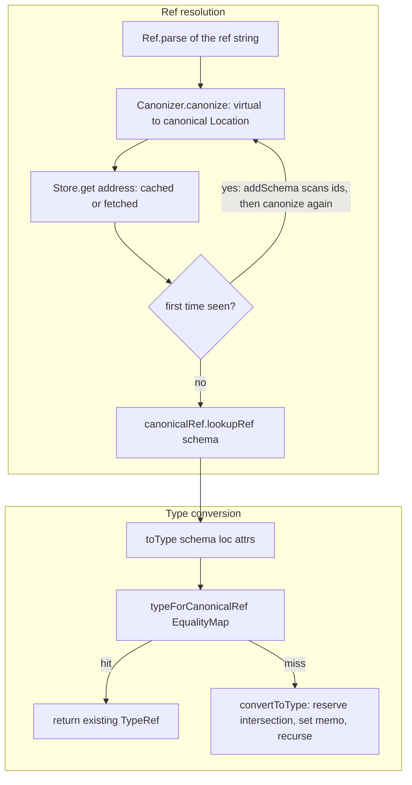

# quicktype — Research report

## Metadata

- **Library name**: quicktype
- **Repo URL**: https://github.com/glideapps/quicktype
- **Clone path**: `research/repos/typescript/glideapps-quicktype/`
- **Language**: TypeScript
- **License**: Apache-2.0 (see package.json)
- **Analyzed version**: HEAD c39af7d3 (2026-09-08); `git describe` v26.0.0-945-gc39af7d3; root and `packages/quicktype-core` package.json both say 24.0.0
- **Report date**: 2026-10-26

## Summary

quicktype is a multi-language code generator that produces strongly-typed models and serializers from JSON, JSON Schema, TypeScript, and GraphQL. For JSON Schema input, it reads one or more schema sources (file or URL), resolves `$ref` and `$id`, builds an internal type graph (TypeBuilder), then runs rewrites (resolve intersections, flatten unions, infer maps, etc.) and emits code for a chosen target language. It supports many target languages (TypeScript, Swift, Go, Rust, C#, Python, Kotlin, Java, and others) and can also emit JSON Schema as output (reverse: types → schema). The implementation is TypeScript in a monorepo; schema handling lives in the `quicktype-core` package.

## JSON Schema support

- **Drafts**: No explicit draft validation on input. The library accepts common JSON Schema keywords and structure; refs use URI + JSON Pointer–style fragments. Output when generating JSON Schema uses `$schema: "http://json-schema.org/draft-06/schema#"` (see `packages/quicktype-core/src/language/JSONSchema/JSONSchemaRenderer.ts`). Input supports `definitions` (Draft 4 style) and `$id` for resolution scope; resolution is path-based so `$defs` can be used as a path segment, and `Ref.definitionName` now treats both `definitions` and `$defs` as definition containers (used for type names).
- **Scope**: Code generation from schema (schema → types → emitted code). No schema validation (instance vs schema).
- **Subset**: Core applicator and validation keywords used for type shape: `type`, `properties`, `items` (array or tuple-style array), `required`, `additionalProperties`, `patternProperties` (only the `".*"` hack for additionalProperties), `$ref`, `allOf`, `oneOf`, `anyOf`, `enum`, `const`, `format` (for string subtypes), `title`, `description`, `default` (scalar only), `minimum`/`maximum`, `minLength`/`maxLength`, `minItems`/`maxItems`, `pattern`, `prefixItems` (tuples), `unevaluatedProperties` (as additionalProperties fallback), and the custom `quicktypePropertyOrder` extension. Not supported in input: `not`, `if`/`then`/`else`, `unevaluatedItems`, `dependentRequired`, `dependentSchemas`, `content*`, `$dynamicRef`/`$dynamicAnchor`, `$vocabulary`; `uniqueItems`, `multipleOf`, `exclusiveMinimum`/`exclusiveMaximum` are not read.

## Keyword support table

Keyword list derived from vendored draft 2020-12 meta-schemas (`specs/json-schema.org/draft/2020-12/meta/`). Implementation evidence from `packages/quicktype-core/src/input/JSONSchemaInput.ts`, `packages/quicktype-core/src/attributes/Constraints.ts`, `Description.ts`, `EnumValues.ts`, and related attribute producers.

| Keyword | Implemented | Notes |
|---------|-------------|-------|
| $anchor | no | Not used in input handling. |
| $comment | no | Not read or preserved. |
| $defs | yes | Resolved as path segment for $ref; Ref.definitionName accepts `definitions` or `$defs` for naming. |
| $dynamicAnchor | no | Not implemented. |
| $dynamicRef | no | Not implemented. |
| $id | partial | Used for resolution scope (Location.updateWithID, Canonizer.addIDs); not validated. Draft-04 `id` is not read. |
| $ref | yes | Ref.parse, Resolver.resolveVirtualRef; resolves against base, fetches remote via JSONSchemaStore. Sibling keywords next to `$ref` are still processed (the target becomes one member of the schema's intersection type). |
| $schema | partial | Not used to select draft on input (2020-12 `$schema` is tolerated); output schema uses draft-06. |
| $vocabulary | no | Not implemented. |
| additionalProperties | yes | Read in makeObjectType; true/undefined → any, false → forbid, object → schema for additional. |
| allOf | yes | makeTypesFromCases(schema.allOf, "allOf"); members join the per-schema IntersectionType, later resolved by `IntersectionAccumulator` (properties merged, required if required in any member, number bounds tightened). |
| anyOf | partial | Same path as oneOf (without the per-case attribute producers); same kind-wise union canonicalization. |
| const | partial | String const becomes a one-case string enum; a non-string const degrades to its plain primitive type and the literal is dropped (FIXME in `convertToType`; fixture `const-non-string.schema`). |
| contains | no | Not implemented. |
| contentEncoding | no | Not implemented. |
| contentMediaType | no | Not implemented. |
| contentSchema | no | Not implemented. |
| default | partial | defaultValueAttributeProducer (attributes/DefaultValue.ts): only boolean/number/string/null defaults; stored as an identity-relevant type attribute, re-emitted in schema output; number defaults only on number/integer types. |
| dependentRequired | no | Not implemented. |
| dependentSchemas | no | Not implemented. |
| deprecated | no | Not implemented. |
| description | yes | descriptionAttributeProducer; passed to type attributes and JSON Schema output. |
| else | no | Not implemented. |
| enum | partial | enumArray in convertToType; only the string members become an enum (`StringTypes.fromCases`); non-string members only add their primitive kind to the union (values dropped). Attribute producer for `qt-enum-values`. |
| examples | no | Not implemented. |
| exclusiveMaximum | no | Not implemented. |
| exclusiveMinimum | no | Not implemented. |
| format | partial | typeKindForJSONSchemaFormat maps to TransformedStringTypeKind (e.g. date-time); only for string subtype. |
| if | no | Not implemented. |
| items | yes | Object/boolean form → array item type; array form (tuple) → array of the union of member types. Missing `items` → `any`. |
| maxContains | no | Not implemented. |
| maximum | yes | minMaxAttributeProducer (Constraints.ts); min/max as type attributes. |
| maxItems | yes | minMaxItemsAttributeProducer (Constraints.ts); stored as attribute. |
| maxLength | yes | minMaxLengthAttributeProducer. |
| maxProperties | no | Not implemented. |
| minContains | no | Not implemented. |
| minimum | yes | minMaxAttributeProducer. |
| minItems | yes | minMaxItemsAttributeProducer (Constraints.ts); stored as attribute. |
| minLength | yes | minMaxLengthAttributeProducer. |
| minProperties | no | Not implemented. |
| multipleOf | no | Not implemented. |
| not | no | Not implemented. |
| oneOf | partial | convertOneOrAnyOf(schema.oneOf, "oneOf"); becomes a union, which flattening canonicalizes to at most one member per kind (several object alternatives are merged into ONE class with the union of properties, missing ones optional); no exclusivity semantics. |
| pattern | yes | patternAttributeProducer; stored as type attribute, emitted in schema output. |
| patternProperties | partial | Only used when key ".*" exists to set additionalProperties (workaround for some generators). |
| prefixItems | yes | Handled like draft-07 array-valued `items` (tuple -> union of member types, $ref members preserved); object-form `items` next to prefixItems joins the union (regression test test/unit/prefix-items-schema.test.ts). |
| properties | yes | checkJSONSchemaObject(schema.properties); each property → toType; sorted by lowercased key (or `quicktypePropertyOrder`). |
| propertyNames | no | Not implemented. |
| readOnly | no | Not implemented. |
| required | yes | checkRequiredArray(schema.required); Draft 3 per-property `required: true` supported; names in `required` that are not in `properties` become properties typed by `additionalProperties` (error if additionalProperties is false). |
| then | no | Not implemented. |
| title | yes | Used for type name (convertToType makeAttributes, definitionName, refsInSchemaForURI). |
| type | yes | checkTypeList; null, boolean, object, array, number, string, integer. |
| unevaluatedItems | no | Not implemented. |
| unevaluatedProperties | partial | Used as the additionalProperties schema when additionalProperties is absent; no real unevaluated semantics. |
| uniqueItems | no | Not implemented. |
| writeOnly | no | Not implemented. |

## Constraints

Validation keywords that are read (`minimum`, `maximum`, `minLength`, `maxLength`, `minItems`, `maxItems`, `pattern`, scalar `default`) are stored as type attributes (MinMaxConstraint, PatternTypeAttributeKind, DefaultValue) and can be emitted when the target is JSON Schema (e.g. `addToSchema` in Constraints.ts). They are not enforced at runtime by quicktype; generated code in other languages may or may not reflect them (e.g. comments or schema emission). No runtime validation of JSON instances against the schema is performed by quicktype.

## High-level architecture

Pipeline: **schema source(s)** (file, URL, or inline string) → **JSONSchemaStore** (fetch, parse, per-address cache) → **Canonizer** (scan every `$id`) → **Resolver** (`$ref` to schema plus `Location`) → **addTypesInSchema / toType** (builds a mutable `TypeBuilder`, one *intersection* node per schema location) → frozen immutable **TypeGraph** → **Run.processGraph** (a fixed sequence of whole-graph rewrite passes, each producing a *new* TypeGraph) → **gatherNames** (name proposals per type) → **ConvenienceRenderer** (assign names, order declarations, emit text) for the chosen target language → serialized lines.

```mermaid
flowchart LR
  Sources["Schema sources: file, URL, inline"] --> Store["JSONSchemaStore.get"]
  Store --> Canonizer["Canonizer.addSchema: collect id"]
  Canonizer --> Resolver["Resolver.resolveVirtualRef"]
  Resolver --> ToType["toType and convertToType"]
  ToType --> Builder["TypeBuilder mutable"]
  Builder --> Frozen["TypeGraph.freeze"]
  Frozen --> Passes["Rewrite passes in Run.processGraph"]
  Passes --> Names["gatherNames"]
  Names --> Render["ConvenienceRenderer: assignNames, declarations, emit"]
  Render --> Out["SerializedRenderResult lines"]
```

The pass order in `Run.processGraph` for schema input is: `removeIndirectionIntersections` → loop { `resolveIntersections`, `flattenUnions(makeObjectTypes=true)` } until both report done → `replaceObjectType` → `flattenUnions` until done → `combineClasses` (two rounds; a no-op for fixed classes) → `inferMaps` loop (flag) → `expandStrings` (enum inference "all" for schema input) → `flattenUnions` → `flattenStrings` → `noneToAny` → `optionalToNullable` (only when the language lacks optional-property support, the default and the Rust case) → `rewriteFixedPoint` → `makeTransformations` → `flattenUnions` → `garbageCollect` → `gatherNames`.

## Medium-level architecture

- **Entry**: CLI `src/index.ts` (`-s schema`), or `quicktype({ inputData, lang, ... })` in `packages/quicktype-core/src/Run.ts`. `InputData` holds `Input`s; `JSONSchemaInput` is the schema one (`needSchemaProcessing = true`). `Run.makeGraph` calls `inputData.addTypes(...)` then `processGraph`.
- **Source registration** (`JSONSchemaInput.addSourceSync`): each source gets a normalized URI; an inline `schema` string is stored in `_schemaInputs` under a de-duplicated URI (`path`, `path-1`, ...). `addTypes` wraps the real store in `InputJSONSchemaStore` so inline schemas are served first, builds one `Canonizer` and one `Resolver`, pre-loads `--additional-schema` addresses, and for each source computes top-level `(name, Ref)` pairs via `refsInSchemaForURI` (a URI fragment ending in `/` means "every property of this object is a top-level type"; otherwise the name is the schema `title`, else derived from the URI fragment or filename).
- **Type conversion**: `addTypesInSchema` defines the closures `toType`, `convertToType`, `makeObject` (see the algorithm sections).
- **Graph machinery**: `Type/Type.ts` (type classes), `Type/TypeBuilder.ts`, `Type/TypeGraph.ts`, `Type/TypeRef.ts`, `GraphRewriting.ts` (rewrite builders), `UnionBuilder.ts` and `UnifyClasses.ts` (union and clique unification), `rewrites/*.ts` (passes).
- **Rendering**: `Renderer.ts` (line emission), `ConvenienceRenderer.ts` (naming namespaces, declaration ordering, helper iteration), `Naming.ts`, `GatherNames.ts`, `DeclarationIR.ts`, `CycleBreaker.ts`, `language/<Lang>/` (one renderer plus a `language.ts` option/config file per target).

## Algorithms and data structures

### Schema representation

quicktype has no typed schema model. A schema is the raw parsed JSON (`type JSONSchema = StringMap | boolean`, `input/JSONSchemaStore.ts`) and `convertToType` reads keywords ad hoc from that object (`schema.properties`, `schema.items`, ...). Unknown keywords are never touched (no unknown-keyword store). `true`/`false` schemas are handled in `toType` (`any` / `none`). Shape checks (`checkJSONSchemaObject`, `checkTypeList`, `checkRequiredArray`) raise `messageError` carrying a `Ref`. Only a few vendor keywords are read: `quicktypePropertyOrder`, `qt-accessors`, `qt-enum-values`.

A schema position is identified by a `Ref` (`JSONSchemaInput.ts`): optional `addressURI` (a `urijs` URI, normalized and percent-decoded in `normalizeURI`) plus `path: readonly PathElement[]`, where an element is `Root`, `KeyOrIndex{key}`, `Type{index}` or `Object` (the last two are synthetic and used by non-schema inputs). `Ref` implements `equals`/`hashCode` (address string plus a per-element hash) so it can key an `EqualityMap`. A `Location` pairs `canonicalRef` (where the schema physically lives) with `virtualRef` (where `$id` says it lives) and a `haveID` flag; `Location.push(...)` extends both in lock-step and copies the path array each time (O(depth) per child).

### Reference resolution and registry

Three cooperating pieces in `input/JSONSchemaInput.ts` and `input/JSONSchemaStore.ts`:

1. **`JSONSchemaStore`**: abstract `fetch(address)`; the concrete `get` memoizes parsed schemas in a `Map<string, JSONSchema>` and swallows fetch errors (returns `undefined`, with a `FIXME: handle or log`). `FetchingJSONSchemaStore` reads a file path or http(s) URL (`readFromFileOrURL`, optional headers) and `parseJSON`s it. There is no negative cache, retry, or size limit in this layer.
2. **`Canonizer`**: `_map: EqualityMap<Ref, Location>` from *virtual* ref to the *canonical* location, plus `_schemaAddressesAdded`. `addSchema(schema, address)` runs `addIDs`, a literal recursive walk over the entire JSON value (every property of every object and every array index, whether or not it is a schema position). Whenever an object has a string `$id`, `Location.updateWithID` resolves it against the enclosing virtual ref (`Ref.resolveAgainst` uses `URI.absoluteTo`) and records `virtualRef -> locWithoutID`. The first `$id` of a document must be absolute (`SchemaIDMustHaveAddress`). `canonize(base, ref)` resolves `ref` against `base.virtualRef`; a registered `$id` returns its registered location, otherwise the same path under the base canonical address is used. `$anchor`, `$dynamicRef`, `$recursiveRef`, and draft-04 `id` are not recognized, and `Ref.parsePath` splits the fragment on `/` with no `~0`/`~1` unescaping (none found in `input/`).
3. **`Resolver`**: `tryResolveVirtualRef` loops: canonize, fetch the address, and if the document has not been scanned yet (`canonizer.addSchema` returns true) go around once more because newly discovered `$id`s may change the canonical location (`assert(!didAdd)` bounds it); otherwise return `canonicalRef.lookupRef(schema)`. `Ref.lookup` is a recursive path walk (array index or own-property check; errors `SchemaKeyNotInObject`, `SchemaIndexNotInArray`). `resolveVirtualRef` first tries the virtual base and then retries with an "alt base" (canonical address plus virtual path) before raising `SchemaFetchError`. Remote refs are fetched lazily when first reached and cached by address.

Cycles are not detected in the resolver; they are handled by memoization in `toType` (below). `removeIndirectionIntersections` panics on a pure cycle of single-member intersections (`"There's a cycle of intersection types"`, with a FIXME saying it should be `any`).

### Compiled / intermediate form

The IR is a **type graph** held in an arena-like array.

- **`TypeRef`** (`Type/TypeRef.ts`) is a plain `number`: low 26 bits are the index into the graph's type array, the next 5 bits are the graph's `serial` (incremented on every rewrite), so dereferencing a ref against the wrong graph generation trips `assertTypeRefGraph`. Hard limit of 2^26 types.
- **`Type` subclasses** (`Type/Type.ts`): `PrimitiveType` (none, any, null, bool, integer, double, string, plus transformed string kinds date, time, date-time, uuid, uri, integer-string, bool-string), `ArrayType` (one items ref), `ObjectType` with subclasses `ClassType` (named properties, `isFixed`) and `MapType` (value type in the additional-properties slot) and the intermediate kind `object` (properties plus additional properties), `EnumType` (a set of case strings), and `UnionType` / `IntersectionType` (both `SetOperationType` holding a `ReadonlySet<TypeRef>`). A `ClassProperty` is `{typeRef, isOptional}`. A `Type` object holds only its `typeRef` and the owning graph plus its kind-specific data; **attributes live outside the type**.
- **Type attributes** are `TypeAttributes = ReadonlyMap<TypeAttributeKind, value>`, stored per type index in `TypeBuilder.typeAttributes` (a parallel array) and, after freeze, in `TypeAttributeStore`. A `TypeAttributeKind` (`attributes/TypeAttributes.ts`) defines the algebra of its value: `combine` (union of two types' attributes), `intersect` (for allOf), `makeInferred`, `increaseDistance`, `inIdentity`, `requiresUniqueIdentity`, `appliesToTypeKind`, `children` (types referenced from the attribute so GC keeps them), `addToSchema`, `reconstitute`. Kinds in use: names (`TypeNames`), description, default value, min/max (number, length, items; `combine` widens, `intersect` tightens), pattern, string types (enum cases with counts), URI attributes, accessor names, enum values, and an optional provenance set. Setting an attribute clones the map (`new Map(attributes).set(kind, value)`, annotated `FIXME: potentially super slow`).
- **Identity and hash-consing**: `TypeIdentity` is `(kind, components[])` with a precomputed hash; components are the *identity attributes* (those with `inIdentity`, e.g. min/max, pattern, string cases) plus child refs (array items, union/intersection member set, class property map, additional-properties ref). `TypeBuilder._typeForIdentity` is an `EqualityMap<TypeIdentity, TypeRef>`. `getOrAddType` looks the identity up; on a hit it returns the existing ref and merges only non-identity attributes (`addAttributes` asserts the identity attributes agree). `getUnique*` variants skip the table and always allocate. A type whose attributes `requiresUniqueIdentity` (a string with a non-empty case set) has identity `undefined` and is never shared. Because refs inside identities are integers and children must exist before parents, structurally identical *acyclic* types are merged at construction; cyclic ones are created with `getUnique*` and filled with `set*` (reserve, fill, then `registerType`).
- **Two-phase lifetime**: `reserveTypeRef()` pushes `undefined` into `types[]` plus an empty attribute map; `commitType` fills the slot (and drops attributes that do not `appliesToTypeKind`); `finish()` calls `TypeGraph.freeze(topLevels, types, attributes)`. After that the graph is immutable and every rewrite builds a new one.
- **JSON Schema specifics**: `convertToType` produces for **every** schema location an `IntersectionType` (a `getUniqueIntersectionType` placeholder registered in `typeForCanonicalRef` *before* recursing) whose members are: one `UnionType` (the "type-based" part: primitive kinds selected by `type`/`enum`/`const`, a string or enum type, an array type, an object type), the converted `$ref` target, each `allOf` member, and one union each for `oneOf` and `anyOf`. Objects from schemas are created as kind `object` (`getUniqueObjectType`), not `class`; `replaceObjectType` later turns them into classes or maps.

### Core algorithm

**Phase 1: schema to graph** (`addTypesInSchema`). `toType(schema, loc, typeAttributes)` first consults `typeForCanonicalRef: EqualityMap<Ref, TypeRef>` keyed by canonical ref, so one schema location always yields one `TypeRef`; this is both the dedup-by-location mechanism and the cycle breaker (a recursive `$ref` finds the already-registered placeholder). `convertToType` then computes `includedTypes` (JSON types the schema permits, intersecting `type` with what the `enum`/`const` values contain), runs the attribute producers (cached once for the no-cases case in `producedAttributesForNoCases`, once per `oneOf` case list), builds naming attributes (property key for properties; `title`, else `Ref.definitionName` from a `definitions`/`$defs` key, else the `$ref` target's `Ref.name`; given vs inferred), and creates:

- primitives `null`, `double` (number), `integer`, `bool`;
- a string type: `StringTypes.fromCases(...)` for a string enum or const, else `makeStringType`, which maps `format` through `transformedStringTypeTargetTypeKindsMap` (date, time, date-time, uuid, uri, plus invented integer and boolean formats);
- an array type (`makeArrayType`): object or boolean `items`; array-form `items` or `prefixItems` as an array of the union of member types, the object-form `items` joining that union when `prefixItems` is present; absent `items` → `any`;
- an object type (`makeObject`): properties sorted by `sortKey` (lowercased key, or the index in `quicktypePropertyOrder`); each property recursed with its name attribute; `additionalProperties` absent/true → `any`, false → none, schema → recursed (the `patternProperties[".*"]` and `unevaluatedProperties` fallbacks apply only when `additionalProperties` is absent); required names missing from `properties` become properties of the additional-properties type.

Recursion is ordinary async recursion (`await toType` inside `makeObject`, `arrayMapSync`, ...), so schema nesting depth is bounded by the JS stack.

**Phase 2: rewrites** (`TypeGraph.rewrite` plus `GraphRewriteBuilder`, `GraphRewriting.ts`). A pass supplies *replacement groups* (arrays of types that must collapse to one new type) and a `replacer(group, builder, forwardingRef)`. The builder is a fresh `TypeBuilder` over the new graph. Its `reconstituteTypeRef(oldRef)` is the workhorse: `lookupTypeRefs` checks (a) whether the old type was already reconstituted (`reconstitutedTypes: Map<oldIndex, newRef>`), (b) whether this exact *set* of old refs was already registered as a union (`_reconstitutedUnions: EqualityMap<Set<TypeRef>, TypeRef>`), (c) whether the type belongs to a replacement group (`_setsToReplaceByMember`), in which case `replaceSet` reserves a `forwardingRef`, writes `reconstitutedTypes[member] = forwardingRef` for **every** member *before* invoking the replacer, then calls the replacer, which must build its result into that slot. Because the map entry is written before the recursive construction, a cyclic reference met while building resolves to the forwarding ref instead of recursing forever. Otherwise `forceReconstituteTypeRef` calls the old type's `reconstitute(reconstituter)`, which re-issues `getClassType`/`getArrayType`/... on the new builder (recursing into children and hash-consing again). `finish()` reconstitutes only the top levels, so unreachable types are dropped: every rewrite is also a garbage collection. Recursion is literal (depth proportional to type nesting). `TypeGraph.remap` / `GraphRemapBuilder` is the cheaper variant (old type to representative type, identity sharing disabled) used for `removeIndirectionIntersections` and GC.

The passes, in the order that matters for schema input:

- **`removeIndirectionIntersections`** (`Type/TypeGraphUtils.ts`): follows chains of single-member intersections and remaps each to the final non-intersection member. This erases the many one-member intersections created for plain schemas.
- **`resolveIntersections`** (`rewrites/ResolveIntersections.ts`): collects intersections that `canResolve` (all recursively reachable member unions already canonical) and groups them with `makeGroupsToFlatten` (flattens nested intersections via `setOperationMembersRecursively` and keys an `EqualityMap<Set<Type>, Set<Type>>` on the flattened member set, so equal member sets share one replacement). The replacer feeds each flattened member into an `IntersectionAccumulator`: primitive kinds are intersected as sets (integer ∩ double → integer); array item types are collected; object properties are merged by name with each property's type becoming an *intersection of the member property types* (new unique intersections, which set `needsRepeat`), `isOptional = existing.isOptional && new.isOptional` (required in any member means required), additional-property types are kept only while every member allows them (otherwise dropped and the loss flagged); min/max attributes use `intersect` (tighter bounds). The result is emitted through the shared `UnionBuilder.buildUnion`. Enums, classes, and maps in intersections panic by design (those kinds do not exist yet at this stage: strings still carry cases as an attribute, objects are still kind `object`). The pass reports done only when no new intersections were created and all were resolvable.
- **`flattenUnions`** (`rewrites/FlattenUnions.ts`): picks non-canonical unions (`isCanonical` = at most one member per kind, no nested unions), groups them by flattened member set, and replaces each group via `unifyTypes` (`UnifyClasses.ts`). `unifyTypes` fills a `TypeRefUnionAccumulator` with every non-union descendant (attributes inherited from single-child ancestor unions, `attributesForTypes` in `UnionBuilder.ts`), and `UnionBuilder.buildUnion` asks the accumulator for `getMemberKinds()`, a `Map<TypeKind, TypeAttributes>`: **at most one member per kind**. Consequences: all string-like members collapse into one string whose `StringTypes` attribute carries the union of enum cases with counts; all object/class/map members collapse into a single object (`UnifyUnionBuilder.makeObject`); all array members collapse into one array whose item type is the recursive unification of the item types; integer and double merge into `double` when `conflateNumbers` (the target lacks "unions with both number types", the default); `any` absorbs everything. For the object merge, `getCliqueProperties` takes the union of property names; a property is optional if any member lacks it or marks it optional, and its type is the unified type of all members' property types (members lacking the property but having a non-`any` additional-properties type contribute that type). With `makeObjectTypes=true` the result is kind `object` (class-or-map decided later); in later rounds classes are created fixed (`_makeClassesFixed=true`). Recursion is guarded by `unionKeyToRef: Map<string, TypeRef>` keyed by the sorted, comma-joined indexes of the non-union atoms (so `A | (A | M)` and `A | M` share a key), which prevents unrolling cyclic unions into ever larger finite copies. When a union transitively contains an intersection the pass defers (`needsRepeat` / `foundIntersection`), so the driver loop in `Run.processGraph` alternates `resolveIntersections` and `flattenUnions` until both are stable (it asserts progress: "Graph didn't change but we're not done").
- **`replaceObjectType`** (`rewrites/ReplaceObjectType.ts`): every remaining `object` becomes a class or map: no additional properties → fixed `ClassType`; no properties → `MapType` of the additional type; additional properties of kind `any` alongside properties → class (additional-property semantics lost, `setLostTypeAttributes`); otherwise a map whose value is a unique union of all property types plus the additional type (class semantics lost). These classes are always **fixed** (`getUniqueClassType(attributes, true, ...)`).
- **`combineClasses`** (`rewrites/CombineClasses.ts`): `findSimilarityCliques` greedily clusters classes. Each class is tested against each existing clique's prototypes first with `structurallyCompatible` (a work-list bisimulation over `(a, b)` index pairs in `Type.structurallyCompatible`, cycle-safe through a `done` list) and then with `canBeCombined` (property-count ratio and at least 3/4 name overlap, plus pairwise compatibility of the non-null property cases). Cliques of size above one are merged with `unifyTypes` into one class whose absent properties become optional. The clique list is move-to-front reordered as a heuristic. It considers only non-fixed classes (`includeFixedClasses=false`), and the flag docs say it "doesn't apply to classes from a schema, only from inference", so it is a no-op (beyond the scan) for pure schema input.
- **`inferMaps`** (`rewrites/InferMaps.ts`): turns non-fixed classes that look like dictionaries into maps (digit-only keys; at least 20 or 50 properties; otherwise a Markov-chain name-plausibility score). Non-fixed classes only, so it affects sample-JSON inference, not schema input.
- **`expandStrings`** (`rewrites/ExpandStrings.ts`): resolves the `StringTypes` attribute. For schema input (`inference = "all"`) every string type with a non-empty case set becomes an `EnumType` (case sets matched by equality) and `integer-string`/`bool-string` transformations are applied. For sample-JSON inference (`"infer"`) it uses heuristics: at least 10 observed values with fewer than sqrt(count) distinct cases, at least 3/4 overlap to merge sets, all-numeric cases rejected. `flattenStrings` then removes unions that contain both the plain string and restricted-string members.
- **`noneToAny`, `optionalToNullable`** (`Type/TypeGraphUtils.ts`): `none` becomes `any`; for languages without optional properties, each optional property whose type is not nullable is rewritten into a union with `null`, keeping `isOptional`. Rust relies on this: optionality is a nullable union, which the renderer prints as `Option<T>`.
- **`rewriteFixedPoint`**, **`makeTransformations`** (`MakeTransformations.ts`, only for languages whose `needsTransformerForType` is true, not Rust), **`garbageCollect`** (remap with an empty map, forcing a reachable-only graph in a defined order).

**Phase 3: names** (`GatherNames.ts`). A work-list (`UniqueQueue`, an array with a moving front index and a presence set) propagates *given* names (titles, `$ref`/definition names, top-level names) and property names down the graph: object properties name their child type with the property key; arrays pass singularized names (`pluralize.singular`, with a `cookies` special case) to their items; unions pass names to members; map values get singularized names. A type with a given (non-inferred) name keeps it. Name sets are capped (`tooManyNamesThreshold = 1000` → `TooManyTypeNames`). A second traversal `processType(ancestor, t, suffix)` records *alternatives*: `Ancestor_name`, `Ancestor_name_kind`, `name_element`/`name_value`, and finally `name_kind`. Each type ends with `TypeNames{names, alternativeNames, distance}`; `combinedName` merges several names by common prefix/suffix (longer than 2) of their lowercased word forms, else takes the first. `TypeNames.add` keeps only the names of minimal distance (given names beat inferred ones). A seeded PRNG `Chance(31415)` fabricates "City animal" placeholder names; `initTypeNames()` re-seeds it at the start of each run (the code admits this "makes quicktype not quite reentrant").

**Phase 4: render** (`ConvenienceRenderer.ts`, `Naming.ts`, `DeclarationIR.ts`). `processGraph` orders declarations with Tarjan SCC (`Graph.ts stronglyConnectedComponents`, literal recursion) over the type graph; per SCC it defines the single declaration-needing node, or forward-declares for languages that need it (Rust does not). Naming uses a `Namespace` tree (a global namespace with a forbidden-keyword namespace; one namespace per class for property names, per enum for cases, per union for member names), `Name` subclasses (`FixedName`, `SimpleName` with ordered proposals, `AssociatedName`, `DependencyName` computed from other names) and `assignNames`, an iterative fixpoint: pick a namespace whose forbidden namespaces are fully named and that has ready names; take ready names of the lowest `order`; group by naming function and by styled first proposal; `Namer.assignNames` gives each name its first proposal that is not forbidden and not proposed by a sibling, otherwise falls back to prefix names (`Purple_`, `Fluffy_`, ... for `funPrefixNamer`) and numeric suffixes (`Name_1`). Emission is string building: `emitLine(...Sourcelike)` where a `Sourcelike` may embed `Name` objects that are resolved to their assigned strings at serialization (`Source.ts`), with an indentation stack and `ensureBlankLine` bookkeeping.

**Rust target** (`language/Rust/RustRenderer.ts`, `language.ts`, `utils.ts`): class → `pub struct` with `#[derive(Debug, Clone, Serialize, Deserialize)]` (Debug and Clone default on, PartialEq opt-in); fields snake_case via `snakeNamingFunction`; `#[serde(rename = "...")]` when the styled Rust name differs from the JSON key, and a struct-level `#[serde(rename_all = ...)]` chosen by `getPreferredNamingStyle` over all property keys; optional → `Option<T>` (nullable union; the `skip-serializing-none` option adds `skip_serializing_if`); array → `Vec<T>`; map → `HashMap<String, V>` (the import is added only if the graph has maps); enum → `pub enum` with PascalCase variants and `rename`/`rename_all`; non-nullable union → `#[serde(untagged)] pub enum` with tuple variants; any/null → `Option<serde_json::Value>`; integer → `i64`, or `i32` only if both `minimum` and `maximum` are present and fit (`integer-type`: conservative, force-i32, force-i64); number → `f64`; every string format (date-time, uuid, ...) renders as `String` because Rust provides no `stringTypeMapping` and `stringTypeMappingGet` defaults to `string`. Recursive types are boxed: `cycleBreakerTypesForGraph` (`DeclarationIR.ts`) runs a DFS from the top levels with an explicit `path` array, treats arrays and maps as implicit breakers (`isImplicitCycleBreaker`), and records one type per cycle to wrap in `Box<>` (`breakCycle`, which avoids `Box<Option<Box<..>>>`). No `deny_unknown_fields`, no validation attributes; `pattern` and length/items constraints are ignored by this renderer.

### Error and output model

Errors are thrown exceptions: `messageError(kind, props)` / `messageAssert` (`Messages.ts`) look up a templated message (e.g. `SchemaKeyNotInObject: "Key ${key} not in schema object at ${ref}"`) and throw `QuickTypeError{errorMessage, messageName, userMessage, properties}`; internal invariants use `assert`/`panic`. The first error aborts the run (no error list, no recovery). The output is `SerializedRenderResult { lines: string[], annotations: Annotation[] }` per output file inside a `MultiFileRenderResult = Map<filename, ...>`; annotations carry spans for editor hints (e.g. `Option<serde_json::Value>` issue annotations). Per-pass timings flow through `RunContext.time`, `debugPrintTimes`, and the `onTiming` callback.

## Low-level details

- **Numbers**: JSON Schema `number` → `double`, `integer` → `integer` (an `integer` is also included when `enum` members are whole numbers). `multipleOf` and `exclusive*` are ignored; `minimum`/`maximum` are kept as JS `number`s (so 64-bit bounds lose precision) and used only for Rust `i32` narrowing and JSON Schema re-emission. When integer and double meet in a union and the language has no such union, they are conflated to `double` (`moveAttributes(merged, "integer", "double")`).
- **Strings**: `minLength`/`maxLength` are stored only (no length-counting semantics). `format` values `date`, `time`, `date-time`, `uuid`, `uri` become transformed string kinds; others stay `string`. `pattern` is an attribute only.
- **Required/optional**: `required` is read as an array of strings (a boolean `required` on the schema itself is treated as empty); properties not listed are optional; Draft 3 per-property `required: true` is honoured; `allPropertiesOptional` forces all optional.
- **Default property ordering**: properties of schema objects are sorted by lowercased key at construction (`makeObject` `sortKey`), unless `quicktypePropertyOrder` supplies an order; `alphabetizeProperties` additionally sorts at the builder level and the renderer sorts by final identifier.
- **Degenerate schemas**: a schema with no `type` and no structural keywords yields an empty intersection → `any`; an empty union asserts (`IRNoEmptyUnions`); the `false` schema yields `none`, later turned into `any` (`noneToAny` asserts at most one `none` type).
- **Recursion and stack depth**: `toType`, `Canonizer.addIDs`, `Ref.lookup`, `TypeGraph.filterTypes`, `Graph.stronglyConnectedComponents.strongconnect`, `cycleBreakerTypesForGraph.visit`, `GatherNames.processType` and the reconstitution machinery are literal recursion with no depth limit; very deep or very long-chained schemas can overflow the JS stack. `CycleBreaker.breakCycles` is iterative.
- **Untrusted input**: remote `$ref`s are fetched automatically with no allow-list, and file paths come from refs (`readFromFileOrURL`); the tool assumes trusted schemas. Generated doc comments are escaped by per-language comment code (see `COMMENT-INJECTION.md` and the `comment-injection*.schema` fixtures).
- **Reserved words**: Rust keywords (`language/Rust/constants.ts`) go into the global forbidden namespace and are also forbidden for fields, variants, and union members (`includeGlobalForbidden: true`); collisions are resolved by the Namer's alternative proposals (`ClassName_field`) then prefix/suffix fallback.

## Output and integration

- **Vendored vs build-dir**: Output is not vendored; the CLI writes to `--out` or stdout, the API returns a `Map` of filename → serialized result. The core library writes nothing.
- **API vs CLI**: Both. CLI: `quicktype -s schema schema.json -o out.rs -l rust`. API: `quicktype({ inputData, lang, outputFilename, ... })`, `quicktypeMultiFile`, plus sync variants for non-schema inputs (`JSONSchemaInput.addTypesSync` panics: schema input is async-only because of fetching).
- **Writer model**: Renderers produce `string[]` lines plus annotations, not a stream; the driver joins or writes them.

## Configuration

- **Schema source**: file path or URL; optional inline schema in `JSONSchemaSourceData.schema`; `--additional-schema` adds documents to the canonizer; `--http-header` for fetches.
- **Target language and renderer options**: `lang` and per-language `rendererOptions`; Rust: `density`, `visibility`, `integer-type`, `derive-debug`, `derive-clone`, `derive-partial-eq`, `skip-serializing-none`, `leading-comments`.
- **Core options** (`Run.ts`): `alphabetizeProperties`, `allPropertiesOptional`, `fixedTopLevels`, `noRender`, `onTiming`, `indentation`, `leadingComments`, `outputFilename`; inference flags (`inferMaps`, `inferEnums`, `inferUuids`, `inferDateTimes`, `inferIntegerStrings`, `inferBooleanStrings`, `combineClasses`, `ignoreJsonRefs`, all default true), where switching an `infer*` string flag off maps that transformed kind back to `string` (`Run.stringTypeMapping`).
- **Debug**: `debugPrintSchemaResolving`, `debugPrintReconstitution`, `debugPrintGraph`, `debugPrintGatherNames`, `debugPrintTransformations`, `debugPrintTimes`, `checkProvenance` (tracks provenance attributes to detect type attributes lost across rewrites).

## Pros/cons

- **Pros**: One schema front end feeds about 25 language renderers; a principled uniform IR (hash-consed graph with an attribute algebra) and an immutable-rewrite design that handles recursive types explicitly; allOf is genuinely merged (per-property intersection) rather than ignored; union canonicalization gives one predictable shape per kind; a serious naming system (given vs inferred names, alternatives, forbidden namespaces, keyword and case collision handling); remote and multi-document `$ref`/`$id` resolution; CLI, programmatic API, per-pass timing hooks, and built-in pipeline benchmarks.
- **Cons**: No validation; many 2019-09/2020-12 keywords ignored (`not`, `if/then/else`, `dependent*`, `unevaluated*` except as a fallback, `contains`, `uniqueItems`, `multipleOf`, `exclusive*`, `$anchor`, `$dynamic*`); `oneOf`/`anyOf` loses alternative identity (object alternatives merge into one struct with optionals; scalar alternatives merge by kind); non-string `enum`/`const` values are dropped; `patternProperties` only via the `.*` hack; no JSON-pointer `~` escaping; literal recursion throughout; every pass rebuilds the whole graph; attribute maps are cloned on every change; fetch errors are swallowed; identical inline objects are not deduplicated; generated Rust ignores `pattern`, length and item-count constraints and string formats beyond `String`.

## Testability

- **How to run tests**: root `npm test` = `test:unit` (`vitest run`, `test/unit/*.test.ts`, about 60 files incl. `prefix-items-schema`, `enum-order`, `json-schema-definitions`, `rust-cycle-breaker-boxing`, `rust-empty-top-levels`, `union-accumulator`, `naming`, `pipeline-timing`) then `test:fixtures` (`test/test.ts`, `test/fixtures.ts`, `test/languages.ts`). Fixture tests generate code from schema samples for a language, compile and run a per-language driver on JSON samples, and check round-tripping; negative samples are named `*.N.fail.*.json`. Schema fixtures live under `test/inputs/schema/` (about 290 files: `accessors`, `all-of-*`, `class-map-union`, `const-non-string`, `date-time`, `enum*`, `ref-remote`, `required`, ...). `diffViaSchema` re-derives types through schema output. CI also produces an output-diff comparison (`OUTPUT-DIFFS.md`, `script/output-snapshot`).
- **Rust coverage**: `RustLanguage` in `test/languages.ts` (features enum, union, no-defaults, integer; `quickTestRendererOptions` for density, visibility, derive and integer-type variants; `skipSchema: ["optional-property.schema"]`).
- **Entry for external benchmarking**: `quicktype({ inputData, lang: "rust", outputFilename, noRender: true })` measures parse + graph + rewrites without emission; omit `noRender` for the full pipeline. CLI: `quicktype -s schema <schema.json> -l rust -o out.rs`.

## Performance

Analyzed by reading code only; nothing was built or run.

### Performance techniques

- **Compile vs interpret**: There is no runtime validator, so "compile" means schema → graph → source. Work is front-loaded into the graph so renderers are cheap walks: all `$ref`s are resolved and memoized during `toType`, attribute producers run once per schema node (cached in `producedAttributesForNoCases`), name propagation is one global work-list pass, and declaration ordering is one SCC computation. The number of whole-graph rebuilds is fixed by the pass list (roughly 10 to 15 for schema input), not by input size, but each rebuild is linear-plus in the type count.
- **Memory layout and allocation**: Types live in a flat `Type[]` indexed by a bit-packed numeric `TypeRef`; children are referenced by integer, which makes hash-consing keys cheap. Each rewrite allocates a new `TypeBuilder`, type array, attribute maps, and per-pass `Map<number, TypeRef>` tables; the previous graph becomes garbage. `Type` objects are small shells (ref + graph pointer), but `getNonAttributeChildren()` must return a freshly allocated `Set` on each call, `getChildren()` unions in attribute-referenced types, and `allTypesUnordered()` copies the type array into a new `Set` on every call. Attribute updates clone the `Map` (explicit FIXME). `TypeGraph.getParentsOfType` lazily builds `Set<Type>[]` for all types the first time it is needed. Graphs are capped at 2^26 types.
- **Caching and memoization**: (1) `JSONSchemaStore._schemas` per-address parse cache; (2) `Canonizer._schemaAddressesAdded` so each document's `$id`s are scanned once; (3) `typeForCanonicalRef` (`EqualityMap<Ref, TypeRef>`) memoizes schema location → type (also the cycle guard); (4) `TypeBuilder._typeForIdentity` hash-conses structurally identical acyclic types, identity hash computed once in the `TypeIdentity` constructor; (5) `reconstitutedTypes` and `_reconstitutedUnions` memoize per rewrite; (6) `flattenUnions` memoizes in-progress unions by normalized atom key; (7) `makeGroupsToFlatten` shares one replacement among unions/intersections with identical flattened members; (8) `ConvenienceRenderer._cycleBreakerTypes` and `Namespace._forbiddenNameds` are computed lazily once; (9) the Markov chain for map inference is loaded lazily once. Nothing persists across runs.
- **Fast paths and short-circuiting**: `TypeGraph.rewrite`/`remap` return the same graph object when there is nothing to replace, so the driver detects no-ops by identity (`combinedGraph === graph`, `graph === graphBeforeRewrites`); `noneToAny`, `optionalToNullable`, and the set-operation passes pre-filter candidate types before building a rewrite; `unifyTypes` returns the existing ref when the same set was handled; single-member unions are reconstituted directly; `triviallyStructurallyCompatible` short-circuits same-index and `none`. `combineClasses` and `inferMaps` only consider non-fixed classes, so schema input pays just the scan. Hot spots visible in code: `findSimilarityCliques` is O(classes × cliques × prototypes) structural tests; `Type.structurallyCompatible` scans its `done` array linearly (quadratic in compared pairs); `cycleBreakerTypesForGraph` uses `path.indexOf` and `path.unshift` (O(depth) per step); `Namer.assignNames` re-proposes names for every sibling per candidate (`namesToAssign.every(...)`) and `isForbidden` scans the forbidden set linearly, so many same-named types or properties cost O(n^2).
- **Regex handling**: None for schema semantics: `pattern` is stored verbatim as an attribute and never compiled or executed. Internal regexes are small fixed ones (`numberRegexp`, numeric-string checks in `expandStrings`).
- **Concurrency**: Single-threaded JS. The only asynchronous part is schema fetching/parsing, and `arrayMapSync`/`mapMapSync` run sequentially despite async callbacks. Module-level mutable state (`initTypeNames` PRNG, `usedRandomNames`, the lazily loaded `markovChain`) means concurrent in-process runs are not isolated. No parallel generation.

### Benchmarks in repo

`npm run benchmark:pipeline` (`script/benchmark-pipeline.mjs`) imports the built `quicktype-core` and runs configurable iterations and warm-ups (defaults 5 and 1) for `typescript` and `rust` targets on synthetic inputs (5,000 JSON records; a schema with 180 entity types via `makeEntitySchema`) and, with `--canonical`, on cached downloads of real inputs (USGS GeoJSON, GitHub REST OpenAPI, NVD CVE 2024, HL7 FHIR R5 schema, Kestra 0.19 schema), reporting per-pass timings from `onTiming` (heap with `--expose-gc`). `benchmark:canonical` raises the heap to 8 GB. `benchmark:markov-chain` and `benchmark:markov-chain:fidelity` cover the name-plausibility model. `test/unit/pipeline-timing.test.ts` checks the timing hook. For a shared harness: use the `quicktype` API with `JSONSchemaInput` and `noRender` for front-end cost, or the CLI end to end.

## Determinism and idempotency

- **Output ordering**: Largely deterministic for a given schema and options. Schema properties are sorted by lowercased key at graph construction (`makeObject`), so default field order is case-insensitive alphabetical rather than source order, unless `quicktypePropertyOrder` supplies one; Map insertion order preserves this through rewrites. `alphabetizeProperties` makes `TypeBuilder.canonicalOrder` sort by key in every rebuild and the renderer sort by final identifier. `UnionBuilder.getMemberKinds` yields kinds in insertion order; `GatherNames` sorts union members by `kind`; the final `garbageCollect` exists "to get a defined order". Enum case order follows the schema (`enum-order.test.ts`). Placeholder names come from a re-seeded PRNG (`Chance(31415)`). Declaration order comes from the SCC pass over graph indexes, which depend on construction order (itself driven by schema key order and sorted properties).
- **Collision resolution** is order-dependent (the first name in a namespace keeps the plain name, later ones get alternative proposals or `_1` suffixes), so reordering definitions can change which type keeps the short name. No idempotency guarantee is documented; an output-diff CI check (`OUTPUT-DIFFS.md`) exists to review generated-output changes.

## Enum handling

- **Implementation**: `convertToType` selects the string members of `schema.enum` (or a string `schema.const`) and creates a string type with `StringTypes.fromCases(cases)`, a `Map<string, number>` with count 1 per case; a string with cases has identity `undefined` (`requiresUniqueIdentity`). `expandStrings` (inference "all" for schema input) turns each restricted string into an `EnumType` over the exact key set. Unions of restricted strings merge case maps (`StringTypes.union`, counts summed); an enum and an unrestricted string in one union collapse to plain `string` (`flattenStrings`). Non-string enum members (numbers, booleans, null, objects) do not become cases; they only add the matching primitive kind to the union and the literal values are lost (`enum: ["a", 1]` becomes a string enum plus an integer).
- **Duplicate entries**: Silently deduplicated by the Map keyed by the string (`["a","a"]` → one case).
- **Namespace/case collisions**: Case-distinct values such as `"a"` and `"A"` are distinct set members and both survive. For Rust, enum case names are `SimpleName`s with proposals `[caseName, EnumName_caseName]` styled by the camel/Pascal namer; `"a"` and `"A"` both style to `A`, so `Namer.assignNames` gives the first the plain name and the second the alternative (`EnumNameA`-style) or a numeric suffix, and `#[serde(rename = "...")]` (or an enum-level `rename_all`) preserves exact (de)serialization of the original strings. Which one keeps the short name depends on iteration order. Reserved Rust words are avoided via the forbidden namespace.

## Reverse generation (Schema from types)

Yes, as an output language rather than a derive mechanism. `-l schema` (`language/JSONSchema/JSONSchemaRenderer.ts`) renders the type graph as a JSON Schema document with `$schema: "http://json-schema.org/draft-06/schema#"`: named classes, enums (`{type: "string", enum, title}`) and unions go into `definitions` (referenced as `#/definitions/<name>`); multi-member unions are emitted as **`anyOf`** (the helper is named `makeOneOf`), and attributes with `addToSchema` (description, default, min/max, pattern, formats) are re-emitted. Inputs can be sample JSON, an existing schema, GraphQL (`quicktype-graphql-input`), or TypeScript source (`quicktype-typescript-input`); there is no derive macro or reflection of in-language types. When the input is a single schema string and the target is `schema`, `preRun` just re-prints the JSON without processing.

## Multi-language output

Yes. Languages under `packages/quicktype-core/src/language/` (registered in `All.ts`): C#, C++, C (cJSON), Crystal, Dart, Elixir, Elm, Go, Haskell, Java (plus Jackson), JavaScript, JavaScript PropTypes, Kotlin (Klaxon, Jackson, kotlinx), Objective-C, PHP, Pike, Python, Ruby, Rust, Scala 3 (plus Smithy4s), Swift, TypeScript, Flow, TypeScript Zod, TypeScript Effect Schema, and JSON Schema. One language per invocation; capability flags on `TargetLanguage` (`supportsOptionalClassProperties`, `supportsUnionsWithBothNumberTypes`, `supportsFullObjectType`, `stringTypeMapping`, `needsTransformerForType`) let the shared pipeline adapt to each target.

## Model deduplication and $ref/$defs

- **Same location**: one `TypeRef` per canonical schema location (`typeForCanonicalRef`), so every `$ref` to `#/definitions/Foo` or `#/$defs/Foo` that resolves to the same canonical ref (including via `$id`) maps to one node and one generated type.
- **Same shape, different locations**: Schema objects are **not** structurally deduplicated. They are created with `getUniqueObjectType`, converted to *fixed* classes (`getUniqueClassType(..., true)`) by `replaceObjectType`, and `combineClasses` skips fixed classes by design. Two identical inline object definitions therefore become two classes (named from titles, property names, or ancestor names, with collision suffixes). Hash-consing in `_typeForIdentity` merges only structurally identical non-unique types such as arrays with the same item ref, unions or intersections with the same members, and attribute-free primitives, not objects. The exception is union flattening: object alternatives inside one union are merged into one class with optional properties, so identical alternatives within a `oneOf` collapse, and `makeGroupsToFlatten` shares work between unions with identical flattened members. The same `title` in two places remains two types (names only seed naming).
- **`$ref` naming**: a type reached through `$ref` takes its name from the `definitions`/`$defs` key via `Ref.definitionName`, else the last path component (`Ref.name`); an explicit `title` on the target wins. `fixedTopLevels` keeps top-level classes from sharing.
- **Siblings of `$ref`** are not ignored: `$ref` is one member of the schema's intersection together with `properties`, `allOf`, etc., merged by `resolveIntersections`.

## Validation (schema + JSON → errors)

No. quicktype does not validate a JSON instance against a JSON Schema and has no API or CLI for it. Schema-shape problems are reported only when they prevent conversion (`messageError`). The `.fail.json` fixtures check that generated parsers reject mismatches, not that quicktype validates.
