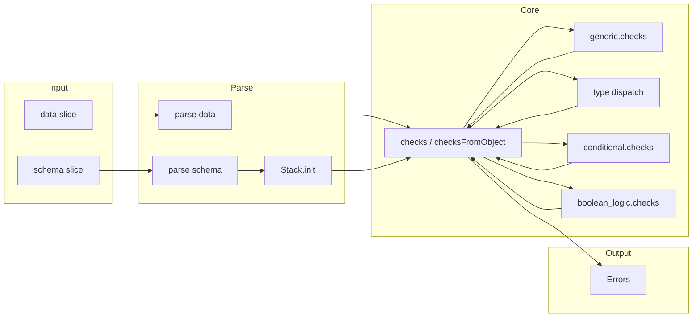
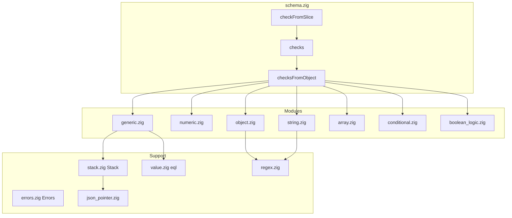

# json-schema-validator (pascalPost) — Research report

## Metadata

- **Library name**: json-schema-validator
- **Repo URL**: https://github.com/pascalPost/json-schema-validator
- **Clone path**: `research/repos/zig/pascalPost-json-schema-validator/`
- **Language**: Zig
- **License**: MIT (see [LICENSE](research/repos/zig/pascalPost-json-schema-validator/LICENSE))
- **Analyzed version**: c85fc24 2025-01-27 ("add format checks"; 62 commits; `build.zig.zon` version 0.0.0, no releases/tags)
- **Report date**: 2026-10-27

## Summary

json-schema-validator is a JSON Schema **validator** for Zig. It follows the [Two-Argument Validation](https://json-schema.org/implementers/interfaces#two-argument-validation) interface: given a schema and a JSON instance, it reports whether the instance is valid and can collect a list of validation errors. It does not generate code from schemas. The library supports Draft 07 only. Validation is implemented by parsing schema and instance, then dispatching to modular checks (generic, numeric, object, string, array, conditional, boolean logic). Reference resolution uses a stack that holds the root schema and resolves `$ref` via JSON Pointer; the README notes that definitions and ref test files are not yet passing. The code base is small (about 1,600 lines of Zig plus a 30-line C++ shim). Schema errors (unknown type, non-array `enum`, unresolvable `$ref`) abort via `panic`/`unreachable` rather than returning an error. Pattern matching uses a C++ regex implementation, requiring linkage against the C++ standard library.

## JSON Schema support

- **Drafts**: Draft 07 only. Stated in [README.md](research/repos/zig/pascalPost-json-schema-validator/README.md) and exercised by [src/test_suite.zig](research/repos/zig/pascalPost-json-schema-validator/src/test_suite.zig) (draft7 test files).
- **Scope**: Validation only. No code generation.
- **Subset**: Core applicator and validation keywords are implemented. README checklist marks as not done: definitions.json, ref.json, refRemote.json, infinite-loop-detection.json. `$ref` is implemented in code (generic.zig, stack.value) for in-document JSON Pointer resolution, but the official ref/definitions test suite is not yet enabled. `format` is not implemented: no source file reads it. The README marks format.json as done and the test runner includes it only because draft-07 treats `format` as an annotation by default, so those cases pass when it is ignored (the last commit, "add format checks", added the test file to the runner, not any logic). Meta-data keywords ($comment, title, description, default, examples, readOnly, writeOnly) are not validated. contentEncoding and contentMediaType are not implemented.

## Keyword support table

Keyword list derived from vendored draft-07 meta-schema ([specs/json-schema.org/draft-07/schema.json](specs/json-schema.org/draft-07/schema.json)). Implementation evidence from src/generic.zig, src/numeric.zig, src/object.zig, src/string.zig, src/array.zig, src/conditional.zig, src/boolean_logic.zig, src/schema.zig, and [README.md](research/repos/zig/pascalPost-json-schema-validator/README.md).

| Keyword | Implemented | Notes |
|---------|-------------|-------|
| $comment | no | Accepted in schema; not validated. |
| $id | no | Not used for resolution in code. |
| $ref | partial | generic.zig: resolves via stack.value(ref_path) (JSON Pointer from root). README lists ref.json as not done. Siblings of `$ref` are not ignored (draft-07 says they should be): type/enum/const and later modules still run. A missing target hits `unreachable` (after printing). Only `#`-prefixed pointers are supported (asserted); `$id`-relative refs are not. |
| $schema | no | Not used for draft selection. |
| additionalItems | yes | array.zig: applies schema to items beyond tuple length when items is array. |
| additionalProperties | yes | object.zig: boolean or schema; rejects or validates extra properties. |
| allOf | yes | boolean_logic.zig: all subschemas must pass. |
| anyOf | yes | boolean_logic.zig: at least one subschema must pass. |
| const | yes | generic.zig: value equality via value.zig eql. |
| contains | yes | array.zig: at least one array element must match schema. |
| contentEncoding | no | Not implemented. |
| contentMediaType | no | Not implemented. |
| default | no | Meta-data; not validated or applied. |
| definitions | no | Not loaded or used; README lists definitions.json as not done. |
| dependencies | yes | object.zig: property presence implies required keys or schema validation. |
| description | no | Meta-data; not validated. |
| else | yes | conditional.zig: applied when "if" fails. |
| enum | yes | generic.zig: instance must match one of array values (eql); no schema-side uniqueness check. |
| examples | no | Not implemented. |
| exclusiveMaximum | yes | numeric.zig: value must be &lt; exclusiveMaximum. |
| exclusiveMinimum | yes | numeric.zig: value must be &gt; exclusiveMinimum. |
| format | no | No format handling in source; format.json cases pass because format is ignored (annotation-only). |
| if | yes | conditional.zig: when present, then/else applied by condition. |
| items | yes | array.zig: single schema or array of schemas (tuple). |
| maximum | yes | numeric.zig. |
| maxItems | yes | array.zig. |
| maxLength | yes | string.zig: UTF-8 codepoint count. |
| maxProperties | yes | object.zig. |
| minimum | yes | numeric.zig. |
| minItems | yes | array.zig. |
| minLength | yes | string.zig: UTF-8 codepoint count. |
| minProperties | yes | object.zig. |
| multipleOf | yes | numeric.zig. |
| not | yes | boolean_logic.zig: instance must not validate against schema. |
| oneOf | yes | boolean_logic.zig: exactly one subschema must pass. |
| pattern | yes | string.zig: Regex (C++ backend). |
| patternProperties | yes | object.zig: regex match on property names, schema on values. |
| properties | yes | object.zig: validates known properties. |
| propertyNames | yes | object.zig: schema applied to each property name (as string). |
| readOnly | no | Not implemented. |
| required | yes | object.zig: listed keys must be present. |
| then | yes | conditional.zig: applied when "if" passes. |
| title | no | Meta-data; not validated. |
| type | yes | generic.zig: string or array of types; integer matches number with zero fractional part. |
| uniqueItems | yes | array.zig: pairwise eql check (numeric 1 and 1.0 compare equal via value.zig). |
| writeOnly | no | Not implemented. |

## Constraints

All implemented validation keywords are enforced at runtime when validating an instance. There is no code generation; constraints (minLength, minimum, pattern, multipleOf, etc.) are applied during validation. All numeric comparisons are done in `f64` (see Low-level details). Type checks include integer (including float with zero fractional part), number, string, array, object, boolean, null. String length uses UTF-8 codepoint count. Pattern is enforced via C++ regex.

## High-level architecture

Pipeline: **Schema** (JSON slice) and **Instance** (JSON slice) → **checkFromSlice(allocator, schema, data)** → parse both with std.json → **Stack.init(allocator, root_schema, capacity)** → **checks(schema_value, data_value, &stack, &errors)** → recursive dispatch by schema (boolean vs object) and by instance type (generic, numeric, string, object, array) and then conditional and boolean_logic → **Errors** (list of path + msg). No code emission; output is validity and an optional collection of errors.

## Medium-level architecture

- **Entry**: `checkFromSlice(allocator, schema: []const u8, data: []const u8) !Errors` in schema.zig parses schema and data, creates a Stack with root schema and an initial ArrayList capacity of 100 (a growth hint, not a depth limit), initializes Errors, calls `checks(schema_value, data_value, &stack, &errors)` and returns errors. Lower-level `checks(schema, data, stack, collect_errors)` and `checksFromObject(schema_object, data, stack, collect_errors)` allow early-exit (collect_errors == null) or collect-all-errors mode.
- **Stack**: stack.zig holds root schema, path_buffer (segment names), and data (path_len or index). Used to build JSON Pointer-style paths for errors and to resolve **$ref**: `stack.value(abs_path)` (json_pointer.zig PathDecoderUnmanaged) resolves a path (e.g. "#/definitions/foo") against the root. So $ref is in-document only; no remote refs, no preloading of definitions from a separate structure.
- **Dispatch order in checksFromObject**: generic.checks first ($ref, type, enum, const), then type-specific: numeric (integer/float), string, object, array. Then conditional.checks (if/then/else), then boolean_logic.checks (allOf, anyOf, oneOf, not).
- **Modules**: generic.zig (type, enum, const, $ref), numeric.zig (maximum, minimum, exclusiveMaximum, exclusiveMinimum, multipleOf), string.zig (maxLength, minLength, pattern), object.zig (properties, additionalProperties, patternProperties, required, propertyNames, dependencies, minProperties, maxProperties), array.zig (items, additionalItems, minItems, maxItems, uniqueItems, contains), conditional.zig (if, then, else), boolean_logic.zig (allOf, anyOf, oneOf, not). Errors hold path + msg per error; path built via stack.constructPath (JSON Pointer style with # prefix).

## Algorithms and data structures

The whole library is a direct, uncompiled interpreter over `std.json.Value` trees. There is no IR, no registry and no cache; every call walks the raw schema tree alongside the instance tree.

### Schema representation

The schema is whatever `std.json.parseFromSlice(std.json.Value, ...)` produces in `checkFromSlice` (`src/schema.zig`): a tagged union (`null`, `bool`, `integer: i64`, `float: f64`, `number_string`, `string`, `array: ArrayList(Value)`, `object: ObjectMap`). `ObjectMap` is `StringArrayHashMap(Value)`, so keyword lookup is a hash lookup (`node.get("minLength")`) and iteration is in document (insertion) order. There is no typed keyword struct: keywords are looked up by string literal at every visit, unknown keywords are simply never asked for, and boolean schemas are the `.bool` arm handled in `schema.checks`. Any schema value that is neither object nor bool hits `std.debug.panic`. Ownership: the parsed schema and instance live in an arena owned by the `Parsed` handle inside `checkFromSlice` and are freed (`defer ...deinit()`) when it returns; the returned `Errors` therefore must not borrow from them, which is why every message and path is allocated in the `Errors` arena. The lower-level `checks`/`checksFromObject` API takes borrowed `Value`s and a `*Stack` whose `root` is a copy of the root `Value` (shallow, it aliases the same maps).

### Reference resolution and registry

There is no registry, no base-URI tracking, no `$id`/`$anchor` handling and no remote loading. `$ref` is handled at the top of `generic.checks` (`src/generic.zig`): `stack.value(ref.string)` resolves the string as a JSON Pointer against `Stack.root` on every visit (lazy, uncached). `Stack.value` (`src/stack.zig`) asserts the string starts with `#`, returns `root` for `#`, otherwise iterates `std.fs.path.componentIterator(abs_path[1..])` (a filesystem path splitter, so separator semantics are platform path rules rather than pure `/` splitting) and for each component decodes it with `json_pointer.PathDecoderUnmanaged.decode` and descends into the object (`get`) or array (`parseInt` index). Two defects in that walk: the `.array` arm `return`s `array.items[idx]` immediately, so any pointer component after an array index is ignored; and a missing key prints to stderr and returns `null`, which the caller turns into `unreachable` (illegal behavior in safe builds, undefined in ReleaseFast). Cost per `$ref` is O(pointer length) hash lookups plus a decode. Cycles are not detected: a self-referencing `$ref` recurses until the native stack overflows (`infinite-loop-detection.json` is unchecked in the README). Siblings of `$ref` are not ignored: after the ref target passes, `type`/`enum`/`const` and all later modules still run on the same node.

### Compiled / intermediate form

Not applicable: nothing is lowered. The "program" is the JSON tree itself and the control flow is the fixed module call sequence in `checksFromObject`. The only auxiliary structure is `Stack`, a path tracker (next sections), which is not a compiled form.

### Core algorithm

`schema.checksFromObject(schema, data, stack, collect_errors)` returns `ErrorSet!bool` and runs, in fixed order: `generic.checks` ($ref, type, enum, const); a `switch` on the instance tag (`numeric.checks(i64|f64)` via comptime-generic `T`, `string.checks`, `object.checks`, `array.checks`; booleans/null fall through); `conditional.checks`; `boolean_logic.checks`. Keywords are thus dispatched by instance type first and keyword presence second: a keyword that does not apply to the instance type is never read.

The single `collect_errors: ?*Errors` parameter encodes two modes. With `null` it is a boolean fast path: each module does `else return false` on the first violation and the caller propagates `if (!try X and collect_errors == null) return false`. With a non-null pointer it appends an `Error` and keeps going so all violations are gathered; the final value is `errors.empty()`. In collect mode nested subschema results still propagate a bool but not all of them early-return (e.g. `$ref` failure returns false at once even in collect mode, after its errors were recorded).

Applicators: `properties` iterates the schema's `properties` map and looks each name up in the instance (O(schema props)); `patternProperties` compiles each pattern then scans all instance keys (O(patterns x keys)); `additionalProperties` loops over instance keys, skipping those in `properties` (`contains`) or matching any pattern (a regex is re-created per key per pattern); `required`, `propertyNames`, `dependencies` (array form checks presence, other forms run `schema.checks`). `items` handles schema, tuple array and boolean, `additionalItems` applies past the tuple length, `contains` scans for any passing element (`checks(..., null)`), `uniqueItems` is a brute-force pairwise `eql` loop, O(n^2) in array length with deep comparisons, and in collect mode it appends one error per equal pair rather than one per array. `allOf`/`anyOf`/`oneOf`/`not`/`if`/`then`/`else` evaluate subschemas with `collect_errors = null`, so only the verdict, never the sub-errors, is reported; `anyOf` breaks at the first pass; `oneOf` in early mode returns on the second pass, in collect mode appends an error and keeps scanning; `if` is evaluated once and exactly one of `then`/`else` is run. A bug of note: in `array.checks`, `items: true` executes `return true`, skipping `additionalItems`/`maxItems`/`minItems`/`uniqueItems`/`contains` for that node; `minItems`/`maxItems` additionally `assert(count > 0)`, so a legal value of 0 aborts in safe builds. There is no annotation tracking (draft-07 has no `unevaluated*`).

Value equality (`src/value.zig` `eql`): numbers are converted to `f64` and compared, so `1` equals `1.0`; other types require equal tags; arrays compare element-wise and objects by count plus keyed lookup (order-insensitive); recursion is literal (depth bounded by instance depth). Used by `enum`, `const` and `uniqueItems`.

### Error and output model

`Errors` (`src/errors.zig`) is `{ arena: ArenaAllocator, data: ArrayListUnmanaged(Error) }` with `Error = { path: []const u8, msg: []const u8 }`. Everything (message text via `allocPrint`, path strings) is allocated in the arena, making `deinit` a single free. Success is `errors.empty()`. There is no error code, keyword name, or schema path field: the `path` is built by `Stack.constructPath` and reflects a mix of schema and instance positions (it pushes keyword names like `properties`, `allOf`, `$ref`, property names and array indices into one pointer), so it is a trace of traversal steps, not a clean instance location. `Stack` stores `data: ArrayList(Storage)` where `Storage` is a union of `path_len` (length of a segment kept contiguously in `path_buffer: ArrayList(u8)`) or `index`; `pushPath` appends bytes and a length marker, `pop` truncates the buffer by that length. Push/pop are O(segment). `constructPath` materialises the string only when an error is emitted (lazy), walking all entries in O(depth + bytes) into a fresh `ArrayList(u8)` (a `TODO performance can be enhanced!` is in the source). Segments are not RFC 6901 escaped when written. Schema errors (non-array `enum`, unknown `type`, malformed numeric keywords) are not returned in the error list; they `panic`/`unreachable`/`assert`. The error set (`ErrorSet`) only contains allocation, int-parse and pointer-syntax errors.

## Low-level details

- **Numeric representation**: `numeric.checks` converts both `i64` and `f64` instance values to `f64` and compares against bounds also converted to `f64`; `i64` values above 2^53 lose precision. `multipleOf` is `isMultipleOf(n, m)`: `res = n / m`, then tests `@floatFromInt(lossyCast(i64, res)) == res`. `lossyCast` saturates, so very large quotients are misclassified, and non-binary-representable divisors (e.g. 0.01) suffer float error. `multipleOf <= 0` panics. `integer` type accepts a `float` with zero fractional part via `numeric.floatToInteger`. `number_string` Values (what std.json yields for integers that do not fit `i64`, per std.json behavior; not verified here) hit `unreachable` in numeric, `eql`, and length code.
- **String length**: `string.lengthCheck` uses `std.unicode.utf8CountCodepoints` (code points, not bytes/UTF-16) and panics on invalid UTF-8; error messages, however, report `data.len` (bytes). `minLength`/`maxLength` accept an integral float, otherwise panic as a schema error.
- **Object count messages**: `minProperties`/`maxProperties` error texts are swapped ("more than maximum" is emitted for the min check, "lenn than minimum" for max).
- **Regex failure mode**: `regex.cpp createRegex` returns `nullptr` on a bad pattern (caught `std::regex_error`), but `regex.zig` declares the extern as returning a non-optional `*RegexWrapper`; `matchRegex` guards null and returns false, so an invalid pattern silently never matches (a `pattern` always fails, `additionalProperties`/`patternProperties` never match). Matching is `std::regex_search` (unanchored, ECMAScript grammar of libstdc++/libc++), over bytes of UTF-8, with a `std::string` copy of the subject per call; exceptions (e.g. complexity errors) are mapped to false.
- **Misc**: `checkFromSlice` asserts the instance root is an object. `type` array/enum arrays are scanned linearly. `uniqueItems` compare `1` and `1.0` equal. Recursion is native (schema depth x instance depth); no depth limit, so adversarial or recursive-ref input can overflow the stack.
- **Pointer decoding**: `PathDecoderUnmanaged.decode` first calls `decodeSlashTilde` (`~0`/`~1`, error `InvalidPointerSyntax` on other `~` forms), which always appends the trailing tail into `buffer`; `percentDecoding` then sees a non-empty buffer and runs `std.Uri.percentDecodeInPlace` on it. The scan-for-`%XX` branch is therefore only reachable for an empty path, and its comment ("if not present buffer.len == 0") does not match behavior.
- **Integer vs number**: `generic.checkType` is a chain of `std.mem.eql` string compares on the `type` name per visit; unknown type names panic.
- **Draft semantics gaps**: no `$id` scope, no `definitions` indexing (only pointer reachability), `format` ignored.

## Output and integration

- **Vendored vs build-dir**: N/A. No generated output; library only validates.
- **API vs CLI**: Library only. Public API: `checkFromSlice(allocator, schema_slice, data_slice) !Errors`, and (for reuse) `checks` / `checksFromObject` with Stack and optional Errors. No CLI in the clone.
- **Writer model**: N/A. Validation result is in-memory (bool or Errors).

## Configuration

- Allocator must be provided by the caller (checkFromSlice, Stack.init, Errors.init). No configuration options for validation behavior (e.g. strict format) in the code. collect_errors: null means early exit on first failure; non-null collects all errors. The Stack capacity of 100 in checkFromSlice is only the initial reservation of the path buffer and entry list; both grow on demand.

## Pros/cons

- **Pros**: Clear Two-Argument Validation interface; modular Zig layout; draft-07 test suite wired (with submodule); supports both early-exit and collect-all-errors; UTF-8-aware string length; JSON Pointer path in errors.
- **Cons**: Draft 07 only; C++ dependency for regex; definitions and ref test files not passing per README; no format validation; no remote $ref; no CLI.

## Testability

- **Unit tests**: In-tree tests in schema.zig (basic example, complex object), stack.zig (stack path and value resolution). [src/tests.zig](research/repos/zig/pascalPost-json-schema-validator/src/tests.zig) runs all tests via `_ = @import(...)` for schema, stack, regex, test_suite, json_pointer.
- **Test suite**: [src/test_suite.zig](research/repos/zig/pascalPost-json-schema-validator/src/test_suite.zig) runs JSON-Schema-Test-Suite draft-07 tests from path `JSON-Schema-Test-Suite/tests/draft7` (submodule [.gitmodules](research/repos/zig/pascalPost-json-schema-validator/.gitmodules)). For each listed JSON file, it parses cases and runs each test in two modes: early return (collect_errors = null) and collect all errors; runTest compares expected valid vs actual. ref.json is commented out in the file list; the same `Stack` is reused for both modes of a test; definitions, refRemote, infinite-loop-detection are absent. No optional/ (bignum, format, ecmascript-regex) suites are run. Zig CI uses `version: "latest"` (build.zig uses the older `addStaticLibrary` API and `std.json.stringify`, so it targets an older Zig and may not build on current Zig; not verified).
- **How to run**: `zig build test`. CI ([.github/workflows/zig.yml](research/repos/zig/pascalPost-json-schema-validator/.github/workflows/zig.yml)) checks out with submodules and runs `zig build test`.

## Performance

Analysis by code reading only; nothing was built or run. The design is a naive tree-walking interpreter with a few deliberate boolean fast paths and several clearly unoptimised hot spots.

### Performance techniques

- **Compile vs interpret**: None. Nothing is precomputed from the schema: keywords are re-looked-up with string-keyed hash lookups on every node visit, `$ref` is re-resolved through a pointer walk on every visit, and regexes are re-compiled per use. Zig `comptime` is used only for type specialisation (`numeric.checks(comptime T, ...)`, `checkMinOrMaxProperties(comptime check, ...)`) and the static `allChecks` function-pointer table in `numeric.zig`, which avoids code duplication rather than precomputing schema work.
- **Memory layout and allocation**: Schema and instance are parsed into `std.json.Value` trees (pointer-rich, `ArrayList`/`StringArrayHashMap`) and walked in place by borrowing, so validation itself does not clone values. The path `Stack` keeps all segment bytes in one `ArrayList(u8)` plus an `ArrayList(Storage)` of lengths/indices, so push/pop are amortised O(1) appends/truncations without per-segment allocation, and paths are built only when an error is recorded (lazy). In collect mode every message/path is `allocPrint`ed into one `ArenaAllocator`, avoiding individual frees. The `PathDecoder` reuses one buffer (`clearRetainingCapacity`). Negative points: `regex.matchRegex` copies the subject into a `std::string`; `std.json.stringify` of the enum is built into every enum error; `constructPath` allocates a new list per error.
- **Caching and memoization**: None. No compiled-schema cache, no resolved-`$ref` cache, no regex cache, no format cache.
- **Fast paths and short-circuiting**: `collect_errors == null` selects a first-failure-returns path through every module (the main fast path). `anyOf` breaks on first success, `contains` breaks on first match, `oneOf` returns on the second success in early mode, subschemas of `allOf`/`anyOf`/`oneOf`/`not`/`if`/`dependencies`/`propertyNames` are always evaluated in early-exit mode (cheaper, but loses their errors). Keyword application is instance-type-driven, so string keywords are never read for non-strings. `properties` walks the schema side and probes the instance map. Anti-patterns: `uniqueItems` is O(n^2) deep-compares (the source notes a hash table "might be more efficient"); `additionalProperties` is O(keys x patterns) regex compilations; `patternProperties` compiles each pattern once per object instance.
- **Regex handling**: C++ `std::regex` via a C ABI shim (`src/regex.zig` / `src/regex.cpp`), ECMAScript grammar. `Regex.init`/`deinit` (a heap `new`/`delete`) are executed on every `pattern` check, every `patternProperties` entry per object, and per key per pattern in `additionalProperties`. No caching and no ReDoS protection: `std::regex` is backtracking and known for slow and stack-heavy matching on pathological patterns; exceptions are swallowed into "no match".
- **Concurrency**: No threads, locks or atomics. `Stack` and `Errors` are mutable per-call state passed by pointer, so concurrent validations need separate `Stack`/`Errors`; since the schema `Value` is only read, sharing a parsed schema across threads would appear safe, but `Stack.value` mutates the shared `decoder` buffer (belongs to the per-call `Stack`). Not verified by running.

### Benchmarks in repo

None. No benchmark target in `build.zig`, no bench fixtures. Entry points for an external harness: `schema.checkFromSlice(allocator, schema_slice, data_slice) !Errors` (parses both per call, instance root must be an object, so it includes parse cost) or `schema.checks(schema_value, data_value, &stack, null)` for pure boolean validation on pre-parsed values (as `src/test_suite.zig` does). The C++ standard library must be linked.

## Determinism and idempotency

- **Validation result**: For the same schema and instance, validation outcome (valid/invalid and the set of errors) is deterministic. Error order follows the fixed module order (generic, type dispatch, conditional, boolean_logic) and, inside modules, hard-coded keyword order; `std.json.ObjectMap` is an insertion-ordered array hash map, so iteration over `properties`/`patternProperties` and instance keys follows document order. No unordered containers or randomness are involved. Allocator and arena behavior do not affect results.
- **Idempotency**: N/A (no generated output). Repeated validation with the same inputs yields the same result.

## Enum handling

- **Implementation**: generic.zig: enum value must be an array; instance is compared to each element using value.zig eql. No deduplication or uniqueness check on the schema enum array (comment in code: "we do not check if items.len > 0 and that elements are unique").
- **Duplicate entries**: Duplicate values in the enum array are allowed; validation passes if instance matches any element; duplicates do not change behavior.
- **Namespace/case collisions**: Comparison is by value (eql); distinct values such as "a" and "A" are both allowed; no name mangling (validation only).

## Reverse generation (Schema from types)

No. The library only validates instances against JSON Schema. There is no facility to generate JSON Schema from Zig types.

## Multi-language output

N/A. The library does not generate code; it only validates. Output is validation result and errors in Zig (Errors struct).

## Model deduplication and $ref/$defs

N/A for code generation. For validation: **$ref** is resolved in generic.zig via stack.value(ref_path), where ref_path is the value of the $ref keyword (e.g. "#/definitions/foo"). The Stack holds the root schema; value() uses JSON Pointer semantics (path decoder in json_pointer.zig) to resolve against the root. **definitions** (draft-07) are not explicitly loaded or indexed; resolution works only if the ref path exists in the root document (e.g. #/definitions/MyType). README states definitions.json and ref.json are not done, so the test suite coverage for ref/definitions is incomplete (e.g. scope or $id-relative refs may be missing). No remote refs; no $dynamicRef/$dynamicAnchor (draft-07 does not define them).

## Validation (schema + JSON → errors)

Yes. This is the library’s primary function.

- **Inputs**: Schema and instance as JSON slices ([]const u8), or at lower level parsed std.json.Value with Stack and optional Errors.
- **API**: `checkFromSlice(allocator, schema, data) !Errors` returns an Errors instance; `errors.empty()` is true when valid. With `checks(..., collect_errors = null)` the result is a boolean (early exit). With `checks(..., collect_errors = &errors)` all errors are collected.
- **Output**: Errors contains zero or more entries; each has `path` (JSON Pointer-style with '#') and `msg` (string). Caller must call errors.deinit().
- **CLI**: None in the repo.
