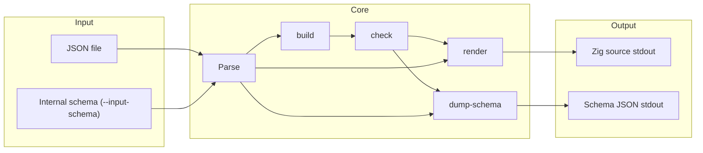
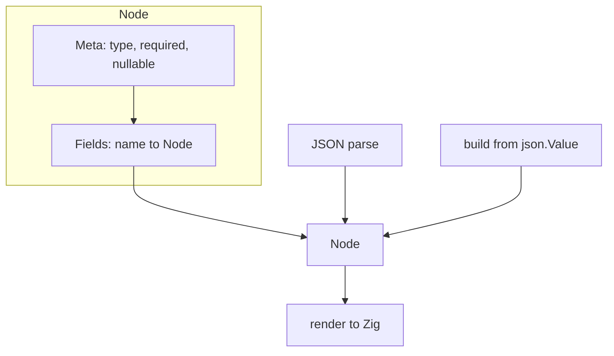

# json-schema-gen — Research report

## Metadata

- **Library name**: json-schema-gen
- **Repo URL**: https://github.com/travisstaloch/json-schema-gen
- **Clone path**: `research/repos/zig/travisstaloch-json-schema-gen/`
- **Language**: Zig
- **License**: MIT (see LICENSE, Copyright (c) 2024 travisstaloch)
- **Analyzed version**: b275361 2025-03-05 ("chore: update to zig version 0.14.0"); `build.zig.zon` version 0.0.0, minimum Zig 0.14.0, no tagged releases or CHANGELOG
- **Report date**: 2026-10-27

## Summary

json-schema-gen is a Zig tool that takes sample JSON as input and emits Zig code defining types that can parse that JSON via `std.json.parseFromTokenSource`. The primary flow is JSON sample → inferred internal schema → generated Zig (structs, unions, optionals, arrays). It does not accept standard JSON Schema (draft-04, 2019-09, 2020-12) as input. Optionally, it can round-trip its own internal schema format: `--dump-schema` writes the inferred schema as JSON, and `--input-schema` reads that format back and skips the build phase. Motivation (per README): using concrete generated types is typically faster and uses less memory than parsing into `std.json.Value`, and gives cleaner access (e.g. `parsed.value.items[0].commits_url` instead of chained `.object.get`/`.array.items`). Output is Zig only; there is no validation (schema + JSON → errors).

## JSON Schema support

The library does **not** target any JSON Schema draft. It does not read or validate standard JSON Schema documents. Input is either (1) arbitrary JSON, from which it infers an internal schema (a tree of nodes with type, required, nullable, and child fields), or (2) its own dumped schema format (the serialized internal `Node` structure: an object with a `__meta__` entry holding `type` (array of `std.json.Value` tag names such as `object`, `integer`, `float`), `required`, `nullable`, plus one entry per child field keyed directly by field name; `__fields__` is only a reserved name, not emitted by the Zig implementation). Note `max_field_count` is not serialized, so union detection is lost when round-tripping via `--input-schema`. The README phrase "Generate a zig schema from a json schema" refers to this internal format (dump from JSON then re-feed with `--input-schema`), not to draft-04/2019-09/2020-12.

## Keyword support table

Keyword list derived from the vendored draft 2020-12 meta-schemas (`specs/json-schema.org/draft/2020-12/meta/`: core, applicator, unevaluated, validation, meta-data, format-annotation, content); 56 keywords, verified by grep of `src/` to have no handling of any of them except the internal `type`/`required` names below. The library does not parse standard JSON Schema; implementation status reflects that. The internal format only has concepts that loosely map to type, required, and nullable (inferred from sample JSON or from the dumped schema).

| Keyword | Implemented | Notes |
|---------|-------------|-------|
| $anchor | no | Not applicable; no standard schema input. |
| $comment | no | Not applicable. |
| $defs | no | Not applicable. |
| $dynamicAnchor | no | Not applicable. |
| $dynamicRef | no | Not applicable. |
| $id | no | Not applicable. |
| $ref | no | Not applicable. |
| $schema | no | Not applicable. |
| $vocabulary | no | Not applicable. |
| additionalProperties | no | Not applicable. |
| allOf | no | Not applicable. |
| anyOf | no | Not applicable. |
| const | no | Not applicable. |
| contains | no | Not applicable. |
| contentEncoding | no | Not applicable. |
| contentMediaType | no | Not applicable. |
| contentSchema | no | Not applicable. |
| default | no | Not applicable. |
| dependentRequired | no | Not applicable. |
| dependentSchemas | no | Not applicable. |
| deprecated | no | Not applicable. |
| description | no | Not applicable. |
| else | no | Not applicable. |
| enum | no | Not applicable; mixed inferred types become std.json.Value. |
| examples | no | Not applicable. |
| exclusiveMaximum | no | Not applicable. |
| exclusiveMinimum | no | Not applicable. |
| format | no | Not applicable. |
| if | no | Not applicable. |
| items | no | Not applicable; array element shape inferred and merged in build(). |
| maxContains | no | Not applicable. |
| maximum | no | Not applicable. |
| maxItems | no | Not applicable. |
| maxLength | no | Not applicable. |
| maxProperties | no | Not applicable. |
| minContains | no | Not applicable. |
| minimum | no | Not applicable. |
| minItems | no | Not applicable. |
| minLength | no | Not applicable. |
| minProperties | no | Not applicable. |
| multipleOf | no | Not applicable. |
| not | no | Not applicable. |
| oneOf | no | Not applicable. |
| pattern | no | Not applicable. |
| patternProperties | no | Not applicable. |
| prefixItems | no | Not applicable. |
| properties | no | Not applicable; object keys inferred from sample JSON. |
| propertyNames | no | Not applicable. |
| readOnly | no | Not applicable. |
| required | partial | Concept only: internal Meta.required (field present in all samples) maps to optional vs required in Zig; not JSON Schema keyword. |
| then | no | Not applicable. |
| title | no | Not applicable. |
| type | partial | Concept only: internal Meta.type (set of JSON value tags) drives Zig type; not JSON Schema type keyword. |
| unevaluatedItems | no | Not applicable. |
| unevaluatedProperties | no | Not applicable. |
| uniqueItems | no | Not applicable. |
| writeOnly | no | Not applicable. |

## Constraints

Generated Zig code does not enforce any validation keywords. The tool generates types for **parsing** only; there is no runtime validation of minLength, minimum, pattern, etc. Constraints are not reflected in the generated code.

## High-level architecture

Pipeline: **JSON file** (or internal schema with `--input-schema`) → **parse** (fully into `std.json.Value`, or into `Node` via its custom `jsonParse`) → **build** (only when not `--input-schema`: traverse JSON, merge types and fields into a `Node` tree) → **check** (only when not `--input-schema`: set `required` to false for fields not present in every object, normalize null into nullable) → **render** (walk `Node`, emit Zig source to writer) or **dump-schema** (print Node as JSON). Output is written to stdout (or captured by the build system). The build system can run the generator, capture stdout as a Zig module, and pass that module to a consumer (e.g. parse-json-with-gen-schema or tests).



## Medium-level architecture

- **Entry**: `main()` in `json-to-zig-schema.zig` parses CLI args (path, `--debug-json`, `--dump-schema`, `--input-schema`, `--include-test`, `-h`/`--help`), opens the file, and calls `parseBuildRender(alloc, reader, writer, opts)`.
- **parseBuildRender**: If `opts.input_schema`, parses token source as `Node` (internal schema), then either dumps that node or calls `node.render(writer, opts)`. Otherwise, parses as `json.Value`, builds a fresh `Node` via `node.build(alloc, value)`, runs `node.check(value)`, then dump or render.
- **Node**: Tree of nodes; each has `meta: Meta` (type set, required, nullable), `max_field_count` (largest object key count seen, used for union detection) and `fields: Fields` (StringArrayHashMapUnmanaged of name → Node). Reserved keys `__meta__` and `__fields__` cannot be used as JSON object keys. Array elements are merged into the same Node (build visits each element and merges).
- **Meta**: `type` is an EnumSet of `std.json.Value` tags (object, array, string, integer, float, bool, null); `required` and `nullable` are booleans.
- **Ref resolution**: None. There is no `$ref` or `$defs`; the internal format is a single tree.
- **Source files**: `src/json-to-zig-schema.zig` (441 lines; all logic: CLI, `Node`/`Meta`, `build`, `check`, `renderImpl`, `render`, `parseBuildRender`), `src/json-helper.zig` (comptime `JsonParse(Self)` helper embedded verbatim into output for `--debug-json`), `src/main.zig` (verifier exe that parses the sample with the generated `Root`), `src/wasm.zig` (WASM export), `src/tests.zig`, and a legacy `src/json-to-zig-schema.py` (146 lines).



## Algorithms and data structures

The whole tool is one ~440-line Zig file. It is a type-inference pass over a sample document, not a schema compiler.

### Schema representation

There is no JSON Schema model. The only schema-like structure is `Node` (`src/json-to-zig-schema.zig`):

```zig
const Node = struct {
    meta: Meta = .{},          // type set + required + nullable
    max_field_count: usize = 0,
    fields: Fields = .{},      // std.StringArrayHashMapUnmanaged(Node)
};
const Type = std.enums.EnumSet(std.meta.Tag(json.Value));
```

`Meta.type` is a bit set (`EnumSet`) over the tags of `std.json.Value` (`null, bool, integer, float, number_string, string, array, object`), so "which JSON kinds were seen at this position" is one machine word, insertion is idempotent and iteration order is by tag order, not encounter order. `fields` is an insertion-ordered hash map from key to child `Node`; a single `Node` therefore stands for *every* value observed at a path. There is exactly one child per key and no separate "items" node: array elements are merged into the array's own `Node` (see Core algorithm). `Meta.required` defaults to `true` and `nullable` to `false`. Keys in `fields` are borrowed slices from the parsed `json.Value` (`getOrPut(alloc, k)` does not dupe), so the `Node` lives no longer than the parsed value; `node.deinit` frees only the maps. In `--input-schema` mode `Node.jsonParse` builds the tree directly with keys from the token source; there the whole result lives in the arena owned by `parseFromTokenSource`'s `Parsed` and is never separately deinited.

The serialized form (`Node.jsonStringify` / `Node.jsonParse` / `Meta.jsonParse`) is a JSON object whose reserved key `__meta__` holds `{type:[tag names], required, nullable}` and whose other keys are child fields. `max_field_count` is not serialized (not even in the dump), so a round-tripped schema never renders `union(enum)`. `Meta.jsonParse` rejects unknown keys and unknown type names with `error.UnexpectedToken`. `__fields__` is reserved in `reserved_fields` (also rejected as a sample key) but is never written or read.

### Reference resolution and registry

Not applicable. There is no `$ref`, `$id`, `$anchor`, no registry and no remote fetching; the schema is a finite tree built from a finite JSON document, so there are no cycles.

### Compiled / intermediate form

The intermediate form is the `Node` tree itself. It is produced by `build`/`check` (or deserialized) and consumed by `renderImpl`, which writes Zig source text directly to a writer; there is no further IR, no type graph, no naming table. Nested objects are emitted as anonymous inline `struct { ... }` / `union(enum) { ... }` expressions, the only named declaration is `pub const Root`. `--debug-json` injects `pub const jsonParse = JsonParse(@This()).jsonParse;` into each struct and appends the text of `src/json-helper.zig` (via `@embedFile`, truncated at the last `const std` with `comptime mem.lastIndexOf`) so the generated file is self-contained.

### Core algorithm

1. **Parse.** `parseBuildRender` creates `json.reader(alloc, reader)` and calls `parseFromTokenSource(json.Value, ...)`, materializing the whole sample as a `std.json.Value` tree (not streaming). Object keys keep source order because `json.ObjectMap` is a `StringArrayHashMap`.
2. **`build(node, alloc, json_node)`** (recursive over the Value): `node.meta.type.insert(json_node)` (a tagged union coerces to its tag), then `node.meta.nullable = json_node == .null` (assignment, so the last visited value decides this flag, not an OR). For `.array`, every element is built into the *same* `node` (arrays are flattened: `[[1,2],[3]]` yields one node with types `{array, integer}`, losing nesting depth). For `.object`, `max_field_count = max(max_field_count, o.count())`; each key is checked against `reserved_fields` (linear scan; `error.NameConflict` on `__meta__`/`__fields__`), then `fields.getOrPut` and recursion into the child. Total cost is O(nodes) hash operations; keys across array elements merge by name.
3. **`check(node, json_node)`**: a second recursive walk of the same Value. At each visit, if the node's type set has exactly two members and one is null, it removes null and sets `nullable = true`. For objects it marks every child key *absent from this object* as `required = false` (`for node.fields.keys() ... o.contains(k)`), then recurses into present children. Cost O(sum over objects of |node.fields|) plus map lookups. Because absence is only evaluated for objects actually seen, a child that is never visited (e.g. under an absent parent) keeps its default and the parent carries optionality instead. Nodes with 3+ types are left alone.
4. **`renderImpl(node, depth, writer, opts, parent_is_union)`**: recursive pretty-printer, branch order:
   - `is_union = max_field_count == 1 and fields.count() > 1`; the optional marker `?` is emitted when `!parent_is_union and (nullable or !required)`.
   - type set has `array` but not `object`: write `[]const `, **remove `.array` from the set (mutation)**, recurse on the same node. This is how nested element types come out and why `[[1]]` yields `[]const i64` (wrong shape for the real data).
   - type set has `object`: write `?`, optionally `[]const ` (if array also seen), then `union(enum) {` or `struct {`, then one `name: <type>,` line per field (recursing with `depth+1`), ` = null` after optional fields in structs (not unions), four-space indentation via `depth*4`. Any non-object/array types in the same set (e.g. `{object,string}`) are silently dropped.
   - empty type set: `?u0`.
   - one type: `[]const u8`, `i64`, `f64`, `bool` (with `?` prefix), or `?u0` for null. A single `number_string` tag matches no branch and emits nothing.
   - two types incl. null: set nullable, remove null (mutation), recurse; otherwise `std.json.Value` (with `?` if applicable). `integer` + `float` therefore becomes `std.json.Value`, not `f64`.
   - a field whose child type count is 0 (only `[]`/empty seen) is rendered `[]const struct{}`.
5. **Union rule.** The `max_field_count == 1` heuristic means that if every sampled object has at most one key and more than one distinct key was seen, the shape is a tagged union with one variant per key; it is a pure heuristic (one object with two keys flips the node to `struct`, with all fields optional).

Field names are written raw with `{2s}`; there is no quoting with `@"..."`, no escaping and no check for Zig keywords, so keys that are Zig keywords or non-identifiers (`error`, `fn`, `a-b`) would produce uncompilable output. Not verified by execution; derived from the print call in `renderImpl`.

### Error and output model

Errors are plain Zig error unions (`error.NameConflict`, `error.UnexpectedToken`, parse errors from `std.json`, `error.MissingJsonPath`, `error.UnexpectedArgument`) with `std.log.err` messages; there is no instance/schema path tracking. `main` prints usage via `std.debug.print`. Output is text written to any writer: stdout in the CLI, a `std.ArrayList(u8)` writer in WASM (`wasm.zig`, which logs the error name through an imported `consoleLog` and returns null).

## Low-level details

- **Union vs struct**: see Core algorithm step 5. Handles arrays of objects with disjoint singleton key sets (`[{"a":1},{"b":"c"}]` -> `[]const union(enum){a: i64, b: []const u8}`, covered by the "unions" test).
- **Nullable/optional**: `[{"a":null},{"a":1}]` -> `a: ?i64` (the null is removed from the set and nullable set; test "optional instead of union with null"). `[1,null]` -> `[]const ?i64`. Because `build` assigns (not ORs) `nullable`, the flag set during build is unreliable; correctness comes from the later two-type normalization in `check` and again in `renderImpl`.
- **Numeric representation**: integers map to `i64`, floats to `f64`. The tag comes from `std.json.Value` parsing. Values too large for `i64` would be `number_string` in std's dynamic parser (std behaviour not verifiable in this clone); renderImpl has no branch for it and would emit nothing for such a node. The earlier note that the tag is "never produced" could not be confirmed.
- **Strings**: always `[]const u8`; no format/enum/length handling.
- **Render mutates the tree**: `renderImpl` removes `.array`/`.null` from type sets, so rendering twice on one `Node` is not idempotent (the CLI renders once).
- **Recursion**: `build`, `check`, `renderImpl` and `Node.jsonParse` (via `innerParse`) are literally recursive on JSON depth; `std.json` parse of the sample into `Value` is also recursive-bounded by its own limits. Deep input can exhaust the stack. No depth limit in this code.
- **Reserved names**: keys `__meta__` and `__fields__` raise `error.NameConflict` during build.
- **`--debug-json` helper**: `json-helper.zig` `JsonParse(Self)` uses `@typeInfo(Self).Struct`, so it only applies to structs; the generator also injects the declaration into `union(enum)` types (not verified to fail to compile).
- **Hardening**: none; sample is read fully into memory, no size cap.

## Output and integration

- **Vendored vs build-dir**: Generated Zig is not checked in. The build system runs the generator and captures stdout (e.g. into `.zig-cache`); that path is used as a module. User can redirect stdout to a file (e.g. `zig build json -- examples/1.json > /my/project/src/json-schema.zig`).
- **API vs CLI**: CLI only. Entry points: `zig build gen` (run json-to-zig-schema with args; stdout is generated Zig), `zig build json -- <path> [options]` (generate from JSON then run parse-json-with-gen-schema to verify). A legacy Python implementation (`src/json-to-zig-schema.py`, flags `--debug-json`/`--dump-schema` only; no `--input-schema`/`--include-test`) is retained but its invocation in `build.zig` is commented out. The generator is also exposed as a library for the WASM build: `parseBuildRender` in `json-to-zig-schema.zig` is exported from `wasm.zig` (wasm32-freestanding, wasm_allocator, fixed-buffer reader, output returned as a sentinel-terminated string, null on error) and installed as `web/lib.wasm` by `zig build`.
- **Writer model**: Generic writer: `parseBuildRender(alloc, reader, writer, opts)` writes to any writer (e.g. stdout, ArrayList(u8) for WASM).

## Configuration

- **Options** (all CLI flags): `--debug-json` (add a jsonParse helper that prints field names), `--dump-schema` (emit internal schema JSON instead of Zig), `--input-schema` (treat input as internal schema and skip build), `--include-test` (add a test skeleton with placeholders in the generated Zig).
- No config for naming convention, map types, or optional dependencies; output uses fixed Zig types (`[]const u8`, `i64`, `f64`, `bool`, `?u0`, `std.json.Value`); the struct name is always `Root`, nested types are anonymous inline `struct`/`union(enum)`.

## Pros/cons

- **Pros**: Simple pipeline (JSON → Zig); no external schema format to maintain; generated code works with `std.json`; optional round-trip of internal schema; CLI and WASM entry points; tests cover multiple example shapes including unions and optionals.
- **Cons**: Does not accept standard JSON Schema; schema is inferred from sample data only (so optional/required and types depend on what appears in the sample); mixed types fall back to `std.json.Value`; nested arrays are flattened and field names are not escaped; no validation of JSON against a schema; reserved keys `__meta__`/`__fields__` limit use of those names in JSON.

## Testability

Tests live in `src/tests.zig` (four `test` blocks: "parse examples", "unions", "optional instead of union with null", "optional 2"). `build.zig` iterates `examples/*.json` automatically (no CI config in the repo). Run with `zig build test` (with no extra args; build system passes paths and generated modules via build-options). For each `examples/*.json` (1–8), the build runs the generator, captures the generated Zig as a module (`gen_1` … `gen_8`), and the test parses the corresponding example JSON with that module and checks round-trip stringify matches the expected format. Additional tests (`src/tests.zig`) assert exact generated Zig text for examples 6, 7, 8 (unions, optional instead of union with null, optional root). New examples require adding entries to `example_mods`, `example_fmts`, and (for path/schema_path) the build step that iterates `examples/`. No separate unit tests for the generator in isolation; coverage is integration (generate + parse + stringify).

## Performance

Analysis by code reading only. The generator is a small, single-pass tool with no performance engineering; the performance claim in the README concerns the *generated* types vs `std.json.Value`, not the generator.

### Performance techniques

- **Compile vs interpret**: The product itself is ahead-of-time specialization: the sample is turned into concrete Zig types so that downstream `std.json.parseFromSlice(Root, ...)` uses comptime-specialized parsing instead of building a dynamic `Value` tree. That claim is stated in the README (unmeasured). Inside the generator there is no compilation; `build`/`check`/`renderImpl` interpret the tree each run.
- **Memory layout and allocation**: The generator holds the full `std.json.Value` tree (arena-backed via `parseFromTokenSource`) plus a `Node` tree built with the general-purpose allocator (`std.heap.GeneralPurposeAllocator`). `Node.fields` is a `StringArrayHashMapUnmanaged` (dense entry array plus optional index; linear scan for small maps), keys are borrowed rather than copied, and the type set is a single `EnumSet` bitmask (no heap). Output is written incrementally to the writer (no intermediate string tree). Nodes are stored by value inside the maps, so growth moves them (they are small).
- **Caching and memoization**: None found. (`reserved_fields` has a TODO to become a `StaticStringMap`.)
- **Fast paths and short-circuiting**: None found. `build` and `check` always walk the entire document twice; merging arrays into one node makes the work proportional to the total number of JSON values, not to the number of distinct shapes.
- **Regex handling**: Not applicable (no patterns).
- **Concurrency**: None; single-threaded. The WASM build uses `std.heap.wasm_allocator` and a fixed-buffer reader over the host-provided input.

Complexity: `build` O(N) hash lookups; `check` O(sum over objects of distinct keys seen at that node); `renderImpl` O(schema size). The key-set scan in `check` can be quadratic-ish for arrays of many objects with many distinct keys (each element iterates all keys of the merged node).

### Benchmarks in repo

None. Entry points for external benchmarking: `zig build gen -- <json-path>` or `zig-out/bin/json-to-zig-schema <json-path>` (generation); `zig build json -- <json-path>` (generate then parse); the WASM export `parseBuildRender`.

## Determinism and idempotency

Output order of object fields follows iteration over `Fields` (StringArrayHashMapUnmanaged), which preserves insertion order. Keys are inserted during build in the order encountered when traversing the JSON (object key order from the parser, which is itself insertion-ordered). Type sets are `EnumSet`s, so `--dump-schema` lists types in enum-tag order independent of encounter order; there is no hashing of pointers or time-dependent state, so output is stable. So repeated runs on the same input should produce the same Zig; reordering keys in the input could change field order in the output. No explicit sorting (e.g. alphabetical) is applied. Idempotency of the CLI: re-running on the same sample gives byte-identical output (the render step mutates the Node, but a fresh Node is built per run). Same input → same output for a given Zig version; small input changes (e.g. one extra optional field) cause localized diff in generated code.

## Enum handling

The library does not implement JSON Schema `enum`. It infers types from sample JSON; if a value could be multiple JSON types, the internal type set has multiple tags and ends up as `std.json.Value` (e.g. `[1,"a"]`, or integer plus float); union types arise only from the `max_field_count == 1` object heuristic, never from scalar value sets. String values are never turned into enums. Duplicate enum values or case collisions are not a separate concept—everything is structure inference. Unknown for explicit enum keyword behavior (not applicable).

## Reverse generation (Schema from types)

No. The library does not generate JSON Schema from Zig types. It can dump its internal schema (with `--dump-schema`) which is a custom format, not standard JSON Schema.

## Multi-language output

Zig only. Generated code is Zig (structs, unions, optionals, arrays, `std.json.Value`). No option to emit TypeScript, Go, or other languages.

## Model deduplication and $ref/$defs

There is no `$ref` or `$defs`; the tool does not read standard JSON Schema. Deduplication is structural: in `build()`, array elements are merged into a single Node (all elements contribute to the same type set and same field map). So identical object shapes in multiple array elements become one structural type. Nested arrays are also flattened into one node (`[[1],[2]]` renders as a one-dimensional slice). Inline object shapes in different branches (e.g. two different object types in the same array) are merged by key: same key names share one child Node; different keys create union or struct depending on `max_field_count`. No named definitions or reuse by reference.

## Validation (schema + JSON → errors)

No. The library only generates Zig types for parsing. It does not provide an API or CLI to validate a JSON payload against a schema and report validation errors. Input is either sample JSON (to infer schema and emit code) or the internal schema format (to emit code). There is no separate validation step.
